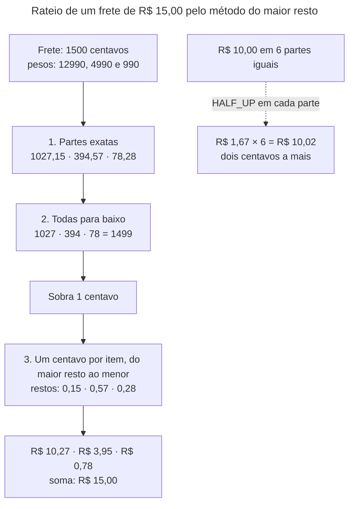

## O problema

Uma loja vende uma caneca por R$ 0,10 e um adesivo por R$ 0,20. O carrinho soma os dois:

```java
double total = 0.10 + 0.20;
System.out.println(total);            // 0.30000000000000004
System.out.println(total == 0.30);    // false
```

O total não é R$ 0,30. Arredondando na tela, ninguém percebe. Mas o total é comparado com o valor que o *gateway* de pagamento confirmou (`0.30`), a comparação falha, e o pedido fica preso em "pagamento divergente". Em outro lugar, o desconto de 10% sobre R$ 19,99 vira R$ 1,9990000000000001, e o relatório do mês fecha com uma diferença de centavos que o financeiro passa dois dias procurando.

Dinheiro tem três problemas que os outros números não têm:

- **Precisão exata.** Um centavo a mais ou a menos é um erro, e não uma aproximação.
- **Uma moeda.** `100` não é um valor: 100 reais, 100 dólares e 100 ienes são coisas diferentes.
- **Divisão sem perda.** Ratear R$ 10,00 de frete entre três itens dá R$ 3,333... por item, e alguém precisa ficar com o centavo que sobra.

Ninguém paga uma conta de "mais ou menos 129,90". No caixa, cada centavo é contado, e a nota diz em que moeda.

> **A pergunta desta página:** como representar dinheiro no JSON e no Java sem perder centavos, sem confundir moedas e sem errar no rateio?

## O conceito

### Por que não `double`

O `double` (e o `float`) guarda números em **base 2**. Assim como 1/3 não tem representação finita em base 10 (0,333...), 1/10 não tem em base 2. O valor `0.1` de um `double` é, na verdade, `0.1000000000000000055511151231257827...`: o mais próximo que 64 bits conseguem chegar. Cada operação acumula o erro.

Para medidas físicas, o erro é irrelevante. Para dinheiro, onde a resposta certa é exata e conhecida, ele é um *bug*.

O problema existe também **fora do Java**. O `JSON.parse` do JavaScript lê todo número como `double`, e a [02.06](/comecando-e-fundamentos-de-http/json-para-apis) mostrou um id grande perdendo o último dígito no navegador. Com dinheiro, um `"valor": 12345678901234567.89` chega ao app como `12345678901234568`.

### `BigDecimal`: exato, mas com regras

O `BigDecimal` guarda um número como um inteiro e uma **escala** (quantas casas depois da vírgula): `129.90` é `12990` com escala 2. Ele é exato em base 10, e as operações que podem gerar dízimas exigem que você diga como arredondar.

Três regras evitam quase todos os erros com `BigDecimal`:

**1. Crie a partir de uma string, nunca de um `double`.**

```java
new BigDecimal(0.1)       // 0.1000000000000000055511151231257827021181583404541015625
new BigDecimal("0.1")     // 0.1
BigDecimal.valueOf(0.1)   // 0.1 (passa pelo Double.toString: funciona, mas o double já existiu)
```

**2. `equals` compara a escala; `compareTo`, só o valor.**

```java
new BigDecimal("129.9").equals(new BigDecimal("129.90"))          // false
new BigDecimal("129.9").compareTo(new BigDecimal("129.90")) == 0  // true
```

Isso afeta tudo que usa `equals`: um `HashSet<BigDecimal>`, um `record` com um campo `BigDecimal`, o `assertEquals` de um teste. A saída é comparar com `compareTo` ou, melhor, **fixar a escala** para que valores iguais tenham a mesma representação.

**3. Divisões precisam de um `RoundingMode`.**

```java
new BigDecimal("10.00").divide(new BigDecimal("3"))
// ArithmeticException: Non-terminating decimal expansion

new BigDecimal("10.00").divide(new BigDecimal("3"), 2, RoundingMode.HALF_EVEN)   // 3.33
```

Os modos que importam para dinheiro:

| `RoundingMode` | 2,345 → | 2,355 → | Uso |
|---|---|---|---|
| `HALF_UP` | 2,35 | 2,36 | O "arredondamento da escola" |
| `HALF_EVEN` | 2,34 | 2,36 | Arredondamento bancário: o empate vai para o par, e os erros se compensam numa soma longa |
| `DOWN` | 2,34 | 2,35 | Truncar: útil no rateio, antes de distribuir o resto |
| `UNNECESSARY` | exceção | exceção | Afirma que não há arredondamento: falha se houver |

Qual usar é uma **regra de negócio**, às vezes definida em lei ou em contrato (impostos têm regras próprias). O que não pode acontecer é o arredondamento ser implícito.

### Uma moeda para cada valor

A moeda é parte do valor, e não um detalhe de exibição. O padrão é o **ISO 4217**, com códigos de três letras: `BRL`, `USD`, `EUR`, `JPY`. O Google exige os códigos padronizados (AIP-143: `currency_code` em ISO 4217), e a Zalando também.

A norma também diz **quantas casas decimais** cada moeda tem, e não são sempre duas:

| Moeda | Casas | Exemplo |
|---|---|---|
| Real (`BRL`) | 2 | 129,90 |
| Iene (`JPY`) | 0 | 1500 |
| Dinar do Bahrein (`BHD`) | 3 | 12,500 |

O Java já sabe disso: `Currency.getInstance("JPY").getDefaultFractionDigits()` devolve `0`. Um código que assume duas casas para todas as moedas está errado para o iene.

### Dinheiro no JSON: quatro formatos

Não há um formato padrão para dinheiro em JSON, e os grandes guias escolheram formatos diferentes:

| Formato | Exemplo | Quem usa | A favor | Contra |
|---|---|---|---|---|
| **Inteiro em unidades menores** | `{ "amount": 12990, "currency": "brl" }` | Stripe; a v1 do Bazar (`precoEmCentavos`) | Inteiro: nenhum problema de precisão em nenhuma linguagem | Exige saber as casas de cada moeda para mostrar; frações de centavo impossíveis |
| **Número decimal + moeda** | `{ "amount": 129.90, "currency": "BRL" }` | Zalando (regra 173, *MUST*) | Legível; o valor é o valor | Clientes que leem números como `double` (JavaScript) perdem precisão |
| **String decimal + moeda** | `{ "valor": "129.90", "moeda": "BRL" }` | PayPal; a v2 do Bazar | Exato em qualquer linguagem; legível | É uma string: o cliente precisa converter, e o esquema precisa dizer o formato |
| **Unidades + nanos** | `{ "currencyCode": "BRL", "units": "129", "nanos": 900000000 }` | Google (`google.type.Money`) | Exato, com até 9 casas | Difícil de ler e de montar à mão |

A Zalando conhece o risco do seu formato e responde com documentação: o campo usa `format: decimal`, e a regra pede para *"make sure that you don't convert the "amount" field to float / double types (...) Instead, use exact formats like Java's BigDecimal"*. O formato do Google parece estranho até se notar que o `units` é um `int64`, que o JSON do Protocol Buffers escreve como **string**, justamente pelo problema do JavaScript.

A Zalando faz ainda uma observação de modelagem: dinheiro é um **tipo fechado**. Em vez de `{ "amount": 19.99, "currency": "EUR", "discounted_amount": 9.99 }`, use dois objetos de dinheiro, `price` e `discounted_price`. Cada valor carrega a sua moeda, e o objeto continua sendo o mesmo tipo em toda a API.

O Bazar tem os dois primeiros formatos, por motivos de evolução:

- **v1:** `precoEmCentavos` (inteiro, sempre em reais). Simples e seguro, e é o que muitos *e-commerces* começam usando.
- **v2:** `preco: { "valor": "129.90", "moeda": "BRL" }`, para quando o Bazar vender em outras moedas. A mudança de um formato para outro é o exemplo de versionamento da [18.03](/contratos-documentacao-e-ciclo-de-vida/versionamento-nativo-no-spring-framework-7).

Os pedidos já usam o formato da v2 nas respostas: `valorTotal`, `precoUnitario` e `subtotal` são objetos de dinheiro.

### O *value object* `Dinheiro`

Espalhar `BigDecimal` e `String moeda` pelo código é pedir para alguém somar reais com dólares. Um <Term id="value-object">*value object*</Term> junta os dois e concentra as regras:

- valor e moeda **obrigatórios**;
- a **escala da moeda** fixada na criação (`129.9` vira `129.90`), o que faz o `equals` funcionar;
- **mais casas do que a moeda tem é um erro**, e não um arredondamento silencioso: `129.999` reais não existe;
- operações (`somar`, `multiplicar`) que **recusam moedas diferentes**;
- o **rateio** sem perder centavos.

### O rateio e o centavo que sobra

Um frete de R$ 10,00 dividido entre três itens:

```
10,00 ÷ 3 = 3,333...
3,33 + 3,33 + 3,33 = 9,99   ← sumiu um centavo
3,34 + 3,34 + 3,34 = 10,02  ← apareceram dois
```

Arredondar cada parte isoladamente **não funciona**: a soma das partes deixa de ser o total. E o total é o que foi cobrado do cliente, o que aparece na nota fiscal e o que o financeiro concilia.

O método do **maior resto** resolve:

1. Calcula a parte exata de cada item, proporcional ao seu peso.
2. Arredonda **todas para baixo**. A soma fica alguns centavos abaixo do total.
3. Distribui os centavos que faltam, **um por item**, aos itens com o maior resto (a parte que foi descartada).

O resultado sempre soma o total, e nenhum item recebe mais do que um centavo de diferença do seu valor exato. É o mesmo problema da distribuição de cadeiras num parlamento, e o mesmo método.

### JSR 354 e Moneta

O Java tem uma especificação para dinheiro, a **JSR 354** (*Money and Currency API*), com a implementação de referência **Moneta** (`org.javamoney.moneta:moneta-core`, versão 1.4.5). Ela traz `MonetaryAmount`, conversão de moedas, formatação por *locale* e arredondamentos por moeda. A JSR 354 nunca entrou no JDK. Para uma API que precisa de um valor, uma moeda, somas e rateio, um *value object* de 80 linhas é mais simples e não traz dependência. Para um sistema financeiro com câmbio, vale avaliar a Moneta (e o módulo `jackson-datatype-money` da Zalando, que a serializa no formato da regra 173).

## Diagrama




## Na prática

### O `Dinheiro`

```java title="src/main/java/com/bazar/compartilhado/Dinheiro.java (trecho)"
@Embeddable
public record Dinheiro(BigDecimal valor, Currency moeda) {

    public Dinheiro {
        Objects.requireNonNull(valor, "valor");
        Objects.requireNonNull(moeda, "moeda");
        var casas = moeda.getDefaultFractionDigits();
        if (valor.stripTrailingZeros().scale() > casas) {
            throw new IllegalArgumentException(
                    "%s tem mais casas decimais do que %s permite (%d)".formatted(valor.toPlainString(), moeda, casas));
        }
        valor = valor.setScale(casas, RoundingMode.UNNECESSARY);
    }

    public static Dinheiro de(String valor, String codigoMoeda) {
        return new Dinheiro(new BigDecimal(valor), Currency.getInstance(codigoMoeda));
    }

    public Dinheiro somar(Dinheiro outro) {
        exigirMesmaMoeda(outro);
        return new Dinheiro(valor.add(outro.valor), moeda);
    }

    public Dinheiro multiplicar(int quantidade) {
        return new Dinheiro(valor.multiply(BigDecimal.valueOf(quantidade)), moeda);
    }
    ...
}
```

O construtor compacto do `record` normaliza o valor. O `stripTrailingZeros()` permite `129.900` (que é exatamente 129,90) e recusa `129.999`. O `RoundingMode.UNNECESSARY` documenta que, depois da verificação, não há arredondamento possível: se houvesse, seria uma exceção.

Com a escala fixa, o `equals` gerado pelo `record` (que usa o `equals` do `BigDecimal`) passa a dar a resposta certa: `Dinheiro.de("129.9", "BRL")` é igual a `Dinheiro.de("129.90", "BRL")`.

### O rateio

```java title="src/main/java/com/bazar/compartilhado/Dinheiro.java (trecho)"
/**
 * Divide o valor em partes proporcionais aos pesos, sem perder nem criar centavos: a soma das partes é sempre
 * o valor. Cada parte é arredondada para baixo, e os centavos que sobram vão, um a um, para as partes com o maior
 * resto (o método do maior resto). Usado para ratear um frete ou um desconto entre os itens de um pedido.
 */
public List<Dinheiro> ratear(List<Long> pesos) {
    ...
    var total = BigDecimal.valueOf(pesos.stream().mapToLong(p -> p).sum());
    var centavos = BigDecimal.valueOf(emCentavos());
    var partes = new ArrayList<Long>();
    var restos = new ArrayList<BigDecimal>();
    for (var peso : pesos) {
        var exata = centavos.multiply(BigDecimal.valueOf(peso)).divide(total, 10, RoundingMode.DOWN);
        var inteira = exata.setScale(0, RoundingMode.DOWN);
        partes.add(inteira.longValueExact());
        restos.add(exata.subtract(inteira));
    }
    var sobra = emCentavos() - partes.stream().mapToLong(p -> p).sum();
    // Em caso de empate no resto, o primeiro item leva o centavo: o resultado não depende da ordenação do Java.
    IntStream.range(0, pesos.size()).boxed()
            .sorted(Comparator.comparing((Integer i) -> restos.get(i)).reversed().thenComparing(i -> i))
            .limit(sobra)
            .forEach(i -> partes.set(i, partes.get(i) + 1));
    return partes.stream().map(parte -> Dinheiro.deCentavos(parte, moeda.getCurrencyCode())).toList();
}
```

O cálculo é feito em **unidades menores** (centavos), que são inteiros: o resto a distribuir é sempre um número inteiro de centavos.

```java title="src/test/java/com/bazar/compartilhado/DinheiroTest.java (trecho)"
// Um frete de R$ 15,00 rateado pelo valor de cada item (R$ 129,90, R$ 49,90 e R$ 9,90). As partes exatas são
// 1027,15, 394,57 e 78,28 centavos: arredondadas para baixo, somam 1499, e o centavo que falta vai para
// o maior resto (o segundo item).
@Test
void rateiaProporcionalmenteAoPeso() {
    var partes = Dinheiro.de("15.00", "BRL").ratear(List.of(12990L, 4990L, 990L));
    assertThat(partes).containsExactly(Dinheiro.de("10.27", "BRL"), Dinheiro.de("3.95", "BRL"),
            Dinheiro.de("0.78", "BRL"));
    assertThat(partes.stream().map(Dinheiro::valor).reduce(BigDecimal.ZERO, BigDecimal::add))
            .isEqualByComparingTo("15.00");
}
```

Neste exemplo, arredondar cada parte com `HALF_UP` daria o mesmo resultado, por sorte: o único resto acima de meio centavo é o do segundo item, que é também o maior. A sorte acaba em outros valores. R$ 10,00 em três partes iguais dá R$ 3,33 em cada uma, e as três somam R$ 9,99. Em seis partes, dá R$ 1,67 em cada uma, e as seis somam R$ 10,02. O maior resto fecha o total em todos os casos, e o teste `naoPerdeNemCriaCentavos` cobre o das três partes.

### O JSON

O formato é `{ "valor": "129.90", "moeda": "BRL" }`. A escrita existia desde a [06.03](/construindo-apis-com-spring-boot/jackson-3-no-spring-boot-4); a leitura chega agora, para a v2 dos produtos:

```java title="src/main/java/com/bazar/compartilhado/DinheiroJson.java (trecho)"
// Qualquer problema (valor ausente, moeda que não é ISO 4217, casas demais) vira um erro de leitura do corpo:
// 400, sem a mensagem interna. O valor é lido token a token: um número vira BigDecimal direto do texto, sem
// passar por double (um readTree leria 12345678901234567.89 como double e perderia os centavos).
public static class Deserializer extends ValueDeserializer<Dinheiro> {

    @Override
    public Dinheiro deserialize(JsonParser parser, DeserializationContext contexto) {
        ...
        for (var campo = parser.nextName(); campo != null; campo = parser.nextName()) {
            var token = parser.nextToken();
            switch (campo) {
                case "valor" -> valor = switch (token) {
                    case VALUE_STRING -> decimal(parser.getString(), contexto);
                    case VALUE_NUMBER_INT, VALUE_NUMBER_FLOAT -> parser.getDecimalValue();
                    default -> null;
                };
                case "moeda" -> moeda = token == JsonToken.VALUE_STRING ? parser.getString() : null;
                default -> parser.skipChildren();
            }
        }
        ...
        return new Dinheiro(valor, Currency.getInstance(moeda));
    }
}
```

A leitura aceita o valor como string (o formato do Bazar) e como número (o formato da Zalando), seguindo o princípio de ser tolerante na entrada ([15.04](/design-de-apis-profissional/enums-evolucao-e-tolerant-reader)). O detalhe que importa é **como** o número é lido. A primeira versão deste desserializador usava `contexto.readTree(parser)` e lia o valor da árvore. O teste com `12345678901234567.89` falhou: a árvore do Jackson guarda decimais como `double` (a não ser que `USE_BIG_DECIMAL_FOR_FLOATS` esteja ligado), e o valor chegava como `12345678901234568`. Lendo o *token* com `getDecimalValue()`, o `BigDecimal` é construído a partir do texto original.

```java title="src/test/java/com/bazar/compartilhado/DinheiroJsonTest.java (trecho)"
// Um número também vale, lido como BigDecimal a partir do texto: um double perderia os centavos deste valor.
@Test
void leUmNumeroSemPassarPorDouble() throws Exception {
    assertThat((double) 12345678901234567.89).isEqualTo(12345678901234568.0);
    assertThat(json.parseObject("""
            { "valor": 12345678901234567.89, "moeda": "BRL" }
            """).valor()).hasToString("12345678901234567.89");
}
```

### Pela API

<HttpExchange
  title="Um pedido: dinheiro como objeto, valor em string"
  request={{ method: 'GET', url: '/v1/pedidos/0192f3a1-9999-7000-8000-000000000123', headers: { Accept: 'application/hal+json' } }}
  response={{ status: 200, headers: { 'Content-Type': 'application/hal+json' }, body: { id: '0192f3a1-9999-7000-8000-000000000123', clienteId: '0192f3a1-7777-7000-8000-000000000001', status: 'CRIADO', itens: [ { produtoId: '0192f39f-2222-7000-8000-000000000042', sku: 'LIV-0042', nomeProduto: 'Clean Code', quantidade: 2, precoUnitario: { valor: '129.90', moeda: 'BRL' }, subtotal: { valor: '259.80', moeda: 'BRL' } } ], valorItens: { valor: '259.80', moeda: 'BRL' }, valorFrete: { valor: '0.00', moeda: 'BRL' }, valorTotal: { valor: '259.80', moeda: 'BRL' }, criadoEm: '2026-10-25T13:32:43.032907Z', cancelamento: null, _links: { self: { href: 'http://localhost:8080/v1/pedidos/0192f3a1-9999-7000-8000-000000000123' }, 'bazar:cliente': { href: 'http://localhost:8080/v1/clientes/0192f3a1-7777-7000-8000-000000000001' }, 'bazar:cancelar': { href: 'http://localhost:8080/v1/pedidos/0192f3a1-9999-7000-8000-000000000123/cancelamento' }, curies: [ { href: 'https://api.bazar.example/rels/{rel}', name: 'bazar', templated: true } ] } } }}
>
Todo valor carrega a sua moeda, sempre com as casas da moeda (`"0.00"`, e não `"0"`).
</HttpExchange>

## Erros comuns

<BadVsGood title="double para dinheiro" why="0.1 não tem representação exata em base 2. A soma 0.10 + 0.20 dá 0.30000000000000004, e o erro se acumula a cada operação.">
<Bad title="Ponto flutuante">

```java
double total = itens.stream().mapToDouble(i -> i.preco() * i.quantidade()).sum();
```

</Bad>
<Good title="Dinheiro">

```java
Dinheiro total = itens.stream()
        .map(i -> i.preco().multiplicar(i.quantidade()))
        .reduce(Dinheiro.deCentavos(0, "BRL"), Dinheiro::somar);
```

</Good>
</BadVsGood>

<BadVsGood title="Arredondar cada parte do rateio" why="Cada parte arredondada isoladamente perde ou cria centavos: a soma das partes deixa de ser o total cobrado.">
<Bad title="Arredondamento por parte">

```java
var parte = frete.divide(BigDecimal.valueOf(3), 2, RoundingMode.HALF_UP);   // 3,33 × 3 = 9,99
```

</Bad>
<Good title="Maior resto">

```java
var partes = frete.ratear(List.of(1L, 1L, 1L));                             // 3,34 + 3,33 + 3,33 = 10,00
```

</Good>
</BadVsGood>

Outros erros frequentes:

- **`new BigDecimal(0.1)`**, que guarda o erro do `double`.
- **`equals` entre `BigDecimal` de escalas diferentes**, que diz que 129,9 é diferente de 129,90.
- **Um valor sem moeda** no contrato, ou uma moeda implícita ("é sempre real") que deixa de ser verdade.
- **Duas casas para toda moeda.** O iene tem zero; o dinar do Bahrein, três.
- **Arredondar em silêncio** um valor com casas demais, em vez de recusá-lo.
- **Somar moedas diferentes.**
- **Formatar o valor na API** (`"R$ 129,90"`). A API entrega o número; o app formata no idioma do usuário ([15.05](/design-de-apis-profissional/internacionalizacao-na-api)).
- **Herdar do dinheiro** (`{ amount, currency, discounted_amount }`) em vez de compor dois objetos de dinheiro (Zalando [173]).

## Boas práticas

- **Nunca `double` ou `float` para dinheiro**, nem no Java, nem no JSON lido por JavaScript.
- **Um *value object*** com valor e moeda, a escala da moeda e as operações que o domínio precisa.
- **Moedas em ISO 4217**, com as casas decimais de cada uma (`Currency.getDefaultFractionDigits()`).
- **No JSON, valor exato e moeda:** inteiro em unidades menores, ou decimal em string. Se usar número decimal, documente que o cliente não deve lê-lo como `double`.
- **`RoundingMode` explícito** em toda divisão, escolhido pela regra de negócio.
- **Rateio pelo maior resto**: a soma das partes é sempre o total.
- **Teste os casos de fronteira**: 0,10 + 0,20, divisão por 3, valores grandes, moedas sem casas decimais.

## No projeto Bazar

<ProjectStep title="O Dinheiro completo" module="compartilhado" tag="pagina-15.02" files={[
  { path: 'src/main/java/com/bazar/compartilhado/Dinheiro.java', change: 'alterado' },
  { path: 'src/main/java/com/bazar/compartilhado/DinheiroJson.java', change: 'alterado' },
  { path: 'src/test/java/com/bazar/compartilhado/DinheiroTest.java', change: 'novo' },
  { path: 'src/test/java/com/bazar/compartilhado/DinheiroJsonTest.java', change: 'novo' },
]}>
O `Dinheiro` passa a validar o valor e a moeda, fixa a escala da moeda (o que faz o `equals` funcionar) e recusa casas decimais a mais. Ganha `de`, `somar`, `multiplicar` e `ratear`, que distribui os centavos pelo maior resto. O `DinheiroJson` ganha a leitura, que aceita o valor como string ou como número sem passar por `double`. Onze testes novos.
</ProjectStep>

## Resumo

- `double` e `float` não representam 0,1 exatamente. Para dinheiro, use `BigDecimal`, criado a partir de strings.
- `BigDecimal.equals` compara a escala; fixe a escala da moeda ou use `compareTo`.
- Toda divisão precisa de um `RoundingMode`, e a escolha é uma regra de negócio.
- Todo valor tem uma moeda ISO 4217, e cada moeda tem o seu número de casas.
- No JSON, quatro formatos: inteiro em unidades menores (Stripe, v1 do Bazar), número decimal (Zalando), string decimal (v2 do Bazar) e `units` + `nanos` (Google). O que importa é que seja exato e tenha a moeda.
- Um *value object* `Dinheiro` concentra as regras e impede somar moedas diferentes.
- Rateios usam o maior resto: a soma das partes é sempre o total.

<Exercise title="O cupom de desconto" difficulty="medio">
Um cupom dá 15% de desconto no pedido, limitado a R$ 50,00. O pedido tem três itens: R$ 129,90 (×1), R$ 49,90 (×2) e R$ 9,90 (×3).

1. Calcule o desconto. Que `RoundingMode` usar e onde arredondar?
2. A nota fiscal exige o desconto **por item**. Distribua o desconto entre os itens.
3. Como o desconto aparece na resposta do pedido? Escreva o trecho do JSON.

<Hint>Some os itens antes de aplicar o percentual. Para o item 2, o peso de cada item é o seu subtotal, e não o preço unitário.</Hint>

<Solution>

1. Subtotal: 129,90 + 2 × 49,90 + 3 × 9,90 = 129,90 + 99,80 + 29,70 = **R$ 259,40**. 15% de 259,40 = 38,91 exatos, abaixo do limite de R$ 50,00. Arredonde **uma vez**, sobre o total, e não item a item: `subtotal.multiply(new BigDecimal("0.15")).setScale(2, RoundingMode.HALF_EVEN)`. O modo é uma decisão do negócio (e, para o cliente, arredondar para baixo um desconto é ruim; `HALF_UP` ou `HALF_EVEN` são as escolhas comuns). Documente-a.

2. `Dinheiro.de("38.91", "BRL").ratear(List.of(12990L, 9980L, 2970L))`, com os **subtotais** em centavos como pesos (e não os preços unitários: o item de R$ 49,90 aparece duas vezes). Os pesos somam 25940, e as partes exatas são 3891 × 12990 / 25940 = 1948,5, 1497 e 445,5 centavos. Truncadas, somam 1948 + 1497 + 445 = 3890: sobra 1 centavo. O primeiro e o terceiro item empatam no resto (0,5), e o desempate do `ratear` dá o centavo ao primeiro. Resultado: R$ 19,49, R$ 14,97 e R$ 4,45, que somam R$ 38,91.

3. ```json
   "valorItens":    { "valor": "259.40", "moeda": "BRL" },
   "desconto":      { "valor": "38.91",  "moeda": "BRL" },
   "valorFrete":    { "valor": "0.00",   "moeda": "BRL" },
   "valorTotal":    { "valor": "220.49", "moeda": "BRL" },
   "itens": [
     { "sku": "LIV-0042", "quantidade": 1, "subtotal": { "valor": "129.90", "moeda": "BRL" },
       "desconto": { "valor": "19.49", "moeda": "BRL" } },
     ...
   ]
   ```
   O desconto é um objeto de dinheiro próprio, e não um campo `descontoEmCentavos` ao lado do preço (Zalando [173]: composição, e não herança). O `valorTotal` é calculado pelo servidor, e o cliente não deve recalculá-lo.

</Solution>
</Exercise>

<Quiz questions={[
  {
    question: 'Qual o resultado de new BigDecimal("129.9").equals(new BigDecimal("129.90"))?',
    options: ['true', 'false, porque equals compara também a escala', 'Lança ArithmeticException', 'Depende do RoundingMode'],
    answer: 1,
    explanation: 'equals considera 129.9 (escala 1) e 129.90 (escala 2) diferentes; compareTo os considera iguais. O Dinheiro do Bazar fixa a escala da moeda no construtor para que o equals do record funcione.',
  },
  {
    question: 'Por que a regra 173 da Zalando pede que o campo "amount" não seja convertido para double?',
    options: [
      'Porque double é lento',
      'Porque o amount é um número decimal no JSON, e lê-lo como double (o padrão do JavaScript, por exemplo) perde precisão',
      'Porque o amount é sempre inteiro',
      'Porque o Jackson não lê double',
    ],
    answer: 1,
    explanation: 'A Zalando usa número decimal no JSON e documenta o risco com format: decimal. O Bazar usa string, e o Google usa units (int64, string no JSON) e nanos, ambos para evitar o problema.',
  },
  {
    question: 'Um frete de R$ 10,00 é dividido entre três itens. Qual resultado preserva o total?',
    options: [
      '3,33 + 3,33 + 3,33',
      '3,34 + 3,34 + 3,34',
      '3,34 + 3,33 + 3,33',
      '3,333 + 3,333 + 3,333',
    ],
    answer: 2,
    explanation: 'Pelo maior resto: todas as partes são truncadas (3,33), e o centavo que sobra vai para uma delas. A soma das partes é sempre o total; 3,333 nem é um valor válido em reais.',
  },
  {
    question: 'Quantas casas decimais tem o iene japonês (JPY) segundo a ISO 4217?',
    options: ['2, como todas as moedas', '0', '3', '4'],
    answer: 1,
    explanation: 'O iene não tem subdivisão em uso. Currency.getInstance("JPY").getDefaultFractionDigits() devolve 0, e o Dinheiro do Bazar recusa 1500.5 ienes.',
  },
]} />

## Referências

<References />
