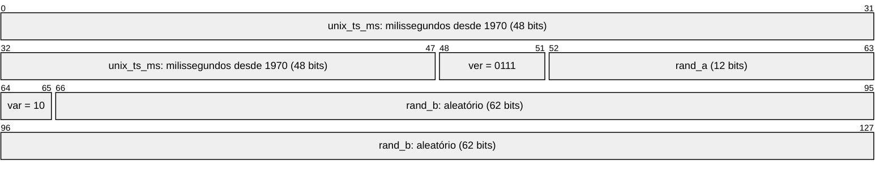
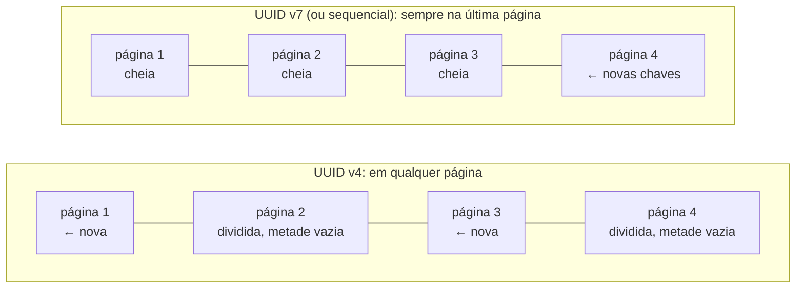

## O problema

O primeiro protótipo do Bazar usava ids sequenciais: o produto 1, o produto 2, o pedido 1042. Duas semanas depois do lançamento, três coisas aconteceram.

- **Um concorrente sabia quantos pedidos o Bazar recebia.** Ele fazia uma compra por semana e olhava o número: o pedido 1042 numa segunda, o 1871 na segunda seguinte. 829 pedidos por semana, sem nenhum acesso aos dados.
- **Alguém baixou o catálogo inteiro**, incluindo os produtos em rascunho, com um laço de `GET /produtos/1` a `GET /produtos/5000`. Ids sequenciais são uma lista de tudo que existe.
- **A importação de um parceiro gerou duplicatas.** O parceiro criava os produtos no sistema dele e precisava do id do Bazar para ligar os dois; como só o banco do Bazar podia gerar o id, cada falha de rede no meio do cadastro deixava um produto que o parceiro não sabia que existia.

A troca óbvia é o UUID aleatório (`UUID.randomUUID()`), e foi o que o Bazar fez. Resolveu os três problemas e criou um quarto, mais silencioso: a tabela de pedidos ficou mais lenta para inserir a cada mês, e o índice da chave primária cresceu mais que a própria tabela justificava.

## O conceito

### O que um id de API precisa ser

| Requisito | Por quê |
|---|---|
| **Único** | O óbvio |
| **Estável** | Não muda nunca: está em URLs, em *links* salvos, em sistemas de terceiros |
| **Opaco** | Não carrega significado de negócio que possa mudar (o CPF, o e-mail) |
| **Não enumerável** | Saber um id não ajuda a adivinhar os outros |
| **Não revela volume** | O id 1871 conta que existem pelo menos 1871 |
| **Gerável fora do banco** | A aplicação (ou o cliente) pode criar o id antes de gravar |
| **Bom para índices** | Inserções baratas no índice B-tree da chave primária |

Nenhum formato atende a tudo, e as opções se distinguem pelo que sacrificam.

### Sequencial, UUID v4, UUID v7 e ULID

| | Sequencial (`bigint`) | UUID v4 | UUID v7 | ULID |
|---|---|---|---|---|
| Exemplo | `1042` | `9b2e6c1f-…-4a1d-…` | `01a1746b-9ed6-72ba-a153-07ea1e406ddc` | `01JB7M7XPP4R8Z9V0G3K2W1Q5N` |
| Tamanho | 8 bytes | 16 bytes | 16 bytes | 16 bytes (26 caracteres em texto) |
| Enumerável | Sim | Não | Não | Não |
| Revela volume | Sim | Não | Não | Não |
| Revela o instante da criação | Não | Não | **Sim** (em milissegundos) | **Sim** |
| Gerável fora do banco | Não | Sim | Sim | Sim |
| Ordenado pelo tempo | Sim | Não | Sim | Sim |
| Inserção no índice | No fim | **Aleatória** | No fim | No fim |
| Padrão | | RFC 9562 | RFC 9562 | Especificação própria |
| Tipo `uuid` do PostgreSQL | | Sim | Sim | Não (é outro formato de texto) |

O **sequencial** é ótimo para o banco e ruim para a API: enumerável, revela volume e só existe depois do `INSERT`. Para uma tabela interna, que nunca aparece numa URL, continua sendo uma boa escolha.

O **UUID v4** são 122 bits aleatórios. Resolve tudo do lado da API, mas paga no índice, como a próxima seção mostra.

O <Term id="uuid-v7">**UUID v7**</Term>, padronizado pela RFC 9562 em 2024, junta as duas coisas: os primeiros 48 bits são o **instante da criação** em milissegundos; os outros 74 (tirando os 6 de versão e variante) são aleatórios. A RFC recomenda o v7 sobre os formatos com tempo mais antigos: *"Implementations SHOULD utilize UUIDv7 instead of UUIDv1 and UUIDv6 if possible"*.



No id `01a1746b-9ed6-72ba-a153-07ea1e406ddc`, um pedido real do Bazar:

- `01a1746b9ed6` são os 48 bits do instante: 1.792.954.572.502 ms desde 1970, ou `2026-10-25T18:56:12.502Z`;
- o `7` que abre o terceiro grupo é a **versão**;
- o `a` que abre o quarto grupo começa com os bits `10`, a **variante** da RFC;
- o resto é aleatório.

O <Term id="ulid">**ULID**</Term> é a mesma ideia (48 bits de tempo e 80 aleatórios), anterior ao v7, com uma representação em texto própria: 26 caracteres em Base32 de Crockford, mais curta que os 36 do UUID e sem hífens. Antes da RFC 9562, era a escolha de quem queria ids ordenados. Hoje o v7 tem a vantagem de ser um UUID: cabe no tipo `uuid` do banco, no `java.util.UUID`, no `format: uuid` do OpenAPI, e qualquer ferramenta o reconhece.

### Por que o UUID v4 piora o índice

A chave primária é um índice B-tree: as chaves ficam **ordenadas** em páginas de 8 KB. Um id sequencial (ou um v7) sempre é maior que todos os anteriores, então cada inserção vai para a **última página**. Quando ela enche, o PostgreSQL abre uma nova à direita, e as páginas antigas ficam cheias e quietas.

Um UUID v4 cai num **lugar aleatório** do índice. Cada inserção precisa da página certa, que pode estar em qualquer parte do índice: com o índice maior que a memória, é uma leitura de disco por `INSERT`. E quando uma página do meio enche, ela se **divide** em duas, cada uma pela metade.



Medimos no PostgreSQL 18, com duas tabelas iguais e 2 milhões de inserções em cada:

| | UUID v4 (`gen_random_uuid()`) | UUID v7 (`uuidv7()`) |
|---|---|---|
| Tempo das inserções (duas rodadas) | 9,8 s e 6,2 s | 6,2 s e 3,9 s |
| Páginas folha do índice | 9.731 | 7.663 |
| Ocupação média das páginas folha | 71% | 90% |
| Tamanho do índice | 76 MB | 60 MB |
| Tamanho da tabela | 100 MB | 100 MB |

Com o v4, o índice fica 27% maior para os mesmos dados, porque as páginas divididas ficam com espaço vazio, e as inserções levam cerca de 1,6 vez mais tempo. E esse é o cenário **favorável** ao v4: os 76 MB do índice cabem nos 128 MB de memória do PostgreSQL. Numa tabela de produção, com um índice maior que a memória, cada inserção aleatória vira uma leitura de disco, e a diferença cresce muito.

O v7 ainda tem uma vantagem para a API: ordenar por id é ordenar pela criação. A paginação por cursor da [13.04](/design-de-apis-profissional/paginacao-por-cursor-keyset) usa `(criadoEm, id)`; com ids v7, o `id` sozinho já seria uma ordem estável de criação.

### O que o UUID v7 revela

Os 48 primeiros bits são o instante da criação, e qualquer um que veja o id pode lê-lo. A RFC trata isso como uma superfície de ataque pequena, mas não nula: o timestamp *"does signal the order of creation"*.

Para a maioria dos recursos, não é um problema. O produto do Bazar já tem `criadoEm` na resposta, e o pedido também. Pense duas vezes quando **o momento da criação for sensível**: o id de um cliente revela quando a pessoa se cadastrou, e o de um documento, quando ele foi gerado. Nesses casos, o v4 (ou um id interno diferente do público) continua sendo a escolha.

E nenhum UUID é um segredo. A RFC é direta: *"Implementations SHOULD NOT assume that UUIDs are hard to guess"* e eles *"MUST NOT be used as security capabilities (identifiers whose mere possession grants access)"*. Um id que não é enumerável **não substitui** a verificação de que o usuário pode ver aquele recurso. A falha de autorização por objeto (BOLA) é a primeira do OWASP API Security Top 10 justamente porque APIs confiam em ids difíceis de adivinhar ([26.03](/seguranca-essencial-para-apis/autorizacao-por-objeto-exposicao-de-dados-e-validacao) e a [documentação de segurança](https://security-doc-beta.vercel.app/)).

### Id interno, id público e id para pessoas

Um recurso pode ter mais de um identificador, cada um com o seu público:

| Identificador | Exemplo | Para quem |
|---|---|---|
| Id interno | `bigint` sequencial | O banco: chaves estrangeiras compactas, *joins* rápidos |
| Id público | UUID v7 | A API: URLs, *links*, integrações |
| Id para pessoas | `BZR-2026-000123` | O cliente no telefone, a nota fiscal, o *e-mail* de confirmação |

Algumas equipes usam os três: `bigint` como chave primária (nunca exposto) e um UUID numa coluna única para a API. A vantagem é o índice compacto das chaves estrangeiras (8 bytes contra 16); o custo é uma coluna e um índice a mais, e a disciplina de nunca vazar o id interno. Com UUID v7, que já é bom para índices, o Bazar usa **o mesmo id** como chave primária e id público.

O **número para pessoas** é outra coisa. Ninguém lê `01a1746b-9ed6-72ba-a153-07ea1e406ddc` no telefone. O pedido ganha um `numero` (`BZR-2026-000123`): curto, legível e com o ano para dar contexto. Ele **é** sequencial e revela volume, e por isso **não** é o id da API: não aparece nas URLs, e um `GET /v1/pedidos/BZR-2026-000123` não existe. Uma busca por número (`?numero=BZR-2026-000123`), quando existir, é uma consulta como as outras, sujeita às mesmas regras de autorização.

### Gerando UUID v7 no Java

O JDK 25 só gera UUID v4 (`randomUUID`) e v3 (`nameUUIDFromBytes`). As opções:

| Opção | Como | Quando o id existe |
|---|---|---|
| Hibernate 7 | `@Id @UuidGenerator(style = UuidGenerator.Style.VERSION_7)` | No `persist`: antes dele, o id é `null` |
| `uuid-creator` 6.1.1 | `UuidCreator.getTimeOrderedEpoch()` | Na hora |
| PostgreSQL 18 | `default uuidv7()` na coluna | No `INSERT` |
| JDK 26+ | `UUID.ofEpochMillis(System.currentTimeMillis())` | Na hora |

O Bazar cria os ids **no construtor** das entidades: o `ProdutoService` usa o id do produto para criar o estoque, e o pedido publica um evento com o seu id. Por isso o `@UuidGenerator`, que só atribui o id quando o Hibernate grava a entidade, não serve. O mesmo vale para o `uuidv7()` do banco. A escolha é a **`uuid-creator`**, atrás de um método `Ids.novo()`: quando o Bazar migrar para o JDK 26, a troca é uma linha.

Uma diferença entre as opções: a RFC define três métodos para manter a ordem entre ids criados **no mesmo milissegundo** (um contador, um aleatório crescente ou mais precisão no relógio). A `uuid-creator` usa um contador; o Hibernate e o PostgreSQL usam mais precisão no relógio (12 bits de fração de milissegundo). O `UUID.ofEpochMillis` do JDK 26 preenche o resto com bits aleatórios, sem garantir a ordem dentro do mesmo milissegundo.

### Ids no JSON: sempre strings

Qualquer id vai no JSON como **string**, mesmo o sequencial. A [02.06](/comecando-e-fundamentos-de-http/json-para-apis) mostrou um id `9007199254740993` virando `9007199254740992` no `JSON.parse` do navegador. Com strings, o problema não existe, e o formato do id pode mudar (de número para UUID) sem mudar o tipo do campo no contrato. O Google segue a mesma regra nos nomes de recurso (AIP-122): ids são strings, e o cliente não deve interpretá-los.

O mesmo vale para o UUID v7: **o cliente não deve ler o instante do id.** Ele está ali para o banco, e não para o contrato. Se o cliente precisa do instante, ele está no `criadoEm`. A RFC recomenda tratar UUIDs *"as opaquely as possible"*.

## Na prática

### `Ids.novo()`

```java title="src/main/java/com/bazar/compartilhado/Ids.java"
/**
 * Os ids do Bazar são UUID v7 (RFC 9562, 15.03): os primeiros 48 bits são o instante da criação em milissegundos,
 * e o resto é aleatório. Ordenados pelo tempo, eles entram no fim do índice B-tree, como um id sequencial, sem
 * revelar quantos pedidos o Bazar tem.
 * <p>
 * O JDK 25 só gera UUID v4 (randomUUID). A partir do JDK 26, UUID.ofEpochMillis(System.currentTimeMillis())
 * substitui a biblioteca nesta linha.
 */
public final class Ids {

    private Ids() {
    }

    public static UUID novo() {
        // Dentro do mesmo milissegundo, um contador mantém a ordem de criação.
        return UuidCreator.getTimeOrderedEpoch();
    }
}
```

Todos os `UUID.randomUUID()` do Bazar (produto, pedido, item de pedido, categoria, cliente, endereço) passaram a ser `Ids.novo()`. A coluna continua sendo `uuid` no PostgreSQL, e nenhuma migração foi necessária: um v7 é um UUID como outro qualquer, e os ids v4 antigos continuam válidos ao lado dos novos.

```java title="src/test/java/com/bazar/compartilhado/IdsTest.java (trecho)"
@Test
void geraUuidVersao7ComOInstanteNosPrimeirosBits() {
    var antes = System.currentTimeMillis();
    var id = Ids.novo();
    var depois = System.currentTimeMillis();

    assertThat(id.version()).isEqualTo(7);
    assertThat(id.variant()).isEqualTo(2);
    // Os 48 bits mais significativos são os milissegundos desde 1970.
    assertThat(id.getMostSignificantBits() >>> 16).isBetween(antes, depois);
}

// Gerados em sequência (vários no mesmo milissegundo), os ids já saem em ordem, como texto e como UUID.
@Test
void idsGeradosEmSequenciaJaEstaoOrdenados() {
    var ids = new ArrayList<UUID>();
    IntStream.range(0, 10_000).forEach(i -> ids.add(Ids.novo()));

    assertThat(ids).isSortedAccordingTo(Comparator.naturalOrder());
    assertThat(ids.stream().map(UUID::toString).toList()).isSorted();
    assertThat(ids).doesNotHaveDuplicates();
}
```

### O número do pedido

O número vem de uma *sequence* do PostgreSQL, que nunca devolve o mesmo valor duas vezes, mesmo com pedidos simultâneos:

```sql title="src/main/resources/db/migration/V11__numero_do_pedido.sql (trecho)"
-- O número do pedido para pessoas (15.03): BZR-2026-000123. O id (UUID v7) continua sendo o identificador da API;
-- o número é o que o cliente fala no telefone e o que vai na nota fiscal.
create sequence pedido_numero_seq;

alter table pedido add column numero varchar(20);
-- (os pedidos existentes ganham números na ordem de criação)
alter table pedido alter column numero set not null;
alter table pedido add constraint pedido_numero_unico unique (numero);
```

```java title="src/main/java/com/bazar/pedidos/dominio/NumeroDoPedido.java"
/**
 * O número legível de um pedido (15.03): BZR, o ano da compra no fuso da loja e um sequencial com 6 dígitos.
 * O sequencial vem de uma sequence do banco e não recomeça a cada ano: o ano é informativo, e a unicidade vem do
 * sequencial.
 */
public final class NumeroDoPedido {

    private static final ZoneId FUSO_DA_LOJA = ZoneId.of("America/Sao_Paulo");

    private NumeroDoPedido() {
    }

    public static String de(long sequencial, Instant criadoEm) {
        return "BZR-%d-%06d".formatted(criadoEm.atZone(FUSO_DA_LOJA).getYear(), sequencial);
    }
}
```

O ano é o **da loja**, e não o do UTC ([15.01](/design-de-apis-profissional/datas-horas-e-fusos-horarios)): um pedido de 31 de dezembro às 22h em São Paulo, que já é 1º de janeiro em UTC, é do ano que está acabando. O teste fixa essa fronteira:

```java title="src/test/java/com/bazar/pedidos/dominio/NumeroDoPedidoTest.java (trecho)"
// 1º de janeiro, 01:00 em UTC, ainda é 31 de dezembro em São Paulo: o pedido é do ano anterior (15.01).
@Test
void usaOAnoNoFusoDaLoja() {
    assertThat(NumeroDoPedido.de(1, Instant.parse("2027-01-01T01:00:00Z"))).isEqualTo("BZR-2026-000001");
    assertThat(NumeroDoPedido.de(2, Instant.parse("2027-01-01T03:00:00Z"))).isEqualTo("BZR-2027-000002");
}
```

No serviço, o número é pedido **depois** das validações:

```java title="src/main/java/com/bazar/pedidos/dominio/PedidoService.java (trecho)"
// O número só é pedido depois das validações: um pedido recusado não gasta um número. Uma sequence não
// volta atrás no rollback, então a falta de estoque ainda deixa um buraco na numeração (15.03).
var agora = relogio.instant();
var pedido = new Pedido(clienteId, NumeroDoPedido.de(pedidos.proximoNumero(), agora), agora);
```

A primeira versão pedia o número logo no início do método, e um teste que conferia que um pedido com produto inexistente **não tocava** no repositório falhou: o pedido recusado já tinha consumido um número. Buracos na numeração não são um erro (a *sequence* é feita para isso), mas não há por que criá-los à toa. Se o negócio exigisse uma numeração **sem buracos** (algumas notas fiscais exigem), a *sequence* não serviria: seria preciso uma tabela de contadores, travada na mesma transação do pedido, com o custo de serializar todas as criações de pedido.

### Pela API

<HttpExchange
  title="Um pedido com id v7 e número legível"
  request={{ method: 'POST', url: '/v1/pedidos', headers: { 'Content-Type': 'application/json', Accept: 'application/json' }, body: { clienteId: '01a1746b-9e9b-7685-b2ab-e9b6e146e795', itens: [ { produtoId: '01a1746b-9dfb-7b92-885d-7bf7152ef90a', quantidade: 1 } ] } }}
  response={{ status: 201, headers: { Location: 'http://localhost:8080/v1/pedidos/01a1746b-9ed6-72ba-a153-07ea1e406ddc', 'Content-Type': 'application/json' }, body: { id: '01a1746b-9ed6-72ba-a153-07ea1e406ddc', numero: 'BZR-2026-000001', clienteId: '01a1746b-9e9b-7685-b2ab-e9b6e146e795', status: 'CRIADO', itens: [ { produtoId: '01a1746b-9dfb-7b92-885d-7bf7152ef90a', sku: 'LIV-0042', nomeProduto: 'Clean Code', quantidade: 1, precoUnitario: { valor: '129.90', moeda: 'BRL' }, subtotal: { valor: '129.90', moeda: 'BRL' } } ], valorItens: { valor: '129.90', moeda: 'BRL' }, valorFrete: { valor: '0.00', moeda: 'BRL' }, valorTotal: { valor: '129.90', moeda: 'BRL' }, criadoEm: '2026-10-25T18:56:12.486947Z', cancelamento: null, _links: { self: { href: 'http://localhost:8080/v1/pedidos/01a1746b-9ed6-72ba-a153-07ea1e406ddc' }, 'bazar:cliente': { href: 'http://localhost:8080/v1/clientes/01a1746b-9e9b-7685-b2ab-e9b6e146e795' }, 'bazar:cancelar': { href: 'http://localhost:8080/v1/pedidos/01a1746b-9ed6-72ba-a153-07ea1e406ddc/cancelamento' }, curies: [ { href: 'https://api.bazar.example/rels/{rel}', name: 'bazar', templated: true } ] } } }}
>
O cliente, o produto e o pedido foram criados em sequência, e os ids mostram isso: os três começam com `01a1746b`. A URL usa o id; o `numero` é para pessoas.
</HttpExchange>

## Erros comuns

<BadVsGood title="Expor o id sequencial do banco" why="Um id sequencial na URL é enumerável (/produtos/1, /produtos/2...) e conta quantos recursos existem. Qualquer cliente pode medir o volume de negócio.">
<Bad title="bigint na URL">

```http
GET /v1/pedidos/1871
```

</Bad>
<Good title="UUID v7 na URL, número legível no corpo">

```http
GET /v1/pedidos/01a1746b-9ed6-72ba-a153-07ea1e406ddc

{ "id": "01a1746b-9ed6-72ba-a153-07ea1e406ddc", "numero": "BZR-2026-000001", ... }
```

</Good>
</BadVsGood>

<BadVsGood title="UUID v4 como chave primária de uma tabela grande" why="Cada inserção cai num lugar aleatório do índice: páginas divididas pela metade, um índice maior e, quando ele não cabe na memória, uma leitura de disco por INSERT.">
<Bad title="Aleatório">

```java
this.id = UUID.randomUUID();
```

</Bad>
<Good title="Ordenado pelo tempo">

```java
this.id = Ids.novo();   // UUID v7
```

</Good>
</BadVsGood>

Outros erros frequentes:

- **Ids numéricos no JSON**, que perdem precisão em JavaScript acima de 2⁵³.
- **Ids com significado de negócio** (o CPF, o SKU, o e-mail), que mudam ou estão errados.
- **Confiar no id como segurança.** Um UUID não é uma senha; a autorização por objeto continua necessária.
- **Clientes que interpretam o id** (extraem a data de um v7, ou a ordem). O id é opaco no contrato.
- **Número legível como id da API**, que traz de volta a enumeração.
- **UUID v7 quando o instante da criação é sensível.**

## Boas práticas

- **UUID v7 como id público** de recursos novos: não enumerável, não revela volume, bom para índices.
- **Gere o id na aplicação** quando o código precisa dele antes de gravar; atrás de um único método, para trocar a implementação depois.
- **Tipo `uuid` no PostgreSQL**, e não `varchar(36)`: 16 bytes em vez de 37, e comparações mais rápidas.
- **Ids como strings no JSON** e opacos no contrato (`format: uuid` no OpenAPI).
- **Um número para pessoas** quando alguém precisa ler ou ditar o identificador, separado do id da API.
- **Autorização por objeto sempre**, qualquer que seja o formato do id.

## No projeto Bazar

<ProjectStep title="UUID v7 em todos os ids e o número do pedido" module="compartilhado, pedidos" tag="pagina-15.03" files={[
  { path: 'pom.xml', change: 'alterado' },
  { path: 'src/main/java/com/bazar/compartilhado/Ids.java', change: 'novo' },
  { path: 'src/main/java/com/bazar/catalogo/dominio/Produto.java', change: 'alterado' },
  { path: 'src/main/java/com/bazar/catalogo/api/CategoriaController.java', change: 'alterado' },
  { path: 'src/main/java/com/bazar/clientes/dominio/Cliente.java', change: 'alterado' },
  { path: 'src/main/java/com/bazar/clientes/dominio/Endereco.java', change: 'alterado' },
  { path: 'src/main/java/com/bazar/pedidos/dominio/Pedido.java', change: 'alterado' },
  { path: 'src/main/java/com/bazar/pedidos/dominio/ItemPedido.java', change: 'alterado' },
  { path: 'src/main/java/com/bazar/pedidos/dominio/NumeroDoPedido.java', change: 'novo' },
  { path: 'src/main/java/com/bazar/pedidos/dominio/PedidoRepository.java', change: 'alterado' },
  { path: 'src/main/java/com/bazar/pedidos/dominio/PedidoService.java', change: 'alterado' },
  { path: 'src/main/java/com/bazar/pedidos/api/PedidoResponse.java', change: 'alterado' },
  { path: 'src/main/resources/db/migration/V11__numero_do_pedido.sql', change: 'novo' },
  { path: 'src/test/java/com/bazar/compartilhado/IdsTest.java', change: 'novo' },
  { path: 'src/test/java/com/bazar/pedidos/dominio/NumeroDoPedidoTest.java', change: 'novo' },
  { path: 'src/test/java/com/bazar/pedidos/dominio/PedidoServiceTest.java', change: 'alterado' },
  { path: 'src/test/java/com/bazar/pedidos/dominio/PedidoDeTeste.java', change: 'alterado' },
  { path: 'src/test/java/com/bazar/pedidos/api/PedidoControllerTest.java', change: 'alterado' },
]}>
Todos os ids do Bazar passam a ser UUID v7, gerados pela `uuid-creator` 6.1.1 atrás de `Ids.novo()`. O pedido ganha o `numero` (`BZR-2026-000123`), vindo de uma *sequence* do PostgreSQL e pedido só depois das validações. A migração `V11` numera os pedidos existentes na ordem de criação. A resposta do pedido traz o `numero` logo depois do `id`. A suíte tem 240 testes.
</ProjectStep>

## Resumo

- Um id de API deve ser único, estável, opaco, não enumerável, gerável fora do banco e bom para índices.
- Sequenciais são enumeráveis e revelam volume. UUID v4 resolve isso, mas espalha as inserções pelo índice: na nossa medição, páginas 71% cheias contra 90%, índice 27% maior e inserções 1,6 vez mais lentas.
- UUID v7 (RFC 9562): 48 bits de tempo em milissegundos e 74 aleatórios. Ordenado como um sequencial, sem os seus problemas. Revela o instante da criação.
- ULID é a mesma ideia, com outra representação em texto. Com a RFC 9562, o v7 é a escolha padrão.
- No Java 25: Hibernate `@UuidGenerator(style = VERSION_7)` (id no `persist`), `uuid-creator` (na hora) ou `uuidv7()` do PostgreSQL 18. No JDK 26, `UUID.ofEpochMillis`.
- Ids vão como strings no JSON, e o cliente não os interpreta.
- Nenhum id é segurança: a autorização por objeto continua obrigatória.
- Números para pessoas (`BZR-2026-000123`) ficam separados do id da API.

<Exercise title="Ids para cupons de desconto" difficulty="medio">
O Bazar vai lançar cupons de desconto. Cada cupom é um recurso da API (`/v1/cupons/{id}`), e o cliente digita um **código** no *checkout* (`NATAL25`, ou um código único por cliente, enviado por *e-mail*).

1. Que formato usar para o `id` do cupom? E para os códigos únicos por cliente?
2. Um UUID v7 serviria como código único enviado por *e-mail*? Por quê?
3. O que impede alguém de testar códigos até achar um válido?

<Hint>Pense em quem lê cada identificador, e no que a RFC 9562 diz sobre adivinhar UUIDs.</Hint>

<Solution>

1. O `id` do cupom é um **UUID v7**, como os outros recursos: é o identificador da API, usado nas URLs do painel do lojista. O **código** é outra coisa, como o número do pedido: é o que a pessoa digita. Para os códigos promocionais (`NATAL25`), um texto escolhido pelo lojista, único entre os cupons ativos. Para os códigos únicos, uma string curta e **aleatória** (8 a 12 caracteres de um alfabeto sem caracteres ambíguos, como o Base32 de Crockford, que não tem `I`, `L`, `O` e `U`), gerada com `SecureRandom`.

2. Não. O código por *e-mail* é um **segredo**: quem o tem ganha o desconto. A RFC diz que UUIDs *"MUST NOT be used as security capabilities"*, e o v7 é o pior candidato: 48 dos seus bits são o instante da criação, que um atacante pode estimar. Restam 74 bits aleatórios, mas o formato não promete que eles venham de uma fonte criptográfica. Além disso, 36 caracteres não são digitáveis. Use um código aleatório com `SecureRandom`, com entropia suficiente para o volume de cupons (40 bits, 8 caracteres em Base32, já tornam a adivinhação inviável com limite de tentativas).

3. Três camadas: **limite de tentativas** por cliente e por IP no endpoint de aplicar cupom (`429`, [Parte 11](/seguranca-essencial-para-apis/panorama-owasp-api-security-top-10)); **códigos únicos ligados ao cliente** (um código de outra pessoa não funciona, mesmo se adivinhado); e **a mesma resposta para "não existe" e "não é seu"**, para que o erro não confirme que um código existe.
</Solution>
</Exercise>

<Quiz questions={[
  {
    question: 'Por que um UUID v4 como chave primária deixa as inserções mais lentas que um UUID v7?',
    options: [
      'Porque o v4 tem mais bits',
      'Porque cada v4 cai num lugar aleatório do índice B-tree, dividindo páginas e exigindo páginas que podem não estar na memória; o v7 sempre entra no fim',
      'Porque o PostgreSQL não tem o tipo uuid para o v4',
      'Porque o v4 precisa de uma sequence',
    ],
    answer: 1,
    explanation: 'Na medição da página, o índice v4 ficou com páginas 71% cheias (contra 90%), 27% maior e com inserções cerca de 1,6 vez mais lentas, mesmo cabendo na memória.',
  },
  {
    question: 'O que os primeiros 48 bits de um UUID v7 representam?',
    options: [
      'Um contador sequencial',
      'O endereço MAC da máquina',
      'Os milissegundos desde 1970 (Unix epoch) do momento da criação',
      'Um hash do conteúdo',
    ],
    answer: 2,
    explanation: 'É o campo unix_ts_ms da RFC 9562. Por isso os ids v7 são ordenados pelo tempo, e por isso eles revelam o instante da criação.',
  },
  {
    question: 'Por que o Bazar gera os ids com a uuid-creator, e não com o @UuidGenerator(style = VERSION_7) do Hibernate?',
    options: [
      'Porque o Hibernate 7 não suporta UUID v7',
      'Porque o @UuidGenerator só atribui o id no persist, e o Bazar usa o id antes de gravar (no estoque do produto, no evento do pedido)',
      'Porque a uuid-creator é mais rápida',
      'Porque o PostgreSQL não aceita os UUIDs do Hibernate',
    ],
    answer: 1,
    explanation: 'Os ids do Bazar nascem no construtor das entidades. Para entidades em que o id só é necessário depois de gravar, o @UuidGenerator do Hibernate 7 é uma boa opção sem dependência extra.',
  },
  {
    question: 'O pedido tem id 01a1746b-9ed6-… e número BZR-2026-000123. Qual deve aparecer na URL do recurso?',
    options: [
      'O número, porque é legível',
      'O id: o número é sequencial, enumerável e revela volume; ele existe para pessoas',
      'Os dois, em URLs diferentes',
      'Nenhum: a URL usa o CPF do cliente',
    ],
    answer: 1,
    explanation: 'O id é opaco e não enumerável; o número é para o telefone e a nota fiscal. Uma busca por número pode existir, como um filtro sujeito à autorização.',
  },
]} />

## Referências

<References />
