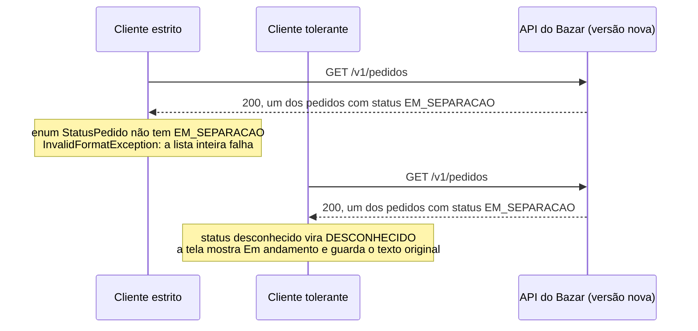

## O problema

O Bazar contratou um centro de distribuição, e o pedido ganhou uma etapa entre o pagamento e o envio: `EM_SEPARACAO`. A mudança parecia a mais inocente possível. Nenhum campo foi removido, nenhum tipo mudou; só um valor novo num campo que já existia.

Às 9h da manhã seguinte, o aplicativo do parceiro que revende pelo Bazar parou de mostrar a lista de pedidos. O código dele tinha um `enum StatusPedido` com os sete valores do contrato, e o Jackson, ao encontrar `"EM_SEPARACAO"`, lançou uma exceção. Uma exceção na leitura de **um** pedido derrubava a lista **inteira**. O painel interno da equipe financeira, escrito em outra linguagem, não quebrou, mas fez pior: um `switch` sem caso padrão deixou os pedidos em separação fora de todos os relatórios, sem nenhum erro.

Os dois lados erraram. O cliente presumiu que a lista de valores era fechada para sempre. O Bazar nunca disse no contrato que ela podia crescer. Esta página trata dos dois lados: como o servidor projeta e documenta enums que vão evoluir, e como o cliente lê respostas de uma versão mais nova da API sem quebrar.

## O conceito

### Enums em JSON: strings em UPPER_SNAKE_CASE

JSON não tem um tipo enum. As opções são um número (`"status": 2`) ou uma string (`"status": "PAGO"`), e a string vence por todos os critérios: um log é legível, a ordem das constantes no código pode mudar sem afetar o contrato, e um valor novo não muda o significado dos antigos.

Para o formato da string, os dois guias concordam:

- **Zalando [#240](https://opensource.zalando.com/restful-api-guidelines/#240):** valores em `UPPER_SNAKE_CASE` (`PAGAMENTO_PENDENTE`), o que os distingue de nomes de propriedades. A exceção são valores de padrões externos, como os códigos de idioma ISO 639-1 (`pt`, `en`).
- **Google [AIP-126](https://google.aip.dev/126):** *"All enum values must use UPPER_SNAKE_CASE."*

É também o padrão do Java, e o Jackson serializa uma constante pelo seu `name()`. O Bazar não precisa de nenhuma configuração.

O AIP-126 tem uma regra a mais, que vem do Protocol Buffers: o primeiro valor deve ser `<NOME>_UNSPECIFIED`, porque em proto3 o valor zero é o que um campo ausente assume. Em JSON, um campo ausente é ausente, e a regra não se aplica: o Bazar não tem um `STATUS_PEDIDO_UNSPECIFIED`.

### Fechado ou extensível

Um enum do JSON Schema (`enum: [CRIADO, PAGO, ...]`) é, por definição, uma lista **completa**. O Zalando ([#112](https://opensource.zalando.com/restful-api-guidelines/#112)) tira a consequência: acrescentar um valor a um `enum` é uma mudança **incompatível**, a ser combinada com todos os consumidores, como a remoção de um campo. Por isso a regra recomenda `enum` só quando a lista está completa *"with respect to any thinkable and unthinkable future feature"*.

Quase nenhuma lista de negócio passa nesse teste. Status de pedido, meios de pagamento, motivos de cancelamento e tipos de entrega crescem com o negócio. Para eles, o Zalando recomenda um **enum extensível**: os valores conhecidos vão em `examples`, e a descrição avisa que a lista pode crescer.

```yaml title="Um status extensível no OpenAPI 3.1 (forma do Zalando #112)"
status:
  type: string
  examples: [CRIADO, PAGAMENTO_PENDENTE, PAGO, ENVIADO, ENTREGUE, CANCELADO, REEMBOLSADO]
  description: >
    [Extensible enum](https://opensource.zalando.com/restful-api-guidelines/#112).
    O estado atual do pedido. Novos valores podem ser acrescentados sem aviso:
    trate um valor desconhecido como "em andamento".
```

Até 2025, o Zalando usava uma extensão própria, `x-extensible-enum`, com a lista de valores. Em novembro de 2025 a extensão foi **depreciada** em favor de `examples`, que o OpenAPI 3.1 passou a aceitar em *schemas* e que as ferramentas já entendem. Você ainda vai encontrar `x-extensible-enum` em contratos antigos; o significado é o mesmo.

O Google chega à mesma conclusão por outro caminho. O AIP-126 pede que cada enum **documente** se está congelado ou se novos valores são esperados, e que enums recebam valores novos raramente (*"a good rule of thumb is no more than once a year"*). Para listas que mudam com frequência, a recomendação é outra: *"the API should use a string and document the format"*.

| | Enum fechado (`enum`) | Enum extensível (`examples` + aviso) |
|---|---|---|
| Valor novo | Mudança incompatível | Mudança compatível, se os clientes estiverem preparados |
| Quando usar | Lista completa por natureza: dias da semana, `ASC`/`DESC` | Listas de negócio: status, meios de pagamento, motivos |
| O servidor valida a entrada? | Sim | Sim: aceita só os valores listados |
| O cliente precisa tratar valor desconhecido? | Não | **Sim** |

### A assimetria: estrito na entrada, extensível na saída

Um enum extensível não significa que o servidor aceita qualquer coisa. A regra do Zalando é explícita: a implementação valida a entrada e aceita só os valores listados, e a lista de entrada nunca encolhe. O que cresce é o conjunto de valores que **podem sair**.

Para a entrada, um valor desconhecido é um erro do cliente, e o Bazar responde como a qualquer erro de validação, com a lista do que é aceito:

<HttpExchange
  title="Um motivo de cancelamento que não existe"
  request={{ method: 'POST', url: '/v1/pedidos/01a17472-f515-7b5b-b7ca-2b4362561b11/cancelamento', headers: { 'Content-Type': 'application/json' }, body: { motivo: 'MUDEI_DE_IDEIA' } }}
  response={{ status: 422, headers: { 'Content-Type': 'application/problem+json' }, body: { type: 'https://api.bazar.example/problemas/validacao', title: 'Dados inválidos', status: 422, detail: 'A requisição tem 1 campo inválido.', instance: '/v1/pedidos/01a17472-f515-7b5b-b7ca-2b4362561b11/cancelamento', erros: [ { campo: 'motivo', mensagem: 'deve ser um destes valores: CLIENTE_DESISTIU, ENDERECO_ERRADO, OUTRO.' } ], codigo: 'VALIDACAO', traceId: '12c6c7c3a07c64dd5a4dd058af7411fb' } }}
>
O corpo é JSON bem formado, com um valor inválido num campo: o mesmo caso de um CEP com letras, e por isso `422`. Um `"cliente_desistiu"` em minúsculas também é recusado. A mensagem não repete o valor recebido.
</HttpExchange>

Um detalhe: o `motivo` também **sai**, dentro do `cancelamento` da resposta do pedido. Acrescentar `PRODUTO_INDISPONIVEL` aos motivos é compatível para quem cancela (que só passa a ter mais uma opção), mas chega aos clientes que leem pedidos cancelados. Um valor de entrada que também é devolvido precisa ser tratado como extensível na saída.

### Tolerant reader

O <Term id="tolerant-reader">*tolerant reader*</Term> é o nome que Martin Fowler deu, em 2011, à disciplina do lado do consumidor: *"be as tolerant as possible when reading data from a service"*. Na prática, três regras:

1. **Leia só o que você usa.** O cliente que mostra uma lista de pedidos precisa de `numero`, `status` e `valorTotal`; ele não deve declarar, nem validar, os outros vinte campos.
2. **Ignore campos desconhecidos.** Um campo novo na resposta é a mudança compatível por excelência ([18.01](/contratos-documentacao-e-ciclo-de-vida/compatibilidade-retroativa-o-que-quebra-um-cliente)). Um cliente que falha com ele transforma toda evolução da API em quebra.
3. **Trate valores desconhecidos.** Um status que o cliente não conhece vai para um caso padrão, definido de propósito.

O Zalando transforma isso em regra obrigatória para clientes ([#108](https://opensource.zalando.com/restful-api-guidelines/#108)): o cliente deve estar preparado para valores novos em enums extensíveis, *"either be agnostic or provide default behavior for unknown values"*. E acrescenta um ponto que os clientes costumam esquecer: não descartar o valor desconhecido quando ele for devolvido num `PUT` seguinte. Por isso, diz a regra, um enum extensível *"cannot simply"* ser implementado como um `enum` do Java.



### No Java: o que o Jackson 3 faz por padrão

O Jackson 3 já vem com metade do *tolerant reader*:

| Situação | Jackson 2 (padrão) | Jackson 3 (padrão) |
|---|---|---|
| Campo desconhecido no JSON | Erro (`UnrecognizedPropertyException`) | **Ignorado** |
| Valor desconhecido num enum | Erro (`InvalidFormatException`) | Erro (`InvalidFormatException`) |

O `FAIL_ON_UNKNOWN_PROPERTIES` do Jackson 3 vem desligado, como a [06.03](/construindo-apis-com-spring-boot/jackson-3-no-spring-boot-4) mostrou do lado do servidor. Um cliente com um `JsonMapper` criado à mão também se beneficia (um teste do Bazar confere isso). O valor desconhecido de enum continua sendo erro, e tratá-lo exige duas peças:

- **`@JsonEnumDefaultValue`** numa constante do enum, que passa a ser o valor usado no lugar dos desconhecidos;
- **`EnumFeature.READ_UNKNOWN_ENUM_VALUES_USING_DEFAULT_VALUE`** ligada no `JsonMapper`. Sem ela, a anotação não tem efeito.

No Jackson 2, a mesma opção existia como `DeserializationFeature.READ_UNKNOWN_ENUM_VALUES_USING_DEFAULT_VALUE`. O Jackson 3 moveu as opções de enum para `tools.jackson.databind.cfg.EnumFeature`. Num cliente com Spring Boot 4, a propriedade é `spring.jackson.datatype.enum.read-unknown-enum-values-using-default-value: true`.

Existe também `READ_UNKNOWN_ENUM_VALUES_AS_NULL`, que transforma o valor desconhecido em `null`. É pior: o `null` se confunde com "campo ausente", e um `NullPointerException` mais adiante é só uma quebra adiada.

### Por que não ser tolerante com tudo: Postel e suas críticas

O *tolerant reader* é uma aplicação do <Term id="principio-da-robustez">**princípio da robustez**</Term>, ou lei de Postel, que a RFC 760 (1980) formulou assim: *"an implementation should be conservative in its sending behavior, and liberal in its receiving behavior"*. Fowler a cita na forma mais conhecida: *"be conservative in what you do, be liberal in what you accept from others"*.

A RFC 9413 (2023, informativa, do IAB) faz a crítica que a experiência acumulou. Um receptor que tolera erros esconde esses erros, e os emissores nunca os corrigem. Com o tempo, *"a flaw can become entrenched as a de facto standard"*, e toda implementação nova precisa reproduzir o defeito para conversar com as existentes. A proposta da RFC é a **intolerância virtuosa**: rejeitar violações da especificação com erros claros, porque *"intolerance toward violations of specification improves feedback for new implementations"*.

As duas ideias não se contradizem, porque tratam de coisas diferentes:

| Situação | Atitude | Por quê |
|---|---|---|
| O servidor recebe um valor fora do contrato | **Intolerante**: `422` com os valores aceitos | É um erro do cliente; aceitá-lo cria um contrato paralelo |
| O cliente recebe um campo ou valor **previsto como extensão** | **Tolerante** | O contrato avisou que a lista cresce |
| O cliente recebe algo que **viola** o contrato (um `valorTotal` que não é número) | **Intolerante**: erro, log, alerta | Tolerar esconderia um defeito no servidor |

O *tolerant reader* tolera **evolução**, e não **erros**. Um cliente que aceita `"valorTotal": "abc"` em silêncio não está sendo robusto: está escondendo um defeito.

### Booleanos que deveriam ser enums

Muito enum extensível nasce como um booleano. Imagine o produto do Bazar com `ativo: true`. Depois vem o rascunho, que não é ativo mas também não foi descontinuado, e a resposta ganha `rascunho: true`. Três estados em dois booleanos permitem quatro combinações, e `ativo: true, rascunho: true` não significa nada. Por isso o produto tem um campo `status` com `RASCUNHO`, `ATIVO` e `DESCONTINUADO`.

O AIP-126 traça a linha: booleanos *"may be used in situations where it is clear that no further flexibility will be needed"*. Ele aponta também um problema próprio do booleano: o padrão precisa ser `false`, e *"it is impossible to distinguish between false and unset"*. Antes de criar um booleano, pergunte se existe um terceiro estado imaginável. Se existir (pendente, parcial, desconhecido), comece com um enum. Transformar um booleano em enum depois é uma mudança incompatível.

## Na prática

### O servidor: 422 com os valores aceitos

O Jackson lança `InvalidFormatException` quando um texto não corresponde a nenhuma constante do enum. O Spring o embrulha numa `HttpMessageNotReadableException`, que antes virava um `400` genérico. O tratador de erros do Bazar passa a reconhecer o caso:

```java title="src/main/java/com/bazar/compartilhado/erros/TratadorGlobalDeErros.java (trecho)"
// Um valor fora do enum ("motivo": "TALVEZ") é JSON bem formado com um valor inválido: 422 no campo, com a
// lista de valores aceitos, como qualquer outra validação (15.04).
if (ex.getMostSpecificCause() instanceof InvalidFormatException invalido && invalido.getTargetType() != null
        && invalido.getTargetType().isEnum()) {
    return valorForaDoEnum(invalido, request);
}
return super.handleHttpMessageNotReadable(ex, headers, status, request);
```

```java title="src/main/java/com/bazar/compartilhado/erros/TratadorGlobalDeErros.java (trecho)"
private ResponseEntity<Object> valorForaDoEnum(InvalidFormatException ex, WebRequest request) {
    var aceitos = Arrays.stream(ex.getTargetType().getEnumConstants())
            .map(valor -> ((Enum<?>) valor).name())
            .collect(Collectors.joining(", "));
    var fonte = getMessageSource();
    var mensagem = fonte != null
            ? fonte.getMessage("bazar.validacao.enum", new Object[] {aceitos}, LocaleContextHolder.getLocale())
            : aceitos;
    return validacao(ex, List.of(new ErroDeCampo(caminho(ex), mensagem)), new HttpHeaders(), request);
}

// O caminho do campo no corpo, no formato dos outros erros: itens[0].produtoId.
private static String caminho(JacksonException ex) {
    var caminho = new StringBuilder();
    for (var parte : ex.getPath()) {
        if (parte.getPropertyName() != null) {
            caminho.append(caminho.isEmpty() ? "" : ".").append(parte.getPropertyName());
        } else if (parte.getIndex() >= 0) {
            caminho.append('[').append(parte.getIndex()).append(']');
        }
    }
    return caminho.toString();
}
```

A mensagem vem do `messages.properties` (`must be one of: {0}.`) e do `messages_pt.properties` (`deve ser um destes valores: {0}.`), e a [15.05](/design-de-apis-profissional/internacionalizacao-na-api) mostra como o idioma é escolhido. A lista de valores vem do próprio enum, e por isso nunca fica desatualizada.

### O cliente: leitor tolerante com Jackson 3

O Bazar não tem um cliente da sua própria API, mas os parceiros têm. O teste a seguir faz o papel de um deles: um cliente escrito quando o pedido tinha sete status, lendo uma resposta da versão com `EM_SEPARACAO` e com um campo novo, `previsaoDeEntrega`.

```java title="src/test/java/com/bazar/exemplos/LeitorToleranteTest.java (trecho)"
private static final String PEDIDO_DA_VERSAO_NOVA = """
        { "id": "01a1746b-9ed6-72ba-a153-07ea1e406ddc", "numero": "BZR-2026-000001",
          "status": "EM_SEPARACAO", "previsaoDeEntrega": "2026-10-30" }
        """;

// O enum do cliente, copiado do contrato quando ele foi escrito.
enum StatusDoPedido {
    CRIADO, PAGAMENTO_PENDENTE, PAGO, ENVIADO, ENTREGUE, CANCELADO, REEMBOLSADO,
    @JsonEnumDefaultValue
    DESCONHECIDO
}

record Pedido(UUID id, String numero, StatusDoPedido status) {
}

// No Jackson 3, um campo desconhecido já é ignorado por padrão (no Jackson 2, era erro). Um valor desconhecido
// de enum continua sendo erro.
@Test
void oPadraoDoJackson3IgnoraOCampoNovoMasQuebraComOStatusNovo() {
    var padrao = JsonMapper.builder().build();

    assertThat(padrao.isEnabled(DeserializationFeature.FAIL_ON_UNKNOWN_PROPERTIES)).isFalse();
    assertThatThrownBy(() -> padrao.readValue(PEDIDO_DA_VERSAO_NOVA, Pedido.class))
            .isInstanceOf(InvalidFormatException.class)
            .hasMessageContaining("EM_SEPARACAO");
}

@Test
void oLeitorToleranteIgnoraOCampoNovoETrataOStatusNovo() {
    var tolerante = JsonMapper.builder()
            // Explícito: o cliente não depende do padrão da versão do Jackson.
            .disable(DeserializationFeature.FAIL_ON_UNKNOWN_PROPERTIES)
            .enable(EnumFeature.READ_UNKNOWN_ENUM_VALUES_USING_DEFAULT_VALUE)
            .build();

    var pedido = tolerante.readValue(PEDIDO_DA_VERSAO_NOVA, Pedido.class);

    assertThat(pedido.numero()).isEqualTo("BZR-2026-000001");
    assertThat(pedido.status()).isEqualTo(StatusDoPedido.DESCONHECIDO);
}
```

O `DESCONHECIDO` resolve a leitura, mas perde a informação: o cliente não sabe mais que o pedido está `EM_SEPARACAO`, e não pode mostrar o texto nem devolvê-lo à API. Quando isso importa, o cliente guarda o **texto** e interpreta só o que conhece:

```java title="src/test/java/com/bazar/exemplos/LeitorToleranteTest.java (trecho)"
// Quando o valor precisa ser mostrado ou devolvido à API, o cliente guarda o texto e interpreta só o que conhece.
record PedidoComStatusOriginal(UUID id, String status) {

    StatusDoPedido statusConhecido() {
        try {
            return StatusDoPedido.valueOf(status);
        } catch (IllegalArgumentException desconhecido) {
            return StatusDoPedido.DESCONHECIDO;
        }
    }
}
```

É essa a forma que o Zalando tem em mente quando diz que um enum extensível não pode ser simplesmente um `enum` do Java. E o `DESCONHECIDO` não é só para o Jackson: no `switch` do cliente, ele é o caso que obriga alguém a decidir o que um status novo significa na tela ("Em andamento"), em vez de deixar o pedido sumir de um relatório.

## Erros comuns

<BadVsGood title="Uma lista de negócio como enum fechado, sem aviso" why="Com enum fechado no contrato, todo valor novo é uma mudança incompatível, e os clientes gerados a partir do OpenAPI quebram na primeira resposta com o valor novo.">
<Bad title="Fechado">

```yaml
status:
  type: string
  enum: [CRIADO, PAGAMENTO_PENDENTE, PAGO, ENVIADO,
         ENTREGUE, CANCELADO, REEMBOLSADO]
```

</Bad>
<Good title="Extensível, com instrução para o desconhecido">

```yaml
status:
  type: string
  examples: [CRIADO, PAGAMENTO_PENDENTE, PAGO, ENVIADO,
             ENTREGUE, CANCELADO, REEMBOLSADO]
  description: >
    [Extensible enum](https://opensource.zalando.com/restful-api-guidelines/#112).
    Trate um valor desconhecido como "em andamento".
```

</Good>
</BadVsGood>

<BadVsGood title="Um cliente que quebra com um valor novo" why="Uma exceção na leitura de um item derruba a lista inteira. O valor novo era uma mudança compatível prevista no contrato.">
<Bad title="Enum do Java, sem padrão">

```java
enum StatusDoPedido { CRIADO, PAGO, /* ... */ REEMBOLSADO }

var mapper = JsonMapper.builder().build();
```

</Bad>
<Good title="Padrão explícito para o desconhecido">

```java
enum StatusDoPedido { CRIADO, PAGO, /* ... */ REEMBOLSADO,
    @JsonEnumDefaultValue DESCONHECIDO }

var mapper = JsonMapper.builder()
        .enable(EnumFeature.READ_UNKNOWN_ENUM_VALUES_USING_DEFAULT_VALUE)
        .build();
```

</Good>
</BadVsGood>

Outros erros frequentes:

- **Enums como números** (`"status": 2`), que dependem da ordem das constantes.
- **Aceitar qualquer texto na entrada** porque "o enum é extensível". Extensível é a saída; a entrada valida.
- **`READ_UNKNOWN_ENUM_VALUES_AS_NULL`**, que troca a exceção por um `null` ambíguo.
- **Tolerar erros**, e não só evolução: aceitar um tipo errado em silêncio.
- **Booleanos que já nascem com um terceiro estado imaginável.**
- **Renomear ou remover um valor** de um enum extensível. Só acrescentar é compatível; mudar o significado de um valor existente não é.

## Boas práticas

- **Strings em UPPER_SNAKE_CASE** para valores de enum.
- **Decida e documente** se cada enum é fechado ou extensível. Na dúvida, extensível.
- **Diga ao cliente o que fazer com um valor desconhecido**, na descrição do campo.
- **Valide a entrada** contra a lista atual e responda `422` com os valores aceitos.
- **No cliente:** ignore campos desconhecidos, tenha um `DESCONHECIDO` com `@JsonEnumDefaultValue` e guarde o texto original quando ele precisar ser mostrado ou devolvido.
- **Prefira um enum a um booleano** quando houver um terceiro estado imaginável.

## No projeto Bazar

<ProjectStep title="Valor fora do enum vira 422, e o exemplo de leitor tolerante" module="compartilhado" tag="pagina-15.04" files={[
  { path: 'src/main/java/com/bazar/compartilhado/erros/TratadorGlobalDeErros.java', change: 'alterado' },
  { path: 'src/main/resources/messages.properties', change: 'alterado' },
  { path: 'src/main/resources/messages_pt.properties', change: 'alterado' },
  { path: 'src/test/java/com/bazar/pedidos/api/PedidoControllerTest.java', change: 'alterado' },
  { path: 'src/test/java/com/bazar/exemplos/LeitorToleranteTest.java', change: 'novo' },
]}>
Um valor fora de um enum no corpo deixa de ser um `400` genérico: vira um erro de validação (`422`) no campo, com a lista de valores aceitos tirada do próprio enum. O teste `LeitorToleranteTest` mostra o lado de um cliente: o padrão do Jackson 3 ignora o campo novo e quebra com o status novo; o leitor tolerante trata os dois. A suíte tem 243 testes.
</ProjectStep>

## Resumo

- Enums em JSON são strings em UPPER_SNAKE_CASE.
- Um `enum` do JSON Schema é uma lista fechada: acrescentar um valor é incompatível. Listas de negócio são **extensíveis**: `examples` no OpenAPI 3.1 e um aviso na descrição (o `x-extensible-enum` do Zalando foi depreciado em 2025).
- O servidor é estrito na entrada (`422` com os valores aceitos) e pode acrescentar valores na saída.
- O cliente é um *tolerant reader*: lê só o que usa, ignora campos novos e trata valores desconhecidos.
- No Jackson 3, campos desconhecidos já são ignorados por padrão; valores desconhecidos de enum pedem `@JsonEnumDefaultValue` e `EnumFeature.READ_UNKNOWN_ENUM_VALUES_USING_DEFAULT_VALUE`.
- A crítica à lei de Postel (RFC 9413) vale para **erros**: tolere evolução, não violações do contrato.
- Na dúvida entre booleano e enum, enum.

<Exercise title="O meio de pagamento" difficulty="medio">
O pedido do Bazar vai ganhar um campo `meioDePagamento`, que hoje pode ser `PIX`, `CARTAO_DE_CREDITO` ou `BOLETO`. Ele é enviado na criação do pedido e devolvido na resposta.

1. Fechado ou extensível? Escreva o trecho do OpenAPI.
2. Um cliente envia `"meioDePagamento": "pix"`. O que o Bazar responde?
3. Seis meses depois, o Bazar aceita `CARTAO_DE_DEBITO`. Quem pode quebrar, e o que o contrato precisava ter dito?
4. Um analista sugere, em vez do enum, um booleano `pagoComPix`. O que você responde?

<Hint>Lembre da assimetria entre entrada e saída, e do valor que é enviado **e** devolvido.</Hint>

<Solution>

1. **Extensível.** Meios de pagamento crescem com o negócio (débito, carteiras digitais, parcelamento próprio).

   ```yaml
   meioDePagamento:
     type: string
     examples: [PIX, CARTAO_DE_CREDITO, BOLETO]
     description: >
       [Extensible enum](https://opensource.zalando.com/restful-api-guidelines/#112).
       Na resposta, um valor desconhecido deve ser exibido como "Outro meio de pagamento".
   ```

2. `422`, com o erro no campo `meioDePagamento` e a lista `PIX, CARTAO_DE_CREDITO, BOLETO`. Os valores são sensíveis a maiúsculas, e aceitar `pix` criaria uma segunda grafia que o Bazar teria de manter para sempre (a crítica da RFC 9413).

3. Na **entrada**, nada quebra: quem não conhece o débito simplesmente não o envia. Na **saída**, quebram os clientes estritos que leem pedidos: o primeiro pedido pago com débito chega com um valor que eles não conhecem. O contrato precisava marcar o campo como extensível desde o primeiro dia e dizer o que fazer com um valor desconhecido; com isso, a mudança é compatível, e quem quebrar violou o contrato.

4. Um booleano já nasce com três estados reais (PIX, cartão, boleto) espremidos em dois. `pagoComPix: false` não diz qual foi o meio, e o próximo meio de pagamento pediria mais um booleano. O AIP-126 reserva o booleano para quando *"no further flexibility will be needed"*, e aqui a flexibilidade é certa.
</Solution>
</Exercise>

<Quiz questions={[
  {
    question: 'Pelo Zalando (#112), acrescentar um valor a um campo declarado com enum no JSON Schema é:',
    options: [
      'Sempre uma mudança compatível',
      'Uma mudança incompatível, porque enum é uma lista fechada e completa por definição',
      'Compatível se o valor for acrescentado no fim da lista',
      'Proibido pelo OpenAPI',
    ],
    answer: 1,
    explanation: 'Por isso o Zalando recomenda, para listas que podem crescer, os valores em examples com o aviso de enum extensível na descrição.',
  },
  {
    question: 'Um cliente com Jackson 3 e um JsonMapper padrão recebe um campo novo e um valor de enum novo. O que acontece?',
    options: [
      'Falha nos dois',
      'Ignora os dois',
      'Ignora o campo novo, mas falha com o valor de enum novo (InvalidFormatException)',
      'Falha com o campo novo, mas ignora o valor de enum',
    ],
    answer: 2,
    explanation: 'No Jackson 3, FAIL_ON_UNKNOWN_PROPERTIES vem desligado. Valores desconhecidos de enum pedem @JsonEnumDefaultValue e EnumFeature.READ_UNKNOWN_ENUM_VALUES_USING_DEFAULT_VALUE.',
  },
  {
    question: 'O status do pedido é um enum extensível. O que o servidor faz com um valor desconhecido na entrada?',
    options: [
      'Aceita, porque o enum é extensível',
      'Converte para o valor padrão',
      'Recusa com 422, listando os valores aceitos',
      'Ignora o campo',
    ],
    answer: 2,
    explanation: 'Extensível descreve a saída: novos valores podem aparecer nas respostas. A entrada é validada contra a lista atual, e um valor fora dela é um erro do cliente.',
  },
  {
    question: 'Qual é a crítica da RFC 9413 ao princípio da robustez (lei de Postel)?',
    options: [
      'Que ele torna os protocolos lentos',
      'Que tolerar erros os esconde, e os defeitos acabam virando padrão de fato que todos precisam reproduzir',
      'Que ele só vale para XML',
      'Que clientes nunca devem ignorar campos desconhecidos',
    ],
    answer: 1,
    explanation: 'A RFC propõe a intolerância virtuosa para violações da especificação. Tolerar evolução prevista no contrato, como faz o tolerant reader, continua sendo uma boa prática.',
  },
]} />

## Referências

<References />
