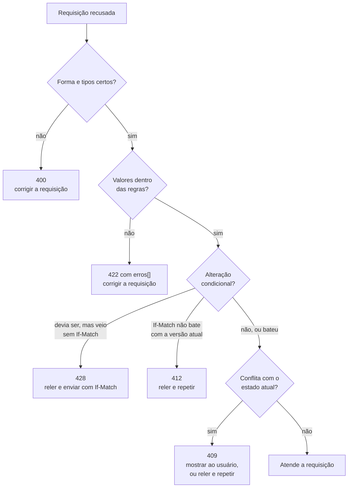

## O problema

O Bazar responde erros em Problem Details desde a [08.01](/construindo-apis-com-spring-boot/problem-details-rfc-9457), e o formato está certo. Mesmo assim, três conversas com integradores mostraram que formato não basta.

- **"Que erros essa API devolve?"** Ninguém sabia responder. Os tipos estavam espalhados em strings (`"sku-duplicado"`, `"conflito-de-versao"`) pelas exceções de cinco módulos. A URI do `type` (`https://api.bazar.example/problemas/sku-duplicado`) não levava a lugar nenhum.
- **"Quando eu tento de novo?"** O aplicativo de um parceiro repetia toda requisição que falhava, inclusive `422` e `409 SKU já cadastrado`: três tentativas idênticas, três erros idênticos. Outro parceiro não repetia nada, nem o `409 Conflito de versão`, que se resolve relendo o recurso.
- **"Por que `status=ESGOTADO` é 400 e `motivo: TALVEZ` é 422?"** Era verdade: a [13.01](/design-de-apis-profissional/filtros-e-busca) e a [15.04](/design-de-apis-profissional/enums-evolucao-e-tolerant-reader) tinham decidido coisas diferentes para o mesmo erro. Cada decisão era defensável sozinha, mas juntas não seguiam regra nenhuma.

O formato diz **como** um erro é escrito. Projetar erros é decidir **quais** erros existem, **que status** cada um usa, por um critério que qualquer pessoa da equipe aplica do mesmo jeito, e **o que o cliente faz** ao receber cada um. O resultado é um <Term id="catalogo-de-problemas">catálogo de problemas</Term>, e ele é parte do contrato da API.

## O conceito

### O que a RFC 9457 pede de um tipo de problema

A RFC 9457 (§4) diz o que a definição de um tipo novo precisa documentar:

1. uma URI para o `type`, *"typically, with the "http" or "https" scheme"*;
2. um `title` curto;
3. o status HTTP com que ele é usado.

E acrescenta: *"A problem type URI SHOULD resolve to HTML documentation that explains how to resolve the problem."* Uma URI que não abre nada cumpre o formato e perde metade do valor. Ao mesmo tempo, a RFC pede que os clientes não a sigam sozinhos: *"consumers SHOULD NOT automatically dereference the type URI"*. A URI é um **identificador** para programas e um **link** para pessoas.

A mesma seção traz um limite: nem todo erro merece um tipo próprio. *"Truly generic problems (...) are usually better expressed as plain status codes"*, com `type` igual a `about:blank`. O exemplo da RFC é um `403` num `PUT`, que se explica sozinho. No Bazar, a rota inexistente (`404`), o método não permitido (`405`) e o erro inesperado (`500`) ficam com `about:blank`, e o `codigo` é o nome do status (`METHOD_NOT_ALLOWED`).

### O catálogo do Bazar

| Status | `codigo` | Quando | O que o cliente faz |
|---|---|---|---|
| 400 | `REQUISICAO_INVALIDA` | JSON malformado, tipo errado (`precoMin=abc`) | Corrigir a requisição |
| 400 | `PARAMETRO_DESCONHECIDO` | Parâmetro que não é filtro (`?categoria=`) | Corrigir a requisição |
| 400 | `VALOR_NAO_ACEITO` | Valor fora da lista em `fields` ou `expand` | Corrigir a requisição |
| 400 | `ORDENACAO_INVALIDA` | `sort` com campo ou formato inválido | Corrigir a requisição |
| 400 | `CURSOR_INVALIDO` | Cursor alterado ou de outra consulta | Corrigir a requisição |
| 400 | `PATCH_INVALIDO` | Operação de JSON Patch impossível | Corrigir a requisição |
| 404 | `PRODUTO_NAO_ENCONTRADO` (e categoria, cliente, endereço, pedido) | O recurso não existe | Mostrar ao usuário |
| 406 | `FORMATO_NAO_ACEITO` | Nenhum formato do `Accept` disponível | Corrigir a requisição |
| 409 | `SKU_DUPLICADO`, `CATEGORIA_COM_PRODUTOS`, `ESTOQUE_INSUFICIENTE`, `TRANSICAO_INVALIDA`... | Válida, mas conflita com o estado atual | Mostrar ao usuário |
| 409 | `CONFLITO_DE_VERSAO`, `TESTE_DO_PATCH_FALHOU` | O recurso mudou desde a leitura | Reler e repetir |
| 415 | `FORMATO_NAO_SUPORTADO` | `Content-Type` não aceito | Corrigir a requisição |
| 422 | `VALIDACAO` | Campos com valores fora das regras (lista em `erros`) | Corrigir a requisição |

A última coluna é o que mais falta nos catálogos reais, e é ela que resolve a segunda conversa do início. São só quatro ações:

| Ação | Significado | Repetir? |
|---|---|---|
| **Corrigir a requisição** | O erro é do código do cliente | Não: a mesma requisição dá o mesmo erro |
| **Mostrar ao usuário** | É uma situação do negócio: SKU em uso, estoque acabou | Não automaticamente: o usuário decide |
| **Reler e repetir** | O recurso mudou entre a leitura e a escrita | Sim, depois de reler e reaplicar a mudança |
| **Aguardar e repetir** | Falha temporária (`429`, `503`, às vezes `500`) | Sim, com *backoff*, se a operação for idempotente |

A divisão não foi inventada para o Bazar. O `google.rpc.Code`, a lista de códigos canônicos do Google, traz a mesma classificação para escolher entre três códigos parecidos: *"Use UNAVAILABLE if the client can retry just the failing call. Use ABORTED if the client should retry at a higher level (...) restart a read-modify-write sequence. Use FAILED_PRECONDITION if the client should not retry until the system state has been explicitly fixed."* São, nessa ordem, "aguardar e repetir", "reler e repetir" e "mostrar ao usuário". A quarta ação, "aguardar e repetir", aparece nas páginas de [*rate limiting*](/padroes-avancados-de-http/rate-limiting-e-quotas) e de [*retry*](/consumindo-outras-apis/retry-quando-e-seguro-e-como-fazer).

### 400 × 422 × 409: um critério objetivo

O Bazar usa três status para "o cliente pediu algo que não pode ser feito", e a escolha entre eles precisa de uma regra que não dependa de quem escreve o código:

| Pergunta | Se sim |
|---|---|
| A requisição tem a **forma** errada? JSON malformado, **tipo** errado (texto onde se espera número), parâmetro que não existe | **400** |
| A forma está certa, mas um **valor** viola as regras do contrato, **independentemente do estado** do sistema? Campo vazio, número negativo, texto fora da lista de um enum | **422** |
| A requisição é válida, mas **conflita com o estado atual** do recurso? SKU já em uso, categoria com produtos, transição de status proibida | **409** |

O teste decisivo entre `422` e `409` é: **a mesma requisição, enviada a um sistema vazio, seria aceita?** `{"precoEmCentavos": -1}` é recusada em qualquer sistema: `422`. `{"sku": "LIV-0042"}` só é recusada porque outro produto já usa o SKU: `409`. É o mesmo critério do `INVALID_ARGUMENT` do Google, *"arguments that are problematic regardless of the state of the system"*.

Entre `400` e `422`, a pergunta é se o **tipo** está certo. Por esse critério, `status=ESGOTADO` é `422`: o parâmetro é um texto, e o texto não está na lista, exatamente como `"motivo": "TALVEZ"` no corpo. Já `precoMin=abc` é `400`: o contrato diz número, e chegou texto. Aplicar o critério corrigiu a inconsistência da terceira conversa. A partir desta página, `status=ESGOTADO` responde `422` com os valores aceitos, como o enum do corpo.

<HttpExchange
  title="Um status que não existe: tipo certo, valor fora da lista"
  request={{ method: 'GET', url: '/v1/produtos?status=ESGOTADO' }}
  response={{ status: 422, headers: { 'Content-Language': 'pt-BR', Vary: 'Accept-Language', 'Content-Type': 'application/problem+json' }, body: { type: 'https://api.bazar.example/problemas/validacao', title: 'Dados inválidos', status: 422, detail: 'A requisição tem 1 campo inválido.', instance: '/v1/produtos', erros: [ { campo: 'status', mensagem: 'deve ser um destes valores: RASCUNHO, ATIVO, DESCONTINUADO.' } ], codigo: 'VALIDACAO', traceId: 'c6b32dd83edf29975cf17a9a68c98d2f' } }}
>
Antes desta página, a mesma requisição recebia `400 requisicao-invalida`. Um `precoMin=abc` continua `400`: ali o tipo é que está errado.
</HttpExchange>

O fluxograma completo inclui os dois status das requisições condicionais, que o Bazar adota na [20.03](/padroes-avancados-de-http/concorrencia-otimista-com-if-match-412-e-428): o `428` quando uma alteração chega **sem** `If-Match`, e o `412` quando o `If-Match` não bate com a versão atual.



### Onde os guias divergem

O critério do Bazar é uma escolha, e os guias grandes escolheram diferente:

| | 400 | 422 | 409 |
|---|---|---|---|
| **Zalando** (#150) | Para tudo, inclusive *"business logic / semantic validation"* | *"Do not use"*: *"400 already covers most use-cases and there does not seem to be a clear benefit to differentiating between them"* | Conflitos de estado |
| **Google** (`google.rpc.Code`) | `INVALID_ARGUMENT` e também `FAILED_PRECONDITION` (o diretório não vazio do exemplo) | Não usa | `ABORTED` (concorrência) e `ALREADY_EXISTS` |
| **Bazar** | Forma e tipo | Valores fora das regras | Estado atual, incluindo regras de negócio |

O argumento do Zalando é forte: um cliente quase nunca age diferente diante de `400` e `422`, porque nos dois casos o código dele tem que mudar. O Bazar mantém o `422` por duas razões. A primeira é que ele sinaliza o formato da resposta: todo `422` do Bazar traz a lista `erros`, com um item por campo, e um cliente pode mostrar cada mensagem ao lado do campo do formulário sem olhar o `type`. A segunda é que a decisão é antiga, desde a [02.03](/comecando-e-fundamentos-de-http/status-codes-em-profundidade). Trocar o status de um erro existente quebra os clientes que testam o status (a [18.01](/contratos-documentacao-e-ciclo-de-vida/compatibilidade-retroativa-o-que-quebra-um-cliente) trata disso).

A diferença com o Google é mais interessante. "Remover uma categoria que tem produtos" é o exemplo de manual do `FAILED_PRECONDITION`, que o Google mapeia para `400`. O Bazar usa `409`, que a RFC 9110 define como *"a conflict with the current state of the target resource"*, e ganha uma distinção que o `400` apaga: o `409` diz ao cliente que a mesma requisição pode passar depois que o estado mudar, e o `400`, não.

O que **todos** concordam: um status por categoria de problema, um identificador estável e específico (o `type` e o `codigo` do Bazar, o `reason` do `ErrorInfo` do Google) para o cliente distinguir os casos, e textos para pessoas que não são contrato.

### Erros de campo: `campo` ou JSON Pointer?

A RFC 9457 mostra, no exemplo da §3, uma lista de erros de validação com um `pointer` em JSON Pointer (RFC 6901):

```json
"errors": [
  { "detail": "must be a positive integer", "pointer": "#/age" },
  { "detail": "must be 'green', 'red' or 'blue'", "pointer": "#/profile/color" }
]
```

O Bazar usa `campo` com a notação dos nomes do próprio contrato: `itens[0].produtoId`. Os dois formatos funcionam, e cada um tem o seu ponto forte:

| | JSON Pointer (`#/itens/0/produtoId`) | Caminho do Bazar (`itens[0].produtoId`) |
|---|---|---|
| Padrão | RFC 6901, com bibliotecas prontas | Convenção própria |
| Parâmetros de URL | Não se aplica: não são JSON | Mesmo formato (`status`, `precoMin`) |
| Legível para pessoas | Menos | Mais |
| Chaves com `.` ou `/` | Escapa (`~1`) | Ambíguo |

O Bazar fica com `campo`, por um motivo: a mesma lista `erros` serve ao corpo e aos parâmetros de URL, e um JSON Pointer não aponta para um parâmetro. Uma API só com corpos JSON tem um bom motivo para preferir o padrão. Trocar agora seria incompatível. Acrescentar um `pointer` ao lado de `campo`, nos erros de corpo, seria compatível.

### O que nunca vai num erro

A RFC 9457 é explícita: *"Problem details are not a debugging tool for the underlying implementation"*. Um erro do Bazar nunca leva:

- **SQL, nomes de tabelas e de *constraints***. A violação de unicidade do SKU vira `SKU_DUPLICADO` ([14.01](/design-de-apis-profissional/criacao-com-post-e-put-com-id-do-cliente)), e não o texto do PostgreSQL.
- ***Stack traces* e nomes de classes Java**. O `500` só leva o `traceId` ([08.02](/construindo-apis-com-spring-boot/problemdetail-no-spring-tratamento-global-de-erros)). A mensagem padrão do conversor do Spring (*"Failed to convert value of type 'java.lang.String' to required type..."*) é filtrada ([13.01](/design-de-apis-profissional/filtros-e-busca)).
- **O valor recebido, ecoado de volta**, que pode ser um dado sensível ou um ataque de injeção para quem mostrar a mensagem num HTML.
- **A existência de recursos que o cliente não pode ver.** O Google é explícito: *"Permission must be checked prior to checking if the resource or parent exists"*. Um `403` para o pedido de outro cliente confirma que ele existe. A [26.03](/seguranca-essencial-para-apis/autorizacao-por-objeto-exposicao-de-dados-e-validacao) e a [documentação de segurança](https://security-doc-beta.vercel.app/) tratam disso.

### Evolução: um `codigo` novo é compatível?

**Acrescentar um tipo** é compatível, com uma condição: os clientes precisam tratar um `codigo` desconhecido pelo **status**, que é o mesmo raciocínio do enum extensível da [15.04](/design-de-apis-profissional/enums-evolucao-e-tolerant-reader). Um cliente que conhece `SKU_DUPLICADO` e recebe um `409 NOME_DUPLICADO` novo mostra a mensagem ao usuário, como faria com qualquer `409`. Por isso a documentação do Bazar diz: *"Trate um `codigo` desconhecido pelo status HTTP."*

**Mudar um tipo existente** quebra os clientes, seja no status (`400` → `422`), no significado ou no nome. O AIP-193 diz o mesmo do `reason`: o mesmo par `(reason, domain)` para o mesmo erro, sempre. A mudança de `status=ESGOTADO` desta página só é aceitável porque o Bazar ainda não tem clientes em produção. Depois do lançamento, ela exigiria o processo da [18.01](/contratos-documentacao-e-ciclo-de-vida/compatibilidade-retroativa-o-que-quebra-um-cliente).

**Os textos** (`title`, `detail`, `mensagem`) podem mudar a qualquer momento, inclusive de idioma ([15.05](/design-de-apis-profissional/internacionalizacao-na-api)). Nenhum cliente deve depender deles.

**As extensões** (`quantidadeDeProdutos`, `versaoAtual`) podem ganhar campos, mas não perder. É a regra do AIP-193 para o `metadata`: *"New keys may be included"*, e *"All keys that have been included must continue to be included"*.

## Na prática

### O catálogo como código: `TipoProblema`

Os tipos saem das strings espalhadas e vão para um `enum`, que passa a ser a fonte única do catálogo:

```java title="src/main/java/com/bazar/compartilhado/erros/TipoProblema.java (trecho)"
/**
 * O catálogo de problemas do Bazar (16.01): todo type que a API devolve está aqui, com o status e o que o cliente
 * deve fazer ao recebê-lo. O nome da constante é o codigo do Problem Details; o slug (produto-nao-encontrado) é o
 * final da URI do type e a chave das mensagens (problemDetail.title.produto-nao-encontrado).
 * <p>
 * Um tipo novo é uma mudança compatível só se os clientes tratarem um codigo desconhecido pelo status (15.04). Um
 * tipo existente não muda de status nem de significado.
 */
public enum TipoProblema {

    // 400: a requisição não segue a forma do contrato (sintaxe, tipo, parâmetro desconhecido).
    REQUISICAO_INVALIDA(HttpStatus.BAD_REQUEST, CORRIGIR_A_REQUISICAO),
    PARAMETRO_DESCONHECIDO(HttpStatus.BAD_REQUEST, CORRIGIR_A_REQUISICAO),
    // ...
    // 409: a requisição é válida, mas conflita com o estado atual do recurso.
    SKU_DUPLICADO(HttpStatus.CONFLICT, MOSTRAR_AO_USUARIO),
    CATEGORIA_COM_PRODUTOS(HttpStatus.CONFLICT, MOSTRAR_AO_USUARIO),
    // ...
    CONFLITO_DE_VERSAO(HttpStatus.CONFLICT, RELER_E_REPETIR),

    // 422: a requisição tem a forma certa, mas um ou mais campos violam as regras (a lista vem em erros).
    VALIDACAO(HttpStatus.UNPROCESSABLE_CONTENT, CORRIGIR_A_REQUISICAO);

    /** O que um cliente bem escrito faz ao receber o problema. */
    public enum Acao {
        CORRIGIR_A_REQUISICAO, MOSTRAR_AO_USUARIO, RELER_E_REPETIR, AGUARDAR_E_REPETIR
    }

    private final HttpStatus status;
    private final Acao acao;

    /** produto-nao-encontrado: o final da URI e a chave das mensagens. */
    public String slug() {
        return name().toLowerCase(Locale.ROOT).replace('_', '-');
    }

    public URI uri() {
        return URI.create(BASE + slug());
    }
}
```

O `codigo` da resposta é o nome da constante, e o `type`, a URI derivada dela. Os dois não podem mais divergir.

Cada exceção de domínio aponta um tipo do catálogo:

```java title="src/main/java/com/bazar/catalogo/dominio/SkuDuplicadoException.java (trecho)"
public SkuDuplicadoException(String sku) {
    super(TipoProblema.SKU_DUPLICADO, Map.of("sku", sku), sku);
}
```

Com o status no tipo, o tratador global perde uma lista de nove métodos `@ExceptionHandler`, um por classe de exceção, cada um com o seu status. Fica um só:

```java title="src/main/java/com/bazar/compartilhado/erros/TratadorGlobalDeErros.java (trecho)"
// Toda exceção de domínio aponta um tipo do catálogo (TipoProblema), e o tipo define o status (16.01).
@ExceptionHandler(ExcecaoDeDominio.class)
ResponseEntity<Object> deDominio(ExcecaoDeDominio ex, WebRequest request) {
    var problema = Problemas.de(ex, getMessageSource(), LocaleContextHolder.getLocale());
    return handleExceptionInternal(ex, problema, new HttpHeaders(), ex.getTipo().status(), request);
}
```

E a *factory* de `ProblemDetail`, usada também pelos itens de um lote ([14.04](/design-de-apis-profissional/operacoes-em-lote)), deixa de receber o status:

```java title="src/main/java/com/bazar/compartilhado/erros/Problemas.java (trecho)"
public static ProblemDetail de(ExcecaoDeDominio ex, @Nullable MessageSource mensagens, Locale idioma) {
    var tipo = ex.getTipo();
    var problema = ErrorResponse.builder(ex, tipo.status(), tipo.slug())
            .type(tipo.uri())
            .titleMessageCode("problemDetail.title." + tipo.slug())
            .detailMessageCode("problemDetail." + tipo.slug())
            .detailMessageArguments(ex.getArgumentos())
            .build()
            .updateAndGetBody(mensagens, idioma);
    ex.getExtensoes().forEach(problema::setProperty);
    problema.setProperty("codigo", tipo.name());
    return problema;
}
```

Uma decisão a registrar: as exceções de domínio passam a conhecer o status HTTP, ainda que indiretamente, pelo `TipoProblema`. A alternativa é o tipo carregar uma categoria abstrata (como os códigos canônicos do Google: `NOT_FOUND`, `FAILED_PRECONDITION`, `ABORTED`) e a camada web traduzir a categoria em status. É mais pura, e vale para um domínio usado por vários protocolos (HTTP e gRPC, por exemplo). Para o Bazar, que só fala HTTP, ela seria uma tradução a mais sem ganho: o catálogo **é** um artefato da API, e o status faz parte dele.

### O teste do catálogo

Um catálogo em código só é confiável se um teste garantir que ele está completo:

```java title="src/test/java/com/bazar/compartilhado/erros/CatalogoDeProblemasTest.java (trecho)"
@ParameterizedTest
@EnumSource(TipoProblema.class)
void todoTipoTemTituloEDetalheNosDoisIdiomas(TipoProblema tipo) throws IOException {
    for (var arquivo : new String[] {"messages.properties", "messages_pt.properties"}) {
        var mensagens = carregar(arquivo);
        assertThat(mensagens).as(arquivo).containsKeys(
                "problemDetail.title." + tipo.slug(), "problemDetail." + tipo.slug());
    }
}

@ParameterizedTest
@ValueSource(strings = {"messages.properties", "messages_pt.properties"})
void nenhumaMensagemDeProblemaFicaForaDoCatalogo(String arquivo) throws IOException {
    var slugs = Arrays.stream(TipoProblema.values()).map(TipoProblema::slug).collect(Collectors.toSet());

    var orfas = carregar(arquivo).stringPropertyNames().stream()
            .filter(chave -> chave.startsWith("problemDetail.title."))
            .map(chave -> chave.substring("problemDetail.title.".length()))
            // As chaves das exceções do Spring (problemDetail.title.org.springframework...) não são tipos.
            .filter(sufixo -> !sufixo.contains("."))
            .filter(sufixo -> !slugs.contains(sufixo))
            .toList();

    assertThat(orfas).isEmpty();
}
```

Na primeira execução, o teste encontrou três tipos sem mensagens próprias: `requisicao-invalida`, `formato-nao-aceito` e `formato-nao-suportado`. Os três vêm de exceções do Spring, que usam as chaves por classe (`problemDetail.title.org.springframework...`) da [15.05](/design-de-apis-profissional/internacionalizacao-na-api). Eles ganharam uma descrição para o catálogo.

### O catálogo publicado

A URI de cada `type` agora abre uma página, gerada do `TipoProblema` e das mensagens, no idioma do `Accept-Language`:

```java title="src/main/java/com/bazar/compartilhado/erros/CatalogoDeProblemasController.java (trecho)"
/**
 * O catálogo de problemas publicado (16.01): a URI de cada type (https://api.bazar.example/problemas/sku-duplicado)
 * abre uma página para pessoas, como a RFC 9457 recomenda. A página é gerada do TipoProblema e das mensagens, então
 * não fica desatualizada, e sai no idioma do Accept-Language (15.05).
 */
@RestController
@RequestMapping(value = "/problemas", produces = MediaType.TEXT_HTML_VALUE)
public class CatalogoDeProblemasController {

    @GetMapping("/{slug}")
    ResponseEntity<String> tipo(@PathVariable String slug) {
        var idioma = LocaleContextHolder.getLocale();
        return TipoProblema.doSlug(slug)
                .map(tipo -> localizada(idioma).body(pagina(tipo, idioma)))
                .orElseGet(() -> ResponseEntity.notFound().build());
    }
    // ...
}
```

Primeiro, o erro que o cliente recebe:

<HttpExchange
  title="Remover uma categoria com produtos"
  request={{ method: 'DELETE', url: '/v1/categorias/0192f3a0-5555-7000-8000-000000000002' }}
  response={{ status: 409, headers: { 'Content-Language': 'pt-BR', Vary: 'Accept-Language', 'Content-Type': 'application/problem+json' }, body: { type: 'https://api.bazar.example/problemas/categoria-com-produtos', title: 'A categoria possui produtos', status: 409, detail: 'A categoria "Eletrônicos" tem 1 produto(s). Mova os produtos para outra categoria antes de removê-la.', instance: '/v1/categorias/0192f3a0-5555-7000-8000-000000000002', quantidadeDeProdutos: 1, codigo: 'CATEGORIA_COM_PRODUTOS', traceId: 'b369d4104242f64a387338ab79a7c7d6' } }}
>
Válida em si, mas conflita com o estado atual: `409`. Num sistema sem produtos, a mesma requisição passaria.
</HttpExchange>

E a página que a URI do `type` abre:

<HttpExchange
  title="A URI do type abre a documentação"
  request={{ method: 'GET', url: '/problemas/categoria-com-produtos', headers: { Accept: 'text/html' } }}
  response={{ status: 200, headers: { 'Content-Language': 'pt-BR', Vary: 'Accept-Language', 'Content-Type': 'text/html;charset=UTF-8' }, body: '<h1>A categoria possui produtos</h1>\n<dl>\n<dt>type</dt><dd><code>https://api.bazar.example/problemas/categoria-com-produtos</code></dd>\n<dt>status</dt><dd>409 Conflict</dd>\n<dt>codigo</dt><dd><code>CATEGORIA_COM_PRODUTOS</code></dd>\n<dt>detail</dt><dd>A categoria &quot;{0}&quot; tem {1} produto(s). Mova os produtos para outra categoria antes de removê-la.</dd>\n<dt>O que o cliente deve fazer</dt><dd>Mostrar ao usuário: é uma situação do negócio, e ele decide o próximo passo.</dd>\n</dl>' }}
>
Trecho do corpo. `GET /problemas` lista todos os tipos. Quando a documentação da API for gerada do OpenAPI (Parte 7), o catálogo pode ir para lá, e esta rota passa a redirecionar.
</HttpExchange>

## Erros comuns

<BadVsGood title="Tipos como strings soltas" why="Sem uma lista, ninguém sabe quais erros a API devolve. Um erro de digitação cria um tipo novo, e o status depende de qual handler pegou a exceção.">
<Bad title="Uma string em cada exceção">

```java
super("sku-duplicado", Map.of("sku", sku), sku);

@ExceptionHandler(SkuDuplicadoException.class)
ResponseEntity<Object> sku(SkuDuplicadoException ex, WebRequest r) {
    return deDominio(ex, HttpStatus.CONFLICT, r);
}
```

</Bad>
<Good title="Um catálogo, uma fonte de verdade">

```java
super(TipoProblema.SKU_DUPLICADO, Map.of("sku", sku), sku);

// TipoProblema.SKU_DUPLICADO(HttpStatus.CONFLICT, MOSTRAR_AO_USUARIO)
@ExceptionHandler(ExcecaoDeDominio.class)
ResponseEntity<Object> deDominio(ExcecaoDeDominio ex, WebRequest r) { ... }
```

</Good>
</BadVsGood>

<BadVsGood title="Cliente que repete qualquer erro" why="Um 422 ou um 409 de regra de negócio dá o mesmo resultado na segunda tentativa, e um POST repetido pode até duplicar efeitos. Repetir é uma decisão por tipo de erro.">
<Bad title="Retry cego">

```javascript
for (let i = 0; i < 3; i++) {
  const r = await fetch(url, opcoes);
  if (r.ok) return r;
}
```

</Bad>
<Good title="Pela ação do catálogo">

```javascript
if (r.status === 409 && erro.codigo === "CONFLITO_DE_VERSAO") {
  return relerEAplicarDeNovo();
}
if (r.status === 503 || r.status === 429) {
  return repetirDepois(r.headers.get("Retry-After"));
}
mostrarAoUsuario(erro);   // 4xx: repetir não muda nada
```

</Good>
</BadVsGood>

Outros erros frequentes:

- **Um `type` que não abre nada.** A RFC pede documentação na URI.
- **Um tipo por mensagem**, em vez de um tipo por **ação** do cliente (`NOME_VAZIO`, `NOME_LONGO`, `NOME_INVALIDO`). Variações de validação cabem em `VALIDACAO` com `erros`.
- **`409` e `422` trocados**: a regra vale em qualquer estado do sistema? Então é `422`.
- **`500` para erros do cliente**, como uma exceção de conversão que escapou do tratador.
- **Mudar o status de um tipo existente** depois que há clientes.
- **Detalhes internos no `detail`**: SQL, classes, *stack*, o valor recebido.
- **Clientes que decidem pelo `title`.**

## Boas práticas

- **Um catálogo único**, em código, com `type`, `codigo`, status e ação esperada do cliente.
- **Um teste** que garante que todo tipo tem título e detalhe em todos os idiomas, e que nenhuma mensagem fica órfã.
- **Publique o catálogo** na URI do `type`.
- **Um critério escrito** para `400`, `422` e `409`, aplicado do mesmo jeito em toda a API.
- **`about:blank`** para os erros que são só o status HTTP.
- **Clientes tratam um `codigo` desconhecido pelo status**, e a documentação diz isso.
- **Nunca mude** o status ou o significado de um tipo publicado.

## No projeto Bazar

<ProjectStep title="Catálogo de problemas: TipoProblema, critério 400/422/409 e o catálogo publicado" module="compartilhado (e as exceções de todos os módulos)" tag="pagina-16.01" files={[
  { path: 'src/main/java/com/bazar/compartilhado/erros/TipoProblema.java', change: 'novo' },
  { path: 'src/main/java/com/bazar/compartilhado/erros/CatalogoDeProblemasController.java', change: 'novo' },
  { path: 'src/main/java/com/bazar/compartilhado/erros/ExcecaoDeDominio.java', change: 'alterado' },
  { path: 'src/main/java/com/bazar/compartilhado/erros/Problemas.java', change: 'alterado' },
  { path: 'src/main/java/com/bazar/compartilhado/erros/TratadorGlobalDeErros.java', change: 'alterado' },
  { path: 'src/main/java/com/bazar/compartilhado/erros/RecursoNaoEncontradoException.java', change: 'alterado' },
  { path: 'src/main/java/com/bazar/compartilhado/erros/RegraDeNegocioException.java', change: 'alterado' },
  { path: 'src/main/java/com/bazar/estoque/api/AjusteDeEstoqueController.java', change: 'alterado' },
  { path: 'src/main/resources/messages.properties', change: 'alterado' },
  { path: 'src/main/resources/messages_pt.properties', change: 'alterado' },
  { path: 'src/test/java/com/bazar/compartilhado/erros/CatalogoDeProblemasTest.java', change: 'novo' },
  { path: 'src/test/java/com/bazar/compartilhado/erros/CatalogoDeProblemasControllerTest.java', change: 'novo' },
  { path: 'src/test/java/com/bazar/catalogo/api/ProdutoControllerTest.java', change: 'alterado' },
]}>
Os tipos de problema saem das strings e vão para o `enum TipoProblema`, com status e ação esperada do cliente. Todas as exceções de domínio (em `catalogo`, `clientes`, `estoque`, `pedidos` e `compartilhado`) passam a apontar um tipo, e o tratador global troca nove `@ExceptionHandler` por um. Um enum inválido na URL (`status=ESGOTADO`) passa a dar `422`, como no corpo. `GET /problemas` e `GET /problemas/{tipo}` publicam o catálogo em HTML. A suíte tem 285 testes.
</ProjectStep>

## Resumo

- Projetar erros é decidir quais existem, que status cada um usa e o que o cliente faz com ele. O resultado é um catálogo, parte do contrato.
- A RFC 9457 pede, para cada tipo, uma URI, um título e um status, e recomenda que a URI abra documentação em HTML. Erros genéricos ficam com `about:blank`.
- Quatro ações cobrem os clientes: corrigir a requisição, mostrar ao usuário, reler e repetir, aguardar e repetir. É a mesma divisão do `google.rpc.Code`.
- Critério do Bazar: forma ou tipo errados → `400`; valores fora das regras em qualquer estado → `422`; conflito com o estado atual → `409`. O Zalando usa `400` para os dois primeiros, e o Google mapeia `FAILED_PRECONDITION` para `400`.
- Erros de campo: JSON Pointer é o padrão da RFC para o corpo; o Bazar usa `campo` porque a lista serve também aos parâmetros de URL.
- Nada interno num erro: SQL, *stack*, classes, o valor recebido, a existência de recursos alheios.
- Um `codigo` novo é compatível se os clientes tratarem o desconhecido pelo status; mudar um existente quebra.

<Exercise title="O cupom de desconto" difficulty="medio">
O Bazar vai aceitar cupons no pedido (`"cupom": "NATAL25"`). Os erros possíveis:

- o código tem caracteres inválidos (`"cupom": "natal 25!"`);
- o cupom não existe;
- o cupom expirou;
- o cupom é válido, mas o valor do pedido está abaixo do mínimo dele;
- o cupom já foi usado pelo cliente;
- o cupom se esgotou: os 1000 usos acabaram entre a tela do carrinho e o envio do pedido.

1. Para cada um, dê o status, o `codigo` (novo ou existente) e a ação do cliente.
2. "O cupom não existe" deve ser `404`? O que um `404` diria nesse caso?
3. Algum desses erros revela algo que não deveria? Como o desenho evita isso?

<Hint>Para cada erro, pergunte: a mesma requisição seria recusada num sistema vazio? E lembre que um código de cupom é um segredo pequeno (15.03).</Hint>

<Solution>

1.

   | Erro | Status | `codigo` | Ação |
   |---|---|---|---|
   | Caracteres inválidos | 422 | `VALIDACAO` (campo `cupom`) | Corrigir a requisição |
   | Não existe | 422 | `CUPOM_INVALIDO` | Mostrar ao usuário |
   | Expirou | 422 | `CUPOM_INVALIDO` | Mostrar ao usuário |
   | Abaixo do mínimo | 409 | `CUPOM_NAO_APLICAVEL` (extensão `valorMinimo`) | Mostrar ao usuário |
   | Já usado pelo cliente | 409 | `CUPOM_NAO_APLICAVEL` | Mostrar ao usuário |
   | Esgotou no meio do caminho | 409 | `CUPOM_ESGOTADO` | Mostrar ao usuário (talvez sem o cupom) |

   O formato é uma regra que vale em qualquer estado: `422`, como qualquer validação. "Abaixo do mínimo", "já usado" e "esgotou" dependem do estado (do carrinho, do histórico, do estoque de usos): `409`. "Não existe" e "expirou" ficam juntos, como explicado nos itens 2 e 3.

2. Não. O recurso da URL é o **pedido** (`POST /v1/pedidos`), e ele existe. Um `404` diria que a URL não existe, e um cliente poderia concluir que errou o endpoint. O cupom é um **valor de um campo** que não corresponde a nada válido. Por isso `422`, com o tipo próprio para a interface mostrar "cupom inválido" ao lado do campo.

3. Sim. Respostas diferentes para "não existe" e "expirou" deixam um atacante descobrir quais códigos existem, testando códigos até receber "expirou". Um código expirado de uma campanha pode ter um irmão ativo com o mesmo prefixo. Por isso os dois casos usam o mesmo `CUPOM_INVALIDO`, com a mesma mensagem. O limite de tentativas da [23.01](/padroes-avancados-de-http/rate-limiting-e-quotas) completa a proteção. "Já usado" é diferente: só é dito ao próprio cliente, sobre um cupom que ele mesmo usou.
</Solution>
</Exercise>

<Quiz questions={[
  {
    question: 'Um POST /v1/produtos com sku "LIV-0042", já usado por outro produto. Qual status, pelo critério do Bazar?',
    options: [
      '400, porque a requisição está errada',
      '422, porque o SKU é um campo inválido',
      '409, porque a requisição só é recusada por causa do estado atual: num sistema vazio, ela passaria',
      '500, porque o banco recusou o INSERT',
    ],
    answer: 2,
    explanation: 'O teste entre 422 e 409: a mesma requisição seria aceita num sistema vazio? Se sim, o problema é o estado, e o status é 409.',
  },
  {
    question: 'O que a RFC 9457 recomenda para a URI do type?',
    options: [
      'Que seja um URN, para não ser acessada',
      'Que, se for http ou https, abra documentação legível (HTML) sobre o problema; mas que os clientes não a acessem automaticamente',
      'Que seja sempre about:blank',
      'Que inclua o status HTTP no caminho',
    ],
    answer: 1,
    explanation: 'A URI é um identificador para programas e um link para pessoas. O Bazar publica o catálogo em /problemas/{tipo}, gerado do TipoProblema.',
  },
  {
    question: 'Qual destes erros deve ter a ação "reler e repetir"?',
    options: [
      'SKU_DUPLICADO',
      'VALIDACAO',
      'CONFLITO_DE_VERSAO: o recurso mudou desde a leitura; o cliente busca o estado atual, reaplica a mudança e envia de novo',
      'PRODUTO_NAO_ENCONTRADO',
    ],
    answer: 2,
    explanation: 'É o ABORTED do google.rpc.Code: repetir num nível acima, refazendo a sequência ler-modificar-gravar.',
  },
  {
    question: 'O Bazar acrescenta um tipo novo, NOME_DUPLICADO (409). Quando essa mudança é compatível?',
    options: [
      'Nunca: todo tipo novo quebra os clientes',
      'Sempre, porque é só um texto novo',
      'Quando os clientes tratam um codigo desconhecido pelo status HTTP, como a documentação do Bazar pede',
      'Só se o title for o mesmo de outro tipo',
    ],
    answer: 2,
    explanation: 'É o mesmo raciocínio do enum extensível da 15.04. Já mudar o status ou o significado de um tipo existente é sempre incompatível.',
  },
]} />

## Referências

<References />
