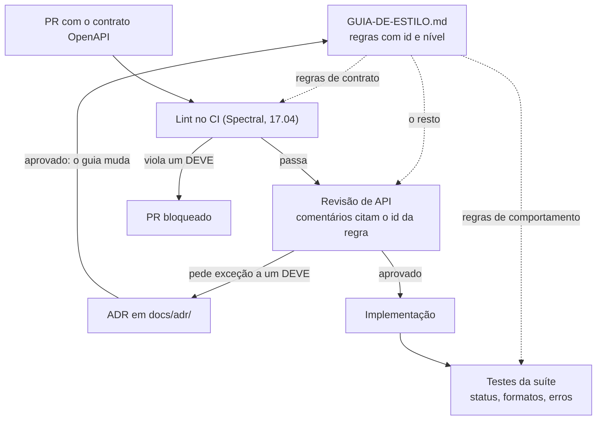

## O problema

As páginas das partes 12 a 16 tomaram umas oitenta decisões de design: caminhos no plural, `criadoEm` e não `dataCriacao`, `422` com `erros`, cursor para coleções grandes, `Dinheiro` com moeda, UUID v7, enums extensíveis. Cada decisão está justificada na sua página. Nenhuma pessoa nova na equipe vai ler vinte páginas antes de abrir o primeiro PR.

O Bazar vai ganhar uma segunda equipe, a de logística, com a sua própria API de entregas. Sem um documento que diga "é assim que fazemos APIs aqui", três coisas são quase certas:

- a API de entregas vai usar `created_at` e `page_size`, porque é o que o *framework* gera;
- alguém vai devolver `400` para um SKU duplicado, porque "é um erro do cliente";
- a revisão de cada PR vai virar uma discussão de gosto ("eu prefiro `offset`"), sem uma referência para encerrar a conversa.

O guia de estilo é esse documento. Ele não inventa regras: **consolida** decisões que já foram tomadas e justificadas, dá a cada uma um nível de obrigação e um identificador, e diz como uma exceção é pedida. A [17.04](/contratos-documentacao-e-ciclo-de-vida/governanca-linting-e-deteccao-de-breaking-changes) transforma parte dele em regras automáticas.

É o manual de redação de um jornal. Cem jornalistas escrevem a mesma palavra do mesmo jeito porque alguém decidiu uma vez, escreveu a regra com o motivo, e o revisor confere cada texto contra ela.

> **A pergunta desta página:** como transformar decisões de design espalhadas num guia de estilo que equipes diferentes seguem, que uma máquina consegue verificar e que tem um caminho claro para exceções?

## O conceito

### A estrutura de uma regra

Uma regra de guia de estilo tem cinco partes:

| Parte | Exemplo | Para quê |
|---|---|---|
| **Identificador** | `BZR-ERR-03` | Citar a regra num comentário de revisão ou numa mensagem de *lint* |
| **Nível** | **DEVE** | Dizer o custo de não seguir |
| **Enunciado** | "Valores fora das regras em qualquer estado → `422` com `erros`" | O que fazer, em uma frase verificável |
| **Justificativa** | Link para a [16.01](/design-de-apis-profissional/projetando-erros-catalogo-codigos-e-decisoes-dificeis) | Por que, para quem quiser discordar com argumentos |
| **Verificação** | *lint*, teste ou revisão | Como saber se a regra foi seguida |

A justificativa é o que separa um guia de uma lista de gostos. "Não use `double` para dinheiro" convence quem já viu `0.1 + 0.2`; para os outros, o link para a [15.02](/design-de-apis-profissional/dinheiro-e-numeros-decimais) faz o trabalho.

O identificador precisa ser **estável**. O Zalando numera as regras (`#112`, `#150`), e esses números aparecem em mensagens do Zally, o *linter* deles, em discussões e em outros guias, como as páginas deste curso. Uma regra removida fica marcada como retirada, e o número não é reaproveitado.

### Os níveis: RFC 2119 e RFC 8174

Os níveis de obrigação vêm do RFC 2119 (1997): **MUST**, **MUST NOT**, **SHOULD**, **SHOULD NOT**, **MAY**, com sinônimos (REQUIRED, SHALL, RECOMMENDED, OPTIONAL). O RFC 8174 (2017) esclareceu um ponto que gerava discussão: as palavras só têm o significado especial quando escritas em **maiúsculas**. "Você deve validar a entrada" é um conselho; "você **DEVE** validar a entrada" é uma obrigação.

Os três guias que o curso acompanha usam os níveis de formas diferentes:

| Guia | Como escreve | Observação |
|---|---|---|
| **Zalando** | `MUST`, `SHOULD`, `MAY` no título de cada regra | Declara o RFC 2119, mas *"case insensitive"*: o contrário do RFC 8174 |
| **Google (AIPs)** | **must**, **should**, **may** em minúsculas e negrito | O negrito faz o papel das maiúsculas |
| **Azure** | **DO**, **YOU SHOULD**, **YOU MAY**, **YOU SHOULD NOT**, **DO NOT**, com ícones | Cada nível diz o que fazer para não segui-lo |

O Azure é o mais útil como modelo, porque amarra cada nível ao **processo de exceção**. Para **DO NOT**: *"If you feel you need an exception, contact the Azure HTTP/REST Stewardship Board **prior** to implementation."* Para **YOU SHOULD**: *"If not following this advice, you MUST disclose your reason during the Azure HTTP/REST Stewardship Board review."* Para **YOU MAY**: *"No notification to the Azure HTTP/REST Stewardship Board is required."* O nível deixa de ser uma intensidade vaga e vira um custo concreto.

O Bazar escreve os níveis em português e copia a ideia do Azure:

| Nível | RFC 2119 | Exceção |
|---|---|---|
| **DEVE** / **NÃO DEVE** | MUST / MUST NOT | Só com um ADR aprovado na revisão de API |
| **DEVERIA** / **NÃO DEVERIA** | SHOULD / SHOULD NOT | Com o motivo escrito no PR |
| **PODE** | MAY | Nenhuma |

### Como os grandes guias se organizam

| | Microsoft | Google | Zalando |
|---|---|---|---|
| Forma | Um documento por plataforma: as diretrizes originais, e versões específicas para o Azure e o Microsoft Graph | Centenas de documentos curtos e numerados, as AIPs (*API Improvement Proposals*) | Um documento único, com regras numeradas, de APIs REST e de eventos |
| Ciclo de vida | Histórico de mudanças no próprio documento | Cada AIP tem estado: *draft*, *reviewing*, *approved*, *withdrawn*, *rejected*, *deferred*, *replaced* | Changelog com data; regras alteradas por PR |
| Quem decide | O *Azure HTTP/REST Stewardship Board* (no Azure) | Editores das AIPs; o líder técnico decide | A *API Guild*, dona do documento |
| Automação | Regras com âncoras estáveis, citadas pelas ferramentas | *api-linter*, que verifica as AIPs em definições protobuf | Zally, que verifica o OpenAPI |
| Ponto forte | Exceções e níveis amarrados ao processo | Cada assunto tem o seu documento, com estado e histórico | Tudo num lugar, com identificadores que todo mundo cita |

Para uma empresa com uma dúzia de APIs, o formato do Zalando é o certo: um documento, regras numeradas. O formato das AIPs compensa quando o guia tem centenas de regras e várias equipes propondo mudanças ao mesmo tempo. O Bazar começa com um arquivo.

### Onde os guias divergem

Os guias concordam no essencial: recursos no plural, JSON em *camelCase* (ou *snake_case*, de forma consistente), datas em RFC 3339, erros estruturados. Nos detalhes, divergem, e o guia da sua empresa precisa **escolher**. Algumas divergências que o curso já encontrou:

| Assunto | Zalando | Google | Microsoft / Azure | Bazar |
|---|---|---|---|---|
| Língua dos nomes | inglês [103] | inglês (AIP-140) | inglês | português (ADR-0001) |
| Validação | `400`; `422` *"do not use"* | `400` (`INVALID_ARGUMENT`) | `400` | `422` com `erros` (ADR-0002) |
| Links de paginação | no corpo | `next_page_token` no corpo | `nextLink` no corpo | header `Link` ([13.03](/design-de-apis-profissional/paginacao-por-offset)) |
| Lote com falhas parciais | `207` sempre | síncrono é atômico | | `207` sempre ([14.04](/design-de-apis-profissional/operacoes-em-lote)) |
| `GET` depois do `DELETE` lógico | `404` ou `410` | devolve o recurso | | devolve o recurso ([14.03](/design-de-apis-profissional/delete-soft-delete-e-arquivamento)) |
| Campo somente leitura enviado na escrita | | ignorar | `400` | ignorar ([14.01](/design-de-apis-profissional/criacao-com-post-e-put-com-id-do-cliente)) |
| Campo desconhecido no corpo | recusar (SHOULD, [108]) | | `400` | ignorar ([06.03](/construindo-apis-com-spring-boot/jackson-3-no-spring-boot-4)) |
| `DELETE` de algo que não existe | | `NOT_FOUND` | **DO** return `204` | `404` |

A última linha mostra por que copiar um guia inteiro não funciona. O Azure manda responder `204` a um `DELETE` *"even if the URL identifies a resource that does not exist"*, porque o estado final (o recurso não existe) é o que o cliente pediu. O Bazar responde `404`, porque um `DELETE` num id inexistente quase sempre é um id errado, e o `404` mostra isso. Os dois são defensáveis. O que não é defensável é cada equipe fazer de um jeito.

**Comece de um guia público e registre as diferenças.** Escrever um guia do zero é reabrir centenas de discussões que o Zalando e o Google já fecharam, com argumentos. O caminho prático é declarar uma base ("na falta de regra aqui, siga o Zalando") e escrever só o que é diferente, ou o que a base não cobre. O Bazar fez as escolhas ao longo do curso, comparando os três, e o guia dele registra o resultado.

### Decisões registradas: ADR

Uma regra diz **o quê**. Quando a regra diverge de um guia público, ou quando vai ser questionada daqui a dois anos por alguém que não estava na discussão, o **porquê** precisa de mais espaço que uma linha de tabela. Esse espaço é o <Term id="adr">ADR</Term> (*Architecture Decision Record*), formato proposto por Michael Nygard em 2011: um arquivo curto, numerado, com o contexto, a decisão e as consequências, **inclusive as ruins**.

Um ADR não é apagado quando a decisão muda: um ADR novo o substitui e diz qual substituiu. O conjunto vira o histórico das decisões, e responde à pergunta "por que isso é assim?" melhor que qualquer conversa.

### A revisão de API

O guia só funciona se alguém conferir as mudanças contra ele. O Zalando chama isso de *API First*: o contrato vem antes do código, e passa por uma revisão de pares e de clientes antes da implementação. O Azure exige a revisão do *Stewardship Board*. As AIPs são, nas palavras do AIP-1, *"used by API reviewers as a basis for review comments"*.



Na revisão, um bom comentário cita a regra: *"BZR-NOM-05: `dataCriacao` deveria ser `criadoEm`."* O comentário deixa de ser opinião do revisor, e a discussão, se houver, é sobre a regra, num PR do guia. Cada tipo de verificação pega um tipo de regra:

- **O *lint*** pega o que está no contrato: nomes, formatos, status documentados.
- **Os testes** pegam o comportamento: o `422` com `erros`, o `Content-Language`, o `207` do lote.
- **A revisão** pega o que nenhuma ferramenta vê: um recurso mal recortado, uma ação modelada como `PATCH`, um booleano que vai precisar de um terceiro estado.

O guia do Bazar marca, em cada regra, qual dos três a verifica. Uma regra marcada só como "revisão" é uma candidata a virar *lint* ou teste.

## Na prática

O guia mora no repositório do projeto, ao lado do código, em `docs/GUIA-DE-ESTILO.md`, e muda por PR como qualquer outro arquivo. Um trecho:

```markdown title="projeto-final/docs/GUIA-DE-ESTILO.md (trecho)"
## Como ler este guia

Os níveis seguem o RFC 2119, com o esclarecimento do RFC 8174: só valem quando escritos em maiúsculas.

| Nível | RFC 2119 | Significado no Bazar | Exceção |
|---|---|---|---|
| **DEVE** | MUST | Obrigatório | Só com ADR aprovado na revisão |
| **NÃO DEVE** | MUST NOT | Proibido | Só com ADR aprovado na revisão |
| **DEVERIA** | SHOULD | O padrão; não seguir exige um motivo | Motivo escrito no PR |
| **NÃO DEVERIA** | SHOULD NOT | Evitar; seguir exige um motivo | Motivo escrito no PR |
| **PODE** | MAY | Opcional | Nenhuma |

Cada regra tem um identificador estável (`BZR-NOM-01`). O identificador nunca é reaproveitado: uma regra removida
fica marcada como **retirada**. As regras de *lint* (17.04) e os comentários de revisão citam o identificador.

## 1. Nomes

| Id | Regra | Verificação | Origem |
|---|---|---|---|
| BZR-NOM-01 | Caminhos **DEVEM** usar substantivos no plural, em *kebab-case*, sem verbos, sem extensão e sem barra final (`/v1/ajustes-estoque`). | lint | 12.02 |
| BZR-NOM-03 | Recursos, campos e valores **DEVEM** estar em português, sem acentos (ADR-0001). | revisão | 12.02 |
| BZR-NOM-05 | Instantes **DEVEM** ter o nome no particípio seguido de `Em` (`criadoEm`, `canceladoEm`). Datas sem hora **DEVEM** usar `format: date`. | lint | 12.02, 15.01 |

## 4. Tipos de dados

| Id | Regra | Verificação | Origem |
|---|---|---|---|
| BZR-TIP-04 | Valores monetários **DEVEM** ter a moeda ISO 4217 e ser exatos: `{"valor": "129.90", "moeda": "BRL"}` (`Dinheiro`). `double` e `float` **NÃO DEVEM** representar dinheiro. | lint, teste | 15.02 |
| BZR-TIP-05 | Listas de negócio **DEVERIAM** ser enums extensíveis (`examples` + aviso na descrição). `enum` fechado só para listas completas por natureza. | lint | 15.04 |

## 7. Erros

| Id | Regra | Verificação | Origem |
|---|---|---|---|
| BZR-ERR-02 | Todo `type` **DEVE** estar no catálogo (`TipoProblema`), com status e ação esperada do cliente, e a URI **DEVE** abrir a documentação. | teste | 16.01 |
| BZR-ERR-03 | O status **DEVE** seguir o critério: forma ou tipo errados → `400`; valores fora das regras em qualquer estado → `422` com `erros`; conflito com o estado atual → `409` (ADR-0002). | revisão, teste | 16.01 |
```

O guia completo tem 44 regras em nove seções: nomes, recursos e URIs, identificadores, tipos de dados, métodos e respostas, coleções, erros, idioma e evolução. Termina com o processo (contrato no PR, *lint*, revisão, exceções) e a lista de ADRs.

Escrever o guia mostrou uma regra que nenhuma página tinha enunciado: os parâmetros transversais (`page`, `limit`, `cursor`, `sort`, `fields`, `embed`, `q`) estão em inglês, num contrato em português. Ninguém decidiu isso: cada página usou o nome comum do mercado. O guia transformou o costume em regra (BZR-NOM-04) e registrou o motivo no ADR-0001. Consolidar decisões costuma revelar decisões que nunca foram tomadas.

Um ADR, inteiro:

```markdown title="projeto-final/docs/adr/0002-criterio-400-422-409.md"
# ADR-0002: Critério 400 × 422 × 409

- **Status:** aceita
- **Data:** 2026-10-25 (422 decidido em 02.03; critério fixado em 16.01)
- **Regras afetadas:** BZR-ERR-03
- **Substitui:** a regra informal "400 para o que não converte", que tratava `status=ESGOTADO` (400) e
  `"motivo": "TALVEZ"` (422) de formas diferentes

## Contexto

O Zalando (regra 150) desaconselha o 422: "400 already covers most use-cases and there does not seem to be a clear
benefit to differentiating between them". O Google usa `INVALID_ARGUMENT` (400) para argumentos inválidos e mapeia
`FAILED_PRECONDITION` também para 400. O Bazar usa 422 desde a 02.03, e as respostas 422 trazem a lista `erros`.

## Decisão

- **400**: a requisição tem a forma ou o tipo errados (JSON malformado, texto onde se espera número, parâmetro
  desconhecido).
- **422**: a forma e os tipos estão certos, mas um ou mais valores violam regras que valem em qualquer estado do
  sistema (campo vazio, número negativo, texto fora da lista de um enum). A resposta traz `erros`, um por campo.
- **409**: a requisição é válida, mas conflita com o estado atual do recurso. Teste: a mesma requisição seria aceita
  num sistema vazio?

## Consequências

- Todo 422 tem a lista `erros`, e um cliente pode mostrar cada mensagem ao lado do campo sem olhar o `type`.
- O 409 diz que a mesma requisição pode passar quando o estado mudar; o 400 do Google não faz essa distinção.
- Divergimos do Zalando e do Google: integradores acostumados a eles precisam ler o catálogo (`/problemas`).
- Aplicar o critério mudou `status=ESGOTADO` de 400 para 422. Depois do lançamento, uma mudança assim seguiria o
  processo de mudanças incompatíveis (18.01).
```

## Erros comuns

<BadVsGood title="Uma regra sem nível, sem verificação e sem porquê" why="Ninguém sabe se ela é obrigatória, ninguém confere, e a primeira pessoa que discordar não tem argumento para ler. Na revisão, vira opinião contra opinião.">
<Bad title="Uma recomendação solta">

```markdown
- Evitar usar números para dinheiro.
```

</Bad>
<Good title="Identificador, nível, enunciado verificável, verificação, origem">

```markdown
| BZR-TIP-04 | Valores monetários **DEVEM** ter a moeda ISO 4217
  e ser exatos: `{"valor": "129.90", "moeda": "BRL"}`.
  `double` e `float` **NÃO DEVEM** representar dinheiro.
  | lint, teste | 15.02 |
```

</Good>
</BadVsGood>

Outros erros frequentes:

- **Um guia escrito do zero**, que reabre discussões que os guias públicos já fecharam.
- **Copiar um guia público inteiro** sem ler, e descobrir na primeira revisão que ele manda o contrário do que a API faz.
- **Tudo como MUST.** Se tudo é obrigatório, as exceções viram rotina, e o nível perde o sentido.
- **Regras de gosto** ("prefira nomes curtos"), que não dá para verificar.
- **Um guia num wiki**, longe do código, que ninguém atualiza quando uma decisão muda.
- **Exceções sem registro**, que a próxima equipe copia achando que são a regra.
- **Um guia sem processo de revisão**, que ninguém consulta.

## Boas práticas

- **Parta de um guia público** e escreva só as diferenças e o que ele não cobre.
- **Identificadores estáveis**, nunca reaproveitados.
- **Níveis do RFC 2119 em maiúsculas**, cada um com um custo de exceção definido.
- **Uma justificativa por regra**, nem que seja um link.
- **Diga como cada regra é verificada**: *lint*, teste ou revisão.
- **ADRs para as divergências** e para as decisões que vão ser questionadas.
- **O guia no repositório**, mudando por PR.
- **Revisão de API antes do código**, com comentários que citam a regra.

## No projeto Bazar

<ProjectStep title="O guia de estilo e os primeiros ADRs" module="docs" tag="pagina-16.02" files={[
  { path: 'docs/GUIA-DE-ESTILO.md', change: 'novo' },
  { path: 'docs/adr/0001-portugues-nos-nomes.md', change: 'novo' },
  { path: 'docs/adr/0002-criterio-400-422-409.md', change: 'novo' },
]}>
O guia consolida as decisões das partes 12 a 16 em 44 regras, cada uma com identificador, nível, forma de verificação e a página que a justifica. Dois ADRs registram as decisões que divergem dos guias públicos: português nos nomes e o critério 400 × 422 × 409. Nenhum código Java muda; a 17.04 transforma as regras marcadas como *lint* em regras do Spectral.
</ProjectStep>

## Resumo

- Um guia de estilo consolida decisões já tomadas, para que equipes diferentes façam APIs coerentes e revisões deixem de ser discussões de gosto.
- Cada regra tem identificador estável, nível, enunciado verificável, justificativa e forma de verificação.
- Os níveis vêm do RFC 2119; o RFC 8174 diz que só valem em maiúsculas. O Zalando os declara *case insensitive*, o Google usa minúsculas em negrito, o Azure amarra cada nível a um custo de exceção.
- Microsoft (um documento por plataforma), Google (AIPs numeradas, com estado) e Zalando (um documento, regras numeradas) concordam no essencial e divergem nos detalhes. O seu guia precisa escolher.
- Comece de um guia público e registre as diferenças. Divergências e decisões controversas vão em ADRs: contexto, decisão e consequências.
- O guia funciona com um processo: contrato no PR, *lint* no CI, revisão de API com comentários que citam as regras, exceções registradas.

<Exercise title="O guia da equipe de logística" difficulty="medio">
A equipe de logística vai criar a API de entregas do Bazar e mandou o primeiro rascunho do contrato para revisão:

```http
GET  /v1/entrega/{id}                → { "id": 18273, "status": "em_transito",
                                         "created_at": "2026-10-25 10:30",
                                         "frete": 15.9, "is_expressa": true }
POST /v1/entrega/{id}/atualizarStatus  { "status": "entregue" }
```

1. Escreva os comentários de revisão, cada um citando a regra do guia do Bazar.
2. A equipe argumenta que a transportadora parceira manda os status em minúsculas e que converter dá trabalho. É motivo para uma exceção? De que nível, e como ela seria registrada?
3. A equipe quer usar `offset` em vez de `cursor`, porque o painel interno tem um seletor de página. O que o guia diz, e o que você responde?

<Hint>Confira cada nome, cada tipo e o modelo da ação contra as seções 1 a 5 do guia. Para o item 2, pense em onde a conversão deveria acontecer.</Hint>

<Solution>

1. Comentários de revisão:

   - **BZR-NOM-01**: `/v1/entrega` deveria ser `/v1/entregas` (plural).
   - **BZR-ID-01** e **BZR-ID-02**: `"id": 18273` é sequencial e numérico; deveria ser UUID v7, como string.
   - **BZR-NOM-08**: `"em_transito"` deveria ser `EM_TRANSITO`.
   - **BZR-NOM-05** e **BZR-TIP-01**: `created_at` deveria ser `criadoEm`, em RFC 3339 UTC (`2026-10-25T13:30:00Z`); `"2026-10-25 10:30"` não tem fuso.
   - **BZR-TIP-04**: `"frete": 15.9` deveria ser `Dinheiro`: `{"valor": "15.90", "moeda": "BRL"}`.
   - **BZR-NOM-06**: `is_expressa` deveria ser `expressa`.
   - **BZR-REC-04** e **BZR-NOM-01**: `atualizarStatus` é um verbo, e mudar o status é uma ação com regras. Cada transição com regras vira um sub-recurso com nome de substantivo (`POST /v1/entregas/{id}/coleta`, `.../entrega-confirmada`), como o cancelamento do pedido ([12.04](/design-de-apis-profissional/acoes-que-nao-sao-crud-e-maquinas-de-estado)).
   - **BZR-TIP-05**: o status deveria ser um enum extensível, porque transportadoras vão acrescentar etapas.

2. Não. BZR-NOM-08 é **DEVE**, e a exceção exigiria um ADR, com um argumento que não se sustenta: o formato da transportadora é um detalhe de integração, e a conversão pertence ao adaptador que fala com ela, e não ao contrato do Bazar. Se a exceção passasse, todo cliente da API de entregas herdaria um formato diferente do resto da API. Esse é o caso que um ADR **recusado** registra bem: a próxima equipe que tiver o mesmo problema encontra a discussão pronta.

3. BZR-COL-04: coleções que crescem sem limite **DEVEM** usar cursor; offset **PODE** ser usado em coleções pequenas. Entregas crescem sem limite. A resposta: a API pública usa cursor. O painel interno pode navegar com "próxima" e "anterior" (os links `next` e `prev`) e filtrar por data para chegar a um período. Um seletor de "página 347 de 2.000" quase nunca é o que o usuário do painel precisa. Se a equipe ainda quiser offset, é um pedido de exceção a um **DEVE**: ADR e revisão.
</Solution>
</Exercise>

<Quiz questions={[
  {
    question: 'Segundo o RFC 8174, quando as palavras "must" e "should" têm o significado especial do RFC 2119?',
    options: [
      'Sempre',
      'Só quando escritas em maiúsculas (MUST, SHOULD)',
      'Só em documentos da IETF',
      'Só quando aparecem em negrito',
    ],
    answer: 1,
    explanation: 'O Zalando declara as palavras "case insensitive", contra o RFC 8174; o Google usa minúsculas em negrito. O Bazar segue o RFC 8174 e escreve DEVE, DEVERIA e PODE em maiúsculas.',
  },
  {
    question: 'Por que cada regra do guia tem um identificador estável, como BZR-ERR-03?',
    options: [
      'Para ordenar as regras',
      'Para que comentários de revisão, mensagens de lint e ADRs possam citá-la sem ambiguidade, mesmo depois que o texto muda',
      'Porque o RFC 2119 exige',
      'Para gerar o OpenAPI',
    ],
    answer: 1,
    explanation: 'Os números do Zalando (#112, #150) são citados por linters, discussões e outros guias. Por isso uma regra removida fica marcada como retirada, e o número não é reaproveitado.',
  },
  {
    question: 'Uma equipe quer quebrar uma regra DEVE do guia. O que o processo do Bazar pede?',
    options: [
      'Nada: o guia é uma recomendação',
      'Um comentário no PR',
      'Um ADR aprovado na revisão de API, com o contexto, a decisão e as consequências',
      'A remoção da regra',
    ],
    answer: 2,
    explanation: 'É a ideia do Azure: cada nível tem um custo de exceção. DEVERIA exige o motivo escrito no PR; PODE não exige nada.',
  },
  {
    question: 'Qual é o ponto de partida recomendado para o guia de estilo de uma empresa?',
    options: [
      'Escrever todas as regras do zero, discutidas com a equipe',
      'Copiar o guia do Google inteiro',
      'Partir de um guia público e escrever só as diferenças e o que ele não cobre, registrando as divergências em ADRs',
      'Não ter guia: o lint basta',
    ],
    answer: 2,
    explanation: 'Os guias públicos já fecharam centenas de discussões com argumentos. Copiar sem ler gera contradições com o que a API faz; escrever do zero reabre tudo.',
  },
]} />

## Referências

<References />
