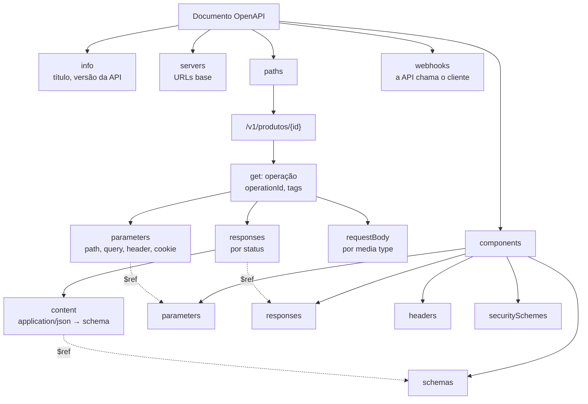

## O problema

O ERP de um lojista quer integrar com o Bazar. A equipe dele precisa saber, antes de escrever uma linha de código:

- quais endpoints existem, com que métodos e parâmetros;
- o formato exato de cada corpo: quais campos são obrigatórios, de que tipo, quais podem ser `null`;
- que status cada operação devolve, e o formato dos erros;
- como autenticar, e em que servidor testar.

Até aqui, a resposta estava espalhada: no código dos controllers, nas páginas deste curso, nos testes. Um arquivo de texto com exemplos de `curl` resolveria por uma semana. Depois, alguém acrescenta um campo e esquece de atualizar o arquivo, e o ERP descobre a diferença em produção.

Pense na planta elétrica de um prédio. O eletricista não precisa abrir as paredes para saber onde passa cada fio: a planta segue um padrão de símbolos que qualquer eletricista lê, e a prefeitura, o engenheiro e a equipe de reforma leem o mesmo desenho. Se a planta fosse um texto livre, cada um entenderia uma coisa.

O <Term id="openapi">OpenAPI</Term> é essa planta para APIs HTTP: um documento em YAML ou JSON, num formato padronizado, que descreve tudo o que um cliente precisa saber. Por ser legível por máquina, o mesmo documento gera a documentação navegável, clientes em várias linguagens, servidores de *mock*, testes e verificações automáticas de estilo.

> **A pergunta desta página:** como é organizado um documento OpenAPI, o que muda entre as versões 3.0, 3.1 e 3.2, e como descrever nele as convenções do Bazar: paginação por cursor, erros em Problem Details e enums extensíveis?

## O conceito

### Um pouco de história

O OpenAPI nasceu como **Swagger**, em 2011. No fim de 2015, a SmartBear doou a especificação à Linux Foundation, e em 2016 ela foi rebatizada de OpenAPI Specification; "Swagger" continuou como o nome das ferramentas da SmartBear (Swagger UI, Swagger Editor). Por isso você ainda vê `swagger: "2.0"` em documentos antigos e `openapi: 3.x` nos atuais. São a mesma linhagem: a versão 2.0 é o Swagger, a 3.0 (2017) já é o OpenAPI.

### A estrutura de um documento

Um documento OpenAPI 3.1 tem poucos campos no topo:

| Campo | Obrigatório | O que descreve |
|---|---|---|
| `openapi` | sim | A versão da **especificação** usada (`3.1.1`). Não é a versão da sua API |
| `info` | sim | Título, versão **da API**, descrição, contato, licença |
| `servers` | não | As URLs base (produção, *sandbox*). Sem ele, vale `/` |
| `paths` | um dos três | Os endpoints: caminho → métodos → operação |
| `webhooks` | um dos três | Requisições que a **API** faz para o cliente |
| `components` | um dos três | Definições reutilizáveis, citadas com `$ref` |
| `security` | não | Os esquemas de segurança exigidos por padrão |
| `tags` | não | Agrupamentos de operações, usados na documentação |

A especificação exige pelo menos um de `paths`, `components` ou `webhooks`. Um documento só com `components` é válido: é assim que uma empresa publica uma biblioteca de esquemas comuns (`Problema`, `Dinheiro`) para várias APIs.

Dentro de `paths`, a hierarquia é sempre a mesma: **caminho → método → operação**. Uma operação tem `operationId` (um nome único, usado pelos geradores de código como nome do método), `parameters`, `requestBody` e `responses`, com uma resposta por status.



### `components` e `$ref`: escrever uma vez

Os erros do Bazar têm sempre o mesmo formato. Repetir o esquema do Problem Details em cada uma das cinquenta respostas de erro seria pedir para as cópias divergirem. Em vez disso, ele é definido uma vez em `components` e citado com `$ref`:

```yaml
'404':
  $ref: '#/components/responses/NaoEncontrado'
```

O valor do `$ref` é uma URI. A parte depois do `#` é um JSON Pointer ([RFC 6901](https://www.rfc-editor.org/rfc/rfc6901)): o caminho dentro do documento. Um `$ref` também aponta para outros arquivos (`./esquemas/problema.yaml#/Problema`) ou URLs, o que permite dividir um contrato grande em vários arquivos.

Os `components` de um documento 3.1 têm dez seções: `schemas`, `responses`, `parameters`, `examples`, `requestBodies`, `headers`, `securitySchemes`, `links`, `callbacks` e `pathItems`. As quatro primeiras e os `securitySchemes` cobrem quase tudo o que uma API comum precisa.

### Os esquemas são JSON Schema

O corpo de uma requisição ou de uma resposta é descrito por um **Schema Object**. Na 3.1, ele é exatamente o <Term id="json-schema">JSON Schema</Term> 2020-12 que a [02.06](/comecando-e-fundamentos-de-http/json-para-apis) apresentou, com algumas palavras a mais (`discriminator`, `xml`, `externalDocs`). Isso significa que um validador de JSON Schema comum valida os corpos de um contrato 3.1, e que tudo o que o JSON Schema oferece está disponível: `const`, `if`/`then`, `prefixItems`, `$defs`.

Dois detalhes do JSON Schema aparecem o tempo todo num contrato:

- **`format` é uma anotação, e não uma validação.** `format: uuid` e `format: date-time` dizem o que o texto representa; a maioria dos validadores só os verifica se configurados para isso. Para uma regra que precisa ser verificada, use `pattern`.
- **`readOnly` e `writeOnly`.** Um campo `readOnly` (como o `id` e o `criadoEm`) aparece nas respostas e não deve ser enviado nas requisições. Com isso, um esquema só serve para criar e para ler. O Bazar ignora esses campos se vierem numa escrita ([14.01](/design-de-apis-profissional/criacao-com-post-e-put-com-id-do-cliente)).

### 3.0, 3.1 e 3.2

| | 3.0 (2017) | 3.1 (2021) | 3.2 (2025) |
|---|---|---|---|
| Esquemas | Um "dialeto" próprio, parecido com o JSON Schema draft 4, mas diferente em detalhes | **JSON Schema 2020-12** completo | Igual à 3.1 |
| Campo que aceita `null` | `nullable: true` | `type: [string, "null"]` | Igual à 3.1 |
| Exemplos no esquema | `example` (um) | `examples` (lista, do JSON Schema); `example` vira *deprecated* | Igual à 3.1 |
| *Webhooks* | Não (só `callbacks`) | `webhooks` no topo | Igual à 3.1 |
| `info.summary`, licença SPDX | Não | Sim | Sim |
| Novidades | | | Método `QUERY` e métodos extras (`additionalOperations`); *query string* inteira como um parâmetro (`in: querystring`); `itemSchema` para *streaming* (SSE, JSON Lines); `tags` hierárquicas (`parent`, `kind`); `$self`; fluxo OAuth *device authorization* |

A mudança que mais afeta o dia a dia é a da 3.0 para a 3.1. Na 3.0, o Schema Object era "um subconjunto estendido" do JSON Schema: parecido o bastante para enganar, diferente o bastante para quebrar ferramentas. A 3.1 eliminou a diferença. Quem migra de 3.0 para 3.1 tem três trocas principais: `nullable` vira um tipo em lista, `example` vira `examples`, e `exclusiveMinimum: true` vira `exclusiveMinimum: 0` (um número, como no JSON Schema).

As versões seguem `major.minor.patch`, e a especificação diz que o *patch* (3.1.**1**, 3.1.**2**) só corrige texto: *"Tooling which supports OAS 3.1 SHOULD be compatible with all OAS 3.1.\* versions."* A versão mais recente é a 3.2.1 (setembro de 2026); a 3.1 está na 3.1.2.

**Por que o Bazar usa a 3.1.** O contrato do Bazar vai ser gerado pelo springdoc a partir do código ([17.02](/contratos-documentacao-e-ciclo-de-vida/springdoc-openapi-documentacao-a-partir-do-codigo)), e o springdoc gera 3.1 por padrão; a documentação dele não fala da 3.2. O resto do ecossistema que o curso usa (Swagger UI, openapi-generator, Spectral) trabalha bem com a 3.1. Das novidades da 3.2, a que o Bazar aproveitaria é o `itemSchema` para descrever o *stream* SSE de acompanhamento do pedido ([19.04](/concorrencia-e-execucao-assincrona/server-sent-events-e-uma-visao-de-websocket)). Quando as ferramentas acompanharem, a migração é uma versão menor: o que é válido em 3.1 continua com o mesmo significado.

### *Webhooks*

A 3.0 tinha `callbacks`: requisições que a API faz de volta **como consequência de uma operação** ("ao criar a assinatura, a API vai chamar a URL que você informou"). A 3.1 acrescentou `webhooks` no topo do documento, para as chamadas que não nascem de uma operação específica. Um <Term id="webhook">*webhook*</Term> do Bazar avisa o lojista que um pedido foi pago:

```yaml
webhooks:
  pedidoPago:
    post:
      summary: Avisa o lojista que um pedido foi pago
      description: Enviado à URL cadastrada em `/v1/assinaturas-webhook` (21.03).
      operationId: pedidoPago
      requestBody:
        required: true
        content:
          application/cloudevents+json:
            schema:
              $ref: '#/components/schemas/EventoPedidoPago'
      responses:
        '204':
          description: O lojista recebeu o evento
```

Os papéis se invertem: o Bazar faz a requisição e o lojista implementa o endpoint. O contrato descreve o que o lojista vai receber e o que deve responder. A [21.03](/padroes-avancados-de-http/webhooks-enviando-e-recebendo) implementa os *webhooks* de saída, com assinatura e retentativas.

### Exemplos

Exemplos são a parte do contrato que as pessoas mais leem. Há dois lugares para eles:

- **No esquema**, `examples` é uma lista de valores, do JSON Schema: `examples: [RASCUNHO, ATIVO, DESCONTINUADO]`. Bom para valores soltos.
- **No media type**, `examples` é um mapa de **Example Objects**, com nome, `summary` e `value`. Bom para corpos completos e para mostrar casos diferentes ("um livro ativo", "um produto em rascunho"). É o que a Swagger UI mostra numa lista de seleção.

Os exemplos não são validados pela maioria das ferramentas. Um exemplo com um campo que não existe mais no esquema continua na documentação, ensinando errado. A [17.04](/contratos-documentacao-e-ciclo-de-vida/governanca-linting-e-deteccao-de-breaking-changes) liga a regra do Spectral que confere exemplos contra os esquemas.

### Arazzo e Overlay

A OpenAPI Initiative mantém duas especificações irmãs, que trabalham sobre documentos OpenAPI:

- **Arazzo** (1.1.0) descreve **fluxos**: sequências de chamadas, com a saída de uma alimentando a próxima ("crie o cliente, crie o pedido com o id dele, pague o pedido"). Serve para documentar casos de uso e gerar testes de ponta a ponta.
- **Overlay** (1.2.0) descreve **transformações** num documento OpenAPI: "acrescente esta descrição a estas operações", "remova as operações internas". Serve para publicar versões diferentes do mesmo contrato (a pública, sem as rotas administrativas) sem editar o original.

Nenhuma das duas é necessária para começar.

## Na prática

O trecho a seguir descreve o produto do Bazar em OpenAPI 3.1: o detalhe, a listagem com paginação por cursor, os erros reutilizáveis e o enum extensível. Ele foi validado com o Spectral 6.17 (`spectral lint`, conjunto de regras `spectral:oas`), sem erros.

### `info`, `servers` e `tags`

```yaml title="bazar-api.yaml (início)"
openapi: 3.1.1
info:
  title: API do Bazar
  version: 1.0.0
  summary: Catálogo, clientes e pedidos do marketplace Bazar.
  description: |
    Erros seguem o RFC 9457 (`application/problem+json`). O catálogo de tipos
    de erro está em https://api.bazar.example/problemas.
  contact:
    name: Equipe de plataforma do Bazar
    url: https://api.bazar.example/suporte
  license:
    name: Proprietária
    url: https://api.bazar.example/termos
servers:
  - url: https://api.bazar.example
    description: Produção
  - url: https://sandbox.api.bazar.example
    description: Sandbox
tags:
  - name: produtos
    description: Catálogo de produtos
```

`openapi: 3.1.1` é a versão da especificação; `info.version: 1.0.0` é a versão do **documento** da API. As duas não têm relação. A versão no caminho (`/v1`) também é outra coisa: a [18.02](/contratos-documentacao-e-ciclo-de-vida/estrategias-de-versionamento) discute como as três se relacionam.

### O detalhe do produto

```yaml title="bazar-api.yaml (paths)"
paths:
  /v1/produtos/{id}:
    get:
      tags: [produtos]
      operationId: detalharProduto
      summary: Detalha um produto
      parameters:
        - $ref: '#/components/parameters/IdDoProduto'
      responses:
        '200':
          description: O produto
          content:
            application/json:
              schema:
                $ref: '#/components/schemas/Produto'
              examples:
                livro:
                  summary: Um livro ativo
                  value:
                    id: 0192f3a0-1111-7000-8000-000000000042
                    sku: LIV-0042
                    nome: Clean Code
                    descricao: null
                    precoEmCentavos: 12990
                    categoriaId: 0192f3a0-5555-7000-8000-000000000003
                    status: ATIVO
                    atributos: { autor: Robert C. Martin }
                    criadoEm: '2026-10-25T13:30:00Z'
                    atualizadoEm: '2026-10-25T13:30:00Z'
        '404':
          $ref: '#/components/responses/NaoEncontrado'
```

Os códigos de status ficam entre aspas: em YAML, `404` sem aspas é um número, e a especificação exige que as chaves de `responses` sejam *strings*. A maioria dos *parsers* converte, mas não todos.

O esquema do produto mostra três convenções do Bazar: o campo que aceita `null` (a descrição), os campos somente leitura e o mapa de atributos:

```yaml title="bazar-api.yaml (components/schemas/Produto)"
Produto:
  type: object
  required: [id, sku, nome, descricao, precoEmCentavos, categoriaId, status, atributos, criadoEm, atualizadoEm]
  properties:
    id:
      type: string
      format: uuid
      readOnly: true
    sku:
      type: string
      pattern: '^[A-Z]{3}-\d{4,8}$'
    nome:
      type: string
      maxLength: 200
    descricao:
      type: [string, 'null']
      maxLength: 5000
    precoEmCentavos:
      type: integer
      format: int64
      minimum: 1
      description: Preço em centavos de real (BRL).
    categoriaId:
      type: string
      format: uuid
    status:
      $ref: '#/components/schemas/StatusProduto'
    atributos:
      type: object
      additionalProperties:
        type: string
    criadoEm:
      type: string
      format: date-time
      readOnly: true
    atualizadoEm:
      type: string
      format: date-time
      readOnly: true
```

`descricao` está em `required` **e** aceita `null`. As duas coisas são independentes: `required` diz que a chave sempre aparece, e o tipo diz que o valor pode ser `null`. É a convenção do Bazar desde a [02.06](/comecando-e-fundamentos-de-http/json-para-apis): campos sem valor saem como `null` explícito, nunca omitidos.

### O enum extensível

```yaml title="bazar-api.yaml (components/schemas/StatusProduto)"
StatusProduto:
  type: string
  description: |
    Lista extensível: valores novos podem ser acrescentados,
    e o cliente deve tolerar um valor que não conhece.
  examples: [RASCUNHO, ATIVO, DESCONTINUADO]
```

É a forma da regra 112 do Zalando, adotada na [15.04](/design-de-apis-profissional/enums-evolucao-e-tolerant-reader): `examples` em vez de `enum`. Com `enum: [RASCUNHO, ATIVO, DESCONTINUADO]`, um gerador de código cria um `enum` fechado no cliente, e o primeiro valor novo quebra a desserialização.

### Paginação por cursor

A listagem reaproveita parâmetros e o header `Link`, que todas as coleções do Bazar vão usar:

```yaml title="bazar-api.yaml (listagem)"
paths:
  /v1/produtos:
    get:
      tags: [produtos]
      operationId: listarProdutos
      summary: Lista produtos, paginando por cursor
      parameters:
        - name: status
          in: query
          description: Um ou mais status, separados por vírgula ou repetidos.
          schema:
            type: array
            items:
              $ref: '#/components/schemas/StatusProduto'
        - $ref: '#/components/parameters/Limit'
        - $ref: '#/components/parameters/Cursor'
      responses:
        '200':
          description: Uma página de produtos
          headers:
            Link:
              $ref: '#/components/headers/Link'
          content:
            application/json:
              schema:
                $ref: '#/components/schemas/ListaDeProdutos'
        '400':
          $ref: '#/components/responses/RequisicaoInvalida'
        '422':
          $ref: '#/components/responses/Validacao'

components:
  parameters:
    Limit:
      name: limit
      in: query
      description: Itens por página. Padrão 20; acima de 100, vale 100.
      schema: { type: integer, minimum: 1, default: 20 }
    Cursor:
      name: cursor
      in: query
      description: Opaco. Use o valor que veio no header `Link`, sem alterar.
      schema: { type: string }
  headers:
    Link:
      description: Links `first`, `prev` e `next` (RFC 8288).
      schema: { type: string }
  schemas:
    ListaDeProdutos:
      type: object
      required: [itens]
      properties:
        itens:
          type: array
          items:
            $ref: '#/components/schemas/ProdutoResumo'
```

O `limit` não tem `maximum: 100`, de propósito: o Bazar não recusa `limit=500`, ele devolve 100 itens ([13.03](/design-de-apis-profissional/paginacao-por-offset)). O contrato descreve o que a API **faz**, e um `maximum` diria a um validador que `limit=500` é inválido. O comportamento vai na descrição.

### O erro reutilizável

O Problem Details é definido uma vez, e cada tipo de resposta de erro o referencia:

```yaml title="bazar-api.yaml (components: o erro)"
components:
  schemas:
    Problema:
      type: object
      description: Problem Details (RFC 9457) com as extensões do Bazar.
      required: [type, title, status, codigo, traceId]
      properties:
        type: { type: string, format: uri }
        title: { type: string }
        status: { type: integer }
        detail: { type: string }
        instance: { type: string, format: uri-reference }
        codigo:
          type: string
          description: O tipo em MAIÚSCULAS, estável para o código do cliente.
          examples: [PRODUTO_NAO_ENCONTRADO]
        traceId: { type: string }
        erros:
          type: array
          items:
            type: object
            required: [campo, mensagem]
            properties:
              campo: { type: string }
              mensagem: { type: string }
  responses:
    NaoEncontrado:
      description: O recurso não existe
      content:
        application/problem+json:
          schema: { $ref: '#/components/schemas/Problema' }
```

O media type é `application/problem+json`, e não `application/json`. Um cliente gerado a partir do contrato usa o media type para escolher como ler a resposta. Esta é a resposta real que o contrato descreve:

<HttpExchange
  title="O 404 que o componente NaoEncontrado descreve"
  request={{ method: 'GET', url: '/v1/produtos/01a1746b-9dfb-7b92-885d-7bf7152ef90a' }}
  response={{ status: 404, headers: { 'Content-Type': 'application/problem+json', 'Content-Language': 'pt-BR', Vary: 'Accept-Language' }, body: { type: 'https://api.bazar.example/problemas/produto-nao-encontrado', title: 'Produto não encontrado', status: 404, detail: 'Não existe produto com id 01a1746b-9dfb-7b92-885d-7bf7152ef90a.', instance: '/v1/produtos/01a1746b-9dfb-7b92-885d-7bf7152ef90a', codigo: 'PRODUTO_NAO_ENCONTRADO', traceId: '87c30cd18f8a86663d6a2c1cb1efd9d6' } }}
>
Cada campo da resposta está no esquema `Problema`, e os obrigatórios (`type`, `title`, `status`, `codigo`, `traceId`) estão em `required`. Os headers `Content-Language` e `Vary` não estão no trecho; um contrato completo os descreveria em `headers`, como o `Link`.
</HttpExchange>

### A segurança

O esquema de autenticação é declarado em `components.securitySchemes` e exigido com `security`, no topo (para todas as operações) ou em cada operação:

```yaml
components:
  securitySchemes:
    jwt:
      type: http
      scheme: bearer
      bearerFormat: JWT
security:
  - jwt: []
```

O Bazar ainda não exige autenticação. O fluxo de tokens e os escopos estão na [documentação de segurança](https://security-doc-beta.vercel.app/), e a [26.04](/seguranca-essencial-para-apis/resource-server-com-jwt-o-essencial) liga a validação do JWT à API.

## Erros comuns

<BadVsGood title="Um campo que aceita null, escrito à moda da 3.0 num documento 3.1" why="Na 3.1, os esquemas são JSON Schema 2020-12, que não conhece nullable. Palavras desconhecidas são ignoradas: o documento passa no Spectral sem nenhum erro, e o esquema diz que descricao é uma string que NÃO aceita null. Um validador recusa a resposta real do Bazar, e um gerador cria um campo não nulo.">
<Bad title="nullable: true (3.0)">

```yaml
openapi: 3.1.1
# ...
descricao:
  type: string
  nullable: true
```

</Bad>
<Good title="O tipo null na lista (3.1)">

```yaml
openapi: 3.1.1
# ...
descricao:
  type: [string, 'null']
```

</Good>
</BadVsGood>

O contrário também acontece. O mesmo trecho do Bazar, com `openapi: 3.0.4` no topo, dá seis erros no Spectral: `info.summary`, o `type` em lista, os dois `examples` em esquemas e os dois `const` não existem na 3.0. **O número da versão no topo muda o significado do resto do documento.**

Outros erros frequentes:

- **Copiar `enum` para listas que vão crescer.** Gera `enum` fechado nos clientes ([15.04](/design-de-apis-profissional/enums-evolucao-e-tolerant-reader)).
- **Esquecer as respostas de erro.** Um contrato com só o `200` diz ao cliente que nada dá errado. Documente pelo menos os erros que o cliente pode tratar: `404`, `409`, `422`.
- **`application/json` nos erros.** O media type certo é `application/problem+json`.
- **Status sem aspas** (`404:` em vez de `'404':`), que alguns *parsers* leem como número.
- **Restrições que a API não aplica**, como um `maximum` que o servidor não recusa, ou `required` em campos que às vezes faltam. O contrato passa a mentir.
- **Exemplos desatualizados**, que ninguém valida e que ensinam um formato que não existe mais.
- **Confundir `openapi` com `info.version`.** O primeiro é a versão da especificação; o segundo, a do documento da sua API.

## Boas práticas

- **Use a 3.1**, a menos que uma ferramenta essencial só leia a 3.0.
- **Reaproveite com `components`** tudo o que se repete: o erro, a paginação, os ids.
- **Um `operationId` por operação**, estável e legível: ele vira o nome do método nos clientes gerados.
- **Documente os erros** com o esquema do Problem Details e o media type certo.
- **`required` e `null` são coisas diferentes**: diga as duas.
- **`readOnly` nos campos gerados pelo servidor**, para que um esquema sirva para criar e para ler.
- **Descreva o comportamento real**, inclusive o que não é recusado.
- **Exemplos com `summary`**, um por caso importante, validados no CI.

## Resumo

- O OpenAPI é um documento padronizado, legível por pessoas e por máquinas, que descreve uma API HTTP. O mesmo documento gera documentação, clientes, *mocks* e testes.
- Os campos do topo são `openapi`, `info`, `servers`, `paths`, `webhooks`, `components`, `security` e `tags`. Em `paths`, a hierarquia é caminho → método → operação.
- `components` e `$ref` (um JSON Pointer) evitam repetição: o erro do Bazar é definido uma vez.
- Na 3.1, os esquemas são JSON Schema 2020-12: `type: [string, "null"]` em vez de `nullable`, `examples` em vez de `example`. A 3.2 acrescenta `QUERY`, *streaming* e tags hierárquicas.
- O Bazar usa a 3.1, que é o que o springdoc gera.
- `webhooks` descreve as requisições que a API faz para o cliente.
- Arazzo descreve fluxos de chamadas; Overlay, transformações num contrato.

<Exercise title="O contrato do DELETE e do POST de produto" difficulty="medio">
Escreva, em OpenAPI 3.1, as operações `DELETE /v1/produtos/{id}` e `POST /v1/produtos` do Bazar, reaproveitando os componentes desta página. Lembre do comportamento real:

- o `DELETE` responde `204`, ou `404` se o produto não existe ([14.03](/design-de-apis-profissional/delete-soft-delete-e-arquivamento));
- o `POST` responde `201` com `Location` e o produto, ou `201` sem corpo com `Prefer: return=minimal`; um SKU repetido dá `409`, e um corpo inválido, `422` ([14.01](/design-de-apis-profissional/criacao-com-post-e-put-com-id-do-cliente)).

<Hint>O corpo do `POST` pode reaproveitar o esquema `Produto`, graças ao `readOnly`. O `Prefer` é um parâmetro de header; o `Location` e o `Preference-Applied`, headers da resposta.</Hint>

<Solution>

```yaml
paths:
  /v1/produtos:
    post:
      tags: [produtos]
      operationId: criarProduto
      summary: Cadastra um produto
      parameters:
        - name: Prefer
          in: header
          description: '`return=minimal` responde sem corpo.'
          schema: { type: string, examples: ['return=minimal'] }
      requestBody:
        required: true
        content:
          application/json:
            schema:
              $ref: '#/components/schemas/Produto'
      responses:
        '201':
          description: 'O produto foi criado. Sem corpo com `Prefer: return=minimal`.'
          headers:
            Location:
              description: A URI do produto criado
              schema: { type: string, format: uri }
            Preference-Applied:
              description: '`return=minimal`, quando a preferência foi atendida'
              schema: { type: string }
          content:
            application/json:
              schema:
                $ref: '#/components/schemas/Produto'
        '409':
          description: Já existe um produto com este SKU
          content:
            application/problem+json:
              schema: { $ref: '#/components/schemas/Problema' }
        '422':
          $ref: '#/components/responses/Validacao'
  /v1/produtos/{id}:
    delete:
      tags: [produtos]
      operationId: removerProduto
      summary: Remove ou descontinua um produto
      parameters:
        - $ref: '#/components/parameters/IdDoProduto'
      responses:
        '204':
          description: O produto foi removido, ou descontinuado se já tem pedidos
        '404':
          $ref: '#/components/responses/NaoEncontrado'
```

Reaproveitar `Produto` no corpo funciona porque `id`, `criadoEm` e `atualizadoEm` são `readOnly`. Mas o esquema exige `descricao`, `status` e `atributos`, que o cadastro não exige. Um contrato fiel teria um esquema próprio para a criação (`CriarProduto`), como o Bazar tem um `CriarProdutoRequest`. A [17.02](/contratos-documentacao-e-ciclo-de-vida/springdoc-openapi-documentacao-a-partir-do-codigo) gera os dois a partir do código.
</Solution>
</Exercise>

<Quiz questions={[
  {
    question: 'Num documento com openapi: 3.1.1, um esquema tem type: string e nullable: true. O que acontece?',
    options: [
      'O campo aceita string ou null, como na 3.0',
      'O documento é recusado pelos validadores',
      'nullable é ignorado (não existe no JSON Schema 2020-12), e o campo não aceita null',
      'O campo passa a ser opcional',
    ],
    answer: 2,
    explanation: 'Na 3.1, os esquemas são JSON Schema 2020-12, e palavras desconhecidas são ignoradas. O Spectral não acusa erro. O jeito certo é type: [string, "null"].',
  },
  {
    question: 'Qual é a diferença entre o campo openapi e o campo info.version?',
    options: [
      'Nenhuma: os dois têm a versão da API',
      'openapi é a versão da especificação OpenAPI usada no documento; info.version é a versão do documento da sua API',
      'openapi é a versão da API; info.version é a do Swagger',
      'info.version é a versão que vai no caminho (/v1)',
    ],
    answer: 1,
    explanation: 'openapi: 3.1.1 diz como ler o documento. info.version (1.0.0) descreve o contrato da sua API. A versão no caminho é uma terceira coisa, discutida em 18.02.',
  },
  {
    question: 'Por que o StatusProduto do Bazar usa examples em vez de enum?',
    options: [
      'Porque enum não existe na 3.1',
      'Porque enum gera um tipo fechado nos clientes gerados, e o primeiro valor novo quebra a leitura',
      'Porque examples é validado e enum não',
      'Por estética',
    ],
    answer: 1,
    explanation: 'É a regra 112 do Zalando, adotada em 15.04. A lista é extensível, e a descrição avisa o cliente para tolerar valores desconhecidos.',
  },
  {
    question: 'Para que serve a seção webhooks, criada na 3.1?',
    options: [
      'Para descrever as operações assíncronas da API',
      'Para descrever as requisições que a própria API faz para uma URL do cliente, e que o cliente implementa',
      'Para substituir os callbacks',
      'Para descrever filas de mensagens',
    ],
    answer: 1,
    explanation: 'Os papéis se invertem: o Bazar faz a requisição, e o lojista implementa o endpoint. Os callbacks continuam existindo, para chamadas que nascem de uma operação específica.',
  },
]} />

## Referências

<References />
