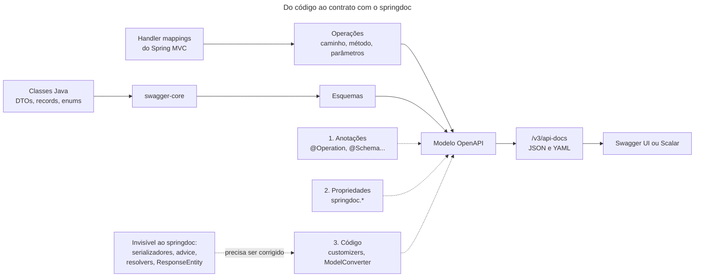

## O problema

A [17.01](/contratos-documentacao-e-ciclo-de-vida/a-especificacao-openapi) escreveu à mão um trecho do contrato do Bazar: dois endpoints e meia dúzia de esquemas, umas duzentas linhas de YAML. O Bazar tem 26 operações. Escrever o contrato inteiro à mão é um dia de trabalho, e mantê-lo é pior: cada campo novo num `record` exige uma edição no YAML, e a primeira edição esquecida transforma o contrato numa descrição de uma API que não existe mais.

O código já sabe quase tudo o que o contrato diz. O `@GetMapping("/{id}")` diz o caminho e o método, o `@PathVariable UUID id` diz o parâmetro e o tipo, o `ProdutoResponse` diz os campos e o `@NotBlank` diz o que é obrigatório. O <Term id="springdoc">springdoc-openapi</Term> lê tudo isso com a aplicação no ar e gera o contrato OpenAPI, sem nenhuma linha de YAML.

É como a lista de ingredientes de um alimento industrializado: ela sai da própria receita usada na fábrica, e não de alguém que copia a receita para o rótulo. Mas a receita só diz o que **entra**: "farinha" na receita vira "farinha de trigo enriquecida com ferro e ácido fólico" no rótulo, porque alguém precisou dizer o que a receita não dizia. O springdoc tem o mesmo limite. Ele vê as classes Java, e não o JSON que sai delas.

> **A pergunta desta página:** como gerar o contrato OpenAPI do Bazar a partir do código com o springdoc, o que o contrato gerado erra quando ninguém o configura, e como corrigir isso de forma que o contrato continue certo quando o código mudar?

## O conceito

### Como o springdoc funciona

Com a aplicação no ar, o springdoc percorre os *handler mappings* do Spring MVC: cada método de controller vira uma operação, com caminho, método HTTP, parâmetros e corpo. Os tipos Java (`ProdutoResponse`, `CriarProdutoRequest`) passam pelo **swagger-core**, a biblioteca que transforma classes em esquemas OpenAPI. O resultado sai em dois endereços:

| Endereço | O que é |
|---|---|
| `/v3/api-docs` | O contrato em JSON |
| `/v3/api-docs.yaml` | O mesmo contrato em YAML |
| `/swagger-ui.html` | Redireciona para `/swagger-ui/index.html`, a Swagger UI: o contrato navegável, com um botão para executar cada operação |

O springdoc 3.x é a linha para o Spring Boot 4. O Bazar usa a 3.2.0, que é compilada contra o próprio Boot 4.1.2. Ele gera **OpenAPI 3.1** por padrão (`springdoc.api-docs.version=openapi_3_1`); a outra opção é a 3.0. A documentação do springdoc não fala da 3.2.

A Swagger UI não é a única interface. O **Scalar** é uma alternativa mais recente, com um cliente HTTP embutido e uma navegação mais limpa; o springdoc tem um *starter* para ele (`springdoc-openapi-starter-webmvc-scalar`), que publica a interface em `/scalar`. Os dois leem o mesmo `/v3/api-docs`, e a escolha é de gosto.

### O que sai sem configuração

O Bazar ganhou a dependência e nada mais:

```xml title="pom.xml"
<dependency>
    <groupId>org.springdoc</groupId>
    <artifactId>springdoc-openapi-starter-webmvc-ui</artifactId>
    <version>${springdoc.version}</version> <!-- 3.2.0 -->
</dependency>
```

O contrato gerado tem 17 caminhos e 36 esquemas, e passa no Spectral sem nenhum erro de estrutura (só 72 avisos de estilo). Comparado com o JSON que a API realmente devolve, ele erra em quase tudo o que importa:

| O contrato gerado diz | O que a API faz | Por quê |
|---|---|---|
| `info.title: OpenAPI definition`, versão `v0`, servidor `http://localhost:8080` | | Ninguém disse o nome da API |
| `operationId: detalhar_1`, `detalhar_2`... `detalhar_5` | | Cinco controllers têm um método `detalhar`, e o springdoc desempata com sufixos |
| Tag `produto-controller` | | O nome da classe |
| Respostas com media type `*/*` | `application/json` | O springdoc não sabe o que o conversor de mensagens vai escolher |
| `POST /v1/produtos` responde `200` | `201` | O método devolve `ResponseEntity`, e o status é decidido em tempo de execução |
| Só o `200`, em todas as operações | `400`, `404`, `409`, `422` | Os erros vêm do `@RestControllerAdvice`, que devolve `ResponseEntity` |
| `filtro`, `sort` e `janela` são parâmetros-objeto obrigatórios | Um parâmetro por campo, todos opcionais | São `@ModelAttribute` |
| `contexto` é um parâmetro de *query* | É o header `Bazar-Canal` | Um `HandlerMethodArgumentResolver` próprio (09.02) |
| `Dinheiro` tem `valor` número e `moeda` objeto (com `currencyCode`, `symbol`, `displayName`...) | `{"valor": "129.90", "moeda": "BRL"}` | O serializador próprio do `Dinheiro` (15.02) é invisível |
| `ProblemDetail` tem um campo `properties` | As extensões ficam no topo (`codigo`, `traceId`) | Idem: o Jackson "espalha" o mapa no JSON |
| `status` é `enum` fechado | Lista extensível ([15.04](/design-de-apis-profissional/enums-evolucao-e-tolerant-reader)) | O springdoc lê o `enum` Java |
| `descricao` não aceita `null`; nenhum campo é `required` | Todo campo sempre presente, `null` explícito | Nada no código diz isso ao springdoc |
| Um esquema `Item` com `produtoId` e `quantidade` | Quatro `record Item` diferentes | Os quatro têm o mesmo nome simples, e o primeiro vence |
| `/error` com seis métodos | | O `BasicErrorController` do Spring Boot |

A última coluna é a lição. O springdoc vê **classes**; o cliente vê **JSON**. Tudo o que acontece entre os dois (um serializador próprio, um `ResponseEntity`, um *advice*, um *resolver*) é invisível para ele. E o contrato errado é pior que nenhum: um cliente gerado a partir dele quebra ao ler o primeiro `Dinheiro`.

A linha do `Item` merece atenção, porque não dá erro nenhum. Os esquemas do OpenAPI vivem num espaço de nomes só, e o swagger-core usa o nome simples da classe. `PedidoResponse.Item`, `CriarPedidoRequest.Item`, `ResultadoDoLote.Item` e `AjusteDeEstoqueEmLoteRequest.Item` viraram um único `Item`, o do primeiro que apareceu. O contrato descreve os itens do pedido com os campos do item da criação.

### Três ferramentas de correção

O springdoc oferece três níveis de correção, do mais local ao mais global:

1. **Anotações** no controller e nos DTOs (`@Operation`, `@ApiResponse`, `@Parameter`, `@Schema`, `@Tag`), do pacote `io.swagger.v3.oas.annotations`. Servem para o que é próprio de uma operação: o resumo, os erros que ela devolve, o exemplo de um parâmetro.
2. **Propriedades** (`springdoc.*`) para comportamentos gerais: quais caminhos entram, o media type padrão, o achatamento dos `@ModelAttribute`.
3. **Código**: `SpringDocUtils` (trocar o esquema de um tipo), `OperationCustomizer` (mexer em cada operação), `GlobalOpenApiCustomizer` (mexer no documento inteiro) e `ModelConverter` (mexer na conversão de classes em esquemas).

A regra prática: **anotação para o que é exceção, código para o que é convenção.** Anotar `@Schema(requiredMode = REQUIRED)` em cada um dos 120 campos de resposta do Bazar seria correto e insustentável: o campo 121 vai ser esquecido. Uma convenção ("toda resposta traz todos os campos") se escreve uma vez, em código, e vale para os campos que ainda não existem.

## Diagrama



## Na prática

### As propriedades

```yaml title="src/main/resources/application.yml"
springdoc:
  # Só a API pública: o /error do Spring e as páginas HTML de /problemas não entram no contrato.
  # A 18.03 troca por /v*/**, quando chega a v2.
  paths-to-match: /v1/**
  # Sem isso, as respostas aparecem como */*: o springdoc não sabe o que o conversor de mensagens vai escolher.
  default-produces-media-type: application/json
  # Os @ModelAttribute (FiltroProduto, JanelaPedida) viram um parâmetro de query por campo, como chegam de verdade.
  default-flat-param-object: true
  # Chaves em ordem alfabética: o contrato exportado (docs/openapi) muda só quando a API muda.
  writer-with-order-by-keys: true
  model-converters:
    # Campos com @Nullable (JSpecify) aceitam null no contrato: type: [string, "null"].
    java-nullable-property-customizer:
      enabled: true
  api-docs:
    # Em produção, o contrato é publicado no portal a partir do arquivo versionado (17.05), e não pela aplicação.
    enabled: ${BAZAR_CONTRATO_NA_APLICACAO:true}
  swagger-ui:
    enabled: ${BAZAR_CONTRATO_NA_APLICACAO:true}
    # A ordem do contrato, e não a alfabética.
    operations-sorter: method
```

O `java-nullable-property-customizer` é novo na 3.2.0 e vem **desligado**. Ligado, ele lê o `@Nullable` do JSpecify, que o Bazar já usa desde a [05.01](/construindo-apis-com-spring-boot/spring-boot-4-em-uma-pagina), e o `descricao` passa a ser `type: [string, "null"]`. Num campo que referencia outro esquema, ele usa `oneOf` com `type: "null"`, sem mexer no esquema compartilhado:

```yaml
categoria:
  oneOf:
  - $ref: '#/components/schemas/CategoriaResponse'
  - type: 'null'
```

### Os tipos que o springdoc não entende

`SpringDocUtils` troca o esquema deduzido de uma classe por um escrito à mão. O Bazar faz isso com o `Dinheiro` e o `ProblemDetail`, que são definidos uma vez como componentes, e com o `ContextoRequisicao`, que sai do contrato:

```java title="src/main/java/com/bazar/compartilhado/web/ConfiguracaoOpenApi.java (trecho)"
static {
    SpringDocUtils.getConfig()
            // O Dinheiro tem um serializador próprio (15.02): pela classe, o springdoc descreveria o Currency
            // inteiro e um número, e o JSON real é {"valor": "129.90", "moeda": "BRL"}.
            .replaceWithSchema(Dinheiro.class, new Schema<>().$ref(DINHEIRO))
            // O ProblemDetail guarda as extensões num mapa, que o Jackson espalha no JSON. Pela classe, o contrato
            // teria um campo "properties" que não existe.
            .replaceWithSchema(ProblemDetail.class, new Schema<>().$ref(PROBLEMA))
            // Preenchido pelo ContextoRequisicaoResolver a partir de headers, e não um parâmetro de query.
            .addRequestWrapperToIgnore(ContextoRequisicao.class);
}

private static Schema<?> dinheiro() {
    return tipo("object")
            .description("Um valor monetário exato, com a moeda (15.02).")
            .required(List.of("valor", "moeda"))
            .addProperty("valor", texto().pattern("^-?\\d+(\\.\\d+)?$")
                    .description("Decimal em texto, com as casas da moeda").examples(List.of("129.90")))
            .addProperty("moeda", texto().pattern("^[A-Z]{3}$")
                    .description("Código ISO 4217").examples(List.of("BRL")));
}

// Na OpenAPI 3.1, o tipo é uma lista (type: [string, "null"]): o swagger-core serializa types, e não type.
private static Schema<Object> tipo(String tipo) {
    return new Schema<>().types(Set.of(tipo));
}
```

O comentário do `tipo` registra uma armadilha que custou uma rodada de testes: `new Schema<>().type("object")` funciona na 3.0 e **some** na saída 3.1, sem erro. O esquema do `Problema` saiu com todos os campos e nenhum tipo. Na 3.1, o modelo do swagger-core guarda o tipo em `types`, um conjunto, porque o JSON Schema aceita uma lista.

### As convenções em código

Duas regras do Bazar valem para todos os DTOs e não têm propriedade pronta: os enums são extensíveis, e as respostas trazem todos os campos. Um `ModelConverter` entra na cadeia do swagger-core e ajusta cada esquema logo depois de gerado:

```java title="src/main/java/com/bazar/compartilhado/web/ConvencoesDoContrato.java (trecho)"
@Component
public class ConvencoesDoContrato implements ModelConverter {

    @Override
    public @Nullable Schema resolve(AnnotatedType tipo, ModelConverterContext contexto,
            Iterator<ModelConverter> cadeia) {
        if (!cadeia.hasNext()) {
            return null;
        }
        Schema esquema = cadeia.next().resolve(tipo, contexto, cadeia);
        if (esquema == null) {
            return null;
        }
        Class<?> classe = Json.mapper().constructType(tipo.getType()).getRawClass();
        if (classe.isEnum() && esquema.getEnum() != null) {
            tornarExtensivel(esquema);
        }
        else if (classe.isRecord() && classe.getPackageName().startsWith("com.bazar") && !ehEntrada(classe)) {
            var modelo = esquema.get$ref() == null ? esquema : contexto.getDefinedModels().get(nome(esquema));
            if (modelo != null) {
                modelo.setRequired(camposSemprePresentes(classe));
            }
        }
        return esquema;
    }

    // Uma entrada é um *Request (ou um tipo aninhado num) ou um record validado: respostas não levam validação.
    private static boolean ehEntrada(Class<?> classe) {
        for (var atual = classe; atual != null; atual = atual.getEnclosingClass()) {
            if (atual.getSimpleName().endsWith("Request")) {
                return true;
            }
        }
        // As anotações de validação de um componente chegam também ao método de acesso (todas aceitam METHOD).
        return Arrays.stream(classe.getRecordComponents())
                .flatMap(componente -> Arrays.stream(componente.getAccessor().getAnnotations()))
                .anyMatch(ConvencoesDoContrato::ehRestricao);
    }
```

Nas **entradas**, o springdoc já marca como `required` os campos com `@NotNull` e `@NotBlank`, e isso está certo: na criação do produto, `descricao` é opcional. Nas **respostas**, todo campo é `required`, menos os omitidos de propósito com `@JsonInclude(NON_NULL)`, como o `categoria` do produto, que só aparece com `?embed=categoria`. Para separar uma coisa da outra, a regra usa o que o Bazar já tem: entradas terminam em `Request` ou são validadas (`BuscaDeProdutos`), e nenhuma resposta tem anotação de validação.

Um `OperationCustomizer` resolve os nomes das operações com a mesma ideia, e acrescenta o header `Bazar-Canal` onde o `ContextoRequisicao` era usado:

```java title="ConfiguracaoOpenApi.java (trecho)"
@Bean
OperationCustomizer convencoesDasOperacoes() {
    return (operacao, metodo) -> {
        var anotacao = metodo.getMethodAnnotation(Operation.class);
        if (anotacao == null || anotacao.operationId().isBlank()) {
            var recurso = metodo.getBeanType().getSimpleName().replace("Controller", "");
            operacao.setOperationId(metodo.getMethod().getName() + recurso);
        }
        // ... o header Bazar-Canal nas operações que recebem ContextoRequisicao
        return operacao;
    };
}
```

`detalhar_3` vira `detalharCategoria`. O nome do método mais o recurso nem sempre fica bom: `PedidoAcoesController.cancelar` viraria `cancelarPedidoAcoes`, e por isso esse método declara `operationId = "cancelarPedido"`. Uma anotação explícita sempre vence a convenção.

Os nomes dos quatro `Item` são resolvidos na fonte, com `@Schema(name = "ItemDoPedido")` e equivalentes. Uma alternativa é `springdoc.use-fqn=true`, que usa o nome completo da classe (`com.bazar.pedidos.api.PedidoResponse.Item`) em todos os esquemas: resolve a colisão e deixa o contrato ilegível.

### Os erros

Um `GlobalOpenApiCustomizer` registra o esquema `Problema` (o mesmo da 17.01) e quatro respostas reutilizáveis, e acrescenta o `400` a todas as operações, porque o interceptor de parâmetros desconhecidos vale para qualquer rota `/v1` ([12.02](/design-de-apis-profissional/convencoes-de-nomenclatura)):

```java title="ConfiguracaoOpenApi.java (trecho)"
@Bean
GlobalOpenApiCustomizer errosReutilizaveis() {
    return openApi -> {
        var componentes = openApi.getComponents() == null ? new Components() : openApi.getComponents();
        componentes.addSchemas("Dinheiro", dinheiro());
        componentes.addSchemas("Problema", problema());
        componentes.addResponses("RequisicaoInvalida", erro("A requisição tem a forma ou o tipo errados"));
        componentes.addResponses("NaoEncontrado", erro("O recurso não existe"));
        componentes.addResponses("Conflito", erro("A requisição conflita com o estado atual do recurso"));
        componentes.addResponses("Validacao", erro("Um ou mais valores violam as regras; veja `erros`"));
        openApi.setComponents(componentes);
        if (openApi.getPaths() != null) {
            openApi.getPaths().values().forEach(caminho -> caminho.readOperations().forEach(operacao ->
                    operacao.getResponses().putIfAbsent("400",
                            new ApiResponse().$ref("#/components/responses/RequisicaoInvalida"))));
        }
    };
}
```

Os outros erros dependem da operação: só o `GET` por id dá `404`, só a criação dá `409` por SKU repetido. Esses vão nas anotações de cada método.

O springdoc tem um mecanismo automático para isso: ele lê os métodos `@ExceptionHandler` de um `@ControllerAdvice` anotados com `@ResponseStatus` e acrescenta essas respostas a **todas** as operações (propriedade `springdoc.override-with-generic-response`, ligada por padrão). O tratador do Bazar devolve `ResponseEntity`, e o mecanismo não o enxerga. Seria o caso de usá-lo? Não: ele diria que o `GET /v1/categorias` pode devolver `409 SKU duplicado`. Um contrato que lista todo erro possível em toda operação não ajuda ninguém a escrever o tratamento de erros.

### O controller anotado

```java title="src/main/java/com/bazar/catalogo/api/ProdutoController.java (trecho)"
@RestController
@RequestMapping("/v1/produtos")
@Tag(name = "produtos", description = "O catálogo de produtos")
public class ProdutoController {

    // As respostas de erro reutilizáveis, definidas em ConfiguracaoOpenApi (17.02).
    static final String NAO_ENCONTRADO = "#/components/responses/NaoEncontrado";
    static final String CONFLITO = "#/components/responses/Conflito";
    static final String VALIDACAO = "#/components/responses/Validacao";

    @PostMapping
    @Operation(operationId = "criarProduto", summary = "Cadastra um produto",
            description = "O produto nasce em `RASCUNHO`. Campos somente leitura enviados são ignorados. Um SKU "
                    + "repetido dá `409` (14.01).")
    @ApiResponse(responseCode = "201", description = "O produto foi criado. Sem corpo com `Prefer: return=minimal`.",
            headers = {
                @Header(name = "Location", description = "A URI do produto", schema = @Schema(type = "string")),
                @Header(name = "Preference-Applied", description = "`return=minimal`, quando foi atendido",
                        schema = @Schema(type = "string"))})
    @ApiResponse(responseCode = "409", ref = CONFLITO)
    @ApiResponse(responseCode = "422", ref = VALIDACAO)
    public ResponseEntity<ProdutoResponse> criar(@Valid @RequestBody CriarProdutoRequest request,
            @Parameter(description = "`return=minimal` responde sem corpo.", example = "return=minimal")
            @RequestHeader(name = "Prefer", required = false) @Nullable String prefer) {
        // ...
    }

    @GetMapping("/{id}")
    @Operation(operationId = "detalharProduto", summary = "Detalha um produto")
    @ApiResponse(responseCode = "200", description = "O produto")
    @ApiResponse(responseCode = "404", ref = NAO_ENCONTRADO)
    public ProdutoResponse detalhar(@PathVariable UUID id,
            @Parameter(description = "`categoria` traz a categoria dentro do produto.", example = "categoria")
            @RequestParam(required = false) @Nullable String embed) {
        // ...
    }
```

O `@ApiResponse(responseCode = "201")` não declara o corpo: o springdoc completa o `content` com o tipo de retorno do método. Duas armadilhas apareceram nas anotações:

- **`description` ao lado de `ref` é descartada.** Um `@ApiResponse(responseCode = "409", ref = CONFLITO, description = "SKU repetido")` sai só com o `$ref`. O motivo do conflito foi para a `description` da operação.
- **`@Parameter` num argumento `Sort` é ignorado**, porque o springdoc descreve o `Sort` por conta própria (em inglês). A descrição do `sort` do Bazar vai num `@Parameter(name = "sort", in = ParameterIn.QUERY, ...)` no método.

Os dois `PATCH` (Merge Patch e JSON Patch) têm o mesmo caminho e método. No contrato, eles são **uma** operação com dois media types no corpo, e o `requestBody` da anotação descreve os dois:

```java
@Operation(operationId = "corrigirProduto", summary = "Muda só alguns campos de um produto",
        requestBody = @io.swagger.v3.oas.annotations.parameters.RequestBody(required = true, content = {
            @Content(mediaType = MERGE_PATCH, schema = @Schema(type = "object",
                    description = "Os campos a mudar; `null` remove o valor.")),
            @Content(mediaType = JSON_PATCH, array = @ArraySchema(schema = @Schema(type = "object",
                    description = "Uma operação: `op`, `path` e, conforme a operação, `value` ou `from`.")))}))
```

Sem isso, o corpo aparecia como um esquema `JsonNode`, a classe do Jackson.

### O resultado

<HttpExchange
  title="O contrato gerado, com a aplicação no ar"
  request={{ method: 'GET', url: '/v3/api-docs' }}
  response={{ status: 200, headers: { 'Content-Type': 'application/json' }, body: { openapi: '3.1.0', info: { title: 'API do Bazar', version: '1.0.0', summary: 'Catálogo, clientes e pedidos do marketplace Bazar.' }, servers: [ { url: '/', description: 'Este servidor' }, { url: 'https://api.bazar.example', description: 'Produção' } ], paths: { '/v1/produtos/{id}': { get: { operationId: 'detalharProduto', summary: 'Detalha um produto', tags: [ 'produtos' ], responses: { '200': { description: 'O produto', content: { 'application/json': { schema: { $ref: '#/components/schemas/ProdutoResponse' } } } }, '400': { $ref: '#/components/responses/RequisicaoInvalida' }, '404': { $ref: '#/components/responses/NaoEncontrado' } } } } } } }}
>
Resposta reduzida: o documento completo tem 32 KB. O servidor `/` é relativo: a Swagger UI local chama a aplicação local, e não a produção.
</HttpExchange>

O esquema do produto, no arquivo exportado:

```yaml title="docs/openapi/bazar-api.yaml (trecho)"
ProdutoResponse:
  type: object
  properties:
    # ... atributos, atualizadoEm, categoria, categoriaId, criadoEm
    descricao:
      type:
      - string
      - 'null'
    # ... id, nome, precoEmCentavos, sku
    status:
      type: string
      description: 'Lista extensível: valores novos podem ser acrescentados, e o cliente deve tolerar um valor que não
        conhece (15.04).'
      examples:
      - RASCUNHO
      - ATIVO
      - DESCONTINUADO
  required:
  - atributos
  - atualizadoEm
  - categoriaId
  - criadoEm
  - descricao
  - id
  - nome
  - precoEmCentavos
  - sku
  - status
```

O `categoria` não está em `required`: ele só aparece com `?embed=categoria`.

Os nomes dos esquemas continuam sendo os das classes (`ProdutoResponse`, `CriarProdutoRequest`), e não `Produto` e `CriarProduto`, como no contrato escrito à mão da 17.01. Dá para renomear com `@Schema(name = ...)` em cada DTO. O Bazar mantém os nomes das classes: o sufixo é consistente, e os clientes gerados na [17.03](/contratos-documentacao-e-ciclo-de-vida/api-first-o-contrato-como-fonte-da-verdade) ficam com os mesmos nomes do servidor.

### Paginação e `Pageable`

Quem usa o `Pageable` do Spring Data direto no controller deve anotá-lo com `@ParameterObject`. Sem a anotação, o `Pageable` aparece como um objeto; com ela, como os três parâmetros que ele realmente lê (`page`, `size`, `sort`):

```java
@GetMapping
public Page<ProdutoResponse> listar(@ParameterObject Pageable pageable) { ... }
```

O Bazar não usa o `Pageable` ([13.03](/design-de-apis-profissional/paginacao-por-offset)). As páginas chegam em `@ModelAttribute` próprios (`PaginaPedida`, `JanelaPedida`), e a propriedade `default-flat-param-object` faz o mesmo papel do `@ParameterObject` para todos eles. A documentação de cada parâmetro vai num `@Schema` no componente do `record`:

```java title="src/main/java/com/bazar/compartilhado/web/JanelaPedida.java (trecho)"
public record JanelaPedida(
        @Schema(description = "Itens por página. Acima de 100, vale 100.", defaultValue = "20")
        @Nullable @Min(1) Integer limit,
        @Schema(description = "Opaco. Use o valor que veio no header `Link`, sem alterar.")
        @Nullable String cursor) {
```

### Grupos

Uma aplicação pode publicar vários contratos, um por grupo, com `GroupedOpenApi`:

```java
@Bean
GroupedOpenApi v1() {
    return GroupedOpenApi.builder().group("v1").pathsToMatch("/v1/**").build();
}
```

Cada grupo sai em `/v3/api-docs/{grupo}`, e a Swagger UI ganha uma lista para escolher. O uso mais comum é um contrato por versão da API, e é o que a [18.03](/contratos-documentacao-e-ciclo-de-vida/versionamento-nativo-no-spring-framework-7) faz quando o Bazar ganha a v2 do produto. Um `OpenApiCustomizer` comum vale só para o contrato padrão; para valer também nos grupos, ele precisa ser um `GlobalOpenApiCustomizer`, que é o tipo que o Bazar já usa.

### Em produção

A Swagger UI com o botão "Try it out" é uma forma cômoda de chamar a API. Em produção, é também uma forma cômoda de alguém chamar a API. E o `/v3/api-docs` publica a lista de tudo o que a aplicação expõe, inclusive o que ninguém lembrou de esconder. Há dois caminhos:

- **Desligar** (`springdoc.api-docs.enabled=false` e `springdoc.swagger-ui.enabled=false`) e publicar o contrato por outro meio: o arquivo versionado, num portal ([17.05](/contratos-documentacao-e-ciclo-de-vida/documentacao-alem-da-referencia)).
- **Proteger** os caminhos com autenticação, como qualquer outro endpoint ([Parte 11](/seguranca-essencial-para-apis/resource-server-com-jwt-o-essencial) e a [documentação de segurança](https://security-doc-beta.vercel.app/)).

O Bazar desliga. As duas propriedades leem a variável `BAZAR_CONTRATO_NA_APLICACAO`, que o *deploy* da [31.10](/projeto-final-o-bazar/observabilidade-carga-e-deploy) define como `false`. Com ela desligada, `/v3/api-docs` e `/swagger-ui.html` respondem `404`, e o resto da API continua igual.

### O contrato no repositório

Um contrato que só existe com a aplicação no ar não pode ser revisado num PR, comparado com a versão anterior nem publicado num portal. Ele precisa virar um arquivo.

O springdoc tem um plugin Maven para isso, o `springdoc-openapi-maven-plugin` (1.5). Ele sobe a aplicação na fase de testes de integração, com o `spring-boot-maven-plugin` (`start` e `stop`), baixa o `/v3/api-docs` e grava o arquivo. Para o Bazar, isso significaria subir a aplicação inteira no *build*, com um PostgreSQL disponível para ela.

O Bazar já sobe a aplicação inteira nos testes de integração, com o PostgreSQL do Testcontainers ([11.04](/testes-de-api/testes-de-integracao-com-springboottest-e-testcontainers)). Um teste a mais faz o trabalho do plugin, e ainda **falha** quando o contrato muda sem que o arquivo seja atualizado:

```java title="src/test/java/com/bazar/compartilhado/contrato/ContratoOpenApiTest.java"
/**
 * O contrato OpenAPI fica versionado em docs/openapi/bazar-api.yaml (17.02). Este teste gera o contrato a partir do
 * código e o compara com o arquivo: uma mudança na API que muda o contrato quebra o build até alguém atualizar o
 * arquivo, e a mudança aparece no diff do PR, onde é revisada (17.04).
 *
 * <p>Para atualizar o arquivo: {@code ./mvnw test -Dtest=ContratoOpenApiTest -Dcontrato.atualizar=true}.
 */
@TesteDeIntegracao
class ContratoOpenApiTest {

    static final Path ARQUIVO = Path.of("docs/openapi/bazar-api.yaml");

    @Autowired
    RestTestClient cliente;

    @Test
    void oContratoVersionadoEhOGeradoPeloCodigo() throws IOException {
        var gerado = cliente.get().uri("/v3/api-docs.yaml")
                .exchange()
                .expectStatus().isOk()
                .returnResult(String.class)
                .getResponseBody();

        if (Boolean.getBoolean("contrato.atualizar")) {
            Files.writeString(ARQUIVO, gerado);
        }
        assertThat(ARQUIVO).exists();
        assertThat(gerado)
                .as("O contrato mudou. Rode ./mvnw test -Dtest=ContratoOpenApiTest -Dcontrato.atualizar=true "
                        + "e revise o diff de " + ARQUIVO)
                .isEqualTo(Files.readString(ARQUIVO));
    }
}
```

O efeito é que **nenhuma mudança de contrato passa despercebida**. Quem acrescenta um campo ao `ProdutoResponse` vê o teste falhar, roda o comando e comita o YAML junto com o código. No PR, o revisor vê duas mudanças: a do Java e a do contrato. A segunda é a que interessa ao cliente, e é ela que a [17.04](/contratos-documentacao-e-ciclo-de-vida/governanca-linting-e-deteccao-de-breaking-changes) vai verificar automaticamente.

Para o diff ser legível, a saída precisa ser estável. `writer-with-order-by-keys` ordena as chaves; sem ele, a ordem dos caminhos depende da ordem em que o Spring registra os controllers.

### O Javadoc como fonte

O springdoc pode usar o Javadoc dos métodos e campos como `description`, com a biblioteca **therapi-runtime-javadoc**: um processador de anotações (`therapi-runtime-javadoc-scribe`) guarda o Javadoc nas classes compiladas, e o springdoc o lê em tempo de execução. A ideia é boa (o comentário já existe, e não precisa ser repetido numa anotação), mas a biblioteca está na 0.15.0, sem *release* desde julho de 2022. O Bazar não a usa. Os comentários do Bazar também explicam decisões de implementação ("o Spring 7.1 deixa de preencher sozinho"), que não pertencem ao contrato.

## Erros comuns

<BadVsGood title="Dois records aninhados com o mesmo nome simples" why="Os esquemas do OpenAPI vivem num espaço de nomes só, e o swagger-core usa o nome simples da classe. Os dois Item viram um esquema, o do primeiro encontrado, sem erro nem aviso. O contrato do pedido passa a descrever os itens com os campos da criação.">
<Bad title="O primeiro Item vence">

```java
public record PedidoResponse(..., List<Item> itens) {
    public record Item(UUID produtoId, String sku, String nomeProduto,
            int quantidade, Dinheiro precoUnitario, Dinheiro subtotal) { }
}

public record CriarPedidoRequest(List<Item> itens) {
    public record Item(@NotNull UUID produtoId,
            @NotNull @Positive @Max(100) Integer quantidade) { }
}
```

</Bad>
<Good title="Um nome por esquema">

```java
public record PedidoResponse(..., List<Item> itens) {
    @Schema(name = "ItemDoPedido")
    public record Item(UUID produtoId, String sku, String nomeProduto,
            int quantidade, Dinheiro precoUnitario, Dinheiro subtotal) { }
}

public record CriarPedidoRequest(List<Item> itens) {
    @Schema(name = "ItemDoNovoPedido")
    public record Item(@NotNull UUID produtoId,
            @NotNull @Positive @Max(100) Integer quantidade) { }
}
```

</Good>
</BadVsGood>

Outros erros frequentes:

- **Confiar no contrato sem configuração.** Ele é estruturalmente válido e descreve a API errada: `*/*`, `200` no `POST`, `Dinheiro` com `currencyCode`, nenhum erro.
- **Achar que o springdoc vê o JSON.** Ele vê classes. Serializadores próprios, `ResponseEntity`, *advices* e *resolvers* precisam ser descritos.
- **Anotar tudo à mão** quando a regra é uma convenção. O campo novo esquece a anotação.
- **`new Schema<>().type(...)`** com a saída 3.1: o tipo some. Use `types(Set.of(...))`.
- **`description` junto de `ref`** num `@ApiResponse`, que é descartada.
- **Swagger UI aberta em produção**, sem autenticação.
- **Contrato só em tempo de execução**, que ninguém revisa e que muda sem aviso.
- **Expor o `/error`** e rotas internas: use `paths-to-match` ou `@Hidden`.

## Boas práticas

- **Compare o contrato gerado com o JSON real** antes de confiar nele.
- **Propriedades primeiro, código para as convenções, anotações para as exceções.**
- **Nomes de operação estáveis**: `operationId` explícito ou uma convenção, nunca os sufixos `_1`.
- **Erros documentados** com respostas reutilizáveis e o media type `application/problem+json`.
- **`@Nullable` do JSpecify** ligado ao contrato com o `java-nullable-property-customizer`.
- **O contrato versionado no repositório**, com saída ordenada e um teste que acusa a diferença.
- **Desligue ou proteja** a UI e o `/v3/api-docs` em produção.

## No projeto Bazar

<ProjectStep title="O contrato gerado pelo springdoc e versionado" module="compartilhado" tag="pagina-17.02" files={[
  { path: 'pom.xml', change: 'alterado' },
  { path: 'src/main/resources/application.yml', change: 'alterado' },
  { path: 'src/main/java/com/bazar/compartilhado/web/ConfiguracaoOpenApi.java', change: 'novo' },
  { path: 'src/main/java/com/bazar/compartilhado/web/ConvencoesDoContrato.java', change: 'novo' },
  { path: 'src/main/java/com/bazar/catalogo/api/ProdutoController.java', change: 'alterado' },
  { path: 'src/main/java/com/bazar/compartilhado/web/JanelaPedida.java', change: 'alterado' },
  { path: 'src/main/java/com/bazar/pedidos/api/PedidoResponse.java', change: 'alterado' },
  { path: 'src/main/java/com/bazar/pedidos/api/CriarPedidoRequest.java', change: 'alterado' },
  { path: 'src/main/java/com/bazar/estoque/api/ResultadoDoLote.java', change: 'alterado' },
  { path: 'src/main/java/com/bazar/estoque/api/AjusteDeEstoqueEmLoteRequest.java', change: 'alterado' },
  { path: 'src/test/java/com/bazar/compartilhado/contrato/ContratoOpenApiTest.java', change: 'novo' },
  { path: 'docs/openapi/bazar-api.yaml', change: 'novo' },
]}>
O Bazar ganha o springdoc 3.2.0, com `/v3/api-docs` e a Swagger UI. As propriedades limitam o contrato a `/v1/**`, fixam o media type, achatam os `@ModelAttribute` e ligam o `@Nullable` do JSpecify. A `ConfiguracaoOpenApi` dá nome e servidores à API, substitui os esquemas do `Dinheiro` e do `ProblemDetail`, registra os erros reutilizáveis e nomeia as operações; a `ConvencoesDoContrato` torna os enums extensíveis e as respostas completas. O `ProdutoController` é anotado por inteiro, os outros controllers ganham `@Tag`, e os quatro `Item` ganham nomes próprios. O contrato fica em `docs/openapi/bazar-api.yaml`, e o `ContratoOpenApiTest` falha quando o código e o arquivo divergem. Em produção, a variável `BAZAR_CONTRATO_NA_APLICACAO=false` desliga o contrato e a UI. A suíte tem 286 testes.
</ProjectStep>

## Resumo

- O springdoc gera o contrato OpenAPI 3.1 a partir dos controllers e das classes, em `/v3/api-docs`, com a Swagger UI em `/swagger-ui.html`. O Scalar é uma alternativa de interface.
- Sem configuração, o contrato do Bazar era válido e errado: `*/*`, `200` no `POST`, nenhum erro, `Dinheiro` e `ProblemDetail` pela classe, enums fechados, nenhum campo obrigatório, quatro `Item` num esquema só.
- O springdoc vê classes, e não o JSON. O que acontece entre os dois precisa ser descrito.
- Propriedades para o geral, código (`SpringDocUtils`, `OperationCustomizer`, `GlobalOpenApiCustomizer`, `ModelConverter`) para as convenções, anotações para o que é próprio de cada operação.
- `@ParameterObject` (ou `default-flat-param-object`) para `Pageable` e `@ModelAttribute`; `GroupedOpenApi` para vários contratos.
- O contrato precisa ser um arquivo versionado. O Bazar usa um teste que o gera e o compara, no lugar do plugin Maven.
- Em produção, desligue ou proteja a UI e o `/v3/api-docs`.

<Exercise title="O contrato da categoria" difficulty="medio">
O `CategoriaController` ganhou só o `@Tag`. Abra o `/v3/api-docs` (ou o `docs/openapi/bazar-api.yaml`) e compare as operações de categoria com o comportamento real ([05.04](/construindo-apis-com-spring-boot/um-crud-com-status-corretos), [14.03](/design-de-apis-profissional/delete-soft-delete-e-arquivamento) e [16.01](/design-de-apis-profissional/projetando-erros-catalogo-codigos-e-decisoes-dificeis)).

1. Liste o que o contrato da categoria ainda diz de errado ou deixa de dizer.
2. Anote o controller para corrigir. Quais erros cada operação documenta?
3. Rode o `ContratoOpenApiTest`. O que acontece, e o que você faz?

<Hint>Olhe o status do `POST` e do `DELETE`, os erros de cada operação e as descrições. Remover uma categoria com produtos ou com subcategorias dá `409`.</Hint>

<Solution>

1. O `POST` diz `200`, e a API responde `201` com `Location`. O `DELETE` diz `200`, e a API responde `204`. Nenhuma operação tem `summary`, e os erros específicos faltam: `404` no `GET`, no `PUT` e no `DELETE` por id; `409` no `DELETE` (categoria com produtos ou com subcategorias); `422` no `POST` e no `PUT`. O `400` já vem de todas as operações.

2. Um trecho:

```java
@DeleteMapping("/{id}")
@Operation(operationId = "removerCategoria", summary = "Remove uma categoria",
        description = "Uma categoria com produtos ou com subcategorias não pode ser removida: `409`.")
@ApiResponse(responseCode = "204", description = "A categoria foi removida")
@ApiResponse(responseCode = "404", ref = "#/components/responses/NaoEncontrado")
@ApiResponse(responseCode = "409", ref = "#/components/responses/Conflito")
public ResponseEntity<Void> remover(@PathVariable UUID id) { ... }
```

Com o `operationId` explícito, a convenção do `OperationCustomizer` deixa de valer para este método, e o nome continua o mesmo (`removerCategoria`). As constantes `NAO_ENCONTRADO` e `CONFLITO` do `ProdutoController` podem ir para uma classe comum.

3. O teste falha com "O contrato mudou". Rode `./mvnw test -Dtest=ContratoOpenApiTest -Dcontrato.atualizar=true`, confira o diff do `docs/openapi/bazar-api.yaml` (só as operações de categoria devem mudar) e comite o arquivo junto com o controller.
</Solution>
</Exercise>

<Quiz questions={[
  {
    question: 'O Dinheiro do Bazar tem um serializador próprio que gera {"valor": "129.90", "moeda": "BRL"}. O que o springdoc gera sem configuração?',
    options: [
      'O formato certo, porque o springdoc usa o Jackson da aplicação',
      'Um esquema deduzido da classe: valor como número e moeda como o objeto Currency inteiro',
      'Nada: o Dinheiro fica fora do contrato',
      'Um erro na inicialização',
    ],
    answer: 1,
    explanation: 'O springdoc vê classes, e não o JSON. O esquema é trocado com SpringDocUtils.getConfig().replaceWithSchema(Dinheiro.class, ...).',
  },
  {
    question: 'Por que o POST /v1/produtos aparecia com 200 no contrato, se a API responde 201?',
    options: [
      'Porque o springdoc não suporta 201',
      'Porque o método devolve ResponseEntity e o status é decidido em tempo de execução; sem @ApiResponse ou @ResponseStatus, o springdoc supõe 200',
      'Porque falta o header Location',
      'Porque a especificação 3.1 não tem 201',
    ],
    answer: 1,
    explanation: 'O mesmo vale para o 204 do DELETE e para os erros do @RestControllerAdvice, que também devolve ResponseEntity.',
  },
  {
    question: 'Quatro records chamados Item, em classes diferentes, viraram um esquema só. Por quê?',
    options: [
      'Porque o springdoc ignora records aninhados',
      'Porque os esquemas do OpenAPI vivem num espaço de nomes só, o swagger-core usa o nome simples da classe, e o primeiro encontrado vence, sem aviso',
      'Porque os quatro têm os mesmos campos',
      'Porque falta @JsonProperty',
    ],
    answer: 1,
    explanation: 'A correção é @Schema(name = ...) em cada um. springdoc.use-fqn=true também resolve, com nomes completos e ilegíveis em todos os esquemas.',
  },
  {
    question: 'O Bazar versiona o contrato em docs/openapi/bazar-api.yaml. Para que serve o ContratoOpenApiTest?',
    options: [
      'Para validar as respostas da API contra o contrato',
      'Para falhar quando o contrato gerado pelo código difere do arquivo, obrigando a atualizar o arquivo e levando a mudança para o diff do PR',
      'Para gerar o código dos controllers',
      'Para publicar o contrato no portal',
    ],
    answer: 1,
    explanation: 'Ele faz o trabalho do springdoc-openapi-maven-plugin aproveitando a aplicação que os testes de integração já sobem, e transforma toda mudança de contrato numa mudança visível e revisável.',
  },
]} />

## Referências

<References />
