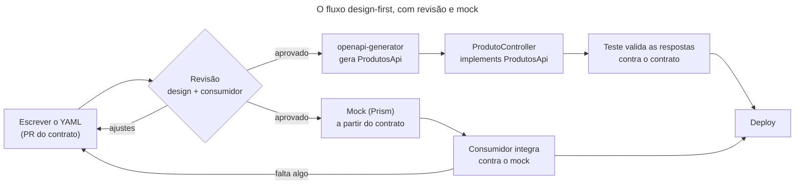

## O problema

Na [17.02](/contratos-documentacao-e-ciclo-de-vida/springdoc-openapi-documentacao-a-partir-do-codigo), o contrato do Bazar nasceu do código: o springdoc leu os controllers e gerou o YAML. Esse caminho tem uma consequência que só aparece com o tempo. O contrato só existe **depois** do código. O time do aplicativo, que vai consumir o `GET /v1/produtos`, espera o endpoint ficar pronto para saber que forma ele tem. E quem revisa a API revisa um PR de controller, entidade e serviço, onde a forma da API se perde entre os detalhes. Quando alguém nota que `precoEmCentavos` deveria ser um objeto `Dinheiro`, o código já existe, o aplicativo já consome o campo, e mudar custa caro.

Há um caminho inverso: escrever o contrato primeiro, revisá-lo como um documento, publicar um servidor de mentira que responde de acordo com ele e só então implementar. O contrato deixa de ser um subproduto do código e passa a ser a fonte de onde o código sai.

É a planta de uma casa. Ninguém levanta as paredes e depois desenha a planta para mostrar ao cliente onde ficou a cozinha. A planta vem antes: o cliente a revisa, o eletricista e o encanador trabalham a partir dela ao mesmo tempo, e a obra é conferida contra ela. Mudar uma parede no papel custa uma borracha, e na obra custa uma demolição.

> **A pergunta desta página:** quando vale escrever o contrato antes do código, como o fluxo *design-first* funciona com Prism e openapi-generator no Spring Boot 4, e como garantir, nos testes, que a implementação continua cumprindo o contrato, qualquer que seja o caminho escolhido?

## O conceito

### *Code-first* × *design-first*

As duas abordagens produzem um contrato OpenAPI. A diferença está em quem é a fonte e quem é a cópia:

- **Code-first:** o código é a fonte, e o contrato é gerado dele (springdoc, 17.02). É o caminho do Bazar até aqui.
- **Design-first:** o contrato é a fonte, escrito e revisado antes do código. O código é gerado dele (interfaces, modelos) ou conferido contra ele. É o que se chama de <Term id="api-first">API-first</Term>: a API é tratada como um produto, projetada antes da implementação.

<Comparison
  title="Code-first × design-first"
  columns={['Code-first', 'Design-first']}
  rows={[
    { label: 'Fonte da verdade', values: ['O código: o contrato é gerado dele', 'O contrato: o código é gerado dele ou conferido contra ele'] },
    { label: 'Quando o contrato existe', values: ['Depois da implementação', 'Antes da primeira linha de código'] },
    { label: 'O que se revisa', values: ['Um PR de código, com a forma da API diluída nele', 'Um PR de YAML, só com a forma da API'] },
    { label: 'Trabalho em paralelo', values: ['O consumidor espera o endpoint', 'O consumidor usa um mock desde o primeiro dia'] },
    { label: 'Risco principal', values: ['Detalhes de implementação vazam para a API (nomes de entidade, enums internos)', 'O contrato e o código divergem se nada os amarrar'] },
    { label: 'Custo', values: ['Baixo: o contrato vem de graça', 'Alto: escrever e manter YAML é um trabalho próprio'] },
    { label: 'Melhor para', values: ['APIs internas, um time só, mudanças rápidas', 'APIs públicas ou de parceiros, vários times, contratos que duram'] },
  ]}
/>

Nenhuma das duas é a certa em geral. O que importa é a pergunta "quem precisa do contrato antes do código?". Se a resposta é "ninguém", porque o mesmo time escreve a API e o único cliente, o *code-first* é mais barato. Se um time de aplicativo, um parceiro ou um cliente externo vai consumir a API, o contrato antes do código paga o custo do YAML com semanas de espera evitadas e com mudanças feitas no papel.

<Callout type="info" title="Os dois caminhos têm o mesmo ponto fraco">
No *code-first*, o contrato gerado pode não descrever o JSON real: o springdoc vê classes, e não o que sai delas (17.02). No *design-first*, o código pode se afastar do YAML assim que alguém muda um controller. Nos dois casos, a única proteção é um teste que confira as respostas reais contra o contrato. O Bazar ganha esse teste no fim desta página, e ele encontrou quatro diferenças num contrato que o próprio código tinha gerado.
</Callout>

### O fluxo *design-first*

O fluxo tem cinco passos, e os dois do meio (revisão e *mock*) são a razão de existir da abordagem:

1. **Escrever o contrato.** O YAML da operação nova, com esquemas, erros e exemplos, num PR próprio. A [17.01](/contratos-documentacao-e-ciclo-de-vida/a-especificacao-openapi) mostrou como.
2. **Revisar.** O PR do YAML é revisado por quem projeta a API e por quem vai consumi-la, contra o guia de estilo ([16.02](/design-de-apis-profissional/escrevendo-o-guia-de-estilo-da-sua-api)). O *lint* automático entra aqui ([17.04](/contratos-documentacao-e-ciclo-de-vida/governanca-linting-e-deteccao-de-breaking-changes)).
3. **Publicar um *mock*.** Um <Term id="servidor-de-mock">servidor de mock</Term> lê o contrato e responde como a API responderia. O consumidor começa a integrar no mesmo dia.
4. **Gerar as interfaces.** O <Term id="openapi-generator">openapi-generator</Term> transforma o contrato em interfaces Java com as anotações do Spring MVC.
5. **Implementar.** O controller implementa a interface gerada, e um teste confere as respostas reais contra o contrato.

Se a revisão ou o uso do *mock* mostram um problema, a correção é no YAML, e o ciclo recomeça barato: nenhum código foi escrito ainda.

### O que gerar e o que não gerar

O gerador sabe produzir quase tudo: controllers completos, modelos, configuração, até um `pom.xml`. A regra prática é gerar só o que é **pura tradução do contrato** e escrever à mão o que tem decisão:

- **Gerar:** as interfaces dos endpoints (caminho, método, parâmetros, validação, media types). É exatamente o que o contrato diz, e gerar garante que um parâmetro renomeado no YAML quebre a compilação.
- **Gerar com cuidado:** os modelos (DTOs). Eles traduzem os esquemas, mas o gerador decide coisas que você talvez decidisse diferente (classes mutáveis com *getters* e *setters*, por exemplo). Para os tipos que já existem no projeto, o `schemaMappings` aponta o esquema para a sua classe.
- **Não gerar:** a lógica (serviços, domínio, persistência), a configuração da aplicação e o tratamento de erros. Nada disso está no contrato.
- **Nunca editar o gerado.** O código gerado vai para `target/generated-sources` e é refeito a cada build. Ele não entra no repositório: o que entra é o contrato.

### O contrato no repositório

Nos dois caminhos, o contrato é um arquivo versionado junto do código. No *design-first*, ele é a entrada do build: o YAML muda num PR, o build gera as interfaces, e o controller que não acompanhar não compila. No *code-first*, ele é a saída: o Bazar gera o `docs/openapi/bazar-api.yaml` e um teste falha quando o arquivo e o código divergem (17.02). Em ambos, toda mudança de contrato aparece no diff, onde pode ser revisada e comparada com a versão anterior ([17.04](/contratos-documentacao-e-ciclo-de-vida/governanca-linting-e-deteccao-de-breaking-changes)).

## Diagrama



## Na prática

O exemplo usa o trecho do contrato que a [17.01](/contratos-documentacao-e-ciclo-de-vida/a-especificacao-openapi) escreveu à mão: `GET /v1/produtos` e `GET /v1/produtos/{id}`, com os esquemas `Produto`, `ProdutoResumo`, `Problema` e as respostas reutilizáveis. É um projeto à parte, para mostrar o fluxo *design-first* do início ao fim. O projeto do Bazar continua *code-first*; o que ele ganha desta página é o teste do fim.

### O *mock* com Prism

O [Prism](https://stoplight.io/open-source/prism) (Stoplight, 5.16.0) lê o contrato e sobe um servidor que responde de acordo com ele. Não precisa de instalação no projeto:

```bash
npx @stoplight/prism-cli@5.16.0 mock -p 4010 bazar-api.yaml
```

Para cada requisição, o Prism faz duas coisas. Primeiro, **valida a requisição** contra o contrato: caminho, parâmetros, corpo. Depois, **escolhe uma resposta**: a de menor código `2xx` declarada, preenchida com o primeiro exemplo da operação. O `detalharProduto` tem o exemplo `livro`, e é ele que volta:

<HttpExchange
  title="O Prism responde com o exemplo do contrato"
  request={{ method: 'GET', url: 'http://localhost:4010/v1/produtos/0192f3a0-1111-7000-8000-000000000042' }}
  response={{ status: 200, headers: { 'Content-Type': 'application/json' }, body: { id: '0192f3a0-1111-7000-8000-000000000042', sku: 'LIV-0042', nome: 'Clean Code', descricao: null, precoEmCentavos: 12990, categoriaId: '0192f3a0-5555-7000-8000-000000000003', status: 'ATIVO', atributos: { autor: 'Robert C. Martin' }, criadoEm: '2026-10-25T13:30:00Z', atualizadoEm: '2026-10-25T13:30:00Z' } }}
>
O id da URL não importa: o Prism não tem banco, então qualquer UUID devolve o mesmo exemplo. Um *mock* responde com a **forma** certa, e não com os dados certos. Para o aplicativo, a forma é o que importa no começo: telas, parsing e tratamento de erro.
</HttpExchange>

Uma requisição que viola o contrato não chega a procurar uma resposta. Com um id que não é UUID, o Prism devolve um erro dele, porque o `detalharProduto` não declara nem `400` nem `422`:

<HttpExchange
  title="A requisição inválida é recusada pelo próprio Prism"
  request={{ method: 'GET', url: 'http://localhost:4010/v1/produtos/abc' }}
  response={{ status: 422, headers: { 'Content-Type': 'application/problem+json' }, body: { type: 'https://stoplight.io/prism/errors#UNPROCESSABLE_ENTITY', title: 'Invalid request', status: 422, detail: 'Your request is not valid and no HTTP validation response was found in the spec, so Prism is generating this error for you.', validation: [ { location: ['path', 'id'], severity: 'Error', code: 'format', message: 'Request path parameter id must match format "uuid"' } ] } }}
>
Quando a operação declara uma resposta de validação, o Prism a usa no lugar desse erro genérico. O `GET /v1/produtos?limit=0` (o `Limit` tem `minimum: 1`) devolve o `422` que o contrato declara, com o media type `application/problem+json` do componente `Validacao`.
</HttpExchange>

O header `Prefer` controla o *mock* sem mudar o contrato. Com ele, o consumidor testa os caminhos de erro antes de a API existir:

| Header | Efeito |
|---|---|
| `Prefer: code=404` | Devolve a resposta `404` declarada |
| `Prefer: example=livro` | Escolhe o exemplo pelo nome |
| `Prefer: dynamic=true` | Gera dados aleatórios a partir dos esquemas, no lugar dos exemplos |

O `Prefer: code=404` mostra o que acontece com uma resposta **sem exemplo**: o Prism a preenche a partir do esquema, com valores de preenchimento. O corpo do `404` volta com `"title": "string"`, `"status": 0` e `"type": "http://example.com"`, e o header `Link` da listagem volta com o valor `string`. O *mock* é tão bom quanto os exemplos do contrato.

<Callout type="tip" title="O Prism também valida uma API real">
Além do `mock`, o Prism tem o modo `proxy`: ele fica entre o cliente e a API real, repassa as requisições e registra cada violação do contrato, na requisição e na resposta. É útil para conferir uma API em homologação sem mexer nos testes dela: `prism proxy bazar-api.yaml http://localhost:8080`.
</Callout>

### O gerador no Maven

O `openapi-generator-maven-plugin` gera o código na fase `generate-sources`, antes da compilação. A configuração para o Spring Boot 4:

```xml title="pom.xml"
<plugin>
    <groupId>org.openapitools</groupId>
    <artifactId>openapi-generator-maven-plugin</artifactId>
    <version>7.26.0</version>
    <executions>
        <execution>
            <goals><goal>generate</goal></goals>
            <configuration>
                <inputSpec>${project.basedir}/src/main/resources/openapi/bazar-api.yaml</inputSpec>
                <generatorName>spring</generatorName>
                <apiPackage>com.bazar.catalogo.api.gerado</apiPackage>
                <modelPackage>com.bazar.catalogo.api.gerado.modelo</modelPackage>
                <!-- Sem pom.xml, application.properties nem classe main geradas. -->
                <generateSupportingFiles>false</generateSupportingFiles>
                <!-- O esquema Produto é o ProdutoResponse do projeto: o gerador não cria um modelo para ele. -->
                <schemaMappings>
                    <schemaMapping>Produto=com.bazar.catalogo.api.ProdutoResponse</schemaMapping>
                </schemaMappings>
                <configOptions>
                    <interfaceOnly>true</interfaceOnly>
                    <useSpringBoot4>true</useSpringBoot4>
                    <useJackson3>true</useJackson3>
                    <useTags>true</useTags>
                    <skipDefaultInterface>true</skipDefaultInterface>
                    <useJspecify>true</useJspecify>
                    <openApiNullable>false</openApiNullable>
                    <documentationProvider>none</documentationProvider>
                    <annotationLibrary>none</annotationLibrary>
                </configOptions>
            </configuration>
        </execution>
    </executions>
</plugin>
```

O que cada opção faz, segundo a [documentação do gerador `spring`](https://openapi-generator.tech/docs/generators/spring/):

| Opção | Efeito |
|---|---|
| `interfaceOnly` | Gera só as interfaces, sem controllers. O controller é seu. |
| `useSpringBoot4` | Código e dependências para o Spring Boot 4. Liga o `useJakartaEe` (`jakarta.*` no lugar de `javax.*`). |
| `useJackson3` | Dependências e tipos do Jackson 3 (`tools.jackson`). As anotações continuam em `com.fasterxml.jackson.annotation`, como no próprio Jackson 3. Só vale junto com `useSpringBoot4`. |
| `useTags` | Uma interface por *tag* (`ProdutosApi`), e não pelo primeiro segmento do caminho. |
| `skipDefaultInterface` | Métodos abstratos. Sem ela, cada método tem uma implementação `default` que responde `501`, e esquecer de implementar um endpoint compila. |
| `useJspecify` | `@Nullable` do JSpecify nos parâmetros e campos opcionais. |
| `openApiNullable` | Com `true` (o padrão), usa `JsonNullable` da biblioteca `jackson-databind-nullable` para distinguir ausente de `null`. O Bazar não usa. |
| `documentationProvider`, `annotationLibrary` | `none` dispensa as anotações do Swagger no código gerado. Com `springdoc`, as interfaces saem anotadas com `@Operation`, e o springdoc publica o contrato a partir delas. |
| `delegatePattern` | Sem `interfaceOnly`: gera o controller e uma interface `...ApiDelegate`, que você implementa como um bean. O controller gerado repassa cada chamada ao *delegate*. |

<Callout type="warning" title="Opções desconhecidas são ignoradas em silêncio">
O gerador não reclama de uma opção que não existe ou que pertence a outra versão. O `useRecords`, que gera os modelos como `record`, aparece na documentação do site, que acompanha a próxima versão: ele entrou no gerador `spring` depois da 7.26.0 e está previsto para a 7.27.0. Na 7.26.0, `<useRecords>true</useRecords>` não muda nada, e os modelos continuam classes com *getters* e *setters*. Confira o resultado gerado, e não só a configuração.
</Callout>

O gerador também avisa, a cada build, que o suporte a OpenAPI 3.1 "ainda está em beta". Para o contrato do Bazar ele funcionou: `type: [string, 'null']` virou `@Nullable String descricao`, e os `examples` da 3.1 foram lidos. Recursos mais raros da 3.1 (`const`, `$ref` com irmãos) merecem um teste antes de você depender deles.

### A interface gerada

Do contrato, sai uma interface por *tag*. Um trecho da `ProdutosApi`, sem os comentários e imports:

```java title="target/generated-sources/openapi/.../ProdutosApi.java"
@Generated(value = "org.openapitools.codegen.languages.SpringCodegen",
        comments = "Generator version: 7.26.0")
@Validated
public interface ProdutosApi {

    String PATH_DETALHAR_PRODUTO = "/v1/produtos/{id}";

    @RequestMapping(
        method = RequestMethod.GET,
        value = ProdutosApi.PATH_DETALHAR_PRODUTO,
        produces = { "application/json", "application/problem+json" }
    )
    ResponseEntity<com.bazar.catalogo.api.ProdutoResponse> detalharProduto(
         @PathVariable("id") UUID id
    );

    String PATH_LISTAR_PRODUTOS = "/v1/produtos";

    @RequestMapping(
        method = RequestMethod.GET,
        value = ProdutosApi.PATH_LISTAR_PRODUTOS,
        produces = { "application/json", "application/problem+json" }
    )
    ResponseEntity<ListaDeProdutos> listarProdutos(
         @RequestParam(value = "status", required = false) @Nullable List<String> status,
        @Min(value = 1)  @Valid @RequestParam(value = "limit", required = false, defaultValue = "20") Integer limit,
         @Valid @RequestParam(value = "cursor", required = false) @Nullable String cursor
    );
}
```

Cada linha vem do contrato: o `operationId` vira o nome do método, o `minimum: 1` do `Limit` vira `@Min(1)`, o `default: 20` vira `defaultValue`, o parâmetro sem `required` vira `@Nullable`. O `status` chega como `List<String>`, e não como um enum: o contrato descreve o `StatusProduto` com `examples`, como lista extensível (15.04), e o gerador respeita isso. O `ListaDeProdutos` é um modelo gerado; o `Produto`, por causa do `schemaMappings`, é o `ProdutoResponse` do projeto.

### O controller implementa a interface

O controller só implementa os métodos. Caminhos, parâmetros e validação vêm da interface, e o Spring MVC os encontra nela:

```java title="ProdutoController.java"
@RestController
public class ProdutoController implements ProdutosApi {

    private final ProdutoService produtos;

    public ProdutoController(ProdutoService produtos) {
        this.produtos = produtos;
    }

    @Override
    public ResponseEntity<ProdutoResponse> detalharProduto(UUID id) {
        return ResponseEntity.ok(ProdutoResponse.de(produtos.buscar(id)));
    }

    @Override
    public ResponseEntity<ListaDeProdutos> listarProdutos(@Nullable List<String> status, Integer limit,
            @Nullable String cursor) {
        // ...
    }
}
```

O ganho aparece quando o contrato muda. Se o PR do YAML renomear o parâmetro `cursor` para `pagina` ou trocar o tipo do `id`, a interface gerada muda no build seguinte, e o controller deixa de compilar. A divergência entre contrato e código, que no *code-first* só um teste pega, aqui é um erro de compilação.

<Callout type="info" title="O que a compilação não pega">
A interface amarra a **entrada**: caminhos, parâmetros, media types. A **saída** não: o controller pode devolver um `404` que o contrato não declara, ou um `ProdutoResponse` com um campo a mais, e tudo compila. Mesmo no *design-first*, as respostas precisam de um teste.
</Callout>

### Validar as respostas contra o contrato

O [openapi-request-validator](https://github.com/atlassian/openapi-request-validator) da Atlassian confere uma requisição e a resposta contra um contrato OpenAPI: o caminho existe, o método existe, o status está declarado, o `Content-Type` é um dos permitidos e o corpo passa no esquema. Ele entende OpenAPI 3.0 e 3.1. A versão 3.0.0 é a primeira com o nome novo (antes era `swagger-request-validator`) e é compatível com Spring 7 e Spring Boot 4.

Ele tem integrações com as ferramentas de teste. Com o `MockMvc`, é um `ResultMatcher`:

```java
mockMvc.perform(get("/v1/produtos/{id}", id))
        .andExpect(status().isOk())
        .andExpect(openApi().isValid("docs/openapi/bazar-api.yaml"));
```

Com o RestAssured, é um filtro, que confere toda requisição feita com ele. O Bazar usa o filtro nos testes ponta a ponta da [11.05](/testes-de-api/testes-ponta-a-ponta-com-restassured), que falam HTTP com a aplicação real:

```java title="FluxoCompraE2ETest.java"
// Toda resposta destes testes é conferida contra o contrato versionado (17.03). As requisições não: alguns
// cenários mandam requisições inválidas de propósito, para ver o erro.
static final OpenApiValidationFilter CONTRATO = new OpenApiValidationFilter(
        OpenApiInteractionValidator.createForSpecificationUrl("docs/openapi/bazar-api.yaml")
                .withLevelResolver(LevelResolver.create()
                        .withLevel("validation.request", ValidationReport.Level.IGNORE)
                        .build())
                .build());

@BeforeEach
void configurarOCliente() {
    api = new RequestSpecBuilder()
            .setBaseUri("http://localhost")
            .setPort(porta)
            .setBasePath("/v1")
            .setContentType(ContentType.JSON)
            .addHeader("Accept-Language", "pt-BR")
            .addFilter(CONTRATO)
            .build();
}
```

O `LevelResolver` escolhe o que é erro. Cada problema tem uma chave hierárquica (`validation.response.status.unknown`, `validation.request.body.schema.required`), e um nível vale para a chave e para tudo abaixo dela. Aqui, as requisições são ignoradas e as respostas são conferidas com rigor.

Esse filtro também substitui o `matchesJsonSchemaInClasspath("esquemas/pedido.json")` da 11.05. Aquele esquema era escrito à mão, cobria só o pedido e precisava ser mantido junto do código. O filtro usa o contrato, que já existe, cobre todas as respostas, e a dependência `json-schema-validator` sai do projeto.

### O que o teste encontrou

O contrato do Bazar foi gerado pelo próprio código, e mesmo assim o filtro reprovou o primeiro teste:

```text
"key" : "validation.response.status.unknown",
"message" : "Response status 201 not defined for path '/v1/clientes'."
```

Foram quatro diferenças entre o JSON real e o contrato, todas casos em que o springdoc não tinha como saber o que sai da aplicação:

| O que o teste acusou | Por quê | Correção |
|---|---|---|
| `201` não declarado no `POST /v1/clientes` e no `POST /v1/pedidos` | O status sai de um `ResponseEntity`, decidido em tempo de execução (17.02) | `@ApiResponse(responseCode = "201", ...)` com o header `Location`, e os erros `409` e `422` do pedido |
| `application/hal+json` não permitido | O pedido é um `EntityModel` (12.04): com `Accept: */*`, sai como HAL | O `OperationCustomizer` acrescenta `application/hal+json` às respostas de quem devolve um `RepresentationModel` |
| `quantidadeDisponivel` não definido no esquema | O estoque insuficiente tem membros próprios (16.01), e o `Problema` não aceitava campos extras | `additionalProperties: true` no `Problema`, como o RFC 9457 prevê para extensões |
| `curies`: lista encontrada, objeto esperado | O springdoc descreve o `_links` do HAL com um link por relação, e o `curies` é sempre uma lista | Um esquema `Links` em que cada relação é um link ou uma lista de links |

Os quatro erros estavam no contrato publicado desde a 17.02. Qualquer cliente gerado a partir dele quebraria ao receber o primeiro pedido.

A última correção tem um detalhe. O springdoc já tem um customizador que reescreve o esquema `Links`, registrado como um bean chamado `linksSchemaCustomizer` com `@ConditionalOnMissingBean(name = "linksSchemaCustomizer")`. Um customizador comum do Bazar rodaria antes ou depois dele, conforme a ordem dos beans. A forma estável é substituí-lo, declarando um bean com o mesmo nome:

```java title="ConfiguracaoOpenApi.java"
/**
 * Substitui o bean de mesmo nome do springdoc, que descreve os links HAL com um link só por relação: o _links de um
 * pedido, com curies em lista, não passaria na validação contra o contrato (17.03).
 */
@Bean
GlobalOpenApiCustomizer linksSchemaCustomizer() {
    return openApi -> {
        if (openApi.getComponents() != null && openApi.getComponents().getSchemas() != null) {
            openApi.getComponents().addSchemas("Links", links());
            openApi.getComponents().addSchemas("Link", link());
        }
    };
}

private static Schema<?> links() {
    return tipo("object")
            .description("Os links HAL (12.04): cada relação tem um link, ou uma lista de links.")
            .additionalProperties(new Schema<>().anyOf(List.of(
                    new Schema<>().$ref(LINK),
                    tipo("array").items(new Schema<>().$ref(LINK)))));
}
```

### O mesmo teste, nos dois caminhos

O teste de validação não depende de como o contrato nasceu. No *design-first*, ele confere o código contra o YAML escrito à mão. No *code-first* do Bazar, ele confere o JSON real contra o YAML gerado, e o `ContratoOpenApiTest` (17.02) confere o YAML gerado contra o arquivo versionado. São duas pontas: o código descreve o contrato certo, e o contrato descreve o JSON certo.

## Erros comuns

<BadVsGood title="Editar o código gerado" why="O código em target/generated-sources é refeito a cada build. A correção feita nele some no próximo mvn clean, sem aviso, e quem lê o código não sabe que a fonte é outra. A mudança pertence ao contrato, ou ao controller que implementa a interface.">
<Bad title="Corrigir a interface gerada">

```java
// target/generated-sources/openapi/.../ProdutosApi.java
// Ajustado à mão: o contrato dizia 20, mas queremos 50.
@RequestParam(value = "limit", required = false, defaultValue = "50") Integer limit
```

</Bad>
<Good title="Corrigir o contrato e gerar de novo">

```yaml
# src/main/resources/openapi/bazar-api.yaml
components:
  parameters:
    Limit:
      name: limit
      in: query
      schema:
        type: integer
        minimum: 1
        default: 50
```

</Good>
</BadVsGood>

Outros erros frequentes:

- **Design-first sem revisão nem mock.** Escrever o YAML e gerar o código no mesmo PR é *code-first* com mais trabalho: o contrato ninguém revisou e ninguém usou.
- **Contrato sem exemplos.** O Prism preenche os campos com `"string"` e `0`, e o *mock* deixa de servir para o consumidor. Toda resposta de sucesso e de erro merece um exemplo.
- **Gerar os controllers e a lógica.** O gerado vira um esqueleto que alguém edita, e o próximo build apaga a edição. Gere interfaces.
- **`skipDefaultInterface` desligado.** Cada método da interface ganha uma implementação `default` que responde `501`. Um endpoint esquecido compila e só aparece em produção.
- **Confiar em opções sem conferir o gerado.** Opções erradas ou de outra versão são ignoradas sem aviso.
- **Achar que a interface gerada garante as respostas.** Ela amarra a entrada. Status, media types e corpos das respostas só um teste confere.
- **Validar as requisições nos testes de erro.** Um teste que manda um corpo inválido de propósito falha no validador antes de chegar à API. Ignore `validation.request` nesses testes, ou valide só as respostas.
- **O gerado no repositório.** Ele dobra o tamanho dos diffs e diverge do contrato. O que se versiona é o YAML.

## Boas práticas

- **Escolha pelo consumidor:** contrato antes do código quando outro time ou outra empresa depende dele.
- **Revise o contrato num PR próprio**, com quem vai consumi-lo, antes de qualquer código.
- **Publique um mock com exemplos reais** e ensine o consumidor a usar o `Prefer: code=...`.
- **Gere só interfaces** (`interfaceOnly`, `skipDefaultInterface`) e mapeie os esquemas para as classes do projeto quando elas já existirem.
- **Fixe a versão do gerador** e confira o código gerado ao atualizá-la.
- **Valide as respostas reais contra o contrato** nos testes ponta a ponta, qualquer que seja o caminho.
- **Versione o contrato** no repositório, e nunca o código gerado.

## No projeto Bazar

<ProjectStep title="As respostas reais conferidas contra o contrato" module="compartilhado" tag="pagina-17.03" files={[
  { path: 'pom.xml', change: 'alterado' },
  { path: 'src/test/java/com/bazar/e2e/FluxoCompraE2ETest.java', change: 'alterado' },
  { path: 'src/test/resources/esquemas/pedido.json', change: 'removido' },
  { path: 'src/main/java/com/bazar/compartilhado/web/ConfiguracaoOpenApi.java', change: 'alterado' },
  { path: 'src/main/java/com/bazar/compartilhado/web/RespostasDeErro.java', change: 'novo' },
  { path: 'src/main/java/com/bazar/catalogo/api/ProdutoController.java', change: 'alterado' },
  { path: 'src/main/java/com/bazar/clientes/api/ClienteController.java', change: 'alterado' },
  { path: 'src/main/java/com/bazar/pedidos/api/PedidoController.java', change: 'alterado' },
  { path: 'docs/openapi/bazar-api.yaml', change: 'alterado' },
]}>
O Bazar continua *code-first*: o contrato é gerado pelo springdoc e versionado em `docs/openapi/bazar-api.yaml`. O que muda é que as respostas dos testes ponta a ponta passam a ser conferidas contra esse arquivo, com o `OpenApiValidationFilter` do `openapi-request-validator-restassured` 3.0.0. O esquema escrito à mão da 11.05 e a dependência `json-schema-validator` saem. O filtro encontrou quatro diferenças, e o contrato foi corrigido: o `201` e os erros do cadastro de cliente e da criação de pedido, o `application/hal+json` das respostas HAL, os membros extras do `Problema` e o esquema `Links` (com o bean `linksSchemaCustomizer` que substitui o do springdoc). As referências às respostas de erro saem do `ProdutoController` para a classe `RespostasDeErro`. O fluxo *design-first* com Prism e openapi-generator desta página foi verificado num projeto à parte, sem entrar no Bazar.
</ProjectStep>

## Resumo

- *Code-first* gera o contrato do código; *design-first* escreve o contrato antes e gera ou confere o código contra ele. A escolha depende de quem precisa do contrato antes do código.
- O fluxo *design-first*: escrever o YAML, revisar, publicar um *mock*, gerar as interfaces, implementar. Revisão e *mock* acontecem antes de qualquer código, quando mudar é barato.
- O Prism sobe um *mock* a partir do contrato, valida as requisições e responde com os exemplos. `Prefer: code=404` escolhe a resposta. Sem exemplos, ele responde com `"string"` e `0`.
- O openapi-generator 7.26.0, gerador `spring`, com `interfaceOnly`, `useSpringBoot4` e `useJackson3`, gera interfaces para o Spring Boot 4. O controller as implementa, e uma mudança de contrato vira erro de compilação.
- Gere interfaces, mapeie esquemas para as classes do projeto com `schemaMappings`, não gere lógica e nunca edite o gerado.
- A interface amarra a entrada, e não a saída. O `openapi-request-validator` 3.0.0 confere as respostas reais contra o contrato, com `MockMvc` ou RestAssured, nos dois caminhos.
- No Bazar, esse teste encontrou quatro diferenças num contrato gerado pelo próprio código.

<Exercise title="Uma operação nova, contrato primeiro" difficulty="medio">
O aplicativo do Bazar precisa mostrar o nome e a categoria pai de uma categoria. Faça o caminho *design-first* no trecho do contrato da 17.01:

1. Acrescente a operação `GET /v1/categorias/{id}`, com a tag `categorias`, uma resposta `200` com o esquema `Categoria` (`id`, `nome`, `slug` e `paiId`, que é `null` numa categoria raiz) e um exemplo, e a resposta `404` reutilizável.
2. Suba o Prism e faça a requisição. O que volta? E com `Prefer: code=404`?
3. Gere o código com a configuração desta página. Que interface e que método aparecem, e como o `paiId` é declarado no modelo?

<Hint>A tag decide o nome da interface (`useTags`), e o `operationId` decide o nome do método. Na 3.1, um campo que pode ser `null` tem `type: [string, 'null']`.</Hint>

<Solution>

1. O trecho novo:

```yaml
tags:
  - name: categorias
    description: Árvore de categorias do catálogo
paths:
  /v1/categorias/{id}:
    get:
      tags: [categorias]
      operationId: detalharCategoria
      summary: Detalha uma categoria
      parameters:
        - name: id
          in: path
          required: true
          schema:
            type: string
            format: uuid
      responses:
        '200':
          description: A categoria
          content:
            application/json:
              schema:
                $ref: '#/components/schemas/Categoria'
              examples:
                programacao:
                  value:
                    id: 0192f3a0-5555-7000-8000-000000000003
                    nome: Programação
                    slug: programacao
                    paiId: 0192f3a0-5555-7000-8000-000000000001
        '404':
          $ref: '#/components/responses/NaoEncontrado'
components:
  schemas:
    Categoria:
      type: object
      required: [id, nome, slug, paiId]
      properties:
        id:
          type: string
          format: uuid
          readOnly: true
        nome:
          type: string
          maxLength: 100
        slug:
          type: string
          pattern: '^[a-z0-9]+(-[a-z0-9]+)*$'
        paiId:
          type: [string, 'null']
          format: uuid
```

2. O Prism devolve `200` com o exemplo `programacao`, para qualquer UUID. Com `Prefer: code=404`, devolve o `404` com `application/problem+json`, mas com valores de preenchimento (`"title": "string"`, `"status": 0`), porque a resposta `NaoEncontrado` não tem exemplo. Vale acrescentar um.

3. Aparece a interface `CategoriasApi`, com `ResponseEntity<Categoria> detalharCategoria(@PathVariable("id") UUID id)`, e o modelo `Categoria` com `private @Nullable UUID paiId = null;`. O `paiId` está em `required` e aceita `null`: o campo sempre vem no JSON, às vezes com `null`, como o guia do Bazar pede (02.06).
</Solution>
</Exercise>

<Quiz questions={[
  {
    question: 'Um time de aplicativo vai consumir uma API que ainda não existe. Qual é a principal vantagem do design-first nesse caso?',
    options: [
      'O código fica mais rápido',
      'O contrato é revisado com o consumidor e publicado como mock antes do código, e os dois times trabalham em paralelo',
      'Não é preciso escrever testes',
      'O springdoc deixa de ser necessário',
    ],
    answer: 1,
    explanation: 'Revisão e mock acontecem quando mudar a API ainda é barato. No code-first, o consumidor espera o endpoint e a forma da API só aparece num PR de código.',
  },
  {
    question: 'O controller implementa a ProdutosApi gerada. O que a compilação garante?',
    options: [
      'Que as respostas seguem o contrato',
      'Que caminhos, parâmetros e tipos de entrada seguem o contrato; status, media types e corpos das respostas não',
      'Que todos os erros estão documentados',
      'Nada: a interface gerada é só documentação',
    ],
    answer: 1,
    explanation: 'A interface amarra a entrada. Um 404 não declarado ou um campo a mais na resposta compilam, e só um teste como o do openapi-request-validator os pega.',
  },
  {
    question: 'Com Prefer: code=404, o Prism devolveu um corpo com "title": "string" e "status": 0. Por quê?',
    options: [
      'Porque o Prism não suporta 404',
      'Porque a resposta 404 do contrato não tem exemplo, e o Prism a preenche a partir do esquema com valores de preenchimento',
      'Porque o id não existe',
      'Porque falta o header Accept',
    ],
    answer: 1,
    explanation: 'O mock é tão bom quanto os exemplos do contrato. Prefer: dynamic=true gera dados aleatórios, mas exemplos reais servem melhor ao consumidor.',
  },
  {
    question: 'O contrato do Bazar é gerado pelo próprio código. Por que o filtro do openapi-request-validator ainda encontrou erros?',
    options: [
      'Porque o validador tem bugs com a 3.1',
      'Porque o springdoc vê classes, e não o JSON: status de ResponseEntity, HAL, extensões do ProblemDetail e o formato do _links ficaram de fora ou errados',
      'Porque o contrato estava desatualizado no repositório',
      'Porque o RestAssured altera as respostas',
    ],
    answer: 1,
    explanation: 'O ContratoOpenApiTest garante que o arquivo é o que o código gera. Só a validação das respostas reais garante que o que o código gera descreve o JSON de verdade.',
  },
]} />

## Referências

<References />
