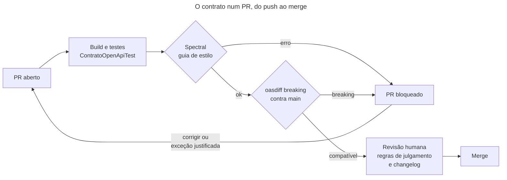

## O problema

A [16.02](/design-de-apis-profissional/escrevendo-o-guia-de-estilo-da-sua-api) escreveu o guia de estilo do Bazar: 44 regras, cada uma com um identificador e com o modo de verificação, `lint`, `teste` ou `revisão`. Um guia de estilo que depende só da memória do revisor dura até o primeiro PR grande numa sexta-feira à tarde. O revisor olha a lógica, não nota que o campo novo se chama `data_criacao` e que o `DELETE` novo responde `200`, e o guia passa a valer "quase sempre".

O mesmo vale para a compatibilidade. Remover um campo da resposta parece uma limpeza inofensiva no PR: o código compila, os testes passam, o contrato gerado muda uma linha. Um aplicativo que lia esse campo quebra no dia do deploy.

Os dois problemas têm a mesma solução: tirar da memória das pessoas o que uma máquina consegue conferir. O guia vira um conjunto de regras que roda em todo PR, e a comparação entre o contrato novo e o anterior aponta o que quebra um cliente antes do merge.

É o corretor ortográfico de um jornal. O revisor humano continua existindo, mas não gasta atenção com acentos e concordância: o corretor marca isso antes, e o revisor fica com o que só uma pessoa julga, como a clareza do texto e a precisão da notícia. Um jornal sem corretor publica erros de digitação; um jornal só com corretor publica textos ruins sem erros de digitação.

> **A pergunta desta página:** como transformar as regras do guia de estilo do Bazar em verificações automáticas com o Spectral, como detectar com o oasdiff uma mudança de contrato que quebra clientes, e onde as duas entram no fluxo de um PR?

## O conceito

### *Linting* de contrato

Um <Term id="linter">linter</Term> de contrato lê o documento OpenAPI e confere regras sobre ele: nomes, formatos, respostas obrigatórias. Ele não roda a API nem olha o código, só o contrato. Por isso funciona igual nos dois caminhos da [17.03](/contratos-documentacao-e-ciclo-de-vida/api-first-o-contrato-como-fonte-da-verdade): no *design-first*, confere o YAML escrito à mão; no *code-first*, confere o YAML gerado pelo springdoc.

O [Spectral](https://github.com/stoplightio/spectral) (Stoplight, 6.17.0) é o linter mais usado. Ele tem dois conjuntos de regras prontos, `spectral:oas` (OpenAPI 2.0, 3.0, 3.1 e 3.2) e `spectral:asyncapi`, e aceita regras próprias num arquivo `.spectral.yaml`. O `spectral:oas` confere o que vale para qualquer API: o documento é válido, toda operação tem `operationId` único, as tags são declaradas, os exemplos batem com os esquemas. O que é próprio do Bazar, como os nomes em português terminados em `Em`, vem das regras próprias.

Uma regra do Spectral tem três partes:

- **`given`**: uma expressão JSONPath que escolhe os pontos do documento a conferir. `$.paths[*]~` são as chaves de `paths` (os caminhos); `$..properties[*]~`, os nomes de todos os campos de todos os esquemas.
- **`then`**: a função que confere cada ponto. As funções nativas cobrem quase tudo: `pattern` (expressão regular), `casing` (camelCase, kebab-case, `macro` para UPPER_SNAKE_CASE), `truthy` e `falsy` (o campo existe ou não), `enumeration`, `length` e `schema` (um JSON Schema inteiro). Para o resto, há funções em JavaScript.
- **`severity`**: `error`, `warn`, `info` ou `hint`. O comando falha a partir da severidade passada em `--fail-severity`.

### Nem toda regra é de máquina

O guia do Bazar já separa as regras pelo modo de verificação, e essa separação é a parte mais importante da governança. Uma regra de `lint` tem uma resposta mecânica: o caminho está em kebab-case ou não. Uma regra de `revisão` precisa de julgamento: "o modelo de recursos parte dos casos de uso" (BZR-REC-01) não tem expressão regular. Uma regra de `teste` depende do comportamento: "o acesso a um sub-recurso verifica o pertencimento ao pai" (BZR-REC-03) só um teste com a API no ar confere.

Forçar uma regra de julgamento num linter produz falsos positivos, e falsos positivos ensinam o time a ignorar o linter. A regra de plural (BZR-NOM-01 pede caminhos no plural) é um exemplo: `estoque` em `/produtos/{id}/estoque` é um singular correto, porque cada produto tem um estoque só. O Bazar confere o kebab-case com o linter e deixa o plural para a revisão.

### *Breaking changes*

Uma <Term id="breaking-change">breaking change</Term> é uma mudança no contrato que faz um cliente existente parar de funcionar. A [18.01](/contratos-documentacao-e-ciclo-de-vida/compatibilidade-retroativa-o-que-quebra-um-cliente) trata do assunto por inteiro; aqui importa que boa parte dessas mudanças tem uma definição mecânica. Remover um campo da resposta, tornar obrigatório um campo da requisição, remover um status de sucesso, trocar o tipo de um campo: tudo isso aparece comparando o contrato antigo com o novo.

O [oasdiff](https://github.com/oasdiff/oasdiff) (1.34.1) faz essa comparação. Ele tem três comandos principais:

| Comando | O que mostra |
|---|---|
| `oasdiff diff` | Todas as diferenças estruturais entre os dois documentos |
| `oasdiff breaking` | Só as mudanças que podem quebrar clientes, classificadas como `error` (quebra) ou `warning` (pode quebrar) |
| `oasdiff changelog` | As mudanças com significado para quem consome a API, incluindo as compatíveis (`info`) |

Ele conhece centenas de verificações, com o lado da mudança em mente. Acrescentar um campo obrigatório na **resposta** é compatível: o cliente recebe um campo a mais. Acrescentar um campo obrigatório na **requisição** quebra: o cliente antigo não o envia. Um diff de texto do YAML não sabe a diferença.

## Diagrama



## Na prática

### As regras do guia em `.spectral.yaml`

O arquivo fica na raiz do projeto, onde o Spectral o encontra sozinho. Cada regra leva no nome o identificador do guia, e a mensagem o repete: quem vê o erro sabe onde ler o porquê.

```yaml title=".spectral.yaml (trecho)"
# As regras do guia de estilo (docs/GUIA-DE-ESTILO.md) que uma máquina consegue conferir (17.04). Cada regra leva o
# identificador do guia no nome; as marcadas "revisão" ou "teste" no guia ficam fora daqui.
extends: ["spectral:oas"]

rules:
  # O summary basta para a referência; a description fica para o que o summary não diz.
  operation-description: off

  bzr-nom-01-caminhos-kebab-case:
    description: Caminhos em kebab-case, sem extensão nem barra final (BZR-NOM-01).
    message: "{{property}}: use kebab-case, sem extensão nem barra final (BZR-NOM-01)."
    severity: error
    given: $.paths[*]~
    then:
      function: pattern
      functionOptions:
        match: "^(/([a-z0-9]+(-[a-z0-9]+)*|\\{[a-zA-Z]+\\}))+$"

  bzr-nom-02-campos-camel-case:
    description: Campos JSON em camelCase (BZR-NOM-02). _links e _embedded vêm do HAL (12.04).
    message: "Campo {{property}}: use camelCase (BZR-NOM-02)."
    severity: error
    given: $..properties[*]~
    then:
      function: pattern
      functionOptions:
        match: "^(_links|_embedded|[a-z][a-zA-Z0-9]*)$"

  bzr-nom-05-instantes-terminam-em-em:
    description: Instantes têm o nome no particípio seguido de Em (criadoEm), e filtros de período, de Apos ou Antes (BZR-NOM-05).
    message: "Campo {{property}}: um instante deve terminar em Em, como criadoEm (BZR-NOM-05)."
    severity: error
    given: $..properties[?(@.format == 'date-time')]~
    then:
      function: pattern
      functionOptions:
        match: "(Em|Apos|Antes)$"

  bzr-nom-08-enum-upper-snake-case:
    description: Valores de enum em UPPER_SNAKE_CASE (BZR-NOM-08).
    message: "Valor {{value}}: use UPPER_SNAKE_CASE (BZR-NOM-08)."
    severity: error
    given: $..enum[*]
    then:
      function: casing
      functionOptions:
        type: macro

  bzr-err-01-erros-sao-problem-details:
    description: Toda resposta 4xx e 5xx é application/problem+json (BZR-ERR-01).
    message: "{{path}}: um erro deve ser application/problem+json (BZR-ERR-01)."
    severity: error
    given: $.paths[*][*].responses[?(@property.match(/^[45]/))].content
    then:
      field: application/problem+json
      function: truthy
```

O arquivo completo tem doze regras próprias:

| Regra | Guia | O que confere |
|---|---|---|
| `bzr-nom-01-caminhos-kebab-case` | BZR-NOM-01 | Segmentos em kebab-case, sem extensão nem barra final |
| `bzr-rec-05-versao-no-caminho` | BZR-REC-05 | O caminho começa por `/v1` |
| `bzr-rec-02-um-nivel-de-sub-recurso` | BZR-REC-02 | No máximo dois ids no caminho |
| `bzr-nom-02-campos-camel-case` | BZR-NOM-02 | Nomes de campos em camelCase |
| `bzr-nom-02-parametros-camel-case` | BZR-NOM-02 | Parâmetros de query em camelCase |
| `bzr-nom-05-instantes-terminam-em-em` | BZR-NOM-05 | `date-time` terminado em `Em`, `Apos` ou `Antes` |
| `bzr-nom-06-booleanos-sem-prefixo` | BZR-NOM-06 | Nada de `isAtivo` |
| `bzr-nom-08-enum-upper-snake-case` | BZR-NOM-08 | Valores de enum em UPPER_SNAKE_CASE |
| `bzr-id-02-ids-sao-uuid` | BZR-ID-02 | `id` e `...Id` são `string` com `format: uuid` |
| `bzr-tip-04-sem-ponto-flutuante` | BZR-TIP-04 | Nenhum `format: float` ou `double` |
| `bzr-err-01-erros-sao-problem-details` | BZR-ERR-01 | Respostas 4xx e 5xx em `application/problem+json` |
| `bzr-col-04-colecoes-paginadas` | BZR-COL-04 | Uma listagem com `itens` aceita `limit` (aviso) |

### Testar o linter com um contrato ruim

Um linter que nunca acusa nada pode estar certo ou pode estar quebrado. Antes de confiar nas regras, o Bazar as rodou contra um contrato escrito para violar o guia, com `/v1/ProdutosAtivos/`, `/produtos`, `page_size`, `categoria_id`, `dataCriacao`, `isAtivo`, um preço `double` e um enum `[ativo, Descontinuado]`:

```text
error    bzr-nom-01-caminhos-kebab-case        /v1/ProdutosAtivos/: use kebab-case, sem extensão nem barra final (BZR-NOM-01).
warning  path-keys-no-trailing-slash           Path must not end with slash.
error    bzr-rec-05-versao-no-caminho          /produtos: o caminho deve começar pela versão, como /v1 (BZR-REC-05).
warning  bzr-col-04-colecoes-paginadas         #/paths/~1produtos/get/parameters: uma listagem deve aceitar limit (BZR-COL-04).
error    bzr-nom-02-parametros-camel-case      Parâmetro page_size: use camelCase (BZR-NOM-02).
error    bzr-err-01-erros-sao-problem-details  #/paths/~1produtos/get/responses/404/content: um erro deve ser application/problem+json (BZR-ERR-01).
error    bzr-rec-02-um-nivel-de-sub-recurso    /v1/clientes/{id}/pedidos/{pedidoId}/itens/{itemId}: mais de um nível de sub-recurso (BZR-REC-02).
error    bzr-id-02-ids-sao-uuid                Campo id: um id deve ser string com format uuid (BZR-ID-02).
error    bzr-nom-02-campos-camel-case          Campo categoria_id: use camelCase (BZR-NOM-02).
error    bzr-nom-05-instantes-terminam-em-em   Campo dataCriacao: um instante deve terminar em Em, como criadoEm (BZR-NOM-05).
error    bzr-nom-06-booleanos-sem-prefixo      Campo isAtivo: booleanos não levam prefixo (BZR-NOM-06).
error    bzr-tip-04-sem-ponto-flutuante        #/components/schemas/Produto/properties/preco/format: float e double não são exatos (BZR-TIP-04).
error    bzr-nom-08-enum-upper-snake-case      Valor ativo: use UPPER_SNAKE_CASE (BZR-NOM-08).
error    bzr-nom-08-enum-upper-snake-case      Valor Descontinuado: use UPPER_SNAKE_CASE (BZR-NOM-08).
```

A primeira versão do ruleset não passou nesse teste. Duas regras falhavam em silêncio: a do id e a da paginação. O erro da primeira está nos [Erros comuns](#erros-comuns).

### O que o linter encontrou no Bazar

Contra o contrato real, o ruleset acusou três problemas, e nenhum deles era um erro de código:

- **`criadoApos` não termina em `Em`.** É o filtro de período da busca de produtos ([13.01](/design-de-apis-profissional/filtros-e-busca)), e não um instante de um recurso. A regra BZR-NOM-05 não previa filtros. A correção foi no **guia**: filtros de período usam o particípio seguido de `Apos` ou `Antes`. O linter mostrou uma lacuna da regra escrita.
- **`traceId` não é UUID.** O `traceId` do Problem Details tem o formato do trace-id do W3C Trace Context, 32 hexadecimais. Não é o id de um recurso, e a regra passou a excluí-lo. O contrato ganhou o `pattern: ^[0-9a-f]{32}$` que faltava.
- **A listagem de endereços não aceita `limit`.** Um cliente tem poucos endereços, e o guia permite a lista inteira numa coleção pequena (BZR-COL-04). Essa é uma exceção legítima, registrada no próprio ruleset:

```yaml title=".spectral.yaml (fim)"
overrides:
  # Um cliente tem poucos endereços: a lista sai inteira, sem paginação (BZR-COL-04).
  - files: ["docs/openapi/bazar-api.yaml#/paths/~1v1~1clientes~1%7BclienteId%7D~1enderecos/get"]
    rules:
      bzr-col-04-colecoes-paginadas: off
```

O `overrides` desliga uma regra num trecho do documento, apontado por um JSON Pointer. A exceção fica no repositório, com o motivo ao lado, e passa por revisão como qualquer mudança. O caminho no ponteiro usa a mesma codificação que o Spectral mostra na mensagem (`~1` para `/`, `%7B` e `%7D` para as chaves).

### Comparando contratos com o oasdiff

Para ver o oasdiff em ação, o campo `descricao` foi removido do `ProdutoResponse` numa cópia do contrato:

```bash
oasdiff breaking bazar-api.yaml sem-descricao.yaml
```

```text
4 changes: 4 error, 0 warning, 0 info
error	[response-required-property-removed] at sem-descricao.yaml
	in API POST /v1/produtos
		removed the required property `descricao` from the response with the `201` status

error	[response-required-property-removed] at sem-descricao.yaml
	in API GET /v1/produtos/{id}
		removed the required property `descricao` from the response with the `200` status

error	[response-required-property-removed] at sem-descricao.yaml
	in API PATCH /v1/produtos/{id}
		removed the required property `descricao` from the response with the `200` status

error	[response-required-property-removed] at sem-descricao.yaml
	in API PUT /v1/produtos/{id}
		removed the required property `descricao` from the response with the `200` status
```

Um campo removido num esquema vira quatro quebras, uma por operação que o devolve. O relatório fala a língua do consumidor: não "o esquema mudou", mas "o `GET /v1/produtos/{id}` deixou de devolver `descricao`". O código de saída é `0` por padrão; com `--fail-on ERR`, é `1` quando há algum `error`, e é isso que bloqueia o PR.

O `changelog` mostra também o que é compatível. Numa cópia com um campo novo na resposta (`urlImagem`) e um campo obrigatório novo na criação (`marca`):

```text
6 changes: 1 error, 0 warning, 5 info
error	[new-required-request-property] at misto.yaml
	in API POST /v1/produtos
		added the new required request property `marca`

info	[api-version-not-bumped]
	in info
		a breaking change was detected but the version is still `1.0.0`

info	[response-required-property-added] at misto.yaml
	in API POST /v1/produtos
		added the required property `urlImagem` to the response with the `201` status
...
```

O campo novo na resposta é `info`, compatível. O campo obrigatório novo na requisição é `error`. E o oasdiff ainda nota que houve uma quebra sem que o `info.version` mudasse.

O mesmo relatório sai em outros formatos com `--format`: `markdown` e `html` para um changelog publicado, `json` e `yaml` para outras ferramentas, `githubactions` e `junit` para o CI.

### Quando a quebra é uma correção

Comparar o contrato da 17.02 com o da 17.03 dá seis erros, e dois deles são estes:

```text
error	[response-success-status-removed]
	in API POST /v1/clientes
		removed the success response with the status `200`

error	[response-success-status-removed]
	in API POST /v1/pedidos
		removed the success response with the status `200`
```

Pelo contrato, é uma quebra: o `200` sumiu. Pela API, não é: ela sempre respondeu `201`, e o contrato é que estava errado (17.03). Um cliente gerado do contrato antigo já falhava. O oasdiff não tem como saber disso, e a decisão é humana.

A própria documentação do oasdiff prevê o caso, "quando o contrato e o serviço estão fora de sincronia e é preciso corrigir o contrato": um arquivo de exceções, passado com `--err-ignore`, com uma linha por quebra aceita, no formato "método caminho descrição":

```text title="docs/openapi/quebras-aceitas.txt"
POST /v1/clientes removed the success response with the status `200`
POST /v1/pedidos removed the success response with the status `200`
```

A exceção entra no PR, onde o revisor lê a linha e a justificativa na descrição. Ela vale para aquela comparação; no PR seguinte, a base já é o contrato corrigido, e o arquivo pode ser esvaziado.

### No pipeline

O Bazar junta as duas verificações num script, que o CI da [29.06](/producao-e-deploy/ci-cd-para-apis) vai chamar em todo PR e que roda igual na máquina de quem desenvolve:

```bash title="scripts/verificar-contrato.sh"
#!/usr/bin/env bash
# Confere o contrato antes do merge (17.04): o guia de estilo (Spectral) e as mudanças incompatíveis em relação a uma
# versão anterior (oasdiff). Uso: scripts/verificar-contrato.sh [referência do git, padrão origin/main]
set -euo pipefail

BASE="${1:-origin/main}"
CONTRATO="docs/openapi/bazar-api.yaml"
cd "$(dirname "$0")/.."

echo "== Guia de estilo (Spectral)"
npx --yes @stoplight/spectral-cli@6.17.0 lint "$CONTRATO" --fail-severity error

echo "== Mudanças em relação a $BASE (oasdiff)"
anterior="$(mktemp -d)"
trap 'rm -rf "$anterior"' EXIT
# O caminho do contrato no repositório, que pode não ser a raiz (git show quer o caminho completo).
git show "$BASE:$(git rev-parse --show-prefix)$CONTRATO" > "$anterior/bazar-api.yaml"
cp "$CONTRATO" "$anterior/atual.yaml"
docker run --rm -v "$anterior:/specs:ro" tufin/oasdiff:v1.34.1 \
    breaking /specs/bazar-api.yaml /specs/atual.yaml --fail-on ERR
```

Contra a tag `pagina-17.03`, o script passa: as mudanças desta página no contrato (o `pattern` do `traceId`) são compatíveis, porque restringem só o que a API devolve. Contra a `pagina-17.02`, ele falha com os seis erros da seção anterior.

As duas ferramentas comparam o contrato **versionado**. No *code-first* do Bazar, isso depende do `ContratoOpenApiTest` da [17.02](/contratos-documentacao-e-ciclo-de-vida/springdoc-openapi-documentacao-a-partir-do-codigo): ele falha quando o código muda e o `docs/openapi/bazar-api.yaml` não. Sem ele, um PR mudaria a API sem mudar o arquivo, e o lint e o oasdiff confeririam um contrato velho.

<Callout type="warning" title="O mesmo código, dois contratos">
Comparar contratos só funciona se o mesmo código gerar sempre o mesmo arquivo. No Bazar, não gerava: na OpenAPI 3.1, um parâmetro opcional tem `type: [integer, "null"]`, o swagger-core guarda os tipos num conjunto, e a ordem dos dois mudava conforme a ordem em que os testes montavam o contexto do Spring. O `ContratoOpenApiTest` passava sozinho e falhava depois do teste ponta a ponta. A correção foi um `GlobalOpenApiCustomizer` que ordena os tipos, com o `"null"` por último. O `writer-with-order-by-keys` da 17.02 ordena as chaves dos mapas, mas não o conteúdo das listas.
</Callout>

<Callout type="tip" title="No GitHub Actions">
O oasdiff tem uma *action* oficial, `oasdiff/oasdiff-action/breaking`, que aceita referências do git (`origin/main:docs/openapi/bazar-api.yaml`) e escreve as quebras como anotações no PR. A integração completa do Bazar fica na 29.06.
</Callout>

### Rulesets prontos e catálogos

O Bazar escreve as próprias regras porque o guia é dele. Existem alternativas prontas:

- **Zally**, o linter do Zalando, implementa as [diretrizes de API do Zalando](https://opensource.zalando.com/restful-api-guidelines/), uma das referências mais citadas em guias de estilo. O repositório continua ativo, mas a última *release* é a 2.1.1, de dezembro de 2022, e ele roda como um servidor à parte. As diretrizes servem de inspiração; o Spectral, de ferramenta.
- **Rulesets publicados para o Spectral**, de empresas e de governos, podem ser estendidos com `extends` como o `spectral:oas`. Vale ler as regras antes de adotar: cada uma é uma decisão de design de outra pessoa.

Quando a empresa tem dezenas de APIs, a governança também precisa saber **quais** APIs existem, quem é o dono de cada uma e onde está o contrato. É o papel de um catálogo, como o [Backstage](https://backstage.io/docs/features/software-catalog/descriptor-format#kind-api), em que cada API é uma entidade `kind: API` com o contrato OpenAPI em `spec.definition`. O Bazar tem uma API só e não precisa de catálogo.

## Erros comuns

<BadVsGood title="Uma regra que nunca falha" why="A função pattern ignora um ponto em que o campo não existe. Um id declarado como type: integer, sem format, não tem o campo format, e a regra passa em silêncio exatamente no caso que ela existia para pegar. Com a função schema, a ausência do campo é uma violação.">
<Bad title="pattern no campo format">

```yaml
bzr-id-02-ids-sao-uuid:
  given: $..properties[?(@property == 'id' || @property.match(/^[a-z]+Id$/))]
  then:
    field: format
    function: pattern
    functionOptions:
      match: "^uuid$"
```

</Bad>
<Good title="schema exige o campo">

```yaml
bzr-id-02-ids-sao-uuid:
  given: $..properties[?(@property == 'id' || (@property.match(/^[a-z]+Id$/) && @property != 'traceId'))]
  then:
    function: schema
    functionOptions:
      schema:
        required: [type, format]
        properties:
          type:
            const: string
          format:
            const: uuid
```

</Good>
</BadVsGood>

Outros erros frequentes:

- **Não testar o ruleset.** Uma regra com o `given` errado não acusa nada, e "nenhum erro" parece sucesso. Mantenha um contrato ruim de propósito e confira que cada regra dispara.
- **Lint de regras de julgamento.** Plural, nomes de domínio, modelo de recursos: o linter erra, o time aprende a ignorá-lo, e as regras boas perdem a força.
- **Avisos que ninguém lê.** Centenas de `warning` viram ruído. Ou a regra vale e é `error`, ou é desligada, ou a exceção é registrada no `overrides`.
- **Exceções sem motivo.** Uma regra desligada sem comentário vira permanente. O motivo fica ao lado do `overrides` ou na linha do arquivo de exceções.
- **Diff de texto no lugar do oasdiff.** O diff do YAML mostra a mudança, mas não diz se ela quebra, e a mesma linha num esquema pode quebrar quatro operações.
- **Comparar com o contrato errado.** A base é o que está publicado (a `main`, ou a tag da última versão), e não o commit anterior da própria branch.
- **Lint sem o contrato atualizado.** No *code-first*, sem um teste como o `ContratoOpenApiTest`, o PR muda a API e o arquivo que o linter lê continua o mesmo.

## Boas práticas

- **Uma regra de máquina por regra de lint do guia**, com o identificador do guia no nome e na mensagem.
- **`extends: spectral:oas`** como base, desligando com comentário o que não serve.
- **Teste o ruleset** contra um contrato que viola cada regra.
- **Exceções no repositório**: `overrides` no Spectral, `--err-ignore` no oasdiff, sempre com o motivo.
- **`oasdiff breaking --fail-on ERR`** contra o contrato publicado, em todo PR.
- **Publique o changelog** com `oasdiff changelog --format markdown` junto de cada versão ([17.05](/contratos-documentacao-e-ciclo-de-vida/documentacao-alem-da-referencia)).
- **O mesmo script no CI e na máquina** de quem desenvolve.

## No projeto Bazar

<ProjectStep title="O guia de estilo e a compatibilidade conferidos por máquina" module="compartilhado" tag="pagina-17.04" files={[
  { path: '.spectral.yaml', change: 'novo' },
  { path: 'scripts/verificar-contrato.sh', change: 'novo' },
  { path: 'docs/GUIA-DE-ESTILO.md', change: 'alterado' },
  { path: 'src/main/java/com/bazar/compartilhado/web/ConfiguracaoOpenApi.java', change: 'alterado' },
  { path: 'docs/openapi/bazar-api.yaml', change: 'alterado' },
]}>
O `.spectral.yaml` estende o `spectral:oas` com doze regras próprias, tiradas das regras de lint do guia de estilo, e registra a exceção da listagem de endereços. O contrato do Bazar passa sem erros. O guia ganhou o caso dos filtros de período em BZR-NOM-05 (`criadoApos`), e a BZR-COL-04 passa a ser também um aviso do linter. O `traceId` do esquema `Problema` ganhou o `pattern` de 32 hexadecimais, e a `ConfiguracaoOpenApi` ganhou o customizador `ordemDosTipos`, que torna o contrato gerado estável. O `scripts/verificar-contrato.sh` roda o Spectral 6.17.0 e o `oasdiff breaking` 1.34.1 (pela imagem Docker `tufin/oasdiff:v1.34.1`) contra uma referência do git, `origin/main` por padrão.
</ProjectStep>

## Resumo

- Governança é tirar da memória do revisor o que uma máquina confere: o guia de estilo vira regras de lint, e a compatibilidade vira uma comparação de contratos.
- O Spectral confere o documento OpenAPI com o `spectral:oas` e com regras próprias: `given` (JSONPath), `then` (função) e `severity`.
- Só as regras mecânicas vão para o linter. Julgamento fica com a revisão, comportamento com os testes.
- Teste o ruleset contra um contrato ruim: uma regra quebrada não acusa nada.
- O oasdiff compara dois contratos e classifica as mudanças: `breaking` para o que quebra, `changelog` para tudo o que importa ao consumidor. `--fail-on ERR` bloqueia o PR.
- Uma correção do contrato pode aparecer como quebra. A decisão é humana, e a exceção fica registrada num arquivo `--err-ignore`.
- No Bazar, lint e diff rodam num script só, contra o contrato versionado que o `ContratoOpenApiTest` mantém em dia.

<Exercise title="Duas regras de métodos" difficulty="medio">
O guia tem duas regras de métodos marcadas como `teste`, mas com uma parte que o contrato mostra:

- BZR-MET-01: o `POST` de criação responde `201` com `Location`.
- BZR-MET-04: o `DELETE` responde `204`.

1. Escreva uma regra do Spectral para cada uma, num arquivo que estende o `.spectral.yaml` do Bazar.
2. Rode contra o `docs/openapi/bazar-api.yaml`. O que aparece, e o que isso diz sobre o contrato?
3. O que a regra de `POST` não consegue conferir?

<Hint>Para o `DELETE`, o `given` são as respostas de toda operação `delete`, e o campo `"204"` precisa existir. Para o `POST`, comece pelas respostas `201` e exija o header. Um arquivo de regras pode estender outro com `extends: [".spectral.yaml"]`.</Hint>

<Solution>

1. As duas regras:

```yaml
extends: [".spectral.yaml"]
rules:
  bzr-met-04-delete-responde-204:
    description: DELETE responde 204 (BZR-MET-04).
    message: "{{path}}: um DELETE deve responder 204 (BZR-MET-04)."
    severity: error
    given: $.paths[*].delete.responses
    then:
      field: "204"
      function: truthy
  bzr-met-01-criacao-com-location:
    description: POST que responde 201 devolve o header Location (BZR-MET-01).
    message: "{{path}}: um 201 deve ter o header Location (BZR-MET-01)."
    severity: error
    given: $.paths[*].post.responses.201
    then:
      field: headers.Location
      function: truthy
```

2. A regra do `DELETE` acusa o `DELETE /v1/categorias/{id}` e o `DELETE /v1/clientes/{clienteId}/enderecos/{enderecoId}`: o contrato diz `200`, e a API responde `204`. É o mesmo tipo de erro que a 17.03 encontrou, num controller que ninguém anotou (o exercício da 17.02 trata da categoria). A regra do `POST` não acusa nada: os três `POST` com `201` no contrato têm `Location`.

3. Ela confere só os `POST` que **já** declaram `201`. O `POST /v1/categorias` e o `POST /v1/clientes/{clienteId}/enderecos` aparecem no contrato com `200` e passam. O linter não sabe quais `POST` criam um recurso: o `POST /v1/produtos/buscas` e o `POST /v1/pedidos/{id}/cancelamento` respondem `200` corretamente. Essa parte é de julgamento ou de teste, e o filtro da 17.03 é quem pega o `201` real que o contrato não declara.
</Solution>
</Exercise>

<Quiz questions={[
  {
    question: 'Por que a regra de plural nos caminhos (BZR-NOM-01) não está no linter do Bazar?',
    options: [
      'Porque o Spectral não aceita expressões regulares',
      'Porque é uma regra de julgamento: estoque em /produtos/{id}/estoque é um singular correto, e o linter daria falsos positivos',
      'Porque o guia não pede plural',
      'Porque o springdoc já garante o plural',
    ],
    answer: 1,
    explanation: 'Falsos positivos ensinam o time a ignorar o linter. O kebab-case, que é mecânico, fica no linter; o plural fica na revisão.',
  },
  {
    question: 'O oasdiff classificou como error um campo obrigatório novo na requisição, e como info um campo obrigatório novo na resposta. Por quê?',
    options: [
      'Porque requisições são mais importantes',
      'Porque um cliente antigo não envia o campo novo e passa a receber erro, enquanto um campo a mais na resposta não atrapalha quem o ignora',
      'Porque o oasdiff só olha requisições',
      'Porque a resposta não tem esquema',
    ],
    answer: 1,
    explanation: 'O lado da mudança decide se ela quebra. Um diff de texto do YAML não faz essa distinção.',
  },
  {
    question: 'Comparando o contrato da 17.02 com o da 17.03, o oasdiff acusou "removed the success response with the status 200" no POST /v1/clientes. O que fazer?',
    options: [
      'Voltar o 200 para o contrato',
      'Reconhecer que é a correção de um contrato que nunca descreveu a API (ela sempre respondeu 201) e registrar a exceção com --err-ignore, com o motivo no PR',
      'Desligar o oasdiff',
      'Mudar a API para responder 200',
    ],
    answer: 1,
    explanation: 'A ferramenta compara contratos, não comportamentos. Quando o contrato estava errado, a correção é uma quebra no papel e nenhuma na prática, e quem decide é uma pessoa.',
  },
  {
    question: 'Uma regra do Spectral com function: pattern no campo format nunca acusou um id sem format. Por quê?',
    options: [
      'Porque o format é opcional no OpenAPI',
      'Porque pattern ignora pontos em que o campo não existe; é preciso exigir o campo, por exemplo com a função schema e required',
      'Porque o Spectral não lê components',
      'Porque o id era string',
    ],
    answer: 1,
    explanation: 'É o motivo de testar o ruleset contra um contrato ruim: uma regra quebrada não acusa nada, e "nenhum erro" parece sucesso.',
  },
]} />

## Referências

<References />
