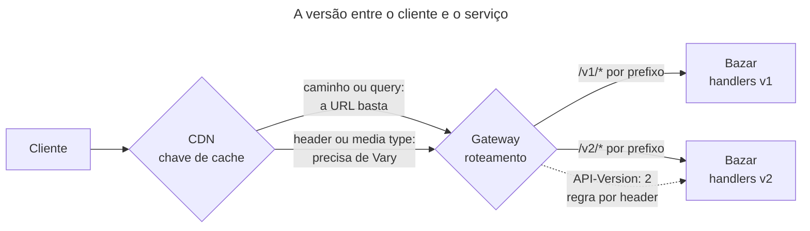

## O problema

A [18.01](/contratos-documentacao-e-ciclo-de-vida/compatibilidade-retroativa-o-que-quebra-um-cliente) mostrou como evoluir o Bazar sem quebrar ninguém, e deixou uma conta em aberto: o `precoEmCentavos` está depreciado, mas não pode sair. Remover um campo é incompatível, e o aplicativo antigo continua lendo o campo. Em algum momento, o Bazar vai precisar de uma representação do produto sem ele, sem derrubar quem ainda depende dele. Os dois produtos, o antigo e o novo, têm de conviver no mesmo servidor, e cada cliente precisa dizer qual quer.

Dizer "qual versão" parece um detalhe, e não é. Onde a versão aparece decide se a CDN guarda as duas respostas separadas ou entrega a de um cliente para o outro, se o gateway consegue mandar a v2 para um serviço novo, se o integrador vê a versão no `curl` que copiou da documentação e se um link guardado há dois anos ainda funciona.

É a edição de um livro técnico. A segunda edição corrige capítulos e muda a numeração das páginas. A livraria vende as duas por um tempo, e quem cita "página 142" precisa dizer de qual edição. A editora pode pôr a edição na capa, só na ficha catalográfica ou num número que só o distribuidor entende. As três funcionam, mas só uma deixa o leitor saber, olhando a estante, qual edição tem na mão.

> **A pergunta desta página:** onde a versão de uma API pode ficar (caminho, header, query, media type, data), o que cada escolha custa em cache, roteamento e experiência do cliente, e por que o Bazar escolheu a versão maior no caminho?

## O conceito

### Primeiro: evite a versão

Toda estratégia desta página tem um custo que nenhuma estratégia elimina: duas versões são duas APIs para testar, documentar, monitorar e manter. O Zalando abre o assunto com a regra 113, "SHOULD avoid versioning": quando a mudança não puder ser compatível, a primeira alternativa é um recurso novo ao lado do antigo, e só depois uma versão nova. O caminho da 18.01 (mudanças aditivas, listas extensíveis, *expand-contract*) é o que mantém as versões raras. Uma API que lança uma v2 por ano não tem um problema de estratégia de versão.

O resto da página é sobre o caso em que a versão é inevitável.

### Onde a versão fica

Há quatro lugares para a versão numa requisição HTTP, mais uma variação que muda o que a versão significa:

**No caminho.** `GET /v2/produtos/42`. É a forma mais comum em APIs públicas. A versão faz parte da URL: aparece em logs, métricas, links e no navegador, e a CDN e o gateway a tratam sem configuração especial. A crítica, que é a do Zalando na regra 115: o mesmo recurso tem duas URLs, e a versão, que é um detalhe da representação, vira parte da identidade do recurso. Um link guardado aponta para uma versão para sempre.

**Num header.** `GET /produtos/42` com `API-Version: 2`. A URL do recurso não muda. A versão fica invisível em logs que não registram headers, num link compartilhado e no navegador. Toda resposta que varia com a versão precisa de `Vary: API-Version`, ou a CDN entrega a resposta da v1 para quem pediu a v2 ([20.01](/padroes-avancados-de-http/cache-http-rfc-9111)).

**Num parâmetro de *query*.** `GET /produtos/42?api-version=2`. É a escolha do Azure, que exige o `api-version` em toda operação, com datas (`2021-06-04`) como valores. A versão está na URL, então caches e logs a veem, mas o caminho do recurso não muda. A URL deixa de ser um identificador limpo, e um parâmetro esquecido precisa de uma regra: erro (o Azure responde `400`) ou versão padrão.

**No media type.** `GET /produtos/42` com `Accept: application/json;v=2`, ou um tipo próprio, `application/vnd.bazar.produto.v2+json`. É a recomendação do Zalando (regra 114): a versão é da **representação**, e a negociação de conteúdo ([02.05](/comecando-e-fundamentos-de-http/content-negotiation-e-media-types)) é o mecanismo do HTTP para escolher representações. É a forma mais fiel ao HTTP e a menos visível: precisa de `Vary: Accept`, de ferramentas que mandem o `Accept` certo e de integradores que entendam negociação de conteúdo.

**Por data.** É a variação da Stripe, e muda o que a versão significa. Cada versão é uma data (`2026-09-30`), e cada conta fica fixada na versão do dia em que começou a usar a API. Um header (`Stripe-Version`) troca a versão por requisição, para testar uma versão nova antes de mudar a da conta. Por dentro, o servidor tem uma só implementação, a mais recente, e uma pilha de transformações que convertem a resposta, passo a passo, até o formato de cada data antiga. Desde 2024, a Stripe lança versões mensais sem mudanças incompatíveis e duas versões maiores por ano, com nomes (a atual é a `2026-09-30.endive`).

**Sem versão.** O extremo oposto, e a recomendação geral do Zalando: a API evolui só de forma compatível, e o que não puder ser compatível vira um recurso novo ou uma API nova. Funciona quando o produtor controla os clientes ou tem disciplina para nunca quebrar.

### O quadro comparativo

<Comparison
  title="Onde fica a versão"
  columns={['Caminho', 'Header', 'Query', 'Media type']}
  rows={[
    { label: 'Exemplo', values: ['/v2/produtos/42', 'API-Version: 2', '?api-version=2', 'Accept: application/json;v=2'] },
    { label: 'Visível no curl e em logs', values: ['Sim', 'Só se o header for registrado', 'Sim', 'Só se o header for registrado'] },
    { label: 'Chave de cache', values: ['A URL, sem configuração', 'Precisa de Vary: API-Version', 'A URL, sem configuração', 'Precisa de Vary: Accept'] },
    { label: 'Roteamento no gateway', values: ['Por prefixo, trivial', 'Por header, nem todo gateway faz bem', 'Por parâmetro, incomum', 'Por header Accept, raro'] },
    { label: 'URL do recurso', values: ['Muda com a versão', 'Estável', 'Estável no caminho', 'Estável'] },
    { label: 'Fiel ao HTTP', values: ['Menos: versão vira identidade', 'Médio', 'Médio', 'Mais: versão é representação'] },
    { label: 'Quem usa', values: ['A maioria das APIs públicas', 'GitHub (X-GitHub-Api-Version)', 'Azure', 'Zalando'] },
  ]}
/>

O Spring Framework 7 resolve a versão em qualquer um desses lugares, com a mesma anotação nos controllers ([18.03](/contratos-documentacao-e-ciclo-de-vida/versionamento-nativo-no-spring-framework-7)). A escolha deixou de ser técnica: o framework não pesa mais para nenhum lado.

### Só a maior, ou semântica?

O número da versão pode ser só a versão maior (`v1`, `v2`) ou uma versão semântica completa (`1.4.2`). Na URL e nos headers, o cliente só precisa da maior: por definição, as versões menores são compatíveis, e um cliente da 1.2 funciona com a 1.4. Expor a menor no caminho (`/v1.4/produtos`) obriga o cliente a mudar a URL a cada mudança compatível, o contrário do objetivo. A versão completa tem lugar no contrato (`info.version: 1.4.0`) e no changelog, onde diz ao integrador o que mudou.

O Spring 7 aceita versões semânticas, e há um uso para elas: um endpoint que passou a existir na 1.2 pode ser declarado como `version = "1.2+"`. O Bazar não precisa disso, e a 18.03 mostra a diferença.

### Granularidade: a API inteira ou o recurso

Quando o produto ganha uma v2, o pedido também ganha? Há duas respostas:

- **A API inteira**: `/v2` tem todos os recursos, mesmo os que não mudaram. O cliente troca um prefixo e pronto. O produtor mantém duas cópias de tudo, e uma v2 de pedido sem nenhuma mudança é só custo.
- **Por recurso**: `/v2/produtos` existe, `/v2/pedidos` não. O cliente usa `/v1/pedidos` e `/v2/produtos` ao mesmo tempo. O produtor só versiona o que mudou, e o cliente precisa saber qual recurso está em qual versão.

Com poucas versões e recursos independentes, a granularidade por recurso é mais barata. Com muitas versões ou recursos muito ligados (um pedido que embute o produto), a API inteira fica mais simples de explicar.

### Quantas versões manter

Cada versão em produção multiplica testes, documentação e plantão. A regra prática é duas: a atual e a anterior, com um prazo de desligamento anunciado no lançamento da atual ([18.04](/contratos-documentacao-e-ciclo-de-vida/depreciacao-e-desligamento-de-apis)). A Stripe é a exceção que confirma a regra: mantém todas as versões desde 2011, e paga por isso com a pilha de transformações e uma equipe dedicada.

## Diagrama



## Na prática

### A mesma requisição, cinco estratégias

O detalhe do produto na v2 do Bazar, pedido de cada forma. Só a primeira é a do Bazar; as outras mostram como a mesma requisição ficaria nas outras estratégias.

```bash
# Caminho (o Bazar)
curl https://api.bazar.example/v2/produtos/0192f3a0-1111-7000-8000-000000000042

# Header
curl https://api.bazar.example/produtos/0192f3a0-1111-7000-8000-000000000042 \
     -H 'API-Version: 2'

# Parâmetro de query
curl 'https://api.bazar.example/produtos/0192f3a0-1111-7000-8000-000000000042?api-version=2'

# Parâmetro de media type
curl https://api.bazar.example/produtos/0192f3a0-1111-7000-8000-000000000042 \
     -H 'Accept: application/json;v=2'

# Por data, fixada por conta e trocada por header (estilo Stripe)
curl https://api.bazar.example/produtos/0192f3a0-1111-7000-8000-000000000042 \
     -H 'Bazar-Version: 2026-09-30'
```

Repare no que cada linha exige de quem integra. A primeira funciona copiada da documentação, colada no navegador ou numa planilha. As do meio exigem que a ferramenta do integrador mande um header, e que ele se lembre de mandá-lo. A última depende de um estado que o integrador não vê (a versão fixada na conta) até mandar o header.

### O cache com a versão num header

Com a versão num header, o servidor precisa avisar os caches de que a resposta depende dele:

```http
HTTP/1.1 200 OK
Content-Type: application/json
Cache-Control: public, max-age=60
Vary: API-Version
```

Sem o `Vary`, a CDN guarda a primeira resposta para `/produtos/42` e a entrega para todos, qualquer que seja o `API-Version`. O cliente da v2 recebe o produto da v1, com `precoEmCentavos` e sem erro nenhum. É o tipo de bug que só aparece em produção, atrás da CDN, e que some quando alguém testa direto no servidor. Com a versão no caminho, `/v1/produtos/42` e `/v2/produtos/42` são URLs diferentes, e o problema não existe.

### A decisão do Bazar

O Bazar usa `/v1` desde a [05.01](/construindo-apis-com-spring-boot/spring-boot-4-em-uma-pagina), e a regra BZR-REC-05 do guia de estilo exigia a versão no caminho sem justificar. Esta página registra a decisão num ADR, como a [16.02](/design-de-apis-profissional/escrevendo-o-guia-de-estilo-da-sua-api) pede para as decisões que divergem dos guias públicos:

```markdown title="docs/adr/0003-versao-maior-no-caminho.md (trecho)"
## Decisão

- A versão maior vai no início do caminho: `/v1/produtos`, `/v2/produtos`. Só a maior: mudanças compatíveis não mudam
  a URL, e o `info.version` do contrato (`1.4.0`) registra as menores para o changelog.
- A granularidade é o recurso: a `/v2` existe só para os recursos que tiveram uma mudança incompatível. O resto
  continua só em `/v1`.
- No máximo duas versões maiores de um recurso em produção. A anterior é depreciada no lançamento da nova e desligada
  com pelo menos seis meses de aviso (18.04).
```

Os motivos estão nos clientes. O Bazar tem lojistas que integram com `curl`, planilhas e ERPs antigos, e a versão no caminho é a única que funciona em todos sem explicação. A CDN e o gateway tratam a versão sem configuração. E o custo apontado pelo Zalando, os links presos a uma versão, é aceitável com no máximo duas versões vivas e um prazo de desligamento. O ADR registra também o que o Bazar perde: a URL do recurso deixa de ser única, e quem conhece as diretrizes do Zalando precisa ler o porquê.

O guia de estilo ganha duas regras: BZR-EVO-04 (versão nova só para os recursos com mudanças incompatíveis, só a maior no caminho) e BZR-EVO-05 (no máximo duas versões maiores em produção, seis meses de aviso).

## Erros comuns

<BadVsGood title="Versão num header sem Vary" why="A CDN usa a URL como chave de cache. Sem Vary: API-Version, as respostas das duas versões disputam a mesma entrada, e cada cliente recebe a versão que chegou primeiro ao cache, sem nenhum erro. O Vary acrescenta o header à chave, e cada versão tem a sua entrada.">
<Bad title="A resposta não diz do que depende">

```http
GET /produtos/42
API-Version: 2

HTTP/1.1 200 OK
Cache-Control: public, max-age=60
Content-Type: application/json
```

</Bad>
<Good title="O Vary inclui a versão na chave">

```http
GET /produtos/42
API-Version: 2

HTTP/1.1 200 OK
Cache-Control: public, max-age=60
Content-Type: application/json
Vary: API-Version
```

</Good>
</BadVsGood>

Outros erros frequentes:

- **Versionar cedo demais.** Uma v2 para uma mudança que poderia ser aditiva. Cada versão é uma API a mais para manter.
- **Versão menor na URL** (`/v1.3/`). O cliente muda a URL a cada mudança compatível.
- **Uma v2 da API inteira** para mudar um recurso, copiando dezenas de controllers sem mudança.
- **Versão sem prazo de fim.** A v1 vive para sempre porque ninguém anunciou quando ela acaba.
- **Versão padrão silenciosa.** Com a versão num header, um cliente que não manda o header recebe a mais recente, e quebra no dia em que ela muda. Ou a versão é obrigatória, ou o padrão é a mais antiga suportada, e isso é documentado.
- **Mudanças incompatíveis dentro de uma versão** "porque é só um campo". A versão só vale se ela for uma promessa.
- **Estratégias misturadas**: parte da API no caminho, parte em header. O integrador precisa saber duas regras.

## Boas práticas

- **Evite a versão** com mudanças compatíveis (18.01); versione só o inevitável.
- **Só a versão maior** na URL ou no header; a completa no contrato e no changelog.
- **Uma estratégia para a API inteira**, registrada num ADR com o porquê.
- **Com header ou media type, sempre `Vary`.**
- **No máximo duas versões vivas**, com o prazo da anterior anunciado no lançamento da nova.
- **Versione por recurso** quando os recursos são independentes.
- **Documente as versões vigentes** de cada recurso no guia de primeiros passos (17.05).

## No projeto Bazar

<ProjectStep title="A estratégia de versão registrada num ADR" module="compartilhado" tag="pagina-18.02" files={[
  { path: 'docs/adr/0003-versao-maior-no-caminho.md', change: 'novo' },
  { path: 'docs/GUIA-DE-ESTILO.md', change: 'alterado' },
]}>
O ADR-0003 registra a estratégia de versão do Bazar: só a versão maior, no início do caminho, por recurso, com no máximo duas versões em produção e seis meses de aviso antes de desligar a anterior. O ADR lista as alternativas consideradas e o que o Bazar perde ao divergir do Zalando. O guia de estilo passa a citar o ADR na BZR-REC-05 e ganha as regras BZR-EVO-04 e BZR-EVO-05. Nenhum código muda: a v2 do produto chega na 18.03.
</ProjectStep>

## Resumo

- A melhor versão é a que não existe: mudanças compatíveis (18.01) tornam as versões raras.
- A versão pode ficar no caminho, num header, num parâmetro de *query* ou no media type. A Stripe usa datas fixadas por conta; o Zalando recomenda evitar versões e, quando inevitável, usar o media type.
- Caminho e *query* entram na URL: caches, logs e gateways os tratam sem configuração. Header e media type deixam a URL estável, e exigem `Vary` e ferramentas que mandem o header.
- Só a versão maior vai na URL ou no header. A versão completa fica no contrato e no changelog.
- Versionar por recurso evita copiar a API inteira; versionar a API inteira é mais simples de explicar.
- Duas versões vivas, no máximo, e a anterior com prazo de desligamento anunciado.
- O Bazar usa a versão maior no caminho, por recurso, e registrou o porquê no ADR-0003.

<Exercise title="Uma estratégia para outra empresa" difficulty="medio">
Uma fintech vai lançar uma API de pagamentos. Os clientes são outros sistemas, todos integrados por SDKs que a própria fintech gera e distribui. A API fica atrás de uma CDN só para os recursos públicos (taxas e bancos). A empresa espera mudanças incompatíveis algumas vezes por ano e não quer forçar ninguém a migrar com pressa.

1. Qual estratégia de versão você recomenda, e por quê?
2. O que muda em relação à escolha do Bazar?
3. Que cuidado a CDN exige com a sua escolha?

<Hint>Pense em quem digita as requisições: uma pessoa com `curl` ou um SDK. E no que "não forçar ninguém a migrar com pressa" significa para o número de versões vivas.</Hint>

<Solution>

1. **Versões por data, fixadas por conta e trocadas por header**, no estilo da Stripe. Os clientes usam SDKs, então a visibilidade da versão na URL importa pouco: o SDK manda o header sozinho, e cada versão do SDK fixa a data com que foi gerado. "Não forçar ninguém a migrar" pede muitas versões vivas, e a pilha de transformações da Stripe é a forma conhecida de manter muitas versões com uma implementação só. Uma alternativa mais barata é a versão maior num header, com duas versões vivas e prazos longos.

2. O Bazar tem clientes que digitam requisições (`curl`, planilhas, ERPs antigos) e quer poucas versões. A fintech tem só clientes por SDK e muitas versões. A versão no caminho, boa para o Bazar, criaria uma URL por data, o que é estranho; a versão num header, ruim para quem usa `curl`, é invisível para quem usa SDK.

3. Os recursos públicos atrás da CDN precisam de `Vary` com o header da versão (`Vary: Bazar-Version`, ou o nome que a fintech escolher), e a CDN precisa respeitar o `Vary`. Como cada data é um valor diferente, o cache se divide em muitas entradas para o mesmo recurso; para taxas e bancos, que mudam pouco e são lidos por todos, vale considerar se a representação deles precisa mesmo variar com a versão.
</Solution>
</Exercise>

<Quiz questions={[
  {
    question: 'A API passou a ler a versão do header API-Version, e as respostas são cacheáveis numa CDN. O que falta para não misturar as versões?',
    options: [
      'Nada: a CDN entende o header',
      'Vary: API-Version nas respostas, para que o header faça parte da chave de cache',
      'Cache-Control: no-store',
      'Um ETag por versão',
    ],
    answer: 1,
    explanation: 'Sem o Vary, a chave de cache é só a URL, e a CDN entrega a resposta da primeira versão que chegou para qualquer cliente.',
  },
  {
    question: 'Por que só a versão maior vai na URL do Bazar?',
    options: [
      'Porque URLs não aceitam pontos',
      'Porque versões menores são compatíveis por definição: o cliente não precisa escolher entre elas, e mudar a URL a cada uma o obrigaria a mudar sem motivo',
      'Porque o Spring 7 não aceita versões semânticas',
      'Porque o OpenAPI proíbe',
    ],
    answer: 1,
    explanation: 'A versão completa (info.version) fica no contrato e no changelog, onde informa sem obrigar o cliente a nada.',
  },
  {
    question: 'Qual é o principal argumento do Zalando contra a versão no caminho?',
    options: [
      'É lenta',
      'A versão é um detalhe da representação, mas no caminho vira parte da identidade do recurso: o mesmo recurso ganha duas URLs, e links ficam presos a uma versão',
      'Não funciona com HTTPS',
      'Impede o cache',
    ],
    answer: 1,
    explanation: 'O Bazar aceita esse custo com no máximo duas versões vivas e prazo de desligamento, e registrou a divergência no ADR-0003.',
  },
  {
    question: 'Como a Stripe mantém dezenas de versões por data com uma implementação só?',
    options: [
      'Com um servidor por versão',
      'Com a implementação mais recente e uma pilha de transformações que convertem a resposta, passo a passo, até o formato de cada versão antiga',
      'Com bancos de dados separados',
      'Não mantém: só a última versão funciona',
    ],
    answer: 1,
    explanation: 'Cada conta fica fixada numa data, e o header Stripe-Version troca a versão por requisição. Desde 2024, há versões mensais compatíveis e duas versões maiores por ano.',
  },
]} />

## Referências

<References />
