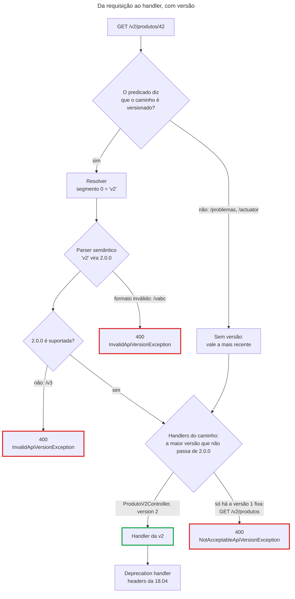

## O problema

A [18.02](/contratos-documentacao-e-ciclo-de-vida/estrategias-de-versionamento) decidiu onde a versão do Bazar fica: a versão maior, no início do caminho, só nos recursos que tiveram uma mudança incompatível. Falta o código. O produto precisa de uma v2 sem o `precoEmCentavos`, e a v1 continua no ar para o aplicativo antigo.

Até o Spring 6, não havia um jeito do framework de fazer isso. Cada equipe escolhia uma destas soluções:

- **Copiar o controller**, com `@RequestMapping("/v2/produtos")` num e `"/v1/produtos"` no outro. A versão é só texto no caminho. Ninguém recusa uma `/v3`, que vira um 404 como qualquer erro de digitação. E nada impede que as duas cópias divirjam em validação ou em regras de negócio.
- **Usar condições de mapeamento**: `headers = "API-Version=2"` ou `produces = "application/vnd.bazar.v2+json"` em cada método. Funciona para uma versão fixa, mas não existe "a v2 e as seguintes", nem validação de versões conhecidas.
- **Escrever uma `RequestCondition` própria**, sobrescrevendo `RequestMappingHandlerMapping#getCustomTypeCondition`. É o caminho completo e também o mais caro. Cada empresa reinventava a mesma infraestrutura, com os mesmos bugs.

É um restaurante que trocou o cardápio e mantém o antigo por alguns meses, para os clientes fiéis. A cozinha é uma só. Antes de anotar o pedido, o garçom precisa saber qual cardápio está na mão do cliente. Se o cliente pedir um prato que só existe no cardápio novo, o garçom tem de anotar o prato certo. Se o cliente aparecer com um cardápio que nunca existiu, o garçom deve recusar o pedido, e não levar à mesa o prato mais parecido.

> **A pergunta desta página:** como o Spring Framework 7 resolve, valida e usa a versão de uma requisição para escolher o handler, e como o Bazar põe a v2 do produto ao lado da v1 sem copiar o controller nem o serviço?

## O conceito

### Quatro peças e uma estratégia

O Spring 7 trata a versão como mais uma condição do mapeamento, igual ao método HTTP e ao `Content-Type`. Ligar o versionamento cria uma <Term id="api-version-strategy">ApiVersionStrategy</Term>. O `RequestMappingHandlerMapping` consulta essa estratégia em toda requisição, e ela combina quatro peças:

| Peça | O que faz | Padrão |
|---|---|---|
| `ApiVersionResolver` | Extrai o texto da versão da requisição: header, parâmetro de query, parâmetro de media type, segmento do caminho ou um resolver seu | Nenhum: você escolhe ao ligar |
| `ApiVersionParser` | Converte o texto num valor comparável (`Comparable`) | `SemanticApiVersionParser` |
| Validação | Recusa versões ausentes (quando obrigatórias) e versões não suportadas, com `400` | Versão obrigatória; suportadas = as declaradas nos mapeamentos |
| `ApiVersionDeprecationHandler` | Avisa o cliente de que a versão pedida está depreciada, com os headers `Deprecation`, `Sunset` e `Link` | Nenhum (18.04) |

A estratégia é configurada no `WebMvcConfigurer`, pelo método `configureApiVersioning`:

```java
@Configuration
public class ConfiguracaoWeb implements WebMvcConfigurer {

    @Override
    public void configureApiVersioning(ApiVersionConfigurer configurer) {
        configurer.useRequestHeader("API-Version");
    }
}
```

O `ApiVersionConfigurer` tem um método para cada resolver: `useRequestHeader`, `useQueryParam`, `useMediaTypeParameter(MediaType, String)`, `usePathSegment(int)`, `usePathSegment(int, Predicate<RequestPath>)` e `useVersionResolver` para um resolver seu. Para o resto da estratégia, há `setVersionParser`, `setVersionRequired`, `setDefaultVersion`, `addSupportedVersions`, `detectSupportedVersions`, `setSupportedVersionPredicate` e `setDeprecationHandler`.

### Pelas propriedades do Boot

O Spring Boot 4 expõe quase tudo em `spring.mvc.apiversion.*` (e em `spring.webflux.apiversion.*`, no WebFlux). A mesma configuração por header, sem código:

```yaml
spring:
  mvc:
    apiversion:
      use:
        header: API-Version           # ou query-parameter, path-segment, media-type-parameter
      supported: 1, 2                 # versões aceitas além das declaradas nos mapeamentos
      default: 1                      # a versão de quem não manda nenhuma
      required: false                 # o padrão do framework é obrigatória
      detect-supported: true          # considerar as versões dos mapeamentos como suportadas
```

As opções de `use` são `header`, `query-parameter`, `path-segment` (o índice do segmento) e `media-type-parameter`. A última é um mapa do media type para o nome do parâmetro, como `spring.mvc.apiversion.use.media-type-parameter[application/json]=v`. As propriedades bastam para header, query e media type. Para o caminho, elas não aceitam o predicado que diz quais caminhos são versionados, e o Bazar precisa dele (veja abaixo). Por isso o Bazar usa o `configureApiVersioning`.

### Mapeando por versão: fixa, de base e sem versão

Com a estratégia ligada, `@RequestMapping` e as variantes (`@GetMapping`, `@PostMapping`...) ganham o atributo `version`, que aceita três formas:

| Atributo | Casa com | Uso típico |
|---|---|---|
| `version = "1.2"` | Só a 1.2: versão **fixa** | Uma operação que mudou de forma incompatível na 1.2 |
| `version = "1.2+"` | A 1.2 e as versões suportadas acima dela: <Term id="versao-de-base">versão de base</Term> | Uma operação que não mudou e deve continuar disponível nas versões seguintes |
| sem `version` | Qualquer versão, com a menor prioridade | Handlers criados antes do versionamento |

Quando vários métodos casam com a versão pedida, vence o de maior versão que não passe da versão pedida. A documentação do Spring dá um exemplo com quatro métodos para a mesma URL: um sem versão, um com `"1.1"`, um com `"1.2+"` e um com `"1.5"`.

| Versão pedida | Casam | Vence |
|---|---|---|
| 1.3 | sem versão, `1.2+` | `1.2+`, a maior que não passa de 1.3 (a 1.3 precisa ser suportada) |
| 1.5 | sem versão, `1.2+`, `1.5` | `1.5` |
| 1.6 | sem versão e `1.2+` casam, mas o `1.5` fixo os supera e não aceita 1.6 | ninguém: `400` (`NotAcceptableApiVersionException`) |

O terceiro caso surpreende. Uma versão fixa "fecha" a linha: depois do `1.5`, a 1.6 não volta a cair no `1.2+`. Se a 1.6 deveria ser atendida pelo método da 1.5, ele precisa ser `"1.5+"`.

### A versão no caminho

O resolver de caminho lê a versão de um segmento, pelo índice. O segmento 0 de `/v2/produtos/42` é `v2`. A documentação pede que o segmento seja declarado como uma variável na URI (`/{version}/produtos`, `/v{version}/produtos`; o nome não importa). Outra opção é um prefixo comum para todos os handlers, configurado no *path matching* (`configurePathMatch` → `addPathPrefix`). Sem a variável ou o prefixo, o mapeamento não casa com caminhos de versões diferentes.

O resolver de caminho tem uma particularidade: ele nunca devolve "sem versão". Se o segmento não existe, ele lança `InvalidApiVersionException`. A exceção é quando ele recebe um `Predicate<RequestPath>` que diz se o caminho é versionado. Toda API tem caminhos sem versão (`/actuator`, `/error`, o catálogo de problemas). Por isso, na prática, o predicado é obrigatório. O springdoc 3 é uma exceção: ele protege os próprios caminhos (`/v3/api-docs`, que até parece "a versão 3") da validação de versão.

### O parser semântico

O `SemanticApiVersionParser` converte o texto em `maior.menor.patch`, com menor e patch valendo 0 quando ausentes, e aceita um `v` ou `V` na frente. Os valores abaixo foram testados no Spring 7.0.10:

| Texto | Versão |
|---|---|
| `1` | 1.0.0 |
| `v1` | 1.0.0 |
| `V2` | 2.0.0 |
| `v1.2.3` | 1.2.3 |
| `2026-09-30` | erro: `Invalid API version format` |
| `abc` | erro: `Invalid API version format` |

Versões por data, no estilo da Stripe, precisam de um `ApiVersionParser` próprio, registrado com `setVersionParser`. Um parser que devolve `LocalDate` resolve, porque `LocalDate` já é `Comparable`.

### Obrigatória, opcional ou padrão

Por padrão, com o versionamento ligado, a versão é obrigatória. Uma requisição sem versão recebe `400` (`MissingApiVersionException`). Com `setVersionRequired(false)`, a ausência passa a ser aceita, e vale a versão mais recente. Com `setDefaultVersion("1")`, quem não manda nada recebe a versão escolhida. O padrão do framework protege o servidor contra clientes que esquecem a versão. Uma versão padrão protege os clientes que existiam antes do versionamento, desde que seja a mais antiga, e não a mais nova.

### Suportadas: declaradas ou detectadas

Uma versão que o servidor não suporta é recusada com `400` (`InvalidApiVersionException`). Por padrão, as versões suportadas são detectadas nos mapeamentos: se algum handler declara `version = "2"`, a 2 é suportada. `addSupportedVersions` acrescenta versões que nenhum mapeamento declara, como uma 1.3 que só existe por causa de um `1.2+`. `detectSupportedVersions(false)` desliga a detecção, e aí só valem as versões configuradas. Desligar a detecção é útil quando a lista de versões vigentes é uma decisão de negócio, como a do ADR-0003, que não deveria mudar porque alguém escreveu `version = "3"` num controller.

### No cliente e nos testes

O versionamento também chegou aos clientes HTTP do Spring. Um `ApiVersionInserter` faz o contrário do resolver: põe a versão na requisição de saída, no header, na query, no media type ou num segmento do caminho.

```java
RestClient bazar = RestClient.builder()
        .baseUrl("https://api.bazar.example")
        .apiVersionInserter(ApiVersionInserter.builder()
                .usePathSegment(0)
                .withVersionFormatter(versao -> "v" + versao)   // o Bazar usa "v2", não "2"
                .build())
        .defaultApiVersion(1)
        .build();

ProdutoV2 produto = bazar.get().uri("/produtos/{id}", id)
        .apiVersion(2)                                          // GET /v2/produtos/{id}
        .retrieve()
        .body(ProdutoV2.class);
```

Nas HTTP interfaces (a [24.03](/consumindo-outras-apis/http-interfaces-httpexchange-e-o-registro-de-clientes) mostra o resto), a versão vai na anotação: `@GetExchange(url = "/{id}", version = "2")`. O `WebClient`, o `RestTestClient` e o `WebTestClient` têm os mesmos `apiVersionInserter`, `defaultApiVersion` e `apiVersion`.

### Uma implementação, duas representações

O versionamento escolhe o handler. O resto do código é que decide quanto se duplica. A v2 do produto não precisa de outro serviço, outro repositório nem outra entidade. O domínio é o mesmo, porque o produto não mudou: mudou a forma de mostrá-lo. A divisão que funciona:

- **Um serviço**, `ProdutoService`, usado pelas duas versões.
- **Um controller por versão**, fino: lê a requisição, chama o serviço e devolve a representação da versão.
- **Um DTO e um mapper por versão**, `ProdutoResponse` com `ProdutoMapper` e `ProdutoV2Response` com `ProdutoV2Mapper`. É aqui que mora a diferença entre as versões.

Quando a v1 for desligada (18.04), saem o controller, o DTO e o mapper dela. O serviço fica.

## Diagrama



## Na prática

### A configuração do Bazar

O ADR-0003 pede a versão maior no caminho. A configuração tem três decisões, uma por linha:

```java title="compartilhado/web/ConfiguracaoWeb.java"
@Configuration
public class ConfiguracaoWeb implements WebMvcConfigurer {

    // Todo primeiro segmento que começa com v é a versão, válida ou não: com /v\d+/, um /v1.5/produtos ficaria sem
    // versão e o {versao} do mapeamento aceitaria qualquer valor (200 em vez de 400).
    private static final Pattern VERSAO_NO_CAMINHO = Pattern.compile("/v[^/]*/");

    // A versão é o primeiro segmento do caminho (/v1, /v2), conforme o ADR-0003 (18.03). O predicado separa as rotas
    // da API das outras: sem ele, o "problemas" de /problemas/... seria lido como versão e recusado. O /v3/api-docs
    // passa no predicado, mas o springdoc protege os próprios caminhos da validação de versão.
    @Override
    public void configureApiVersioning(ApiVersionConfigurer configurer) {
        configurer.usePathSegment(0, ConfiguracaoWeb::rotaDaApi)
                .addSupportedVersions("1", "2")
                // Obrigatória por padrão: sem isto, /problemas/... (sem versão no caminho) seria um 400.
                .setVersionRequired(false);
    }

    static boolean rotaDaApi(RequestPath caminho) {
        var valor = caminho.pathWithinApplication().value();
        return VERSAO_NO_CAMINHO.matcher(valor).lookingAt();
    }

    // ... interceptors, conversores, LocaleResolver (inalterados)
}
```

O `addSupportedVersions("1", "2")` repete o que a detecção já encontraria nos mapeamentos. Ele está ali para deixar a lista do ADR visível na configuração. O `setVersionRequired(false)` não abre brecha: toda rota da API tem a versão no caminho, então "sem versão" só acontece nas rotas que o predicado exclui.

### Dois controllers, um serviço

O controller da v1 só muda na anotação da classe. O caminho ganha a variável, e a classe ganha a versão:

```java title="catalogo/api/ProdutoController.java"
@RestController
// A v1 do produto. A v2 (ProdutoV2Controller) tem o mesmo caminho: o Spring escolhe pela versão do primeiro segmento,
// e o springdoc troca o {versao} pela versão de cada controller no contrato (18.03).
@RequestMapping(path = "/v{versao}/produtos", version = "1")
@Tag(name = "produtos", description = "O catálogo de produtos")
public class ProdutoController {
    // ... os mesmos métodos de antes
}
```

O `version` na classe vale para todos os métodos dela. Os métodos não declaram `@PathVariable String versao`: a variável só existe para o caminho casar.

A v2 começa só pelo detalhe, que é a operação onde o `precoEmCentavos` incomoda. As outras operações chegam na [31.09](/projeto-final-o-bazar/evoluindo-v2-do-produto-e-depreciacao-da-v1):

```java title="catalogo/api/ProdutoV2Controller.java"
/**
 * A v2 do produto (18.03), no mesmo caminho da v1. Começa pelo detalhe; as outras operações chegam na 31.09. O
 * serviço é o mesmo da v1: só a representação muda.
 */
@RestController
@RequestMapping(path = "/v{versao}/produtos", version = "2")
@Tag(name = "produtos")
public class ProdutoV2Controller {

    private final ProdutoService servico;
    private final ProdutoV2Mapper mapper;

    public ProdutoV2Controller(ProdutoService servico, ProdutoV2Mapper mapper) {
        this.servico = servico;
        this.mapper = mapper;
    }

    @GetMapping("/{id}")
    @Operation(operationId = "detalharProdutoV2", summary = "Detalha um produto (v2)")
    @ApiResponse(responseCode = "200", description = "O produto")
    @ApiResponse(responseCode = "404", ref = NAO_ENCONTRADO)
    public ProdutoV2Response detalhar(@PathVariable UUID id) {
        return mapper.paraResponse(servico.detalhar(id));
    }
}
```

A diferença entre as versões está no DTO e no mapper. O `ProdutoV2Response` é a representação sem o campo depreciado:

```java title="catalogo/api/ProdutoV2Response.java"
/**
 * Representação v2 do produto (18.03): o preço é só o Dinheiro. O precoEmCentavos, depreciado na v1 (18.01), não
 * existe aqui.
 */
@Schema(name = "ProdutoV2")
public record ProdutoV2Response(
        UUID id,
        String sku,
        String nome,
        @Nullable String descricao,
        Dinheiro preco,
        UUID categoriaId,
        StatusProduto status,
        Map<String, String> atributos,
        Instant criadoEm,
        Instant atualizadoEm) {
}
```

```java title="catalogo/api/ProdutoV2Mapper.java"
// Um mapper por versão, sobre o mesmo domínio e o mesmo serviço (18.03).
@Mapper(config = ConfiguracaoMapStruct.class)
interface ProdutoV2Mapper {

    ProdutoV2Response paraResponse(Produto produto);
}
```

O MapStruct copia o `Dinheiro` da entidade direto para o campo `preco`. Ninguém precisa escrever a conversão, nem lembrar de não preencher `precoEmCentavos`: o campo não existe no record.

### As duas versões respondendo

O mesmo produto, pedido nas duas versões. A v1 continua igual à da [18.01](/contratos-documentacao-e-ciclo-de-vida/compatibilidade-retroativa-o-que-quebra-um-cliente), com os dois campos de preço. A v2:

<HttpExchange
  title="O produto na v2"
  request={{ method: 'GET', url: '/v2/produtos/01a17566-c2c2-750b-a6fd-e44a3e704746' }}
  response={{ status: 200, headers: { 'Content-Type': 'application/json' }, body: { id: '01a17566-c2c2-750b-a6fd-e44a3e704746', sku: 'LIV-0042', nome: 'Clean Code', descricao: null, preco: { valor: '129.90', moeda: 'BRL' }, categoriaId: '0192f3a0-5555-7000-8000-000000000003', status: 'RASCUNHO', atributos: { autor: 'Robert C. Martin' }, criadoEm: '2026-10-25T23:30:31.234342Z', atualizadoEm: '2026-10-25T23:30:31.234342Z' } }}
>
O mesmo produto da v1, sem o `precoEmCentavos`. O produto foi criado pela v1 (`POST /v1/produtos`) e lido pela v2: o banco, a entidade e o serviço não sabem de versão.
</HttpExchange>

Uma versão que não existe é recusada antes de chegar a qualquer controller:

<HttpExchange
  title="Uma versão que o Bazar não tem"
  request={{ method: 'GET', url: '/v3/produtos/01a17566-c2c2-750b-a6fd-e44a3e704746' }}
  response={{ status: 400, headers: { 'Content-Type': 'application/problem+json', 'Content-Language': 'pt-BR', 'Vary': 'Accept-Language' }, body: { type: 'https://api.bazar.example/problemas/versao-nao-suportada', title: 'Versão da API não suportada', status: 400, detail: "A versão '3.0.0' não existe, ou este recurso não a tem.", instance: '/v3/produtos/01a17566-c2c2-750b-a6fd-e44a3e704746', codigo: 'VERSAO_NAO_SUPORTADA', traceId: '53f45682257706bec7434075ffc0c140' } }}
>
O `detail` mostra a versão como o parser a entendeu (`3.0.0`), não como o cliente a escreveu (`v3`). O `type` é do catálogo de problemas do Bazar ([16.01](/design-de-apis-profissional/projetando-erros-catalogo-codigos-e-decisoes-dificeis)), e o `codigo` o espelha, como em todo erro do Bazar.
</HttpExchange>

A v2 existe, mas a listagem ainda não foi para ela. O único `GET /v{versao}/produtos` declara a versão 1 fixa:

<HttpExchange
  title="Uma operação que ainda não tem v2"
  request={{ method: 'GET', url: '/v2/produtos' }}
  response={{ status: 400, headers: { 'Content-Type': 'application/problem+json', 'Content-Language': 'pt-BR', 'Vary': 'Accept-Language' }, body: { type: 'https://api.bazar.example/problemas/versao-nao-suportada', title: 'Versão da API não suportada', status: 400, detail: "A versão '2.0.0' não existe, ou este recurso não a tem.", instance: '/v2/produtos', codigo: 'VERSAO_NAO_SUPORTADA', traceId: '527022ca9724337a935418a2dd91bebe' } }}
>
É o caso da tabela da documentação em que nenhum handler aceita a versão pedida: o Spring lança `NotAcceptableApiVersionException`, uma subclasse da `InvalidApiVersionException`. Se a listagem devesse continuar igual na v2, ela usaria `version = "1+"`.
</HttpExchange>

Um recurso que nunca teve v2 se comporta de outro jeito. Os pedidos continuam com o caminho literal `/v1/pedidos`, sem variável:

<HttpExchange
  title="Um recurso que só existe na v1"
  request={{ method: 'GET', url: '/v2/pedidos' }}
  response={{ status: 404, headers: { 'Content-Type': 'application/problem+json', 'Content-Language': 'pt-BR', 'Vary': 'Accept-Language' }, body: { title: 'Não encontrado', status: 404, detail: "Não existe nada em 'v2/pedidos'.", instance: '/v2/pedidos', codigo: 'NOT_FOUND', traceId: 'bda44f289a36eae5b30657ca8cbccacb' } }}
>
A versão 2 é válida e suportada, mas nenhum mapeamento casa com o caminho `/v2/pedidos`, e o resultado é um 404 como qualquer outro. É a granularidade por recurso do ADR-0003: a v2 existe só onde houve mudança incompatível.
</HttpExchange>

### O erro de versão no formato do Bazar

Sem nada além da configuração, o 400 de versão sai com `title: "Bad Request"`, sem `type` e com o `detail` em inglês, quebrando a BZR-ERR-01 do guia de estilo. Três ajustes o põem no padrão. O catálogo ganha um tipo, `VERSAO_NAO_SUPORTADA`. O tratador global liga a exceção ao tipo, no mesmo mapa que já liga as exceções de formato. E as mensagens ganham um título e um detail por idioma.

```java title="compartilhado/erros/TratadorGlobalDeErros.java (trechos)"
private static final Map<Class<? extends Exception>, TipoProblema> TIPOS_DO_SPRING = Map.of(
        HttpMessageNotReadableException.class, TipoProblema.REQUISICAO_INVALIDA,
        TypeMismatchException.class, TipoProblema.REQUISICAO_INVALIDA,
        HttpMediaTypeNotAcceptableException.class, TipoProblema.FORMATO_NAO_ACEITO,
        HttpMediaTypeNotSupportedException.class, TipoProblema.FORMATO_NAO_SUPORTADO,
        InvalidApiVersionException.class, TipoProblema.VERSAO_NAO_SUPORTADA);   // e a subclasse NotAcceptable...

// em handleExceptionInternal:
// Uma ResponseStatusException com reason fica com o reason (em inglês) como detail, mesmo com a chave da classe
// no messages.properties: a mensagem da versão é resolvida aqui (18.03).
if (body instanceof ProblemDetail problema && ex instanceof InvalidApiVersionException versao) {
    problema.setDetail(mensagem("problemDetail.versao-recusada", versao.getVersion()));
}
```

O último trecho existe por um detalhe do Spring. As exceções de versão são `ResponseStatusException` criadas com um `reason` (`"Invalid API version: '3.0.0'."`). O `updateAndGetBody` de uma `ResponseStatusException` resolve a chave `problemDetail.<classe>` e em seguida a substitui pelo `reason`. O título traduz pela chave da classe. O detail, não.

### O contrato com as duas versões

O springdoc 3.2 conhece o versionamento do Spring 7. Ao gerar o contrato, ele troca o segmento da versão pela versão de cada controller: `/v{versao}/produtos/{id}` vira `/v1/produtos/{id}` para o `ProdutoController` e `/v2/produtos/{id}` para o `ProdutoV2Controller`. O contrato do Bazar ganha uma operação e um schema, e o oasdiff confirma que a mudança é compatível com a 18.02:

```text
$ ./scripts/verificar-contrato.sh pagina-18.02
== Guia de estilo (Spectral)
No results with a severity of 'error' found!
== Mudanças em relação a pagina-18.02 (oasdiff)
No breaking changes to report, but the specs are different.
```

O caminho até esse contrato teve um tropeço instrutivo. A configuração do springdoc tinha `paths-to-match: /v1/**`, que filtra os caminhos pelo mapeamento antes da troca de `{versao}`. Com isso, `/v{versao}/produtos` não casava, e os dois controllers sumiram do contrato sem aviso. O filtro passou a ser `/v*/**`. O `ContratoOpenApiTest` (17.02) pegou o sumiço, porque o arquivo gerado deixou de bater com o versionado.

### Os testes das duas versões

```java title="catalogo/api/VersoesDoProdutoTest.java"
// As duas versões do produto lado a lado (18.03): o mesmo serviço, duas representações, e o 400 de uma versão que
// não existe.
@WebMvcTest({ ProdutoController.class, ProdutoV2Controller.class })
@AutoConfigureRestTestClient
@Import({ ProdutoMapperImpl.class, ProdutoV2MapperImpl.class, DinheiroMapperImpl.class, AplicadorDePatch.class })
class VersoesDoProdutoTest {

    @Autowired
    MockMvcTester mvc;

    @Autowired
    RestTestClient cliente;

    @MockitoBean
    ProdutoService produtos;

    @Test
    void aV1MantemOsCentavosEAV2SoTemODinheiro() {
        var produto = umProduto().comPreco(12990).build();
        when(produtos.detalhar(produto.getId())).thenReturn(produto);

        assertThat(mvc.get().uri("/v1/produtos/{id}", produto.getId())).hasStatusOk()
                .bodyJson().satisfies(json -> {
                    json.assertThat().extractingPath("$.precoEmCentavos").isEqualTo(12990);
                    json.assertThat().extractingPath("$.preco.valor").isEqualTo("129.90");
                });
        assertThat(mvc.get().uri("/v2/produtos/{id}", produto.getId())).hasStatusOk()
                .bodyJson().satisfies(json -> {
                    json.assertThat().doesNotHavePath("$.precoEmCentavos");
                    json.assertThat().extractingPath("$.preco.valor").isEqualTo("129.90");
                });
    }

    @Test
    void umSegmentoQueNaoEhUmaVersaoTambemEh400() {
        // Sem o predicado amplo (/v[^/]*/), /v1.5 ficaria sem versão e o {versao} do mapeamento aceitaria o valor.
        assertThat(mvc.get().uri("/v1.5/produtos")).hasStatus(HttpStatus.BAD_REQUEST);
        assertThat(mvc.get().uri("/vabc/produtos")).hasStatus(HttpStatus.BAD_REQUEST);
    }

    @Test
    void oClienteDizAVersaoEOInserterMontaOCaminho() {
        var produto = umProduto().build();
        when(produtos.detalhar(produto.getId())).thenReturn(produto);
        var v2 = cliente.mutate()
                .apiVersionInserter(ApiVersionInserter.builder()
                        .usePathSegment(0)
                        .withVersionFormatter(versao -> "v" + versao)
                        .build())
                .build();

        v2.get().uri("/produtos/{id}", produto.getId()).apiVersion(2)
                .exchange()
                .expectStatus().isOk()
                .expectBody().jsonPath("$.precoEmCentavos").doesNotExist();
    }

    // ... e o 400 de /v3 e de GET /v2/produtos, com o codigo VERSAO_NAO_SUPORTADA
}
```

O `@WebMvcTest` carrega os `WebMvcConfigurer` da aplicação, e com eles a estratégia de versão. Os testes exercitam o versionamento de verdade, não uma simulação. O último teste é o lado do cliente: a URI não tem versão, e o `ApiVersionInserter` a põe no segmento 0, com o formato que o Bazar usa.

## Erros comuns

<BadVsGood title="Um predicado que só reconhece versões válidas" why="Quando o predicado diz que o caminho não é versionado, a requisição fica sem versão, e sem versão vale a mais recente. O {versao} do mapeamento casa com qualquer texto, e /v1.5/produtos/42 respondia 200 com a representação da v2. O predicado decide se o caminho tem uma versão, e cabe ao parser e à validação recusar a versão errada.">
<Bad>

```java
// Só /v1/, /v2/... são versionados
private static final Pattern VERSAO_NO_CAMINHO = Pattern.compile("/v\\d+/");
```

```text
GET /v1.5/produtos/42  →  200, representação da v2
GET /vabc/produtos/42  →  200, representação da v2
```

</Bad>
<Good>

```java
// Todo primeiro segmento que começa com v é a versão, válida ou não
private static final Pattern VERSAO_NO_CAMINHO = Pattern.compile("/v[^/]*/");
```

```text
GET /v1.5/produtos/42  →  400, versão 1.5.0 não suportada
GET /vabc/produtos/42  →  400, formato inválido
```

</Good>
</BadVsGood>

Outros tropeços frequentes:

- **Ligar a versão no caminho sem predicado, ou com a versão obrigatória.** Sem predicado, o `problemas` de `/problemas/...` é lido como versão e recusado. Com o predicado, mas com a versão obrigatória (o padrão), o mesmo caminho recebe `400 API version is required`. O segundo caso aconteceu no Bazar antes do `setVersionRequired(false)`.
- **`version = "1+"` em todos os controllers "por garantia".** Toda operação passa a existir na v2 automaticamente, e a granularidade por recurso do ADR-0003 vira "a API inteira na v2". A versão de base é para a operação que deve atravessar versões, uma decisão por operação.
- **Esquecer que uma versão fixa fecha a linha.** Com `"1.2+"` e `"1.5"` no mesmo caminho, a 1.6 não volta para o `"1.2+"`: é `400`. Se a 1.5 vale para as próximas, escreva `"1.5+"`.
- **Versão padrão apontando para a mais nova.** O cliente que não manda versão é o cliente antigo, de antes do versionamento. Se a padrão for a mais nova, ele quebra no dia em que ela sai.
- **Copiar o serviço junto com o controller.** Duas cópias de regra de negócio divergem na primeira correção de bug. O versionamento é da representação; o domínio é um só.
- **Filtros do springdoc (`paths-to-match`, `packages-to-scan`) que ignoram a versão.** O filtro vê o caminho do mapeamento (`/v{versao}/...`), não o caminho final do contrato.

## Boas práticas

- **Configure o versionamento num lugar só**, no `configureApiVersioning` ou nas propriedades, e com as versões vigentes declaradas.
- **Com versão no caminho, use sempre um predicado** e deixe-o largo: ele diz *se* há versão, não *qual* versão é válida.
- **Versão fixa para o que mudou, `"N+"` para o que deve atravessar versões**, sem versão só para handlers legados.
- **Desligue a detecção de versões suportadas** quando a lista for uma decisão de negócio, e declare-a com `addSupportedVersions`.
- **Um serviço, um DTO e um mapper por versão**: a v2 é outra representação, não outra aplicação.
- **Ponha o erro de versão no catálogo de problemas**, com `type`, título e detail traduzidos, como qualquer outro erro.
- **Teste as duas versões e os 400**, de preferência pelo slice web, que carrega a estratégia real.

## Por baixo dos panos

<DeepDive title="Como a versão entra no mapeamento">
Ligar o versionamento faz o `WebMvcConfigurationSupport` criar o bean `mvcApiVersionStrategy` (uma `DefaultApiVersionStrategy`) e entregá-lo ao `RequestMappingHandlerMapping` e ao `RouterFunctionMapping`. As rotas funcionais ([09.05](/construindo-apis-com-spring-boot/functional-endpoints-routerfunction)) também são versionáveis. Ao registrar os handlers, o atributo `version` de cada `@RequestMapping` vira uma `VersionRequestCondition`, ao lado das condições de caminho, método, `consumes` e `produces`.

Em cada requisição, antes de escolher o handler, o mapeamento chama `resolveParseAndValidateVersion` da estratégia. Ela resolve o texto, converte com o parser, valida contra as suportadas e guarda a versão num atributo da requisição. Os erros de ausência ou de versão não suportada saem daqui, antes de qualquer controller. Depois, cada `VersionRequestCondition` compara a versão da requisição com a sua. Entre as condições que casam, a ordenação põe a maior versão primeiro, e os mapeamentos sem versão por último. Por fim, com o handler escolhido, um interceptor que o próprio mapeamento acrescenta (`ApiVersionDeprecationHandlerInterceptor`) chama o `ApiVersionDeprecationHandler`, que a 18.04 usa para os headers de depreciação.

O springdoc entra por fora. Ao gerar o contrato, ele lê a `ApiVersionStrategy` (por reflexão, para descobrir qual resolver está em uso) e, com um resolver de caminho, troca o segmento do índice configurado pela versão de cada mapeamento. Ele também envolve a estratégia para que os próprios caminhos dele (`/v3/api-docs`, `/swagger-ui`) não sejam recusados por falta de versão.
</DeepDive>

## No projeto Bazar

<ProjectStep title="A v2 do produto com o versionamento do Spring 7" module="catalogo" tag="pagina-18.03" files={[
  { path: 'src/main/java/com/bazar/compartilhado/web/ConfiguracaoWeb.java', change: 'alterado' },
  { path: 'src/main/java/com/bazar/catalogo/api/ProdutoController.java', change: 'alterado' },
  { path: 'src/main/java/com/bazar/catalogo/api/ProdutoV2Controller.java', change: 'novo' },
  { path: 'src/main/java/com/bazar/catalogo/api/ProdutoV2Response.java', change: 'novo' },
  { path: 'src/main/java/com/bazar/catalogo/api/ProdutoV2Mapper.java', change: 'novo' },
  { path: 'src/main/java/com/bazar/compartilhado/erros/TipoProblema.java', change: 'alterado' },
  { path: 'src/main/java/com/bazar/compartilhado/erros/TratadorGlobalDeErros.java', change: 'alterado' },
  { path: 'src/main/resources/messages.properties', change: 'alterado' },
  { path: 'src/main/resources/messages_pt.properties', change: 'alterado' },
  { path: 'src/main/resources/application.yml', change: 'alterado' },
  { path: 'src/test/java/com/bazar/catalogo/api/VersoesDoProdutoTest.java', change: 'novo' },
  { path: 'docs/openapi/bazar-api.yaml', change: 'alterado' },
  { path: 'docs/adr/0003-versao-maior-no-caminho.md', change: 'alterado' },
]}>
O Bazar liga o versionamento nativo com a versão no primeiro segmento do caminho e um predicado que separa as rotas da API das outras. O produto ganha a v2 do detalhe (`GET /v2/produtos/{id}`), sem o `precoEmCentavos`, sobre o mesmo serviço da v1. Os outros recursos continuam só na v1, com o caminho literal. Uma versão inexistente, ou que a operação ainda não tem, vira um `400` com o novo tipo `versao-nao-suportada` do catálogo de problemas. O contrato ganha a operação e o schema `ProdutoV2`, e o ADR-0003 ganha a seção de implementação. A v1 ainda não avisa que vai sair: isso é a 18.04.
</ProjectStep>

## Resumo

- O Spring 7 trata a versão como uma condição do mapeamento: um resolver extrai, um parser converte, a validação recusa com `400`, e um deprecation handler avisa.
- Liga-se no `configureApiVersioning` do `WebMvcConfigurer` ou nas propriedades `spring.mvc.apiversion.*` do Boot 4.
- `version = "1.2"` é fixa, `"1.2+"` vale para a 1.2 e as suportadas acima, e sem `version` vale para qualquer uma, com a menor prioridade. Vence a maior versão que não passa da pedida.
- Versão no caminho pede uma variável na URI (ou um prefixo comum) e, na prática, um predicado para os caminhos sem versão.
- O `SemanticApiVersionParser` entende `1`, `v1` e `1.2.3`. Datas pedem um parser próprio.
- A versão é obrigatória por padrão. Opcional, vale a mais recente; com uma padrão, vale a padrão.
- `RestClient`, `WebClient`, HTTP interfaces e os clientes de teste põem a versão na requisição com um `ApiVersionInserter`.
- O Bazar tem a v2 do detalhe do produto: um controller, um DTO e um mapper novos, e o mesmo serviço.

<Exercise title="Uma v2 parcial para as categorias" difficulty="medio">
As categorias do Bazar vão ganhar uma mudança incompatível no detalhe (`GET /v{versao}/categorias/{id}`): o campo `paiId` vira um objeto `pai` com `id` e `nome`. A listagem e a criação não mudam, e o ADR-0003 diz que, quando um recurso ganha a v2, todas as operações dele devem existir na v2.

1. Como ficam os mapeamentos do `CategoriaController` (ou dos controllers de categoria)?
2. O que responde `GET /v2/categorias` (a listagem)? E `GET /v3/categorias`?
3. O que acontece com `DELETE /v2/categorias/{id}` se a remoção ficar sem `version`?

<Hint>Separe as operações que mudaram das que só precisam atravessar as versões. Lembre da tabela fixa / de base / sem versão.</Hint>

<Solution>

1. O caminho da classe vira `/v{versao}/categorias`. O detalhe ganha dois métodos, `@GetMapping(path = "/{id}", version = "1")` com a representação atual e `@GetMapping(path = "/{id}", version = "2")` com o `pai`. A listagem e a criação recebem `version = "1+"`, porque não mudaram e devem existir nas duas versões. Os dois métodos de detalhe podem ficar em controllers separados, como no produto, ou no mesmo controller. O DTO e o mapper do detalhe são por versão; o serviço é o mesmo.

2. `GET /v2/categorias` responde `200`: o `"1+"` casa com a 2, que é suportada, e devolve a mesma listagem da v1. `GET /v3/categorias` é `400` com o tipo `versao-nao-suportada`: a 3 não é suportada, e a validação recusa antes da escolha do handler. Os dois comportamentos foram conferidos num teste com um controller assim.

3. Sem `version`, a remoção casa com qualquer versão, e `DELETE /v2/categorias/{id}` funciona. Funciona, mas deixa a intenção implícita: quem lê não sabe se a remoção foi pensada para a v2 ou ficou para trás. Com `version = "1+"`, a decisão fica escrita e igual à das outras operações que atravessam versões.
</Solution>
</Exercise>

<Quiz questions={[
  {
    question: 'Um controller tem @GetMapping(version = "1.2+") e @GetMapping(version = "1.5") para a mesma URL, e as versões 1.2 a 1.6 são suportadas. O que acontece com uma requisição na versão 1.6?',
    options: [
      'Vai para o método 1.5, o mais próximo',
      'Vai para o método 1.2+, que aceita a 1.2 e acima',
      'Recebe 400: o 1.5 fixo supera o 1.2+ e não aceita a 1.6',
      'Recebe 404',
    ],
    answer: 2,
    explanation: 'Vence a maior versão que casa, e o 1.5 fixo encerra a linha do 1.2+. Para atender a 1.6, o método da 1.5 teria de ser "1.5+". O Spring responde com NotAcceptableApiVersionException (400).',
  },
  {
    question: 'Por que a versão no caminho do Bazar precisa de um predicado?',
    options: [
      'Para converter "v2" em 2.0.0',
      'Porque o resolver de caminho nunca devolve "sem versão": sem o predicado, /v3/api-docs e /problemas seriam lidos ou cobrados como versão e recusados com 400',
      'Para o springdoc gerar o contrato',
      'Porque o Spring exige um predicado em todo resolver',
    ],
    answer: 1,
    explanation: 'O predicado diz quais caminhos são versionados. Converter é o papel do parser. Validar é o papel da lista de suportadas.',
  },
  {
    question: 'O que o SemanticApiVersionParser faz com "2026-09-30"?',
    options: [
      'Converte em 2026.9.30',
      'Lança erro de formato: versões por data precisam de um ApiVersionParser próprio',
      'Converte em 2026.0.0',
      'Ignora e usa a versão padrão',
    ],
    answer: 1,
    explanation: 'Ele entende maior.menor.patch, com v opcional. Uma data pede um parser que devolva, por exemplo, um LocalDate, que já é Comparable.',
  },
  {
    question: 'Na v2 do produto do Bazar, o que foi duplicado em relação à v1?',
    options: [
      'O serviço, o repositório e a entidade',
      'Só o controller, o DTO de resposta e o mapper: o serviço e o domínio são os mesmos',
      'A aplicação inteira, num módulo novo',
      'Nada: o mesmo controller devolve as duas representações com um if',
    ],
    answer: 1,
    explanation: 'A mudança incompatível é na representação, então só a camada que monta a representação tem uma versão por vez. Quando a v1 sair, saem o controller, o DTO e o mapper dela.',
  },
  {
    question: 'GET /v2/pedidos responde 404, e GET /v2/produtos (a listagem) responde 400. Por que a diferença?',
    options: [
      'Porque pedidos exigem autenticação',
      'Porque /v1/pedidos é um caminho literal e não casa com /v2/pedidos, enquanto /v{versao}/produtos casa com o caminho e falha só na versão, fixa em 1',
      'Porque a v2 não é suportada para pedidos',
      'É um bug do Spring',
    ],
    answer: 1,
    explanation: 'Sem mapeamento para o caminho, é 404 como qualquer rota inexistente. Com o caminho casando e nenhuma versão aceitando a 2, é NotAcceptableApiVersionException, 400.',
  },
]} />

## Referências

<References />
