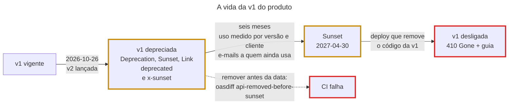

## O problema

A [18.03](/contratos-documentacao-e-ciclo-de-vida/versionamento-nativo-no-spring-framework-7) pôs a v2 do produto no ar. A v1 continua lá, e continuaria para sempre se ninguém fizesse nada. O ADR-0003 diz o contrário: no máximo duas versões de um recurso, e a anterior desligada com pelo menos seis meses de aviso.

"Seis meses de aviso" esconde quatro perguntas. Como avisar um cliente que não lê e-mails nem changelog? Como saber quem ainda chama a v1 no quinto mês? Como garantir que ninguém remove o código antes da data? E o que responder no dia seguinte, quando o aplicativo esquecido numa loja do interior fizer a mesma chamada de sempre? Sem processo, a resposta é a de sempre: o código sai num deploy qualquer, e um cliente descobre pela tela de erro.

É a desativação de uma linha de ônibus. A empresa cola um aviso no ponto meses antes: "esta linha deixa de circular em 30 de abril; use a linha 2". O motorista repete o aviso, e a empresa conta quantas pessoas ainda embarcam na linha antiga, para reforçar a linha nova. No dia 1º de maio, o ponto não fica simplesmente vazio. Uma placa diz que a linha acabou e qual tomar. Quem chega ao ponto sabe o que aconteceu e o que fazer, em vez de esperar um ônibus que nunca vem.

> **A pergunta desta página:** como anunciar, medir e executar o desligamento de uma versão com os headers `Deprecation` e `Sunset`, o handler de depreciação do Spring 7 e o contrato, e o que responder depois que ela sai?

## O conceito

### Depreciar não é desligar

As duas palavras marcam momentos diferentes da vida de uma versão:

| Fase | O que significa | O que o cliente vê |
|---|---|---|
| Vigente | A versão recomendada | Respostas normais |
| <Term id="depreciacao">Depreciada</Term> | Funciona como antes, mas não deve ser usada em código novo e tem data para acabar | Respostas normais, com `Deprecation`, `Sunset` e `Link` |
| <Term id="sunset">Sunset</Term> | A data a partir da qual a versão pode deixar de responder | O mesmo, até o código sair |
| Desligada | O código saiu | `410 Gone` com o caminho para a versão vigente |

Depreciar é uma promessa de comportamento: nada muda até o sunset. Os headers só informam, como a própria RFC 9745 diz ("should be treated as a hint"). É por isso que dá para depreciar no mesmo dia em que a versão nova sai, sem quebrar ninguém.

### O header `Deprecation` (RFC 9745)

Publicada em 2025, a RFC 9745 define o header de resposta `Deprecation`. O valor é uma data no formato de *structured field* da RFC 9651: `@` seguido dos segundos desde 1970, em UTC.

```http
Deprecation: @1792972800
Link: <https://api.bazar.example/docs/migracao/produtos-v2>; rel="deprecation"; type="text/html"
```

A data pode estar no passado (o recurso foi depreciado nesse dia) ou no futuro (o recurso será depreciado nesse dia). O `Link` com `rel="deprecation"` aponta para a explicação: o que mudou, para onde migrar e como. A RFC diz que o header vale para o recurso da resposta. Um escopo maior, como "toda a v1 do produto", é permitido, mas precisa estar documentado, porque um cliente que não conhece a documentação vai entender só o recurso.

Uma versão antiga do rascunho que virou a RFC 9745 aceitava `Deprecation: true` e datas no formato HTTP-date. Ainda há APIs que mandam assim, e um cliente tolerante deve aceitar as duas formas. Quem implementa hoje usa o formato da RFC.

### O header `Sunset` (RFC 8594)

O `Sunset` diz quando o recurso deve deixar de responder. Por razões históricas, ele usa outro formato de data, o HTTP-date dos headers clássicos:

```http
Sunset: Fri, 30 Apr 2027 00:00:00 GMT
Link: <https://api.bazar.example/docs/politica-de-versoes>; rel="sunset"; type="text/html"
```

O `Link` com `rel="sunset"` aponta para a política de desligamento: com quanta antecedência a empresa avisa, o que acontece depois. A RFC 9745 amarra os dois headers: a data do `Sunset` **não pode** ser anterior à do `Deprecation`. O `Sunset` também é uma dica, e não uma garantia: a RFC 8594 avisa que o recurso pode continuar respondendo depois da data, e também que pode sair antes.

### No Spring 7: `StandardApiVersionDeprecationHandler`

O versionamento nativo da 18.03 tem uma quarta peça, o `ApiVersionDeprecationHandler`, chamada depois da escolha do handler, para toda requisição com versão. A implementação do Spring, `StandardApiVersionDeprecationHandler`, escreve os quatro headers por versão:

```java
var handler = new StandardApiVersionDeprecationHandler();
handler.configureVersion("1")
        .setRequestPredicate(request -> request.getRequestURI().startsWith("/v1/produtos"))  // opcional
        .setDeprecationDate(ZonedDateTime.parse("2026-10-26T00:00:00Z"))   // → Deprecation: @1792972800
        .setDeprecationLink(URI.create("https://api.bazar.example/docs/migracao/produtos-v2"))
        .setSunsetDate(ZonedDateTime.parse("2027-04-30T00:00:00Z"))        // → Sunset: Fri, 30 Apr 2027 ...
        .setSunsetLink(URI.create("https://api.bazar.example/docs/politica-de-versoes"));

configurer.setDeprecationHandler(handler);   // no configureApiVersioning
```

O handler converte as datas para os formatos de cada RFC, e os links saem com `type="text/html"` (há sobrecargas para outro media type). O `setRequestPredicate` restringe a depreciação a parte das requisições daquela versão. Sem ele, toda a v1 da API sai depreciada.

<Callout type="warning" title="Uma entrada por versão">
O `StandardApiVersionDeprecationHandler` guarda as configurações num mapa cuja chave é a versão. Um segundo `configureVersion("1")` não acrescenta uma regra: ele substitui a primeira. Com a granularidade por recurso do ADR-0003, dois recursos que depreciam a v1 com datas diferentes não cabem nele. A saída é um `ApiVersionDeprecationHandler` próprio, que é uma interface de um método (é o exercício desta página).
</Callout>

### No contrato: `deprecated` e `x-sunset`

O OpenAPI marca depreciação em três níveis: operação, parâmetro e propriedade de esquema, sempre com `deprecated: true`. A [18.01](/contratos-documentacao-e-ciclo-de-vida/compatibilidade-retroativa-o-que-quebra-um-cliente) já marcou a propriedade `precoEmCentavos`. Uma operação inteira depreciada precisa também de uma data. O OpenAPI não tem um campo para ela, e o oasdiff adotou a extensão `x-sunset`, com a data no formato ISO 8601. Com ela, o oasdiff faz cumprir o calendário no CI:

| Regra do oasdiff | Nível | Quando dispara |
|---|---|---|
| `endpoint-deprecated-with-sunset` | info | Uma operação foi depreciada com `x-sunset` |
| `api-deprecated-sunset-missing` | error | Uma operação foi depreciada sem `x-sunset` |
| `api-sunset-date-too-small` | error | O `x-sunset` está mais perto do que o mínimo de dias (`--deprecation-days-stable`) |
| `api-removed-before-sunset` | error | A operação saiu do contrato antes do `x-sunset` |
| `api-removed-with-deprecation` | info | A operação saiu depois do `x-sunset`: remoção autorizada |
| `api-removed-without-deprecation` | error | A operação saiu sem ter sido depreciada |

A última regra é a mais importante. No oasdiff, remover uma operação só é aceitável depois de depreciá-la com data e esperar a data passar.

### Quem ainda usa a versão antiga?

Seis meses depois, a pergunta que decide o desligamento é: quem ainda chama a v1? Sem uma medida, só sobram duas saídas ruins: adiar para sempre ou desligar no escuro. A medida precisa de duas dimensões:

- **Por versão e operação**: quanto tráfego a v1 ainda recebe, e em quais operações.
- **Por cliente**: quem manda esse tráfego (o canal, a aplicação, o integrador). É a lista de quem vai receber um e-mail.

Há uma armadilha nas métricas HTTP padrão. O Micrometer marca cada requisição com o padrão da URI, e na 18.03 as duas versões do produto compartilham o mesmo padrão: `/v{versao}/produtos/{id}`. Uma métrica por `uri` mistura v1 e v2. A versão precisa entrar como uma marca própria. O Bazar ainda não tem o Micrometer, que chega com o Actuator ([27.02](/observabilidade/spring-boot-actuator)). Até lá, ele registra o uso da versão depreciada num log, como mostra a seção "Na prática". Na [27.05](/observabilidade/metricas-com-micrometer), a versão vira uma marca das métricas HTTP, com uma convenção de observação como esta:

```java
// Prévia da 27.05: a versão como marca das métricas HTTP (http.server.requests).
class VersaoNasMetricas extends DefaultServerRequestObservationConvention {

    @Override
    public KeyValues getLowCardinalityKeyValues(ServerRequestObservationContext contexto) {
        var versao = contexto.getCarrier().getAttribute(HandlerMapping.API_VERSION_ATTRIBUTE) instanceof ApiVersionHolder holder
                && holder.hasVersion() ? holder.getVersion().toString() : "nenhuma";
        return super.getLowCardinalityKeyValues(contexto).and("api.version", versao);
    }
}
```

O identificador do cliente não vai numa marca de métrica: ele tem cardinalidade alta, e cada valor vira uma série. Ele vai no log ou no trace, onde a busca por "quem" é barata.

### Comunicação e prazos

Os headers avisam quem programa olhando as respostas. Os outros clientes precisam de outros canais:

- **No lançamento da versão nova**: changelog, guia de migração, a data do sunset e e-mail para todos os integradores cadastrados.
- **Durante a depreciação**: os headers em toda resposta, um painel de uso da versão antiga e e-mails periódicos só para quem ainda aparece nas medidas.
- **Perto do sunset**: alguns provedores fazem <Term id="brownout">brownouts</Term>, desligamentos curtos e anunciados (uma hora num dia útil), para que os clientes esquecidos descubram enquanto ainda dá tempo.
- **No sunset**: o código sai num deploy, e a versão passa a responder `410`.

O prazo vem da política, não da vontade de quem mantém o código. O Bazar promete seis meses (BZR-EVO-05). Um prazo maior é escolha do negócio, e um prazo menor é quebra de contrato com o cliente.

### Depois do sunset: `410 Gone`

Quando o código sai, o servidor responde a algo que não existe mais. O `404 Not Found` diz "não conheço isto", e o cliente não sabe se errou a URL. O `400` diz "sua requisição está errada", e o cliente não sabe que a requisição era válida até ontem. O `410 Gone` (RFC 9110) diz "isto existiu e foi removido de propósito, provavelmente para sempre". É a placa no ponto de ônibus. Com um Problem Details que aponte o guia de migração, o 410 é a última mensagem útil que a versão manda.

## Diagrama



## Na prática

### O calendário de depreciação

Os headers, o contrato e o 410 precisam das mesmas datas. Se cada um tiver a sua cópia, eles divergem: o header anuncia 30 de abril e o contrato diz 31. O Bazar guarda as datas num lugar só:

```java title="compartilhado/web/Depreciacao.java"
/**
 * Uma versão de um recurso em depreciação (18.04): quais caminhos, desde quando, até quando e onde está o guia de
 * migração. A mesma entrada gera os headers das respostas (Deprecation, Sunset, Link), as marcas do contrato
 * (deprecated, x-sunset) e o 410 depois que o código da versão sai.
 *
 * @param versao a versão maior, como no caminho, sem o v ("1")
 * @param caminhos os caminhos do recurso, sem a versão: só eles são depreciados ("/produtos/{id}", mas não
 *                 "/produtos/{produtoId}/estoque", outro recurso)
 */
public record Depreciacao(String versao, List<String> caminhos, LocalDate desde, LocalDate sunset, URI guia) {

    // A política de versões do Bazar: o que significa depreciar e desligar (ADR-0003).
    public static final URI POLITICA = URI.create("https://api.bazar.example/docs/politica-de-versoes");

    // O calendário do Bazar. A v1 do produto foi depreciada no lançamento da v2 (18.03), com seis meses de aviso
    // (BZR-EVO-05).
    public static final List<Depreciacao> CALENDARIO = List.of(
            new Depreciacao("1", List.of("/produtos", "/produtos/buscas", "/produtos/{id}"),
                    LocalDate.of(2026, 10, 26), LocalDate.of(2027, 4, 30),
                    URI.create("https://api.bazar.example/docs/migracao/produtos-v2")));

    public boolean vale(String caminho) {
        var alvo = PathContainer.parsePath(caminho);
        return caminhos.stream()
                .map(padrao -> PathPatternParser.defaultInstance.parse("/v" + versao + padrao))
                .anyMatch(padrao -> padrao.matches(alvo));
    }

    public ZonedDateTime inicio() {
        return desde.atStartOfDay(ZoneOffset.UTC);
    }

    public ZonedDateTime fim() {
        return sunset.atStartOfDay(ZoneOffset.UTC);
    }

    /** A depreciação deste caminho (que já traz a versão: /v1/produtos/...) cujo sunset já passou, se houver. */
    public static Optional<Depreciacao> desligada(String caminho, Instant agora) {
        return CALENDARIO.stream()
                .filter(d -> d.vale(caminho))
                .filter(d -> !agora.isBefore(d.fim().toInstant()))
                .findFirst();
    }
}
```

Os caminhos são padrões, e não um prefixo, por causa do estoque. `/v1/produtos/{produtoId}/estoque` começa com `/v1/produtos`, mas é outro recurso, sem v2 e sem depreciação. Um `startsWith("/v1/produtos")` avisaria os clientes do estoque de um desligamento que não é com eles. O `DepreciacaoTest` fixa essa fronteira.

### Os headers

O handler de depreciação é montado a partir do calendário e registrado na mesma configuração da 18.03:

```java title="compartilhado/web/ConfiguracaoWeb.java (trecho)"
@Override
public void configureApiVersioning(ApiVersionConfigurer configurer) {
    configurer.usePathSegment(0, ConfiguracaoWeb::rotaDaApi)
            .addSupportedVersions("1", "2")
            .setVersionRequired(false)
            .setDeprecationHandler(depreciacoes());
}

// Os headers Deprecation, Sunset e Link (18.04), a partir do calendário de depreciação. O handler padrão guarda
// uma entrada por versão: dois recursos depreciando a mesma versão sobrescreveriam um ao outro.
static StandardApiVersionDeprecationHandler depreciacoes() {
    var versoes = Depreciacao.CALENDARIO.stream().map(Depreciacao::versao).toList();
    Assert.state(versoes.size() == Set.copyOf(versoes).size(),
            "Uma depreciação por versão: o StandardApiVersionDeprecationHandler guarda uma entrada por versão");
    var handler = new StandardApiVersionDeprecationHandler();
    for (var depreciacao : Depreciacao.CALENDARIO) {
        handler.configureVersion(depreciacao.versao())
                .setRequestPredicate(request -> depreciacao.vale(request.getRequestURI()))
                .setDeprecationDate(depreciacao.inicio())
                .setDeprecationLink(depreciacao.guia())
                .setSunsetDate(depreciacao.fim())
                .setSunsetLink(Depreciacao.POLITICA);
    }
    return handler;
}
```

O `Assert` transforma a limitação do handler padrão num erro de inicialização. No dia em que alguém acrescentar uma segunda depreciação da v1, a aplicação não sobe e explica por quê, em vez de perder os headers de um dos recursos sem aviso.

Um produto pedido pela v1, com a aplicação rodando:

<HttpExchange
  title="A v1 avisando que vai acabar"
  request={{ method: 'GET', url: '/v1/produtos/01a17579-922a-717a-9136-b7b220217421', headers: { 'Bazar-Canal': 'APP', 'User-Agent': 'BazarApp/3.2 (Android 14)' } }}
  response={{ status: 200, headers: { 'Deprecation': '@1792972800', 'Link': '<https://api.bazar.example/docs/migracao/produtos-v2>; rel="deprecation"; type="text/html", <https://api.bazar.example/docs/politica-de-versoes>; rel="sunset"; type="text/html"', 'Sunset': 'Fri, 30 Apr 2027 00:00:00 GMT', 'Content-Type': 'application/json' }, body: { id: '01a17579-922a-717a-9136-b7b220217421', sku: 'LIV-0042', nome: 'Clean Code', descricao: null, precoEmCentavos: 12990, preco: { valor: '129.90', moeda: 'BRL' }, categoriaId: '0192f3a0-5555-7000-8000-000000000003', status: 'RASCUNHO', atributos: { autor: 'Robert C. Martin' }, criadoEm: '2026-10-25T23:51:03.978123Z', atualizadoEm: '2026-10-25T23:51:03.978123Z' } }}
>
O corpo é o mesmo de antes: depreciar não muda o comportamento. O servidor manda dois headers `Link` separados, aqui juntados numa linha, como o HTTP permite. `@1792972800` é 26/10/2026 à meia-noite UTC. A mesma requisição pela v2, ou ao estoque pela v1, sai sem nenhum dos três headers.
</HttpExchange>

### Quem ainda chama a v1

Um interceptor registra cada resposta que saiu com `Deprecation`:

```java title="compartilhado/web/UsoDeVersaoDepreciadaInterceptor.java"
/**
 * Registra quem ainda usa uma versão depreciada (18.04): a resposta saiu com o header Deprecation. Antes de desligar a
 * v1, o Bazar precisa saber quais canais e clientes ainda a chamam. Em 27.05, vira uma métrica com a versão como tag.
 */
class UsoDeVersaoDepreciadaInterceptor implements HandlerInterceptor {

    private static final Logger uso = LoggerFactory.getLogger("bazar.depreciacao");

    @Override
    public void afterCompletion(HttpServletRequest request, HttpServletResponse response, Object handler,
            @Nullable Exception ex) {
        if (response.getHeader("Deprecation") == null) {
            return;
        }
        var versao = request.getAttribute(HandlerMapping.API_VERSION_ATTRIBUTE) instanceof ApiVersionHolder holder
                ? holder.getVersionIfPresent()
                : null;
        uso.info("versao={} operacao=\"{} {}\" canal={} agente=\"{}\"", versao, request.getMethod(),
                request.getAttribute(HandlerMapping.BEST_MATCHING_PATTERN_ATTRIBUTE),
                Canal.de(request.getHeader(ContextoRequisicaoResolver.CABECALHO_CANAL)),
                request.getHeader(HttpHeaders.USER_AGENT));
    }
}
```

A criação e a consulta do produto acima geraram estas linhas:

```text
INFO bazar.depreciacao : versao=1.0.0 operacao="POST /v{versao}/produtos" canal=APP agente="curl/8.5.0"
INFO bazar.depreciacao : versao=1.0.0 operacao="GET /v{versao}/produtos/{id}" canal=APP agente="BazarApp/3.2 (Android 14)"
```

O interceptor não decide nada sobre depreciação. Ele lê o header que o handler do Spring escreveu, então o calendário continua sendo a única fonte. O atributo `API_VERSION_ATTRIBUTE` guarda um `ApiVersionHolder`, e não a versão: o holder carrega a versão ou o erro de resolução. Com a autenticação da [26.04](/seguranca-essencial-para-apis/resource-server-com-jwt-o-essencial), o `agente` dá lugar ao identificador do cliente OAuth, que diz quem é o integrador sem depender do que ele escreve no `User-Agent`.

O mesmo trabalho corrigiu um esquecimento da 18.03: os interceptors estavam registrados em `/v1/**`, e a v2 ficou sem auditoria e sem a recusa de parâmetros desconhecidos. Agora o padrão é `/v*/**`.

### O contrato

Um `GlobalOpenApiCustomizer` marca no contrato as operações do calendário:

```java title="compartilhado/web/ConfiguracaoOpenApi.java (trecho)"
@Bean
GlobalOpenApiCustomizer depreciacoesNoContrato() {
    return openApi -> {
        if (openApi.getPaths() == null) {
            return;
        }
        openApi.getPaths().forEach((caminho, item) -> Depreciacao.CALENDARIO.stream()
                .filter(depreciacao -> depreciacao.vale(caminho))
                .findFirst()
                .ifPresent(depreciacao -> item.readOperations().forEach(operacao -> {
                    operacao.setDeprecated(true);
                    operacao.addExtension("x-sunset", depreciacao.sunset().toString());
                    operacao.getResponses().forEach((status, resposta) -> {
                        if (status.startsWith("2")) {
                            resposta.addHeaderObject("Deprecation", new Header()
                                    .description("Desde quando a operação está depreciada (RFC 9745).")
                                    .schema(new StringSchema().example("@1792972800")));
                            resposta.addHeaderObject("Sunset", new Header()
                                    .description("Quando a operação deixa de existir (RFC 8594).")
                                    .schema(new StringSchema().example("Fri, 30 Apr 2027 00:00:00 GMT")));
                        }
                    });
                })));
    };
}
```

O `vale` funciona também aqui, porque `/v1/produtos/{id}` no contrato é um caminho que casa com o padrão `/v1/produtos/{id}`. No contrato regenerado, as sete operações da v1 do produto ficam assim:

```yaml
  /v1/produtos/{id}:
    get:
      deprecated: true
      operationId: detalharProduto
      ...
      x-sunset: 2027-04-30
```

O oasdiff contra a 18.03 classifica a mudança como compatível, com 21 itens informativos: três por operação (a depreciação com data e os dois headers novos).

```text
$ oasdiff changelog pagina-18.03 depois.yaml
21 changes: 0 error, 0 warning, 21 info
info	[endpoint-deprecated-with-sunset]
	in API GET /v1/produtos
		endpoint deprecated with sunset date `2027-04-30`
...
```

A prova de que o calendário vale no CI é tentar removê-lo antes da hora. Tirando o `GET /v1/produtos/{id}` do contrato hoje:

```text
$ oasdiff breaking bazar-api.yaml sem-o-detalhe-v1.yaml
1 changes: 1 error, 0 warning, 0 info
error	[api-removed-before-sunset]
	in API GET /v1/produtos/{id}
		api removed before the sunset date `2027-04-30`
```

Com o `verificar-contrato.sh` da [17.04](/contratos-documentacao-e-ciclo-de-vida/governanca-linting-e-deteccao-de-breaking-changes) rodando no CI, esse pull request não passa.

### O dia seguinte: 410

Depois do sunset, o `ProdutoController` sai do código. O que o Spring responde a `GET /v1/produtos/{id}`? O teste respondeu, e a resposta não foi a esperada. A v1 continua suportada (pedidos, clientes e categorias ainda vivem nela), e o único handler do caminho `/v{versao}/produtos/{id}` é o da v2, com versão fixa 2. Uma versão fixa não casa com uma versão menor, então o Spring não acha handler e responde **404**. O 400 da 18.03 (`NotAcceptableApiVersionException`) aparece no caso oposto, quando uma versão **maior** pede uma operação que só existe numa menor.

O Bazar intercepta os dois caminhos (404 e 400 de versão) e consulta o calendário:

```java title="compartilhado/erros/TratadorGlobalDeErros.java (trecho)"
// Depois do sunset, os handlers da versão saem do código. Enquanto outra versão do recurso existe, o Spring não
// acha handler para a antiga (404); quando a versão sai da lista de suportadas, ele a recusa (400). Nos dois
// casos, para uma versão que existiu, o Bazar responde 410 Gone, com o guia de migração (18.04).
@ExceptionHandler(InvalidApiVersionException.class)
ResponseEntity<Object> versaoRecusada(InvalidApiVersionException ex, WebRequest request) throws Exception {
    var desligada = desligada(request);
    return desligada != null ? desligada : handleException(ex, request);
}

@Override
protected @Nullable ResponseEntity<Object> handleNoResourceFoundException(
        NoResourceFoundException ex, HttpHeaders headers, HttpStatusCode status, WebRequest request) {
    var desligada = desligada(request);
    return desligada != null ? desligada : super.handleNoResourceFoundException(ex, headers, status, request);
}

private @Nullable ResponseEntity<Object> desligada(WebRequest request) {
    return Depreciacao.desligada(caminho(request), relogio.instant())
            .map(depreciacao -> deDominio(new VersaoDesligadaException(depreciacao), request))
            .orElse(null);
}
```

O `relogio` é o `Clock` da [15.01](/design-de-apis-profissional/datas-horas-e-fusos-horarios). Nos testes, ele avança para depois do sunset:

<HttpExchange
  title="Depois do sunset, com a v1 fora do código"
  request={{ method: 'GET', url: '/v1/produtos/01a17566-c2c2-750b-a6fd-e44a3e704746' }}
  response={{ status: 410, headers: { 'Content-Type': 'application/problem+json', 'Content-Language': 'pt-BR', 'Vary': 'Accept-Language' }, body: { type: 'https://api.bazar.example/problemas/versao-desligada', title: 'Versão desligada', status: 410, detail: 'A v1 deste recurso foi desligada em 2027-04-30. Migre para a versão vigente: o guia está em guiaDeMigracao.', instance: '/v1/produtos/01a17566-c2c2-750b-a6fd-e44a3e704746', desligadaEm: '2027-04-30', guiaDeMigracao: 'https://api.bazar.example/docs/migracao/produtos-v2', codigo: 'VERSAO_DESLIGADA', traceId: '4439b2fb9f4e2821ded0313169d62f50' } }}
>
A resposta que o `DesligamentoDaV1Test` recebe, com o `Clock` em 1º de maio de 2027 e só o `ProdutoV2Controller` carregado. O `guiaDeMigracao` é o mesmo link do `rel="deprecation"`: quem ignorou os avisos recebe o mesmo caminho na última resposta.
</HttpExchange>

O 410 depende de duas condições. O código precisa ter saído (com o handler no lugar, a v1 continua respondendo 200, com a data passada ou não) e a data precisa ter passado. Se alguém remover o código antes do sunset, o cliente recebe o 404 genérico, e o oasdiff já teria barrado esse pull request.

### Os testes

```java title="catalogo/api/DesligamentoDaV1Test.java"
// O dia seguinte ao sunset (18.04): o ProdutoController (v1) saiu do código, e só o ProdutoV2Controller sobe.
@WebMvcTest(ProdutoV2Controller.class)
@Import({ ProdutoV2MapperImpl.class, DinheiroMapperImpl.class })
class DesligamentoDaV1Test {

    private static final String PRODUTO = "/v1/produtos/01a17566-c2c2-750b-a6fd-e44a3e704746";

    @Autowired
    MockMvcTester mvc;

    @MockitoBean
    ProdutoService produtos;

    @MockitoBean
    Clock relogio;

    @Test
    void depoisDoSunsetAV1Eh410ComOGuiaDeMigracao() {
        when(relogio.instant()).thenReturn(Instant.parse("2027-05-01T12:00:00Z"));

        assertThat(mvc.get().uri(PRODUTO))
                .hasStatus(HttpStatus.GONE)
                .bodyJson().satisfies(json -> {
                    json.assertThat().extractingPath("$.codigo").isEqualTo("VERSAO_DESLIGADA");
                    json.assertThat().extractingPath("$.guiaDeMigracao")
                            .isEqualTo("https://api.bazar.example/docs/migracao/produtos-v2");
                });
    }

    @Test
    void antesDoSunsetTirarOCodigoEh404() {
        // O sunset é uma promessa: tirar a v1 antes da data é um erro (o oasdiff barra no CI), e o cliente recebe o
        // 404 genérico, sem guia de migração.
        when(relogio.instant()).thenReturn(Instant.parse("2027-04-29T12:00:00Z"));

        assertThat(mvc.get().uri(PRODUTO))
                .hasStatus(HttpStatus.NOT_FOUND)
                .bodyJson().extractingPath("$.codigo").isEqualTo("NOT_FOUND");
    }
}
```

O `@WebMvcTest(ProdutoV2Controller.class)` simula o futuro sem mexer no código de hoje: o slice sobe só o controller da v2, como estará depois do desligamento. No `VersoesDoProdutoTest`, um teste novo confere os headers da v1, os dois `Link` e a ausência dos headers na v2.

## Erros comuns

<BadVsGood title="Desligar respondendo 404" why="O 404 diz 'não conheço isto': o cliente procura um erro de digitação na URL que funcionava ontem. O 410 diz que a versão existiu e foi removida, e o Problem Details aponta o guia. É a mesma informação que os headers mandaram durante seis meses, agora na única resposta que o cliente esquecido vai ler.">
<Bad>

```text
GET /v1/produtos/0192f3a0-...   (depois do sunset)

HTTP/1.1 404
{ "title": "Não encontrado", "status": 404,
  "detail": "Não existe nada em 'v1/produtos/0192f3a0-...'.",
  "codigo": "NOT_FOUND" }
```

</Bad>
<Good>

```text
GET /v1/produtos/0192f3a0-...   (depois do sunset)

HTTP/1.1 410
{ "type": "https://api.bazar.example/problemas/versao-desligada",
  "title": "Versão desligada", "status": 410,
  "desligadaEm": "2027-04-30",
  "guiaDeMigracao": "https://api.bazar.example/docs/migracao/produtos-v2",
  "codigo": "VERSAO_DESLIGADA" }
```

</Good>
</BadVsGood>

Outros tropeços frequentes:

- **Depreciar sem data.** Um `Deprecation` sem `Sunset` não ajuda o cliente a planejar a migração, e o oasdiff recusa a depreciação no contrato sem `x-sunset` (`api-deprecated-sunset-missing`).
- **Datas em três lugares.** Header, contrato e documentação com cópias da mesma data acabam divergindo. Uma fonte, como o calendário do Bazar.
- **Formatos trocados.** O `Deprecation` usa `@` e segundos, e o `Sunset` usa HTTP-date. Escrever o `Deprecation` em HTTP-date, ou como `true`, segue rascunhos antigos.
- **Depreciar por prefixo.** `/v1/produtos` como prefixo pega `/v1/produtos/{id}/estoque`, outro recurso. A depreciação vale para os caminhos do recurso.
- **Medir pela URI.** Com `/v{versao}/...`, a marca `uri` das métricas é a mesma nas duas versões. A versão precisa de uma marca própria.
- **Desligar quando o tráfego "parece pequeno".** Pouco tráfego pode ser um único integrador grande, que roda uma vez por mês. A medida por cliente diz quem é, e o e-mail vai para ele antes do sunset.
- **Achar que um `ApiVersionDeprecationHandler` basta para vários recursos.** O padrão do Spring guarda uma entrada por versão.

## Boas práticas

- **Deprecie no lançamento da versão nova**, com a data do sunset definida pela política, não pelo humor do sprint.
- **Uma fonte para as datas**, que alimente os headers, o contrato e o 410.
- **`Deprecation`, `Sunset` e os dois `Link`** em toda resposta da versão depreciada.
- **`deprecated: true` e `x-sunset` no contrato**, com o oasdiff no CI barrando remoções antes da data.
- **Meça o uso por versão e por cliente**, e mande os avisos a quem ainda aparece.
- **Responda `410` com o guia de migração** depois do sunset, e mantenha o 410 por muito tempo: custa uma entrada no calendário.
- **Teste o futuro** com um `Clock` controlado e um slice sem o controller antigo.

## No projeto Bazar

<ProjectStep title="A v1 do produto depreciada, com data para acabar" module="compartilhado" tag="pagina-18.04" files={[
  { path: 'src/main/java/com/bazar/compartilhado/web/Depreciacao.java', change: 'novo' },
  { path: 'src/main/java/com/bazar/compartilhado/web/UsoDeVersaoDepreciadaInterceptor.java', change: 'novo' },
  { path: 'src/main/java/com/bazar/compartilhado/erros/VersaoDesligadaException.java', change: 'novo' },
  { path: 'src/main/java/com/bazar/compartilhado/web/ConfiguracaoWeb.java', change: 'alterado' },
  { path: 'src/main/java/com/bazar/compartilhado/web/ConfiguracaoOpenApi.java', change: 'alterado' },
  { path: 'src/main/java/com/bazar/compartilhado/erros/TratadorGlobalDeErros.java', change: 'alterado' },
  { path: 'src/main/java/com/bazar/compartilhado/erros/TipoProblema.java', change: 'alterado' },
  { path: 'src/main/resources/messages.properties', change: 'alterado' },
  { path: 'src/main/resources/messages_pt.properties', change: 'alterado' },
  { path: 'src/test/java/com/bazar/compartilhado/web/DepreciacaoTest.java', change: 'novo' },
  { path: 'src/test/java/com/bazar/catalogo/api/DesligamentoDaV1Test.java', change: 'novo' },
  { path: 'src/test/java/com/bazar/catalogo/api/VersoesDoProdutoTest.java', change: 'alterado' },
  { path: 'docs/openapi/bazar-api.yaml', change: 'alterado' },
  { path: 'docs/GUIA-DE-ESTILO.md', change: 'alterado' },
]}>
A v1 do produto passa a responder com `Deprecation`, `Sunset` e `Link`, a partir de um calendário que também marca o contrato (`deprecated` e `x-sunset`) e decide o 410 depois do sunset. Um interceptor registra quem ainda chama a versão depreciada, por canal e agente. O catálogo de problemas ganha o tipo `versao-desligada`. Os interceptors da API passam a valer para todas as versões (`/v*/**`), o que corrige um esquecimento da 18.03. O guia de estilo ganha a regra BZR-EVO-06. A remoção da v1 fica para a [31.09](/projeto-final-o-bazar/evoluindo-v2-do-produto-e-depreciacao-da-v1).
</ProjectStep>

## Resumo

- Depreciar avisa e não muda nada. O sunset é a data a partir da qual a versão pode deixar de responder, e desligar é tirar o código.
- `Deprecation: @<segundos>` (RFC 9745) e `Sunset: <HTTP-date>` (RFC 8594), com `Link` `rel="deprecation"` (guia) e `rel="sunset"` (política). O sunset não pode ser anterior à depreciação.
- No Spring 7, o `StandardApiVersionDeprecationHandler` escreve os headers por versão, com um predicado opcional. Ele guarda uma entrada por versão.
- No contrato, `deprecated: true` e `x-sunset`. O oasdiff exige a data e barra a remoção antes dela.
- Meça o uso por versão (uma marca própria, não a URI) e por cliente (no log ou no trace).
- Depois do sunset, `410 Gone` com o guia de migração. No Bazar, um calendário único gera os headers, o contrato e o 410.

<Exercise title="A v1 das categorias também vai acabar" difficulty="dificil">
As categorias vão ganhar uma v2 (como no exercício da 18.03), e a v1 delas será depreciada em 1º de fevereiro de 2027, com sunset em 31 de agosto de 2027. A v1 do produto continua com as datas atuais.

1. O que acontece se você só acrescentar a entrada das categorias ao `CALENDARIO`?
2. Escreva um `ApiVersionDeprecationHandler` que atenda as duas depreciações.
3. O que mais precisa mudar para que os headers e o 410 das categorias funcionem?

<Hint>Releia o `Assert` da `ConfiguracaoWeb` e o mapa interno do `StandardApiVersionDeprecationHandler`. O calendário já sabe, pelo caminho, a qual recurso cada requisição pertence.</Hint>

<Solution>

1. A aplicação não sobe: o `Assert.state` da `ConfiguracaoWeb` encontra duas depreciações da versão `"1"` e falha com a mensagem "Uma depreciação por versão". Sem o `Assert`, o segundo `configureVersion("1")` substituiria o primeiro, e a v1 do produto perderia os headers sem nenhum erro.

2. Um handler que consulta o calendário pelo caminho, em vez de guardar uma entrada por versão:

```java
// Uma entrada por recurso, não por versão: v1 de produtos e v1 de categorias com datas diferentes.
class DepreciacoesPorRecurso implements ApiVersionDeprecationHandler {

    @Override
    public void handleVersion(Comparable<?> versao, Object handler, HttpServletRequest request,
            HttpServletResponse response) {
        Depreciacao.CALENDARIO.stream()
                .filter(depreciacao -> depreciacao.vale(request.getRequestURI()))
                .findFirst()
                .ifPresent(depreciacao -> {
                    response.setHeader("Deprecation", "@" + depreciacao.inicio().toEpochSecond());
                    response.setHeader("Sunset", depreciacao.fim().format(DateTimeFormatter.RFC_1123_DATE_TIME));
                    response.addHeader(HttpHeaders.LINK,
                            "<" + depreciacao.guia() + ">; rel=\"deprecation\"; type=\"text/html\"");
                    response.addHeader(HttpHeaders.LINK,
                            "<" + Depreciacao.POLITICA + ">; rel=\"sunset\"; type=\"text/html\"");
                });
    }
}
```

O parâmetro `versao` fica sem uso, porque os caminhos do calendário já trazem a versão (`/v1/categorias/{id}`). Na `ConfiguracaoWeb`, `setDeprecationHandler(new DepreciacoesPorRecurso())` substitui o handler padrão, e o `Assert` sai. Os formatos são os mesmos do handler do Spring: `@` e segundos para o `Deprecation`, RFC 1123 para o `Sunset`.

3. Só a entrada nova no calendário: `new Depreciacao("1", List.of("/categorias", "/categorias/{id}"), LocalDate.of(2027, 2, 1), LocalDate.of(2027, 8, 31), URI.create(".../migracao/categorias-v2"))`. O customizador do contrato, o interceptor de uso e o 410 do tratador já leem o calendário. Um teste no `DepreciacaoTest` para os caminhos novos fecha o trabalho.
</Solution>
</Exercise>

<Quiz questions={[
  {
    question: 'Qual é o formato do header Deprecation na RFC 9745?',
    options: [
      'Deprecation: true',
      'Deprecation: Fri, 30 Apr 2027 00:00:00 GMT',
      'Deprecation: @1792972800, uma data de structured field em segundos desde 1970',
      'Deprecation: 2026-10-26',
    ],
    answer: 2,
    explanation: 'O true e o HTTP-date vêm de rascunhos antigos. O Sunset, de 2019, usa HTTP-date por razões históricas.',
  },
  {
    question: 'Uma resposta tem Deprecation: @1792972800 (26/10/2026). Em 1º de novembro de 2026, o que muda para o cliente?',
    options: [
      'A operação passa a responder 410',
      'Nada no comportamento: depreciar é um aviso, e a operação funciona até o sunset',
      'O cliente precisa mandar um header de confirmação',
      'As respostas passam a ser 299 Deprecated',
    ],
    answer: 1,
    explanation: 'A RFC 9745 trata o header como uma dica. O que muda é o planejamento do cliente: migrar antes do sunset.',
  },
  {
    question: 'Por que o oasdiff recusa remover GET /v1/produtos/{id} do contrato hoje?',
    options: [
      'Porque remover uma operação é sempre proibido',
      'Porque a operação tem x-sunset: 2027-04-30, e a remoção antes da data é api-removed-before-sunset (error)',
      'Porque a v2 ainda não tem a listagem',
      'Porque o Spectral proíbe',
    ],
    answer: 1,
    explanation: 'Depois da data, a mesma remoção vira api-removed-with-deprecation, apenas informativa.',
  },
  {
    question: 'Depois do sunset, o ProdutoController sai do código, e a v1 continua suportada para outros recursos. O que o Spring responde a GET /v1/produtos/{id}, sem o tratamento do Bazar?',
    options: [
      '410 Gone',
      '400, NotAcceptableApiVersionException',
      '404: o único handler do caminho é o da v2, com versão fixa 2, que não casa com uma versão menor',
      '200 com a representação da v2',
    ],
    answer: 2,
    explanation: 'O 400 de versão aparece quando uma versão maior pede algo que só existe numa menor. Para uma versão menor sem handler, é 404. O Bazar intercepta os dois e responde 410 quando o calendário diz que a versão foi desligada.',
  },
  {
    question: 'Por que a versão não pode ser medida só pela marca uri das métricas HTTP no Bazar?',
    options: [
      'Porque o Micrometer não registra a URI',
      'Porque as duas versões compartilham o padrão /v{versao}/produtos/{id}, e a marca uri mistura v1 e v2',
      'Porque a URI tem cardinalidade alta',
      'Porque a versão está num header',
    ],
    answer: 1,
    explanation: 'A versão precisa de uma marca própria, como api.version. O identificador do cliente, por ter cardinalidade alta, fica no log ou no trace.',
  },
]} />

## Referências

<References />
