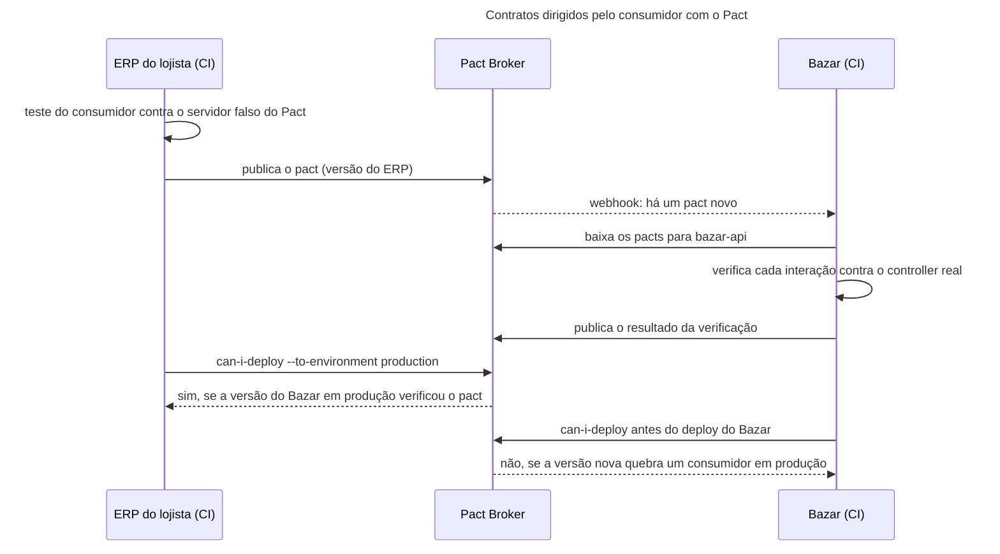

## O problema

O Bazar tem clientes que não controla. O ERP de um lojista importa o catálogo toda noite, o aplicativo publica produtos e um integrador de frete lê os pedidos. A [18.01](/contratos-documentacao-e-ciclo-de-vida/compatibilidade-retroativa-o-que-quebra-um-cliente) ensinou a evoluir sem quebrá-los, e a [17.04](/contratos-documentacao-e-ciclo-de-vida/governanca-linting-e-deteccao-de-breaking-changes) pôs o oasdiff no CI para pegar as quebras no contrato. Falta uma pergunta que nem o contrato responde: o que cada cliente usa de fato? O oasdiff sabe que remover `precoEmCentavos` é incompatível. Ele não sabe que o ERP do lojista depende desse campo, nem que o aplicativo já não depende.

A resposta clássica é um ambiente integrado: Bazar, ERP, aplicativo e frete juntos, com uma suíte que exercita os fluxos. Ela tem os problemas de sempre. É lenta, porque precisa de tudo no ar. É frágil, porque um serviço fora do ar derruba os testes dos outros. Ela chega tarde, porque roda depois do merge. E ninguém sabe quem consertar quando falha. Nas empresas que dependem dela, o ambiente de homologação passa mais tempo quebrado que funcionando.

É a montadora e o fornecedor de peças. A montadora não pede que o fornecedor teste cada maçaneta num carro inteiro, na linha de montagem. As duas combinam um gabarito com as medidas que importam. O fornecedor testa cada peça no gabarito, na própria fábrica, e a montadora projeta o carro em volta do gabarito. Se o fornecedor muda o molde, o gabarito acusa antes de a peça sair da fábrica. E se a montadora passa a precisar de outra medida, ela atualiza o gabarito, e o fornecedor fica sabendo antes de produzir.

> **A pergunta desta página:** como verificar, em cada build e sem um ambiente integrado, que o Bazar continua entregando o que seus consumidores usam, com o Spring Cloud Contract, com o Pact e com a validação contra o OpenAPI, e onde cada um entra no pipeline?

## O conceito

### O que um teste de contrato verifica

Um <Term id="teste-de-contrato">teste de contrato</Term> verifica a fronteira entre dois sistemas: a forma das mensagens que um manda e o outro espera. Ele não verifica a regra de negócio. Isso é trabalho dos testes do próprio serviço ([Parte 5](/testes-de-api/testes-de-integracao-com-springboottest-e-testcontainers)). O teste de contrato tem duas metades que rodam separadas, cada uma no build do seu dono:

- **Do lado do consumidor**, o cliente HTTP conversa com um dublê do provedor, que responde o que o contrato diz.
- **Do lado do provedor**, o contrato vira requisições de verdade contra o serviço, e as respostas são comparadas com o contrato.

Se as duas metades passam contra o mesmo contrato, os dois sistemas são compatíveis, sem nunca terem rodado juntos. O contrato é o gabarito.

### Quem escreve o contrato

| | Dirigido pelo produtor | <Term id="contrato-dirigido-pelo-consumidor">Dirigido pelo consumidor</Term> (CDC) |
|---|---|---|
| Quem escreve | A equipe da API | Cada consumidor, a partir do próprio teste |
| O que descreve | O que a API oferece | O que **aquele** consumidor usa |
| Pergunta que responde | "A API cumpre o que promete?" | "Esta mudança quebra alguém, e quem?" |
| Bom para | Muitos consumidores desconhecidos (API pública) | Consumidores conhecidos (serviços internos, parceiros) |
| Ferramenta típica | Spring Cloud Contract, OpenAPI | Pact (e Spring Cloud Contract, com os contratos no repositório do produtor) |

O artigo de Ian Robinson que deu nome à ideia (2006) parte de uma observação. Cada consumidor usa só uma parte da API, e a soma dessas partes é o que o provedor não pode quebrar. Um campo que nenhum contrato de consumidor cita pode mudar ou sair sem dano, mesmo que o contrato OpenAPI o declare. É a informação que faltava ao oasdiff.

### Spring Cloud Contract 5

O Spring Cloud Contract (SCC) é a ferramenta do ecossistema Spring. O contrato é escrito em YAML ou numa DSL (Groovy, Java ou Kotlin) e mora no repositório do produtor. A partir dele, o plugin Maven gera duas coisas:

- **Testes para o produtor**, um método JUnit por contrato, que estendem uma classe base escrita por você. A classe base prepara o controller com o MockMvc (o padrão), o `WebTestClient` ou HTTP de verdade (o modo `EXPLICIT`).
- **Stubs para os consumidores**, mapeamentos do WireMock publicados num JAR `-stubs`. O consumidor os sobe com o *stub runner* (`@AutoConfigureStubRunner(ids = "com.bazar:bazar:+:stubs", stubsMode = LOCAL)`) e testa o próprio cliente contra eles.

Os dois lados nascem do mesmo arquivo, então o stub nunca promete o que o produtor não entrega. O contrato é do produtor, mas o fluxo pode ser dirigido pelo consumidor: a equipe do consumidor abre um pull request com o contrato que precisa, e o teste gerado falha até o produtor atendê-lo.

O SCC 5 é a linha do Spring Boot 4. Uma mudança da versão 2025.1 do Spring Cloud pega quem segue a documentação antiga. O Contract saiu do *release train*, e o BOM `spring-cloud-dependencies` 2025.1.x não gerencia mais a versão dele. Ele tem BOM próprio, o `spring-cloud-contract-dependencies`.

### Pact

O Pact é dirigido pelo consumidor por construção, e funciona em várias linguagens (JVM, JavaScript, Go, .NET, Python...). O fluxo:

1. **O teste do consumidor** descreve as interações que ele espera, com <Term id="estado-do-provedor">estados do provedor</Term> ("existe o produto LIV-0042") e *matchers* (um texto, um inteiro, uma regex), e exercita o próprio cliente HTTP contra um servidor falso do Pact. O resultado é o *pact*, um arquivo JSON com as interações.
2. **O consumidor publica o pact** no Pact Broker (ou no PactFlow, a versão hospedada), marcado com a versão do consumidor.
3. **O provedor verifica** todos os pacts publicados para ele. Para cada interação, ele prepara o estado pedido, executa a requisição contra o serviço real e compara a resposta com o pact. Os resultados voltam ao broker.
4. **Antes de cada deploy**, os dois lados perguntam ao broker com o `can-i-deploy`: esta versão é compatível com as versões que estão em produção?
5. **Depois do deploy**, o `record-deployment` diz ao broker o que está em produção, para a próxima pergunta.

O passo 4 diferencia o Pact de um teste comum. O broker mantém uma matriz de compatibilidade entre versões de consumidores e provedores, e o `can-i-deploy` consulta essa matriz:

```bash
pact-broker can-i-deploy --pacticipant bazar-api --version 655e04a --to-environment production
pact-broker record-deployment --pacticipant bazar-api --version 655e04a --environment production
```

Um webhook do broker pode disparar o build do provedor quando um consumidor publica um pact novo. Assim, a pergunta "minha mudança quebra o Bazar?" é respondida no pull request do consumidor, e não no do Bazar.

### A alternativa leve: validar contra o OpenAPI

A [17.03](/contratos-documentacao-e-ciclo-de-vida/api-first-o-contrato-como-fonte-da-verdade) pôs o validador da Atlassian nos testes ponta a ponta do Bazar: toda resposta real é conferida contra o `bazar-api.yaml`. Os consumidores podem fazer o mesmo do lado deles, testando o cliente contra o Prism, que gera respostas a partir do contrato. É um teste de contrato dirigido pelo produtor, sem ferramenta nova, com um ponto cego: ele confere que o Bazar cumpre o OpenAPI, mas não sabe o que cada consumidor usa. Ele garante a conformidade. A compatibilidade continua com o oasdiff, que olha só o contrato.

| | Spring Cloud Contract | Pact | Validação contra o OpenAPI |
|---|---|---|---|
| Fonte da verdade | Contratos no repositório do produtor | Pacts gerados pelos testes dos consumidores | O `bazar-api.yaml` |
| Sabe o que cada consumidor usa | Se cada consumidor tiver os seus contratos | Sim, por construção | Não |
| Dublê para o consumidor | Stubs do WireMock (JAR `-stubs`) | Servidor falso durante o teste do consumidor | Prism a partir do contrato |
| Linguagens | Produtor na JVM; os stubs servem a qualquer consumidor | Muitas, dos dois lados | Qualquer uma |
| Infraestrutura | Repositório Maven para os stubs | Pact Broker ou PactFlow | Nenhuma |
| Pergunta "posso fazer o deploy?" | Não responde sozinho | `can-i-deploy` | Não responde |

### Onde cada um entra no pipeline

- **Pull request do produtor**: Spectral e oasdiff (17.04), os testes gerados pelo SCC e a verificação dos pacts publicados. Todos rodam no `./mvnw verify`, sem nenhum serviço no ar.
- **Pull request do consumidor**: o teste do consumidor gera o pact, e a publicação no broker dispara a verificação no produtor.
- **Antes do deploy, dos dois lados**: `can-i-deploy` para o ambiente de destino.
- **Depois do deploy**: `record-deployment`.
- **Ponta a ponta**: um punhado de fluxos críticos, com o validador do OpenAPI ([11.05](/testes-de-api/testes-ponta-a-ponta-com-restassured)). Os testes de contrato não substituem esses fluxos, mas tiram deles o trabalho de pegar quebras de formato.

## Diagrama



## Na prática

O Bazar tem as três abordagens, cada uma num papel. A validação contra o OpenAPI já existe desde a 17.03. O SCC descreve o que o Bazar promete no detalhe do produto. O Pact traz o que o ERP do lojista diz que usa.

### Spring Cloud Contract: o contrato do produtor

O plugin vai no `pom.xml`, com o BOM próprio do Contract:

```xml title="pom.xml (trechos)"
<dependency>
    <groupId>org.springframework.cloud</groupId>
    <artifactId>spring-cloud-starter-contract-verifier</artifactId>
    <scope>test</scope>
</dependency>

<!-- em dependencyManagement -->
<dependency>
    <groupId>org.springframework.cloud</groupId>
    <artifactId>spring-cloud-contract-dependencies</artifactId>
    <version>${spring-cloud-contract.version}</version>   <!-- 5.0.3 -->
    <type>pom</type>
    <scope>import</scope>
</dependency>

<!-- em build/plugins -->
<plugin>
    <groupId>org.springframework.cloud</groupId>
    <artifactId>spring-cloud-contract-maven-plugin</artifactId>
    <version>${spring-cloud-contract.version}</version>
    <extensions>true</extensions>
    <configuration>
        <testFramework>JUNIT5</testFramework>
        <baseClassForTests>com.bazar.catalogo.api.ContratosDoCatalogoBase</baseClassForTests>
    </configuration>
</plugin>
```

O contrato do detalhe do produto. Os valores do exemplo viram o corpo do stub, e os *matchers* dizem o que o teste do produtor confere de fato:

```yaml title="src/test/resources/contracts/produtos/detalharProdutoExistente.yml"
# O detalhe de um produto na v1 (18.05). O contrato fixa o que o Bazar promete: os campos, os tipos e o formato do
# preço. Os valores que variam (id, datas) são conferidos por expressão regular.
description: O detalhe de um produto existente, na v1
request:
  method: GET
  url: /v1/produtos/01a17566-c2c2-750b-a6fd-e44a3e704746
response:
  status: 200
  headers:
    Content-Type: application/json
  body:
    id: "01a17566-c2c2-750b-a6fd-e44a3e704746"
    sku: "LIV-0042"
    nome: "Clean Code"
    precoEmCentavos: 12990
    preco:
      valor: "129.90"
      moeda: "BRL"
    status: "RASCUNHO"
  matchers:
    body:
      - path: $.id
        type: by_regex
        predefined: uuid
      - path: $.sku
        type: by_regex
        value: "[A-Z]{3}-\\d{4}"
      - path: $.nome
        type: by_type
      - path: $.precoEmCentavos
        type: by_type
      - path: $.preco.valor
        type: by_regex
        value: "\\d+\\.\\d{2}"
      - path: $.status
        type: by_regex
        value: "RASCUNHO|ATIVO|DESCONTINUADO"
```

Um segundo contrato, `detalharProdutoInexistente.yml`, fixa o 404 com o `type` e o `codigo` do catálogo de problemas. A classe base sobe o slice web real e programa o serviço com o que cada contrato espera:

```java title="catalogo/api/ContratosDoCatalogoBase.java"
/**
 * A base dos testes que o Spring Cloud Contract gera a partir de src/test/resources/contracts (18.05). Os testes
 * gerados herdam daqui: o slice web real (controller, Jackson, tratador de erros, versionamento) com o serviço
 * substituído pelos dados que cada contrato espera.
 */
@WebMvcTest(ProdutoController.class)
@Import({ ProdutoMapperImpl.class, DinheiroMapperImpl.class, AplicadorDePatch.class })
public abstract class ContratosDoCatalogoBase {

    static final UUID EXISTENTE = UUID.fromString("01a17566-c2c2-750b-a6fd-e44a3e704746");
    static final UUID INEXISTENTE = UUID.fromString("01a17566-0000-7000-8000-000000000000");

    @Autowired
    MockMvc mvc;

    @MockitoBean
    ProdutoService produtos;

    @BeforeEach
    void configurar() {
        RestAssuredMockMvc.mockMvc(mvc);
        when(produtos.detalhar(EXISTENTE)).thenReturn(umProduto().comPreco(12990).build());
        when(produtos.detalhar(INEXISTENTE))
                .thenThrow(new RecursoNaoEncontradoException(TipoProblema.PRODUTO_NAO_ENCONTRADO, INEXISTENTE));
    }
}
```

No `./mvnw verify`, o plugin gera `target/generated-test-sources/contracts/.../ProdutosTest.java`. Este é o trecho do contrato acima, como saiu:

```java title="target/generated-test-sources/contracts/com/bazar/catalogo/api/ProdutosTest.java (gerado)"
public class ProdutosTest extends ContratosDoCatalogoBase {

	@Test
	public void validate_detalharProdutoExistente() throws Exception {
		// given:
			MockMvcRequestSpecification request = given();

		// when:
			ResponseOptions response = given().spec(request)
					.get("/v1/produtos/01a17566-c2c2-750b-a6fd-e44a3e704746");

		// then:
			assertThat(response.statusCode()).isEqualTo(200);
			assertThat(response.header("Content-Type")).isEqualTo("application/json");

		// and:
			DocumentContext parsedJson = JsonPath.parse(response.getBody().asString());
			assertThatJson(parsedJson).field("['preco']").field("['moeda']").isEqualTo("BRL");

		// and:
			assertThat(parsedJson.read("$.id", String.class)).matches("[a-f0-9]{8}-[a-f0-9]{4}-[a-f0-9]{4}-[a-f0-9]{4}-[a-f0-9]{12}");
			assertThat(parsedJson.read("$.sku", String.class)).matches("[A-Z]{3}-\\d{4}");
			assertThat((Object) parsedJson.read("$.nome")).isInstanceOf(java.lang.String.class);
			assertThat((Object) parsedJson.read("$.precoEmCentavos")).isInstanceOf(java.lang.Integer.class);
			assertThat(parsedJson.read("$.preco.valor", String.class)).matches("\\d+\\.\\d{2}");
			assertThat(parsedJson.read("$.status", String.class)).matches("RASCUNHO|ATIVO|DESCONTINUADO");
	}
	// ...
}
```

Repare no que o gerador fez com cada campo. O `moeda`, sem *matcher*, é conferido pelo valor exato. Os outros seguem o *matcher*. O `by_type` de `12990` virou `isInstanceOf(Integer.class)`: um preço acima de 21 milhões de reais em centavos seria um `Long`, e o teste falharia. Os *matchers* fazem parte do contrato e merecem a mesma revisão que ele.

Para ver o contrato pegando uma quebra, o `precoEmCentavos` foi escondido da resposta da v1 (com um `@JsonIgnore` temporário):

```text
[ERROR] com.bazar.catalogo.api.ProdutosTest.validate_detalharProdutoExistente <<< ERROR!
com.jayway.jsonpath.PathNotFoundException: No results for path: $['precoEmCentavos']
```

Do mesmo build sai o stub para os consumidores, em `target/stubs/META-INF/com.bazar/bazar/0.0.1-SNAPSHOT/mappings/produtos/detalharProdutoExistente.json`. É um mapeamento do WireMock com o corpo do exemplo. O `./mvnw install` o empacota no `bazar-0.0.1-SNAPSHOT-stubs.jar`, que o stub runner dos consumidores baixa.

<Callout type="warning" title="Os testes gerados sumiam num build sem clean">
Ao montar este exemplo, um `./mvnw verify` repetido rodou zero testes de contrato, sem nenhum aviso. Quando os contratos não mudam, o plugin 5.0.3 diz "Nothing to generate - all classes are up to date" e não registra a pasta dos testes gerados como fonte de teste. O compilador então ignora o `ProdutosTest.java` que está em disco. O Bazar registra a pasta com o `build-helper-maven-plugin` (fase `generate-test-sources`, objetivo `add-test-source`). Com isso, os 306 testes rodam com e sem `clean`. Confira a contagem de testes depois de ligar uma ferramenta que gera testes.
</Callout>

### Pact: o que o ERP do lojista usa

O ERP do lojista não faz parte do Bazar. Para que o exemplo rode no mesmo build, o cliente dele está nos testes do Bazar, num pacote de outra empresa (`com.lojista.erp`). Num projeto real, ele fica no repositório do ERP. O cliente usa só três campos do produto:

```java title="com/lojista/erp/CatalogoDoBazar.java"
public class CatalogoDoBazar {

    private final RestClient bazar;

    public CatalogoDoBazar(RestClient bazar) {
        this.bazar = bazar;
    }

    public Optional<ProdutoNoErp> produto(UUID id) {
        return bazar.get().uri("/v1/produtos/{id}", id)
                .accept(MediaType.APPLICATION_JSON)
                .exchange((requisicao, resposta) -> resposta.getStatusCode().isSameCodeAs(HttpStatusCode.valueOf(404))
                        ? Optional.empty()
                        : Optional.ofNullable(resposta.bodyTo(ProdutoNoErp.class)));
    }
}

/** O produto como o ERP do lojista o guarda: só os três campos que ele usa da API do Bazar. */
public record ProdutoNoErp(String sku, String nome, long precoEmCentavos) {
}
```

O teste do consumidor descreve as duas interações que o ERP precisa e exercita o cliente contra o servidor falso do Pact:

```java title="com/lojista/erp/CatalogoDoBazarPactTest.java"
@ExtendWith(PactConsumerTestExt.class)
@PactTestFor(providerName = "bazar-api", pactVersion = PactSpecVersion.V4)
class CatalogoDoBazarPactTest {

    static final UUID CLEAN_CODE = UUID.fromString("01a17566-c2c2-750b-a6fd-e44a3e704746");
    static final UUID REMOVIDO = UUID.fromString("01a17566-0000-7000-8000-000000000000");

    @Pact(consumer = "erp-do-lojista")
    V4Pact produtoExistente(PactDslWithProvider bazar) {
        return bazar.given("existe o produto LIV-0042")
                .uponReceiving("o detalhe de um produto pela v1")
                .path("/v1/produtos/" + CLEAN_CODE)
                .method("GET")
                .headers("Accept", "application/json")
                .willRespondWith()
                .status(200)
                .headers(Map.of("Content-Type", "application/json"))
                .body(newJsonBody(produto -> {
                    produto.stringMatcher("sku", "[A-Z]{3}-\\d{4}", "LIV-0042");
                    produto.stringType("nome", "Clean Code");
                    produto.integerType("precoEmCentavos", 12990);
                }).build())
                .toPact(V4Pact.class);
    }

    @Pact(consumer = "erp-do-lojista")
    V4Pact produtoInexistente(PactDslWithProvider bazar) {
        return bazar.given("não existe o produto")
                .uponReceiving("o detalhe de um produto que não existe")
                .path("/v1/produtos/" + REMOVIDO)
                .method("GET")
                .headers("Accept", "application/json")
                .willRespondWith()
                .status(404)
                .toPact(V4Pact.class);
    }

    @Test
    @PactTestFor(pactMethod = "produtoExistente")
    void importaSkuNomeEPreco(MockServer bazar) {
        var catalogo = new CatalogoDoBazar(RestClient.create(bazar.getUrl()));

        assertThat(catalogo.produto(CLEAN_CODE)).contains(new ProdutoNoErp("LIV-0042", "Clean Code", 12990));
    }

    @Test
    @PactTestFor(pactMethod = "produtoInexistente")
    void umProdutoQueNaoExisteMaisFicaVazio(MockServer bazar) {
        var catalogo = new CatalogoDoBazar(RestClient.create(bazar.getUrl()));

        assertThat(catalogo.produto(REMOVIDO)).isEmpty();
    }
}
```

O teste gera `target/pacts/erp-do-lojista-bazar-api.json`. O trecho que importa:

```json title="erp-do-lojista-bazar-api.json (trecho)"
{
  "consumer": { "name": "erp-do-lojista" },
  "provider": { "name": "bazar-api" },
  "interactions": [{
    "description": "o detalhe de um produto pela v1",
    "providerStates": [{ "name": "existe o produto LIV-0042" }],
    "request": { "method": "GET", "path": "/v1/produtos/01a17566-c2c2-750b-a6fd-e44a3e704746",
                 "headers": { "Accept": ["application/json"] } },
    "response": {
      "status": 200,
      "headers": { "Content-Type": ["application/json"] },
      "body": { "content": { "nome": "Clean Code", "precoEmCentavos": 12990, "sku": "LIV-0042" } },
      "matchingRules": { "body": {
        "$.nome": { "matchers": [{ "match": "type" }] },
        "$.precoEmCentavos": { "matchers": [{ "match": "integer" }] },
        "$.sku": { "matchers": [{ "match": "regex", "regex": "[A-Z]{3}-\\d{4}" }] }
      } }
    }
  }]
}
```

O pact cita três campos dos dez que o produto tem. O `preco`, o `id`, as datas e os atributos não aparecem, e o Bazar pode mudá-los à vontade, no que depender deste consumidor.

### Pact: a verificação no Bazar

O Bazar verifica o pact com o mesmo slice web dos outros testes. O módulo `spring7` do Pact JVM 4.7 entrega as requisições ao `MockMvc`:

```java title="catalogo/api/ContratosDosConsumidoresTest.java"
/**
 * Verifica no Bazar os contratos que os consumidores publicaram (18.05). Cada interação de cada pact vira uma
 * execução deste @TestTemplate: o Pact monta a requisição, o MockMvc a entrega ao controller real, e a resposta é
 * comparada com o que o consumidor disse que usa. Os pacts vêm de src/test/resources/pacts; num pipeline real, do
 * broker (@PactBroker).
 */
@Provider("bazar-api")
@PactFolder("pacts")
@WebMvcTest(ProdutoController.class)
@Import({ ProdutoMapperImpl.class, DinheiroMapperImpl.class, AplicadorDePatch.class })
class ContratosDosConsumidoresTest {

    @Autowired
    MockMvc mvc;

    @MockitoBean
    ProdutoService produtos;

    @BeforeEach
    void alvo(PactVerificationContext contexto) {
        contexto.setTarget(new Spring7MockMvcTestTarget(mvc, List.of(), List.of(), List.of(), false, null));
    }

    @TestTemplate
    @ExtendWith(PactVerificationSpring7Provider.class)
    void verificaCadaInteracao(PactVerificationContext contexto) {
        contexto.verifyInteraction();
    }

    // Os estados que os consumidores pedem com given(...). Cada um prepara o dublê do serviço.
    @State("existe o produto LIV-0042")
    void existeOProduto() {
        when(produtos.detalhar(any(UUID.class))).thenReturn(umProduto().comSku("LIV-0042").comPreco(12990).build());
    }

    @State("não existe o produto")
    void naoExisteOProduto() {
        when(produtos.detalhar(any(UUID.class))).thenAnswer(chamada -> {
            throw new RecursoNaoEncontradoException(TipoProblema.PRODUTO_NAO_ENCONTRADO, chamada.getArgument(0));
        });
    }
}
```

O construtor do `Spring7MockMvcTestTarget` vem do Kotlin e, do Java, pede todos os argumentos. As listas vazias e o `null` são os valores padrão dele. Os métodos `@State` são o contrato do lado do provedor: o consumidor nomeia um estado, e o Bazar se compromete a saber montá-lo. Um estado que o Bazar não conhece faz a verificação falhar.

A saída da verificação, para a primeira interação:

```text
Verifying a pact between erp-do-lojista and bazar-api
  [Using File .../target/test-classes/pacts/erp-do-lojista-bazar-api.json]
  Given existe o produto LIV-0042
  o detalhe de um produto pela v1
    returns a response which
      has status code 200 (OK)
      has a matching body (OK)
```

Com o mesmo `@JsonIgnore` temporário no `precoEmCentavos`:

```text
    returns a response which
      has status code 200 (OK)
      has a matching body (FAILED)

Failures:

1) Verifying a pact between erp-do-lojista and bazar-api - o detalhe de um produto pela v1 has a matching body

    1.1) body: $ Actual map is missing the following keys: precoEmCentavos
```

A mensagem traz o que o oasdiff não sabia: o nome do consumidor que a mudança quebraria. Ela também liga esta página à 18.04. O ERP ainda usa a v1 e o `precoEmCentavos`, e o sunset é 30 de abril de 2027. Com o broker, o `can-i-deploy` do Bazar responde "não" para a versão que remove a v1 enquanto a versão do ERP em produção tiver este pact. A data do sunset e a migração do ERP passam a ser verificadas pela máquina, e não só combinadas por e-mail.

Este exemplo não tem um broker no ar. O pact é copiado para `src/test/resources/pacts`, como se tivesse sido baixado. O Pact JVM envia estatísticas de uso anônimas por padrão, e o Bazar desliga isso no Surefire (`pact_do_not_track=true`). Num pipeline real, o `@PactFolder` dá lugar ao `@PactBroker`, com a URL e o token do broker em variáveis de ambiente, e `pact.verifier.publishResults=true` no CI publica os resultados que o `can-i-deploy` consulta.

## Erros comuns

<BadVsGood title="O consumidor exige a resposta inteira" why="Um pact com o corpo inteiro e valores exatos acopla o consumidor a tudo: o Bazar não pode mudar uma data, acrescentar um atributo ou trocar um id de exemplo sem quebrar a verificação, mesmo que o ERP não leia nada disso. O consumidor deve descrever só os campos que usa, com matchers de tipo ou de formato. É a lei de Postel aplicada ao contrato.">
<Bad>

```java
.willRespondWith()
.status(200)
.body("""
    {"id":"01a17566-c2c2-750b-a6fd-e44a3e704746","sku":"LIV-0042",
     "nome":"Clean Code","descricao":null,"precoEmCentavos":12990,
     "preco":{"valor":"129.90","moeda":"BRL"},
     "categoriaId":"0192f3a0-5555-7000-8000-000000000003",
     "status":"RASCUNHO","atributos":{"autor":"Robert C. Martin"},
     "criadoEm":"2026-10-25T23:30:31.234342Z",
     "atualizadoEm":"2026-10-25T23:30:31.234342Z"}
    """)
```

</Bad>
<Good>

```java
.willRespondWith()
.status(200)
.body(newJsonBody(produto -> {
    produto.stringMatcher("sku", "[A-Z]{3}-\\d{4}", "LIV-0042");
    produto.stringType("nome", "Clean Code");
    produto.integerType("precoEmCentavos", 12990);
}).build())
```

</Good>
</BadVsGood>

Outros tropeços frequentes:

- **Testar regras de negócio no contrato.** "Um produto inativo não aparece na busca" é um teste do serviço. O contrato verifica forma: campos, tipos, status, headers. Um teste de contrato que precisa de muitos estados está fazendo trabalho de outro teste.
- **Estados do provedor que dependem do banco compartilhado.** O estado deve ser montado pelo próprio teste (um dublê, como no Bazar, ou dados criados no `@State`), e não esperar que o produto `LIV-0042` "esteja lá".
- **Trocar pacts por arquivo, para sempre.** Copiar o JSON entre repositórios serve para aprender, mas perde o versionamento, a matriz de compatibilidade e o `can-i-deploy`, que são a razão de usar o Pact.
- **Verificar sem publicar o resultado.** Sem `pact.verifier.publishResults=true` no CI, o broker não sabe que o Bazar verificou o pact, e o `can-i-deploy` do consumidor responde "não sei".
- **Confiar na contagem de testes sem olhar.** Os testes gerados pelo SCC podem sumir de um build incremental (veja o aviso acima).
- **Achar que contrato substitui o oasdiff, ou o contrário.** O oasdiff vê o contrato inteiro e nenhum consumidor. Os pacts veem cada consumidor e só o que ele usa. Os dois juntos respondem "quebra?" e "quebra quem?".

## Boas práticas

- **Escolha pelo tipo de consumidor**: Pact para consumidores conhecidos, com quem dá para combinar um broker; SCC ou OpenAPI para uma API pública com consumidores desconhecidos.
- **Consumidores descrevem só o que usam**, com *matchers* de tipo e formato.
- **Estados do provedor com nomes de negócio** ("existe o produto LIV-0042"), montados pelo próprio teste.
- **Verificação no slice web**, sem banco: rápida o bastante para rodar em todo pull request.
- **`can-i-deploy` antes de todo deploy** e `record-deployment` depois, nos dois lados.
- **Uma ferramenta por pergunta**: Spectral para o estilo, oasdiff para a compatibilidade do contrato, pacts para os consumidores reais, o validador do OpenAPI nos fluxos ponta a ponta.

## No projeto Bazar

<ProjectStep title="Contratos do produtor e do consumidor" module="catalogo" tag="pagina-18.05" files={[
  { path: 'pom.xml', change: 'alterado' },
  { path: 'src/test/resources/contracts/produtos/detalharProdutoExistente.yml', change: 'novo' },
  { path: 'src/test/resources/contracts/produtos/detalharProdutoInexistente.yml', change: 'novo' },
  { path: 'src/test/java/com/bazar/catalogo/api/ContratosDoCatalogoBase.java', change: 'novo' },
  { path: 'src/test/java/com/bazar/catalogo/api/ContratosDosConsumidoresTest.java', change: 'novo' },
  { path: 'src/test/java/com/lojista/erp/CatalogoDoBazar.java', change: 'novo' },
  { path: 'src/test/java/com/lojista/erp/ProdutoNoErp.java', change: 'novo' },
  { path: 'src/test/java/com/lojista/erp/CatalogoDoBazarPactTest.java', change: 'novo' },
  { path: 'src/test/resources/pacts/erp-do-lojista-bazar-api.json', change: 'novo' },
]}>
O Bazar ganha os testes de contrato. O Spring Cloud Contract 5.0.3 gera, a partir de dois contratos YAML do detalhe do produto, os testes do produtor e os stubs do WireMock para os consumidores. O `build-helper-maven-plugin` garante que os testes gerados rodem também nos builds sem `clean`. O Pact JVM 4.7.5 traz o lado do consumidor: o cliente do ERP do lojista, o teste que gera o pact e a verificação desse pact no Bazar, com estados do provedor. O pact fica em `src/test/resources/pacts`, no papel do broker.
</ProjectStep>

## Resumo

- Um teste de contrato verifica a fronteira entre dois sistemas: cada lado testa contra o mesmo contrato, no próprio build, sem um ambiente integrado.
- Contratos dirigidos pelo produtor dizem o que a API oferece. Os dirigidos pelo consumidor (CDC) dizem o que cada consumidor usa, e com eles dá para saber quem uma mudança quebra.
- O Spring Cloud Contract gera, de um contrato no repositório do produtor, os testes do produtor e os stubs do WireMock para os consumidores. Na 2025.1 do Spring Cloud, ele tem BOM próprio.
- O Pact gera o contrato no teste do consumidor, troca os pacts por um broker e responde "posso fazer o deploy?" com o `can-i-deploy`.
- Validar contra o OpenAPI é a alternativa leve: garante a conformidade, mas não sabe o que cada consumidor usa.
- No pipeline: SCC e verificação dos pacts no pull request do produtor, `can-i-deploy` antes de cada deploy, `record-deployment` depois.

<Exercise title="O ERP migra para a v2" difficulty="medio">
Antes do sunset da v1 (18.04), o ERP do lojista migra para `GET /v2/produtos/{id}` e passa a ler `preco.valor` e `preco.moeda`, em vez de `precoEmCentavos`.

1. Como fica a interação do pact para o produto existente?
2. Rodando o `ContratosDosConsumidoresTest` como está, com o pact novo, o que acontece, e por quê?
3. O que muda no teste do Bazar?
4. Depois que o ERP publica o pact novo e faz o deploy da versão migrada, o que o `can-i-deploy` responde para a versão do Bazar que remove a v1?

<Hint>Lembre o que a 18.03 mostrou sobre uma versão maior pedida a um caminho que só tem um handler de versão fixa menor. E olhe quais controllers o `@WebMvcTest` do teste carrega.</Hint>

<Solution>

1. O caminho passa a ser `/v2/produtos/{id}`, e o corpo descreve os campos novos:

```java
.path("/v2/produtos/" + CLEAN_CODE)
// ...
.body(newJsonBody(produto -> {
    produto.stringMatcher("sku", "[A-Z]{3}-\\d{4}", "LIV-0042");
    produto.stringType("nome", "Clean Code");
    produto.object("preco", preco -> {
        preco.stringMatcher("valor", "\\d+\\.\\d{2}", "129.90");
        preco.stringType("moeda", "BRL");
    });
}).build())
```

O `ProdutoNoErp` troca o `long precoEmCentavos` por um `PrecoNoErp preco`, com `valor` e `moeda`.

2. A verificação falha com status `400` em vez de `200`. O `@WebMvcTest(ProdutoController.class)` só carrega o controller da v1. Para `/v2/produtos/{id}`, o único handler do caminho é o da versão 1 fixa, e uma versão maior sem handler é `NotAcceptableApiVersionException`, o mesmo `400` que a 18.03 mostrou para `GET /v2/produtos`.

3. O slice passa a carregar as duas versões: `@WebMvcTest({ ProdutoController.class, ProdutoV2Controller.class })` e `ProdutoV2MapperImpl.class` no `@Import`. Os estados do provedor não mudam, porque os dois controllers usam o mesmo `ProdutoService`. É um exemplo prático da 18.03: um serviço, duas representações.

4. "Sim", no que depender do ERP. A versão do ERP em produção agora só tem interações com a v2, e a versão do Bazar sem a v1 continua verificando esse pact. Se outro consumidor ainda tiver interações com a v1 em produção, o `can-i-deploy` responde "não" e diz qual consumidor. É a lista de quem ainda precisa migrar antes do sunset.
</Solution>
</Exercise>

<Quiz questions={[
  {
    question: 'O que um contrato dirigido pelo consumidor informa que o contrato OpenAPI não informa?',
    options: [
      'Os tipos dos campos',
      'O que cada consumidor usa de fato: uma mudança num campo que nenhum pact cita não quebra nenhum consumidor conhecido',
      'Os status de erro',
      'A versão da API',
    ],
    answer: 1,
    explanation: 'O OpenAPI descreve tudo o que a API oferece. Os pacts descrevem a parte que cada consumidor usa, e a soma dessas partes é o que o provedor não pode quebrar.',
  },
  {
    question: 'No Spring Cloud Contract, o que sai do mesmo arquivo de contrato?',
    options: [
      'Só a documentação',
      'Os testes do produtor (estendendo uma classe base) e os stubs do WireMock para os consumidores',
      'O código do controller',
      'O pact para o broker',
    ],
    answer: 1,
    explanation: 'Como os dois nascem do mesmo contrato, o stub que o consumidor usa nunca promete o que o produtor não entrega.',
  },
  {
    question: 'Para que serve o can-i-deploy do Pact?',
    options: [
      'Para rodar os testes do consumidor',
      'Para perguntar ao broker se a versão que vai ser implantada é compatível com as versões dos outros sistemas no ambiente de destino',
      'Para publicar o pact',
      'Para gerar stubs',
    ],
    answer: 1,
    explanation: 'Ele consulta a matriz de verificações do broker. O record-deployment, depois do deploy, mantém essa matriz em dia.',
  },
  {
    question: 'Por que o pact do ERP cita só sku, nome e precoEmCentavos?',
    options: [
      'Porque o Pact só aceita três campos',
      'Porque o consumidor deve descrever só o que usa: com o corpo inteiro e valores exatos, o Bazar não poderia mudar nada sem quebrar a verificação',
      'Porque os outros campos são opcionais no OpenAPI',
      'Por desempenho',
    ],
    answer: 1,
    explanation: 'Com matchers de tipo e formato nos campos usados, o pact protege o que importa ao consumidor e deixa o resto livre para evoluir.',
  },
  {
    question: 'Um ./mvnw verify repetido, sem clean, rodou zero testes gerados pelo Spring Cloud Contract. O que aconteceu?',
    options: [
      'Os contratos estavam errados',
      'Com os contratos inalterados, o plugin não registrou a pasta dos testes gerados como fonte de teste, e o compilador os ignorou; o Bazar resolve com o build-helper-maven-plugin',
      'O Surefire não roda testes gerados',
      'O JUnit 5 não é suportado',
    ],
    answer: 1,
    explanation: 'É o tipo de falha silenciosa que só a contagem de testes revela. Depois da correção, o Bazar roda 306 testes com e sem clean.',
  },
]} />

## Referências

<References />
