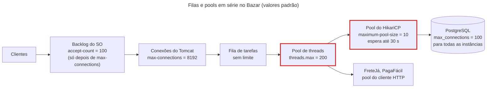
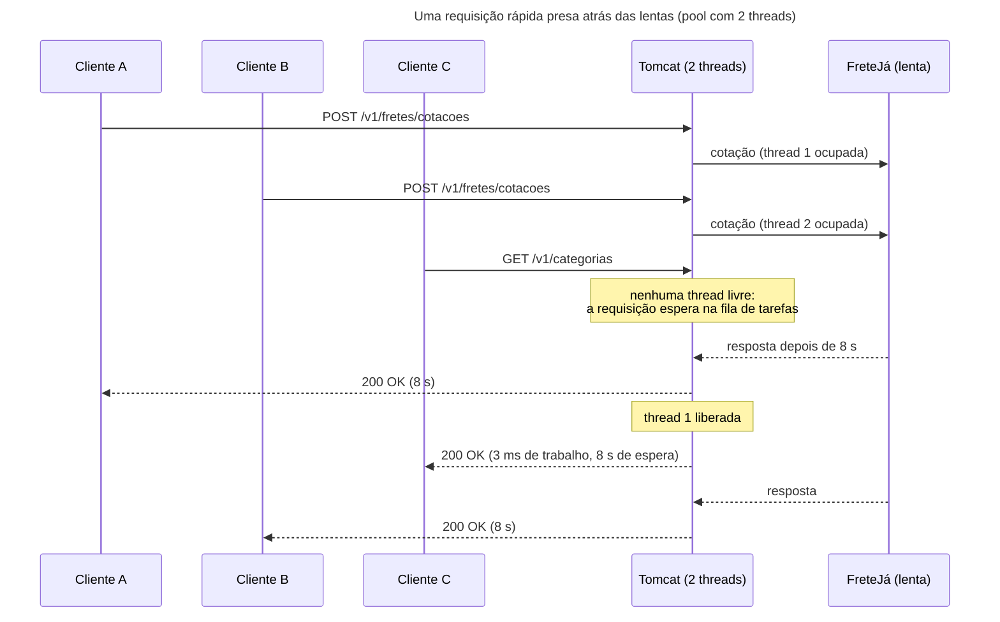

## O problema

O Bazar está no ar com as configurações padrão. Numa sexta-feira à noite, a FreteJá, que cota o frete, começa a demorar oito segundos para responder em vez de duzentos milissegundos. Nada mais mudou: o banco está tranquilo, a CPU dos servidores está em 15%. Mesmo assim, em poucos minutos, `GET /v1/categorias`, que nem fala com a FreteJá, passa a demorar segundos, e depois começa a falhar. O painel mostra a CPU ociosa e a API fora do ar ao mesmo tempo.

A explicação está num número que quase ninguém olha: quantas requisições o servidor consegue atender **ao mesmo tempo**. No Spring MVC sobre o Tomcat, esse número é fixo, e cada requisição lenta ocupa uma vaga enquanto espera.

Pense num restaurante com 20 mesas. A cozinha é rápida, e cada cliente costuma ficar 40 minutos. Um dia, a máquina de cartão começa a levar 15 minutos para aprovar cada pagamento. Os garçons e a cozinha estão parados, mas as mesas continuam ocupadas por clientes esperando a maquininha. Quem chega encontra a casa cheia e espera na porta, mesmo querendo só um café. O gargalo não é a cozinha, é o número de mesas, e uma lentidão fora do restaurante ocupou todas.

> **A pergunta desta página:** como o Tomcat atende as requisições, quantas ele aguenta ao mesmo tempo, e por que uma dependência lenta derruba endpoints que nem dependem dela?

## O conceito

### Uma thread por requisição

O Spring MVC roda sobre a API de Servlet, e o Tomcat atende cada requisição numa <Term id="thread-per-request" />: uma *thread* do servidor recebe a requisição, passa pelos filtros, pelo `DispatcherServlet` da [09.01](/construindo-apis-com-spring-boot/o-caminho-de-uma-requisicao-no-spring-mvc), pelo controller, pelo serviço, pelo repositório, e só é liberada depois que a resposta foi escrita. Se o serviço chama a FreteJá e espera oito segundos, a thread espera oito segundos junto, sem fazer nada.

Esse modelo tem uma qualidade enorme: o código é sequencial. Cada linha roda depois da anterior, a pilha de chamadas de uma exceção conta a história inteira, as transações e o contexto de segurança ficam guardados na thread (é o `ThreadLocal` que a [09.04](/construindo-apis-com-spring-boot/filtros-interceptors-e-aop-quando-usar-cada-um) usou para o MDC) e o depurador para onde você mandou. O preço é que uma thread de plataforma do Java é uma thread do sistema operacional, que custa memória (a pilha reserva da ordem de 1 MB) e troca de contexto. Por isso as threads ficam num <Term id="pool-de-threads">*pool* de tamanho fixo</Term>.

### As quatro filas do Tomcat

Uma requisição passa por quatro limites antes de chegar ao controller. Os nomes vêm das propriedades `server.tomcat.*` do Spring Boot, que repassam os valores ao conector HTTP do Tomcat:

| Propriedade | Padrão | O que limita | Quando enche |
|---|---|---|---|
| `server.tomcat.accept-count` | 100 | A fila de conexões do **sistema operacional** (o *backlog* do `listen`), usada só quando o Tomcat já tem `max-connections` abertas | O sistema operacional descarta as novas conexões; o cliente vê um *timeout* de conexão |
| `server.tomcat.max-connections` | 8192 | Conexões que o Tomcat aceita e acompanha ao mesmo tempo, inclusive as ociosas em *keep-alive* | O Tomcat para de aceitar; as próximas ficam no *backlog* |
| `server.tomcat.threads.max-queue-capacity` | `Integer.MAX_VALUE` | A fila de tarefas do *pool*: requisições que chegaram e esperam uma thread livre | Na prática, nunca: a fila não tem limite |
| `server.tomcat.threads.max` | 200 | Threads que executam requisições ao mesmo tempo (`min-spare`, padrão 10, é o mínimo mantido vivo) | A requisição espera na fila de tarefas |

O ponto que mais confunde é o `accept-count`. A descrição da propriedade no Spring Boot diz "fila de conexões quando todas as threads estão em uso", o que era verdade no conector bloqueante antigo do Tomcat. No conector NIO, o padrão há muitos anos (o conector bloqueante saiu no Tomcat 8.5), a documentação do Tomcat é precisa: é a fila do sistema operacional **quando `maxConnections` foi atingido**. Com as threads ocupadas e menos de 8192 conexões, o Tomcat continua aceitando conexões e lendo requisições, que esperam na fila de tarefas, sem limite. O `accept-count` só entra em cena depois que 8192 conexões estão abertas.

Isso tem uma consequência que surpreende: com a configuração padrão, uma API saturada **não recusa** requisições. Ela as aceita e as deixa esperando. Para o cliente, a API não está fora do ar, está lenta, até que o *timeout* do próprio cliente ou de um *proxy* no caminho desista.

<Callout type="info" title="E os outros servidores?">
O Jetty, a outra opção do Boot 4, tem o mesmo modelo, com `server.jetty.threads.max` (200) e uma fila própria. O Undertow saiu do Boot 4. Os números desta página valem para o Tomcat 11.0.27, o do Boot 4.1.2.
</Callout>

### A Lei de Little

Quantas requisições por segundo 200 threads aguentam? Depende de quanto tempo cada uma fica ocupada. A <Term id="lei-de-little" />, provada por John Little em 1961, diz que, num sistema estável:

> **L = λ × W**: o número médio de itens **dentro** do sistema é a taxa de chegada vezes o tempo médio que cada item fica lá dentro.

Numa API, isso vira **requisições em andamento = <Term id="vazao">vazão</Term> × latência**. Como as requisições em andamento não passam do número de threads, a vazão máxima é:

> **vazão máxima = threads ÷ tempo de cada requisição**

| Threads | Tempo por requisição | Vazão máxima |
|---|---|---|
| 200 | 50 ms (dia normal) | 4.000 req/s |
| 200 | 200 ms | 1.000 req/s |
| 200 | 8 s (FreteJá lenta) | 25 req/s |
| 10 | 200 ms (o experimento desta página) | 50 req/s |

A conta funciona nos dois sentidos. Se chegam 300 req/s e cada requisição leva 50 ms, há em média 15 requisições em andamento: 200 threads sobram. Se a latência sobe para 2 s, seriam necessárias 600 threads. Como só há 200, as outras requisições se acumulam na fila de tarefas, e a fila só cresce enquanto a chegada passar da vazão máxima.

A lei também explica a latência que o cliente vê quando o pool está cheio. Com 50 clientes repetindo requisições de 200 ms num pool de 10 threads, há 50 requisições no sistema, e a vazão é 50 req/s. Pela lei, cada uma fica, em média, 50 ÷ 50 = **1 segundo** lá dentro: 200 ms de trabalho e 800 ms de fila. A seção "Na prática" mede exatamente isso.

### Por que uma dependência lenta esgota o pool

Volte à sexta-feira. Na hora de pico, o Bazar recebe 300 req/s, e 10% delas cotam frete na FreteJá:

- Antes: 30 req/s × 0,2 s = **6 threads** ocupadas com o frete.
- Depois que a FreteJá passa a 8 s: 30 req/s × 8 s = **240 threads**. São mais do que as 200 que existem.

O frete sozinho quer mais threads do que o servidor tem. Em poucos segundos, as 200 threads estão todas paradas esperando a FreteJá, e `GET /v1/categorias`, que levaria 3 ms, entra na mesma fila de tarefas que as cotações. A fila é uma só e não sabe que categorias são rápidas. A lentidão de **uma** dependência virou lentidão de **todos** os endpoints. Em seguida vêm os efeitos de segunda ordem: o aplicativo do cliente desiste e tenta de novo (mais carga), o balanceador marca a instância como lenta e manda o tráfego para as outras, que esgotam do mesmo jeito.

É por isso que a Parte 10 inteira existe. *Timeouts* curtos (25.01) limitam quanto tempo uma thread pode ficar presa, e o *bulkhead* (25.03) limita quantas threads uma dependência pode ocupar, para que a FreteJá lenta consuma 20 threads, e não 200.

<Callout type="info" title="Visto em detalhes adiante">
<Term id="timeout">Timeouts</Term> e orçamento de tempo são o assunto da [25.01](/consumindo-outras-apis/timeouts-e-orcamento-de-tempo), e o *bulkhead* e o *circuit breaker*, da [25.03](/consumindo-outras-apis/circuit-breaker-bulkhead-e-limites-de-concorrencia). Aqui basta saber que eles existem para proteger o pool de threads.
</Callout>

### I/O bloqueante × CPU

Uma requisição de 200 ms pode estar fazendo duas coisas muito diferentes:

- **Esperando** (<Term id="io-bloqueante">I/O bloqueante</Term>): a resposta do banco, da FreteJá, de um arquivo. A thread fica parada, e a CPU fica livre para outras threads.
- **Calculando** (CPU): serializar um JSON grande, aplicar um desconto em mil itens, gerar um hash de senha. A thread usa um núcleo do processador o tempo todo.

Numa API típica, quase todo o tempo é espera. Uma consulta de 20 ms e uma chamada externa de 150 ms, com 5 ms de processamento, deixam a thread parada 97% do tempo. Para esse tipo de carga, o limite é o **número de threads**: a CPU sobra, como no painel da sexta-feira. Mais threads (ou threads mais baratas, que é o assunto da [19.02](/concorrencia-e-execucao-assincrona/virtual-threads-em-apis-spring)) aumentam a vazão.

Numa carga de CPU, o limite é o **número de núcleos**. Com 12 núcleos e 50 ms de CPU por requisição, a vazão máxima é 12 ÷ 0,05 = 240 req/s, tenha o pool 20 ou 2.000 threads. Threads além dos núcleos só disputam a mesma CPU e acrescentam troca de contexto.

| Tipo de carga | O que limita a vazão | Mais threads ajudam? |
|---|---|---|
| I/O bloqueante (banco, APIs externas) | Número de threads e os pools das dependências | Sim, até o próximo gargalo |
| CPU | Número de núcleos | Não |

### Os outros recursos limitados

Aumentar `threads.max` para 1.000 parece resolver a sexta-feira. Só que a thread raramente é o único recurso limitado. A requisição que chega ao repositório precisa de uma conexão do <Term id="pool-de-conexoes">*pool* de conexões</Term> do HikariCP, que tem **10** conexões por padrão (`spring.datasource.hikari.maximum-pool-size`). A [10.03](/persistencia-para-apis/transacoes-na-camada-de-servico) mostrou o que acontece quando as conexões acabam: a requisição espera até `connection-timeout` (30 segundos por padrão) e falha.

Os limites ficam **em série**. Com 200 threads e 10 conexões, no máximo 10 requisições usam o banco ao mesmo tempo. A Lei de Little vale para cada recurso: se cada requisição segura a conexão por 200 ms, a vazão do banco é 10 ÷ 0,2 = 50 req/s, independentemente das threads. O recurso mais apertado da série define a vazão do sistema, e aumentar os outros não muda nada, só move a fila de lugar.

A lista de recursos limitados de uma API Spring vai além das duas:

- Conexões do banco (HikariCP) e o `max_connections` do próprio PostgreSQL (100 por padrão), dividido entre **todas** as instâncias da aplicação.
- Conexões HTTP com cada API externa (o pool do cliente HTTP, Parte 10).
- Os limites de taxa das APIs externas (a PagaFácil responde 429, Parte 10).
- Memória: cada thread, cada requisição em fila e cada corpo em leitura ocupam *heap* ou memória nativa.
- Descritores de arquivo do sistema operacional, um por conexão aberta.

## Diagrama

Os limites em série que uma requisição atravessa, com os valores padrão:



O que acontece com uma requisição rápida quando as threads estão ocupadas por requisições lentas:



## Na prática

### O laboratório

Para ver a saturação acontecer, o Bazar ganhou um *profile* de experimentos com pools pequenos e três endpoints que simulam uma dependência lenta. Eles só existem com o *profile* `experimentos`, não fazem parte do contrato e nunca sobem em produção.

```java title="src/main/java/com/bazar/experimentos/LentidaoController.java"
/**
 * Simula uma dependência lenta de três formas (19.01): esperando sem fazer nada (I/O bloqueante), segurando uma
 * conexão do banco e ocupando a CPU. Cada resposta diz qual thread a atendeu.
 */
@RestController
@RequestMapping("/experimentos")
@Profile("experimentos")
class LentidaoController {

    private final JdbcClient jdbc;

    LentidaoController(JdbcClient jdbc) {
        this.jdbc = jdbc;
    }

    // Como uma chamada HTTP a uma API externa lenta: a thread fica parada, esperando a resposta.
    @GetMapping("/espera")
    Map<String, Object> espera(@RequestParam(defaultValue = "200") long ms) throws InterruptedException {
        Thread.sleep(Duration.ofMillis(ms));
        return resposta(ms);
    }

    // Como uma consulta lenta: a thread espera, e uma conexão do pool do banco fica ocupada o tempo todo.
    @GetMapping("/banco")
    Map<String, Object> banco(@RequestParam(defaultValue = "200") long ms) {
        jdbc.sql("select pg_sleep(:segundos)").param("segundos", ms / 1000.0).query().singleValue();
        return resposta(ms);
    }

    // Trabalho de CPU: a thread não espera nada, ela calcula. O laço conta o tempo de CPU da própria thread, e não o
    // do relógio: com mais threads que núcleos, a thread fica parte do tempo fora do processador, e um laço pelo
    // relógio terminaria tendo feito menos trabalho.
    @GetMapping("/cpu")
    Map<String, Object> cpu(@RequestParam(defaultValue = "200") long ms) {
        var cpu = ManagementFactory.getThreadMXBean();
        long fim = cpu.getCurrentThreadCpuTime() + Duration.ofMillis(ms).toNanos();
        long contas = 0;
        while (cpu.getCurrentThreadCpuTime() < fim) {
            contas++;
        }
        var corpo = resposta(ms);
        corpo.put("contas", contas);
        return corpo;
    }

    private static Map<String, Object> resposta(long ms) {
        var corpo = new LinkedHashMap<String, Object>();
        corpo.put("ms", ms);
        corpo.put("thread", Thread.currentThread().toString());
        return corpo;
    }
}
```

O *profile* reduz os pools para que a saturação apareça com poucos clientes, numa máquina de desenvolvimento:

```yaml title="src/main/resources/application-experimentos.yml"
server:
  tomcat:
    threads:
      max: 10          # padrão: 200
      min-spare: 10    # padrão: 10
    max-connections: 8192   # padrão: 8192
    accept-count: 100       # padrão: 100

spring:
  datasource:
    hikari:
      maximum-pool-size: 5     # padrão: 10
      connection-timeout: 2000   # em ms, sem unidade (é um long do HikariConfig); padrão: 30000

logging:
  level:
    # O log de cada requisição (TempoDeRespostaFilter) atrapalharia a leitura durante a carga.
    com.bazar.compartilhado.web.TempoDeRespostaFilter: warn
```

<Callout type="warning" title="O connection-timeout do Hikari não aceita unidade">
As propriedades `server.*` do Spring Boot são `Duration` e aceitam `2s`. As de `spring.datasource.hikari.*` são repassadas ao `HikariConfig`, onde os tempos são `long` em milissegundos. Com `connection-timeout: 2s`, a aplicação não sobe: `Failed to bind properties under 'spring.datasource.hikari.connection-timeout' to long`.
</Callout>

Uma requisição ao laboratório mostra quem a atendeu:

<HttpExchange
  title="A thread que atendeu a requisição"
  request={{ method: 'GET', url: '/experimentos/espera?ms=200' }}
  response={{ status: 200, headers: { 'Content-Type': 'application/json' }, body: { ms: 200, thread: 'Thread[#69,http-nio-8080-exec-3,5,main]' } }}
>
`http-nio-8080-exec-3` é a terceira thread do pool do conector NIO na porta 8080. Com `threads.max: 10`, os nomes vão de `exec-1` a `exec-10`, e nunca aparece um `exec-11`.
</HttpExchange>

### O gerador de carga

Para disparar vários clientes ao mesmo tempo, o Bazar tem um gerador de carga mínimo em um único arquivo Java, que roda sem compilar nem instalar nada (`java Arquivo.java`, recurso do JDK desde o 11). Cada cliente usa a própria conexão e repete a requisição até o tempo acabar:

```java title="scripts/carga/Carga.java (trecho)"
try (var executor = Executors.newVirtualThreadPerTaskExecutor()) {
    for (int i = 0; i < clientes; i++) {
        executor.submit(() -> {
            try (var http = HttpClient.newBuilder().version(HttpClient.Version.HTTP_1_1)
                    .connectTimeout(Duration.ofSeconds(10)).build()) {
                var requisicao = HttpRequest.newBuilder(url).timeout(Duration.ofSeconds(30)).build();
                while (System.nanoTime() < fim) {
                    long inicio = System.nanoTime();
                    // ... envia, anota a latência e o status (ou o nome da exceção)
                }
            }
        });
    }
}
// ... imprime a vazão, os percentis de latência e a contagem por status
```

Ele mostra a vazão, a latência em <Term id="percentil">percentis</Term> (p50 é a mediana; p95 é o valor abaixo do qual ficam 95% das requisições) e os status. É uma ferramenta de laboratório, para ver um pool encher. Medir desempenho de verdade, com aquecimento, cenários e metas, é o assunto da [28.01](/performance/medindo-antes-de-otimizar-testes-de-carga), com o k6.

<Steps>
<Step title="Suba o Bazar com o profile de experimentos">

```bash
./mvnw spring-boot:run -Dspring-boot.run.profiles=experimentos
```

</Step>
<Step title="Em outro terminal, dispare a carga">

```bash
java scripts/carga/Carga.java 'http://localhost:8080/experimentos/espera?ms=200' 10 10
```

Os argumentos são a URL, o número de clientes e a duração em segundos.

</Step>
</Steps>

### Experimento 1: a Lei de Little

Dez clientes num pool de dez threads, depois cinquenta. Cada requisição espera 200 ms:

```text noCopy
$ java scripts/carga/Carga.java 'http://localhost:8080/experimentos/espera?ms=200' 10 10
10 clientes, 10.2 s, 480 requisições
vazão: 47.0 req/s
latência (ms): p50=207 p95=209 p99=301 máx=301
status: {200=480}

$ java scripts/carga/Carga.java 'http://localhost:8080/experimentos/espera?ms=200' 50 10
50 clientes, 10.9 s, 530 requisições
vazão: 48.5 req/s
latência (ms): p50=1008 p95=1011 p99=1077 máx=1099
status: {200=530}
```

Os números batem com a conta da seção anterior:

- A vazão ficou em torno de 50 req/s nos dois casos: 10 threads ÷ 0,2 s. Cinco vezes mais clientes não trouxeram nenhuma requisição a mais por segundo.
- Com 10 clientes, cada um encontra uma thread livre, e a latência é o próprio trabalho: 207 ms.
- Com 50 clientes, a latência foi a 1.008 ms: 50 requisições no sistema ÷ 50 req/s = 1 s. São 200 ms de trabalho e 800 ms de fila.
- Nenhum erro. O Tomcat aceitou as 50 conexões e deixou as requisições esperando, como a tabela das quatro filas previa.

Um *thread dump* durante a carga (`jcmd <pid> Thread.print`) mostra as dez threads paradas no mesmo lugar:

```text noCopy
"http-nio-8080-exec-1" #67 daemon prio=5 ... waiting on condition
   java.lang.Thread.State: TIMED_WAITING (sleeping)
	at java.lang.Thread.sleep(java.base@25.0.4.1/Thread.java:601)
	at com.bazar.experimentos.LentidaoController.espera(LentidaoController.java:33)
	...
"http-nio-8080-exec-2" ... (o mesmo)
...
"http-nio-8080-exec-10" ... (o mesmo)
"http-nio-8080-Poller" ...
"http-nio-8080-Acceptor" ...
```

É assim que um pool esgotado aparece em produção: dezenas de threads `exec` com a mesma pilha, paradas numa leitura de *socket* para a mesma dependência. O *thread dump* aponta o culpado melhor do que qualquer métrica.

### Experimento 2: a rota rápida presa atrás das lentas

Primeiro, `GET /v1/categorias` sozinha, com um cliente:

```text noCopy
1 clientes, 5.0 s, 1369 requisições
vazão: 273.5 req/s
latência (ms): p50=3 p95=5 p99=7 máx=185
```

Agora a mesma rota, com 50 clientes ocupando o pool no `/experimentos/espera?ms=200` ao mesmo tempo:

```text noCopy
1 clientes, 8.9 s, 9 requisições
vazão: 1.0 req/s
latência (ms): p50=1007 p95=1008 p99=1008 máx=1008
```

A mediana de categorias foi de **3 ms para 1.007 ms**, sem que nada nela mudasse. É o problema da sexta-feira: o trabalho de categorias continua levando 3 ms, mas a requisição espera na mesma fila que as lentas. A fila de tarefas do Tomcat é única e por ordem de chegada.

### Experimento 3: I/O × CPU

Para comparar os dois tipos de carga sem o limite das 10 threads, o Bazar subiu com 200 threads (`--server.tomcat.threads.max=200`) numa máquina de 12 núcleos. Primeiro, a espera de 200 ms com 100 clientes:

```text noCopy
$ java scripts/carga/Carga.java 'http://localhost:8080/experimentos/espera?ms=200' 100 10
100 clientes, 10.2 s, 4800 requisições
vazão: 471.7 req/s
latência (ms): p50=204 p95=212 p99=257 máx=328
```

Cem threads esperando ao mesmo tempo, e a vazão chegou perto de 100 ÷ 0,2 = 500 req/s: com I/O, mais threads trouxeram mais vazão. Agora 50 ms de CPU por requisição, com 12 clientes (um por núcleo) e com 100:

```text noCopy
$ java scripts/carga/Carga.java 'http://localhost:8080/experimentos/cpu?ms=50' 12 10
12 clientes, 10.1 s, 2071 requisições
vazão: 206.0 req/s
latência (ms): p50=53 p95=75 p99=95 máx=158

$ java scripts/carga/Carga.java 'http://localhost:8080/experimentos/cpu?ms=50' 100 10
100 clientes, 10.2 s, 2283 requisições
vazão: 222.8 req/s
latência (ms): p50=438 p95=505 p99=747 máx=1173
```

O teto é o dos núcleos, 12 ÷ 0,05 = 240 req/s (um pouco menos, porque o gerador de carga roda na mesma máquina). Com 100 clientes, havia threads de sobra, e a vazão não saiu do lugar: a latência é que subiu para 438 ms, porque 100 threads se revezaram em 12 núcleos.

<Callout type="warning" title="Simular CPU pelo relógio engana">
A primeira versão do `/cpu` repetia o laço até passar o tempo **do relógio**. Com 100 clientes, ela respondeu 1.316 req/s, mais que o possível. Uma thread que fica fora do processador continua vendo o relógio andar, e o laço terminava tendo calculado bem menos que 50 ms. Por isso o laço conta o tempo de CPU da própria thread (`ThreadMXBean.getCurrentThreadCpuTime`).
</Callout>

### Experimento 4: o gargalo muda para o banco

O endpoint `/experimentos/banco` segura uma conexão do Hikari durante a espera. O pool do banco tem 5 conexões, e o de threads, 10:

```text noCopy
$ java scripts/carga/Carga.java 'http://localhost:8080/experimentos/banco?ms=200' 10 10
10 clientes, 10.2 s, 245 requisições
vazão: 24.0 req/s
latência (ms): p50=407 p95=409 p99=486 máx=486
status: {200=245}
```

A vazão caiu para a metade do experimento 1, com as mesmas 10 threads: 5 conexões ÷ 0,2 s = 25 req/s. Cinco threads trabalham, e as outras cinco esperam uma conexão dentro do Hikari, por isso a latência dobrou para 400 ms. O recurso mais apertado da série é o pool do banco, e as threads a mais não ajudam.

Quando a espera pela conexão passa do `connection-timeout`, o Hikari desiste. Com consultas de 2,5 s e o tempo limite de 2 s, metade das requisições falha:

```text noCopy
$ java scripts/carga/Carga.java 'http://localhost:8080/experimentos/banco?ms=2500' 10 12
10 clientes, 12.8 s, 50 requisições
vazão: 3.9 req/s
latência (ms): p50=2130 p95=3018 p99=3021 máx=3021
status: {200=25, 500=25}
```

```text noCopy
java.sql.SQLTransientConnectionException: HikariPool-1 - Connection is not available, request timed out after 2000ms
(total=5, active=5, idle=0, waiting=2)
```

O `(total=5, active=5, idle=0, waiting=2)` da mensagem é o diagnóstico completo: todas as conexões em uso e duas threads na fila do pool. Para o cliente, isso sai como um `500 Internal Server Error`:

<HttpExchange
  title="Pool do banco esgotado"
  request={{ method: 'GET', url: '/experimentos/banco?ms=10' }}
  response={{ status: 500, headers: { 'Content-Type': 'application/problem+json', 'Content-Language': 'pt-BR' }, body: { title: 'Internal Server Error', status: 500, detail: 'Erro inesperado. Se persistir, informe o traceId ao suporte.', instance: '/experimentos/banco', codigo: 'INTERNAL_SERVER_ERROR', traceId: '29c68bf538a4c569b064576379e02872' } }}
>
Uma requisição de 10 ms que falhou porque esperou 2 s por uma conexão, todas ocupadas por consultas de 2,5 s. O `500` não diz ao cliente que tentar de novo daqui a pouco pode funcionar. A [23.01](/padroes-avancados-de-http/rate-limiting-e-quotas) e a Parte 10 discutem o `503 Service Unavailable` com `Retry-After` para a sobrecarga.
</HttpExchange>

### Experimento 5: quando as conexões acabam

Por fim, o `accept-count` em ação. O Bazar subiu com `max-connections` em 20 e `accept-count` em 5, e 60 clientes tentaram conectar:

```bash
./mvnw spring-boot:run -Dspring-boot.run.profiles=experimentos \
  -Dspring-boot.run.arguments="--server.tomcat.max-connections=20 --server.tomcat.accept-count=5"
```

```text noCopy
60 clientes, 14.0 s, 530 requisições
vazão: 37.8 req/s
latência (ms): p50=408 p95=10010 p99=10274 máx=13795
status: {200=500, HttpConnectTimeoutException=30}

$ ss -ltn 'sport = :8080'
State  Recv-Q Send-Q Local Address:Port Peer Address:PortProcess
LISTEN 0      5                  *:8080            *:*
```

O comportamento mudou de natureza. Os clientes que conseguiram uma das 20 conexões tiveram latência de 400 ms (20 clientes para 10 threads). Alguns esperaram no *backlog* (o `Send-Q 5` do `ss` é o `accept-count`), e 30 tentativas nem conseguiram conectar: o Linux descartou as conexões além do *backlog*, e o cliente desistiu no próprio `connectTimeout` de 10 s. O p95 de 10.010 ms é esse tempo limite. Com os padrões (8192 conexões), esse cenário só aparece com milhares de clientes simultâneos.

### O teste

Os experimentos dependem da máquina, mas os limites inferiores não. Com 4 threads e requisições de 200 ms, 20 requisições simultâneas precisam de 5 rodadas, e nenhuma máquina faz isso em menos de 1 segundo:

```java title="src/test/java/com/bazar/experimentos/SaturacaoDoPoolTest.java"
@SpringBootTest(webEnvironment = WebEnvironment.RANDOM_PORT, properties = "server.tomcat.threads.max=4")
@ActiveProfiles("experimentos")
@Import(TestcontainersConfiguration.class)
class SaturacaoDoPoolTest {

    @LocalServerPort
    int porta;

    @Test
    void vinteRequisicoesComQuatroThreadsLevamCincoRodadas() throws Exception {
        long inicio = System.nanoTime();
        var threads = new HashSet<String>();
        try (var clientes = Executors.newVirtualThreadPerTaskExecutor()) {
            var respostas = new ArrayList<Future<String>>();
            for (int i = 0; i < 20; i++) {
                respostas.add(clientes.submit(() -> get("/experimentos/espera?ms=200")));
            }
            for (var resposta : respostas) {
                threads.add(resposta.get().replaceAll(".*(http-nio-\\d+-exec-\\d+).*", "$1"));
            }
        }
        var total = Duration.ofNanos(System.nanoTime() - inicio);

        // Lei de Little: vazão máxima = 4 threads / 0,2 s = 20 req/s. Vinte requisições levam pelo menos 1 s.
        assertThat(total).isGreaterThanOrEqualTo(Duration.ofMillis(1000));
        assertThat(threads).hasSizeLessThanOrEqualTo(4);
    }

    @Test
    void umaRotaRapidaEsperaNaFilaAtrasDasLentas() throws Exception {
        try (var clientes = Executors.newVirtualThreadPerTaskExecutor()) {
            // Quatro requisições lentas ocupam as quatro threads por 500 ms.
            for (int i = 0; i < 4; i++) {
                clientes.submit(() -> get("/experimentos/espera?ms=500"));
            }
            Thread.sleep(100);

            long inicio = System.nanoTime();
            get("/experimentos/espera?ms=0");
            var espera = Duration.ofNanos(System.nanoTime() - inicio);

            // A rota não faz nada, mas só começa quando uma thread se libera: uns 400 ms depois.
            assertThat(espera).isGreaterThanOrEqualTo(Duration.ofMillis(300));
        }
    }

    // ... get(caminho): um HttpClient por chamada, uma conexão por cliente
}
```

O teste não usa o `@TesteDeIntegracao` da [11.04](/testes-de-api/testes-de-integracao-com-springboottest-e-testcontainers) de propósito: ele precisa de um Tomcat com 4 threads, e uma propriedade diferente cria outro contexto do Spring. É um contexto a mais na suíte, aceito porque o teste mede justamente o servidor.

Os clientes do teste rodam em *virtual threads* (`newVirtualThreadPerTaskExecutor`) porque precisam de 20 esperas simultâneas baratas. A [19.02](/concorrencia-e-execucao-assincrona/virtual-threads-em-apis-spring) explica o que elas são e faz o mesmo do lado do servidor.

## Erros comuns

<BadVsGood title="Resolver a lentidão aumentando threads.max" why="Mais threads só ajudam se a thread é o recurso mais apertado. Com o pool do banco em 10 conexões, 1.000 threads significam 990 esperando uma conexão, e cada uma ocupa memória. Com uma dependência lenta, 1.000 threads só demoram um pouco mais para se esgotar. O que protege o pool é limitar o tempo e a quantidade de threads que cada dependência pode ocupar.">
<Bad title="Mais threads e torcer">

```yaml
server:
  tomcat:
    threads:
      max: 1000   # "a API estava lenta"
spring:
  datasource:
    hikari:
      maximum-pool-size: 10   # continua o gargalo
```

</Bad>
<Good title="Medir o gargalo e proteger o pool">

```yaml
server:
  tomcat:
    threads:
      max: 200   # dimensionado pela Lei de Little
spring:
  datasource:
    hikari:
      maximum-pool-size: 20      # medido (28.02)
      connection-timeout: 2000   # falha rápido
# + timeouts e bulkhead nas chamadas
#   externas (25.01, 25.03)
```

</Good>
</BadVsGood>

Outros tropeços frequentes:

- **Achar que `accept-count` é a fila das requisições esperando thread.** No conector NIO, ela é a fila do sistema operacional depois de `max-connections`. As requisições que esperam thread ficam na fila de tarefas, que não tem limite. Diminuir o `accept-count` não faz a API recusar carga mais cedo.
- **Olhar só a CPU.** Uma API presa em I/O satura com a CPU ociosa. O sinal certo é o número de threads ocupadas, a fila de espera do pool de conexões e a latência por dependência (Parte 12).
- **Olhar só a média de latência.** No experimento 5, a média esconde que 30 clientes nem conectaram. Os percentis altos (p95, p99) e a contagem de erros contam a história.
- **Chamada externa sem *timeout*.** Sem tempo limite, uma dependência que para de responder segura a thread para sempre. O pool esgota e não se recupera sozinho nem quando a dependência volta, porque as threads antigas continuam esperando.
- **Pool do banco maior que o banco aguenta.** O `maximum-pool-size` vale **por instância**. Com 8 instâncias e 20 conexões cada, são 160 conexões, mais que as 100 que o PostgreSQL aceita por padrão.
- **Tempo de espera do Hikari longo demais.** Com 30 s de `connection-timeout`, uma requisição sem conexão segura a thread por 30 s antes de falhar, e o esgotamento do banco vira esgotamento do Tomcat. Falhar em 1 ou 2 s libera a thread.
- **Trabalho demorado dentro da requisição.** Gerar o relatório de vendas do mês durante o `POST` segura a thread por minutos. A [19.03](/concorrencia-e-execucao-assincrona/async-scheduled-e-tarefas-em-segundo-plano) tira esse trabalho da requisição.

## Boas práticas

- **Calcule com a Lei de Little** antes de mudar qualquer pool: requisições em andamento = vazão × latência, para as threads e para cada pool de dependência.
- **Encontre o recurso mais apertado** da série (threads, conexões do banco, conexões HTTP, limites externos) e meça antes de aumentar qualquer um.
- **Ponha *timeout* em toda chamada que pode esperar**: banco, APIs externas, filas. Uma espera sem limite é uma thread perdida.
- **Isole as dependências lentas** para que uma delas não ocupe o pool inteiro (*bulkhead*, 25.03).
- **Some os pools de todas as instâncias** antes de dimensionar o do banco, e compare com o `max_connections` do PostgreSQL.
- **Tire do caminho da requisição** o trabalho que pode demorar (19.03 e 21.02).
- **Reproduza a saturação em laboratório**, com pools pequenos, e guarde um *thread dump* do que você viu: em produção, é o primeiro dado a coletar.

## Por baixo dos panos

<DeepDive title="Acceptor, Poller e Executor: as threads do conector NIO">

O conector HTTP do Tomcat (`Http11NioProtocol`, o padrão) usa três tipos de thread, e o *thread dump* do experimento 1 mostra os três:

1. **`http-nio-8080-Acceptor`** (uma thread): chama `accept()` no *socket* do servidor. Antes de cada `accept`, ela incrementa um contador limitado a `maxConnections` (`LimitLatch`). Quando o contador está cheio, o Acceptor para de aceitar, e as conexões novas ficam no *backlog* do sistema operacional, cujo tamanho é o `acceptCount` passado ao `listen()`.
2. **`http-nio-8080-Poller`** (uma thread): registra as conexões aceitas num `Selector` do Java NIO e espera dados. Uma conexão em *keep-alive*, sem requisição, não ocupa thread nenhuma: fica no Selector. Quando chegam bytes, o Poller cria uma tarefa (`SocketProcessor`) e a entrega ao Executor.
3. **`http-nio-8080-exec-N`** (o pool, até `maxThreads`): executam a tarefa, que lê a requisição, chama o `CoyoteAdapter`, a cadeia de filtros, o `DispatcherServlet` e o seu controller, e escreve a resposta.

O Executor é um `ThreadPoolExecutor` do próprio Tomcat, com um detalhe importante. O `ThreadPoolExecutor` do JDK só cria threads além do mínimo quando a fila enche, e com uma fila sem limite ela nunca enche. O Tomcat inverte isso com a `TaskQueue`: enquanto houver menos threads que `maxThreads`, a fila "recusa" a tarefa e força a criação de uma thread nova. Só quando as `maxThreads` estão ocupadas as tarefas passam a esperar na fila, cujo limite é `maxQueueSize` (`server.tomcat.threads.max-queue-capacity`, `Integer.MAX_VALUE` por padrão).

Por isso o `Send-Q` do `ss` no experimento 5 mostrou 5, e não 100: o *backlog* é o `acceptCount` configurado. No Linux, quando o *backlog* enche, o kernel descarta as tentativas novas (com o padrão `tcp_abort_on_overflow = 0`), e o cliente reenvia o SYN até o próprio tempo limite. Por isso o cliente viu `HttpConnectTimeoutException`, e não "conexão recusada".

</DeepDive>

## No projeto Bazar

<ProjectStep title="Laboratório de saturação e gerador de carga" module="experimentos" tag="pagina-19.01" files={[
  { path: 'src/main/java/com/bazar/experimentos/LentidaoController.java', change: 'novo' },
  { path: 'src/main/java/com/bazar/experimentos/package-info.java', change: 'novo' },
  { path: 'src/main/resources/application-experimentos.yml', change: 'novo' },
  { path: 'scripts/carga/Carga.java', change: 'novo' },
  { path: 'src/test/java/com/bazar/experimentos/SaturacaoDoPoolTest.java', change: 'novo' },
]}>
O *profile* `experimentos` liga três endpoints de laboratório (`/experimentos/espera`, `/banco` e `/cpu`) e reduz os pools (10 threads, 5 conexões, 2 s de espera por conexão). O `Carga.java` dispara N clientes simultâneos e mostra vazão, percentis e status. O `SaturacaoDoPoolTest` fixa os limites inferiores da Lei de Little com 4 threads. A [19.02](/concorrencia-e-execucao-assincrona/virtual-threads-em-apis-spring) repete os experimentos com virtual threads.
</ProjectStep>

## Resumo

- No Spring MVC sobre o Tomcat, cada requisição ocupa uma thread do pool (`server.tomcat.threads.max`, 200) do começo ao fim, inclusive enquanto espera.
- Com as threads ocupadas, as requisições esperam numa fila de tarefas **sem limite**. O `accept-count` só vale depois de `max-connections` (8192) conexões abertas.
- Lei de Little: requisições em andamento = vazão × latência. A vazão máxima é threads ÷ tempo por requisição, e uma dependência lenta a derruba para todos os endpoints.
- Em cargas de I/O, o limite é o número de threads e os pools das dependências; em cargas de CPU, o número de núcleos.
- Os pools ficam em série (threads → Hikari → PostgreSQL), e o mais apertado define a vazão. Aumentar os outros só move a fila.
- *Timeouts*, isolamento das dependências e trabalho fora da requisição protegem o pool; mais threads, sozinhas, não.

<Exercise title="Dimensione o pool para a Black Friday" difficulty="medio">
Na Black Friday, o Bazar espera 600 req/s por instância, com esta distribuição medida no ano anterior:

| Rota | Fração | Tempo médio | Usa o banco por |
|---|---|---|---|
| `GET /v1/produtos` e detalhes | 80% | 30 ms | 20 ms |
| `POST /v1/fretes/cotacoes` | 15% | 250 ms | não usa |
| `POST /v1/pedidos` | 5% | 120 ms | 80 ms |

1. Quantas threads estão ocupadas em média? O padrão de 200 basta?
2. Quantas conexões do banco estão ocupadas em média? O padrão de 10 basta?
3. A FreteJá fica lenta e passa a 5 s. Quantas threads o frete passa a ocupar, e o que acontece com o catálogo?
4. Com 6 instâncias, qual seria o total de conexões ao PostgreSQL se cada uma tivesse 20?

<Hint>Aplique L = λ × W para cada rota e some. Para o banco, use o tempo em que a conexão fica ocupada, e não o tempo total da requisição.</Hint>

<Solution>

1. Threads: catálogo 480 req/s × 0,03 s = 14,4; frete 90 × 0,25 = 22,5; pedidos 30 × 0,12 = 3,6. Total: **cerca de 41 threads**. As 200 sobram, com folga para picos (a média esconde rajadas: dimensione para o pico, não para a média).
2. Conexões: catálogo 480 × 0,02 = 9,6; pedidos 30 × 0,08 = 2,4. Total: **cerca de 12 conexões**, acima das 10 do padrão. O Hikari vira o gargalo antes das threads: requisições esperam uma conexão, a latência sobe, e pela Lei de Little sobem também as threads ocupadas. Algo como 20 conexões dá folga, a confirmar com teste de carga (28.02).
3. Frete: 90 × 5 = **450 threads**, mais do que as 200 que existem. O pool esgota em segundos, e o catálogo, que precisaria de 14 threads, espera na fila atrás das cotações. A correção não é subir para 500 threads: é um *timeout* curto na FreteJá (25.01), um *bulkhead* que limite as cotações a, por exemplo, 30 threads (25.03) e um *fallback* para o frete (25.04).
4. 6 × 20 = **120 conexões**, acima das 100 do `max_connections` padrão do PostgreSQL. Algumas instâncias falhariam ao abrir conexões. É preciso aumentar o limite do banco (com memória para isso) ou reduzir o pool por instância.

</Solution>
</Exercise>

<Quiz questions={[
  {
    question: 'O Bazar tem 200 threads, e todas estão ocupadas esperando a FreteJá. Chega uma nova requisição GET /v1/categorias, e há 300 conexões abertas. O que acontece com ela, com a configuração padrão?',
    options: [
      'É recusada com 503 porque o accept-count foi atingido',
      'O sistema operacional descarta a conexão',
      'O Tomcat a aceita e a deixa na fila de tarefas, sem limite, até uma thread se liberar',
      'O Tomcat cria a thread 201 para atendê-la',
    ],
    answer: 2,
    explanation: 'Com menos de max-connections (8192) conexões, o Tomcat continua aceitando e lendo requisições, que esperam na fila de tarefas sem limite. O accept-count (o backlog do sistema operacional) só vale depois de max-connections. O Tomcat não passa de threads.max, e nada responde 503 automaticamente.',
  },
  {
    question: 'Um pool de 10 threads atende requisições de 200 ms. Com 40 clientes repetindo requisições sem pausa, qual é a latência média que cada cliente vê?',
    options: [
      '200 ms, porque o trabalho não mudou',
      'Cerca de 800 ms: 40 requisições no sistema ÷ 50 req/s',
      'Cerca de 8 s',
      'As requisições além da décima falham',
    ],
    answer: 1,
    explanation: 'A vazão máxima é 10 ÷ 0,2 = 50 req/s. Pela Lei de Little, W = L ÷ λ = 40 ÷ 50 = 0,8 s: 200 ms de trabalho e 600 ms de fila. Nada falha: as requisições esperam.',
  },
  {
    question: 'Um endpoint usa o banco por 100 ms em cada requisição. O pool tem 200 threads e 10 conexões. Qual é a vazão máxima desse endpoint, e o que acontece se threads.max passar a 400?',
    options: [
      '100 req/s, e continua 100 req/s: o pool de conexões é o gargalo',
      '2.000 req/s, e dobra para 4.000 req/s',
      '100 req/s, e dobra para 200 req/s',
      '2.000 req/s, e não muda',
    ],
    answer: 0,
    explanation: '10 conexões ÷ 0,1 s = 100 req/s. As threads permitiriam 2.000 req/s, mas o recurso mais apertado da série é o pool de conexões. Dobrar as threads só aumenta quantas esperam uma conexão.',
  },
  {
    question: 'Um endpoint gasta 50 ms de CPU por requisição, numa máquina com 8 núcleos. Por que aumentar threads.max de 200 para 2.000 não aumenta a vazão?',
    options: [
      'Porque o Tomcat ignora valores acima de 200',
      'Porque a carga é de CPU: o limite é 8 ÷ 0,05 = 160 req/s, e threads além dos núcleos só disputam a mesma CPU',
      'Porque o pool de conexões é o gargalo',
      'Porque as threads extras ficam no backlog do sistema operacional',
    ],
    answer: 1,
    explanation: 'Em cargas de CPU, o recurso limitado são os núcleos. Mais threads acrescentam troca de contexto e memória sem acrescentar processamento. Mais threads ajudam em cargas de I/O, em que as threads passam o tempo esperando.',
  },
]} />

## Referências

<References />
