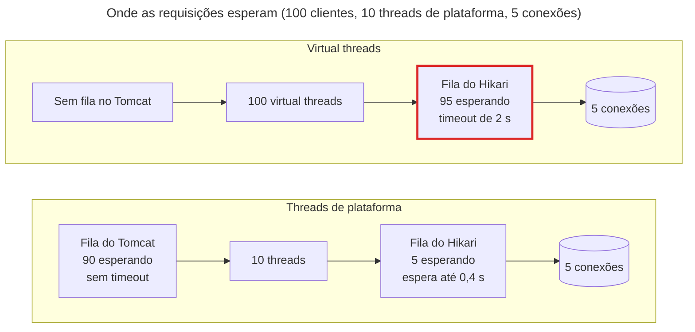

## O problema

A [19.01](/concorrencia-e-execucao-assincrona/o-modelo-thread-per-request-e-seus-limites) terminou com um impasse. Numa API que passa quase todo o tempo esperando o banco e outras APIs, o limite é o número de threads, e as threads de plataforma são caras: cada uma é uma thread do sistema operacional, com memória reservada para a pilha. Por isso o Tomcat tem 200, e não 20 mil. Com 200, uma FreteJá lenta esgota o pool em segundos.

Até o Java 21, havia duas saídas. Uma era aceitar o limite. A outra era trocar de modelo: programação reativa (19.05), em que poucas threads atendem milhares de requisições porque **nenhum código pode bloquear**. Isso exige reescrever cada chamada como uma cadeia de callbacks (`Mono`, `Flux`), com outras bibliotecas para o banco e para HTTP, pilhas de exceção que não contam a história e uma curva de aprendizado que muitas equipes não querem pagar.

Pense numa central de atendimento por telefone. Cada atendente pega uma ligação e fica nela até o fim, inclusive enquanto o cliente vai buscar o número do pedido. Com 200 atendentes, há 200 ligações ao mesmo tempo, e a maioria está em silêncio. Uma solução é ensinar os atendentes a fazer malabarismo com várias ligações ao mesmo tempo (o reativo). A outra é a central colocar cada ligação em espera automaticamente quando há silêncio e devolvê-la ao primeiro atendente livre quando o cliente volta a falar. O atendente continua tratando uma ligação de cada vez, do jeito simples, e a central atende milhares.

> **A pergunta desta página:** como as virtual threads permitem uma thread por requisição sem limite de pool, o que o Spring Boot muda quando você as liga, e qual gargalo aparece no lugar do pool de threads?

## O conceito

### Virtual threads (JEP 444)

Uma <Term id="virtual-thread" /> é um `java.lang.Thread` como qualquer outro, com a mesma API, mas gerenciado pela JVM, e não pelo sistema operacional. Elas chegaram como recurso final no **JDK 21** (JEP 444). As diferenças que importam para uma API:

| | Thread de plataforma | Virtual thread |
|---|---|---|
| Quem agenda | O sistema operacional | A JVM |
| Custo de criar | Alto (chamada ao SO, pilha reservada da ordem de 1 MB) | Baixo (um objeto no *heap*, a pilha cresce conforme o uso) |
| Quantas cabem | Milhares | Milhões |
| O que acontece num bloqueio de I/O | A thread do SO fica parada | A virtual thread se desmonta, e a thread do SO atende outra |
| Pool | Sim, por serem caras | **Nunca**: uma por tarefa |
| Código | Imperativo, bloqueante | O mesmo código |

A última linha é a que muda o jogo. O controller, o serviço, o `JdbcClient` e o `RestClient` continuam iguais. O `Thread.sleep`, o `InputStream.read` de um *socket* e a espera numa `ReentrantLock` continuam bloqueando **a virtual thread**, mas não a thread do sistema.

### Montar e desmontar: as carrier threads

As virtual threads rodam sobre um pequeno conjunto de threads de plataforma, as <Term id="carrier-thread">*carrier threads*</Term>, num `ForkJoinPool` próprio da JVM com uma carrier por núcleo (a propriedade `jdk.virtualThreadScheduler.parallelism` muda isso). O ciclo de uma requisição:

1. A virtual thread é **montada** numa carrier e executa o código do controller.
2. O código chega a uma operação bloqueante, como a leitura da resposta da FreteJá. A JDK reescreveu essas operações para, numa virtual thread, **desmontar**: a pilha da virtual thread vai para o *heap*, e a carrier fica livre.
3. A carrier pega outra virtual thread pronta para rodar.
4. Quando a resposta da FreteJá chega, a virtual thread volta à fila de prontas, é montada de novo, possivelmente em **outra** carrier, e continua da linha seguinte.

Para o código, nada disso é visível: a linha seguinte roda depois da anterior, como sempre. Mas 12 carriers podem atender 10 mil requisições esperando ao mesmo tempo, porque uma requisição que espera não ocupa carrier.

### O que o Spring Boot muda com `spring.threads.virtual.enabled`

No Spring Boot (desde a 3.2), uma propriedade liga as virtual threads em todas as peças que executam código:

```yaml title="src/main/resources/application.yml (trecho)"
spring:
  threads:
    virtual:
      enabled: true
  main:
    keep-alive: true
```

| Peça | Sem virtual threads | Com virtual threads |
|---|---|---|
| Tomcat | Pool de `server.tomcat.threads.max` (200) threads `http-nio-8080-exec-N` | `VirtualThreadExecutor` do Tomcat: uma virtual thread `tomcat-handler-N` por requisição. As `server.tomcat.threads.*` deixam de valer |
| `@Async` e o `applicationTaskExecutor` | `ThreadPoolTaskExecutor` (`spring.task.execution.pool.*`) | `SimpleAsyncTaskExecutor` com uma virtual thread por tarefa. Um limite opcional vem de `spring.task.execution.simple.concurrency-limit` |
| `@Scheduled` | `ThreadPoolTaskScheduler`, com uma thread | `SimpleAsyncTaskScheduler`, com virtual threads; as propriedades de pool são ignoradas |
| Cliente HTTP do JDK (`JdkClientHttpRequestFactory`, usado pelo `RestClient`) | O executor padrão do `HttpClient` | Um executor de virtual threads `httpclient-N` |

Os nomes da tabela vêm das classes de autoconfiguração do Boot 4.1.2 (`TomcatVirtualThreadsWebServerFactoryCustomizer`, `TaskExecutorConfigurations`, `ImperativeHttpClientAutoConfiguration`). As páginas da Parte 10 usam o `RestClient`, e a [19.03](/concorrencia-e-execucao-assincrona/async-scheduled-e-tarefas-em-segundo-plano) usa o `@Async` e o `@Scheduled`, já com virtual threads.

O `spring.main.keep-alive: true` vem de um aviso da documentação do Boot: virtual threads são *daemon*, e a JVM termina quando só restam threads *daemon*. Uma aplicação sem servidor web que só tem tarefas `@Scheduled` terminaria logo depois de subir. O Bazar tem o Tomcat, que mantém a JVM viva, mas a propriedade custa nada e evita a surpresa num *worker* sem HTTP.

<Callout type="warning" title="O server.tomcat.max-connections continua valendo">
Com virtual threads, o Tomcat ainda usa o conector NIO, o Acceptor e o Poller da 19.01. O que muda é o Executor. O `max-connections` (8192) e o `accept-count` continuam limitando as conexões, e passam a ser o único limite do próprio Tomcat.
</Callout>

### Pinning: resolvido para `synchronized` no JDK 24

Uma virtual thread só se desmonta se a JVM conseguir tirar a pilha dela da carrier. Quando não consegue, a virtual thread bloqueada **prende** a carrier: é o <Term id="pinning" />. Com 12 carriers e 12 virtual threads presas, nenhuma outra virtual thread roda, e a aplicação para, com a CPU ociosa.

No JDK 21, o caso mais comum era o `synchronized`: bloquear dentro de um bloco `synchronized` (ou num `Object.wait()`) prendia a carrier. Bibliotecas antigas cheias de `synchronized`, como drivers JDBC e pools de conexão, faziam as virtual threads se comportarem pior que threads de plataforma. A recomendação da época era trocar `synchronized` por `ReentrantLock`.

O **JEP 491**, no **JDK 24**, reescreveu os monitores da JVM, e o `synchronized` deixou de prender. Como o Bazar usa o JDK 25, o `synchronized` do `EnderecoService` (que impede dois endereços principais ao mesmo tempo, 12.03) não é um problema. Ainda prendem a carrier, segundo o JEP 491:

- Código **nativo** (método `native` ou a API de funções estrangeiras, FFM) que chama de volta código Java que bloqueia.
- Bloquear dentro de um **inicializador de classe** (um bloco `static`), ou esperar que outra thread termine de inicializar uma classe.
- Bloquear durante o **carregamento de uma classe**, na resolução de símbolos.

Na prática, numa API Spring sobre o JDK 25, o *pinning* virou raro. A forma de verificar é o JFR, como mostra a seção "Na prática".

### `ThreadLocal` e o custo de memória

Virtual threads suportam `ThreadLocal`, e o Spring depende disso: a transação, o contexto de segurança, o `RequestContextHolder` e o MDC dos logs (09.04) são variáveis por thread. Para esse uso, **contexto da requisição atual**, nada muda. Cada requisição tem a sua virtual thread, e o contexto vive e morre com ela.

O uso que deixa de funcionar é o `ThreadLocal` como **cache de objetos caros**. Um padrão antigo guardava um `SimpleDateFormat` (que não é *thread-safe*) por thread: com 200 threads reaproveitadas, eram 200 instâncias. Com virtual threads, cada requisição é uma thread nova. O cache nunca acerta, cria um objeto por requisição, e com 10 mil requisições simultâneas são 10 mil instâncias na memória. A documentação da Oracle chama esse uso de "fundamentalmente incompatível com virtual threads". A correção é um objeto imutável compartilhado (`DateTimeFormatter`, que o Bazar já usa) ou um pool explícito.

Há ainda o custo da quantidade. Uma virtual thread é barata, mas não é gratuita: cada uma guarda a pilha no *heap* enquanto espera, e cada requisição em andamento segura o corpo, os objetos do JPA e os buffers. Dez mil requisições esperando são dez mil desses conjuntos. A [19.06](/concorrencia-e-execucao-assincrona/scoped-values-e-concorrencia-estruturada) apresenta os *scoped values*, a alternativa ao `ThreadLocal` desenhada para virtual threads.

### O gargalo muda de lugar

Este é o ponto mais importante da página. As virtual threads removem **um** limite, o das threads, e a Lei de Little da 19.01 continua valendo para todos os outros. Com 1.000 requisições simultâneas, as 1.000 entram, e cada uma segue para o próximo recurso limitado da série:

- **O pool do banco.** Com 10 conexões e 1.000 requisições querendo uma, há 990 esperando **dentro do HikariCP**. Antes, com 200 threads, no máximo 200 esperavam lá, e as outras 800 esperavam na fila do Tomcat, que não tem *timeout*. O Hikari tem: depois de `connection-timeout`, a requisição falha. A seção "Na prática" mostra esse efeito: a mesma carga que com threads de plataforma era lenta e sem erros, com virtual threads virou metade de erros.
- **As APIs externas.** A FreteJá e a PagaFácil têm a capacidade delas. Antes, o pool de 200 threads limitava, sem querer, quantas chamadas simultâneas o Bazar fazia. Agora nada limita: 2.000 cotações simultâneas chegam à FreteJá, que responde `429 Too Many Requests` ou cai.
- **O próprio PostgreSQL**, a memória e os descritores de arquivo, como na 19.01.

O pool de 200 threads funcionava como um limitador de concorrência acidental para todo o sistema. Ao removê-lo, a concorrência precisa ser limitada **de propósito**, em cada dependência: o pool do banco dimensionado e com espera curta ([28.02](/performance/pool-de-conexoes-hikaricp)), e limites de concorrência e *bulkheads* nas chamadas externas ([25.03](/consumindo-outras-apis/circuit-breaker-bulkhead-e-limites-de-concorrencia)). A documentação da Oracle diz o mesmo: "virtual threads nunca devem ficar num pool"; para limitar o acesso a um recurso, use um `Semaphore` (ou o próprio pool de conexões, que já é um).

### Quando não ajudam: CPU

As virtual threads multiplicam o número de requisições **esperando**, e não a capacidade de **calcular**. O experimento 3 da 19.01 mostrou que uma carga de CPU tem como teto o número de núcleos, com 12 ou 200 threads. Com virtual threads, as carriers são uma por núcleo, e o teto é o mesmo. Para trabalho de CPU, elas não trazem vazão, e uma virtual thread que calcula por muito tempo segura a carrier (o agendador não interrompe uma virtual thread no meio de um cálculo). Gerar um PDF grande ou redimensionar imagens continua pedindo um executor com tamanho limitado aos núcleos, ou trabalho fora da requisição (19.03).

## Diagrama

<AnimatedFlow
  title="Uma carrier, duas requisições: montar e desmontar em I/O"
  nodes={[
    { id: 'tomcat', label: 'Tomcat', sublabel: 'tomcat-handler-N' },
    { id: 'carrier', label: 'Carrier thread', sublabel: 'ForkJoinPool-1-worker-1' },
    { id: 'heap', label: 'Heap', sublabel: 'pilhas desmontadas' },
    { id: 'frete', label: 'FreteJá', sublabel: 'lenta' },
    { id: 'pg', label: 'PostgreSQL' },
  ]}
  steps={[
    { from: 'tomcat', to: 'carrier', label: 'VT 1: cotação', title: 'VT 1 montada', description: 'A virtual thread da cotação de frete é montada na carrier e executa o controller.' },
    { from: 'carrier', to: 'frete', label: 'POST /cotacoes', title: 'VT 1 bloqueia em I/O', description: 'A leitura do socket bloquearia. Numa virtual thread, a JDK a desmonta.' },
    { from: 'carrier', to: 'heap', label: 'pilha da VT 1', title: 'VT 1 desmontada', description: 'A pilha da VT 1 vai para o heap. A carrier fica livre, sem esperar a FreteJá.' },
    { from: 'tomcat', to: 'carrier', label: 'VT 2: categorias', title: 'VT 2 montada na mesma carrier', description: 'Outra requisição usa a carrier enquanto a FreteJá pensa.' },
    { from: 'carrier', to: 'pg', label: 'select', title: 'VT 2 também desmonta', description: 'A consulta ao banco também é I/O: a VT 2 desmonta, e a carrier atende outra.' },
    { from: 'frete', to: 'heap', label: 'resposta', response: true, title: 'A resposta chega', description: 'A VT 1 volta à fila de prontas e será montada na primeira carrier livre, talvez outra.' },
    { from: 'heap', to: 'carrier', label: 'VT 1 remontada', response: true, title: 'VT 1 continua da linha seguinte', description: 'Para o código, a chamada à FreteJá só retornou. Nada mudou no controller.' },
  ]}
/>

O gargalo que muda de lugar, com a mesma carga de 100 clientes e um endpoint que segura uma conexão do banco:



## Na prática

### Ligando no Bazar

A mudança no Bazar é a propriedade da seção anterior, no `application.yml`. Nenhuma linha de código Java mudou. A suíte inteira (309 testes) passou com as virtual threads ligadas.

O laboratório da 19.01 mostra a diferença na primeira requisição:

<HttpExchange
  title="A mesma requisição, agora numa virtual thread"
  request={{ method: 'GET', url: '/experimentos/espera?ms=10' }}
  response={{ status: 200, headers: { 'Content-Type': 'application/json' }, body: { ms: 10, thread: 'VirtualThread[#81,tomcat-handler-1]/runnable@ForkJoinPool-1-worker-1' } }}
>
`VirtualThread[#81,tomcat-handler-1]` é a virtual thread criada pelo Tomcat para a requisição. `@ForkJoinPool-1-worker-1` é a carrier em que ela estava montada no momento do `toString()`. O `threads.max: 10` do *profile* `experimentos` continua no arquivo, e foi ignorado.
</HttpExchange>

### O teste comparativo, com nota de método

Os números abaixo vêm do mesmo laboratório e do mesmo `Carga.java` da 19.01, com o *profile* `experimentos` (10 threads de plataforma no "antes", 5 conexões no banco, 2 s de espera por conexão), numa máquina de 12 núcleos. O "antes" é o Bazar com `--spring.threads.virtual.enabled=false`.

<Callout type="info" title="Nota de método">
É um experimento de laboratório, e não um *benchmark*. O gerador de carga roda na mesma máquina que a aplicação e disputa a CPU com ela, a JVM foi aquecida com uma rodada curta antes de cada medida, cada cenário rodou uma vez por 10 segundos, e os pools são pequenos de propósito. Os números servem para comparar os dois modelos entre si, e não para prever a capacidade do Bazar em produção. A [28.01](/performance/medindo-antes-de-otimizar-testes-de-carga) trata de testes de carga de verdade: máquinas separadas, várias rodadas, aquecimento, metas.
</Callout>

**I/O puro** (`/experimentos/espera?ms=200`):

| Clientes | Antes: vazão | Antes: p50 | Depois: vazão | Depois: p50 |
|---|---|---|---|---|
| 10 | 47,0 req/s | 207 ms | 46,9 req/s | 207 ms |
| 50 | 48,5 req/s | 1.008 ms | 230,8 req/s | 206 ms |
| 1.000 | 49,1 req/s | 14.380 ms | 4.110,4 req/s | 205 ms |

Com 10 clientes, nada muda: havia uma thread para cada um. A partir daí, o "antes" fica preso em 10 ÷ 0,2 = 50 req/s, e a latência cresce com a fila (com 1.000 clientes, o p95 foi de 20 s). O "depois" atende os 1.000 ao mesmo tempo, com a latência do próprio trabalho:

```text noCopy
$ java scripts/carga/Carga.java 'http://localhost:8080/experimentos/espera?ms=200' 1000 10
1000 clientes, 10.3 s, 42141 requisições
vazão: 4110.4 req/s
latência (ms): p50=205 p95=253 p99=318 máx=508
status: {200=42141}
```

A rota rápida também deixou de esperar atrás das lentas. O experimento 2 da 19.01 (`GET /v1/categorias` com 50 clientes na espera) foi de **1.007 ms** com threads de plataforma para **1 ms** com virtual threads:

```text noCopy
1 clientes, 8.0 s, 3635 requisições
vazão: 454.0 req/s
latência (ms): p50=1 p95=4 p99=6 máx=196
status: {200=3635}
```

**Com o banco** (`/experimentos/banco?ms=200`, 5 conexões):

| Clientes | Antes | Depois |
|---|---|---|
| 10 | 24,0 req/s, p50 407 ms, 0 erros | 23,9 req/s, p50 407 ms, 0 erros |
| 50 | — | 24,0 req/s, p50 2.034 ms, 0 erros |
| 100 | 24,1 req/s, p50 4.072 ms, **0 erros** | 24 req/s de sucesso, p50 2.032 ms, **251 erros 500** em 536 |

A vazão do banco não mudou em nenhum cenário: 5 conexões ÷ 0,2 s = 25 req/s, com ou sem virtual threads. A diferença está em **onde** as requisições esperam:

```text noCopy
# Antes: 100 clientes, 10 threads de plataforma
100 clientes, 13.9 s, 335 requisições
vazão: 24.1 req/s
latência (ms): p50=4072 p95=4076 p99=4077 máx=4079
status: {200=335}

# Depois: 100 clientes, virtual threads
100 clientes, 11.9 s, 536 requisições
vazão: 45.2 req/s
latência (ms): p50=2032 p95=2161 p99=2226 máx=2289
status: {200=285, 500=251}
```

Antes, 90 requisições esperavam na fila do Tomcat, que não tem *timeout*, e só 10 chegavam ao Hikari, onde a espera por uma das 5 conexões era de no máximo uns 400 ms. Lento, mas sem erros. Depois, as 100 chegam ao Hikari, e a espera passa dos 2 s do `connection-timeout`. A "vazão" de 45 req/s engana: quase metade são falhas rápidas. Virtual threads não criaram o gargalo, mas o tiraram de um lugar onde ele só atrasava para um lugar onde ele falha. Isso pode ser bom (falhar rápido libera o cliente para tentar de novo ou desistir), desde que seja uma escolha: um `connection-timeout` pensado, um `503` com `Retry-After` em vez de `500`, e um limite de concorrência antes do banco quando fizer sentido.

### Diagnóstico: o thread dump das virtual threads

O `jcmd <pid> Thread.print` da 19.01 **não mostra** as virtual threads. Com 500 requisições esperando, ele listou 57 threads, nenhuma delas uma requisição. Para elas, há outro comando, que gera o *dump* num arquivo:

```bash
jcmd <pid> Thread.dump_to_file -format=text dump.txt
```

```text noCopy
#51858 "tomcat-handler-51756" virtual TIMED_WAITING 2026-10-26T09:30:52.017618576Z
    at java.base/java.lang.VirtualThread.parkNanos(VirtualThread.java:787)
    at java.base/java.lang.VirtualThread.sleepNanos(VirtualThread.java:983)
    at java.base/java.lang.Thread.sleepNanos(Thread.java:507)
    at java.base/java.lang.Thread.sleep(Thread.java:601)
    at com.bazar.experimentos.LentidaoController.espera(LentidaoController.java:33)
    ...
```

O arquivo trouxe as 500 virtual threads `tomcat-handler` e só 12 carriers (`ForkJoinPool-1-worker-1` a `-12`), uma por núcleo. O `-format=json` gera o mesmo em JSON, para ferramentas.

### Diagnóstico: pinning com JFR

O JDK Flight Recorder registra o evento `jdk.VirtualThreadPinned` quando uma virtual thread fica presa à carrier por mais de 20 ms. O evento vem ligado por padrão, com esse limite. Para gravar o Bazar:

```bash
./mvnw spring-boot:run -Dspring-boot.run.profiles=experimentos \
  -Dspring-boot.run.jvmArguments="-XX:StartFlightRecording=filename=bazar.jfr,dumponexit=true"
# ... carga ...
jfr summary bazar.jfr | grep VirtualThreadPinned
```

```text noCopy
 jdk.VirtualThreadPinned                     0             0
```

Zero eventos em toda a bateria de experimentos. Para ver o que o JEP 491 mudou, o `scripts/carga/Pinning.java` cria 120 virtual threads que dormem 100 ms **dentro** de um `synchronized`, cada uma com a própria trava (ninguém disputa nada), e roda no JDK 21 e no JDK 25:

```java title="scripts/carga/Pinning.java (trecho)"
try (var executor = Executors.newVirtualThreadPerTaskExecutor()) {
    for (int i = 0; i < tarefas; i++) {
        var trava = new Object();          // uma trava por tarefa: ninguém disputa
        executor.submit(() -> {
            synchronized (trava) {
                Thread.sleep(Duration.ofMillis(100));   // espera dentro do synchronized
            }
            return null;
        });
    }
}
```

```text noCopy
$ java -XX:StartFlightRecording=filename=p21.jfr scripts/carga/Pinning.java    # JDK 21
Java 21, 12 núcleos: 120 tarefas de 100 ms em 1013 ms
 jdk.VirtualThreadPinned                   120          1703

$ java -XX:StartFlightRecording=filename=p25.jfr scripts/carga/Pinning.java    # JDK 25
Java 25, 12 núcleos: 120 tarefas de 100 ms em 109 ms
 jdk.VirtualThreadPinned                     0             0
```

No JDK 21, cada virtual thread prendeu a carrier durante o `sleep`: com 12 carriers, as 120 tarefas rodaram em 10 rodadas de 100 ms, e o JFR registrou 120 eventos. No JDK 25, as 120 dormiram ao mesmo tempo. O evento mostra onde a virtual thread estava presa:

```text noCopy
$ jfr print --events jdk.VirtualThreadPinned p21.jfr
jdk.VirtualThreadPinned {
  duration = 98.7 ms
  eventThread = "" (javaThreadId = 26, virtual)
  stackTrace = [
    java.lang.VirtualThread.parkOnCarrierThread(boolean, long) line: 689
    ...
    java.lang.Thread.sleep(Duration) line: 590
    Pinning.lambda$main$0(Object) line: 13
```

Se a sua aplicação ainda roda no JDK 21, esse é o comando que diz se alguma biblioteca está prendendo as carriers. A propriedade antiga `-Djdk.tracePinnedThreads`, que imprimia a pilha no console, foi removida pelo JEP 491 e não tem mais efeito.

### Os testes

O `SaturacaoDoPoolTest` da 19.01 mede o modelo de threads de plataforma, e agora precisa desligá-las de propósito:

```java title="src/test/java/com/bazar/experimentos/SaturacaoDoPoolTest.java (trecho)"
@SpringBootTest(webEnvironment = WebEnvironment.RANDOM_PORT,
        properties = { "spring.threads.virtual.enabled=false", "server.tomcat.threads.max=4" })
```

Um teste novo repete o experimento com as virtual threads ligadas e o mesmo `threads.max=4`, ignorado:

```java title="src/test/java/com/bazar/experimentos/VirtualThreadsTest.java"
@SpringBootTest(webEnvironment = WebEnvironment.RANDOM_PORT, properties = "server.tomcat.threads.max=4")
@ActiveProfiles("experimentos")
@Import(TestcontainersConfiguration.class)
class VirtualThreadsTest {

    @LocalServerPort
    int porta;

    @Test
    void vinteRequisicoesAcontecemAoMesmoTempo() throws Exception {
        long inicio = System.nanoTime();
        var respostas = new ArrayList<Future<String>>();
        try (var clientes = Executors.newVirtualThreadPerTaskExecutor()) {
            for (int i = 0; i < 20; i++) {
                respostas.add(clientes.submit(() -> get("/experimentos/espera?ms=200")));
            }
        }
        var total = Duration.ofNanos(System.nanoTime() - inicio);

        // Com 4 threads de plataforma, seriam pelo menos 1.000 ms (SaturacaoDoPoolTest). A folga cobre máquinas lentas.
        assertThat(total).isLessThan(Duration.ofMillis(900));
        for (var resposta : respostas) {
            // VirtualThread[#123,tomcat-handler-7]/runnable@ForkJoinPool-1-worker-3
            assertThat(resposta.get()).contains("VirtualThread").contains("tomcat-handler-");
        }
    }

    // ... get(caminho), como no SaturacaoDoPoolTest
}
```

Este teste tem um limite **superior** de tempo, ao contrário dos da 19.01. A folga é grande (900 ms para um trabalho de 200 ms), mas numa máquina de CI muito carregada ele pode falhar. É o preço de testar uma propriedade de desempenho, e a razão de haver só um teste assim.

## Erros comuns

<BadVsGood title="Pôr virtual threads num pool" why="Virtual threads existem para não serem reaproveitadas: criar uma custa quase nada. Um pool de virtual threads só reintroduz o limite que elas removeram, com um nome enganoso. Para limitar o acesso a um recurso, limite o recurso: um Semaphore, o pool de conexões ou um limite de concorrência (25.03).">
<Bad title="Pool fixo de virtual threads">

```java
// Volta a ter 200 "vagas", como o Tomcat
var executor = Executors.newFixedThreadPool(200,
        Thread.ofVirtual().factory());
```

</Bad>
<Good title="Uma por tarefa, com o limite no recurso">

```java
var executor = Executors.newVirtualThreadPerTaskExecutor();
var freteJa = new Semaphore(20);   // até 20 cotações simultâneas

// em cada tarefa:
freteJa.acquire();
try {
    return cliente.cotar(pedido);
} finally {
    freteJa.release();
}
```

</Good>
</BadVsGood>

Outros tropeços frequentes:

- **Ligar e esperar que o banco aguente.** O pool de threads limitava a concorrência sem ninguém perceber. Ligue as virtual threads junto com uma revisão do `maximum-pool-size`, do `connection-timeout` e dos limites nas APIs externas.
- **Achar que `server.tomcat.threads.max` limita alguma coisa.** Com virtual threads ligadas, ele é ignorado, sem aviso. O mesmo vale para `spring.task.execution.pool.*` e `spring.task.scheduling.pool.*`.
- **Cache em `ThreadLocal`.** Cada requisição é uma thread nova: o cache nunca acerta e multiplica a memória.
- **Procurar as requisições no `jcmd Thread.print`.** Ele lista só as threads de plataforma. Use `Thread.dump_to_file`.
- **Usar virtual threads para CPU.** O teto continua sendo o número de núcleos, e uma virtual thread que calcula por muito tempo segura uma carrier.
- **Seguir conselhos do JDK 21 no JDK 25.** "Troque todo `synchronized` por `ReentrantLock`" era a recomendação antes do JEP 491. No JDK 24+, reescrever código por isso não traz nada.
- **Esquecer o `spring.main.keep-alive`** num processo sem servidor web que só roda tarefas agendadas: ele termina logo depois de subir.

## Boas práticas

- **Ligue `spring.threads.virtual.enabled`** em APIs que passam a maior parte do tempo esperando banco e outras APIs, no JDK 24 ou mais novo.
- **Limite a concorrência em cada dependência**, de propósito: pool do banco dimensionado, espera curta por conexão, `Semaphore` ou *bulkhead* nas APIs externas.
- **Compare antes e depois com a mesma carga**, olhando a vazão, os percentis **e** os erros, e não só a média.
- **Grave com JFR** e confira `jdk.VirtualThreadPinned` quando houver bibliotecas com código nativo, ou se ainda estiver no JDK 21.
- **Troque caches em `ThreadLocal`** por objetos imutáveis compartilhados.
- **Mantenha o trabalho de CPU** num executor limitado aos núcleos, ou fora da requisição.
- **Use `Thread.dump_to_file`** para diagnosticar um sistema com virtual threads.

## Por baixo dos panos

<DeepDive title="Como uma leitura de socket desmonta uma virtual thread">

Uma virtual thread é um objeto `java.lang.VirtualThread`, com uma *continuação* (`jdk.internal.vm.Continuation`): um pedaço de pilha que pode ser suspenso e retomado. O agendador é um `ForkJoinPool` em modo FIFO, com paralelismo igual ao número de núcleos (`jdk.virtualThreadScheduler.parallelism`) e um máximo de carriers extras para compensar *pinning* (`jdk.virtualThreadScheduler.maxPoolSize`, 256 por padrão).

Quando o código chama `socket.getInputStream().read()` numa virtual thread, a implementação do `NioSocketImpl` da JDK não faz o `read` bloqueante do sistema operacional. Ela põe o *socket* em modo não bloqueante, tenta ler, e, se não há dados, registra o descritor num *poller* interno da JDK (baseado em `epoll` no Linux) e chama `VirtualThread.park()`. O `park` faz `Continuation.yield`: os quadros da pilha da virtual thread são copiados para o *heap*, e a carrier volta ao `ForkJoinPool` para pegar a próxima tarefa. Quando o `epoll` avisa que há dados, o *poller* chama `unpark`, que agenda a continuação de novo no `ForkJoinPool`. A carrier que a pegar copia os quadros de volta e continua dentro do `read`, que agora encontra os dados.

O `Thread.sleep` segue o mesmo caminho, com um temporizador no lugar do `epoll`, como mostra o *dump* da seção "Na prática" (`VirtualThread.parkNanos`). O JDBC do PostgreSQL usa *sockets* do JDK, e por isso também desmonta. Antes do JEP 491, um `synchronized` na pilha impedia o `yield`, porque a JVM associava o monitor à thread do sistema operacional, e a virtual thread caía em `parkOnCarrierThread`: a mesma linha que aparece no evento do JFR do JDK 21. O JEP 491 passou a associar os monitores à virtual thread, e o `yield` deixou de depender disso.

</DeepDive>

## No projeto Bazar

<ProjectStep title="Virtual threads ligadas" module="compartilhado" tag="pagina-19.02" files={[
  { path: 'src/main/resources/application.yml', change: 'alterado' },
  { path: 'scripts/carga/Pinning.java', change: 'novo' },
  { path: 'src/test/java/com/bazar/experimentos/VirtualThreadsTest.java', change: 'novo' },
  { path: 'src/test/java/com/bazar/experimentos/SaturacaoDoPoolTest.java', change: 'alterado' },
]}>
O Bazar passa a atender cada requisição numa virtual thread (`spring.threads.virtual.enabled: true`, com `spring.main.keep-alive: true`). Nenhum código Java mudou, e os 309 testes passaram. O `SaturacaoDoPoolTest` desliga as virtual threads para continuar medindo o modelo da 19.01, e o `VirtualThreadsTest` confere que o `threads.max` deixou de limitar. O `Pinning.java` reproduz, no JDK 21 e no JDK 25, o efeito do JEP 491. O ajuste do pool do banco para a nova concorrência fica para a [28.02](/performance/pool-de-conexoes-hikaricp), e os limites nas APIs externas, para a [25.03](/consumindo-outras-apis/circuit-breaker-bulkhead-e-limites-de-concorrencia).
</ProjectStep>

## Resumo

- Uma virtual thread é um `Thread` gerenciado pela JVM. Ao bloquear em I/O, ela se desmonta da carrier (uma por núcleo), que atende outra. O código continua imperativo.
- `spring.threads.virtual.enabled=true` muda o Tomcat (uma virtual thread por requisição; `threads.*` ignoradas), o `@Async`, o `@Scheduled` e o cliente HTTP do JDK. Use também `spring.main.keep-alive=true`.
- No JDK 24+, o `synchronized` não prende mais a carrier (JEP 491). Ainda prendem código nativo e a inicialização de classes; o JFR (`jdk.VirtualThreadPinned`) mostra quando.
- `ThreadLocal` para contexto da requisição continua certo; como cache de objetos caros, não funciona.
- O gargalo muda para o banco e as APIs externas. O pool de threads era um limitador acidental, e agora a concorrência precisa ser limitada de propósito em cada dependência.
- Para trabalho de CPU, virtual threads não aumentam a vazão.

<Exercise title="Proteja o banco depois das virtual threads" difficulty="medio">
Com as virtual threads ligadas, o experimento de 100 clientes no `/experimentos/banco?ms=200` teve metade de erros `500`. Antes delas, a mesma carga não tinha erros, mas a latência era de 4 s.

1. Explique, com a Lei de Little, por que a espera no Hikari passou de 2 s.
2. Proponha duas mudanças de configuração diferentes e diga o que cada uma troca (latência, erros, carga no PostgreSQL).
3. Escreva um limite de concorrência com `Semaphore` no `LentidaoController.banco` que deixe no máximo 10 requisições disputando as 5 conexões, e responda `503` quando a espera pelo `Semaphore` passar de 1 s.

<Hint>Com 100 requisições e uma vazão de 25 req/s, cada uma fica no sistema 100 ÷ 25 = 4 s. O `Semaphore.tryAcquire(long, TimeUnit)` espera com prazo. Para o `503`, uma exceção com `@ResponseStatus` ou um `ResponseStatusException` basta neste laboratório.</Hint>

<Solution>

1. A vazão do banco é 5 conexões ÷ 0,2 s = 25 req/s. Com 100 requisições em andamento, cada uma fica, em média, 100 ÷ 25 = 4 s no sistema, e quase todo esse tempo é espera por uma conexão. Com 10 threads de plataforma, só 10 requisições chegavam ao Hikari, e a espera lá era de uns 400 ms; os outros 3,6 s eram na fila do Tomcat, sem *timeout*. Com virtual threads, os 4 s inteiros acontecem dentro do Hikari, e passam dos 2 s do `connection-timeout`.

2. Duas possibilidades:
   - **Aumentar o `connection-timeout`** para, por exemplo, 5 s. Os erros somem, e a latência volta aos 4 s. A carga no PostgreSQL é a mesma (5 conexões). É o comportamento antigo, com a fila no Hikari.
   - **Aumentar o `maximum-pool-size`** para 20. A vazão sobe para até 100 req/s, se o PostgreSQL aguentar 20 consultas simultâneas. A latência cai, e a carga no banco quadruplica. É a decisão da 28.02, que precisa de medição no banco, e não só na aplicação.

3. Um limite de concorrência antes do banco:

```java
private final Semaphore banco = new Semaphore(10);   // 2× as conexões: há sempre alguém pronto

@GetMapping("/banco")
Map<String, Object> banco(@RequestParam(defaultValue = "200") long ms) throws InterruptedException {
    if (!banco.tryAcquire(1, TimeUnit.SECONDS)) {
        throw new ResponseStatusException(HttpStatus.SERVICE_UNAVAILABLE, "Banco ocupado; tente de novo.");
    }
    try {
        jdbc.sql("select pg_sleep(:segundos)").param("segundos", ms / 1000.0).query().singleValue();
        return resposta(ms);
    }
    finally {
        banco.release();
    }
}
```

Com no máximo 10 requisições no Hikari, a espera por uma conexão fica perto de 400 ms, longe dos 2 s. As outras esperam no `Semaphore` por até 1 s e, se não conseguirem, recebem `503`, que diz ao cliente que tentar de novo pode funcionar (com um `Retry-After`, melhor ainda). É o *bulkhead* da 25.03 escrito à mão. O `finally` é obrigatório: um `release` esquecido numa exceção perde uma vaga para sempre.

</Solution>
</Exercise>

<Quiz questions={[
  {
    question: 'Com spring.threads.virtual.enabled=true e server.tomcat.threads.max=10, quantas requisições bloqueadas em I/O o Tomcat atende ao mesmo tempo?',
    options: [
      '10, o valor de threads.max',
      'Uma por núcleo, o número de carrier threads',
      'Uma virtual thread por requisição: o threads.max é ignorado, e o limite do Tomcat passa a ser o max-connections',
      '200, o padrão do Tomcat',
    ],
    answer: 2,
    explanation: 'O Tomcat troca o pool pelo VirtualThreadExecutor, e as propriedades de threads deixam de valer. As carriers limitam quantas virtual threads rodam código ao mesmo tempo, não quantas esperam I/O.',
  },
  {
    question: 'Depois de ligar as virtual threads, um endpoint que consulta o banco passou a dar erros 500 sob a mesma carga que antes era só lenta. Por quê?',
    options: [
      'Virtual threads não funcionam com JDBC',
      'O synchronized do driver JDBC prende as carriers',
      'As requisições que antes esperavam na fila do Tomcat (sem timeout) agora esperam no HikariCP, que desiste depois de connection-timeout',
      'As virtual threads consomem as conexões mais rápido',
    ],
    answer: 2,
    explanation: 'A vazão do banco é a mesma (conexões ÷ tempo). O que mudou foi o lugar da fila. No JDK 25, o synchronized não prende mais a carrier (JEP 491), e o driver do PostgreSQL usa sockets do JDK, que desmontam.',
  },
  {
    question: 'No JDK 25, qual destas situações ainda prende (pinning) a carrier thread?',
    options: [
      'Thread.sleep dentro de um bloco synchronized',
      'Object.wait()',
      'Bloquear dentro de um inicializador estático de classe',
      'Esperar uma ReentrantLock',
    ],
    answer: 2,
    explanation: 'O JEP 491 (JDK 24) resolveu o synchronized e o Object.wait. Continuam prendendo os casos com um quadro nativo na pilha: código nativo que chama de volta Java e bloqueia, inicialização e carregamento de classes. A ReentrantLock nunca prendeu.',
  },
  {
    question: 'Um serviço guarda um MessageDigest (caro de criar) num ThreadLocal para reaproveitá-lo. O que acontece com virtual threads?',
    options: [
      'Nada: o ThreadLocal funciona igual',
      'Cada requisição é uma thread nova, então o cache nunca acerta e cria um objeto por requisição',
      'O ThreadLocal é compartilhado entre as virtual threads da mesma carrier',
      'A JVM proíbe ThreadLocal em virtual threads',
    ],
    answer: 1,
    explanation: 'ThreadLocal funciona e é isolado por virtual thread. O problema é que virtual threads não são reaproveitadas: o cache por thread vira um objeto por requisição, multiplicado pela concorrência.',
  },
]} />

## Referências

<References />
