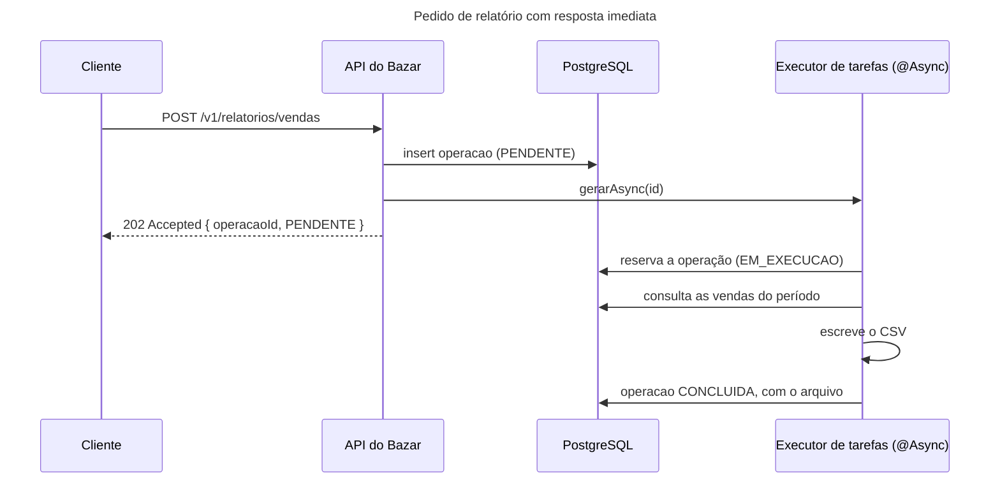
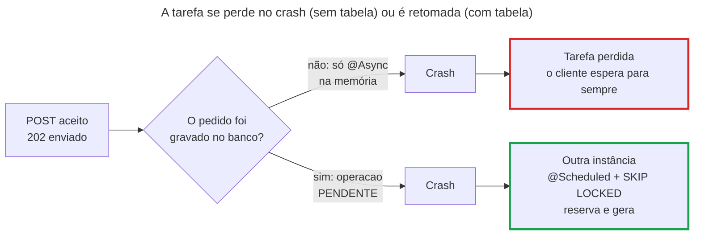

## O problema

O financeiro do Bazar quer o relatório de vendas por produto do mês. A consulta da [10.05](/persistencia-para-apis/projecoes-e-consultas-para-leitura) agrega todos os itens de todos os pedidos do período e, com um ano de dados, leva quarenta segundos, mais o tempo de escrever o arquivo. Se `POST /v1/relatorios/vendas` fizer tudo isso antes de responder, três coisas dão errado:

- O cliente espera quarenta segundos olhando para uma tela parada, e o *proxy* ou o balanceador no caminho, que costuma desistir em 30 ou 60 segundos, corta a conexão antes. O relatório fica pronto, e ninguém o recebe.
- Pela Lei de Little da [19.01](/concorrencia-e-execucao-assincrona/o-modelo-thread-per-request-e-seus-limites), cada pedido de relatório segura uma thread e uma conexão do banco por quarenta segundos. Com virtual threads ([19.02](/concorrencia-e-execucao-assincrona/virtual-threads-em-apis-spring)), a thread é barata, mas a conexão não é.
- Se o cliente desistir e tentar de novo, são dois relatórios pesados rodando.

O que o financeiro precisa é que o pedido seja **aceito** na hora, e que o relatório seja feito **depois**, fora da requisição. Essa ideia resolve um relatório, e também o envio de webhooks a parceiros (21.03), o reembolso na PagaFácil (21.02), a limpeza de chaves de idempotência expiradas (21.01) e qualquer outro trabalho que não precisa acontecer enquanto o cliente espera.

Pense numa lavanderia. Você entrega as roupas, recebe um tíquete e vai embora. Ninguém espera no balcão as duas horas da lavagem. Mas a lavanderia precisa de duas coisas para isso funcionar: anotar o pedido num caderno, para que uma queda de energia não faça as roupas sumirem do sistema, e combinar entre os funcionários quem lava o quê, para que duas máquinas não lavem a mesma trouxa.

> **A pergunta desta página:** como tirar um trabalho demorado da requisição com `@Async` e `@Scheduled`, o que se perde quando a aplicação reinicia, e como garantir que, com várias instâncias, cada tarefa rode uma vez só?

## O conceito

### `@Async`: o método roda em outra thread

O Spring executa um método anotado com `@Async` numa thread de um `TaskExecutor`, e quem chamou continua sem esperar. Para ligar o recurso, uma classe de configuração recebe `@EnableAsync`:

```java
@Configuration(proxyBeanMethods = false)
@EnableAsync
public class ConfiguracaoDeTarefas { }

@Service
public class RelatorioVendasService {

    @Async
    public CompletableFuture<Optional<Path>> gerarAsync(UUID operacao) {
        // ... roda numa thread do executor de tarefas
    }
}
```

O mecanismo é o mesmo do `@Transactional` da [10.03](/persistencia-para-apis/transacoes-na-camada-de-servico): um <Term id="proxy" /> em volta do *bean*. Quem chama `relatorios.gerarAsync(id)` fala com o proxy, que embrulha a chamada numa tarefa, entrega a tarefa ao executor e devolve na hora. Daí vêm as duas regras que mais pegam:

- **Autoinvocação não passa pelo proxy.** Um método do próprio `RelatorioVendasService` que chame `this.gerarAsync(id)` executa tudo na mesma thread, sem aviso.
- **Métodos `private` nunca são interceptados.** O `@Async` precisa estar num método que outro *bean* chame.

### Os tipos de retorno e as exceções

Um método `@Async` pode devolver:

| Retorno | O que quem chamou recebe | E se a tarefa lançar uma exceção? |
|---|---|---|
| `void` | Nada | Ninguém recebe. Ela vai para o `AsyncUncaughtExceptionHandler`; o padrão só registra um log |
| `CompletableFuture<T>` | Um futuro, completado quando a tarefa termina | O futuro termina com a exceção, e quem o observa (`whenComplete`, `exceptionally`, `get`) a recebe |
| `Future<T>` | Um futuro mais pobre, sem composição | Aparece no `get()` |

Com `void`, a exceção não tem dono. O `AsyncConfigurer` permite trocar o tratador padrão, para que a falha pelo menos apareça com contexto no log:

```java title="src/main/java/com/bazar/compartilhado/ConfiguracaoDeTarefas.java (trecho)"
// Exceções de métodos @Async que devolvem void não têm quem as receba: sem este handler, só um log genérico.
// Os que devolvem CompletableFuture entregam a exceção no futuro.
@Override
public AsyncUncaughtExceptionHandler getAsyncUncaughtExceptionHandler() {
    return (Throwable ex, Method metodo, Object... argumentos) -> log.error("Falha em {}.{}({})",
            metodo.getDeclaringClass().getSimpleName(), metodo.getName(), Arrays.toString(argumentos), ex);
}
```

Registrar a falha num log não basta para um relatório que o cliente está esperando. A operação precisa terminar num estado que alguém consiga consultar (`FALHOU`, com o motivo). É o que a tabela de operações, mais adiante, resolve.

### O executor e as propriedades `spring.task.execution.*`

O `@Async` usa o executor de tarefas que o Spring Boot cria, o *bean* `applicationTaskExecutor`. O tipo depende das virtual threads da 19.02:

| | Sem virtual threads | Com virtual threads (o Bazar) |
|---|---|---|
| Executor | `ThreadPoolTaskExecutor` | `SimpleAsyncTaskExecutor`, uma virtual thread por tarefa |
| Threads | `spring.task.execution.pool.core-size` (8) | Sem pool |
| Fila | `pool.queue-capacity`, **sem limite** por padrão | Não há fila |
| Limite | `pool.max-size`, ignorado enquanto a fila não enche (e ela nunca enche) | `spring.task.execution.simple.concurrency-limit`, sem limite por padrão |
| Nomes | `task-1`, `task-2`... (`thread-name-prefix`) | Os mesmos, como virtual threads |

A linha do limite tem uma armadilha em cada coluna. No `ThreadPoolTaskExecutor` padrão, a fila sem limite faz o `max-size` nunca ser usado: com 8 threads ocupadas, a tarefa 9 espera na fila, e a 10.000 também. Com virtual threads, não há limite nenhum: cem pedidos de relatório viram cem consultas pesadas ao mesmo tempo no banco, o gargalo da 19.02. O Bazar limita a quatro relatórios simultâneos por instância:

```yaml title="src/main/resources/application.yml (trecho)"
spring:
  task:
    execution:
      propagate-context: true
      simple:
        concurrency-limit: 4
        reject-tasks-when-limit-reached: true
```

O `reject-tasks-when-limit-reached` decide o que acontece com a quinta tarefa. Por padrão (`false`), **quem chama espera** uma vaga: o controller ficaria parado até um relatório terminar, e a resposta "imediata" deixaria de ser imediata. Com `true`, o executor recusa a tarefa com uma `TaskRejectedException`, e o controller segue em frente. A seção "Na prática" mostra por que recusar não perde o relatório.

### Propagação de contexto: o MDC e o `ThreadLocal`

O contexto da requisição mora em variáveis `ThreadLocal` (19.02): o MDC dos logs, a transação, o contexto de segurança, o *trace* (27.06). Uma tarefa `@Async` roda em **outra** thread, que começa com essas variáveis vazias. Os logs do relatório saem sem o identificador da operação, e o *trace* da requisição termina no `@Async`.

A solução é copiar o contexto no momento em que a tarefa é criada e restaurá-lo na thread que a executa. O Spring tem um ponto de extensão para isso, o `TaskDecorator`, e um decorador pronto, o `ContextPropagatingTaskDecorator`, que usa a biblioteca Micrometer Context Propagation. No Spring Boot 4.1, uma propriedade o liga no executor de tarefas:

```properties
spring.task.execution.propagate-context=true
```

Há três detalhes que a propriedade não resolve sozinha:

1. **A biblioteca precisa estar no classpath**: `io.micrometer:context-propagation`. Sem ela, a autoconfiguração não cria o decorador, sem erro.
2. **Ela só copia o que está registrado.** O Micrometer Tracing (27.06) registra o *trace*. O MDC precisa de um registro explícito: `ContextRegistry.getInstance().registerThreadLocalAccessor(new Slf4jThreadLocalAccessor())`.
3. **Vale para o executor de tarefas**, e não para threads criadas à mão (`new Thread`, `Executors.newVirtualThreadPerTaskExecutor()`). Essas precisam de `ContextSnapshot` manual ou de um executor decorado.

O teste do Bazar mostra a diferença. Com a propriedade, a tarefa enxerga o MDC de quem a criou. Sem ela, a mesma asserção falha assim:

```text noCopy
Expecting actual:
  "null em VirtualThread[#73,task-1]/runnable@ForkJoinPool-1-worker-1"
to start with:
  "0192f3a1-9999-7000-8000-000000000123 em VirtualThread"
```

<Callout type="info" title="Contexto de segurança">
O usuário autenticado também mora num `ThreadLocal` (`SecurityContextHolder`). Propagar a identidade para tarefas em segundo plano tem implicações de segurança (a tarefa age em nome de quem?), tratadas na [documentação de segurança](https://security-doc-beta.vercel.app/) 🔒. Aqui, a regra é: passe para a tarefa os **dados** de que ela precisa (o id do cliente), e não a sessão inteira.
</Callout>

### `@Scheduled`: tarefas no relógio

Com `@EnableScheduling`, métodos sem parâmetros anotados com `@Scheduled` rodam sozinhos, no agendador do Boot (`ThreadPoolTaskScheduler` com uma thread, ou `SimpleAsyncTaskScheduler` com virtual threads). Os três modos:

| Atributo | Quando roda | Pode sobrepor? |
|---|---|---|
| `fixedDelay` | Um intervalo **depois que a anterior termina** | Não |
| `fixedRate` | A cada intervalo, contado do **início** da anterior | Com virtual threads, sim: o `SimpleAsyncTaskScheduler` dá uma thread a cada execução, sem limite. Com o agendador de uma thread, a próxima só atrasa |
| `cron` | Nos horários de uma <Term id="expressao-cron" /> | Como o `fixedRate` |

Os intervalos aceitam número (milissegundos), `Duration` ISO-8601 (`PT10S`) e o formato curto (`10s`) nas versões `String` dos atributos, que leem propriedades: `@Scheduled(fixedDelayString = "${bazar.operacoes.intervalo}")`.

A expressão cron do Spring tem **seis** campos, um a mais que o cron do Linux, porque começa pelos segundos:

```text noCopy
┌───────────── segundo (0-59)
│ ┌─────────── minuto (0-59)
│ │ ┌───────── hora (0-23)
│ │ │ ┌─────── dia do mês (1-31)
│ │ │ │ ┌───── mês (1-12 ou JAN-DEC)
│ │ │ │ │ ┌─── dia da semana (0-7 ou MON-SUN; 0 e 7 são domingo)
0 0 6 * * MON-FRI       às 6h dos dias úteis
0 */15 * * * *          a cada 15 minutos
0 0 3 1 * *             às 3h do dia 1 de cada mês
```

O horário é o do fuso padrão da JVM, a não ser que o atributo `zone` diga outro. Num contêiner, o fuso padrão costuma ser UTC, e o "às 6h" vira 3h em Brasília. Escreva o fuso: `@Scheduled(cron = "0 0 6 * * MON-FRI", zone = "America/Sao_Paulo")`.

### Várias instâncias: o job duplicado

O `@Scheduled` roda em **cada** instância da aplicação. Com o Bazar em três instâncias, o relatório diário das 6h é gerado três vezes, e o e-mail para o financeiro sai três vezes. O agendador do Spring não sabe que existem outras instâncias. Há duas famílias de solução, para dois tipos de trabalho:

**Trabalho em itens (uma fila).** Há uma lista de coisas a fazer (relatórios pedidos, webhooks a entregar), e tanto faz qual instância faz cada item, desde que cada um seja feito uma vez. Todas as instâncias rodam o `@Scheduled`, e cada uma **reserva** itens diferentes no banco. No PostgreSQL, a ferramenta é o `SELECT ... FOR UPDATE SKIP LOCKED`:

- `FOR UPDATE` trava as linhas selecionadas até o fim da transação.
- <Term id="skip-locked">`SKIP LOCKED`</Term> faz a consulta **pular** as linhas que outra transação já travou, em vez de esperar por elas.

Duas instâncias que rodam a mesma consulta ao mesmo tempo recebem linhas diferentes, sem esperar uma pela outra. A tabela vira uma fila com vários consumidores, sem outra peça de infraestrutura. É o que o Bazar usa.

**Um job único no cluster.** O trabalho é um só (fechar o caixa do dia, recalcular um índice), e precisa rodar em uma instância de cada vez. Aqui, uma trava distribuída resolve: antes de rodar, a instância tenta pegar uma trava com nome e prazo numa tabela (ou no Redis); quem não pega, não roda. A biblioteca mais usada para isso é o ShedLock (7.10.1, com suporte a Spring 7 e Boot 4):

```java
// Exemplo com ShedLock (não usado no Bazar): só uma instância fecha o caixa a cada dia.
@Scheduled(cron = "0 5 0 * * *", zone = "America/Sao_Paulo")
@SchedulerLock(name = "fechamentoDoCaixa", lockAtMostFor = "PT30M", lockAtLeastFor = "PT1M")
void fecharOCaixa() {
    // ...
}
```

O `lockAtMostFor` libera a trava se a instância que a pegou morrer no meio. O `lockAtLeastFor` segura a trava um pouco mesmo que o job termine rápido, para que uma instância com o relógio um pouco atrasado não o rode de novo.

<Comparison
  title="Fila com SKIP LOCKED × trava distribuída (ShedLock)"
  columns={['Fila com SKIP LOCKED', 'Trava distribuída']}
  rows={[
    { label: 'Tipo de trabalho', values: ['Muitos itens independentes', 'Um job por vez'] },
    { label: 'Instâncias trabalhando ao mesmo tempo', values: ['Todas, em itens diferentes', 'Uma'] },
    { label: 'Retoma o que ficou pela metade', values: ['Sim, com prazo de reserva', 'Só roda de novo no próximo horário'] },
    { label: 'Guarda o estado de cada item', values: [true, false] },
    { label: 'Infraestrutura extra', values: ['Nenhuma (a própria tabela)', 'Biblioteca e tabela de travas'] },
  ]}
/>

### O limite: o que está só na memória se perde

Uma tarefa `@Async` é um objeto na memória da JVM. Se a aplicação reinicia (um deploy, um *crash*, o Kubernetes matando o *pod* por falta de memória) entre o `202` e o fim do relatório, a tarefa some. O cliente recebeu "aceito", e nada vai acontecer.

O desligamento gracioso reduz o problema, sem resolvê-lo. Com `spring.task.execution.shutdown.await-termination=true`, o Spring espera as tarefas em andamento terminarem (até `await-termination-period`) antes de desligar. Isso cobre um deploy, mas não um *crash* nem um `kill -9`, e um relatório de quarenta segundos pode passar do tempo que o orquestrador espera (29.04).

A solução é o caderno da lavanderia: **gravar o pedido no banco antes de responder**. Uma tabela `operacao` guarda cada trabalho com seu estado (`PENDENTE`, `EM_EXECUCAO`, `CONCLUIDA`, `FALHOU`). O `@Async` vira uma otimização, para começar na hora, e um `@Scheduled` vira a rede de segurança, que de tempos em tempos pega o que ficou para trás. Uma operação reservada por uma instância que morreu tem um **prazo de reserva**: quando ele vence, outra instância a retoma.

O mesmo raciocínio, aplicado a eventos que precisam sair da aplicação junto com uma transação (`PedidoCriado`), é o padrão Outbox da [30.04](/arquitetura/padrao-outbox).

## Diagrama

O caminho feliz: o `202` sai antes do relatório.



O que acontece quando a instância cai depois do `202`, sem e com a tabela:



## Na prática

### A tabela de operações

A migração cria a tabela. Os parâmetros ficam em JSON, porque cada tipo de operação tem os seus (o relatório, um período; o reembolso da 21.02, um pagamento e um valor):

```sql title="src/main/resources/db/migration/V12__criar_operacao.sql"
create table operacao (
    id            uuid         primary key,
    tipo          varchar(40)  not null,
    status        varchar(20)  not null,
    -- Os parâmetros da operação, em JSON: cada tipo tem os seus.
    parametros    text         not null,
    tentativas    integer      not null default 0,
    -- Até quando a instância que reservou a operação tem exclusividade sobre ela.
    reservada_ate timestamptz,
    resultado     text,
    erro          text,
    criada_em     timestamptz  not null,
    atualizada_em timestamptz  not null
);

-- O processador só procura operações que ainda podem rodar.
create index operacao_a_executar_idx on operacao (criada_em) where status in ('PENDENTE', 'EM_EXECUCAO');
```

A reserva é o coração da fila. Um único comando, numa única transação, escolhe as operações disponíveis, trava-as, pula as que outra instância já travou, marca-as como `EM_EXECUCAO` com um prazo e as devolve:

```java title="src/main/java/com/bazar/compartilhado/operacoes/FilaDeOperacoes.java (trecho)"
// Depois de três tentativas (três instâncias que caíram no meio), a operação fica parada para alguém olhar.
static final int MAXIMO_DE_TENTATIVAS = 3;

private List<Operacao> reservar(String filtro, int limite, Duration prazo, @Nullable UUID id) {
    var agora = relogio.instant().atOffset(ZoneOffset.UTC);
    var consulta = jdbc.sql("""
            update operacao
               set status = 'EM_EXECUCAO', tentativas = tentativas + 1,
                   reservada_ate = :reservadaAte, atualizada_em = :agora
             where id in (select id
                            from operacao
                           where %s
                             and (status = 'PENDENTE'
                                  or (status = 'EM_EXECUCAO' and reservada_ate < :agora))
                             and tentativas < :maximo
                           order by criada_em
                           limit :limite
                             for update skip locked)
            returning id, tipo, status, parametros, tentativas, resultado, erro, criada_em
            """.formatted(filtro))
            .param("agora", agora)
            .param("reservadaAte", agora.plus(prazo))
            .param("maximo", MAXIMO_DE_TENTATIVAS)
            .param("limite", limite);
    // ...
    return consulta.query(Operacao.class).list();
}
```

Três decisões estão nesse SQL:

- **`status = 'EM_EXECUCAO' and reservada_ate < :agora`** é a retomada. Uma operação reservada por uma instância que caiu fica `EM_EXECUCAO` até o prazo vencer, e depois volta a ser candidata. O prazo do relatório é de cinco minutos: maior que o pior tempo de geração, para que uma instância lenta, mas viva, não tenha o trabalho roubado.
- **`tentativas < :maximo`** impede que uma operação que derruba a instância (um relatório que estoura a memória) seja retomada para sempre, derrubando uma instância atrás da outra. Depois de três tentativas, ela fica parada.
- **`for update skip locked`** no `select` interno, e não no `update`, porque é a escolha das linhas que precisa pular as travadas. O `update ... returning` devolve exatamente as linhas que esta transação conseguiu.

A versão pública `reservar(UUID, Duration)` usa o mesmo SQL com o filtro `id = :id`: reserva uma operação específica, se ninguém a pegou antes.

### O serviço e o `@Async`

```java title="src/main/java/com/bazar/relatorios/dominio/RelatorioVendasService.java (trecho)"
/** Registra o pedido do relatório. Depois deste insert, o trabalho não se perde, nem com um restart. */
public UUID solicitar(PeriodoDeVendas periodo) {
    return fila.enfileirar(TIPO, json.writeValueAsString(periodo));
}

/**
 * Gera o relatório numa thread do executor de tarefas, sem segurar a requisição. Só gera se conseguir reservar a
 * operação: se o ProcessadorDeOperacoes já a pegou, não há nada a fazer.
 */
@Async
public CompletableFuture<Optional<Path>> gerarAsync(UUID operacao) {
    return CompletableFuture.completedFuture(fila.reservar(operacao, PRAZO).map(this::executar));
}

/** Gera o arquivo de uma operação já reservada e registra o resultado. Uma falha marca a operação como FALHOU. */
public Path executar(Operacao operacao) {
    try {
        var periodo = json.readValue(operacao.parametros(), PeriodoDeVendas.class);
        var arquivo = escrever(operacao.id(), consulta.porProduto(periodo.de(), periodo.ate()));
        fila.concluir(operacao.id(), arquivo.toString());
        log.info("Relatório de vendas {} gerado em {}", operacao.id(), arquivo);
        return arquivo;
    }
    catch (RuntimeException ex) {
        fila.falhar(operacao.id(), ex.getMessage());
        throw ex;
    }
}
```

O `gerarAsync` começa reservando a operação, e não confiando que ela está livre. Entre o `insert` e o início da tarefa, o processador agendado pode tê-la pegado. Os dois caminhos passam pela mesma reserva com `SKIP LOCKED`, e só um gera o arquivo. O `CompletableFuture.completedFuture` dentro de um método `@Async` parece estranho, mas é o padrão: o método roda **inteiro** na outra thread, e o proxy devolve a quem chamou um futuro que será completado com esse valor.

### O controller

<Endpoint
  method="POST"
  path="/v1/relatorios/vendas"
  summary="Solicita o relatório de vendas por produto. O relatório é gerado fora da requisição."
  params={[
    { name: 'criadoApos', in: 'body', type: 'string (date-time)', required: true, description: 'Início do período, inclusivo.' },
    { name: 'criadoAntes', in: 'body', type: 'string (date-time)', required: true, description: 'Fim do período, exclusivo.' },
  ]}
  responses={[{ status: 202, description: 'O pedido foi registrado.' }, { status: 422, description: 'Período ausente ou invertido.' }]}
/>

Os nomes dos campos seguem a regra BZR-NOM-05 do guia de estilo (16.02), a mesma do filtro de pedidos (`criadoApos`): o lint do contrato recusou a primeira versão, com `de` e `ate`.

```java title="src/main/java/com/bazar/relatorios/api/RelatorioController.java (trecho)"
// 202 Accepted: o pedido foi registrado, e o relatório será gerado depois (19.03). O recurso para acompanhar a
// operação (GET /v1/operacoes/{id}, com Location e Retry-After) chega na 21.02.
@PostMapping("/vendas")
@ApiResponse(responseCode = "202", description = "O pedido foi registrado e o relatório será gerado")
@ApiResponse(responseCode = "422", ref = VALIDACAO)
public ResponseEntity<OperacaoAceitaResponse> solicitarVendas(
        @Valid @RequestBody SolicitarRelatorioVendasRequest pedido) {
    var operacao = relatorios.solicitar(pedido.paraPeriodo());
    // O MDC vai junto para a thread do @Async (spring.task.execution.propagate-context).
    MDC.put("operacao", operacao.toString());
    try {
        relatorios.gerarAsync(operacao);
    }
    catch (TaskRejectedException ex) {
        // O executor está no limite. A operação já está gravada: o ProcessadorDeOperacoes a pega depois.
        log.info("Executor cheio; a operação {} fica para o processador", operacao);
    }
    finally {
        MDC.remove("operacao");
    }
    return ResponseEntity.accepted().body(new OperacaoAceitaResponse(operacao, StatusOperacao.PENDENTE));
}
```

A ordem importa. O `insert` acontece antes do `@Async` e já está confirmado quando a tarefa começa: o `JdbcClient` sem `@Transactional` confirma cada comando sozinho. Se o `insert` estivesse numa transação que só confirmasse no fim do método, a tarefa poderia começar antes do *commit*, não encontrar a operação e não fazer nada (é um dos erros comuns, adiante). E a recusa do executor não perde nada: a operação continua `PENDENTE` no banco.

<HttpExchange
  title="O pedido aceito na hora"
  request={{ method: 'POST', url: '/v1/relatorios/vendas', headers: { 'Content-Type': 'application/json' }, body: { criadoApos: '2026-10-01T00:00:00Z', criadoAntes: '2026-11-01T00:00:00Z' } }}
  response={{ status: 202, headers: { 'Content-Type': 'application/json' }, body: { operacaoId: '01a17796-c9bd-7650-9b32-3eecb596e183', status: 'PENDENTE' } }}
>
O `202 Accepted` diz "recebi e vou processar", e não "está pronto". Por enquanto, o cliente não tem como acompanhar a operação: o recurso `GET /v1/operacoes/{id}`, o header `Location` e o `Retry-After` são o assunto da [21.02](/padroes-avancados-de-http/operacoes-assincronas-e-de-longa-duracao-202-polling), e o download do arquivo, da [22.02](/padroes-avancados-de-http/download-streaming-e-range).
</HttpExchange>

<HttpExchange
  title="Período invertido"
  request={{ method: 'POST', url: '/v1/relatorios/vendas', headers: { 'Content-Type': 'application/json', 'Accept-Language': 'pt-BR' }, body: { criadoApos: '2026-11-01T00:00:00Z', criadoAntes: '2026-10-01T00:00:00Z' } }}
  response={{ status: 422, headers: { 'Content-Type': 'application/problem+json', 'Content-Language': 'pt-BR' }, body: { type: 'https://api.bazar.example/problemas/validacao', title: 'Dados inválidos', status: 422, detail: 'A requisição tem 1 campo inválido.', instance: '/v1/relatorios/vendas', erros: [{ campo: 'periodo', mensagem: 'criadoAntes deve ser posterior a criadoApos' }], codigo: 'VALIDACAO', traceId: 'ba353db8b0d9a8c0fa5f9dc6cfeb6958' } }}
>
A validação continua síncrona: o que dá para saber na hora (período invertido, campo ausente) é respondido na hora, e só o trabalho pesado vai para depois.
</HttpExchange>

No log, o relatório aparece gerado numa thread do executor de tarefas, e não na thread da requisição:

```text noCopy
INFO --- [bazar] [         task-1] c.b.r.dominio.RelatorioVendasService     : Relatório de vendas 01a17796-c9bd-7650-9b32-3eecb596e183 gerado em /tmp/bazar/relatorios/vendas-01a17796-c9bd-7650-9b32-3eecb596e183.csv
```

```text title="vendas-01a17796-c9bd-7650-9b32-3eecb596e183.csv" noCopy
produtoId,sku,nomeProduto,pedidos,unidades,receita
bcd399f5-d6d1-4032-9c80-10ca4c363d31,LIV-0042,"Clean Code (2ª ed.)",2,3,419.70
```

O arquivo vai para um diretório local (`bazar.relatorios.diretorio`). Com várias instâncias, ele precisaria ir para um armazenamento compartilhado, como um *bucket* S3, assunto da 22.02.

### O processador agendado

```java title="src/main/java/com/bazar/relatorios/infraestrutura/ProcessadorDeOperacoes.java (trecho)"
// fixedDelay: a próxima rodada começa um intervalo depois que esta termina; rodadas nunca se sobrepõem.
@Scheduled(fixedDelayString = "${bazar.operacoes.intervalo}", initialDelayString = "${bazar.operacoes.intervalo}")
void processarPendentes() {
    // Por enquanto, o relatório de vendas é o único tipo de operação; os reembolsos chegam na 21.02.
    for (var operacao : fila.reservar(5, RelatorioVendasService.PRAZO)) {
        MDC.put("operacao", operacao.id().toString());
        try {
            log.info("Retomando a operação {} (tentativa {})", operacao.id(), operacao.tentativas());
            relatorios.executar(operacao);
        }
        catch (RuntimeException ex) {
            // A operação já foi marcada como FALHOU; a próxima da lista continua.
            log.warn("A operação {} falhou: {}", operacao.id(), ex.getMessage());
        }
        finally {
            MDC.remove("operacao");
        }
    }
}
```

O `fixedDelay`, e não o `fixedRate`, garante que uma rodada lenta não se sobreponha à próxima na mesma instância. O intervalo é de 10 segundos (`bazar.operacoes.intervalo`): é o atraso máximo de uma operação que o `@Async` não pegou, e o custo é uma consulta indexada a cada 10 segundos por instância.

### Simulando a queda

Para ver a rede de segurança funcionar, o Bazar foi derrubado com `kill -9` e uma operação foi gravada direto no banco, como se o `insert` tivesse acontecido e a instância tivesse morrido antes do `@Async`:

```bash
docker exec projeto-final-postgres-1 psql -U bazar -d bazar -c "insert into operacao
  (id, tipo, status, parametros, criada_em, atualizada_em) values ('0192f3a1-9999-7000-8000-000000000123',
  'RELATORIO_VENDAS', 'PENDENTE', '{\"de\":\"2026-10-01T00:00:00Z\",\"ate\":\"2026-11-01T00:00:00Z\"}', now(), now())"
```

Ao subir de novo, ninguém chamou o `@Async` para essa operação. Dez segundos depois, o processador a encontrou:

```text noCopy
06:42:39.188  INFO [  restartedMain] com.bazar.BazarApplication           : Started BazarApplication in 3.844 seconds
06:42:49.212  INFO [   scheduling-1] c.b.r.i.ProcessadorDeOperacoes       : Retomando a operação 0192f3a1-9999-7000-8000-000000000123 (tentativa 1)
06:42:49.222  INFO [   scheduling-1] c.b.r.dominio.RelatorioVendasService : Relatório de vendas 0192f3a1-9999-7000-8000-000000000123 gerado em /tmp/bazar/relatorios/...
```

Com só o `@Async`, sem a tabela, esse relatório não existiria em lugar nenhum depois do `kill -9`.

### Os testes

O teste mais importante prova o `SKIP LOCKED` com duas transações reais. A "instância A" reserva uma operação e segura a transação aberta; a "instância B" tenta reservar enquanto isso:

```java title="src/test/java/com/bazar/compartilhado/operacoes/FilaDeOperacoesTest.java (trecho)"
@Test
void duasInstanciasReservandoAoMesmoTempoNaoPegamAMesmaOperacao() throws Exception {
    var primeira = fila.enfileirar("TESTE", "{}");
    var segunda = fila.enfileirar("TESTE", "{}");
    var reservou = new CountDownLatch(1);
    var podeTerminar = new CountDownLatch(1);

    // A "instância A" reserva uma operação e segura a transação aberta, com a linha travada.
    var instanciaA = CompletableFuture.supplyAsync(() -> transacao.execute(status -> {
        var reservadas = fila.reservar(1, PRAZO);
        reservou.countDown();
        aguardar(podeTerminar);
        return reservadas;
    }));
    assertThat(reservou.await(5, TimeUnit.SECONDS)).isTrue();

    // A "instância B" não espera a trava da A: pula a linha travada e pega a outra.
    long inicio = System.nanoTime();
    var daInstanciaB = fila.reservar(5, PRAZO);
    var espera = Duration.ofNanos(System.nanoTime() - inicio);
    podeTerminar.countDown();
    var daInstanciaA = instanciaA.get(5, TimeUnit.SECONDS);

    assertThat(daInstanciaA).extracting(Operacao::id).containsExactly(primeira);
    assertThat(daInstanciaB).extracting(Operacao::id).containsExactly(segunda);
    assertThat(espera).isLessThan(Duration.ofSeconds(1));
}
```

Sem o `skip locked`, a instância B esperaria a transação da A terminar e depois receberia a segunda operação (o `limit` já teria sido aplicado sobre a primeira, travada). A asserção de tempo pega essa regressão. Os outros testes da classe conferem a retomada depois do prazo, o limite de três tentativas e a reserva pelo id.

O `RelatorioVendasTest` faz o caminho inteiro pela API: o `POST` responde `202`, e o teste espera (com o Awaitility, que vem no `spring-boot-starter-test`) a operação ficar `CONCLUIDA`, sem `Thread.sleep` fixo:

```java title="src/test/java/com/bazar/relatorios/api/RelatorioVendasTest.java (trecho)"
// O @Async gera o arquivo numa virtual thread do executor de tarefas, sem esperar o ProcessadorDeOperacoes.
await().atMost(Duration.ofSeconds(5)).untilAsserted(() -> assertThat(fila.buscar(id)).get()
        .extracting(Operacao::status).isEqualTo(StatusOperacao.CONCLUIDA));
```

## Erros comuns

<BadVsGood title="Só @Async, sem registro" why="A tarefa existe só na memória: um deploy, um crash ou um kill -9 entre o 202 e o fim do trabalho a apagam, e o cliente fica com um 'aceito' que nunca se cumpre. Gravando a operação antes de responder, o @Async vira só um atalho para começar logo, e o processador agendado retoma o que ficou para trás.">
<Bad title="Fire and forget">

```java
@PostMapping("/vendas")
ResponseEntity<Void> solicitar(@RequestBody Periodo p) {
    relatorios.gerarAsync(p);   // só na memória
    return ResponseEntity.accepted().build();
}
```

</Bad>
<Good title="Gravar, depois disparar">

```java
@PostMapping("/vendas")
ResponseEntity<OperacaoAceitaResponse> solicitar(...) {
    var id = relatorios.solicitar(periodo);  // insert
    relatorios.gerarAsync(id);               // atalho
    return ResponseEntity.accepted()
            .body(new OperacaoAceitaResponse(id, PENDENTE));
}
// + @Scheduled com SKIP LOCKED como rede de segurança
```

</Good>
</BadVsGood>

Outros tropeços frequentes:

- **Chamar o método `@Async` de dentro da mesma classe.** A chamada não passa pelo proxy, e roda na mesma thread, segurando a requisição, sem nenhum aviso.
- **`@Async` dentro de uma transação que ainda não confirmou.** Um `@Transactional` que grava a operação e chama o `@Async` no meio dispara a tarefa antes do *commit*. A tarefa não encontra a linha, ou encontra a versão antiga. Chame o `@Async` depois do *commit*, fora do método transacional, ou num `@TransactionalEventListener(phase = AFTER_COMMIT)`.
- **`@Async void` com exceção.** A falha vai para um log genérico, e a operação fica em `EM_EXECUCAO` para sempre. Devolva `CompletableFuture` ou registre o estado final você mesmo.
- **Confiar no `max-size` do `ThreadPoolTaskExecutor`.** Com a fila sem limite (o padrão), ele nunca é usado, e as tarefas se acumulam na memória.
- **Executor sem limite com virtual threads.** Cada tarefa vira uma consulta pesada simultânea. Use `spring.task.execution.simple.concurrency-limit`.
- **Limite que bloqueia quem chama.** Com `concurrency-limit` e o padrão `reject-tasks-when-limit-reached=false`, o controller espera uma vaga, e a resposta imediata deixa de ser imediata.
- **`@Scheduled` em várias instâncias sem coordenação.** O job roda uma vez por instância. Use uma fila com `SKIP LOCKED` ou uma trava distribuída.
- **Cron sem fuso.** O fuso padrão do contêiner costuma ser UTC. Declare `zone`.
- **`fixedRate` para um trabalho que pode demorar mais que o intervalo.** Com virtual threads, as rodadas se sobrepõem. Use `fixedDelay`.

## Boas práticas

- **Grave o pedido antes de responder `202`**, e trate o `@Async` como atalho, não como garantia.
- **Faça a tarefa reservar o trabalho**, com `SELECT ... FOR UPDATE SKIP LOCKED` e um prazo de reserva, para que dois caminhos (o `@Async` e o processador) e várias instâncias nunca façam o mesmo item.
- **Limite as tentativas** de uma operação que derruba quem a executa.
- **Limite a concorrência do executor** e prefira recusar a fazer a requisição esperar.
- **Propague o contexto** com `spring.task.execution.propagate-context` e registre o MDC no `ContextRegistry`.
- **Use `fixedDelay`** para processadores e **declare o fuso** em todo `cron`.
- **Teste a concorrência de verdade**: duas transações no mesmo banco, com o Testcontainers, e espera por condição (Awaitility), sem `sleep` fixo.

## Por baixo dos panos

<DeepDive title="Do @Async ao executor: quem decide em que thread o método roda">

O `@EnableAsync` registra um `AsyncAnnotationBeanPostProcessor`. Para cada *bean* com `@Async` em algum método, ele cria um proxy (CGLIB, para classes) com um `AnnotationAsyncExecutionInterceptor`. A chamada `relatorios.gerarAsync(id)` cai no interceptor, que:

1. **Escolhe o executor.** Se a anotação tem um valor (`@Async("relatorios")`), procura um `Executor` com esse nome. Senão, usa o do `AsyncConfigurer.getAsyncExecutor()`, se houver; senão, um *bean* único do tipo `TaskExecutor`, ou o *bean* chamado `taskExecutor`. O `applicationTaskExecutor` do Boot também é registrado com o nome `taskExecutor`, e por isso é o escolhido.
2. **Embrulha a chamada** num `Callable` que invoca o método original e trata a exceção: se o retorno é `void`, chama o `AsyncUncaughtExceptionHandler`; se é um futuro, entrega a exceção a ele.
3. **Submete conforme o tipo de retorno.** Para `CompletableFuture`, usa `executor.submitCompletable(...)`, que devolve um futuro completado quando o `CompletableFuture` interno do método completar. Para `void`, `executor.submit(...)`, e devolve `null`.

O `TaskDecorator` (o `ContextPropagatingTaskDecorator`, com a propriedade da 4.1) age dentro do executor: no `submit`, ele tira um `ContextSnapshot` dos `ThreadLocal` registrados na thread de quem chama e devolve um `Runnable` que restaura esse *snapshot* antes de rodar a tarefa e o limpa depois.

O limite de concorrência do `SimpleAsyncTaskExecutor` é um `ConcurrencyThrottleSupport`: um contador protegido por um *lock*. No `submit`, se o contador chegou ao limite, ou a thread que chama espera (`Condition.await`), ou, com `rejectTasksWhenLimitReached`, recebe a `TaskRejectedException`. A exceção sai do próprio `submitCompletable`, de forma síncrona, e por isso o `catch` do controller a pega.

</DeepDive>

## No projeto Bazar

<ProjectStep title="Relatório de vendas fora da requisição" module="relatorios" tag="pagina-19.03" files={[
  { path: 'src/main/resources/db/migration/V12__criar_operacao.sql', change: 'novo' },
  { path: 'src/main/java/com/bazar/compartilhado/operacoes/FilaDeOperacoes.java', change: 'novo' },
  { path: 'src/main/java/com/bazar/compartilhado/operacoes/Operacao.java', change: 'novo' },
  { path: 'src/main/java/com/bazar/compartilhado/operacoes/StatusOperacao.java', change: 'novo' },
  { path: 'src/main/java/com/bazar/compartilhado/ConfiguracaoDeTarefas.java', change: 'novo' },
  { path: 'src/main/java/com/bazar/relatorios/dominio/RelatorioVendasService.java', change: 'novo' },
  { path: 'src/main/java/com/bazar/relatorios/dominio/PeriodoDeVendas.java', change: 'novo' },
  { path: 'src/main/java/com/bazar/relatorios/infraestrutura/ProcessadorDeOperacoes.java', change: 'novo' },
  { path: 'src/main/java/com/bazar/relatorios/api/RelatorioController.java', change: 'novo' },
  { path: 'src/main/java/com/bazar/relatorios/api/SolicitarRelatorioVendasRequest.java', change: 'novo' },
  { path: 'src/main/resources/application.yml', change: 'alterado' },
  { path: 'pom.xml', change: 'alterado' },
  { path: 'docs/openapi/bazar-api.yaml', change: 'alterado' },
  { path: 'src/test/java/com/bazar/compartilhado/operacoes/FilaDeOperacoesTest.java', change: 'novo' },
  { path: 'src/test/java/com/bazar/relatorios/api/RelatorioVendasTest.java', change: 'novo' },
]}>
`POST /v1/relatorios/vendas` grava uma operação `PENDENTE`, dispara a geração com `@Async` e responde `202`. A tabela `operacao` funciona como fila: o `@Async` e o `ProcessadorDeOperacoes` (`@Scheduled`, a cada 10 s) reservam o trabalho com `FOR UPDATE SKIP LOCKED` e um prazo de cinco minutos, até três tentativas. O executor de tarefas tem no máximo quatro relatórios simultâneos e recusa o quinto, que fica para o processador. O MDC passa para a thread do `@Async` com `spring.task.execution.propagate-context` e a biblioteca `context-propagation`. A [21.02](/padroes-avancados-de-http/operacoes-assincronas-e-de-longa-duracao-202-polling) expõe a operação para *polling*, e a [22.02](/padroes-avancados-de-http/download-streaming-e-range), o arquivo.
</ProjectStep>

## Resumo

- `@Async` executa o método noutra thread, através de um proxy: nada de autoinvocação nem métodos `private`. Devolva `CompletableFuture` para que a exceção tenha dono.
- O executor do Boot é um `ThreadPoolTaskExecutor` com fila sem limite, ou, com virtual threads, um `SimpleAsyncTaskExecutor` sem limite. Limite a concorrência e prefira recusar a bloquear quem chama.
- O contexto em `ThreadLocal` não passa sozinho para outra thread. No Boot 4.1, `spring.task.execution.propagate-context` com a `context-propagation` o leva, para o que estiver registrado (o MDC, com o `Slf4jThreadLocalAccessor`).
- `@Scheduled` com `fixedDelay`, `fixedRate` ou `cron` (seis campos, com `zone`) roda em **cada** instância. Coordene com `SKIP LOCKED` (trabalho em itens) ou uma trava distribuída como o ShedLock (job único).
- Tarefas só na memória se perdem num restart. Grave o pedido antes do `202`, e use um processador agendado com prazo de reserva como rede de segurança.

<Exercise title="O relatório diário, uma vez só" difficulty="dificil">
O financeiro quer receber, todo dia útil às 6h de Brasília, o relatório de vendas do dia anterior. O Bazar roda em três instâncias. Um colega propõe:

```java
@Scheduled(cron = "0 0 6 * * MON-FRI")
void relatorioDiario() {
    var ontem = LocalDate.now().minusDays(1);
    relatorios.solicitar(periodoDo(ontem));
}
```

1. Aponte os três problemas dessa versão.
2. Corrija-a sem acrescentar o ShedLock, usando a própria tabela `operacao`.

<Hint>Quantas operações são criadas às 6h? Em que fuso está o "6h" e o "ontem"? O PostgreSQL tem `insert ... on conflict do nothing`, que depende de uma restrição de unicidade.</Hint>

<Solution>

1. Os problemas:
   - **Três relatórios por dia**: o `@Scheduled` roda nas três instâncias, e cada uma cria uma operação. A fila garante que cada **operação** é gerada uma vez, mas aqui são três operações diferentes.
   - **Fuso**: sem `zone`, o cron usa o fuso da JVM, que no contêiner costuma ser UTC. O relatório sai às 3h de Brasília.
   - **"Ontem" no fuso errado**: `LocalDate.now()` também usa o fuso da JVM, e o período do dia anterior em UTC não é o dia anterior em Brasília (15.01).

2. Uma chave que identifica "o relatório diário de tal data", com unicidade no banco. Todas as instâncias tentam criar, e só a primeira consegue:

```sql
-- V13: a chave de negócio é opcional; quando existe, é única por tipo.
alter table operacao add column chave varchar(80);
create unique index operacao_tipo_chave_idx on operacao (tipo, chave) where chave is not null;
```

```java
private static final ZoneId BRASILIA = ZoneId.of("America/Sao_Paulo");

@Scheduled(cron = "0 0 6 * * MON-FRI", zone = "America/Sao_Paulo")
void relatorioDiario() {
    var ontem = LocalDate.now(relogio.withZone(BRASILIA)).minusDays(1);
    var periodo = new PeriodoDeVendas(ontem.atStartOfDay(BRASILIA).toInstant(),
            ontem.plusDays(1).atStartOfDay(BRASILIA).toInstant());
    // insert ... on conflict (tipo, chave) where chave is not null do nothing
    fila.enfileirarUmaVez(RelatorioVendasService.TIPO, "diario-" + ontem, json.writeValueAsString(periodo));
}
```

As três instâncias rodam o método às 6h. A primeira grava a operação com a chave `diario-2026-10-25`, e as outras duas batem na restrição única e não gravam nada. A geração segue o caminho de sempre: o processador agendado reserva a operação com `SKIP LOCKED` numa das instâncias. O período usa o `Clock` injetado (15.01) e o fuso de Brasília nas duas pontas, e continua semiaberto. A mesma chave torna o job seguro também contra um *restart* às 6h: a instância que subir de novo e rodar o cron não cria um segundo relatório.

</Solution>
</Exercise>

<Quiz questions={[
  {
    question: 'O controller grava a operação e chama relatorios.gerarAsync(id). A instância cai um segundo depois do 202, antes de o relatório começar. O que acontece no Bazar?',
    options: [
      'O relatório se perde: o @Async estava só na memória',
      'O relatório é gerado duas vezes quando a instância voltar',
      'A operação continua PENDENTE no banco, e o ProcessadorDeOperacoes de qualquer instância a reserva e gera o relatório',
      'O cliente recebe um 500',
    ],
    answer: 2,
    explanation: 'A tarefa @Async se perde, mas o pedido estava gravado. O processador agendado procura operações PENDENTE (ou EM_EXECUCAO com o prazo vencido) e as reserva com SKIP LOCKED, então só uma instância gera.',
  },
  {
    question: 'Duas instâncias executam ao mesmo tempo o SELECT ... FOR UPDATE SKIP LOCKED LIMIT 1 sobre uma fila com duas operações pendentes. O que cada uma recebe?',
    options: [
      'As duas recebem a primeira operação',
      'Uma recebe a primeira; a outra espera a primeira transação terminar',
      'Uma recebe a primeira; a outra pula a linha travada e recebe a segunda, sem esperar',
      'A segunda recebe um erro de deadlock',
    ],
    answer: 2,
    explanation: 'Sem SKIP LOCKED, a segunda esperaria a trava. Com ele, a consulta ignora as linhas travadas por outras transações. É o que permite vários consumidores numa tabela.',
  },
  {
    question: 'Com virtual threads e spring.task.execution.simple.concurrency-limit=4, o que acontece com a quinta chamada a um método @Async enquanto quatro estão rodando, com a configuração padrão?',
    options: [
      'Ela é descartada em silêncio',
      'A thread que chamou espera até uma vaga abrir',
      'Ela recebe uma TaskRejectedException',
      'Ela roda mesmo assim, numa virtual thread extra',
    ],
    answer: 1,
    explanation: 'O padrão de reject-tasks-when-limit-reached é false: quem chama bloqueia. Num controller, isso segura a requisição. Com true, a chamada recebe uma TaskRejectedException, e o Bazar deixa a operação para o processador.',
  },
  {
    question: 'Um log dentro de um método @Async sai sem o id da operação que o controller pôs no MDC. O que falta, no Boot 4.1?',
    options: [
      'Anotar o método com @Transactional',
      'spring.task.execution.propagate-context=true, a biblioteca io.micrometer:context-propagation e o MDC registrado no ContextRegistry',
      'Usar fixedDelay',
      'Trocar as virtual threads por threads de plataforma',
    ],
    answer: 1,
    explanation: 'O MDC é um ThreadLocal, e a tarefa roda em outra thread. A propriedade liga o ContextPropagatingTaskDecorator, que só existe com a biblioteca no classpath e só copia os ThreadLocal registrados.',
  },
]} />

## Referências

<References />
