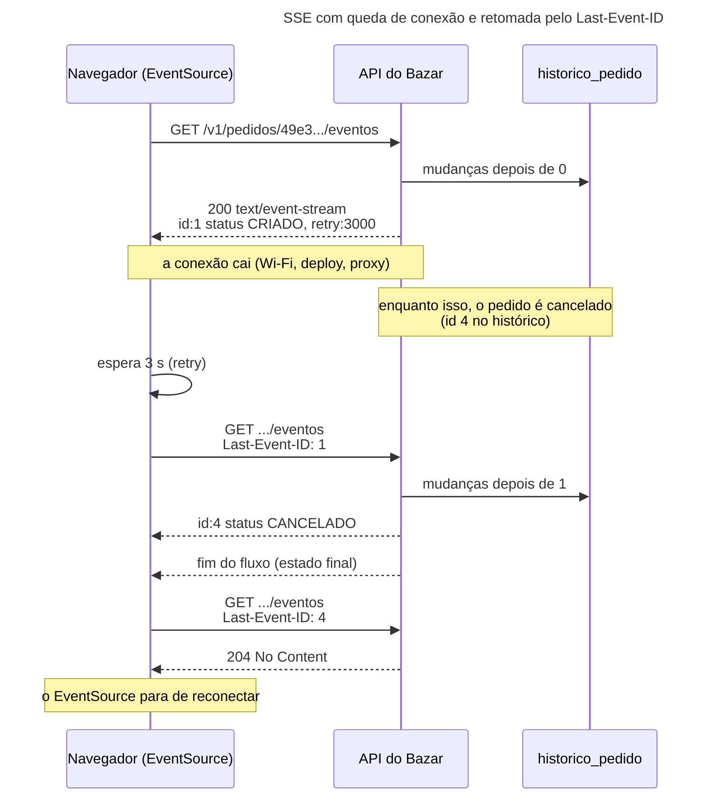
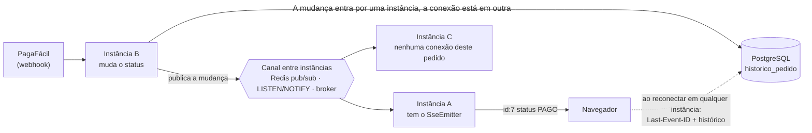

## O problema

Depois de comprar, a cliente do Bazar fica na tela "Meu pedido" esperando a confirmação do pagamento. O app precisa mostrar a mudança de `PAGAMENTO_PENDENTE` para `PAGO` assim que ela acontece, e depois `ENVIADO`. Com o que existe até aqui, o app só tem uma forma de saber: perguntar.

```text noCopy
GET /v1/pedidos/01a177a2-...   → PAGAMENTO_PENDENTE
(2 segundos)
GET /v1/pedidos/01a177a2-...   → PAGAMENTO_PENDENTE
(2 segundos)
GET /v1/pedidos/01a177a2-...   → PAGAMENTO_PENDENTE
...
```

Isso é *polling*. Funciona, e tem dois defeitos que crescem juntos. Com intervalo curto, a API recebe uma requisição a cada dois segundos de cada tela aberta, e quase todas respondem "nada mudou": dez mil clientes olhando os pedidos são cinco mil requisições por segundo de puro desperdício. Com intervalo longo, a novidade chega atrasada. Não existe um intervalo bom para os dois.

O que o app quer é o contrário: **o servidor avisa quando algo muda**. É a diferença entre ligar para a transportadora a cada hora perguntando pela encomenda e receber uma mensagem quando ela sai para entrega. Na web, há três formas de o servidor avisar o navegador: o <Term id="long-polling" /> (visto na 04.01), os Server-Sent Events e o WebSocket. Esta página mostra por que, para "acompanhar o status do pedido", os Server-Sent Events são a escolha mais simples, e quando o WebSocket se justifica.

> **A pergunta desta página:** como a API do Bazar envia as mudanças de status de um pedido no momento em que elas acontecem, sem *polling*, de um jeito que sobreviva a quedas de conexão, a *proxies* e a várias instâncias?

## O conceito

### Server-Sent Events: uma resposta HTTP que não termina

<Term id="server-sent-events">Server-Sent Events</Term> (SSE) é uma especificação do HTML (WHATWG) para um fluxo de eventos do servidor para o cliente, por cima de HTTP comum. O cliente faz um `GET`, o servidor responde `200` com `Content-Type: text/event-stream` e **não fecha a resposta**: vai escrevendo eventos à medida que eles acontecem. Não há protocolo novo, não há *upgrade* de conexão. Para o *proxy*, o balanceador e o *firewall* no caminho, é uma resposta HTTP que demora a terminar.

O formato é texto, uma linha por campo, e uma linha em branco encerra cada evento:

```text noCopy
id:4
event:status
retry:3000
data:{"pedidoId":"49e34c29-...","status":"CANCELADO","ocorridoEm":"2026-10-26T09:54:34.843954Z"}

:batimento 2026-10-26T09:55:07.116562167Z

```

| Campo | Para que serve |
|---|---|
| `data` | O conteúdo do evento. Várias linhas `data` seguidas viram um texto só, unidas por quebra de linha. O Bazar manda um JSON numa linha |
| `event` | O tipo do evento. Sem ele, o tipo é `message` |
| `id` | O identificador do evento. O cliente guarda o último e o devolve ao reconectar |
| `retry` | Quantos milissegundos o cliente deve esperar antes de reconectar |
| `:` no início | Um comentário, ignorado pelo cliente. Serve para manter a conexão viva |

O espaço depois dos dois-pontos é opcional (`data: x` e `data:x` são iguais); o Spring escreve sem espaço.

### O lado do navegador: `EventSource`

O navegador tem uma API pronta para consumir SSE, o `EventSource`, e é ela que dá ao SSE suas melhores propriedades:

```javascript
const fonte = new EventSource(`/v1/pedidos/${id}/eventos`);
fonte.addEventListener('status', (evento) => {
  const mudanca = JSON.parse(evento.data);
  // evento.lastEventId tem o id do evento
});
```

- **Reconexão automática.** Se a conexão cai (o Wi-Fi oscila, o servidor reinicia, um *proxy* corta), o `EventSource` espera o tempo do `retry` e reconecta sozinho.
- **Retomada com `Last-Event-ID`.** Ao reconectar, o navegador manda o header `Last-Event-ID` com o `id` do último evento que recebeu. O servidor responde só com o que veio depois. Nenhum evento se perde, nenhum se repete, sem uma linha de código no cliente.
- **Parada pelo servidor.** O `EventSource` reconecta mesmo quando o servidor encerra o fluxo de propósito. Para fazê-lo parar, o servidor responde à reconexão com `204 No Content`. Uma resposta que não seja `200` com `text/event-stream` (um `404`, um `500`, um JSON) também faz o `EventSource` desistir, mas como erro.

Três limitações do `EventSource` pesam no design:

- **Só `GET`, sem corpo.**
- **Sem headers personalizados.** Não dá para mandar `Authorization: Bearer ...`. O `EventSource` manda os *cookies* da origem (com `withCredentials` para outra origem). Para usar um *token*, o cliente precisa de uma implementação de SSE sobre `fetch` (há bibliotecas), ou de um *token* de curta duração na URL, com os cuidados da [documentação de segurança](https://security-doc-beta.vercel.app/) 🔒 (URLs vão parar em logs).
- **Só texto.** Binário precisa ser codificado (Base64), o que raramente faz sentido num fluxo de eventos.

Fora do navegador (um app Android, outro serviço), qualquer cliente HTTP lê SSE, mas a reconexão e o `Last-Event-ID` passam a ser responsabilidade de quem escreve o cliente.

### O lado do Spring: `SseEmitter`

No Spring MVC, um método que devolve `SseEmitter` abre o fluxo. O `SseEmitter` usa o processamento assíncrono do Servlet: o método do controller **termina** e a thread da requisição volta ao Tomcat, mas a resposta continua aberta. Qualquer outra thread pode chamar `emitter.send(...)` depois, e o texto vai para o cliente.

Isso é importante pela 19.01: dez mil telas acompanhando pedidos são dez mil respostas abertas, mas não dez mil threads presas. Cada conexão ocupa um *socket* e alguns objetos na memória, e o limite passa a ser o `server.tomcat.max-connections` (8192 por padrão) e os descritores de arquivo do sistema operacional.

O ciclo de vida do `SseEmitter` tem quatro saídas, e cada uma precisa ser tratada:

| Evento | Quando | O que fazer |
|---|---|---|
| `complete()` | O servidor encerra (o pedido chegou a um estado final) | Tirar a inscrição do registro (`onCompletion`) |
| *Timeout* | A conexão passou do tempo do `SseEmitter` | Encerrar normalmente; o `EventSource` reconecta (`onTimeout`) |
| Erro | O `send` falhou: o cliente foi embora | Tirar a inscrição (`onError`) |
| Cliente desconectou | O servidor **só descobre no próximo `send`** | Mandar algo periodicamente (o batimento) |

O *timeout* merece atenção. Sem valor no construtor, o `SseEmitter` usa o `spring.mvc.async.request-timeout`, e, sem essa propriedade, o tempo padrão do contêiner: 30 segundos no Tomcat. Um fluxo que morre a cada 30 segundos funciona (o `EventSource` reconecta), mas gera reconexões à toa. Um fluxo sem *timeout* nenhum (`new SseEmitter(-1L)`) prende a conexão para sempre, mesmo que o cliente tenha sumido sem avisar. O Bazar usa 30 minutos.

### Batimentos e *proxies*

Entre o Bazar e o navegador há quase sempre um *proxy* reverso (nginx, um balanceador de nuvem, um API Gateway, 29.05). Dois comportamentos comuns deles quebram SSE:

- **Corte por inatividade.** O nginx encerra uma conexão em que o servidor não escreve nada por 60 segundos (`proxy_read_timeout`). Balanceadores de nuvem têm limites parecidos. Um pedido pode ficar horas em `PAGO` sem nenhum evento.
- ***Buffering*.** O nginx, por padrão, acumula a resposta do servidor antes de repassá-la ao cliente (`proxy_buffering on`). Para uma resposta comum, isso é bom. Para SSE, os eventos ficam parados no *buffer* e chegam todos juntos, minutos depois, ou quando a conexão fecha.

A resposta ao primeiro é o **batimento** (*heartbeat*): um comentário (`:batimento ...`) a cada 15 segundos. O cliente o ignora, o *proxy* vê tráfego e não corta, e o servidor descobre as conexões mortas, porque o `send` para um cliente que sumiu falha. A resposta ao segundo é o header `X-Accel-Buffering: no`, que o nginx entende como "não acumule esta resposta". Outros *proxies* têm configurações próprias. A compressão também acumula: um filtro de `gzip` no caminho precisa excluir `text/event-stream`.

### O limite de conexões do HTTP/1.1

Em HTTP/1.1, cada fluxo SSE ocupa uma conexão TCP inteira, e os navegadores abrem no máximo **seis conexões por origem** (somando todas as abas). Uma usuária com sete abas do Bazar abertas, cada uma com um `EventSource`, trava a sétima aba, e também qualquer outra requisição para a API. Em HTTP/2 ([02.08](/comecando-e-fundamentos-de-http/http-1-1-http-2-e-http-3)), os fluxos são multiplexados numa só conexão (o limite típico é de 100 fluxos simultâneos), e o problema some. Em produção, SSE deveria andar sobre HTTP/2 entre o navegador e o *proxy* da borda.

### Várias instâncias

O `SseEmitter` é um objeto na memória da instância que recebeu o `GET`. Com o Bazar em três instâncias, a cliente está conectada à instância A, e o cancelamento chega pela instância B. A B sabe que o status mudou, mas não tem a conexão. A A tem a conexão, mas não sabe da mudança.

Há duas formas de resolver:

- **Espalhar a notícia.** Toda instância que muda um status publica a mudança num canal que todas escutam: Redis pub/sub, o `LISTEN`/`NOTIFY` do PostgreSQL ou um *broker* de mensagens (30.03). Cada instância repassa a mudança às conexões que tem.
- **Reconectar e consultar.** Como o histórico está no banco, um cliente que reconecta em **qualquer** instância recebe tudo o que perdeu, pelo `Last-Event-ID`. Isso não entrega a novidade em tempo real, mas garante que nada se perde entre uma conexão e outra.

O Bazar ainda roda numa instância só, e implementa a segunda propriedade, que é a que garante correção. O canal entre instâncias é o exercício desta página e volta na 30.03.

<Callout type="warning" title="Sticky sessions não resolvem">
Colar a cliente sempre na mesma instância (*sticky session* no balanceador) não ajuda: o problema não é para onde a cliente se conecta, é por onde a mudança entra. O pagamento confirmado pela PagaFácil (21.03) chega pela instância que receber o *webhook*, que não tem relação com a instância da cliente.
</Callout>

### E o WebSocket?

<Term id="websocket">WebSocket</Term> (RFC 6455) é outro protocolo. A conexão começa como HTTP (`GET` com `Upgrade: websocket`), o servidor responde `101 Switching Protocols`, e daí em diante o TCP carrega quadros WebSocket nos **dois sentidos**, texto ou binário, sem a semântica do HTTP: sem métodos, sem códigos de status, sem *cache*, sem `Content-Type` por mensagem.

No Spring, o WebSocket costuma vir com o STOMP, um protocolo de mensagens por cima dele, com destinos (`/topic/pedidos.49e34c29`) e um *broker* que distribui as mensagens:

```java
// Visão geral (não usado no Bazar): o cliente assina /topic/pedidos.{id}, e o servidor publica nele.
@Configuration
@EnableWebSocketMessageBroker
class ConfiguracaoDeWebSocket implements WebSocketMessageBrokerConfigurer {

    @Override
    public void registerStompEndpoints(StompEndpointRegistry registro) {
        registro.addEndpoint("/ws");
    }

    @Override
    public void configureMessageBroker(MessageBrokerRegistry registro) {
        // Um broker em memória; com várias instâncias, um broker externo (RabbitMQ) com enableStompBrokerRelay.
        registro.enableSimpleBroker("/topic");
    }
}

// Em qualquer bean: mensageiro.convertAndSend("/topic/pedidos." + id, evento);
```

O WebSocket se justifica quando **o cliente também manda mensagens com frequência** pela mesma conexão: chat, edição colaborativa, jogos, cotações com o cliente mudando a assinatura o tempo todo. Para "o servidor avisa o cliente", ele traz custos que o SSE não tem: não há reconexão nem retomada automática (o STOMP e as bibliotecas cliente cobrem parte disso), a autenticação acontece só no *handshake*, alguns *proxies* corporativos bloqueiam o `Upgrade`, e a API sai do mundo HTTP que o resto deste curso construiu (contrato OpenAPI, códigos de status, Problem Details).

<Comparison
  title="Polling, long polling, SSE e WebSocket"
  columns={['Polling', 'Long polling', 'SSE', 'WebSocket']}
  highlight={2}
  rows={[
    { label: 'Direção', values: ['Cliente pergunta', 'Cliente pergunta, servidor segura', 'Servidor → cliente', 'Nos dois sentidos'] },
    { label: 'Atraso da novidade', values: ['Até um intervalo', 'Quase nenhum', 'Quase nenhum', 'Quase nenhum'] },
    { label: 'Requisições sem novidade', values: ['Quase todas', 'Uma por tempo limite', 'Nenhuma', 'Nenhuma'] },
    { label: 'É HTTP comum', values: [true, true, true, false] },
    { label: 'Reconexão e retomada prontas no navegador', values: [false, false, true, false] },
    { label: 'Binário', values: [true, true, false, true] },
    { label: 'Headers de autenticação no navegador', values: [true, true, false, false] },
  ]}
/>

Para integração entre servidores (avisar o ERP de um lojista de que um pedido foi pago), nenhuma das quatro é a ferramenta usual: o servidor chama o outro com um *webhook* ([21.03](/padroes-avancados-de-http/webhooks-enviando-e-recebendo)).

## Diagrama

A conexão cai entre dois eventos, e o `Last-Event-ID` garante que o cancelamento não se perde:



Com várias instâncias, a mudança precisa chegar à instância que tem a conexão:



## Na prática

### O histórico de status

Para que a retomada funcione, cada mudança de status precisa de um `id` que cresce, e de um lugar de onde o servidor consiga ler "o que veio depois do evento 1". O Bazar grava cada mudança numa tabela, na mesma transação que muda o status:

```sql title="src/main/resources/db/migration/V13__historico_do_pedido.sql (trecho)"
-- As mudanças de status de cada pedido, em ordem (19.04). O id crescente é o id dos eventos do acompanhamento em
-- tempo real: o cliente que reconecta manda o último que viu (Last-Event-ID) e recebe só os seguintes.

create table historico_pedido (
    id          bigint       generated always as identity primary key,
    pedido_id   uuid         not null references pedido (id),
    status      varchar(30)  not null,
    ocorrido_em timestamptz  not null
);

create index historico_pedido_pedido_id_idx on historico_pedido (pedido_id, id);
```

A migração também reconstrói o histórico dos pedidos que já existiam (o `CRIADO` de todos, e o `CANCELADO` dos cancelados). O `PedidoService` registra a mudança e a publica como evento do Spring:

```java title="src/main/java/com/bazar/pedidos/dominio/PedidoService.java (trecho de cancelar)"
var agora = relogio.instant();
pedido.cancelar(motivo, observacao, agora);
// ...
quantidades.forEach(estoques::liberar);
eventos.publishEvent(historico.registrar(pedido, agora));
return pedido;
```

Por enquanto, o Bazar só tem duas mudanças de status pela API: a criação e o cancelamento. O pagamento (21.02) e o envio entram pelo mesmo `historico.registrar`, e o acompanhamento passa a mostrá-los sem nenhuma mudança.

### O controller

<Endpoint
  method="GET"
  path="/v1/pedidos/{id}/eventos"
  summary="Acompanha as mudanças de status do pedido, como Server-Sent Events."
  params={[
    { name: 'id', in: 'path', type: 'string (uuid)', required: true, description: 'O pedido.' },
    { name: 'Last-Event-ID', in: 'header', type: 'integer', required: false, description: 'O id do último evento recebido. O EventSource manda sozinho ao reconectar.' },
  ]}
  responses={[{ status: 200, description: 'O fluxo de eventos (text/event-stream).' }, { status: 204, description: 'O pedido está num estado final, e não há eventos novos.' }, { status: 404, description: 'O pedido não existe.' }]}
/>

```java title="src/main/java/com/bazar/pedidos/api/EventosDoPedidoController.java (trecho)"
@GetMapping(path = "/v1/pedidos/{id}/eventos", produces = MediaType.TEXT_EVENT_STREAM_VALUE)
public ResponseEntity<SseEmitter> acompanhar(@PathVariable UUID id,
        @RequestHeader(name = "Last-Event-ID", required = false) @Nullable Long ultimoVisto) {
    var pedido = pedidos.buscar(id)
            .orElseThrow(() -> new RecursoNaoEncontradoException(TipoProblema.PEDIDO_NAO_ENCONTRADO, id));
    var novidades = historico.depoisDe(id, ultimoVisto == null ? 0 : ultimoVisto);
    if (pedido.getStatus().ehFinal() && novidades.isEmpty() && ultimoVisto != null) {
        // Pela especificação do HTML, um 204 faz o EventSource parar de reconectar.
        return ResponseEntity.noContent().build();
    }
    return ResponseEntity.ok()
            // Nenhum cache guarda um fluxo, e o nginx não deve acumular os eventos antes de repassá-los.
            .cacheControl(CacheControl.noStore())
            .header("X-Accel-Buffering", "no")
            .body(acompanhamento.acompanhar(id, novidades, pedido.getStatus()));
}
```

Tudo o que pode dar errado acontece **antes** de abrir o fluxo, enquanto ainda dá para responder com um status HTTP: o pedido inexistente vira um `404` com Problem Details, como em qualquer outro endpoint. Depois do `200`, não há mais como mudar o status da resposta. O `produces` também faz o seu papel: um `GET` com `Accept: application/json` recebe `406 Not Acceptable`.

### O registro das conexões

O `AcompanhamentoDePedidos` guarda as conexões abertas por pedido e as alimenta:

```java title="src/main/java/com/bazar/pedidos/api/AcompanhamentoDePedidos.java (trecho)"
private final Map<UUID, Set<Inscricao>> inscricoes = new ConcurrentHashMap<>();

SseEmitter acompanhar(UUID pedidoId, List<MudancaDeStatus> historico, StatusPedido atual) {
    var emitter = new SseEmitter(DURACAO_MAXIMA.toMillis());
    var inscricao = new Inscricao(pedidoId, emitter);
    if (!atual.ehFinal()) {
        // Inscreve antes de mandar o histórico: uma mudança que chegue no meio fica guardada e sai depois dele.
        inscricoes.computeIfAbsent(pedidoId, id -> ConcurrentHashMap.newKeySet()).add(inscricao);
        emitter.onCompletion(() -> remover(inscricao));
        emitter.onTimeout(emitter::complete);
        emitter.onError(erro -> remover(inscricao));
    }
    inscricao.comecar(historico);
    if (atual.ehFinal()) {
        // Nada mais vai acontecer com este pedido. O EventSource reconecta mesmo assim; a próxima tentativa,
        // com o Last-Event-ID do último status, recebe 204 e para.
        emitter.complete();
    }
    return emitter;
}

// Depois do commit: um status desfeito por rollback nunca é anunciado.
@TransactionalEventListener
void aoMudarStatus(MudancaDeStatus mudanca) {
    for (var inscricao : inscricoes.getOrDefault(mudanca.pedidoId(), Set.of())) {
        inscricao.enviar(mudanca);
    }
}

// Um comentário a cada 15 s: mantém a conexão viva em proxies que fecham conexões ociosas e revela as que
// morreram sem aviso (o envio falha, e a inscrição sai).
@Scheduled(fixedDelay = 15_000)
void manterVivas() {
    inscricoes.values().forEach(doPedido -> doPedido.forEach(Inscricao::batimento));
}
```

O `@TransactionalEventListener` é o mesmo da [10.03](/persistencia-para-apis/transacoes-na-camada-de-servico): o evento só chega às conexões depois do *commit*. Se o cancelamento falhar no meio e for desfeito, nenhuma tela mostra um `CANCELADO` que nunca existiu.

Cada evento é montado com o `SseEmitter.event()`:

```java title="src/main/java/com/bazar/pedidos/api/AcompanhamentoDePedidos.java (trecho de Inscricao)"
var evento = SseEmitter.event().id(String.valueOf(mudanca.id())).name("status");
if (ultimoEnviado == 0) {
    // Só no primeiro evento: o EventSource guarda o valor para as próximas reconexões.
    evento.reconnectTime(RECONEXAO.toMillis());
}
emitter.send(evento.data(EventoDeStatusResponse.de(mudanca), MediaType.APPLICATION_JSON));
ultimoEnviado = mudanca.id();
if (mudanca.status().ehFinal()) {
    // O último capítulo: o servidor encerra o fluxo.
    emitter.complete();
}
```

O `data` com `MediaType.APPLICATION_JSON` passa pelo mesmo Jackson dos outros endpoints: o `Instant` sai em ISO-8601, e o enum, pelo nome.

### O fluxo, ao vivo

Uma cliente abre o acompanhamento de um pedido recém-criado. O histórico chega na hora (o `CRIADO`), e a conexão fica aberta. Dois segundos depois, o pedido é cancelado por outra requisição, e o evento chega pela mesma resposta, que então termina:

<HttpExchange
  title="Acompanhando o pedido até o cancelamento"
  request={{ method: 'GET', url: '/v1/pedidos/49e34c29-d967-42d5-b136-309a2638517e/eventos', headers: { Accept: 'text/event-stream' } }}
  response={{ status: 200, headers: { 'Content-Type': 'text/event-stream', 'Cache-Control': 'no-store', 'X-Accel-Buffering': 'no', 'Transfer-Encoding': 'chunked' }, body: 'id:1\nevent:status\nretry:3000\ndata:{"pedidoId":"49e34c29-d967-42d5-b136-309a2638517e","numero":"BZR-2026-000001","status":"CRIADO","ocorridoEm":"2026-10-25T04:14:19.464423Z"}\n\nid:4\nevent:status\ndata:{"pedidoId":"49e34c29-d967-42d5-b136-309a2638517e","numero":"BZR-2026-000001","status":"CANCELADO","ocorridoEm":"2026-10-26T09:54:34.843954Z"}\n' }}
>
Não há `Content-Length`: o servidor não sabe quanto vai escrever, e a resposta vai em pedaços (`Transfer-Encoding: chunked`, em HTTP/1.1). O id salta de 1 para 4 porque a sequência é da tabela inteira, compartilhada por todos os pedidos. O cliente não precisa de ids consecutivos, só crescentes.
</HttpExchange>

A cliente perdeu a conexão logo depois do `CRIADO`. O `EventSource` reconecta com o último id que viu e recebe só o que faltou:

<HttpExchange
  title="Reconexão com Last-Event-ID"
  request={{ method: 'GET', url: '/v1/pedidos/49e34c29-d967-42d5-b136-309a2638517e/eventos', headers: { Accept: 'text/event-stream', 'Last-Event-ID': '1' } }}
  response={{ status: 200, headers: { 'Content-Type': 'text/event-stream', 'Cache-Control': 'no-store', 'X-Accel-Buffering': 'no' }, body: 'id:4\nevent:status\nretry:3000\ndata:{"pedidoId":"49e34c29-d967-42d5-b136-309a2638517e","numero":"BZR-2026-000001","status":"CANCELADO","ocorridoEm":"2026-10-26T09:54:34.843954Z"}\n' }}
/>

O pedido está cancelado, e o fluxo terminou. O `EventSource` reconecta ainda uma vez, com `Last-Event-ID: 4`, e recebe a ordem de parar:

<HttpExchange
  title="Nada mais a dizer"
  request={{ method: 'GET', url: '/v1/pedidos/49e34c29-d967-42d5-b136-309a2638517e/eventos', headers: { Accept: 'text/event-stream', 'Last-Event-ID': '4' } }}
  response={{ status: 204, headers: {} }}
/>

Num pedido que fica parado, a conexão recebe só os batimentos, a cada 15 segundos:

```text noCopy
id:5
event:status
retry:3000
data:{"pedidoId":"01a177a2-7241-75f9-ae2a-121dfc5107b3","numero":"BZR-2026-000004","status":"CRIADO","ocorridoEm":"2026-10-26T09:54:57.216091Z"}

:batimento 2026-10-26T09:55:07.116562167Z

:batimento 2026-10-26T09:55:22.118209367Z
```

<Callout type="info" title="Um bug que só a reconexão mostra">
Na primeira versão, o `ocorridoEm` do evento ao vivo saía como `09:53:44.441591589Z`, e o mesmo evento, lido do histórico numa reconexão, como `09:53:44.441592Z`. O `Instant` do relógio da JVM tem nanossegundos; o `timestamptz` do PostgreSQL guarda microssegundos e arredonda. O mesmo evento, com o mesmo `id`, tinha dois conteúdos. A correção foi fazer o `insert` devolver a linha gravada (`returning ... ocorrido_em`) e montar o evento ao vivo a partir dela: o que sai ao vivo é exatamente o que a retomada vai ler.
</Callout>

### O cliente no navegador

O Bazar serve uma página de demonstração em `/acompanhar-pedido.html?id=...`. O código inteiro do cliente é este:

```javascript title="src/main/resources/static/acompanhar-pedido.html (trecho)"
const id = new URLSearchParams(location.search).get('id');
const fonte = new EventSource(`/v1/pedidos/${id}/eventos`);

// Cada mudança de status chega como um evento "status". Ao reconectar, o navegador manda sozinho o
// Last-Event-ID com o id do último evento recebido.
fonte.addEventListener('status', (evento) => {
  const mudanca = JSON.parse(evento.data);
  document.getElementById('numero').textContent = mudanca.numero;
  document.getElementById('status').textContent = mudanca.status;
  // ...
});

// readyState CONNECTING: o EventSource vai tentar de novo sozinho, depois do retry. CLOSED: desistiu (o
// servidor respondeu 204, 404 ou outro tipo de conteúdo).
fonte.onerror = () => {
  if (fonte.readyState === EventSource.CLOSED) {
    document.getElementById('status').textContent += ' (acompanhamento encerrado)';
  }
};
```

Repare no `addEventListener('status', ...)`. Como o servidor manda `event:status`, o `fonte.onmessage` **não** é chamado: ele só recebe eventos sem tipo (o tipo `message`). É o tropeço mais comum de quem começa com SSE.

### O contrato

O OpenAPI 3.1, que o Bazar usa, não tem como descrever cada evento de um fluxo: a resposta é um `text/event-stream` com corpo `string`, e a estrutura do `data` vai na descrição. Sem uma anotação explícita, o springdoc fazia pior, descrevendo a classe `SseEmitter` do Spring como se fosse o corpo da resposta. O OpenAPI 3.2 (setembro de 2025) acrescentou o `itemSchema`, que descreve cada item de um fluxo, com regras específicas para `text/event-stream`. Quando as ferramentas do Bazar suportarem o 3.2, o contrato pode descrever o evento `status` com um schema de verdade.

### O teste

O `MockMvc` não mantém uma conexão aberta como um `EventSource`, então o teste usa HTTP de verdade, com o `HttpClient` do JDK contra a porta aleatória do `@SpringBootTest`. Ele abre o fluxo, espera a inscrição aparecer no registro, cancela o pedido e confere o que chegou:

```java title="src/test/java/com/bazar/pedidos/api/EventosDoPedidoTest.java (trecho)"
@Test
void quemAcompanhaRecebeOHistoricoEOCancelamentoAoVivo() throws Exception {
    var pedido = umPedido();

    // A conexão fica aberta até o pedido chegar a um estado final; o corpo inteiro só termina aí.
    var fluxo = http.sendAsync(eventos(pedido, null), HttpResponse.BodyHandlers.ofString());
    await().atMost(Duration.ofSeconds(5)).until(() -> acompanhamento.abertas() == 1);

    pedidos.cancelar(pedido, MotivoCancelamento.CLIENTE_DESISTIU, null);

    var resposta = fluxo.get(5, TimeUnit.SECONDS);
    assertThat(resposta.statusCode()).isEqualTo(200);
    assertThat(resposta.headers().firstValue("Content-Type")).hasValue("text/event-stream");
    assertThat(resposta.headers().firstValue("X-Accel-Buffering")).hasValue("no");
    assertThat(status(resposta.body())).containsExactly("CRIADO", "CANCELADO");
    assertThat(resposta.body()).contains("retry:3000");
    // O servidor encerrou o fluxo, e a inscrição saiu do registro.
    await().atMost(Duration.ofSeconds(5)).until(() -> acompanhamento.abertas() == 0);
}
```

Os outros testes da classe cobrem a retomada com `Last-Event-ID`, o `204` depois do último evento e o `404` com Problem Details.

## Erros comuns

<BadVsGood title="Eventos sem id e sem histórico" why="Sem id, o EventSource não tem o que mandar no Last-Event-ID, e tudo o que acontecer enquanto a conexão está caída se perde. Com ids crescentes e um histórico consultável, a reconexão recebe exatamente o que faltou, e um evento visto ao vivo é idêntico ao mesmo evento lido depois.">
<Bad title="Só repassa o que acontece agora">

```java
emitter.send(SseEmitter.event()
        .name("status")
        .data(pedido.getStatus()));
// reconectou? o que passou, passou
```

</Bad>
<Good title="Id do histórico, retomada pelo Last-Event-ID">

```java
emitter.send(SseEmitter.event()
        .id(String.valueOf(mudanca.id()))
        .name("status")
        .data(EventoDeStatusResponse.de(mudanca),
              MediaType.APPLICATION_JSON));
// e o GET lê historico.depoisDe(id, ultimoVisto)
```

</Good>
</BadVsGood>

Outros tropeços frequentes:

- **`onmessage` com eventos nomeados.** Com `event:status`, só o `addEventListener('status', ...)` recebe.
- **Sem batimento.** O *proxy* corta a conexão depois de um minuto de silêncio, e o servidor nunca descobre que o cliente sumiu.
- **Sem `X-Accel-Buffering: no` (ou o equivalente do seu *proxy*).** Os eventos chegam todos juntos, quando a conexão fecha. Funciona na máquina do desenvolvedor, sem *proxy*, e falha em produção.
- **`new SseEmitter()` sem *timeout*.** O fluxo morre aos 30 segundos do Tomcat. E o oposto, `-1L`, deixa conexões mortas para sempre.
- **Esquecer de tirar a inscrição** no `onCompletion` e no `onError`. O mapa de conexões cresce sem parar, um vazamento de memória que aparece dias depois.
- **Encerrar o fluxo e esperar que o cliente pare.** O `EventSource` reconecta depois de um `complete()`. Para fazê-lo parar, responda `204`.
- **Anunciar antes do *commit*.** Um evento publicado dentro da transação chega à tela mesmo que a transação seja desfeita. Use `@TransactionalEventListener`.
- **Validar depois de abrir o fluxo.** Depois do `200`, não dá para devolver um `404`. Faça todas as verificações antes de criar o `SseEmitter`.
- **Muitas abas em HTTP/1.1.** Seis conexões por origem esgotam rápido. Sirva SSE em HTTP/2.
- **Escolher WebSocket por reflexo.** Para notificações do servidor, ele traz protocolo, *broker* e autenticação próprios sem ganho.

## Boas práticas

- **Dê a cada evento um `id` crescente** que o servidor saiba consultar, e trate o `Last-Event-ID`.
- **Mande o `retry`** para controlar o ritmo das reconexões, e **responda `204`** quando não houver mais nada a dizer.
- **Batimento a cada 15 a 30 segundos**, sempre abaixo do menor *timeout* de inatividade do caminho.
- **`Cache-Control: no-store` e `X-Accel-Buffering: no`** na resposta do fluxo, e nada de compressão.
- **Um *timeout* finito no `SseEmitter`**, e limpeza do registro em todas as saídas (`onCompletion`, `onError`, `onTimeout`).
- **Publique as mudanças depois do *commit*** e, com várias instâncias, por um canal que todas escutem.
- **Teste com HTTP de verdade**, em porta aleatória, e espere por condições (Awaitility).
- **Prefira SSE a WebSocket** quando só o servidor fala. Reserve o WebSocket para comunicação bidirecional frequente.

## Por baixo dos panos

<DeepDive title="Histórico e novidades se cruzando: a ordem dos eventos numa conexão">

Abrir um acompanhamento tem duas fontes de eventos: o histórico, lido do banco no `GET`, e as novidades, que chegam pelo `@TransactionalEventListener` em outra thread. Há uma janela entre ler o histórico e começar a receber novidades. Se o cancelamento for confirmado exatamente nessa janela, uma implementação ingênua o perde (inscreveu-se tarde) ou o manda duas vezes (inscreveu-se cedo e o leu também do histórico).

O Bazar fecha a janela assim:

1. **Inscreve primeiro, lê depois.** A inscrição entra no registro antes de o histórico ser enviado. Uma novidade que chegue enquanto isso não se perde.
2. **Guarda as novidades até o histórico sair.** A `Inscricao` começa no modo "guardando": `enviar` põe a mudança numa lista. O `comecar` manda o histórico, depois a lista, e só então passa para o modo "ao vivo". Os métodos são `synchronized`, então o envio do histórico e a chegada de uma novidade nunca se intercalam no meio de um evento.
3. **Descarta o que já foi enviado.** Cada inscrição lembra o `id` do último evento enviado e ignora qualquer mudança com `id` menor ou igual. Um cancelamento que aparece no histórico **e** na lista sai uma vez só.

O passo 3 depende de os `id`s de um mesmo pedido crescerem na ordem dos *commits*. A coluna `identity` gera números na ordem dos `insert`s, não dos *commits*: duas transações podem confirmar fora de ordem. Para o mesmo pedido, isso não acontece, porque o `@Version` da [10.06](/persistencia-para-apis/concorrencia-no-banco-locking-otimista-e-pessimista) serializa as mudanças de um pedido (a segunda transação falha com `409` ao gravar, e o `insert` dela no histórico é desfeito junto). Entre pedidos diferentes, a ordem não importa, porque cada conexão acompanha um pedido só.

Quanto às threads: o `send` escreve na resposta do Servlet de forma síncrona, na thread de quem chama. No `@TransactionalEventListener`, essa thread é a da requisição que cancelou o pedido. Um cliente lento do outro lado (uma rede 3G) poderia segurar o cancelamento de outra pessoa. Com poucos acompanhantes por pedido, o custo é desprezível; com muitos (um leilão com mil telas), o envio precisa ir para um executor, como o da 19.03.

</DeepDive>

## No projeto Bazar

<ProjectStep title="Acompanhamento do pedido em tempo real" module="pedidos" tag="pagina-19.04" files={[
  { path: 'src/main/resources/db/migration/V13__historico_do_pedido.sql', change: 'novo' },
  { path: 'src/main/java/com/bazar/pedidos/dominio/HistoricoDoPedido.java', change: 'novo' },
  { path: 'src/main/java/com/bazar/pedidos/dominio/MudancaDeStatus.java', change: 'novo' },
  { path: 'src/main/java/com/bazar/pedidos/dominio/PedidoService.java', change: 'alterado' },
  { path: 'src/main/java/com/bazar/pedidos/dominio/StatusPedido.java', change: 'alterado' },
  { path: 'src/main/java/com/bazar/pedidos/api/EventosDoPedidoController.java', change: 'novo' },
  { path: 'src/main/java/com/bazar/pedidos/api/AcompanhamentoDePedidos.java', change: 'novo' },
  { path: 'src/main/java/com/bazar/pedidos/api/EventoDeStatusResponse.java', change: 'novo' },
  { path: 'src/main/resources/static/acompanhar-pedido.html', change: 'novo' },
  { path: 'docs/openapi/bazar-api.yaml', change: 'alterado' },
  { path: 'src/test/java/com/bazar/pedidos/api/EventosDoPedidoTest.java', change: 'novo' },
]}>
Cada mudança de status do pedido é gravada em `historico_pedido`, com um `id` crescente, e publicada depois do *commit*. `GET /v1/pedidos/{id}/eventos` responde com um fluxo SSE: o histórico depois do `Last-Event-ID`, as mudanças ao vivo, um batimento a cada 15 segundos e o fim do fluxo quando o pedido chega a um estado final, com `204` na reconexão seguinte. O registro das conexões é em memória, por instância; o canal entre instâncias fica para a 30.03.
</ProjectStep>

## Resumo

- SSE é uma resposta HTTP `text/event-stream` que não termina, com eventos em texto (`id`, `event`, `data`, `retry`, comentários).
- O `EventSource` do navegador reconecta sozinho e manda o `Last-Event-ID`; o servidor retoma a partir dele e encerra de vez com `204`. Ele só faz `GET` e não manda headers próprios.
- O `SseEmitter` libera a thread da requisição; cada conexão custa um *socket*, não uma thread. Dê a ele um *timeout* finito e limpe o registro em todas as saídas.
- Batimentos mantêm a conexão viva nos *proxies*; `X-Accel-Buffering: no` impede o *buffering*. Em HTTP/1.1, o limite de seis conexões por origem pesa; use HTTP/2.
- Com várias instâncias, a mudança precisa chegar a todas (Redis, `LISTEN`/`NOTIFY`, *broker*); o histórico no banco garante que a reconexão não perde nada.
- WebSocket é para comunicação bidirecional frequente. Para o servidor avisar o cliente, SSE é mais simples e continua sendo HTTP.

<Exercise title="O cancelamento que não chegou" difficulty="dificil">
O Bazar passou a rodar em duas instâncias atrás de um balanceador. A equipe de suporte relata: "às vezes a cliente cancela pelo app, o cancelamento funciona, mas a tela de acompanhamento, aberta no computador, só mostra o `CANCELADO` depois de recarregar a página".

1. Explique o que acontece, usando o código desta página.
2. Por que recarregar a página resolve?
3. Proponha uma solução com o `LISTEN`/`NOTIFY` do PostgreSQL, sem nenhuma infraestrutura nova. O que muda no `AcompanhamentoDePedidos`?

<Hint>Em que instância roda o `@TransactionalEventListener` do cancelamento? E em que instância está o `SseEmitter` do computador? O `NOTIFY` pode ser executado dentro da transação do cancelamento.</Hint>

<Solution>

1. O computador abriu o fluxo na instância A, e o `SseEmitter` está no mapa de inscrições da A. O cancelamento feito pelo app foi para a instância B. O `@TransactionalEventListener` da B roda depois do *commit*, procura inscrições do pedido **no mapa da B**, não encontra nenhuma e não faz nada. A A nunca soube da mudança. Quando o cancelamento cai por acaso na A, a tela atualiza: daí o "às vezes".

2. Recarregar abre um novo `GET .../eventos`, em qualquer instância, que lê o histórico do banco. O `CANCELADO` está lá. É a propriedade do histórico garantindo a correção, mas não o tempo real.

3. O `NOTIFY` do PostgreSQL entrega uma mensagem a todas as conexões que fizeram `LISTEN` no canal, **só quando a transação que o executou confirma**. Isso substitui o papel do `@TransactionalEventListener`:

```java
// No HistoricoDoPedido.registrar, na mesma transação do insert:
// (pg_notify, e não NOTIFY, porque o NOTIFY não aceita parâmetros; ele devolve void, uma linha sem valor.)
jdbc.sql("select pg_notify('historico_pedido', :id)").param("id", String.valueOf(id)).query().listOfRows();
```

Em cada instância, um componente mantém uma conexão **dedicada** (fora do pool do Hikari, que a devolveria e perderia o `LISTEN`) e escuta o canal:

```java
// Numa thread própria (uma virtual thread basta), em laço:
conexao.createStatement().execute("LISTEN historico_pedido");
var pg = conexao.unwrap(PGConnection.class);
while (!encerrando) {
    for (var aviso : pg.getNotifications(10_000)) {        // espera até 10 s
        long id = Long.parseLong(aviso.getParameter());
        historico.buscar(id).ifPresent(acompanhamento::aoMudarStatus);
    }
}
```

O `AcompanhamentoDePedidos` perde o `@TransactionalEventListener` e passa a receber as mudanças do escutador, que roda em todas as instâncias, inclusive na que fez a mudança. O resto não muda: a ordenação por `id` e o descarte de repetidos continuam valendo, e protegem contra um aviso que chegue depois de o mesmo evento ter saído pelo histórico. Os limites: o *payload* do `NOTIFY` tem até 8000 bytes (por isso só o `id`), um aviso emitido enquanto o escutador está desconectado se perde (a reconexão do cliente cobre esse caso), e, com muitas instâncias e muito tráfego, um *broker* (30.03) escala melhor.

</Solution>
</Exercise>

<Quiz questions={[
  {
    question: 'O servidor manda eventos com event:status. O cliente registrou fonte.onmessage = ... e nada acontece. Por quê?',
    options: [
      'O servidor precisa mandar Content-Type: application/json',
      'onmessage só recebe eventos sem tipo (o tipo message); eventos nomeados exigem addEventListener com o nome',
      'O EventSource só funciona com WebSocket',
      'Falta o campo retry',
    ],
    answer: 1,
    explanation: 'O tipo padrão de um evento é message. Com event:status, o EventSource dispara um evento DOM chamado status, e só addEventListener("status", ...) o recebe.',
  },
  {
    question: 'A conexão SSE cai e o EventSource reconecta. Como o servidor sabe o que a cliente já recebeu?',
    options: [
      'Pelo cookie de sessão',
      'Não sabe: manda tudo de novo',
      'Pelo header Last-Event-ID, que o navegador manda com o id do último evento recebido',
      'Pelo campo retry',
    ],
    answer: 2,
    explanation: 'O EventSource guarda o id do último evento e o envia no header Last-Event-ID ao reconectar. O servidor precisa de ids que consiga consultar, como os do historico_pedido.',
  },
  {
    question: 'Em produção, atrás do nginx, os eventos chegam todos de uma vez, só quando a conexão fecha. Em desenvolvimento, sem proxy, chegam na hora. O que falta?',
    options: [
      'Batimentos',
      'Desligar o buffering do proxy para essa resposta, por exemplo com X-Accel-Buffering: no',
      'Trocar para WebSocket',
      'Aumentar o timeout do SseEmitter',
    ],
    answer: 1,
    explanation: 'O nginx acumula a resposta antes de repassá-la (proxy_buffering on). O header X-Accel-Buffering: no desliga isso para a resposta. Batimentos resolvem outro problema: o corte por inatividade.',
  },
  {
    question: 'O pedido chegou a CANCELADO e o servidor chamou emitter.complete(). O que o EventSource faz em seguida, e como fazê-lo parar?',
    options: [
      'Para sozinho, porque a resposta terminou',
      'Reconecta depois do retry; o servidor responde 204 No Content e ele para',
      'Reconecta para sempre, não há como pará-lo pelo servidor',
      'Mostra um erro e recarrega a página',
    ],
    answer: 1,
    explanation: 'Para o EventSource, o fim da resposta é uma queda de conexão. A especificação define o 204 como a forma de o servidor dizer "não reconecte".',
  },
  {
    question: 'Quando o WebSocket é uma escolha melhor que SSE?',
    options: [
      'Sempre que houver tempo real',
      'Quando o cliente também envia mensagens com frequência pela mesma conexão, como num chat ou edição colaborativa',
      'Quando a API precisa de autenticação',
      'Quando há mais de uma instância',
    ],
    answer: 1,
    explanation: 'SSE é do servidor para o cliente. Se o cliente fala tanto quanto o servidor, uma conexão bidirecional compensa o protocolo, o broker e a perda da semântica HTTP.',
  },
]} />

## Referências

<References />
