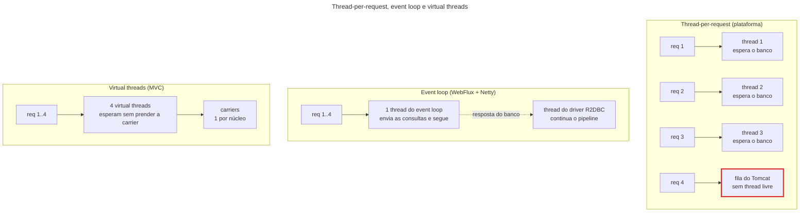
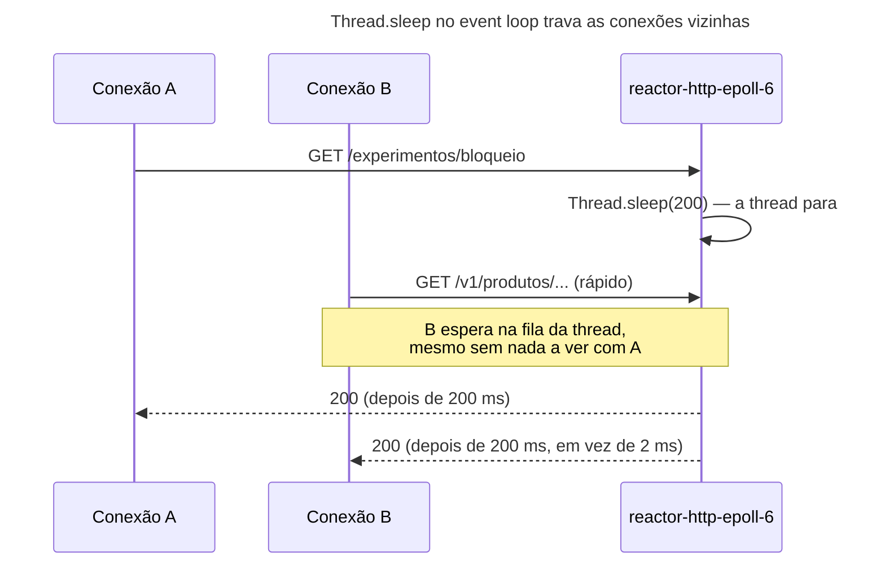

## O problema

Em 2017, a resposta para "minha API passa a maior parte do tempo esperando o banco e outros serviços, e as threads acabam" era o Spring WebFlux. A 19.01 mostrou o limite: no modelo *thread-per-request*, cada requisição prende uma thread de plataforma enquanto espera, e duzentas threads atendem duzentas requisições de cada vez. O WebFlux propunha outro modelo, em que **nenhuma thread espera**: poucas threads, uma por núcleo, atendem milhares de conexões, porque cada uma só trabalha quando há algo a fazer.

Desde então, muita gente reescreveu APIs em estilo reativo, e muitas vagas pedem "Spring WebFlux". Mas a 19.02 mudou a conta: com virtual threads, uma API Spring MVC comum também atende milhares de requisições esperando ao mesmo tempo, sem mudar o estilo do código. A pergunta deixou de ser "como escalar o I/O" e virou: **o que o WebFlux ainda oferece que as virtual threads não oferecem, e quanto ele custa?**

Pense em dois restaurantes. No primeiro, cada mesa tem um garçom que fica ao lado dela do pedido à conta, inclusive enquanto a cozinha prepara o prato. É o *thread-per-request*. No segundo, há três garçons para o salão inteiro: anotam o pedido, levam à cozinha e vão atender outra mesa; quando a cozinha toca a campainha, quem estiver livre leva o prato. É o *event loop*. O segundo atende muito mais mesas com menos gente, mas exige uma disciplina rígida: um garçom que pare para conversar com um cliente trava as mesas de todos. As virtual threads são um terceiro restaurante, com garçons quase de graça: cada mesa tem o seu, e o garçom que espera não custa nada.

> **A pergunta desta página:** como o WebFlux funciona por dentro, o que muda no código e quando ele compensa numa API, agora que as virtual threads existem?

## O conceito

### Reactive Streams: publicador, assinante e *backpressure*

O WebFlux se apoia na especificação Reactive Streams, que o Java incorporou como `java.util.concurrent.Flow` no JDK 9. Ela define quatro interfaces pequenas:

| Interface | Papel |
|---|---|
| `Publisher<T>` | Produz elementos, mas só depois de alguém assinar |
| `Subscriber<T>` | Recebe os elementos (`onNext`), o fim (`onComplete`) ou um erro (`onError`) |
| `Subscription` | O vínculo entre os dois: o assinante pede `request(n)` elementos ou cancela |
| `Processor<T, R>` | Um assinante que também publica |

A peça central é o `request(n)`. O publicador nunca manda mais do que o assinante pediu. Se o assinante é lento (um cliente numa rede ruim, um banco sobrecarregado), ele pede menos, e o publicador produz menos. Isso é o <Term id="backpressure">*backpressure*</Term>: a pressão de quem consome volta para quem produz, em vez de os elementos se acumularem na memória até estourá-la.

### Reactor: `Mono` e `Flux`

O Spring usa o Project Reactor, que implementa a especificação com dois tipos:

- **`Mono<T>`**: zero ou um elemento. É o tipo de "buscar o produto pelo id".
- **`Flux<T>`**: zero a N elementos, possivelmente infinitos. É o tipo de "listar os produtos" ou "os eventos de status".

Os dois vêm com centenas de operadores (`map`, `flatMap`, `filter`, `zip`, `timeout`, `retry`, `switchIfEmpty`...) que montam um *pipeline*. E a regra mais importante, que confunde quem chega do código imperativo: **nada acontece até alguém assinar**. Chamar um método que devolve `Mono` só monta a receita. Quem executa é o WebFlux, ao assinar o `Mono` para escrever a resposta.

### Netty e o *event loop*

O servidor padrão do WebFlux é o Netty (via Reactor Netty), não o Tomcat. O Netty tem um pequeno grupo de threads, o <Term id="event-loop" />: por padrão, uma por núcleo da CPU (no mínimo quatro). Cada thread do *event loop* cuida de muitas conexões. Ela pergunta ao sistema operacional quais *sockets* têm dados prontos (`epoll` no Linux), processa o que chegou até o próximo ponto de espera e passa adiante. Ela nunca espera.

Quando o código precisa do banco, a consulta é enviada e a thread volta ao *event loop*. Quando a resposta do banco chega, outra thread (a do driver) continua o *pipeline* de onde parou. Uma requisição pode passar por três threads diferentes, sem que nenhuma fique parada.

O preço está naquele "nunca". Se o código chama algo bloqueante dentro do *event loop* (`Thread.sleep`, JDBC, `RestClient`, um arquivo lido com `java.io`), a thread fica parada, e **todas as conexões que ela atende esperam junto**. Com doze threads, doze chamadas bloqueantes param o servidor inteiro.

### R2DBC: o banco sem bloquear

O JDBC é bloqueante por definição: `executeQuery` só devolve quando o banco responde. Por isso, uma aplicação WebFlux que usa JPA ou `JdbcClient` perde o sentido (ou precisa empurrar cada chamada para um *pool* de threads separado). O R2DBC é a especificação de drivers relacionais reativos, e o Spring Data R2DBC oferece o `DatabaseClient` e repositórios que devolvem `Mono` e `Flux`.

O R2DBC não é um JPA reativo. Não há *lazy loading*, nem contexto de persistência, nem cascatas: o Spring Data R2DBC é mais próximo do `JdbcClient` com repositórios simples. E algumas ferramentas continuam exigindo JDBC: o Flyway, por exemplo, não tem suporte a R2DBC, e uma aplicação reativa costuma levar os dois drivers, o JDBC só para as migrações.

### O custo

O código reativo tem custos reais, e eles explicam por que a adoção ficou bem menor do que se esperava:

- **Curva de aprendizado.** O fluxo de controle sai da linguagem (`if`, `for`, `try`) e vai para os operadores (`filter`, `flatMap`, `onErrorResume`). Um laço com uma condição e um tratamento de erro vira uma composição de operadores que pouca gente lê de primeira.
- **Depuração.** Uma exceção mostra a pilha de quem **executou** o operador, não de quem **montou** o *pipeline*. O Reactor tenta compensar com *checkpoints*, como este, de um 404 que virou 500 na primeira versão do exemplo desta página:

  ```text noCopy
  com.bazar.reativo.ProdutoNaoEncontradoException: 404 NOT_FOUND, ProblemDetail[type='https://api.bazar.example/...
  	*__checkpoint ⇢ HTTP GET "/v1/produtos/0192f3a1-9999-7000-8000-000000000123" [ExceptionHandlingWebHandler]
  ```

- **Contexto em `ThreadLocal` não funciona.** Uma requisição passa por várias threads, então o MDC, o contexto de segurança e o *trace* precisam viajar no `Context` do Reactor. O Boot tem `spring.reactor.context-propagation=auto`, que usa a mesma biblioteca da 19.03, mas cada integração precisa conhecer o mecanismo.
- **Bibliotecas bloqueantes.** Qualquer SDK que use JDBC ou I/O bloqueante (muitos SDKs de nuvem, de pagamento, de e-mail) precisa ser isolado com `subscribeOn(Schedulers.boundedElastic())`. Esquecer um é o erro mais perigoso do modelo, e o BlockHound existe só para detectá-lo nos testes.
- **Tudo vira `Mono`.** Um método reativo só pode ser chamado de forma útil por outro método reativo. A mudança se espalha por todas as camadas.

### Virtual threads × reativo: os critérios

Para o problema que motivou o WebFlux, esperar I/O sem prender threads caras, as virtual threads resolvem com código imperativo comum (19.02). O experimento da próxima seção mostra os dois empatando. O que sobra a favor do reativo:

| Situação | Por que o reativo ajuda |
|---|---|
| ***Streaming* com *backpressure*** | Um `Flux` de milhões de linhas, entregue ao ritmo do cliente, de ponta a ponta, sem acumular na memória. Com virtual threads, isso é possível, mas à mão |
| **Composição de muitas chamadas assíncronas** | `zip`, `timeout`, `retry`, `mergeWith` são operadores prontos. A concorrência estruturada (19.06) é a resposta imperativa, ainda em *preview* no JDK 25 |
| **Gateways e proxies** | Repassar fluxos sem processá-los, com milhares de conexões longas (o Spring Cloud Gateway nasceu reativo; hoje também tem uma versão MVC) |
| **Um ecossistema já reativo** | Kafka reativo, RSocket, um time que já domina Reactor |

E a favor do Spring MVC com virtual threads: código que todo desenvolvedor Java lê, pilhas de erro inteiras, `ThreadLocal` funcionando, JPA, todas as bibliotecas bloqueantes sem cuidado especial e as ferramentas de teste do resto deste curso. Para uma API de negócio como o Bazar, a recomendação desde o Java 21 é clara: **MVC com virtual threads**, e WebFlux só com um dos motivos da tabela.

Uma observação prática: se as duas dependências estão no classpath (`spring-boot-starter-web` e `spring-boot-starter-webflux`), o Spring Boot sobe o MVC. Isso permite usar o `WebClient` numa aplicação MVC, que é o assunto da [24.04](/consumindo-outras-apis/webclient-em-aplicacoes-mvc).

## Diagrama

Três modelos atendendo as mesmas quatro requisições que esperam o banco:



O que acontece com uma chamada bloqueante dentro do *event loop*:



## Na prática

O Bazar continua em Spring MVC. Para comparar, o repositório tem um projeto à parte, `exemplos/catalogo-reativo`, com o mesmo `GET /v1/produtos/{id}` em WebFlux e R2DBC, lendo a mesma tabela `produto` do mesmo PostgreSQL.

### As dependências

```xml title="exemplos/catalogo-reativo/pom.xml (trecho)"
<dependency>
    <groupId>org.springframework.boot</groupId>
    <artifactId>spring-boot-starter-webflux</artifactId>
</dependency>
<dependency>
    <groupId>org.springframework.boot</groupId>
    <artifactId>spring-boot-starter-data-r2dbc</artifactId>
</dependency>
<dependency>
    <groupId>org.postgresql</groupId>
    <artifactId>r2dbc-postgresql</artifactId>
    <scope>runtime</scope>
</dependency>
```

```yaml title="exemplos/catalogo-reativo/src/main/resources/application.yml"
server:
  port: 8081

spring:
  application:
    name: catalogo-reativo
  r2dbc:
    # O mesmo banco do Bazar. O compose publica o PostgreSQL numa porta aleatória:
    # BAZAR_PG_PORTA=$(docker port projeto-final-postgres-1 5432 | cut -d: -f2)
    url: r2dbc:postgresql://localhost:${BAZAR_PG_PORTA:5432}/bazar
    username: bazar
    password: bazar
  webflux:
    # Como no Bazar MVC: erros em Problem Details (RFC 9457), inclusive as ErrorResponseException.
    problemdetails:
      enabled: true
```

### O mesmo endpoint, nos dois estilos

<Endpoint
  method="GET"
  path="/v1/produtos/{id}"
  summary="Busca um produto pelo id. Em Spring MVC no Bazar; em WebFlux no exemplo de comparação."
  params={[{ name: 'id', in: 'path', type: 'string (uuid)', required: true, description: 'O produto.' }]}
  responses={[{ status: 200, description: 'O produto.' }, { status: 404, description: 'O produto não existe.' }]}
/>

<Comparison
  title="GET /v1/produtos/{id}"
  columns={['Spring MVC (Bazar)', 'WebFlux (catalogo-reativo)']}
  rows={[
    { label: 'Retorno do método', values: ['ProdutoResponse', 'Mono<ProdutoResponse>'] },
    { label: 'Acesso ao banco', values: ['JPA (repositório), bloqueante', 'DatabaseClient (R2DBC), não bloqueante'] },
    { label: 'Produto inexistente', values: ['orElseThrow(...)', 'switchIfEmpty(Mono.error(...))'] },
    { label: 'Servidor', values: ['Tomcat', 'Netty'] },
    { label: 'Quem executa', values: ['Uma virtual thread do começo ao fim', 'O event loop e a thread do driver, em partes'] },
  ]}
/>

No WebFlux, o controller fica assim:

```java title="exemplos/catalogo-reativo/src/main/java/com/bazar/reativo/ProdutoController.java (trecho)"
// O método devolve na hora um Mono vazio de dados: a consulta só roda quando o WebFlux assina o Mono para
// escrever a resposta, e nenhuma thread espera o banco responder.
@GetMapping("/{id}")
Mono<ProdutoResponse> buscar(@PathVariable UUID id) {
    return banco.sql(COLUNAS + " where id = :id")
            .bind("id", id)
            .map(ProdutoController::paraResposta)
            .one()
            .switchIfEmpty(Mono.error(() -> new ProdutoNaoEncontradoException(id)));
}
```

As anotações (`@RestController`, `@GetMapping`, `@PathVariable`) são as mesmas do MVC: o WebFlux aceita o modelo anotado, além das rotas funcionais da [09.05](/construindo-apis-com-spring-boot/functional-endpoints-routerfunction). A diferença está no tipo de retorno e no que vem antes dele. O `.one()` não busca nada: ele devolve um `Mono` que, **quando assinado**, manda a consulta. O `switchIfEmpty` é o `orElseThrow` reativo: se o `Mono` terminar sem elemento, ele assina o `Mono.error`, que emite a exceção.

O 404 sai em Problem Details nos dois, com o mesmo `type`:

<HttpExchange
  title="Produto inexistente, em WebFlux"
  request={{ method: 'GET', url: 'http://localhost:8081/v1/produtos/0192f3a1-9999-7000-8000-000000000123' }}
  response={{ status: 404, headers: { 'Content-Type': 'application/problem+json' }, body: { detail: 'Não existe produto com id 0192f3a1-9999-7000-8000-000000000123.', instance: '/v1/produtos/0192f3a1-9999-7000-8000-000000000123', status: 404, title: 'Produto não encontrado', type: 'https://api.bazar.example/problemas/produto-nao-encontrado', codigo: 'PRODUTO_NAO_ENCONTRADO' } }}
>
Na primeira versão, essa resposta era um `500`. O tratador de erros padrão do WebFlux no Spring Boot não reconhece a `ErrorResponseException`; é preciso ligar o `spring.webflux.problemdetails.enabled`, como o Bazar fez com o `spring.mvc.problemdetails.enabled` na [08.02](/construindo-apis-com-spring-boot/problemdetail-no-spring-tratamento-global-de-erros).
</HttpExchange>

O exemplo também lista os produtos como um `Flux`, um por linha, em NDJSON:

```java title="exemplos/catalogo-reativo/src/main/java/com/bazar/reativo/ProdutoController.java (trecho)"
// Um Flux: os produtos saem um por linha (NDJSON) à medida que o banco os entrega, e o ritmo é o do cliente.
// Se ele lê devagar, o WebFlux pede menos linhas ao driver (backpressure), em vez de acumulá-las na memória.
@GetMapping(produces = MediaType.APPLICATION_NDJSON_VALUE)
Flux<ProdutoResponse> listar() {
    return banco.sql(COLUNAS + " order by nome, id")
            .map(ProdutoController::paraResposta)
            .all();
}
```

```text noCopy
{"id":"bcd399f5-d6d1-4032-9c80-10ca4c363d31","sku":"LIV-0042","nome":"Clean Code (2ª ed.)","descricao":null,"preco":{"valor":139.90,"moeda":"BRL"},...}
{"id":"01a177a2-4072-7904-b8db-45de372442b0","sku":"LIV-0077","nome":"Java Concurrency in Practice","descricao":null,"preco":{"valor":189.90,...}
```

Esse é o caso em que o modelo reativo brilha: o `request(n)` do Netty, que só pede mais quando o *socket* aceita escrever, chega até o driver do PostgreSQL. A paginação da [13.04](/design-de-apis-profissional/paginacao-por-cursor-keyset) continua sendo a resposta certa para uma API pública; o *streaming* de ponta a ponta é para exportações e integrações (22.02).

### Medindo: o mesmo experimento da 19.01 e da 19.02

O exemplo tem as mesmas rotas de experimento do Bazar: `/experimentos/espera` (espera sem trabalho, aqui com `Mono.delay`), `/experimentos/banco` (`pg_sleep` pelo R2DBC) e uma rota nova, `/experimentos/bloqueio`, com o erro clássico: `Thread.sleep` dentro do *event loop*. Cada uma devolve a thread que a atendeu:

```text noCopy
/experimentos/espera   {"ms":200,"thread":"Thread[#63,parallel-2,5,main]"}
/experimentos/bloqueio {"ms":200,"thread":"Thread[#64,reactor-http-epoll-6,5,main]"}
/experimentos/banco    {"ms":100,"thread":"Thread[#51,reactor-tcp-epoll-11,5,main]"}
```

A resposta do `/banco` foi escrita pela thread do driver R2DBC (`reactor-tcp-epoll`), não pela do servidor (`reactor-http-epoll`): a requisição mudou de thread no meio, exatamente como o diagrama mostra. O gerador de carga da 19.01 (`scripts/carga/Carga.java`), com 200 clientes por 10 segundos, contra o Bazar em MVC com virtual threads (porta 8080) e o exemplo em WebFlux (porta 8081), numa máquina de 12 núcleos:

| Cenário | Vazão | p50 | p99 | Erros |
|---|---|---|---|---|
| MVC + virtual threads, espera de 200 ms | 938,7 req/s | 203 ms | 246 ms | 0 |
| WebFlux, espera de 200 ms (`Mono.delay`) | 939,9 req/s | 202 ms | 250 ms | 0 |
| WebFlux, `Thread.sleep(200)` no *event loop* | **56,9 req/s** | 1.009 ms | **13.052 ms** | 0 |

As duas primeiras linhas empatam: 200 clientes ÷ 0,2 s ≈ 1.000 req/s, o máximo que a carga permite. Para esperar I/O, as virtual threads entregam o mesmo que o *event loop*. A terceira mostra o risco que só o modelo reativo tem: doze threads no *event loop* (uma por núcleo) ÷ 0,2 s = 60 req/s, e uma latência p99 de 13 segundos, porque as conexões presas atrás de uma thread parada esperam a vez dela. No MVC com virtual threads, o mesmo `Thread.sleep` é inofensivo: ele só desmonta a virtual thread da *carrier*.

E com o banco? Os dois com cinco conexões no *pool* (o Hikari do perfil `experimentos` e `--spring.r2dbc.pool.max-size=5`), 100 clientes, consultas de 200 ms:

| Cenário | Vazão (só respostas 200) | p50 | Erros |
|---|---|---|---|
| MVC + virtual threads + JDBC | 24,0 req/s (285 em 11,9 s) | 2.038 ms | 251 × `500` (*timeout* de 2 s do Hikari) |
| WebFlux + R2DBC | 23,5 req/s | 4.144 ms | 0 |

O teto é o mesmo nos dois: cinco conexões ÷ 0,2 s = 25 consultas por segundo, a Lei de Little da 19.01 aplicada ao banco. **Nem as virtual threads nem o WebFlux deixam o banco mais rápido.** A diferença está no que acontece com o excesso: o Hikari desiste depois de 2 segundos (`connection-timeout`), e o *pool* do R2DBC, cujo `max-acquire-time` não tem limite por padrão, faz as requisições esperarem para sempre na fila. Nenhum dos dois comportamentos é bom: a 25.03 trata de limitar a concorrência antes de o pedido chegar ao *pool*.

### O teste

O `WebTestClient` é a ferramenta de testes nativa do WebFlux, e o `StepVerifier` (do `reactor-test`) verifica o que um `Mono` ou `Flux` emite. O teste mais didático prova a regra "nada acontece até alguém assinar" com um efeito real no banco:

```java title="exemplos/catalogo-reativo/src/test/java/com/bazar/reativo/CatalogoReativoTest.java (trecho)"
@Test
void nadaAconteceAteAlguemAssinar() {
    // Montar o Mono não toca o banco: o insert só roda na assinatura.
    var insercao = banco.sql("""
            insert into produto values ('0192f3a1-0000-7000-8000-000000000001', 'LIV-0099', 'Teste', null, 10.00,
            'BRL', '0192f3a0-5555-7000-8000-000000000003', 'RASCUNHO', now())
            """).fetch().rowsUpdated();
    assertThat(total()).isEqualTo(2L);

    StepVerifier.create(insercao).expectNext(1L).expectComplete().verify(Duration.ofSeconds(5));
    assertThat(total()).isEqualTo(3L);

    banco.sql("delete from produto where sku = 'LIV-0099'").fetch().rowsUpdated().block();
}
```

O banco do teste é um PostgreSQL do Testcontainers, como no Bazar. Um detalhe: o `@ServiceConnection` só cria a conexão R2DBC (e não só a JDBC) com o módulo `testcontainers-r2dbc` no classpath. Sem ele, o contexto não sobe, com um `NoClassDefFoundError` de `R2DBCDatabaseContainer`.

## Erros comuns

<BadVsGood title="Chamada bloqueante no pipeline reativo" why="O código bloqueante dentro de um map roda numa thread do event loop (ou do driver), e tudo o que ela atende espera junto. O experimento mostrou o efeito: 57 req/s em vez de 940, e p99 de 13 segundos. Quando não há alternativa reativa, a chamada vai para um scheduler feito para bloquear, o boundedElastic.">
<Bad title="SDK bloqueante no event loop">

```java
@GetMapping("/{id}/frete")
Mono<Frete> frete(@PathVariable UUID id) {
    return produtos.buscar(id)
        .map(p -> transportadora.cotar(p)); // HTTP bloqueante
}
```

</Bad>
<Good title="Isolado num scheduler para bloqueio">

```java
@GetMapping("/{id}/frete")
Mono<Frete> frete(@PathVariable UUID id) {
    return produtos.buscar(id)
        .flatMap(p -> Mono.fromCallable(() -> transportadora.cotar(p))
            .subscribeOn(Schedulers.boundedElastic()));
}
```

</Good>
</BadVsGood>

Outros tropeços frequentes:

- **Chamar `.block()` dentro do WebFlux.** Num *event loop*, o Reactor recusa com `IllegalStateException: block()/blockFirst()/blockLast() are blocking, which is not supported in thread reactor-http-epoll-N`. Em outros lugares, ele bloqueia em silêncio.
- **Montar o `Mono` e não devolvê-lo.** `repositorio.save(produto);` sem `return` (ou sem compor no *pipeline*) não grava nada: ninguém assina.
- **Assinar duas vezes.** Cada assinatura executa o *pipeline* de novo. Um `Mono` de um `insert`, assinado no código e devolvido ao WebFlux, grava duas vezes.
- **JPA ou `JdbcClient` numa aplicação WebFlux** sem isolamento: é o erro do `BadVsGood` em escala.
- **Esperar que o MDC e o `SecurityContextHolder` funcionem** como no MVC. No WebFlux, o contexto viaja no `Context` do Reactor (`ReactiveSecurityContextHolder`).
- **`Mono.error(new Excecao())` em vez de `Mono.error(() -> new Excecao())`.** A versão sem *supplier* cria a exceção (e a pilha) toda vez que o *pipeline* é montado, mesmo quando o produto existe.
- **Escolher WebFlux por desempenho, em 2026.** Para I/O, as virtual threads empatam. Escolha pelo *streaming*, pela composição ou pelo ecossistema.

## Boas práticas

- **Comece com Spring MVC e virtual threads.** Mude para WebFlux só com um motivo da tabela de critérios.
- **No WebFlux, todo I/O precisa ser reativo**: R2DBC, `WebClient`, drivers reativos. O que não for vai para `Schedulers.boundedElastic()`.
- **Rode o BlockHound nos testes** para encontrar chamadas bloqueantes no *event loop* antes da produção.
- **Dê um limite de espera ao *pool* do R2DBC** (`spring.r2dbc.pool.max-acquire-time`), como o `connection-timeout` do Hikari.
- **Ligue `spring.webflux.problemdetails.enabled`** para manter o formato de erro do resto da API.
- **Teste com `WebTestClient` e `StepVerifier`**, e nunca com `Thread.sleep`.

## Por baixo dos panos

<DeepDive title="Da assinatura à resposta: quem pede, quem entrega">

Quando uma requisição chega ao Netty, o `DispatcherHandler` (o equivalente reativo do `DispatcherServlet`) encontra o método do controller, o invoca e recebe o `Mono<ProdutoResponse>`, ainda sem nenhum dado. Ele então monta um `Mono<Void>` maior: "quando o `Mono` do controller emitir, serialize com o Jackson e escreva no *socket*". O Reactor Netty **assina** esse `Mono<Void>`, e a assinatura sobe a cadeia de operadores até a fonte:

1. A assinatura chega ao `switchIfEmpty`, depois ao `map`, depois ao `one()` do `DatabaseClient`.
2. O `one()` pega uma conexão do *pool* do R2DBC (também um `Mono`, que pode esperar) e manda a consulta pelo protocolo do PostgreSQL, num *socket* não bloqueante. A thread do *event loop* volta a atender outras conexões.
3. Os bytes da resposta do PostgreSQL chegam ao *event loop* do driver (`reactor-tcp-epoll-N`). O driver decodifica a linha e chama `onNext` no assinante, que é o `map`, que chama `onNext` no `switchIfEmpty`, e assim por diante até o escritor da resposta.
4. O escritor serializa o JSON e escreve no *socket* do cliente. Como a escrita é feita a partir da thread do driver, o Reactor Netty agenda a operação no *event loop* da conexão do cliente.
5. O `onComplete` desce a cadeia, a conexão do banco volta ao *pool*, e a resposta termina.

Num `Flux`, o passo 3 se repete por linha, e entra o *backpressure*: o escritor pede `request(n)` só quando o *buffer* do *socket* tem espaço, e o driver do PostgreSQL lê mais linhas do banco só quando há demanda. No modelo imperativo, o equivalente é um laço que escreve no `OutputStream` e bloqueia quando o *buffer* enche; com virtual threads, esse bloqueio é barato, e o efeito final é parecido, mas a demanda não chega ao driver do banco.

</DeepDive>

## No projeto Bazar

<ProjectStep title="Catálogo reativo, só para comparar" module="exemplos/catalogo-reativo" tag="pagina-19.05" files={[
  { path: 'exemplos/catalogo-reativo/pom.xml', change: 'novo' },
  { path: 'exemplos/catalogo-reativo/src/main/resources/application.yml', change: 'novo' },
  { path: 'exemplos/catalogo-reativo/src/main/java/com/bazar/reativo/CatalogoReativoApplication.java', change: 'novo' },
  { path: 'exemplos/catalogo-reativo/src/main/java/com/bazar/reativo/ProdutoController.java', change: 'novo' },
  { path: 'exemplos/catalogo-reativo/src/main/java/com/bazar/reativo/ProdutoResponse.java', change: 'novo' },
  { path: 'exemplos/catalogo-reativo/src/main/java/com/bazar/reativo/ProdutoNaoEncontradoException.java', change: 'novo' },
  { path: 'exemplos/catalogo-reativo/src/main/java/com/bazar/reativo/ExperimentosController.java', change: 'novo' },
  { path: 'exemplos/catalogo-reativo/src/test/java/com/bazar/reativo/CatalogoReativoTest.java', change: 'novo' },
  { path: 'exemplos/catalogo-reativo/src/test/resources/schema.sql', change: 'novo' },
]}>
O Bazar continua em Spring MVC com virtual threads: nenhuma linha da aplicação mudou nesta página. O projeto `exemplos/catalogo-reativo`, fora do Bazar, implementa `GET /v1/produtos/{id}` e uma listagem em NDJSON com WebFlux e R2DBC, sobre a mesma tabela, e as rotas de experimento usadas nas medições. Para rodar: suba o PostgreSQL do Bazar e execute `BAZAR_PG_PORTA=$(docker port projeto-final-postgres-1 5432 | cut -d: -f2) ./mvnw spring-boot:run` na pasta do exemplo.
</ProjectStep>

## Resumo

- WebFlux é a pilha reativa do Spring: Reactive Streams (com *backpressure*), Reactor (`Mono` e `Flux`), Netty com um *event loop* de uma thread por núcleo e R2DBC para o banco.
- Nada acontece até alguém assinar. O controller devolve a receita; o WebFlux a executa, possivelmente em várias threads.
- Uma chamada bloqueante no *event loop* trava todas as conexões da thread: 57 req/s em vez de 940 no experimento.
- Para esperar I/O, MVC com virtual threads empata com o WebFlux, com código imperativo, `ThreadLocal`, JPA e pilhas de erro inteiras. Nenhum dos dois acelera o banco.
- WebFlux compensa para *streaming* com *backpressure* de ponta a ponta, composição de muitas chamadas assíncronas, gateways e ecossistemas já reativos.

<Exercise title="Migrar para WebFlux?" difficulty="medio">
Um colega propõe migrar o Bazar para WebFlux "para aguentar a Black Friday". Os números da última Black Friday: picos de 3.000 req/s, p99 de 2 segundos, com o tempo gasto quase todo esperando o PostgreSQL (consultas de pedido) e a PagaFácil (chamadas HTTP de 300 a 800 ms). O Bazar já roda com virtual threads.

1. A migração resolveria o p99? Use os experimentos desta página para argumentar.
2. O que você investigaria no lugar?
3. Em que parte do Bazar o WebFlux poderia, de fato, valer a pena?

<Hint>O que limitou a vazão no experimento com o banco, nos dois modelos? Quanto custa cada chamada à PagaFácil em conexões do *pool* do banco, se ela acontece dentro de uma transação?</Hint>

<Solution>

1. Não. Com virtual threads, o Bazar já não tem limite de threads esperando I/O: o experimento de espera deu 938,7 req/s no MVC e 939,9 no WebFlux. O p99 de 2 segundos vem do que está sendo esperado, e o experimento do banco mostrou os dois modelos presos no mesmo teto (conexões ÷ tempo da consulta). Trocar o modelo de execução não muda o tempo do PostgreSQL nem o da PagaFácil, e a migração custaria reescrever todas as camadas, trocar JPA por R2DBC e Flyway por dois drivers.

2. O que olhar:
   - **O pool do banco e as consultas.** Pela Lei de Little, 3.000 req/s com 20 ms de banco cada uma pedem 60 conexões ocupadas em média. Se o pool tem 10, há fila. As consultas lentas (EXPLAIN, índices, [28.04](/performance/consultas-e-paginacao-eficientes)) e o tamanho do pool contra o `max_connections` do PostgreSQL vêm primeiro.
   - **Chamadas externas dentro de transações.** Uma chamada de 800 ms à PagaFácil com uma transação aberta segura uma conexão do banco por 800 ms sem usá-la. Tirar a chamada de dentro da transação (ou torná-la assíncrona, com a fila da 19.03 e o *webhook* da 21.03) libera o pool.
   - **Os *timeouts* e o limite de concorrência** com a PagaFácil (25.01, 25.03), para que a lentidão dela não ocupe todo o resto.
   - **O tracing (27.06)** para ver, numa requisição lenta de verdade, onde os 2 segundos foram gastos.

3. Na exportação de pedidos para os lojistas (22.02): milhões de linhas, entregues ao ritmo de quem baixa, sem carregar tudo na memória. Ali o *backpressure* de ponta a ponta, do *socket* ao driver do banco, é uma vantagem real. Mesmo assim, uma alternativa sem WebFlux (um `StreamingResponseBody` com um cursor JDBC, numa virtual thread) costuma resolver com menos mudança, e seria a primeira tentativa.

</Solution>
</Exercise>

<Quiz questions={[
  {
    question: 'Um método do controller WebFlux faz repositorio.save(produto); e depois return Mono.just(resposta);. O produto não aparece no banco. Por quê?',
    options: [
      'O R2DBC não suporta insert',
      'O save devolve um Mono que ninguém assinou, então o insert nunca rodou',
      'Falta @Transactional',
      'O WebFlux grava só depois de a resposta ser enviada',
    ],
    answer: 1,
    explanation: 'Nada acontece até alguém assinar. O save precisa entrar no pipeline devolvido, por exemplo return repositorio.save(produto).map(...).',
  },
  {
    question: 'No experimento, Thread.sleep(200) dentro de um endpoint WebFlux derrubou a vazão de 940 para 57 req/s numa máquina de 12 núcleos. De onde vem o 57?',
    options: [
      'Do pool de conexões do banco',
      'Do limite de 6 conexões por origem do HTTP/1.1',
      'Das 12 threads do event loop, cada uma presa 200 ms por requisição: 12 ÷ 0,2 s = 60 req/s',
      'Do número de clientes do teste',
    ],
    answer: 2,
    explanation: 'O event loop tem uma thread por núcleo. Bloqueadas, elas viram um pool pequeno de threads de plataforma, e a Lei de Little dá o teto.',
  },
  {
    question: 'Com cinco conexões no pool e consultas de 200 ms, qual é a vazão máxima de uma rota que faz uma consulta, em MVC com virtual threads e em WebFlux com R2DBC?',
    options: [
      'MVC 25 req/s; WebFlux ilimitada',
      '25 req/s nos dois',
      'MVC 5 req/s; WebFlux 25 req/s',
      'Depende do número de núcleos',
    ],
    answer: 1,
    explanation: 'O gargalo é o banco: 5 conexões ÷ 0,2 s = 25 consultas por segundo, nos dois modelos. O experimento mediu 24,0 e 23,5.',
  },
  {
    question: 'Qual destes é um bom motivo para escolher WebFlux numa API nova, em 2026?',
    options: [
      'Atender mais requisições que esperam I/O',
      'Usar JPA com lazy loading',
      'Entregar um fluxo enorme de dados ao ritmo do cliente, com backpressure até o banco',
      'Ter pilhas de exceção mais fáceis de ler',
    ],
    answer: 2,
    explanation: 'Para esperar I/O, as virtual threads empatam. JPA e pilhas legíveis são vantagens do MVC. O backpressure de ponta a ponta é o que o modelo reativo oferece de próprio.',
  },
]} />

## Referências

<References />
