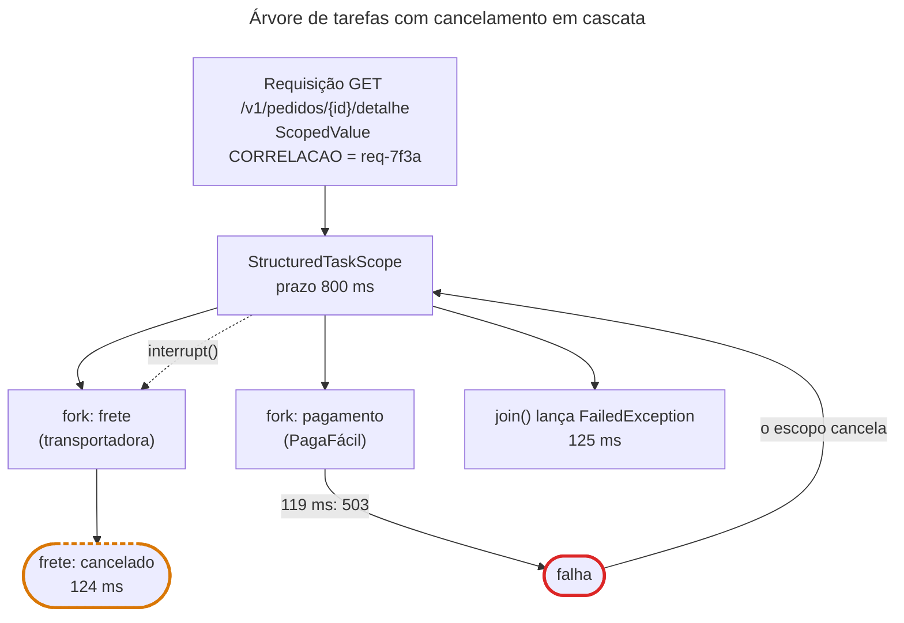

## O problema

A tela de detalhe do pedido no app do Bazar mostra, além dos itens, o rastreio do frete (da transportadora) e a situação do pagamento (da PagaFácil). São duas chamadas HTTP independentes: a transportadora leva uns 300 ms, a PagaFácil uns 500 ms. Uma depois da outra, a tela leva 800 ms. Em paralelo, leva 500 ms. Paralelizar parece óbvio, e o Java tem `CompletableFuture` desde o 8:

```java
var frete = CompletableFuture.supplyAsync(() -> transportadora.rastrear(pedido), executor);
var pagamento = CompletableFuture.supplyAsync(() -> pagaFacil.situacao(pedido), executor);
return frete.thenCombine(pagamento, Detalhe::new).join();
```

Funciona no caminho feliz. Os problemas aparecem quando algo dá errado, e foram medidos no exemplo desta página:

- **A PagaFácil responde `503` em 119 ms. O erro só chega a quem chamou em 2.021 ms.** O `thenCombine` espera **os dois** terminarem, mesmo quando um já falhou e o resultado não tem mais como sair.
- **Ninguém cancela o frete.** A consulta à transportadora continua até o fim, ocupando uma conexão e o limite de taxa da transportadora, para um resultado que vai para o lixo.
- **O contexto não vai junto.** O id de correlação da requisição, num `ThreadLocal`, não existe nas threads do executor (o problema da 19.03, de novo).

O que a tela precisa é de algo que trate as duas chamadas como **uma unidade**: elas começam juntas, terminam juntas, e, se uma falhar, a outra é cancelada. É como um gerente que manda dois funcionários buscar peças em dois fornecedores: se um liga dizendo que o fornecedor fechou, o gerente liga para o outro e diz "pode voltar, a obra foi cancelada", e só vai embora quando os dois estão de volta.

> **A pergunta desta página:** como paralelizar chamadas com cancelamento e prazo corretos, e levar o contexto da requisição até elas, com as APIs que o Java trouxe junto com as virtual threads?

## O conceito

### Concorrência estruturada: subtarefas têm dono

A <Term id="concorrencia-estruturada" /> aplica à concorrência a mesma ideia que a programação estruturada aplicou ao `goto`: o código que **começa** uma subtarefa é o mesmo que **espera** por ela, dentro de um bloco. Nenhuma subtarefa sobrevive ao bloco que a criou. No Java, a ferramenta é o `StructuredTaskScope`:

```java
try (var escopo = StructuredTaskScope.open()) {
    var frete = escopo.fork(() -> transportadora.rastrear(pedido));
    var pagamento = escopo.fork(() -> pagaFacil.situacao(pedido));
    escopo.join();                   // espera as duas, ou a primeira falha
    return new Detalhe(frete.get(), pagamento.get());
}                                    // close(): nenhuma subtarefa passa daqui
```

- **`fork`** inicia a subtarefa numa virtual thread nova (por padrão) e devolve um `Subtask`.
- **`join`** espera, conforme a política do escopo. A padrão: todas com sucesso, ou a primeira falha.
- **Se uma falha, o escopo cancela as outras**, interrompendo as threads delas, e o `join` lança uma `FailedException` com a causa.
- **O `close`**, no fim do `try`, garante que todas as subtarefas terminaram. O código depois do bloco nunca convive com uma subtarefa "solta".

A política se escolhe com um `Joiner`, passado ao `open`:

| Joiner (JDK 25) | O `join` termina quando... | e devolve |
|---|---|---|
| `awaitAllSuccessfulOrThrow()` (o padrão) | Todas tiveram sucesso, ou uma falhou | `null`; os resultados ficam nos `Subtask` |
| `allSuccessfulOrThrow()` | Todas tiveram sucesso, ou uma falhou | Um `Stream` dos `Subtask` (uma `List` de resultados a partir do JDK 26) |
| `anySuccessfulResultOrThrow()` | Uma teve sucesso (cancela as outras), ou todas falharam | O primeiro resultado. Serve para consultar duas réplicas e ficar com a mais rápida |
| `awaitAll()` | Todas terminaram, com sucesso ou não | `null`; cada `Subtask` diz o seu estado |
| `allUntil(predicado)` | Todas terminaram, ou o predicado aceitou uma | Um `Stream` dos `Subtask` |

E o prazo vai na configuração:

```java
StructuredTaskScope.open(Joiner.awaitAllSuccessfulOrThrow(), config -> config.withTimeout(Duration.ofMillis(800)))
```

Quando o prazo vence, o escopo cancela as subtarefas que ainda rodam e o `join` lança `TimeoutException`. É o orçamento de tempo da [25.01](/consumindo-outras-apis/timeouts-e-orcamento-de-tempo) aplicado a um grupo de chamadas: 800 ms para o detalhe inteiro, não 800 ms para cada chamada. No JDK 25, esse prazo é "tudo ou nada": depois da `TimeoutException`, nem as subtarefas que terminaram entregam o resultado (`get()` lança `IllegalStateException: join not called`). Aproveitar o que ficou pronto exige o `Joiner.onTimeout()` do JDK 26, ou prazos nas próprias chamadas, como mostra o exercício.

### Cancelamento é interrupção

O escopo cancela uma subtarefa **interrompendo** a thread dela (`Thread.interrupt()`). Isso só tem efeito se o código da subtarefa responder à interrupção. Felizmente, o que importa responde: `Thread.sleep`, as filas de `java.util.concurrent`, o I/O de *sockets* em virtual threads e o `HttpClient` do JDK, que cancela a requisição. Um `RestClient` configurado com o `JdkClientHttpRequestFactory` (a [24.02](/consumindo-outras-apis/restclient-a-fundo)) é cancelável. Um laço de CPU que nunca verifica `Thread.interrupted()` não é, e o `close` do escopo vai esperar por ele.

O erro mais comum diante da interrupção é engoli-la:

```java
try { Thread.sleep(ms); }
catch (InterruptedException ex) { /* ignora */ }   // a subtarefa continua como se nada tivesse acontecido
```

A regra é sair: restaurar o *flag* (`Thread.currentThread().interrupt()`) e lançar uma exceção, ou devolver logo.

### `ScopedValue`: contexto imutável com começo e fim

O `ThreadLocal` tem três defeitos para guardar contexto de requisição, todos vistos neste curso: ele é **mutável** (qualquer código pode trocar o valor no meio da requisição), ele **vaza** se ninguém chamar `remove()` (num pool de threads, o valor da requisição anterior aparece na seguinte), e ele **não passa** para outras threads sem cópia explícita (a propagação da 19.03).

O <Term id="scoped-value">`ScopedValue`</Term>, final no JDK 25 (JEP 506), resolve os três:

```java
static final ScopedValue<String> CORRELACAO = ScopedValue.newInstance();

ScopedValue.where(CORRELACAO, "req-7f3a").run(() -> {
    // aqui dentro, e em tudo o que for chamado daqui: CORRELACAO.get() == "req-7f3a"
    atenderARequisicao();
});
// aqui fora: CORRELACAO.isBound() == false
```

- **Imutável.** Não há `set`. Para outro valor num trecho, faz-se outro `where(...).run(...)` aninhado, que vale só dentro dele.
- **Com começo e fim.** O valor existe durante o `run` (ou `call`) e some sozinho no fim, mesmo com exceção. Não há `remove()` para esquecer.
- **Herdado pelas subtarefas de um `StructuredTaskScope`.** As subtarefas veem os mesmos valores de quem as criou, sem cópia, porque o escopo garante que elas terminam antes de o bloco do `where` acabar. Threads de um `ExecutorService` ou de um `CompletableFuture` **não** herdam: elas podem viver mais que o bloco.

| | `ThreadLocal` | `ScopedValue` |
|---|---|---|
| Mudar o valor | `set`, a qualquer momento | Só aninhando um novo `where` |
| Fim do valor | Quando alguém chamar `remove()` | No fim do bloco, sempre |
| Subtarefas do `StructuredTaskScope` | Não veem (ou copiam, com `InheritableThreadLocal`) | Veem, sem cópia |
| Threads de executor | Não veem sem `TaskDecorator` (19.03) | Não veem |
| Custo com milhões de virtual threads | Um mapa por thread | Leitura barata, sem cópia |

O Spring 7 e o SLF4J ainda guardam o contexto da requisição (o MDC, a segurança, a transação) em `ThreadLocal`. Por enquanto, o `ScopedValue` serve ao **seu** contexto: um id de correlação, o tenant, o usuário que a regra de negócio precisa conhecer. O `ThreadLocal` continua existindo e funcionando; a recomendação da JEP é usar `ScopedValue` em código novo onde o contexto tem começo e fim claros.

### *Preview features*: o que isso significa em produção

O `ScopedValue` é final no JDK 25 e pode ser usado como qualquer API. O `StructuredTaskScope`, não. Ele está em *preview* há anos, e a API muda a cada versão:

| JDK | JEP | O que mudou |
|---|---|---|
| 21 a 24 | 453, 462, 480, 499 | Subclasses `ShutdownOnFailure` e `ShutdownOnSuccess`, construtores públicos |
| 25 | 505 (5ª *preview*) | Redesenho: `StructuredTaskScope.open(...)` e a interface `Joiner`. O código das versões anteriores não compila |
| 26 | 525 (6ª *preview*) | `allSuccessfulOrThrow()` devolve uma lista de resultados; `anySuccessfulResultOrThrow()` vira `anySuccessfulOrThrow()`; o `Joiner` ganha `onTimeout()` |
| 27 | 533 (7ª *preview*) | Um terceiro parâmetro de tipo para a exceção do `join`; os *joiners* passam a lançar `ExecutionException`; `awaitAll()` é removido; `onTimeout()` vira `timeout()` |

Usar uma API em *preview* tem custos concretos:

1. **`--enable-preview` em todo lugar**: no `javac` (o `maven-compiler-plugin`), nos testes (o `argLine` do Surefire), no `spring-boot:run` e no `java -jar` do contêiner.
2. **O `.class` fica preso à versão exata do JDK.** Um arquivo compilado com *preview* no JDK 25 não carrega no JDK 26, nem com `--enable-preview`. Atualizar o JDK obriga a recompilar, e, como a API muda, a reescrever.
3. **Todo o código compilado vira "preview"**, não só a classe que usa a API.

Para uma API de produção, a recomendação é esperar a versão final, ou isolar o uso atrás de uma interface do próprio projeto, num único lugar, sabendo que ele vai mudar a cada atualização do JDK. Por isso, esta página usa um exemplo à parte, e o Bazar continua sem `--enable-preview`. Enquanto isso, a alternativa estável é a da 19.02: chamadas sequenciais em virtual threads, que custam a soma das latências, mas não têm nenhuma das armadilhas do `CompletableFuture`.

## Diagrama

As subtarefas formam uma árvore, e o cancelamento desce por ela:



## Na prática

O exemplo está em `exemplos/concorrencia-estruturada/DetalheDoPedido.java`, um programa de arquivo único. As duas APIs externas são simuladas com `Thread.sleep`: o que interessa aqui é quem espera, quem é cancelado e quando. Ele roda com o JDK 25:

```bash
java --enable-preview --source 25 DetalheDoPedido.java falha
```

Sem o `--enable-preview`, o compilador recusa:

```text noCopy
DetalheDoPedido.java:4: error: StructuredTaskScope is a preview API and is disabled by default.
import java.util.concurrent.StructuredTaskScope;
                           ^
```

### A versão estruturada

```java title="exemplos/concorrencia-estruturada/DetalheDoPedido.java (trecho)"
// O id de correlação da requisição, visível em todas as subtarefas sem ser passado como parâmetro.
static final ScopedValue<String> CORRELACAO = ScopedValue.newInstance();

// A versão estruturada: as duas consultas são filhas deste bloco. Se uma falha, ou o prazo vence, a outra é
// cancelada, e o bloco só termina quando as duas terminaram.
static Detalhe detalhe(long msFrete, long msPagamento, boolean pagamentoFalha, Duration prazo)
        throws InterruptedException {
    try (var escopo = StructuredTaskScope.open(Joiner.<Object>awaitAllSuccessfulOrThrow(),
            config -> config.withTimeout(prazo))) {
        var frete = escopo.fork(() -> consultarFrete(msFrete));
        var pagamento = escopo.fork(() -> consultarPagamento(msPagamento, pagamentoFalha));
        escopo.join();
        return new Detalhe("BZR-2026-000004", frete.get(), pagamento.get());
    }
}
```

O `main` liga o `ScopedValue` antes de chamar o detalhe, como um filtro faria no começo de uma requisição:

```java title="exemplos/concorrencia-estruturada/DetalheDoPedido.java (trecho)"
// ScopedValue.where(...).call(...): o valor existe só dentro desta chamada, e some sozinho no fim.
ScopedValue.where(CORRELACAO, "req-7f3a").call(() -> { /* ... detalhe(...) ... */ });
```

Cada linha de log mostra o tempo desde o início, o valor do `ScopedValue` na thread que escreveu e a thread.

**Caminho feliz** (frete 300 ms, pagamento 500 ms): o detalhe sai em 528 ms, o tempo da chamada mais lenta, e as duas subtarefas, em virtual threads diferentes, enxergam a correlação `req-7f3a`. Fora do bloco do `where`, ela não existe mais:

```text noCopy
    7 ms  req-7f3a         virtual#27   frete: consultando a transportadora
    8 ms  req-7f3a         virtual#29   pagamento: consultando a PagaFácil
  317 ms  req-7f3a         virtual#27   frete: respondeu
  516 ms  req-7f3a         virtual#29   pagamento: respondeu
  528 ms  req-7f3a         main         detalhe pronto: Detalhe[pedido=BZR-2026-000004, frete=Frete[...], pagamento=Pagamento[status=APROVADO]]
  528 ms  (sem correlação) main         fim do programa
```

**A PagaFácil falha** (frete 2 s, pagamento falha em 100 ms): o escopo cancela o frete 6 ms depois da falha, e o erro chega a quem chamou em 125 ms:

```text noCopy
    7 ms  req-7f3a         virtual#27   frete: consultando a transportadora
    9 ms  req-7f3a         virtual#29   pagamento: consultando a PagaFácil
  118 ms  req-7f3a         virtual#29   pagamento: a PagaFácil respondeu 503
  124 ms  req-7f3a         virtual#27   frete: cancelado (interrompido)
  125 ms  req-7f3a         main         detalhe falhou: java.util.concurrent.StructuredTaskScope$FailedException: java.lang.IllegalStateException: PagaFácil indisponível (503)
```

**O prazo vence** (frete 2 s, pagamento 500 ms, prazo 800 ms): o pagamento termina, o frete é cancelado quando o prazo vence, e o `join` lança `TimeoutException`:

```text noCopy
    7 ms  req-7f3a         virtual#27   frete: consultando a transportadora
    8 ms  req-7f3a         virtual#29   pagamento: consultando a PagaFácil
  518 ms  req-7f3a         virtual#29   pagamento: respondeu
  807 ms  req-7f3a         virtual#27   frete: cancelado (interrompido)
  809 ms  req-7f3a         main         detalhe falhou: java.util.concurrent.StructuredTaskScope$TimeoutException
```

### A versão com `CompletableFuture`, para comparar

```java title="exemplos/concorrencia-estruturada/DetalheDoPedido.java (trecho)"
// A versão com CompletableFuture: as duas consultas também rodam em paralelo, mas não têm dono. A falha do
// pagamento faz o join() lançar, e o frete continua rodando até o fim, sem ninguém para usar o resultado.
static Detalhe comCompletableFuture(long msFrete, long msPagamento, boolean pagamentoFalha) {
    var executor = Executors.newVirtualThreadPerTaskExecutor();
    var frete = CompletableFuture.supplyAsync(() -> consultarFrete(msFrete), executor);
    var pagamento = CompletableFuture.supplyAsync(() -> consultarPagamento(msPagamento, pagamentoFalha), executor);
    return frete.thenCombine(pagamento, (f, p) -> new Detalhe("BZR-2026-000004", f, p)).join();
}
```

O mesmo cenário de falha:

```text noCopy
    9 ms  (sem correlação) virtual#26   frete: consultando a transportadora
   11 ms  (sem correlação) virtual#28   pagamento: consultando a PagaFácil
  119 ms  (sem correlação) virtual#28   pagamento: a PagaFácil respondeu 503
 2019 ms  (sem correlação) virtual#26   frete: respondeu
 2021 ms  req-7f3a         main         detalhe falhou: java.util.concurrent.CompletionException: java.lang.IllegalStateException: PagaFácil indisponível (503)
```

Três diferenças, todas medidas:

| | `StructuredTaskScope` | `CompletableFuture` + `thenCombine` |
|---|---|---|
| A falha chega a quem chamou | Em 125 ms | Em 2.021 ms: o `thenCombine` espera os dois |
| O frete | Cancelado em 124 ms | Roda até o fim (2.019 ms), para nada |
| O `ScopedValue` nas subtarefas | `req-7f3a` | Não existe (`sem correlação`) |

Dá para chegar perto com `CompletableFuture`: compor com `anyOf` para reagir à primeira falha, chamar `cancel` à mão no outro futuro (que **não** interrompe a thread: `cancel(true)` é ignorado pelo `CompletableFuture`), copiar o contexto com um `TaskDecorator`. É exatamente o código que a concorrência estruturada torna desnecessário.

<Callout type="warning" title="Tutoriais antigos não compilam">
Boa parte do material sobre concorrência estruturada na internet usa `new StructuredTaskScope.ShutdownOnFailure()` e `scope.throwIfFailed()`, a API do JDK 21 a 24. Ela não existe mais no JDK 25. E o código desta página, escrito para o JDK 25, precisa de ajustes no JDK 26 e no 27 (a tabela de versões acima). Confira a JEP da versão do seu JDK antes de copiar um exemplo.
</Callout>

### A árvore no *thread dump*

Uma vantagem que não aparece no código: as subtarefas ficam registradas como filhas do escopo, e o *thread dump* em JSON mostra a árvore. Com o cenário `observar` (consultas de 30 s) rodando:

```bash
jcmd <pid> Thread.dump_to_file -format=json detalhe.json
```

```json title="detalhe.json (trecho)"
{
  "container": "java.util.concurrent.StructuredTaskScopeImpl@19932c16",
  "parent": "<root>",
  "owner": "3",
  "threads": [
    { "tid": "27", "virtual": true, "state": "TIMED_WAITING", "stack": ["...", "DetalheDoPedido.dormir(DetalheDoPedido.java:104)", "DetalheDoPedido.consultarFrete(DetalheDoPedido.java:86)"] },
    { "tid": "29", "virtual": true, "state": "TIMED_WAITING", "stack": ["...", "DetalheDoPedido.dormir(DetalheDoPedido.java:104)", "DetalheDoPedido.consultarPagamento(DetalheDoPedido.java:93)"] }
  ],
  "threadCount": "2"
}
```

O `owner` é a thread `main` (tid 3), que abriu o escopo. Numa API com milhares de virtual threads, é isso que permite responder "quais chamadas externas esta requisição está esperando?". Com `CompletableFuture`, as threads do executor aparecem soltas, sem relação com quem as criou.

### Para usar num projeto Spring Boot

Num projeto Maven com Spring Boot, ligar o *preview* exige mexer em três lugares (o Bazar **não** faz isso):

```xml
<plugin>
    <artifactId>maven-compiler-plugin</artifactId>
    <configuration>
        <compilerArgs><arg>--enable-preview</arg></compilerArgs>
    </configuration>
</plugin>
<plugin>
    <artifactId>maven-surefire-plugin</artifactId>
    <configuration><argLine>--enable-preview</argLine></configuration>
</plugin>
<plugin>
    <groupId>org.springframework.boot</groupId>
    <artifactId>spring-boot-maven-plugin</artifactId>
    <configuration><jvmArguments>--enable-preview</jvmArguments></configuration>
</plugin>
```

E o `java --enable-preview -jar bazar.jar` no Dockerfile (29.01). Com as virtual threads da 19.02 ligadas, a thread da requisição já é virtual, e o controller pode abrir o escopo diretamente; cada `fork` cria outra virtual thread.

## Erros comuns

<BadVsGood title="Paralelizar sem dono" why="Com CompletableFuture, as subtarefas não pertencem a ninguém: a falha de uma não cancela a outra, o erro pode demorar o tempo da mais lenta (o thenCombine espera as duas), e o contexto da requisição fica para trás. Com StructuredTaskScope, as duas são filhas do bloco: a primeira falha cancela a outra, o prazo vale para o grupo, e o ScopedValue chega às duas.">
<Bad title="CompletableFuture solto">

```java
var f = supplyAsync(() -> frete(), exec);
var p = supplyAsync(() -> pagamento(), exec);
return f.thenCombine(p, Detalhe::new)
        .orTimeout(800, MILLISECONDS)  // não cancela nada
        .join();
```

</Bad>
<Good title="Escopo estruturado com prazo">

```java
try (var escopo = StructuredTaskScope.open(
        Joiner.awaitAllSuccessfulOrThrow(),
        c -> c.withTimeout(Duration.ofMillis(800)))) {
    var f = escopo.fork(() -> frete());
    var p = escopo.fork(() -> pagamento());
    escopo.join();
    return new Detalhe(f.get(), p.get());
}
```

</Good>
</BadVsGood>

Outros tropeços frequentes:

- **Engolir a `InterruptedException`.** A subtarefa não para quando é cancelada, e o `close` do escopo espera por ela.
- **Chamar `subtask.get()` antes do `join()`**, de uma subtarefa que falhou, ou depois de um `join` que lançou `TimeoutException`. Lança `IllegalStateException`.
- **Esquecer o `try`-with-resources.** Sem o `close`, o escopo não garante nada; a API exige o bloco.
- **Chamar `fork` ou `join` de outra thread** que não a dona do escopo. A API recusa com `WrongThreadException`.
- **Esperar que um `ScopedValue` chegue a um `@Async` ou a um executor.** Só as subtarefas de um `StructuredTaskScope` herdam.
- **Usar `ScopedValue` para o que muda durante a requisição**, como um acumulador. Ele é imutável; para isso existe um objeto mutável guardado no valor, ou um parâmetro.
- **Ligar `--enable-preview` em produção sem um plano** para a próxima atualização do JDK.
- **Copiar exemplos de outra versão do JDK.** A API do `StructuredTaskScope` mudou em todas as versões desde a 21.

## Boas práticas

- **Para paralelizar chamadas de uma requisição**, prefira concorrência estruturada a `CompletableFuture`: falha, cancelamento e prazo tratados pela API.
- **Dê um prazo ao escopo inteiro** (`withTimeout`), coerente com o orçamento de tempo da requisição.
- **Escreva subtarefas que respondam à interrupção**, e use clientes HTTP canceláveis.
- **Use `ScopedValue` em código novo** para contexto com começo e fim claros (correlação, tenant), e ligue-o uma vez, na borda (um filtro).
- **Trate *preview* como experimento**: isole o uso atrás de uma interface, num lugar só, ou espere a versão final. Fora do *preview*, chamadas sequenciais em virtual threads são a alternativa simples.

## Por baixo dos panos

<DeepDive title="Como o ScopedValue chega às subtarefas sem cópia">

Cada thread tem um ponteiro para um *snapshot* dos `ScopedValue` ligados nela: uma lista encadeada imutável de pares (chave, valor). O `ScopedValue.where(K, v).run(op)` cria um *snapshot* novo, que aponta para o anterior, troca o ponteiro da thread, executa `op` e, no `finally`, restaura o ponteiro antigo. Ler `K.get()` percorre a lista (com um pequeno *cache* por thread, por isso a leitura é barata).

Quando o `StructuredTaskScope` é aberto, ele guarda o *snapshot* da thread dona. Cada `fork` cria a virtual thread da subtarefa **com o mesmo ponteiro**. Não há cópia: as subtarefas leem a mesma lista imutável. Isso só é seguro porque o escopo garante duas coisas: as subtarefas terminam antes do `close`, e o `close` acontece antes de o `where` restaurar o ponteiro. Se a subtarefa pudesse viver mais que o bloco (como numa thread de executor), ela enxergaria um valor que, para a thread que o ligou, já não existe. É por isso que o `ScopedValue` só é herdado dentro da concorrência estruturada.

O escopo também verifica, no `fork`, que os `ScopedValue` da thread são os mesmos de quando ele foi aberto. Abrir um escopo, ligar outro valor com um `where` aninhado e chamar `fork` lá dentro lança `StructureViolationException`: a subtarefa veria um valor que não pertence ao escopo.

</DeepDive>

## No projeto Bazar

<ProjectStep title="Detalhe do pedido com concorrência estruturada (exemplo)" module="exemplos/concorrencia-estruturada" tag="pagina-19.06" files={[
  { path: 'exemplos/concorrencia-estruturada/DetalheDoPedido.java', change: 'novo' },
  { path: 'exemplos/concorrencia-estruturada/verificar.sh', change: 'novo' },
]}>
O Bazar não usa *preview features*, e nenhuma linha da aplicação mudou nesta página. O exemplo `DetalheDoPedido.java` monta o detalhe com frete e pagamento em paralelo, com `StructuredTaskScope` (JDK 25, JEP 505) e `ScopedValue`, nos cenários de sucesso, falha, prazo vencido e a comparação com `CompletableFuture`. O `verificar.sh` roda os cenários e confere os desfechos. As chamadas reais à transportadora e à PagaFácil chegam na Parte 10 (24.x e 25.x), com `RestClient`, *timeouts* e *circuit breaker*.
</ProjectStep>

## Resumo

- Concorrência estruturada: subtarefas têm dono. O `StructuredTaskScope` faz `fork`, `join` e `close` num bloco; a primeira falha cancela as outras, e o prazo vale para o grupo.
- O cancelamento é uma interrupção: as subtarefas precisam respeitá-la, e os clientes HTTP precisam ser canceláveis.
- `ScopedValue` (final no JDK 25) é contexto imutável, com começo e fim, herdado pelas subtarefas do escopo e por nada mais.
- No experimento, o `CompletableFuture` entregou a falha em 2.021 ms em vez de 125, não cancelou o frete e perdeu o contexto.
- O `StructuredTaskScope` continua em *preview* (JDK 25, 26 e 27), com a API mudando a cada versão: `--enable-preview` em todo o *build* e `.class` presos à versão do JDK.

<Exercise title="Frete opcional" difficulty="dificil">
O produto decidiu: o pagamento é obrigatório no detalhe do pedido, mas o frete não. Se a transportadora falhar ou demorar, a tela mostra "rastreio indisponível" em vez de dar erro.

Reescreva o `detalhe(...)` com `StructuredTaskScope` (API do JDK 25) para que:

1. Uma falha da PagaFácil cancele o frete na hora e falhe o detalhe.
2. Uma falha da transportadora **não** cancele o pagamento e resulte em frete "indisponível".
3. Uma transportadora que demore mais de 800 ms resulte em frete "indisponível", sem atrasar o detalhe além disso.

Uma ideia natural para o item 3 é pôr `withTimeout(800 ms)` no escopo e, depois da `TimeoutException`, usar o que ficou pronto. Experimente antes de seguir.

<Hint>O `Joiner` padrão cancela tudo na primeira falha, de qualquer subtarefa; o `Joiner.allUntil(predicado)` só cancela quando o predicado aceita uma subtarefa que terminou. Para o prazo, rode o experimento: depois de um `join` que lançou `TimeoutException`, o `state()` de uma subtarefa pronta é `SUCCESS`, mas o que acontece com o `get()`?</Hint>

<Solution>

**Por que o `withTimeout` do escopo não serve no JDK 25.** Depois de um `join` que lançou `TimeoutException`, o `state()` do pagamento pronto é `SUCCESS`, mas o `get()` lança `IllegalStateException: join not called`: o resultado não está mais acessível. O prazo do escopo é "tudo ou nada". O JDK 26 (JEP 525) acrescentou o `Joiner.onTimeout()` justamente para devolver resultados parciais, e o JDK 27 (JEP 533) o trocou por `timeout()`.

**A solução no JDK 25** separa as duas regras. O cancelamento seletivo fica num `allUntil`, que só cancela o escopo quando o pagamento falha (identificado por uma exceção própria). O prazo fica **na chamada do frete**, não no escopo. Com um cliente HTTP de verdade, é o *timeout* da requisição (a 25.01); no exemplo simulado, um escopo interno com prazo faz o papel:

```java
static class PagamentoFalhou extends RuntimeException { /* ... */ }

static Detalhe detalhe() throws InterruptedException {
    try (var escopo = StructuredTaskScope.open(Joiner.<Object>allUntil(
            s -> s.state() == Subtask.State.FAILED && s.exception() instanceof PagamentoFalhou))) {
        var frete = escopo.fork(() -> {
            // O prazo é do frete, não do detalhe: no código real, o timeout do RestClient.
            try (var interno = StructuredTaskScope.open(Joiner.<Frete>anySuccessfulResultOrThrow(),
                    c -> c.withTimeout(Duration.ofMillis(800)))) {
                interno.fork(() -> consultarFrete());
                return interno.join();
            }
        });
        var pagamento = escopo.fork(() -> consultarPagamento());   // lança PagamentoFalhou
        escopo.join();
        if (pagamento.state() != Subtask.State.SUCCESS) {
            throw new IllegalStateException("Pagamento indisponível", pagamento.exception());
        }
        var rastreio = frete.state() == Subtask.State.SUCCESS ? frete.get() : Frete.INDISPONIVEL;
        return new Detalhe(pedido, rastreio, pagamento.get());
    }
}
```

O `allUntil` não cancela quando o frete falha (a exceção não é `PagamentoFalhou`), então o `join` espera o pagamento, e o frete sai "indisponível". Quando o pagamento falha, o predicado aceita e o escopo interrompe o frete. Medido no JDK 25:

| Cenário | Resultado | Tempo |
|---|---|---|
| Transportadora 2 s, PagaFácil 500 ms | `INDISPONIVEL` + pagamento | 817 ms |
| Transportadora 2 s, PagaFácil falha em 100 ms | Falha do detalhe, frete cancelado | 102 ms |
| Transportadora 300 ms, PagaFácil 500 ms | Frete + pagamento | 501 ms |

O pagamento continua sem prazo próprio aqui; num código real, ele também teria o *timeout* do cliente HTTP, e o escopo externo poderia ter um `withTimeout` maior, como rede de segurança "tudo ou nada".

</Solution>
</Exercise>

<Quiz questions={[
  {
    question: 'Num StructuredTaskScope com o Joiner padrão, a subtarefa do pagamento falha enquanto a do frete ainda está esperando a transportadora. O que acontece?',
    options: [
      'O frete continua até o fim, e o join lança a exceção depois',
      'O escopo interrompe a thread do frete, e o join lança FailedException com a causa',
      'O join devolve null para o pagamento e o resultado do frete',
      'O programa encerra com a exceção não tratada',
    ],
    answer: 1,
    explanation: 'O Joiner padrão (awaitAllSuccessfulOrThrow) cancela o escopo na primeira falha, interrompendo as subtarefas que ainda rodam. No experimento, o frete foi cancelado 6 ms depois da falha.',
  },
  {
    question: 'No experimento com CompletableFuture e thenCombine, a PagaFácil falhou em 119 ms. Quando a exceção chegou a quem chamou join()?',
    options: [
      'Em 119 ms',
      'Nunca: o thenCombine engole a exceção',
      'Em cerca de 2 s, quando o frete terminou, porque o thenCombine espera os dois futuros',
      'No timeout padrão de 30 s',
    ],
    answer: 2,
    explanation: 'O thenCombine só executa (ou propaga a falha) quando os dois futuros completaram. O frete, que ninguém cancelou, terminou em 2.019 ms, e a exceção veio em 2.021 ms.',
  },
  {
    question: 'Um ScopedValue ligado com ScopedValue.where(...).run(...) é visível em quais threads?',
    options: [
      'Em todas as threads da JVM',
      'Na thread que o ligou, durante o run, e nas subtarefas de um StructuredTaskScope aberto dentro dele',
      'Na thread que o ligou e em qualquer thread de executor criada dentro do run',
      'Só na thread que o ligou, nunca em outras',
    ],
    answer: 1,
    explanation: 'A herança acontece só na concorrência estruturada, porque o escopo garante que as subtarefas terminam antes de o bloco acabar. Threads de executor podem viver mais, e não herdam.',
  },
  {
    question: 'Por que o Bazar não usa StructuredTaskScope em produção?',
    options: [
      'Porque não funciona com virtual threads',
      'Porque é uma preview API: exige --enable-preview em todo o build, prende os .class à versão exata do JDK e muda a cada versão',
      'Porque o Spring Boot proíbe',
      'Porque é mais lento que CompletableFuture',
    ],
    answer: 1,
    explanation: 'A API está em preview no JDK 25, 26 e 27, com mudanças a cada uma. O ScopedValue, final no JDK 25, pode ser usado normalmente.',
  },
]} />

## Referências

<References />
