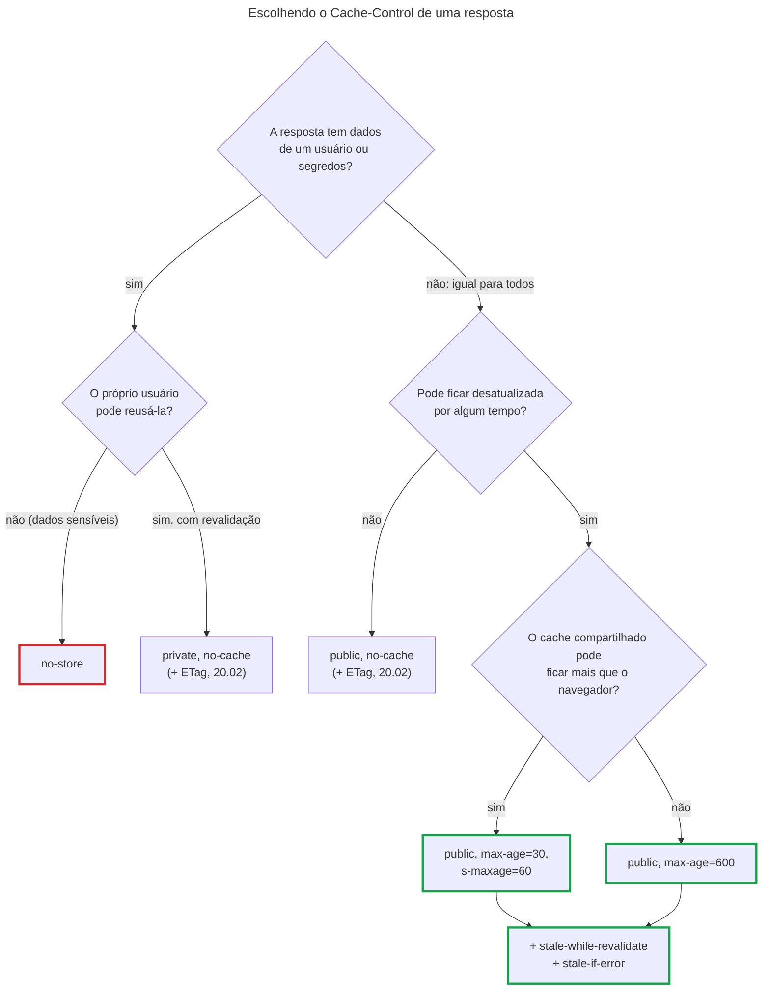
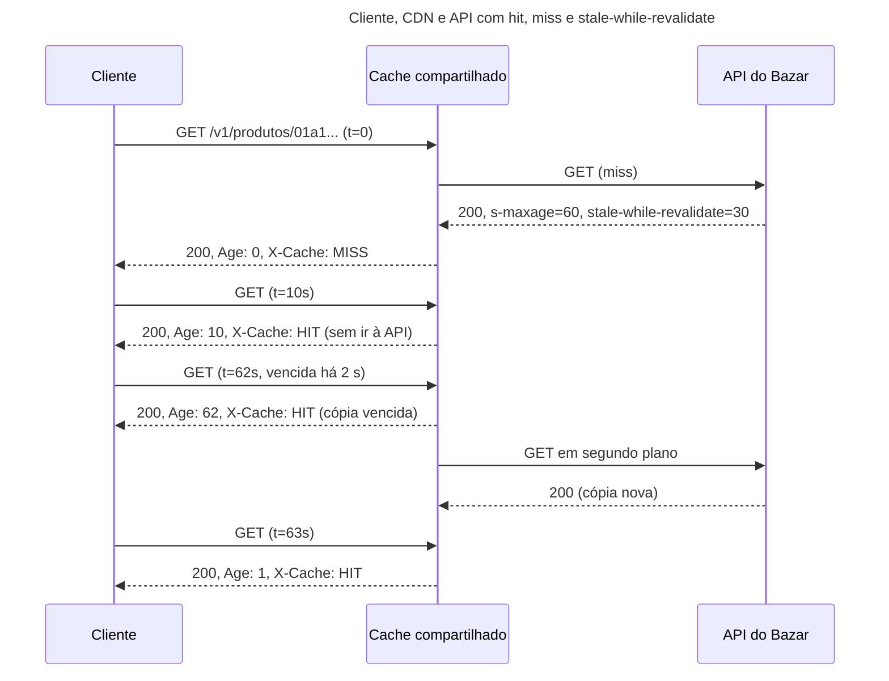

## O problema

A vitrine do Bazar mostra, a cada visita, as categorias e o detalhe dos produtos em destaque. Cada abertura do app faz as mesmas requisições, e a resposta é a mesma para todo mundo: o "Clean Code (2ª ed.)" custa R$ 139,90 para a Ana e para o Bruno. Mesmo assim, cada uma dessas requisições atravessa a internet, passa pelo Tomcat, abre uma transação, consulta o PostgreSQL, monta o JSON e volta. Na Black Friday, são dezenas de milhares de vezes por minuto o mesmo trabalho, com o mesmo resultado.

O HTTP tem, desde o começo, uma resposta para isso: o **cache**. O navegador, o app, um *proxy* da empresa ou uma CDN podem guardar uma resposta e entregá-la de novo sem perguntar à API. É a otimização mais barata que existe: um header na resposta, e milhares de requisições deixam de chegar ao servidor. No laboratório desta página, um cache na frente do Bazar atendeu 168 mil requisições e foi ao Bazar **uma** vez.

O perigo é o outro lado. Um cache não sabe o que é "dado do cliente". Se a resposta de `GET /v1/pedidos/{id}` da Ana for guardada por um *proxy* compartilhado, o próximo que pedir a mesma URL pode receber os pedidos dela. E um preço guardado por tempo demais é um preço errado na tela.

Pense numa banca de jornal. O jornal do dia pode ficar exposto o dia todo: é igual para todos e só muda amanhã. Já uma carta registrada, endereçada a uma pessoa, não fica na banca para quem passar: é entregue a quem ela pertence, e só. O `Cache-Control` é a etiqueta que a API põe em cada resposta dizendo se ela é jornal ou carta, e por quanto tempo vale.

> **A pergunta desta página:** como a API diz, para cada resposta, quem pode guardá-la, por quanto tempo e o que fazer quando ela vencer, sem nunca expor dados de um cliente a outro?

## O conceito

### Quem guarda: caches privados e compartilhados

A RFC 9111, de 2022 (que substituiu a RFC 7234), define dois tipos de cache:

- **Cache privado**: pertence a um único usuário. O cache do navegador, o cache HTTP do app (o `OkHttp`, o `URLCache` do iOS). Ele pode guardar respostas pessoais, porque só quem as pediu vai reutilizá-las.
- <Term id="cache-compartilhado">**Cache compartilhado**</Term>: atende muitos usuários. Uma CDN (Cloudflare, CloudFront, Fastly), um *proxy* reverso com cache (Varnish, nginx), o *proxy* da rede de uma empresa. Uma resposta guardada ali pode ser entregue a **qualquer** pessoa que peça a mesma URL.

A diferença decide o que a API pode permitir. Uma resposta pessoal pode, no máximo, ir para o cache privado. Uma resposta igual para todos pode ir para os dois, e é no compartilhado que está o grande ganho, porque ele protege a API de todos os clientes ao mesmo tempo.

### Frescor e validação

Uma resposta guardada passa por duas fases:

- **Fresca**: dentro do prazo que a API deu. O cache a entrega sem perguntar nada a ninguém. É o caso mais rápido.
- **Vencida** (*stale*): passou do prazo. Em regra, o cache precisa **revalidar** antes de usá-la: perguntar à API "isto ainda vale?". Se a API responde `304 Not Modified`, a cópia volta a ser fresca sem baixar o corpo de novo; se responde `200`, a cópia é trocada.

A revalidação depende de um identificador da versão da resposta, o <Term id="etag" /> (ou a data `Last-Modified`), e é o assunto da [20.02](/padroes-avancados-de-http/etag-e-requisicoes-condicionais). Esta página trata do frescor: quanto tempo a resposta vale, e quem pode guardá-la.

O tempo que uma resposta passou no cache vai no header `Age`, em segundos. Uma resposta com `max-age=60` e `Age: 45` ainda é fresca por 15 segundos.

### As diretivas do `Cache-Control`

O header `Cache-Control` da resposta carrega uma lista de diretivas, separadas por vírgula. As que uma API usa:

| Diretiva | O que diz |
|---|---|
| `max-age=N` | A resposta é fresca por N segundos, em qualquer cache |
| `s-maxage=N` | Para caches **compartilhados**, vale N segundos (e substitui o `max-age` neles). Caches privados ignoram |
| `public` | Qualquer cache pode guardar, mesmo em casos que normalmente não guardaria, como a resposta a uma requisição com `Authorization` |
| `private` | Só caches privados podem guardar. Uma CDN, não |
| `no-cache` | Pode guardar, mas **precisa revalidar antes de cada uso**. Não quer dizer "não guarde" |
| `no-store` | Não guarde, em lugar nenhum. É o "não guarde" de verdade |
| `must-revalidate` | Depois de vencer, nunca entregue sem revalidar; se a API estiver fora, responda `504` |
| `stale-while-revalidate=N` | Depois de vencer, pode entregar a cópia antiga por mais N segundos **enquanto** busca a nova em segundo plano (RFC 5861) |
| `stale-if-error=N` | Se a API falhar (5xx ou fora do ar), pode entregar a cópia antiga por até N segundos depois do vencimento (RFC 5861) |
| `immutable` | A resposta nunca vai mudar enquanto for fresca: nem um "recarregar" do navegador precisa revalidar (RFC 8246). Para arquivos com versão no nome |

A confusão mais cara é entre `no-cache` e `no-store`. O `no-cache` permite guardar: ele só obriga a perguntar à API antes de usar. Para dados sensíveis, a diretiva certa é `no-store`. O header antigo `Expires` (uma data) e o `Pragma: no-cache` ainda aparecem, mas o `Cache-Control` tem precedência e é o que se deve escrever.

### E se a resposta não disser nada?

Sem `Cache-Control` nem `Expires`, a RFC 9111 (§4.2.2) permite que o cache calcule um prazo por **heurística**, para os códigos de status "cacheáveis por padrão" (`200`, `203`, `204`, `206`, `300`, `301`, `308`, `404`, `405`, `410`, `414`, `501`). A heurística comum é 10% do tempo desde o `Last-Modified`. Na prática, cada cache faz uma coisa. Uma API que não diz nada deixa a decisão com o cache, e o `404` está na lista.

Por isso, a regra do Bazar é: **toda resposta diz o que pode ser feito com ela**. As que podem ir para cache declaram no controller; todas as outras saem com `no-store`.

### O `Vary`: quando a URL não basta

Um cache guarda a resposta pela URL (e pelo método). Se a resposta muda conforme um header da **requisição**, a URL não basta como chave. O `Vary` lista esses headers:

```http
Vary: Accept-Language
```

Com ele, o cache guarda uma cópia para `Accept-Language: pt-BR` e outra para `en`. Os erros do Bazar, traduzidos desde a 15.05, já mandam `Vary: Accept-Language`. O versionamento do Bazar, por outro lado, está no caminho (`/v1`, `/v2`, a 18.03), então cada versão já tem a sua URL, e o `Vary` não é necessário. Uma API versionada por header (`API-Version: 2`) **precisa** de `Vary: API-Version`, ou um cache entrega a v1 para quem pediu a v2.

Dois cuidados: cada valor diferente do header vira uma entrada no cache (um `Vary: User-Agent` multiplica as cópias por milhares), e `Vary: *` torna a resposta, na prática, impossível de reaproveitar.

### Respostas autenticadas

A RFC 9111 (§3.5) protege as respostas autenticadas por padrão: um cache compartilhado **não** reaproveita a resposta a uma requisição com `Authorization`, a menos que a resposta diga `public`, `s-maxage` ou `must-revalidate`. O detalhe perigoso está na exceção: o `public` e o `s-maxage` autorizam o cache compartilhado a guardar e entregar a resposta autenticada a **outros** usuários. Num catálogo igual para todos, isso é o que se quer. Num `GET /v1/pedidos`, é um vazamento.

Os caches reais costumam ser ainda mais conservadores. O Varnish, com a configuração embutida, nem consulta o cache quando a requisição tem `Authorization` ou `Cookie`. Mas a API não pode contar com isso: a CDN pode estar configurada para ignorar o `Authorization` na chave do cache, e aí só o `Cache-Control` protege. A [documentação de segurança](https://security-doc-beta.vercel.app/) 🔒 trata dos ataques de envenenamento e de engano de cache (*cache poisoning*, *web cache deception*), que exploram exatamente essas diferenças.

<Callout type="warning" title="Quando o Spring Security entrar">
O Spring Security (26.04) põe, por padrão, `Cache-Control: no-cache, no-store, max-age=0, must-revalidate` em todas as respostas, mas só nas que ainda não têm `Cache-Control`. O que o controller declarar continua valendo. A política desta página, "`no-store` por padrão, cache explícito onde faz sentido", é a mesma ideia.
</Callout>

### Invalidação: o cache não sabe que o preço mudou

Uma resposta fresca é entregue sem consultar a API. Se o preço mudar dez segundos depois de o cache guardar o produto, ele continua entregando o preço antigo até o prazo vencer. A RFC 9111 (§4.4) manda um cache invalidar a URL quando um `PUT`, `POST`, `PATCH` ou `DELETE` bem-sucedido **passa por ele**. Só que a escrita raramente passa pelo mesmo cache (o painel do lojista não fala com a CDN da vitrine), e nem todo cache implementa a regra: no laboratório desta página, um `PUT` feito **através** do Varnish não tirou a cópia antiga de lá.

Na prática, há três formas de lidar com isso:

1. **Prazos curtos**, do tamanho do atraso que o negócio aceita. É o que o Bazar faz: 60 segundos.
2. **Invalidação explícita**: depois da escrita, a API chama a API da CDN para remover a URL (*purge*). Funciona, mas é mais uma integração, e falha às vezes.
3. **Revalidação sempre** (`no-cache` com ETag): a cópia nunca é usada sem perguntar, mas a pergunta é barata (`304`, sem corpo). É a [20.02](/padroes-avancados-de-http/etag-e-requisicoes-condicionais).

### O que nunca cachear (em caches compartilhados)

- Dados de um cliente: pedidos, endereços, dados cadastrais, saldo.
- Respostas com `Set-Cookie` ou com *tokens*.
- Respostas de escrita (`201`, `200` de um `PUT`).
- Erros, a não ser por decisão explícita. Um `404` guardado por uma hora esconde um produto recém-criado por uma hora.
- Qualquer coisa que dependa de quem pergunta e cuja diferença não esteja no `Vary`.

## Diagrama

Uma árvore para escolher as diretivas de uma resposta:



O caminho de uma requisição de produto pela CDN, ao longo do tempo:



## Na prática

### No Spring: `CacheControl` no `ResponseEntity`

O Spring tem um construtor de `Cache-Control`, o `CacheControl`, que vai no `ResponseEntity`:

```java title="src/main/java/com/bazar/catalogo/api/ProdutoController.java (trecho)"
// O produto é igual para todos os clientes, mas o preço muda (20.01). O navegador pode reusar a cópia por 30 s; um
// cache compartilhado (CDN), que protege a API de todos os clientes ao mesmo tempo, por 60 s. Vencido o prazo, o
// cache pode entregar a cópia antiga por mais 30 s enquanto busca a nova em segundo plano.
static final CacheControl CACHE_DO_DETALHE = CacheControl.maxAge(Duration.ofSeconds(30))
        .sMaxAge(Duration.ofSeconds(60)).cachePublic().staleWhileRevalidate(Duration.ofSeconds(30));

@GetMapping("/{id}")
public ResponseEntity<ProdutoResponse> detalhar(@PathVariable UUID id, @RequestParam(required = false) @Nullable String embed) {
    // ...
    return ResponseEntity.ok()
            .cacheControl(CACHE_DO_DETALHE)
            .body(/* ... */);
}
```

Por que o `s-maxage` maior que o `max-age`? Os dois limitam o atraso de um preço, mas de formas diferentes. O navegador da Ana guarda só para ela: um prazo longo ali não economiza quase nada para a API. A CDN guarda para todos: cada segundo a mais nela são milhares de requisições a menos. E, se um dia o Bazar fizer *purge* na CDN ao mudar um preço, o prazo da CDN deixa de ser um problema, mas o do navegador, que a API não alcança, continua: por isso ele é o menor dos dois. A v2 do detalhe (`ProdutoV2Controller`) usa a mesma constante.

As categorias mudam muito pouco, e por ação de um administrador:

```java title="src/main/java/com/bazar/catalogo/api/CategoriaController.java (trecho)"
// As categorias quase não mudam, e são iguais para todos os clientes (20.01): qualquer cache pode guardá-las por
// 10 minutos. Vencido o prazo, um cache pode entregar a cópia antiga por mais 1 minuto enquanto busca a nova, ou
// por 1 dia se a API estiver fora do ar.
static final CacheControl CACHE = CacheControl.maxAge(Duration.ofMinutes(10)).cachePublic()
        .staleWhileRevalidate(Duration.ofMinutes(1)).staleIfError(Duration.ofDays(1));
```

O `stale-if-error` de um dia transforma o cache numa proteção de disponibilidade: se o Bazar cair, a vitrine continua mostrando as categorias.

<HttpExchange
  title="Categorias: qualquer cache pode guardar"
  request={{ method: 'GET', url: '/v1/categorias' }}
  response={{ status: 200, headers: { 'Content-Type': 'application/json', 'Cache-Control': 'max-age=600, public, stale-if-error=86400, stale-while-revalidate=60' }, body: { itens: [{ id: '0192f3a0-5555-7000-8000-000000000003', nome: 'Programação', '...': '...' }], pagina: { numero: 1, tamanho: 20, totalDeItens: 3, totalDePaginas: 1 } } }}
/>

### `no-store` por padrão

Todas as outras respostas da API saem com `no-store`, sem que cada controller precise lembrar. Um `ResponseBodyAdvice` olha a resposta antes de o corpo ser escrito e, se o controller não declarou nada, declara. O mesmo lugar cuida do `Vary: Accept` das listas que saem em JSON ou CSV pela mesma URI (09.03): sem ele, um cache que guardasse o CSV de `GET /v1/produtos` o entregaria a quem pediu JSON. O Spring MVC não manda esse `Vary` sozinho.

```java title="src/main/java/com/bazar/compartilhado/web/PoliticaDeCachePadrao.java"
/**
 * Os headers de cache que valem para toda a API (20.01).
 */
@RestControllerAdvice
class PoliticaDeCachePadrao implements ResponseBodyAdvice<Object> {

    @Override
    public boolean supports(MethodParameter tipoDeRetorno, Class<? extends HttpMessageConverter<?>> conversor) {
        return true;
    }

    @Override
    public @Nullable Object beforeBodyWrite(@Nullable Object corpo, MethodParameter tipoDeRetorno,
            MediaType tipoDeConteudo, Class<? extends HttpMessageConverter<?>> conversor, ServerHttpRequest requisicao,
            ServerHttpResponse resposta) {
        var cabecalhos = resposta.getHeaders();
        // Por padrão, nenhuma resposta vai para cache: quem quer cache declara no controller. Sem Cache-Control, a
        // resposta fica à mercê da heurística de cada cache (RFC 9111, §4.2.2), e um proxy poderia guardar um 404 ou
        // os pedidos de um cliente.
        if (!cabecalhos.containsHeader(HttpHeaders.CACHE_CONTROL)) {
            cabecalhos.setCacheControl(CacheControl.noStore());
        }
        // Uma Lista sai em JSON ou CSV pela mesma URI, conforme o Accept (09.03): um cache precisa guardar uma cópia
        // por formato, ou entrega CSV a quem pediu JSON.
        if (corpo instanceof Lista<?> && !cabecalhos.getVary().contains(HttpHeaders.ACCEPT)) {
            cabecalhos.add(HttpHeaders.VARY, HttpHeaders.ACCEPT);
        }
        return corpo;
    }
}
```

O `ResponseBodyAdvice` é chamado para toda resposta com corpo que passa pelos conversores de mensagem, inclusive os `ProblemDetail` do tratador global de erros. Os pedidos, os clientes, os erros e as respostas de escrita ficam assim:

<HttpExchange
  title="Um produto que não existe: nada de cache"
  request={{ method: 'GET', url: '/v1/produtos/0192f3a1-9999-7000-8000-000000000123' }}
  response={{ status: 404, headers: { 'Content-Type': 'application/problem+json', 'Vary': 'Accept-Language', 'Cache-Control': 'no-store' }, body: { type: 'https://api.bazar.example/problemas/produto-nao-encontrado', title: 'Produto não encontrado', status: 404, detail: 'Não existe produto com id 0192f3a1-9999-7000-8000-000000000123.', instance: '/v1/produtos/0192f3a1-9999-7000-8000-000000000123', codigo: 'PRODUTO_NAO_ENCONTRADO', traceId: 'a531b7c7580dbe2c69ea74a55f72fe62' } }}
>
Sem o `no-store`, este `404` seria "cacheável por padrão", e um cache poderia guardá-lo por heurística: o produto criado logo depois continuaria "não encontrado" para quem passasse por aquele cache.
</HttpExchange>

### Um cache compartilhado de laboratório

Para ver o efeito, o repositório tem uma configuração do Varnish 9.0.4 que faz o papel de uma CDN na frente do Bazar, em `exemplos/cache-compartilhado`. A VCL só acrescenta um header que diz se a resposta veio do cache:

```vcl title="exemplos/cache-compartilhado/default.vcl"
vcl 4.1;

# Um cache compartilhado de laboratório na frente do Bazar (20.01), no papel de uma CDN. Fora as duas sub-rotinas
# abaixo, vale a VCL embutida do Varnish: não guarda respostas com private, no-store, no-cache ou Set-Cookie, e
# nem consulta o cache para requisições com Authorization ou Cookie.

backend bazar {
    .host = "127.0.0.1";
    .port = "8080";
}

sub vcl_deliver {
    # Para ver o que aconteceu: HIT (servido do cache) ou MISS (foi até o Bazar).
    if (obj.hits > 0) {
        set resp.http.X-Cache = "HIT";
    } else {
        set resp.http.X-Cache = "MISS";
    }
}
```

Com o Bazar na porta 8080, o `subir.sh` sobe o Varnish na 6081. A primeira requisição de um produto vai ao Bazar; a segunda, não:

<HttpExchange
  title="Pelo cache: a segunda requisição não chega ao Bazar"
  request={{ method: 'GET', url: 'http://localhost:6081/v1/produtos/bcd399f5-d6d1-4032-9c80-10ca4c363d31' }}
  response={{ status: 200, headers: { 'Cache-Control': 'max-age=30, public, s-maxage=60, stale-while-revalidate=30', 'Age': '0', 'X-Varnish': '5 32771', 'X-Cache': 'HIT' }, body: { id: 'bcd399f5-d6d1-4032-9c80-10ca4c363d31', sku: 'LIV-0042', nome: 'Clean Code (2ª ed.)', preco: { valor: '139.90', moeda: 'BRL' } } }}
>
O `X-Varnish` com dois números identifica a requisição atual e a que trouxe a cópia do Bazar: é um *hit*.
</HttpExchange>

**A linha do tempo de uma cópia.** Requisições ao mesmo produto ao longo de 93 segundos, contando quantas vezes o Varnish foi ao Bazar (o contador `MAIN.backend_req`):

```text noCopy
t=  0s Age: 0  X-Cache: MISS  idas ao Bazar: 3
t= 10s Age: 10 X-Cache: HIT   idas ao Bazar: 3
t= 62s Age: 62 X-Cache: HIT   idas ao Bazar: 4
t= 63s Age: 1  X-Cache: HIT   idas ao Bazar: 4
t= 93s Age: 31 X-Cache: HIT   idas ao Bazar: 4
```

Aos 62 segundos, a cópia estava vencida (`s-maxage=60`), e o Varnish a entregou mesmo assim, com `Age: 62`, por causa do `stale-while-revalidate=30`, e buscou a nova em segundo plano: o contador subiu para 4. Um segundo depois, a cópia já era a nova (`Age: 1`). Nenhum cliente esperou pela ida ao Bazar.

**Sob carga.** O gerador de carga da 19.01, com 100 clientes por 10 segundos, contra o detalhe do produto:

| | Vazão | p50 | p99 | Idas ao Bazar |
|---|---|---|---|---|
| Direto no Bazar | 1.912 req/s | 39 ms | 264 ms | 19.217 |
| Pelo Varnish | 16.726 req/s | 4 ms | 30 ms | **1** |

Os números são de uma máquina só (o Bazar, o Varnish, o PostgreSQL e o gerador de carga dividindo os mesmos 12 núcleos), então o ganho absoluto não vale para produção. A última coluna vale: com 60 segundos de `s-maxage`, um produto popular custa ao Bazar uma requisição por minuto, não importa quantos clientes o vejam.

**O preço desatualizado.** O lado ruim, medido também: o preço do "Java Concurrency in Practice" mudou de R$ 189,90 para R$ 159,90 pelo `PUT` direto no Bazar. Logo depois:

```text noCopy
direto no Bazar: {'valor': '159.90', 'moeda': 'BRL'}
pelo cache:      {'valor': '189.90', 'moeda': 'BRL'}  Age: 46  X-Cache: HIT
```

E um segundo `PUT` (R$ 149,90), desta vez feito **através** do Varnish, também não tirou a cópia antiga de lá: a VCL embutida repassa o `PUT` ao Bazar, mas não invalida nada. Por até 60 segundos (mais 30 de `stale-while-revalidate`), quem passa pelo cache vê o preço antigo. É o atraso que o Bazar decidiu aceitar no detalhe do produto. O carrinho e o pedido, que não passam por cache, usam sempre o preço atual.

**Requisições com `Authorization`.** Três requisições às categorias com `Authorization: Bearer ...` pelo Varnish: três `MISS`, e três idas ao Bazar. A VCL embutida não consulta o cache quando a requisição se identifica.

### O teste

```java title="src/test/java/com/bazar/compartilhado/web/PoliticaDeCacheTest.java (trecho)"
@Test
void errosEDadosDeClienteNaoVaoParaCache() {
    cliente.get().uri("/v1/produtos/" + UUID.randomUUID()).exchange()
            .expectStatus().isNotFound()
            .expectHeader().valueEquals(HttpHeaders.CACHE_CONTROL, "no-store");
    cliente.get().uri("/v1/pedidos/" + UUID.randomUUID()).exchange()
            .expectStatus().isNotFound()
            .expectHeader().valueEquals(HttpHeaders.CACHE_CONTROL, "no-store");
    // ... e o GET de um cliente recém-criado: no-store
}
```

Os outros testes da classe conferem o header exato das categorias e do detalhe do produto, nas duas versões, o `no-store` da resposta ao `POST` que cria o produto e o `Vary: Accept` da lista de produtos, em JSON e em CSV. Testar o texto exato do header parece frágil, mas é a forma de pegar uma mudança acidental de política: um `public` a mais num endpoint de cliente é um incidente de segurança.

## Erros comuns

<BadVsGood title="public numa resposta pessoal" why="O public autoriza qualquer cache, inclusive a CDN, a guardar a resposta, e a RFC 9111 deixa até a resposta a uma requisição com Authorization ser reaproveitada para outros usuários. Os pedidos da Ana chegariam ao Bruno pela mesma URL. Uma resposta pessoal é private (no máximo) ou no-store.">
<Bad title="Cache 'para aliviar a API'">

```java
@GetMapping("/v1/pedidos/{id}")
ResponseEntity<PedidoResponse> detalhar(...) {
    return ResponseEntity.ok()
        .cacheControl(CacheControl.maxAge(Duration.ofMinutes(5))
            .cachePublic())
        .body(...);
}
```

</Bad>
<Good title="Dado pessoal não vai para cache">

```java
@GetMapping("/v1/pedidos/{id}")
ResponseEntity<PedidoResponse> detalhar(...) {
    return ResponseEntity.ok()
        .cacheControl(CacheControl.noStore())
        .body(...);
}
// (no Bazar, o PoliticaDeCachePadrao já faz isso)
```

</Good>
</BadVsGood>

Outros tropeços frequentes:

- **`no-cache` achando que é "não guarde".** Ele permite guardar e obriga a revalidar. O "não guarde" é `no-store`.
- **Não declarar nada.** O cache decide por heurística, e o `404` é cacheável por padrão.
- **Esquecer o `Vary`** quando a resposta muda conforme um header da requisição (idioma, versão por header, formato pelo `Accept`).
- **`Vary: User-Agent`** ou outro header com milhares de valores: o cache vira uma coleção de cópias que ninguém reaproveita.
- **Prazos longos para o que muda**, sem plano de invalidação. Um preço com `max-age=86400` fica um dia errado no navegador, e a API não alcança o navegador para corrigir.
- **Contar com a invalidação pelo `PUT`.** Nem todo cache a faz, e a escrita raramente passa pelo mesmo cache.
- **Cachear a resposta de um `POST`** ou de qualquer escrita.
- **Testar o cache só no navegador do desenvolvedor**, que costuma estar com "desativar cache" ligado nas ferramentas de desenvolvimento.

## Boas práticas

- **Declare o `Cache-Control` em toda resposta**, com `no-store` como padrão e cache explícito onde faz sentido.
- **Pergunte primeiro "é igual para todos?"**. Se não for, nunca `public` nem `s-maxage`.
- **Escolha o prazo pelo atraso que o negócio aceita**, não pela carga que se quer tirar.
- **Use `s-maxage` maior que o `max-age`** quando a CDN puder ser invalidada e o navegador não.
- **Some `stale-while-revalidate` e `stale-if-error`**: latência baixa quando a cópia vence e disponibilidade quando a API cai.
- **Ponha no `Vary`** todo header da requisição que muda a resposta, e só esses.
- **Teste os headers exatos**, e meça o cache com um cache de verdade (Varnish, nginx) antes de confiar nele.

## Por baixo dos panos

<DeepDive title="Como um cache decide: guardar, entregar, revalidar">

Para **guardar** uma resposta, um cache verifica (RFC 9111, §3): o método é cacheável (na prática, `GET` e `HEAD`); o status é entendido pelo cache; não há `no-store`; se o cache é compartilhado, não há `private`, e a requisição não tem `Authorization` (salvo `public`, `s-maxage` ou `must-revalidate`); e a resposta tem um prazo explícito, um validador, ou um status cacheável por padrão.

Para **entregar** uma cópia guardada (§4), a URL e o método precisam bater, os headers listados no `Vary` precisam ter os mesmos valores da requisição original, e a cópia precisa estar fresca. O frescor é `prazo > idade`, em que o prazo vem de `s-maxage` (só em cache compartilhado), senão de `max-age`, senão de `Expires`, senão da heurística; e a idade é o `Age` recebido mais o tempo que a cópia passou neste cache. Uma cópia vencida só é entregue sem revalidar se uma extensão permitir (`stale-while-revalidate`, `stale-if-error`) e se não houver `must-revalidate`.

Para **revalidar** (§4.3), o cache manda a requisição com os validadores que guardou: `If-None-Match` com o `ETag`, `If-Modified-Since` com o `Last-Modified`. Um `304` atualiza os headers da cópia e a torna fresca de novo; um `200` a substitui.

No Varnish, o `stale-while-revalidate` vira o *grace* do objeto: durante esse tempo, uma requisição recebe a cópia vencida, e uma única busca ao *backend* acontece em segundo plano, mesmo que mil clientes peçam a mesma URL ao mesmo tempo. É o que impede o "estouro da manada" quando um produto popular vence no cache: uma ida ao Bazar, não mil.

</DeepDive>

## No projeto Bazar

<ProjectStep title="Política de cache" module="compartilhado e catalogo" tag="pagina-20.01" files={[
  { path: 'src/main/java/com/bazar/compartilhado/web/PoliticaDeCachePadrao.java', change: 'novo' },
  { path: 'src/main/java/com/bazar/catalogo/api/CategoriaController.java', change: 'alterado' },
  { path: 'src/main/java/com/bazar/catalogo/api/ProdutoController.java', change: 'alterado' },
  { path: 'src/main/java/com/bazar/catalogo/api/ProdutoV2Controller.java', change: 'alterado' },
  { path: 'src/test/java/com/bazar/compartilhado/web/PoliticaDeCacheTest.java', change: 'novo' },
  { path: 'exemplos/cache-compartilhado/default.vcl', change: 'novo' },
  { path: 'exemplos/cache-compartilhado/subir.sh', change: 'novo' },
]}>
Toda resposta da API tem `Cache-Control`: `no-store` por padrão e `Vary: Accept` nas listas JSON/CSV (o `PoliticaDeCachePadrao`), `public, max-age=600, stale-while-revalidate=60, stale-if-error=86400` nas categorias e `public, max-age=30, s-maxage=60, stale-while-revalidate=30` no detalhe do produto, v1 e v2. O `exemplos/cache-compartilhado` sobe um Varnish na frente do Bazar para ver o cache funcionando. A 20.02 acrescenta o `ETag` ao produto, e com ele a revalidação com `304`.
</ProjectStep>

## Resumo

- Caches privados guardam para um usuário; compartilhados (CDN, *proxy*) para todos. O grande ganho, e o grande risco, estão nos compartilhados.
- Uma resposta fresca é entregue sem consultar a API; uma vencida precisa ser revalidada (20.02), salvo `stale-while-revalidate` ou `stale-if-error`.
- `max-age`, `s-maxage`, `public`, `private`, `no-cache` (guarde e revalide) e `no-store` (não guarde) cobrem quase tudo. Sem nenhuma diretiva, o cache decide por heurística.
- `Vary` acrescenta headers da requisição à chave do cache.
- Respostas pessoais nunca levam `public` nem `s-maxage`. O Bazar usa `no-store` por padrão e declara o cache só onde a resposta é igual para todos.
- O cache não sabe que o dado mudou: o prazo é o atraso aceito. No laboratório, o preço antigo continuou no cache depois de um `PUT`, inclusive de um `PUT` feito através dele.

<Exercise title="Preço na Black Friday" difficulty="medio">
Na Black Friday, o Bazar muda preços à meia-noite em ponto. O time de produto reclama que, por até um minuto e meio, alguns clientes viram o preço antigo no detalhe do produto, mas pagaram o novo no pedido. Eles pedem "preço sempre atualizado, sem perder o cache".

1. Por que o atraso chega a um minuto e meio, e não a 60 segundos?
2. Avalie três propostas: (a) `s-maxage=5`; (b) *purge* na CDN a cada mudança de preço; (c) `public, no-cache` com `ETag`.
3. Qual combinação você recomendaria para o detalhe do produto, e o que fica sem solução?

<Hint>Some o `s-maxage` e o `stale-while-revalidate`. Qual cache o *purge* alcança, e qual não? O que custa uma revalidação com `304`?</Hint>

<Solution>

1. Depois de vencer o `s-maxage=60`, o `stale-while-revalidate=30` ainda permite entregar a cópia antiga por 30 segundos. Até 90 segundos no cache compartilhado. No navegador, o `max-age=30` (sem `s-maxage`, que ele ignora) mais os mesmos 30 de `stale-while-revalidate` dão até 60 segundos.

2. As propostas:
   - **(a) `s-maxage=5`**: o atraso cai para 5 s (+ o `stale-while-revalidate`, que precisaria cair junto), mas o Bazar passa a receber uma requisição a cada 5 segundos por produto e por nó da CDN. Ainda é muito menos que sem cache, e é a mudança mais simples.
   - **(b) *purge***: zera o atraso na CDN, logo depois da mudança. Mas é uma integração a mais (e um ponto de falha: um *purge* que falha deixa o preço errado pelo prazo inteiro), e não alcança o cache do navegador, que continua com até 60 s.
   - **(c) `no-cache` com `ETag`**: nenhum cache entrega sem perguntar, então o preço nunca está atrasado. Cada visualização vira uma requisição ao Bazar, mas a maioria responde `304`, sem corpo; a [20.02](/padroes-avancados-de-http/etag-e-requisicoes-condicionais) mostra quanto isso economiza. O custo é a latência de uma ida à API (ou à CDN, que também pode revalidar) em toda visualização.

3. Uma combinação razoável: no navegador, `max-age=0` com `ETag` (o navegador sempre revalida, e o `304` é barato); na CDN, `s-maxage` curto e *purge* na mudança de preço, com o prazo curto como rede de segurança para o *purge* que falhar. Em Spring: `CacheControl.maxAge(Duration.ZERO).sMaxAge(Duration.ofSeconds(30)).cachePublic()` mais o ETag da 20.02. O que fica sem solução: uma página já aberta não muda sozinha. Se o cliente olhar a tela às 23h59 e comprar às 0h01, verá um preço e pagará outro, com ou sem cache. Isso é regra de negócio (mostrar o preço final no checkout, que não passa por cache), não HTTP.

</Solution>
</Exercise>

<Quiz questions={[
  {
    question: 'Qual diretiva impede que a resposta seja guardada em qualquer cache?',
    options: ['no-cache', 'no-store', 'private', 'max-age=0'],
    answer: 1,
    explanation: 'no-cache permite guardar e exige revalidação antes do uso. private só impede os caches compartilhados. max-age=0 deixa a resposta vencida desde o início, mas guardável. Só no-store diz "não guarde".',
  },
  {
    question: 'O detalhe do produto do Bazar sai com max-age=30, s-maxage=60. Por quanto tempo uma CDN o considera fresco, e o navegador?',
    options: [
      'CDN 30 s, navegador 60 s',
      'CDN 60 s, navegador 30 s',
      'Os dois, 60 s',
      'Os dois, 30 s',
    ],
    answer: 1,
    explanation: 's-maxage vale só para caches compartilhados e, neles, substitui o max-age. O navegador, um cache privado, usa o max-age.',
  },
  {
    question: 'Um endpoint GET /v1/pedidos responde com Cache-Control: public, max-age=300, e o cliente manda Authorization. O que a RFC 9111 permite a uma CDN?',
    options: [
      'Nada: requisições com Authorization nunca são guardadas',
      'Guardar e entregar a mesma resposta a outros usuários que peçam a mesma URL, porque a resposta disse public',
      'Guardar só no navegador',
      'Guardar, mas revalidar a cada uso',
    ],
    answer: 1,
    explanation: 'Sem public, s-maxage ou must-revalidate, um cache compartilhado não reaproveita respostas a requisições autenticadas. O public é justamente a exceção, e é por isso que ele nunca pode ir numa resposta pessoal.',
  },
  {
    question: 'No laboratório, o preço mudou com um PUT feito através do Varnish. O que o cache entregou em seguida?',
    options: [
      'O preço novo, porque a RFC manda invalidar após um PUT',
      'Um erro 409',
      'A cópia antiga, ainda fresca: a configuração embutida do Varnish não invalida a URL',
      'Nada: o PUT apagou todo o cache',
    ],
    answer: 2,
    explanation: 'A RFC 9111 pede a invalidação, mas nem todo cache a implementa, e a escrita muitas vezes nem passa pelo mesmo cache. O prazo é o atraso que a API aceita; para zerá-lo, purge explícito ou revalidação com ETag.',
  },
]} />

## Referências

<References />
