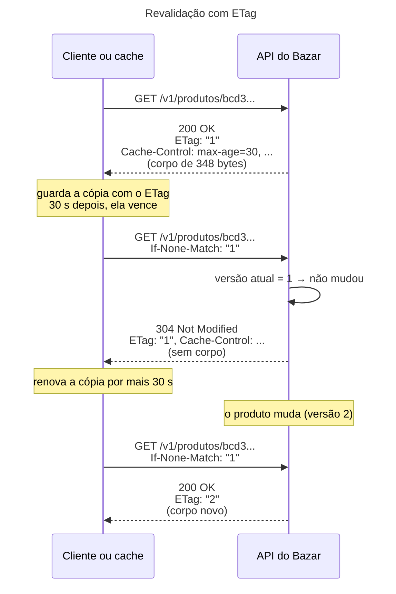

## O problema

A [20.01](/padroes-avancados-de-http/cache-http-rfc-9111) deu um prazo ao detalhe do produto: 30 segundos no navegador, 60 na CDN. Passado o prazo, o cache não pode mais entregar a cópia sem perguntar. Até aqui, "perguntar" significava pedir a resposta inteira de novo. Só que, na imensa maioria das vezes, o produto não mudou nesses 60 segundos: a API monta e transfere o mesmo JSON, byte a byte, que o cache já tem.

O que o cache quer perguntar é outra coisa: "eu tenho a versão X; ela ainda vale?". Se a resposta for "sim", basta um `304 Not Modified`, sem corpo, e a cópia volta a ser fresca. Para isso, a API precisa dar a cada versão de uma resposta um identificador, e entender a pergunta quando ela vier.

É como conferir um extrato. Você não pede ao banco o extrato inteiro do mês a cada vez que abre o app; o app pergunta "houve algum lançamento depois do último que eu tenho?". Se não houve, a tela continua como está.

> **A pergunta desta página:** como a API identifica a versão de uma resposta (o `ETag`), como o cliente e os caches perguntam se ela mudou (`If-None-Match`, `If-Modified-Since`), e de onde o Bazar tira esse identificador sem desperdiçar trabalho?

## O conceito

### Validadores: `ETag` e `Last-Modified`

Um **validador** é um header da resposta que identifica a versão dela. A RFC 9110 (§8.8) define dois:

- **`ETag`**: um identificador opaco entre aspas, escolhido pela API. `ETag: "1"`, `ETag: "039ef9c7257eb5be27653c1a433d7465f"`. O cliente não interpreta o valor, só o devolve.
- **`Last-Modified`**: a data da última mudança, no formato HTTP, com precisão de **segundos**. `Last-Modified: Sun, 25 Oct 2026 04:14:00 GMT`.

O `ETag` é o mais preciso dos dois. Duas mudanças no mesmo segundo têm o mesmo `Last-Modified`, e a segunda passaria despercebida; com um `ETag` derivado da versão, não. Uma API pode mandar os dois, e o Bazar manda, no detalhe do produto.

### Forte × fraco

Um `ETag` pode ser **forte** (`"1"`) ou **fraco** (`W/"1"`):

| | Forte | Fraco |
|---|---|---|
| Promete | Mesmos bytes: duas respostas com o mesmo ETag são idênticas | Mesmo significado: o conteúdo é equivalente, ainda que os bytes difiram |
| Exemplo de uso | Versão da entidade, hash do corpo | Uma página com um carimbo de hora no rodapé que não importa |
| `If-None-Match` (revalidar cache) | Vale | Vale (a comparação é fraca) |
| `If-Match` (concorrência, 20.03) | Vale | Nunca bate (a comparação é forte) |
| `Range` (22.02) | Vale | Não serve |

A comparação fraca, usada pelo `If-None-Match`, ignora o `W/`: `W/"1"` e `"1"` são iguais para ela. A comparação forte, usada pelo `If-Match` e pelo `Range`, exige que os dois sejam fortes e iguais. Um ETag fraco serve para cache, mas não para controle de concorrência.

### A requisição condicional

O cliente (ou o cache) devolve o validador num header **condicional**:

| Header da requisição | Pergunta | Se a condição for falsa |
|---|---|---|
| `If-None-Match: "1"` | "A versão atual é diferente de `"1"`?" | `304 Not Modified` (em `GET`/`HEAD`) |
| `If-Modified-Since: <data>` | "Mudou depois desta data?" | `304 Not Modified` |
| `If-Match: "1"` | "A versão atual ainda é `"1"`?" | `412 Precondition Failed` (20.03) |
| `If-Unmodified-Since: <data>` | "Não mudou desde esta data?" | `412` (20.03) |

Os dois primeiros servem para **ler sem baixar de novo**; os dois últimos, para **escrever sem sobrescrever** a alteração de outro (a [20.03](/padroes-avancados-de-http/concorrencia-otimista-com-if-match-412-e-428)). Quando a requisição traz `If-None-Match` e `If-Modified-Since`, o servidor avalia só o `If-None-Match` (RFC 9110, §13.2.2): o validador mais preciso ganha.

O `304` não tem corpo, mas repete os headers que o cache precisa para renovar a cópia: `ETag`, `Cache-Control`, `Last-Modified`, `Vary`, `Date`. O cache junta esses headers ao corpo que já tinha e volta a considerar a cópia fresca pelo novo prazo.

### De onde vem o ETag

Há duas formas de calcular um ETag, com custos muito diferentes:

**Hash do corpo.** Monta a resposta, calcula um hash (MD5, SHA) dos bytes e usa como ETag. Funciona para qualquer resposta, sem conhecer o domínio. O Spring faz isso pronto com o `ShallowEtagHeaderFilter`. O custo: toda a requisição acontece, inclusive a consulta ao banco e a serialização. Só a transferência é economizada. E o filtro guarda a resposta inteira na memória antes de enviá-la, o que o torna incompatível com *streaming* e SSE.

**Versão da entidade.** O `@Version` da [10.06](/persistencia-para-apis/concorrencia-no-banco-locking-otimista-e-pessimista) já muda a cada alteração do produto. Ele serve de ETag diretamente: `"1"` é o produto na versão 1. Calcular não exige montar nem serializar nada, e, com o `@Version`, o mesmo ETag serve depois para o `If-Match` da 20.03. O cuidado: o ETag tem de mudar sempre que a **representação** muda. Se a resposta inclui dados de outra entidade (o `?embed=categoria`), a versão dela também precisa entrar.

<Comparison
  title="Hash do corpo × versão da entidade"
  columns={['Hash do corpo (ShallowEtagHeaderFilter)', 'Versão da entidade (@Version)']}
  rows={[
    { label: 'Economiza a transferência', values: [true, true] },
    { label: 'Economiza a serialização', values: [false, true] },
    { label: 'Economiza a consulta ao banco', values: [false, 'Só com uma consulta mais leve da versão'] },
    { label: 'Serve para If-Match (20.03)', values: [false, true] },
    { label: 'Funciona sem conhecer o domínio', values: [true, false] },
    { label: 'Compatível com streaming', values: [false, true] },
  ]}
/>

### ETag em coleções

Uma lista não tem `@Version`. As opções:

- **Hash do corpo**, com o `ShallowEtagHeaderFilter`. Simples, e razoável para listas pequenas e baratas.
- **Um agregado das versões**: `max(atualizado_em)` e `count(*)` da consulta, ou um hash das versões dos itens da página. Mais barato que montar a lista, mas exige uma consulta pensada para isso, e é fácil esquecer um caso (um item que saiu da lista não muda o `max`, mas muda o `count`).
- **Nenhum**, para listas que mudam a toda hora ou são pessoais. Um `no-store` não precisa de validador.

### ETag e compressão

Um ETag forte promete **os mesmos bytes**. A mesma resposta comprimida com gzip tem outros bytes. Por isso, servidores e *proxies* que comprimem tratam o ETag forte com cuidado. O nginx, ao comprimir, transforma o ETag forte em fraco (`"1"` vira `W/"1"`). O Tomcat faz o contrário: com `server.compression.enabled=true`, ele **não comprime** respostas que tenham um ETag forte, como o Bazar comprovou na seção seguinte. As duas escolhas preservam a promessa do ETag forte, cada uma abrindo mão de uma coisa.

## Diagrama



## Na prática

### O ETag do produto a partir da versão

```java title="src/main/java/com/bazar/catalogo/api/VersaoDaRepresentacao.java"
/**
 * O ETag de uma representação a partir das versões (@Version) das entidades que ela mostra (20.02). É um ETag
 * forte: a mesma versão gera sempre os mesmos bytes. Calculá-lo não exige montar nem serializar a resposta, ao
 * contrário de um hash do corpo.
 */
final class VersaoDaRepresentacao {

    private VersaoDaRepresentacao() {
    }

    /** {@code "3"} para uma entidade na versão 3; {@code "3-7"} para duas. */
    static String etag(@Nullable Long... versoes) {
        return "\"" + Arrays.stream(versoes).map(versao -> String.valueOf(Objects.requireNonNull(versao)))
                .collect(Collectors.joining("-")) + "\"";
    }
}
```

O `requireNonNull` é proposital: um produto sem versão nunca foi gravado, e não deveria estar sendo detalhado. Os testes de *slice* da Parte 4, que devolviam produtos montados pelo *builder* de teste, sem versão, quebraram com `500` ao ganhar o ETag. A correção foi no teste, não no código: o *builder* ganhou um `comVersao(...)` para simular um produto lido do banco.

No controller, o ETag e o `Last-Modified` vão no `ResponseEntity`:

```java title="src/main/java/com/bazar/catalogo/api/ProdutoController.java (trecho)"
var incorporar = ValoresDeParametro.ler("embed", embed, INCORPORAVEIS);
var produto = servico.detalhar(id);
var resposta = mapper.paraResponse(produto);
if (!incorporar.contains("categoria")) {
    // Com ETag e Last-Modified, o Spring responde 304 sozinho a um If-None-Match (ou If-Modified-Since) que
    // ainda valha, sem corpo (20.02).
    return ResponseEntity.ok()
            .cacheControl(CACHE_DO_DETALHE)
            .eTag(VersaoDaRepresentacao.etag(produto.getVersao()))
            .lastModified(produto.getAtualizadoEm())
            .body(resposta);
}
// Com a categoria dentro, o corpo muda quando qualquer um dos dois muda: o ETag leva as duas versões. O
// Last-Modified fica de fora, porque a categoria não guarda quando mudou.
var categoria = servico.categoriaDe(produto);
return ResponseEntity.ok()
        .cacheControl(CACHE_DO_DETALHE)
        .eTag(VersaoDaRepresentacao.etag(produto.getVersao(), categoria.versao()))
        .body(resposta.comCategoria(CategoriaResponse.de(categoria)));
```

Não há nenhum `if` comparando o `If-None-Match`. Quando um `ResponseEntity` de um `GET` ou `HEAD` tem `ETag` ou `Last-Modified`, o Spring MVC compara com os headers condicionais da requisição (o `HttpEntityMethodProcessor` chama o `ServletWebRequest.checkNotModified`) e, se a condição for falsa, troca o `200` por um `304` sem corpo, mantendo os headers. A v2 do detalhe (`ProdutoV2Controller`) faz o mesmo.

Há uma alternativa mais econômica, para quando montar a resposta é caro: chamar `webRequest.checkNotModified(etag)` **antes** de montar, e devolver `null` se ele disser que não mudou. No Bazar, a montagem do produto é barata, e o `ResponseEntity` deixa o código mais simples.

<HttpExchange
  title="Primeira leitura: o produto com o seu ETag"
  request={{ method: 'GET', url: '/v1/produtos/bcd399f5-d6d1-4032-9c80-10ca4c363d31' }}
  response={{ status: 200, headers: { 'Cache-Control': 'max-age=30, public, s-maxage=60, stale-while-revalidate=30', 'Last-Modified': 'Sun, 25 Oct 2026 04:14:00 GMT', 'ETag': '"1"', 'Content-Type': 'application/json' }, body: { id: 'bcd399f5-d6d1-4032-9c80-10ca4c363d31', sku: 'LIV-0042', nome: 'Clean Code (2ª ed.)', preco: { valor: '139.90', moeda: 'BRL' }, '...': '...' } }}
>
O corpo completo tem 348 bytes. O produto está na versão 1: foi criado (versão 0) e alterado uma vez.
</HttpExchange>

<HttpExchange
  title="Revalidação: nada mudou"
  request={{ method: 'GET', url: '/v1/produtos/bcd399f5-d6d1-4032-9c80-10ca4c363d31', headers: { 'If-None-Match': '"1"' } }}
  response={{ status: 304, headers: { 'Deprecation': '@1792972800', 'Sunset': 'Fri, 30 Apr 2027 00:00:00 GMT', 'Cache-Control': 'max-age=30, public, s-maxage=60, stale-while-revalidate=30', 'Last-Modified': 'Sun, 25 Oct 2026 04:14:00 GMT', 'ETag': '"1"', 'Date': 'Mon, 26 Oct 2026 10:38:09 GMT' } }}
>
Sem corpo. Os headers de cache vêm de novo, e os da depreciação da v1 (18.04) também: o `304` é uma resposta como as outras para os filtros e interceptores.
</HttpExchange>

O `If-Modified-Since` com o valor do `Last-Modified` também dá `304`. Repare na precisão: o `atualizadoEm` do produto é `04:14:00.166313`, e o header só guarda `04:14:00`. O Spring compara no nível de segundos, como manda a RFC, e uma alteração 300 milissegundos depois teria o mesmo `Last-Modified`. O ETag, derivado da versão, não tem esse ponto cego.

### O custo de um `304`

Um `304` não é de graça. Com o log de SQL ligado, as duas formas de ETag do Bazar mostram o que ainda acontece:

```text noCopy
304 das categorias (hash do corpo):   1 consulta  (select c1_0.id,c1_0.pai_id,c1_0.nome,... from categoria c1_0 ...)
304 do produto (versão da entidade):  1 consulta
```

Nas categorias, o `ShallowEtagHeaderFilter` executou o controller inteiro (a consulta e a serialização) para descobrir que o hash não mudou; só deixou de enviar os 439 bytes. No produto, a consulta é a que carrega a entidade para saber a versão; a serialização e, com `?embed=categoria`, a consulta da categoria são evitadas. Para evitar também a leitura do produto, a versão teria de vir de uma consulta mais leve (`select versao from produto where id = ?`) ou de um cache na aplicação ([28.03](/performance/cache-na-aplicacao-cacheable-caffeine-e-redis)). O ganho do `304` está sobretudo na rede e no cliente: um app no 3G que revalida dez produtos baixa dez respostas vazias, em vez de 3,5 KB.

### As categorias, com hash do corpo

```java title="src/main/java/com/bazar/catalogo/api/EtagDasCategorias.java"
/**
 * O ETag das categorias pelo hash do corpo (20.02). O filtro guarda a resposta inteira na memória, calcula o MD5 e,
 * se ele bater com o If-None-Match, troca o 200 por um 304 sem corpo. Economiza a transferência, mas não o trabalho:
 * a consulta e a serialização acontecem do mesmo jeito. Por isso, só nas categorias, que são poucas e pequenas.
 */
@Configuration(proxyBeanMethods = false)
class EtagDasCategorias {

    @Bean
    FilterRegistrationBean<ShallowEtagHeaderFilter> etagPeloCorpoDasCategorias() {
        var registro = new FilterRegistrationBean<>(new ShallowEtagHeaderFilter());
        // "/v1/categorias/*" também cobre o próprio "/v1/categorias" (a lista).
        registro.addUrlPatterns("/v1/categorias/*");
        return registro;
    }
}
```

O filtro é registrado só nos caminhos das categorias. Aplicado à API inteira, ele bufferizaria o fluxo SSE da 19.04, que deixaria de ser um fluxo. O ETag que ele gera é o MD5 do corpo com um `0` na frente: `"039ef9c7257eb5be27653c1a433d7465f"`. Ele também respeita o `no-store`: uma resposta com `Cache-Control: no-store` não recebe ETag.

### ETag forte e a compressão do Tomcat

Com a compressão do Tomcat ligada (`server.compression.enabled=true`) e um cliente que aceita gzip, as respostas se comportaram assim:

```text noCopy
GET /v1/produtos        (sem ETag)        → Content-Encoding: gzip, Vary: accept,accept-encoding
GET /v1/produtos/bcd3…  (ETag: "1")       → sem compressão
GET /v1/categorias      (ETag: "039ef…")  → sem compressão
```

A explicação está no código do Tomcat 11.0.27: o `CompressionConfig` desiste de comprimir quando a resposta tem um `ETag` que não começa com `W/` (a não ser com `compression=force`). Com um ETag forte, comprimir quebraria a promessa de "mesmos bytes". As saídas: aceitar respostas sem compressão (o detalhe do produto tem 348 bytes, e o gzip quase não ajuda), usar ETag fraco (`W/"1"`, que serve para cache, mas não para o `If-Match` da 20.03), ou comprimir num *proxy* na frente, que trate o ETag do jeito dele. A [22.03](/padroes-avancados-de-http/compressao) volta ao assunto.

### O cache compartilhado revalidando

O Varnish do laboratório da 20.01 ganhou uma linha na VCL, para guardar a cópia por mais tempo depois de vencida, só para poder revalidá-la:

```vcl title="exemplos/cache-compartilhado/default.vcl (trecho)"
sub vcl_backend_response {
    # Guarda a cópia por mais 10 minutos depois de vencida (e do stale-while-revalidate), só para revalidar: com
    # ETag ou Last-Modified, a próxima ida ao Bazar é condicional, e um 304 renova a cópia sem trazer o corpo (20.02).
    set beresp.keep = 10m;
}
```

Uma requisição ao produto, e outra 95 segundos depois (passados os 60 do `s-maxage` e os 30 do `stale-while-revalidate`). O `varnishlog` mostra o que o Varnish mandou ao Bazar na segunda:

```text noCopy
32774 BereqMethod    b GET
32774 BereqURL       b /v1/produtos/bcd399f5-d6d1-4032-9c80-10ca4c363d31
32774 BereqHeader    b If-Modified-Since: Sun, 25 Oct 2026 04:14:00 GMT
32774 BereqHeader    b If-None-Match: "1"
32774 BerespStatus   b 304
32774 BerespStatus   b 200
```

O Varnish mandou os dois validadores, o Bazar respondeu `304`, e o Varnish montou um `200` para o cliente com o corpo que já tinha (a segunda linha `BerespStatus`). O cliente nem soube da revalidação.

### Os testes

```java title="src/test/java/com/bazar/catalogo/api/EtagTest.java (trecho)"
@Test
void oProdutoNaoMudouEntao304SemCorpo() {
    var produto = umProduto();
    var etag = cliente.get().uri(produto).exchange()
            .expectStatus().isOk()
            .expectHeader().valueEquals(HttpHeaders.ETAG, "\"0\"")
            .returnResult().getResponseHeaders().getETag();

    cliente.get().uri(produto).header(HttpHeaders.IF_NONE_MATCH, etag).exchange()
            .expectStatus().isNotModified()
            // O 304 repete os headers de cache: o cliente renova a cópia que tem.
            .expectHeader().valueEquals(HttpHeaders.ETAG, "\"0\"")
            .expectHeader().exists(HttpHeaders.CACHE_CONTROL)
            .expectBody().isEmpty();
}

@Test
void depoisDeUmaAlteracaoOEtagAntigoNaoValeMais() {
    var produto = umProduto();
    cliente.put().uri(produto).contentType(MediaType.APPLICATION_JSON)
            .body("""
                    { "nome": "Clean Code", "precoEmCentavos": 11990, "categoriaId": "%s" }
                    """.formatted(PROGRAMACAO))
            .exchange()
            .expectStatus().isOk();

    cliente.get().uri(produto).header(HttpHeaders.IF_NONE_MATCH, "\"0\"").exchange()
            .expectStatus().isOk()
            .expectHeader().valueEquals(HttpHeaders.ETAG, "\"1\"")
            .expectBody().jsonPath("$.precoEmCentavos").isEqualTo(11990);
}
```

Os outros testes da classe cobrem o `If-Modified-Since`, o ETag com as duas versões no `?embed=categoria` e o `304` das categorias pelo hash do corpo.

## Erros comuns

<BadVsGood title="ETag que não acompanha a representação" why="O ETag identifica a resposta, não só a entidade principal. Com ?embed=categoria, o corpo também muda quando a categoria muda: um ETag só com a versão do produto responderia 304 com o nome antigo da categoria. As versões de tudo o que aparece no corpo entram no ETag.">
<Bad title="Só a versão do produto">

```java
return ResponseEntity.ok()
    .eTag(etag(produto.getVersao()))
    .body(resposta.comCategoria(
        CategoriaResponse.de(categoria)));
```

</Bad>
<Good title="As versões de tudo o que está no corpo">

```java
return ResponseEntity.ok()
    .eTag(etag(produto.getVersao(),
               categoria.versao()))
    .body(resposta.comCategoria(
        CategoriaResponse.de(categoria)));
```

</Good>
</BadVsGood>

Outros tropeços frequentes:

- **ETag sem aspas.** `ETag: 1` é inválido; o valor vai entre aspas (`"1"`). O `ResponseEntity.eTag(...)` do Spring acrescenta as aspas se faltarem.
- **Achar que o `ShallowEtagHeaderFilter` alivia o banco.** Ele economiza só a transferência.
- **Aplicar o `ShallowEtagHeaderFilter` em tudo**, inclusive em SSE, *downloads* grandes e *streaming*: ele guarda a resposta inteira na memória.
- **ETag fraco esperando usar `If-Match`.** A comparação forte nunca aceita um ETag fraco.
- **Confiar só no `Last-Modified`.** A precisão de segundos esconde mudanças no mesmo segundo.
- **Ligar a compressão e não entender por que o detalhe não é comprimido.** No Tomcat, um ETag forte desliga a compressão daquela resposta.
- **Um ETag que muda sem a representação mudar**, como um hash que inclui um carimbo de hora ou um campo gerado a cada requisição. O `304` nunca acontece.
- **`304` sem os headers de cache.** O cache não consegue renovar a cópia sem o `Cache-Control`.

## Boas práticas

- **Derive o ETag da versão** quando houver uma (`@Version`), e combine as versões de tudo o que aparece no corpo.
- **Mande também o `Last-Modified`** quando houver uma data confiável: alguns clientes só usam ele.
- **Deixe o Spring responder o `304`** com `ResponseEntity.eTag(...)`, ou use `checkNotModified` antes de montar uma resposta cara.
- **Use o `ShallowEtagHeaderFilter` só onde o corpo é pequeno e barato**, e restrinja os caminhos.
- **Prefira ETag forte** se ele vai servir para concorrência (20.03); pense na compressão ao escolher.
- **Teste o par 200 → 304 e o par alteração → 200 com ETag novo.**

## Por baixo dos panos

<DeepDive title="Como o Spring decide o 304">

Quando um método do controller devolve um `ResponseEntity`, quem escreve a resposta é o `HttpEntityMethodProcessor`. Antes de escrever o corpo, ele verifica se a resposta tem `ETag` ou `Last-Modified` e se a requisição é um `GET` ou `HEAD`. Se sim, chama `ServletWebRequest.checkNotModified(etag, lastModified)`, que segue a ordem da RFC 9110 (§13.2.2):

1. Se há `If-Match` e ele não bate, a resposta é `412` (só faz sentido em escritas; volta na 20.03).
2. Se há `If-Unmodified-Since` e o recurso mudou depois, `412`.
3. Se há `If-None-Match`, compara (comparação fraca) com o ETag. Se algum valor da lista bate, ou se é `*`, a condição é falsa: `304` para `GET`/`HEAD`.
4. Só se **não** há `If-None-Match`: se há `If-Modified-Since` e o recurso não mudou depois dessa data (em segundos), `304`.

Com o `304`, o processador não chama o conversor de mensagem: o corpo não é serializado, e o `ResponseBodyAdvice` da 20.01 nem é chamado (os headers de cache vieram do próprio `ResponseEntity`). Os headers do `ResponseEntity` vão para a resposta, e ela é enviada vazia.

O `ShallowEtagHeaderFilter` faz a mesma comparação, mas depois: ele envolve a resposta num `ContentCachingResponseWrapper`, deixa a requisição inteira acontecer, calcula o MD5 do que foi escrito e só então decide entre copiar o corpo para a resposta real ou trocar o status por `304`.

</DeepDive>

## No projeto Bazar

<ProjectStep title="ETag no catálogo" module="catalogo" tag="pagina-20.02" files={[
  { path: 'src/main/java/com/bazar/catalogo/api/VersaoDaRepresentacao.java', change: 'novo' },
  { path: 'src/main/java/com/bazar/catalogo/api/EtagDasCategorias.java', change: 'novo' },
  { path: 'src/main/java/com/bazar/catalogo/api/ProdutoController.java', change: 'alterado' },
  { path: 'src/main/java/com/bazar/catalogo/api/ProdutoV2Controller.java', change: 'alterado' },
  { path: 'src/main/java/com/bazar/catalogo/dominio/Categoria.java', change: 'alterado' },
  { path: 'src/test/java/com/bazar/catalogo/api/EtagTest.java', change: 'novo' },
  { path: 'src/test/java/com/bazar/catalogo/dominio/ProdutoDeTeste.java', change: 'alterado' },
  { path: 'exemplos/cache-compartilhado/default.vcl', change: 'alterado' },
]}>
O detalhe do produto (v1 e v2) tem `ETag` derivado do `@Version` (`"1"`, ou `"1-5"` com `?embed=categoria`) e `Last-Modified` do `atualizadoEm`; o Spring responde `304` sozinho. As categorias têm ETag pelo hash do corpo, com o `ShallowEtagHeaderFilter` restrito aos caminhos delas. O Varnish do laboratório guarda as cópias vencidas por 10 minutos para revalidá-las com `If-None-Match`. A 20.03 usa o mesmo ETag do produto para exigir `If-Match` nas escritas.
</ProjectStep>

## Resumo

- Um validador identifica a versão de uma resposta: `ETag` (preciso, opaco) e `Last-Modified` (data, com precisão de segundos).
- `If-None-Match` e `If-Modified-Since` perguntam "mudou?"; se não mudou, `304` sem corpo, com os headers de cache para renovar a cópia. O `If-None-Match` tem precedência.
- ETag forte promete os mesmos bytes; fraco (`W/`), o mesmo significado. Só o forte serve para `If-Match` e `Range`.
- ETag pela versão da entidade evita a serialização e serve para concorrência; pelo hash do corpo (`ShallowEtagHeaderFilter`), economiza só a transferência.
- O ETag precisa mudar sempre que a representação muda, inclusive por dados de outras entidades no corpo.
- No Tomcat, um ETag forte desliga a compressão daquela resposta.

<Exercise title="ETag para a lista de produtos" difficulty="medio">
A lista `GET /v1/produtos?categoriaId=...` (paginada por cursor, 13.04) é a página mais acessada da vitrine. Hoje ela sai com `no-store` e sem ETag. O time quer que o app possa revalidá-la.

1. Por que usar o `ShallowEtagHeaderFilter` nela seria uma economia pequena?
2. Proponha um ETag mais barato, calculado sem montar a lista. Que consulta ele usaria?
3. Que mudanças nos dados o seu ETag precisa detectar? Teste a proposta contra cada uma.
4. Que `Cache-Control` a lista deveria ter para o ETag valer a pena?

<Hint>O que muda numa página da lista quando um produto entra, sai, muda de preço ou muda de categoria? O `max(atualizado_em)` sozinho percebe um produto que saiu da categoria?</Hint>

<Solution>

1. O filtro executa a consulta da página (a mais pesada da vitrine), monta e serializa a lista, e só então calcula o hash. O `304` economiza os bytes, não o banco nem a CPU.

2. Um ETag derivado de um resumo da página, calculado por uma consulta que só lê colunas pequenas, com o mesmo filtro e a mesma posição do cursor:

```sql
select count(*), max(versao), max(atualizado_em), string_agg(id::text || ':' || versao, ',' order by nome, id)
  from (select id, versao, atualizado_em, nome
          from produto
         where categoria_id = :categoria and status = 'ATIVO' and (nome, id) > (:nome, :id)
         order by nome, id
         limit :limite) pagina
```

O ETag é um hash (SHA-256, por exemplo) do `string_agg`: os ids e as versões dos itens da página, na ordem. A consulta usa o mesmo índice `(nome, id)` da listagem e não lê descrição nem atributos.

3. O que precisa ser detectado, e se o hash de `id:versao` na ordem detecta:
   - **Um produto da página muda de preço**: a versão dele muda. Sim.
   - **Um produto novo entra na página** (nome entre dois existentes): a lista de ids muda. Sim.
   - **Um produto sai da categoria ou é descontinuado**: some da lista, e outro entra no fim. Sim. Só o `max(atualizado_em)` falharia aqui, se o que saiu não fosse o mais recente.
   - **Um produto muda de nome e de posição**: a ordem muda. Sim.
   - **A categoria de um item muda de nome**: a lista mostra o `categoriaId`, não o nome, então não importa. Se a lista incluísse o nome da categoria, a versão dela teria de entrar no hash, como no `?embed=categoria` desta página.

4. A lista é igual para todos (não depende do cliente), então pode ser `public`. Com um prazo curto e revalidação, por exemplo `public, max-age=0, s-maxage=30` (o navegador sempre revalida; a CDN guarda 30 s), o ETag faz cada revalidação custar a consulta leve e um `304`. Com `no-store`, nenhum cache guarda a lista, e o ETag não teria uso. O `Vary: Accept` da 20.01 continua necessário, porque a lista também sai em CSV, e o ETag do CSV precisa ser diferente do ETag do JSON (são bytes diferentes): o tipo de conteúdo entra no hash.

</Solution>
</Exercise>

<Quiz questions={[
  {
    question: 'Um cache tem uma cópia com ETag "4" e manda If-None-Match: "4". O produto não mudou. O que a API responde?',
    options: [
      '200 com o corpo inteiro',
      '304 Not Modified, sem corpo, com ETag e Cache-Control',
      '412 Precondition Failed',
      '204 No Content',
    ],
    answer: 1,
    explanation: 'A condição "a versão atual é diferente de 4" é falsa: 304, sem corpo. Os headers de cache vêm junto para o cache renovar a cópia.',
  },
  {
    question: 'Por que o ETag do Bazar, derivado do @Version, é melhor que o do ShallowEtagHeaderFilter para o detalhe do produto?',
    options: [
      'Porque o ShallowEtagHeaderFilter não gera 304',
      'Porque não exige serializar a resposta para ser calculado, e serve para If-Match na 20.03',
      'Porque é um ETag fraco',
      'Porque dispensa totalmente o acesso ao banco',
    ],
    answer: 1,
    explanation: 'O hash do corpo exige montar a resposta inteira. A versão já está na entidade carregada. A leitura do banco ainda acontece (o experimento mostrou 1 consulta no 304), salvo com uma consulta mais leve da versão.',
  },
  {
    question: 'Com server.compression.enabled=true, o detalhe do produto (ETag: "1") saiu sem compressão, e a lista de produtos (sem ETag) saiu com gzip. Por quê?',
    options: [
      'O detalhe é menor que o tamanho mínimo de compressão',
      'O Tomcat não comprime respostas com ETag forte, porque comprimir mudaria os bytes que o ETag forte promete',
      'O Spring desliga a compressão para respostas com Cache-Control',
      'Respostas 200 de GET por id nunca são comprimidas',
    ],
    answer: 1,
    explanation: 'O CompressionConfig do Tomcat desiste de comprimir quando há um ETag que não começa com W/ (fora o modo force). O experimento usou min-response-size=0, então o tamanho não era a causa.',
  },
  {
    question: 'A resposta com ?embed=categoria tem ETag só com a versão do produto. O que dá errado?',
    options: [
      'Nada: a categoria não faz parte do produto',
      'Quando a categoria muda de nome, o cliente que revalida recebe 304 e continua mostrando o nome antigo',
      'O Spring rejeita a resposta',
      'O ETag deixa de ser forte',
    ],
    answer: 1,
    explanation: 'O ETag identifica a representação inteira. Se o corpo muda sem o ETag mudar, a revalidação confirma uma cópia desatualizada.',
  },
]} />

## Referências

<References />
