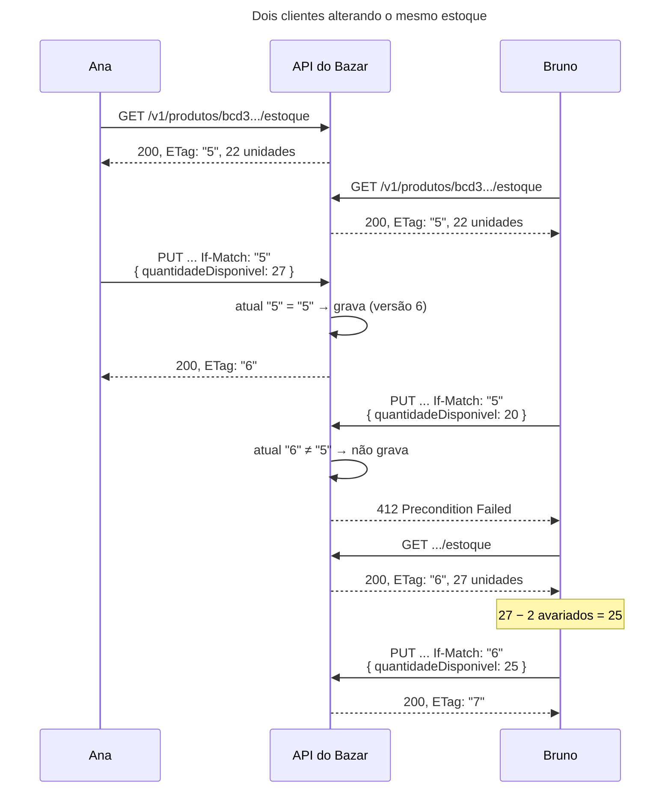

## O problema

Ana e Bruno cuidam do estoque do Bazar. Às 9h, os dois abrem a tela do mesmo livro, que mostra 22 unidades. Ana recebe uma caixa com 5 e grava 27. Bruno, que ainda está com a tela das 9h aberta, conta 2 exemplares avariados e grava 20. O último `PUT` vence: o estoque fica em 20, e as 5 unidades da Ana sumiram. Ninguém viu erro nenhum.

É a **atualização perdida** (*lost update*). A [10.06](/persistencia-para-apis/concorrencia-no-banco-locking-otimista-e-pessimista) resolveu o problema no Bazar com a versão no corpo: o cliente manda `"versao": 0`, e o serviço recusa com `409` se a versão atual for outra. Funciona, mas é uma convenção só do Bazar. Cada cliente precisa saber que existe um campo `versao`, em que recurso ele vale, e o que fazer com o `409`. Um `DELETE` não tem corpo para levar a versão.

O HTTP já tem um mecanismo para isso, o mesmo da [20.02](/padroes-avancados-de-http/etag-e-requisicoes-condicionais): o `ETag`, agora na direção contrária. Na leitura, o cliente perguntava "mudou?" com `If-None-Match`. Na escrita, ele diz "só grave se ainda estiver como eu vi", com **`If-Match`**.

É como um cartório que só registra a venda de um imóvel se a matrícula que o comprador apresenta for a mais recente. Se alguém registrou outra coisa nesse meio-tempo, o cartório devolve o pedido, e o comprador precisa ver a matrícula nova antes de tentar de novo.

> **A pergunta desta página:** como usar `If-Match` para impedir atualizações perdidas, que status responder quando a precondição falha (`412`) ou falta (`428`), e como migrar o Bazar da versão no corpo para o header sem quebrar quem já usa a API?

## O conceito

### O fluxo

1. O cliente lê o recurso: `GET /v1/produtos/{id}/estoque` → `200`, `ETag: "5"`.
2. O cliente altera e manda o ETag que leu: `PUT ...` com `If-Match: "5"`.
3. O servidor compara o `If-Match` com o ETag **atual**:
   - Bateu: aplica a alteração e responde `200` com o ETag novo (`"6"`).
   - Não bateu: **não aplica nada** e responde `412 Precondition Failed`.

É **concorrência otimista**: ninguém trava o recurso enquanto o usuário edita (o que seria impossível entre duas requisições HTTP, que podem estar a minutos de distância). O servidor só confere, na hora de gravar, se a suposição do cliente ("ninguém mexeu") ainda vale.

### `412` × `409`

| | `412 Precondition Failed` | `409 Conflict` |
|---|---|---|
| Quando | Uma precondição **do header** (`If-Match`, `If-Unmodified-Since`) é falsa | A requisição conflita com o estado do recurso, por uma regra da API |
| Quem define | O HTTP (RFC 9110, §13) | A API |
| O cliente genérico entende | Sim: "o recurso mudou desde a leitura" | Só lendo o corpo |
| No Bazar | `If-Match` desatualizado | Versão no corpo desatualizada (10.06), SKU duplicado, estoque insuficiente |

A versão no corpo é uma regra da API, então o `409` da 10.06 estava certo. Com a versão no `If-Match`, a falha é de uma precondição HTTP, e o status certo é o `412`.

### `428 Precondition Required`

O `If-Match` é opcional para o HTTP: sem ele, o `PUT` é incondicional, e a atualização perdida volta. A RFC 6585 criou o **`428 Precondition Required`** para a API dizer "esta alteração exige uma precondição". Com ele, um cliente que esquece o `If-Match` recebe um erro em vez de sobrescrever silenciosamente.

### A comparação é forte

O `If-Match` usa **comparação forte** (RFC 9110, §8.8.3.2): os dois ETags precisam ser fortes e iguais. Um ETag fraco (`W/"5"`) nunca passa, nem contra o `"5"` atual. Faz sentido: um ETag fraco promete "conteúdo equivalente", e "equivalente" não basta para garantir que ninguém mudou nada. É por isso que a 20.02 fez o ETag do Bazar forte, derivado do `@Version`.

O `If-Match` também aceita:

- **Uma lista**: `If-Match: "5", "7"` passa se o ETag atual for qualquer um deles.
- **`*`**: passa se o recurso **existir**, em qualquer versão. Serve para "atualize, mas não crie": num `PUT` que também poderia criar o recurso, `If-Match: *` garante que só haverá atualização.

O inverso, **`If-None-Match: *`** num `PUT`, significa "crie, mas não sobrescreva": passa só se o recurso **não** existir. É a forma HTTP de um `INSERT` que falha se a linha já existe.

### `If-Unmodified-Since`

É o par de data do `If-Match`: "só grave se não mudou desde esta data". Tem a mesma fraqueza do `Last-Modified` da 20.02, a precisão de segundos: duas alterações no mesmo segundo passam despercebidas. Serve para clientes que só têm a data. Quando a requisição traz os dois, o servidor avalia o `If-Match` e ignora o `If-Unmodified-Since` (RFC 9110, §13.2.2). O Bazar não implementa o `If-Unmodified-Since` no estoque: o `atualizado_em` do estoque não existe, e o ETag basta.

### O que o cliente faz com o `412`

O `412` diz "o recurso mudou". O cliente **não deve repetir a mesma requisição**: ela vai falhar de novo, ou pior, se ele trocar o ETag pelo novo sem olhar, vai sobrescrever a alteração do outro, que era exatamente o que se queria evitar. O caminho é:

1. Ler o recurso de novo (`GET`, com o ETag novo).
2. Decidir o que fazer com a alteração: reaplicá-la sobre o estado novo (se ela ainda fizer sentido), mesclar, ou mostrar as duas versões ao usuário.
3. Mandar de novo, com o ETag novo no `If-Match`.

Se a alteração é **relativa** ("some 5 ao estoque"), o passo 2 pode ser automático: 5 a mais sobre 27 é tão válido quanto sobre 22. Se ela é **absoluta** ("o estoque é 20", baseado numa contagem), só o usuário sabe se a contagem dele ainda vale. É por isso que o Bazar classifica o `PRECONDICAO_FALHOU` como `RELER_E_REPETIR` no catálogo de problemas da [16.01](/design-de-apis-profissional/projetando-erros-catalogo-codigos-e-decisoes-dificeis): reler, não só repetir.

### Concorrência otimista × idempotência

As duas coisas protegem escritas, mas de problemas diferentes:

| | `If-Match` (esta página) | Idempotency-Key ([21.01](/padroes-avancados-de-http/idempotency-keys)) |
|---|---|---|
| Problema | Dois clientes alterando o mesmo recurso | O mesmo cliente repetindo a mesma requisição (por *timeout*) |
| Pergunta | "O recurso ainda está como eu vi?" | "Esta requisição já foi processada?" |
| Resposta à repetição | `412`, se a primeira passou | A mesma resposta da primeira |

Elas se complementam. Um cliente que manda um `PUT` com `If-Match: "5"`, não recebe resposta (a rede caiu) e repete, recebe `412`: a primeira tentativa passou e mudou o ETag para `"6"`. A RFC 9110 (§13.1.1) permite que o servidor responda `2xx` nesse caso, se o estado atual já reflete a alteração pedida, mas o servidor precisa saber reconhecer isso. Com a Idempotency-Key, ele reconhece: a repetição devolve o `200` da primeira.

## Diagrama



## Na prática

### O ETag no `GET`

O estoque já tinha `@Version` desde a 10.06. O `GET` passa a mandar a versão no `ETag`, com o mesmo `VersaoDaRepresentacao` da 20.02. A classe saiu do pacote do catálogo para o `compartilhado.web`, porque agora dois módulos usam:

```java title="src/main/java/com/bazar/estoque/api/EstoqueController.java (trecho)"
@GetMapping
public ResponseEntity<EstoqueResponse> detalhar(@PathVariable UUID produtoId) {
    var estoque = servico.buscar(produtoId);
    return ResponseEntity.ok()
            .eTag(VersaoDaRepresentacao.etag(estoque.getVersao()))
            .body(EstoqueResponse.de(estoque));
}
```

De quebra, o `GET` do estoque ganhou o `304` da 20.02: um `If-None-Match` com o ETag atual recebe `304`.

### O `If-Match` no `PUT`

```java title="src/main/java/com/bazar/compartilhado/web/PrecondicaoIfMatch.java"
/**
 * O If-Match de uma escrita, já interpretado (20.03). A comparação é forte (RFC 9110, §13.1.1): um ETag fraco
 * (W/"3") nunca bate, e o * bate com qualquer versão de um recurso que existe.
 */
public record PrecondicaoIfMatch(List<ETag> etags) {

    public static PrecondicaoIfMatch ler(String ifMatch) {
        return new PrecondicaoIfMatch(ETag.parse(ifMatch));
    }

    public boolean aceita(String etagAtual) {
        var atual = ETag.create(etagAtual);
        return etags.stream().anyMatch(etag -> etag.isWildcard() || etag.compare(atual, true));
    }
}
```

O `ETag` do Spring (`org.springframework.http.ETag`) já sabe ler uma lista de ETags, reconhecer o `W/` e o `*`, e comparar de forma forte (`compare(outro, true)`). O `PrecondicaoIfMatch` só junta as peças.

```java title="src/main/java/com/bazar/estoque/api/EstoqueController.java (trecho)"
// Concorrência otimista pelo HTTP (20.03): o cliente devolve no If-Match o ETag do GET. Se o estoque mudou
// desde então, 412; sem nenhuma precondição, 428.
@PutMapping
@Auditavel("estoque.definir")
public ResponseEntity<EstoqueResponse> definir(@PathVariable UUID produtoId,
        @RequestHeader(name = HttpHeaders.IF_MATCH, required = false) @Nullable String ifMatch,
        @Valid @RequestBody DefinirEstoqueRequest request) {
    var quantidade = request.quantidadeDisponivel();
    Estoque estoque;
    if (ifMatch != null) {
        var precondicao = PrecondicaoIfMatch.ler(ifMatch);
        try {
            estoque = servico.definirDisponivel(produtoId, quantidade,
                    versao -> precondicao.aceita(VersaoDaRepresentacao.etag(versao)));
        } catch (ConflitoDeVersaoException | OptimisticLockingFailureException e) {
            // Pela conferência no serviço ou pelo @Version no commit: para quem mandou If-Match, é 412.
            throw new PrecondicaoFalhouException();
        }
    } else if (request.versao() != null) {
        // A versão no corpo (10.06) continua valendo, com o 409 de antes, para não quebrar quem já a usa.
        long versaoLida = request.versao();
        estoque = servico.definirDisponivel(produtoId, quantidade, versao -> versao == versaoLida);
    } else {
        throw new PrecondicaoObrigatoriaException();
    }
    return ResponseEntity.ok()
            .eTag(VersaoDaRepresentacao.etag(estoque.getVersao()))
            .body(EstoqueResponse.de(estoque));
}
```

Três decisões estão nesse método.

**A conferência acontece dentro da transação.** O controller não lê o estoque para comparar o ETag e só depois chama o serviço. Isso abriria uma janela entre a comparação e a gravação. Ele passa ao serviço a regra "que versão eu aceito", e o serviço confere com o estoque que carregou na mesma transação em que grava:

```java title="src/main/java/com/bazar/estoque/dominio/EstoqueService.java (trecho)"
// Locking otimista em duas camadas: a versão que o cliente leu é conferida aqui (no corpo, 10.06, ou no
// If-Match, 20.03: quem chama diz qual versão aceita); a corrida entre esta conferência e o commit é pega pelo
// @Version no UPDATE (OptimisticLockingFailureException).
@Transactional
public Estoque definirDisponivel(UUID produtoId, int quantidade, LongPredicate versaoAceita) {
    var estoque = buscar(produtoId);
    if (!versaoAceita.test(estoque.getVersao())) {
        throw new ConflitoDeVersaoException(estoque.getVersao());
    }
    estoque.definirDisponivel(quantidade);
    return estoque;
}
```

O serviço não sabe o que é um ETag nem um `412`: ele recebe um `LongPredicate` e fala em versões. Quem traduz o conflito para o status HTTP é o controller.

**As duas camadas viram `412`.** A conferência no serviço pega quase todos os casos. Sobra a corrida em que duas requisições leem a versão 5 ao mesmo tempo, passam pela conferência, e só uma consegue o `UPDATE ... where versao = 5`. A outra recebe uma `OptimisticLockingFailureException` no commit. Para o cliente, as duas situações são a mesma (o recurso não estava mais como ele viu), e as duas viram `412`. Com 50 `PUT` simultâneos, todos com `If-Match: "6"`:

```text noCopy
      1 200
     49 412
```

**A versão no corpo continua valendo.** A 10.06 publicou o contrato com `"versao"` obrigatório no corpo e `409` no conflito. Exigir o `If-Match` de uma hora para outra quebraria todos os clientes que seguem esse contrato (é o que a [18.01](/contratos-documentacao-e-ciclo-de-vida/compatibilidade-retroativa-o-que-quebra-um-cliente) chama de mudança incompatível). Então o Bazar aceita os dois: o `If-Match` tem precedência; sem ele, vale a versão do corpo, com o `409` de antes; sem nenhum dos dois, `428`. No contrato, o campo `versao` passou a ser opcional e marcado `deprecated`:

```java title="src/main/java/com/bazar/estoque/api/DefinirEstoqueRequest.java"
/**
 * Corpo de PUT /v1/produtos/{id}/estoque: o novo saldo disponível. A versão lida vai no If-Match (20.03); o campo
 * versao, o jeito da 10.06, continua aceito para os clientes que já o mandam.
 */
public record DefinirEstoqueRequest(
        @NotNull @PositiveOrZero @Max(1_000_000) Integer quantidadeDisponivel,
        @Schema(deprecated = true, description = "Use o header If-Match com o ETag do GET.") @Nullable Long versao) {
}
```

Tornar um campo obrigatório opcional é uma mudança compatível. Um cliente que não mandava nada recebia `422` e agora recebe `428`: mudou o status de uma requisição que já era inválida, e o `428` é mais útil, porque diz o que fazer. O dia em que a versão no corpo deixar de ser aceita é uma mudança incompatível, com o roteiro de depreciação da [18.04](/contratos-documentacao-e-ciclo-de-vida/depreciacao-e-desligamento-de-apis).

### O catálogo de problemas

Dois tipos novos no catálogo da 16.01:

```java title="src/main/java/com/bazar/compartilhado/erros/TipoProblema.java (trecho)"
// 412 e 428: requisições condicionais (20.03). O If-Match não bate com a versão atual, ou a escrita veio sem
// nenhuma precondição.
PRECONDICAO_FALHOU(HttpStatus.PRECONDITION_FAILED, RELER_E_REPETIR),
PRECONDICAO_OBRIGATORIA(HttpStatus.PRECONDITION_REQUIRED, CORRIGIR_A_REQUISICAO),
```

### As trocas

<HttpExchange
  title="Ana lê o estoque"
  request={{ method: 'GET', url: '/v1/produtos/bcd399f5-d6d1-4032-9c80-10ca4c363d31/estoque' }}
  response={{ status: 200, headers: { 'ETag': '"5"', 'Cache-Control': 'no-store', 'Content-Type': 'application/json' }, body: { produtoId: 'bcd399f5-d6d1-4032-9c80-10ca4c363d31', quantidadeDisponivel: 22, quantidadeReservada: 0, versao: 5 } }}
>
O `versao` continua no corpo, pelos clientes da 10.06. O `Cache-Control: no-store` vem da política padrão da 20.01: o estoque muda a toda hora.
</HttpExchange>

<HttpExchange
  title="Ana grava, com o ETag que leu"
  request={{ method: 'PUT', url: '/v1/produtos/bcd399f5-d6d1-4032-9c80-10ca4c363d31/estoque', headers: { 'Content-Type': 'application/json', 'If-Match': '"5"' }, body: { quantidadeDisponivel: 27 } }}
  response={{ status: 200, headers: { 'ETag': '"6"', 'Content-Type': 'application/json' }, body: { produtoId: 'bcd399f5-d6d1-4032-9c80-10ca4c363d31', quantidadeDisponivel: 27, quantidadeReservada: 0, versao: 6 } }}
>
A resposta traz o ETag novo: se Ana quiser alterar de novo, já tem o que mandar no próximo `If-Match`, sem outro `GET`.
</HttpExchange>

<HttpExchange
  title="Bruno grava, com o ETag antigo"
  request={{ method: 'PUT', url: '/v1/produtos/bcd399f5-d6d1-4032-9c80-10ca4c363d31/estoque', headers: { 'Content-Type': 'application/json', 'Accept-Language': 'pt-BR', 'If-Match': '"5"' }, body: { quantidadeDisponivel: 20 } }}
  response={{ status: 412, headers: { 'Content-Type': 'application/problem+json', 'Content-Language': 'pt-BR' }, body: { type: 'https://api.bazar.example/problemas/precondicao-falhou', title: 'Precondição falhou', status: 412, detail: 'O recurso mudou desde a versão informada no If-Match. Leia de novo, reaplique a alteração e envie com o ETag novo.', instance: '/v1/produtos/bcd399f5-d6d1-4032-9c80-10ca4c363d31/estoque', codigo: 'PRECONDICAO_FALHOU', traceId: '51c288caa487f20ec61b4152a6e8c54f' } }}
>
Nada foi gravado: o estoque continua em 27.
</HttpExchange>

<HttpExchange
  title="Um cliente sem precondição nenhuma"
  request={{ method: 'PUT', url: '/v1/produtos/bcd399f5-d6d1-4032-9c80-10ca4c363d31/estoque', headers: { 'Content-Type': 'application/json', 'Accept-Language': 'pt-BR' }, body: { quantidadeDisponivel: 1 } }}
  response={{ status: 428, headers: { 'Content-Type': 'application/problem+json', 'Content-Language': 'pt-BR' }, body: { type: 'https://api.bazar.example/problemas/precondicao-obrigatoria', title: 'Precondição obrigatória', status: 428, detail: 'Esta alteração exige o header If-Match com o ETag lido no GET.', instance: '/v1/produtos/bcd399f5-d6d1-4032-9c80-10ca4c363d31/estoque', codigo: 'PRECONDICAO_OBRIGATORIA', traceId: '75e342ef1ceee1b91a763d85ce6f5d4b' } }}
/>

### Por que não o `checkNotModified` do Spring

O `ServletWebRequest.checkNotModified(etag)`, que a 20.02 citou para o `304`, também avalia o `If-Match` em escritas e marca a resposta com `412`. O Bazar não o usa no `PUT` por dois motivos. A resposta sai com `412` e sem corpo, fora do formato Problem Details do resto da API. E a comparação acontece no controller, antes de chamar o serviço, com o ETag de uma leitura separada: é a janela entre conferir e gravar que o `LongPredicate` dentro da transação evita.

### Os testes

```java title="src/test/java/com/bazar/estoque/api/EstoqueControllerTest.java (trecho)"
@Test
void umIfMatchDesatualizadoRecebe412ENadaMuda() {
    assertThat(definirComIfMatch(10, "\"0\"")).hasStatusOk();

    // Outro cliente ainda tem o ETag "0".
    assertThat(definirComIfMatch(3, "\"0\""))
            .hasStatus(HttpStatus.PRECONDITION_FAILED)
            .bodyJson().isLenientlyEqualTo("""
                    { "type": "https://api.bazar.example/problemas/precondicao-falhou",
                      "status": 412, "codigo": "PRECONDICAO_FALHOU" }
                    """);
    assertThat(mvc.get().uri("/v1/produtos/{id}/estoque", produtoId))
            .bodyJson().extractingPath("$.quantidadeDisponivel").isEqualTo(10);
}

@Test
void umEtagFracoNuncaPassaNoIfMatch() {
    // A comparação do If-Match é forte: W/"0" não bate nem com o "0" atual.
    assertThat(definirComIfMatch(10, "W/\"0\"")).hasStatus(HttpStatus.PRECONDITION_FAILED);
}
```

A classe também testa a lista e o `*` no `If-Match`, o `428`, e dez rodadas de duas gravações simultâneas com o mesmo `If-Match`, em que uma recebe `200` e a outra `412`. Os testes da versão no corpo (10.06), com o `409`, continuam passando sem mudança.

## Erros comuns

<BadVsGood title="Conferir o If-Match fora da transação" why="Entre a leitura que compara o ETag e a gravação, outra requisição pode gravar. As duas passam pela conferência, e a segunda sobrescreve a primeira: a atualização perdida que o If-Match devia impedir. A conferência tem de acontecer na mesma transação da gravação, e o @Version pega a corrida que sobra.">
<Bad title="Lê, compara e só depois grava">

```java
var atual = servico.buscar(id);
if (!precondicao.aceita(etag(atual.getVersao()))) {
    throw new PrecondicaoFalhouException();
}
// outra requisição pode gravar aqui
servico.ajustarDisponivel(id, quantidade);
```

</Bad>
<Good title="O serviço confere e grava na mesma transação">

```java
try {
    servico.definirDisponivel(id, quantidade,
        v -> precondicao.aceita(etag(v)));
} catch (ConflitoDeVersaoException
         | OptimisticLockingFailureException e) {
    throw new PrecondicaoFalhouException();
}
```

</Good>
</BadVsGood>

Outros tropeços frequentes:

- **Responder `409` para um `If-Match` que falhou.** O HTTP tem um status para isso, o `412`, e um cliente genérico sabe o que ele significa.
- **Aceitar ETag fraco no `If-Match`.** A comparação é forte; um `W/"5"` nunca bate.
- **Repetir o `412` automaticamente**, trocando o `If-Match` pelo ETag novo sem reler o recurso. É a atualização perdida com mais passos.
- **Exigir o `If-Match` de um dia para o outro** numa API que já tem clientes. Para eles, toda escrita passa a dar `428`.
- **Mandar no `If-Match` o ETag de uma representação diferente**: o ETag de `?embed=categoria` (`"1-5"`) nunca bate com o do produto sozinho (`"1"`).
- **Derivar o ETag de um `atualizado_em` com precisão de segundos.** Duas gravações no mesmo segundo têm o mesmo ETag, e a segunda passa.
- **Usar o hash do corpo (`ShallowEtagHeaderFilter`) como ETag para `If-Match`.** Para comparar, o servidor teria de montar a representação atual antes de cada escrita, e o filtro só calcula o hash depois da resposta.

## Boas práticas

- **Derive o ETag de uma versão** (`@Version`) e use o mesmo ETag no cache (`If-None-Match`) e na escrita (`If-Match`).
- **Confira a precondição dentro da transação** que grava, e trate a falha do `@Version` no commit como a mesma `412`.
- **Devolva o ETag novo na resposta da escrita**, para o cliente encadear alterações sem um `GET` a mais.
- **Use `428`** para escritas em que a atualização perdida é cara, e introduza a exigência com o roteiro de depreciação.
- **Documente no contrato** o header `If-Match`, as respostas `412` e `428`, e o `ETag` das respostas.
- **Diga ao cliente o que fazer com o `412`**: reler e reaplicar, não só repetir.

## Por baixo dos panos

<DeepDive title="A ordem em que as precondições são avaliadas">

A RFC 9110 (§13.2.2) define a ordem para quando uma requisição traz várias precondições:

1. **`If-Match`**, se presente. Falsa → `412` (salvo se a alteração já estiver aplicada, quando o servidor pode responder `2xx`).
2. **`If-Unmodified-Since`**, só se **não** houver `If-Match`. Falsa → `412`.
3. **`If-None-Match`**, se presente. Falsa → `304` para `GET`/`HEAD`, `412` para os outros métodos.
4. **`If-Modified-Since`**, só para `GET`/`HEAD` e só se **não** houver `If-None-Match`. Falsa → `304`.
5. **`If-Range`**, para requisições com `Range` (22.02).

Duas consequências práticas. O validador forte (ETag) sempre ganha do validador de data, quando os dois estão presentes. E todas as precondições são avaliadas **antes** de o método produzir qualquer efeito: um `412` garante que nada foi alterado.

O `ServletWebRequest.checkNotModified` do Spring implementa essa ordem (`validateIfMatch`, `validateIfUnmodifiedSince`, `validateIfNoneMatch`, `validateIfModifiedSince`). O Bazar reproduz só a parte que usa (`If-Match`), mas dentro da transação.

A Google (AIP-154) segue um caminho parecido, com uma diferença: o `etag` também fica num campo do recurso, e a requisição de atualização pode mandá-lo no corpo, além do header. É o que o Bazar faz hoje com o `versao` da 10.06, mantido por compatibilidade.

</DeepDive>

## No projeto Bazar

<ProjectStep title="If-Match no estoque" module="estoque" tag="pagina-20.03" files={[
  { path: 'src/main/java/com/bazar/estoque/api/EstoqueController.java', change: 'alterado' },
  { path: 'src/main/java/com/bazar/estoque/api/DefinirEstoqueRequest.java', change: 'alterado' },
  { path: 'src/main/java/com/bazar/estoque/dominio/EstoqueService.java', change: 'alterado' },
  { path: 'src/main/java/com/bazar/compartilhado/web/PrecondicaoIfMatch.java', change: 'novo' },
  { path: 'src/main/java/com/bazar/compartilhado/web/VersaoDaRepresentacao.java', change: 'novo' },
  { path: 'src/main/java/com/bazar/catalogo/api/VersaoDaRepresentacao.java', change: 'removido' },
  { path: 'src/main/java/com/bazar/compartilhado/erros/PrecondicaoFalhouException.java', change: 'novo' },
  { path: 'src/main/java/com/bazar/compartilhado/erros/PrecondicaoObrigatoriaException.java', change: 'novo' },
  { path: 'src/main/java/com/bazar/compartilhado/erros/TipoProblema.java', change: 'alterado' },
  { path: 'src/test/java/com/bazar/estoque/api/EstoqueControllerTest.java', change: 'alterado' },
  { path: 'docs/openapi/bazar-api.yaml', change: 'alterado' },
]}>
O `GET` do estoque manda o `ETag` (e responde `304`). O `PUT` aceita `If-Match` com comparação forte, lista e `*`: `412` se a versão mudou (pela conferência ou pelo `@Version` no commit), `428` sem nenhuma precondição. A versão no corpo da 10.06 continua aceita, com `409`, e está marcada `deprecated` no contrato. Dois tipos novos no catálogo de problemas: `PRECONDICAO_FALHOU` e `PRECONDICAO_OBRIGATORIA`.
</ProjectStep>

## Resumo

- A atualização perdida acontece quando duas escritas partem da mesma leitura e a última sobrescreve a primeira.
- Com `If-Match`, o cliente devolve o ETag que leu; se o recurso mudou, o servidor não grava e responde `412`.
- A comparação do `If-Match` é forte: ETag fraco nunca passa. `*` passa se o recurso existe; `If-None-Match: *` num `PUT` impede sobrescrever.
- `428` torna a precondição obrigatória; introduzi-lo numa API com clientes exige um período de transição.
- A conferência precisa acontecer na transação que grava, e a falha do `@Version` no commit também é `412`.
- No `412`, o cliente relê e reaplica a alteração; `If-Match` e Idempotency-Key resolvem problemas diferentes e se complementam.

<Exercise title="If-Match no produto" difficulty="medio">
O `PUT /v1/produtos/{id}` (substituir o produto) e o `PATCH /v1/produtos/{id}` (14.02) ainda são incondicionais. O time quer protegê-los com `If-Match`, aproveitando o ETag que o `GET` do produto já manda desde a 20.02.

1. Um cliente da vitrine lê o produto com `?embed=categoria` e recebe `ETag: "3-7"`. Ele manda esse ETag no `If-Match` do `PATCH`. O que acontece, e como a API deveria tratar isso?
2. O `PATCH` com JSON Patch tem a operação `test` (14.02), que já falha com `409` se um valor não for o esperado. O `If-Match` torna o `test` desnecessário?
3. Os clientes atuais do `PUT` não mandam `If-Match`. Proponha um plano para exigi-lo.

<Hint>Contra qual representação o `If-Match` é comparado: a que o cliente leu ou a do recurso que ele está alterando?</Hint>

<Solution>

1. O `If-Match` é comparado com o ETag da representação **atual do recurso alvo** do `PATCH`, que é o produto sozinho: `"3"`. `"3-7"` nunca bate, e o cliente recebe `412` para sempre, mesmo sem ninguém ter mexido no produto. Há duas saídas. A mais simples é documentar que o `If-Match` usa o ETag do `GET` sem `embed`, e o `412` com um `detail` claro ajuda quem errar. A outra é a API entender o formato e comparar só a parte do produto (`"3"` de `"3-7"`), o que acopla o `If-Match` ao formato interno do ETag. Ele deixa de ser opaco. A primeira é melhor.

2. Não. Eles respondem perguntas diferentes. O `If-Match` diz "nada no produto mudou desde a minha leitura", e falha mesmo que a mudança tenha sido num campo que o cliente nem está alterando. O `test` diz "este campo específico ainda tem este valor", e permite que alterações em campos diferentes não conflitem. Um cliente pode usar o `test` sem `If-Match` para ter concorrência por campo, ou o `If-Match` para concorrência pelo recurso inteiro.

3. Um plano em três passos, como o da 18.04:
   - **Aceitar** o `If-Match` no `PUT` e no `PATCH`, com `412`, sem exigi-lo. Documentar no contrato e no guia de migração.
   - **Medir** quem ainda grava sem `If-Match`, com um contador (o `UsoDeVersaoDepreciadaInterceptor` da 18.04 é um bom modelo), e avisar esses clientes. Na resposta das escritas sem `If-Match`, um header `Deprecation` com um `Link` para o guia sinaliza a mudança.
   - **Exigir** com `428` numa data anunciada (a data do `Sunset`), ou só na v2 do produto, se a v1 já estiver a caminho do desligamento.

</Solution>
</Exercise>

<Quiz questions={[
  {
    question: 'Bruno manda PUT com If-Match: "5", mas o estoque já está na versão 6. O que a API do Bazar responde?',
    options: [
      '409 Conflict, como na 10.06',
      '412 Precondition Failed, e nada é gravado',
      '200, gravando por cima',
      '428 Precondition Required',
    ],
    answer: 1,
    explanation: 'A precondição do header é falsa: 412, sem efeito nenhum. O 409 continua só para a versão no corpo, pelos clientes da 10.06.',
  },
  {
    question: 'Um cliente manda If-Match: W/"6", e o ETag atual é "6". O que acontece?',
    options: [
      'Passa: a comparação ignora o W/',
      '412: a comparação do If-Match é forte, e um ETag fraco nunca bate',
      '400: ETag fraco é inválido no If-Match',
      '304 Not Modified',
    ],
    answer: 1,
    explanation: 'A comparação fraca (que ignora o W/) é a do If-None-Match. O If-Match exige os dois fortes e iguais.',
  },
  {
    question: 'Por que o Bazar converte também a OptimisticLockingFailureException em 412 no PUT com If-Match?',
    options: [
      'Porque o Spring exige',
      'Porque é a mesma situação para o cliente: duas requisições passaram pela conferência com a mesma versão, e o @Version no commit barrou a segunda',
      'Porque a exceção indica um erro do banco',
      'Porque o 409 não existe no catálogo',
    ],
    answer: 1,
    explanation: 'A conferência no serviço pega quase tudo; a corrida que sobra é pega no UPDATE com where versao = ?. Para quem mandou If-Match, as duas falhas significam "o recurso mudou desde a sua leitura".',
  },
  {
    question: 'Um cliente manda PUT com If-Match, não recebe resposta (timeout) e repete a mesma requisição. O que ele recebe, e o que resolveria isso?',
    options: [
      '200 de novo, porque PUT é idempotente',
      '412, porque a primeira passou e mudou o ETag; uma Idempotency-Key (21.01) faria a repetição devolver o 200 da primeira',
      '428, porque o If-Match expirou',
      '409, porque a versão no corpo está desatualizada',
    ],
    answer: 1,
    explanation: 'If-Match protege contra outros clientes; a Idempotency-Key protege contra a repetição do mesmo cliente. Elas se complementam.',
  },
]} />

## Referências

<References />
