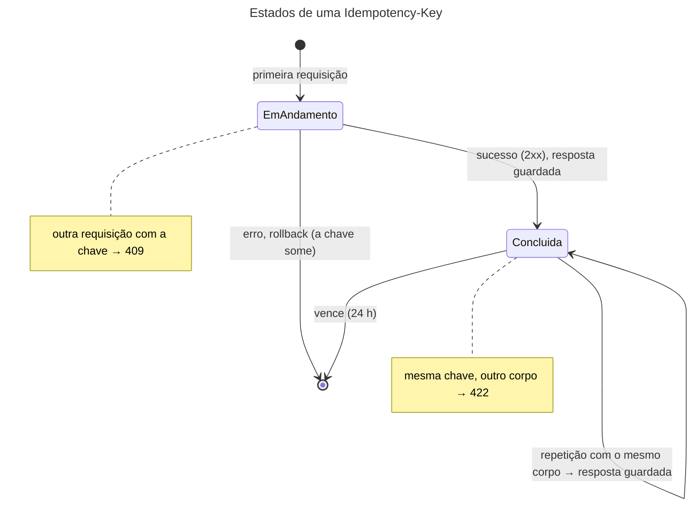

## O problema

O app do Bazar manda um `POST /v1/pedidos`. O servidor valida, reserva o estoque, grava o pedido e faz o *commit*. A resposta `201` volta pela rede e se perde: o celular entrou num túnel, o *load balancer* fechou a conexão, o *timeout* do cliente era de 5 segundos e a resposta levou 6.

Do lado do cliente, a situação é a mesma de quando o servidor nem recebeu a requisição: não chegou resposta. Ele tem duas opções, e as duas são ruins:

- **Não repetir**: se o pedido não foi criado, a cliente perdeu a compra.
- **Repetir**: se o pedido foi criado, agora são dois, com dois estoques reservados e, quando houver pagamento ([24.02](/consumindo-outras-apis/restclient-a-fundo)), duas cobranças.

O `POST` não é idempotente ([02.02](/comecando-e-fundamentos-de-http/metodos-http-semantica-seguranca-e-idempotencia)): repeti-lo repete o efeito. No Bazar, até esta página, foi exatamente isso:

```text noCopy
== sem chave, duas vezes
201 201
pedidos: 2
```

O que falta é um jeito de o cliente dizer "esta é a **mesma** requisição de antes, não uma nova". Pense no número do protocolo de um atendimento: se a ligação cai e você liga de novo informando o protocolo, o atendente continua o atendimento de onde parou, em vez de abrir um segundo chamado.

> **A pergunta desta página:** como o cliente identifica uma requisição para poder repeti-la sem repetir o efeito, e como o servidor guarda e devolve a resposta original, mesmo com duas cópias da requisição chegando ao mesmo tempo?

## O conceito

### O header `Idempotency-Key`

O cliente gera uma chave única para cada **operação** (não para cada tentativa) e a manda num header:

```http
POST /v1/pedidos
Content-Type: application/json
Idempotency-Key: "9f4c2b1e-7d3a-4e8b-a6f0-3c5d8e2b1a70"
```

O servidor guarda a resposta associada à chave. Se a mesma chave chegar de novo, ele devolve a resposta guardada, sem processar outra vez. O cliente pode repetir quantas vezes precisar: o efeito acontece uma vez só.

O header é descrito num **Internet-Draft** do grupo *httpapi* da IETF, o `draft-ietf-httpapi-idempotency-key-header`, ainda **não é uma RFC** (a versão -08 é de outubro de 2026). A prática é bem mais antiga que o rascunho: a Stripe usa o header há anos, e muitas APIs de pagamento seguem o mesmo modelo. O rascunho define:

- O valor é uma *string* de Structured Fields (RFC 9651), entre aspas. Um UUID v4 é a escolha comum, porque é único e difícil de adivinhar.
- A chave **não pode ser reutilizada** com outro corpo. Se for, o servidor responde **`422`**.
- Se a chave chega enquanto a primeira requisição ainda está em andamento, o servidor responde **`409`**. É o único erro em que o cliente pode repetir a mesma requisição sem mudar nada, só esperando.
- Se o servidor exige a chave e ela não veio, **`400`**.
- O servidor **deve publicar** a política de expiração: por quanto tempo uma chave vale.

### O que forma a identidade de uma requisição

A chave sozinha não basta. O servidor guarda, junto com ela:

- **O escopo**: a mesma chave em rotas diferentes são chaves diferentes (`POST /v1/pedidos` e `POST /v1/pedidos/{id}/pagamentos`). Com autenticação ([26.04](/seguranca-essencial-para-apis/resource-server-com-jwt-o-essencial)), o escopo também inclui **quem** está chamando: sem isso, um cliente que adivinhasse a chave de outro receberia a resposta dele, com os dados do pedido (veja a [documentação de segurança](https://security-doc-beta.vercel.app/)). O Bazar ainda não tem autenticação; o escopo é o método e a rota, e ganha o usuário na Parte 11.
- **A impressão digital (*fingerprint*) do corpo**: um hash (SHA-256) dos bytes. Uma repetição legítima manda os mesmos bytes; a mesma chave com outro hash é um erro do cliente (`422`), não uma repetição.

### O ciclo de vida de uma chave



### Atomicidade: a chave e a operação juntas

O ponto mais delicado é garantir que a chave e a operação não se separem. Se o servidor grava o pedido, faz o *commit* e só depois grava a chave, uma queda entre as duas coisas deixa um pedido sem chave: a repetição cria o segundo pedido. Se grava a chave antes e a operação falha, a chave aponta para algo que não aconteceu.

Quando a operação e a chave estão **no mesmo banco**, a solução é gravar as duas **na mesma transação**: ou existem as duas, ou nenhuma. É o que o Bazar faz. Uma queda do processo no meio desfaz tudo, e a repetição com a mesma chave é processada como se fosse a primeira.

Quando a operação tem efeitos **fora** do banco (chamar a PagaFácil para cobrar, mandar um e-mail), a transação não cobre tudo. Aí a chave precisa de um estado `EM_ANDAMENTO` gravado antes, e de pontos de recuperação para cada efeito externo, como no desenho que a Stripe descreve: o pagamento da [25.02](/consumindo-outras-apis/retry-quando-e-seguro-e-como-fazer) repassa a própria chave para a PagaFácil, para que o *retry* do Bazar também seja seguro do lado de lá.

### Erros: guardar ou não?

Se a primeira tentativa falhou, a repetição deve receber o mesmo erro?

| Escolha | Quem faz | Por quê |
|---|---|---|
| Guardar só sucessos (2xx) | Bazar | O erro fez *rollback*, nada aconteceu. O cliente corrige o que faltava (o estoque voltou) e repete com a mesma chave. |
| Guardar também erros, até `500` | Stripe | Um `500` pode ter acontecido depois de um efeito externo (a operadora do cartão já cobrou). Repetir poderia cobrar de novo; devolver o erro guardado obriga o cliente a investigar. |

As duas são corretas no seu contexto. A regra que vale para as duas: **erros de validação e o `409` de concorrência nunca ficam guardados**, porque a operação nem começou.

### Expiração

Uma chave não precisa durar para sempre. O cliente só repete por um tempo limitado (alguns minutos de *retry*, no máximo algumas horas se o app ficou offline). A Stripe guarda por 24 horas, o Bazar também. Depois disso a chave vence, e a mesma chave seria tratada como nova. A limpeza das vencidas é uma tarefa periódica ([19.03](/concorrencia-e-execucao-assincrona/async-scheduled-e-tarefas-em-segundo-plano)).

### Postgres ou Redis

As chaves podem ficar num armazenamento rápido com TTL, como o Redis (`SET chave valor NX PX 86400000`): ele expira as chaves sozinho, e o `NX` dá a exclusão mútua. O preço é perder a atomicidade com a operação. O pedido é gravado no Postgres e a chave no Redis, e entre um e outro há uma janela em que um pode existir sem o outro. Para operações que já gravam no Postgres, guardar a chave no próprio Postgres, na mesma transação, é mais simples e mais seguro. O Redis volta na [28.03](/performance/cache-na-aplicacao-cacheable-caffeine-e-redis), como cache.

## Diagrama

```mermaid
---
title: Falha de rede depois do commit, e o retry
---
sequenceDiagram
    participant App
    participant API as API do Bazar
    participant DB as Postgres
    App->>API: POST /v1/pedidos<br/>Idempotency-Key: "9f4c..."
    API->>DB: BEGIN; lock da chave; não existe
    API->>DB: cria o pedido, reserva estoque
    API->>DB: guarda a chave com a resposta 201
    API->>DB: COMMIT
    API--xApp: 201 Created (a resposta se perde)
    Note over App: timeout: o pedido foi criado?
    App->>API: POST /v1/pedidos<br/>Idempotency-Key: "9f4c..." (mesmo corpo)
    API->>DB: BEGIN; lock da chave; existe, mesmo hash
    API-->>App: 201 Created (a mesma resposta)<br/>Idempotent-Replayed: true
    Note over App,DB: um pedido só, uma reserva só
```

## Na prática

### A anotação

O endpoint só declara que aceita a chave:

```java title="src/main/java/com/bazar/pedidos/api/PedidoController.java (trecho)"
@PostMapping
@Idempotente
@Operation(operationId = "criarPedido", summary = "Cria um pedido e reserva o estoque",
        description = "Um cliente ou produto inexistente dá `422`; estoque insuficiente, `409` (10.03).")
@Parameter(in = ParameterIn.HEADER, name = IdempotenciaFilter.IDEMPOTENCY_KEY, schema = @Schema(type = "string"),
        description = """
                Uma chave única por pedido (um UUID novo), entre aspas: `"8e03978e-40d5-43e8-bc93-6894a57f9324"`. \
                Repetir com a mesma chave e o mesmo corpo devolve a resposta original, com \
                `Idempotent-Replayed: true`, sem criar outro pedido. A chave vale por 24 horas. A mesma chave \
                com outro corpo dá `422`; enquanto a primeira ainda está em andamento, `409` (21.01).""")
public ResponseEntity<EntityModel<PedidoResponse>> criar(@Valid @RequestBody CriarPedidoRequest request) {
```

O corpo do método não mudou. O `@Parameter` documenta o header no contrato, com a política de expiração, como o rascunho pede. A chave é **opcional**: os clientes atuais não a mandam, e exigi-la seria uma mudança incompatível (é o mesmo raciocínio do `428` na [20.03](/padroes-avancados-de-http/concorrencia-otimista-com-if-match-412-e-428)). Sem a chave, o `POST` se comporta como antes.

### A tabela

```sql title="src/main/resources/db/migration/V14__chave_de_idempotencia.sql"
-- A resposta de cada requisição com Idempotency-Key já processada (21.01). O escopo é o método e a rota: a mesma
-- chave em rotas diferentes são chaves diferentes. Uma repetição dentro da validade recebe esta resposta de novo.
create table chave_idempotencia (
    escopo           varchar(200) not null,
    chave            varchar(255) not null,
    hash_requisicao  varchar(64)  not null,
    status_resposta  smallint     not null,
    headers_resposta text         not null,
    corpo_resposta   bytea        not null,
    criada_em        timestamptz  not null,
    expira_em        timestamptz  not null,
    primary key (escopo, chave)
);

create index chave_idempotencia_expira_em_idx on chave_idempotencia (expira_em);
```

Não há coluna de estado. O estado `EM_ANDAMENTO` do diagrama existe, mas não como linha: ele é a transação aberta, que segura um *lock* da chave. Uma linha na tabela significa sempre `CONCLUIDA`.

### O filtro

Quem faz o trabalho é um filtro de servlet, porque só um filtro enxerga a resposta inteira (status, headers e os bytes do corpo) para guardá-la e devolvê-la depois:

```java title="src/main/java/com/bazar/compartilhado/idempotencia/IdempotenciaFilter.java (trecho)"
@Override
protected boolean shouldNotFilter(HttpServletRequest request) {
    return request.getHeader(IDEMPOTENCY_KEY) == null || !ehIdempotente(request);
}

private void processar(HttpServletRequest request, ContentCachingResponseWrapper resposta, FilterChain chain)
        throws ServletException, IOException {
    var chave = lerChave(request.getHeader(IDEMPOTENCY_KEY));
    var escopo = request.getMethod() + " " + request.getRequestURI();
    var corpo = request.getInputStream().readAllBytes();
    var hash = sha256(corpo);
    var agora = relogio.instant();

    var transacao = transacoes.getTransaction(TransactionDefinition.withDefaults());
    try {
        if (!chaves.travar(escopo, chave)) {
            throw new RegraDeNegocioException(TipoProblema.REQUISICAO_EM_ANDAMENTO, Map.of());
        }
        var guardada = chaves.buscar(escopo, chave, agora);
        if (guardada.isPresent()) {
            if (!guardada.get().hashRequisicao().equals(hash)) {
                throw new RegraDeNegocioException(TipoProblema.CHAVE_DE_IDEMPOTENCIA_REUTILIZADA, Map.of());
            }
            repetir(guardada.get(), resposta);
            transacoes.commit(transacao);
            return;
        }
        // O controller e o serviço (@Transactional) participam desta transação.
        chain.doFilter(new RequisicaoComCorpo(request, corpo), resposta);
        if (resposta.getStatus() >= 200 && resposta.getStatus() < 300) {
            chaves.guardar(escopo, chave, guardar(hash, resposta), agora, agora.plus(VALIDADE));
            transacoes.commit(transacao);
        } else {
            // Um erro (de negócio ou de validação) não deixou efeito, e não fica guardado: com a mesma chave, o
            // cliente pode repetir depois de corrigir o que faltava (o estoque, por exemplo).
            transacoes.rollback(transacao);
        }
    } catch (RuntimeException | IOException | ServletException ex) {
        if (!transacao.isCompleted()) {
            transacoes.rollback(transacao);
        }
        throw ex;
    }
}
```

Os pontos que merecem atenção:

**A transação começa no filtro.** O `PedidoService.criar` é `@Transactional` com a propagação padrão (`REQUIRED`): encontrando uma transação aberta na mesma *thread*, ele participa dela, em vez de abrir outra. O pedido, a reserva do estoque, o histórico e a chave são gravados no mesmo *commit*. Um efeito colateral bom: o `201` só sai do *buffer* (`ContentCachingResponseWrapper`) depois do *commit*. O cliente nunca recebe um `201` de um pedido que não foi gravado. Os eventos `@TransactionalEventListener` da 19.04 continuam disparando depois do *commit*, agora o do filtro.

**O lock da chave não espera.** O `travar` usa um *advisory lock* do Postgres, preso à transação:

```java title="src/main/java/com/bazar/compartilhado/idempotencia/ChavesDeIdempotencia.java (trecho)"
// Um advisory lock da transação, sem esperar: se outra requisição com a mesma chave está em andamento, ela tem
// o lock, e esta desiste na hora (409). O lock é solto sozinho no commit ou no rollback.
boolean travar(String escopo, String chave) {
    return jdbc.sql("select pg_try_advisory_xact_lock(hashtextextended(:escopo || ' ' || :chave, 0))")
            .param("escopo", escopo)
            .param("chave", chave)
            .query(Boolean.class)
            .single();
}
```

O `pg_try_advisory_xact_lock` devolve `false` na hora se outra transação tem o lock, em vez de esperar. Ele é solto sozinho no *commit* ou no *rollback*, inclusive se o processo morrer (a conexão cai, o Postgres desfaz a transação e solta o lock). Não sobra nenhuma chave "presa em andamento" para alguém limpar. O `hashtextextended` transforma o texto num número de 64 bits. Duas chaves diferentes com o mesmo hash dariam um `409` falso, numa chance desprezível.

**O corpo é lido duas vezes.** O filtro lê os bytes para calcular o hash, e o Spring MVC precisa lê-los de novo para desserializar o JSON. O `RequisicaoComCorpo` (um `HttpServletRequestWrapper`) devolve os mesmos bytes a quem pedir.

**Como o filtro sabe que a rota é `@Idempotente`.** Ele pergunta ao `RequestMappingHandlerMapping` qual método atenderia a requisição e olha a anotação. Isso só acontece quando o header está presente; sem ele, o `shouldNotFilter` descarta a requisição na primeira comparação.

**Os erros saem no formato da API.** Um `409` ou `422` lançado no filtro não passa pelo `@RestControllerAdvice` sozinho, porque o filtro roda fora do Spring MVC. O filtro entrega a exceção ao `HandlerExceptionResolver` do Spring, que chama o `TratadorGlobalDeErros` da 16.01. A resposta tem o mesmo Problem Details, traduzido, de qualquer outro erro.

O filtro é registrado por um `FilterRegistrationBean` numa `@Configuration`, e não com `@Component`. Um `Filter` anotado com `@Component` entra nos testes de fatia (`@WebMvcTest`), que não têm banco, e todos eles quebraram na primeira tentativa.

### A resposta repetida

```java title="src/main/java/com/bazar/compartilhado/idempotencia/IdempotenciaFilter.java (trecho)"
// Os headers que voltam numa repetição. Date, traceparent e afins são da nova resposta, não da original.
private static final List<String> HEADERS_GUARDADOS = List.of(HttpHeaders.CONTENT_TYPE, HttpHeaders.LOCATION,
        HttpHeaders.CONTENT_LANGUAGE, HttpHeaders.CACHE_CONTROL, HttpHeaders.ETAG);

private static void repetir(RespostaGuardada guardada, ContentCachingResponseWrapper resposta) throws IOException {
    resposta.setStatus(guardada.status());
    guardada.headers().forEach(resposta::setHeader);
    resposta.setHeader(IDEMPOTENT_REPLAYED, "true");
    resposta.getOutputStream().write(guardada.corpo());
}
```

O `Idempotent-Replayed: true` é uma convenção da Stripe, fora do rascunho da IETF. Ele não muda nada para o cliente que só quer o resultado, mas ajuda quem investiga um problema a saber que aquela resposta veio da chave.

A resposta repetida é a **original**, com os bytes de então. Se o pedido foi cancelado depois, a repetição ainda mostra `"status": "CRIADO"`. É o comportamento certo: a repetição responde "o que aconteceu com aquela requisição", não "como o pedido está agora". Para o estado atual, há o `GET` do `Location`.

### As trocas

<HttpExchange
  title="Primeira tentativa (a resposta se perdeu no caminho)"
  request={{ method: 'POST', url: '/v1/pedidos', headers: { 'Content-Type': 'application/json', 'Idempotency-Key': '"9f4c2b1e-7d3a-4e8b-a6f0-3c5d8e2b1a70"' }, body: { clienteId: '01a177df-5122-7d2b-9f1f-d9ccc8b31f06', itens: [ { produtoId: 'bcd399f5-d6d1-4032-9c80-10ca4c363d31', quantidade: 1 } ] } }}
  response={{ status: 201, headers: { 'Location': 'http://localhost:8080/v1/pedidos/01a177df-7cb5-7644-945a-4da3f6218ca2', 'Cache-Control': 'no-store', 'Content-Type': 'application/hal+json', 'Content-Length': '962' }, body: { id: '01a177df-7cb5-7644-945a-4da3f6218ca2', numero: 'BZR-2026-000007', status: 'CRIADO', '...': '...' } }}
/>

<HttpExchange
  title="A repetição, com a mesma chave e o mesmo corpo"
  request={{ method: 'POST', url: '/v1/pedidos', headers: { 'Content-Type': 'application/json', 'Idempotency-Key': '"9f4c2b1e-7d3a-4e8b-a6f0-3c5d8e2b1a70"' }, body: { clienteId: '01a177df-5122-7d2b-9f1f-d9ccc8b31f06', itens: [ { produtoId: 'bcd399f5-d6d1-4032-9c80-10ca4c363d31', quantidade: 1 } ] } }}
  response={{ status: 201, headers: { 'Location': 'http://localhost:8080/v1/pedidos/01a177df-7cb5-7644-945a-4da3f6218ca2', 'Cache-Control': 'no-store', 'Idempotent-Replayed': 'true', 'Content-Type': 'application/hal+json', 'Content-Length': '962' }, body: { id: '01a177df-7cb5-7644-945a-4da3f6218ca2', numero: 'BZR-2026-000007', status: 'CRIADO', '...': '...' } }}
>
O mesmo `Location`, o mesmo número de pedido, os mesmos 962 bytes. Nenhum pedido novo foi criado.
</HttpExchange>

<HttpExchange
  title="A mesma chave, com outra quantidade"
  request={{ method: 'POST', url: '/v1/pedidos', headers: { 'Content-Type': 'application/json', 'Accept-Language': 'pt-BR', 'Idempotency-Key': '"9f4c2b1e-7d3a-4e8b-a6f0-3c5d8e2b1a70"' }, body: { clienteId: '01a177df-5122-7d2b-9f1f-d9ccc8b31f06', itens: [ { produtoId: 'bcd399f5-d6d1-4032-9c80-10ca4c363d31', quantidade: 2 } ] } }}
  response={{ status: 422, headers: { 'Content-Type': 'application/problem+json' }, body: { type: 'https://api.bazar.example/problemas/chave-de-idempotencia-reutilizada', title: 'Idempotency-Key reutilizada', status: 422, detail: 'Esta Idempotency-Key já foi usada com outro corpo. Uma chave identifica uma requisição só: gere outra para uma operação nova.', instance: '/v1/pedidos', codigo: 'CHAVE_DE_IDEMPOTENCIA_REUTILIZADA', traceId: 'd54f1be1422a2de7c27393e94dc2806d' } }}
>
Provavelmente um bug no cliente: ele reaproveitou a chave da compra anterior para uma compra nova. Sem o hash, o servidor devolveria o pedido antigo, e a compra nova nunca seria feita.
</HttpExchange>

### Medindo

Trinta requisições simultâneas, todas com a mesma chave e o mesmo corpo, liberadas juntas por uma barreira:

```text noCopy
concorrentes: {(409, None): 29, (201, None): 1}
locations distintas: 1
```

Uma criou o pedido; as outras 29 encontraram o lock ocupado e receberam `409` na hora, sem esperar. Um cliente que recebe esse `409` espera um pouco e repete, e aí recebe o `201` guardado.

O custo, em 300 `POST` sequenciais de cada tipo, com a conexão reaproveitada:

```text noCopy
sem chave:           p50 13.42 ms, p99 24.21 ms
com chave nova:      p50 11.95 ms, p99 20.44 ms
repetição (replay):  p50  0.55 ms, p99  1.14 ms
```

A chave não teve custo mensurável: o lock, a busca e o `insert` a mais somem no ruído de uma operação que já faz vários `insert` e `update`. A repetição é 20 vezes mais rápida que a criação, porque só lê uma linha e copia os bytes.

### Os testes

```java title="src/test/java/com/bazar/compartilhado/idempotencia/IdempotenciaTest.java (trecho)"
@Test
void aMesmaChaveDevolveAMesmaRespostaSemCriarOutroPedido() {
    var primeira = criarPedido("\"8e03978e-40d5-43e8-bc93-6894a57f9324\"", 2);
    assertThat(primeira).hasStatus(HttpStatus.CREATED).doesNotContainHeader(IdempotenciaFilter.IDEMPOTENT_REPLAYED);

    var repeticao = criarPedido("\"8e03978e-40d5-43e8-bc93-6894a57f9324\"", 2);
    assertThat(repeticao).hasStatus(HttpStatus.CREATED)
            .hasHeader(IdempotenciaFilter.IDEMPOTENT_REPLAYED, "true")
            .hasHeader("Location", primeira.getResponse().getHeader("Location"));
    assertThat(repeticao.getResponse().getContentAsByteArray())
            .isEqualTo(primeira.getResponse().getContentAsByteArray());

    // Um pedido só, e o estoque reservado uma vez só.
    assertThat(jdbc.sql("select count(*) from pedido").query(Long.class).single()).isEqualTo(1);
    assertThat(estoques.findById(cleanCode).orElseThrow().getQuantidadeReservada()).isEqualTo(2);
}

@Test
void umErroNaoFicaGuardadoEAMesmaChavePodeSerRepetida() {
    assertThat(criarPedido("\"chave-1\"", 8)).hasStatus(HttpStatus.CONFLICT)
            .bodyJson().extractingPath("$.codigo").isEqualTo("ESTOQUE_INSUFICIENTE");
    assertThat(jdbc.sql("select count(*) from chave_idempotencia").query(Long.class).single()).isZero();

    repor(10);
    assertThat(criarPedido("\"chave-1\"", 8)).hasStatus(HttpStatus.CREATED)
            .doesNotContainHeader(IdempotenciaFilter.IDEMPOTENT_REPLAYED);
}
```

O teste do `409` precisa de uma requisição "em andamento" de verdade. Uma *thread* abre uma transação, pega o lock da chave e espera um sinal. Enquanto isso, o teste manda o `POST` com a mesma chave e confere o `409`. Depois solta o lock e confere que a mesma chave passa a funcionar. Os outros testes cobrem o `422`, o `400` (chave vazia ou com mais de 255 caracteres), o `POST` sem chave e a expiração.

## Erros comuns

<BadVsGood title="Gravar a chave fora da transação da operação" why="Entre o commit do pedido e a gravação da chave há uma janela. Se o processo cair nela, o pedido existe e a chave não: a repetição cria o segundo pedido, que é tudo o que a chave devia impedir. Com as duas na mesma transação, ou existem as duas, ou nenhuma.">
<Bad title="Duas transações">

```java
var pedido = servico.criar(...);   // commit aqui
// queda aqui: pedido sem chave
chaves.guardar(chave, resposta);   // outro commit
```

</Bad>
<Good title="Uma transação para as duas">

```java
// BEGIN no filtro
chain.doFilter(requisicao, resposta);  // servico.criar participa
chaves.guardar(escopo, chave, ...);
transacoes.commit(transacao);          // as duas, ou nenhuma
```

</Good>
</BadVsGood>

Outros tropeços frequentes:

- **Uma chave por tentativa, em vez de uma por operação.** O cliente gera um UUID novo a cada *retry*, e a chave não protege nada. A chave nasce quando o usuário toca em "Finalizar compra" e acompanha todas as tentativas daquela compra.
- **Não comparar o corpo.** A mesma chave com outro corpo devolveria a resposta de outra operação, em silêncio.
- **Escopo só pela chave**, sem a rota e sem o usuário: uma colisão ou uma chave adivinhada entrega a resposta de outra pessoa.
- **Esperar o lock em vez de responder `409`.** Com `pg_advisory_xact_lock` (sem o `try`), as repetições ficam paradas segurando conexões do *pool* enquanto a primeira não termina.
- **Guardar a resposta antes do *commit*** num armazenamento separado (Redis): se o *commit* falhar, a chave devolve um sucesso que não aconteceu.
- **Usar a chave para o que é concorrência entre clientes diferentes.** Dois usuários alterando o mesmo recurso é assunto do `If-Match` (20.03), não da Idempotency-Key.
- **Não publicar a validade.** O cliente precisa saber até quando pode repetir com segurança.

## Boas práticas

- **Gere a chave no cliente**, um UUID v4 por operação, e guarde-a junto com a operação pendente (até no armazenamento local do app, se ele puder fechar no meio).
- **Grave a chave na mesma transação da operação** sempre que os efeitos estiverem no mesmo banco.
- **Compare o hash do corpo** e responda `422` a uma chave reutilizada.
- **Responda `409` sem esperar** a uma chave em andamento, e documente que o cliente deve repetir depois.
- **Inclua o usuário autenticado no escopo** da chave.
- **Publique a validade** na documentação do header e apague as chaves vencidas periodicamente.
- **Repasse a chave** (ou uma derivada dela) às APIs externas que a operação chama, para o *retry* ser seguro de ponta a ponta.

## Por baixo dos panos

<DeepDive title="Por que um advisory lock, e não a chave primária">

Uma alternativa mais óbvia seria o `insert ... on conflict do nothing` na chave primária, logo no começo da transação. Se outra transação já inseriu a mesma chave e ainda não fez *commit*, o Postgres **espera** essa transação terminar para decidir se há conflito, porque o resultado depende do *commit* ou do *rollback* da outra. O comportamento seria correto, mas as repetições ficariam paradas, cada uma segurando uma conexão do *pool* (o HikariCP abre 10 por padrão; a [28.02](/performance/pool-de-conexoes-hikaricp) volta ao assunto), durante toda a criação do pedido. Trinta repetições simultâneas esgotariam o *pool*, e requisições que nada têm a ver com a chave ficariam esperando conexão.

O `pg_try_advisory_xact_lock(n)` resolve isso. É um lock sobre um número qualquer (aqui, o hash da chave), sem tabela nenhuma. O `try` devolve `false` imediatamente se o lock está com outra transação. O `xact` amarra o lock à transação: ele é solto no *commit* ou no *rollback*, sem um `unlock` explícito que alguém possa esquecer.

A sequência dentro da transação do filtro é então:

1. `pg_try_advisory_xact_lock(hash)` → `false`: `409`, sem esperar nada.
2. `select ... where escopo = ? and chave = ? and expira_em > ?` → achou: compara o hash, devolve a resposta guardada.
3. Não achou: processa, `insert` da chave, *commit* (que solta o lock).

Entre os passos 1 e 3, ninguém mais com a mesma chave passa do passo 1. E como o lock só é solto no *commit*, a próxima requisição que conseguir o lock já enxerga a linha gravada no passo 2.

</DeepDive>

## No projeto Bazar

<ProjectStep title="POST /v1/pedidos idempotente" module="compartilhado" tag="pagina-21.01" files={[
  { path: 'src/main/java/com/bazar/compartilhado/idempotencia/Idempotente.java', change: 'novo' },
  { path: 'src/main/java/com/bazar/compartilhado/idempotencia/IdempotenciaFilter.java', change: 'novo' },
  { path: 'src/main/java/com/bazar/compartilhado/idempotencia/ChavesDeIdempotencia.java', change: 'novo' },
  { path: 'src/main/java/com/bazar/compartilhado/idempotencia/RespostaGuardada.java', change: 'novo' },
  { path: 'src/main/java/com/bazar/compartilhado/idempotencia/ExpiracaoDasChaves.java', change: 'novo' },
  { path: 'src/main/java/com/bazar/compartilhado/idempotencia/ConfiguracaoDaIdempotencia.java', change: 'novo' },
  { path: 'src/main/resources/db/migration/V14__chave_de_idempotencia.sql', change: 'novo' },
  { path: 'src/main/java/com/bazar/compartilhado/erros/TipoProblema.java', change: 'alterado' },
  { path: 'src/main/java/com/bazar/pedidos/api/PedidoController.java', change: 'alterado' },
  { path: 'src/test/java/com/bazar/compartilhado/idempotencia/IdempotenciaTest.java', change: 'novo' },
  { path: 'docs/openapi/bazar-api.yaml', change: 'alterado' },
]}>
O `POST /v1/pedidos` aceita o header `Idempotency-Key` (opcional, por compatibilidade). A chave, o pedido e a resposta guardada vão na mesma transação, aberta pelo `IdempotenciaFilter`. Repetição com o mesmo corpo: a resposta original, com `Idempotent-Replayed: true`. Outro corpo: `422`. Em andamento: `409`, por um *advisory lock* sem espera. Erros não ficam guardados. As chaves valem 24 horas, e uma tarefa de hora em hora apaga as vencidas. Três tipos novos no catálogo de problemas. O pagamento (25.02) vai exigir a chave e repassá-la à PagaFácil.
</ProjectStep>

## Resumo

- Um `POST` cuja resposta se perdeu deixa o cliente sem saber se o efeito aconteceu; repetir sem proteção duplica o efeito.
- Com `Idempotency-Key`, o cliente identifica a operação; o servidor guarda a resposta e a devolve nas repetições. O header é um Internet-Draft da IETF, não uma RFC, e segue a prática da Stripe.
- A chave vale num escopo (rota e usuário) e com uma impressão digital do corpo: outro corpo com a mesma chave é `422`; chave em andamento é `409`.
- A chave e a operação precisam ser gravadas juntas, na mesma transação quando estão no mesmo banco.
- Erros que não deixaram efeito não precisam ficar guardados; com efeitos externos, guardar até o `500` pode ser mais seguro.
- As chaves expiram (24 h no Bazar e na Stripe), e a validade é publicada.

<Exercise title="Idempotência na ação de cancelar" difficulty="medio">
O `POST /v1/pedidos/{id}/cancelamento` (12.04) cancela o pedido e devolve o estoque. Hoje, um segundo cancelamento do mesmo pedido responde `409 TRANSICAO_INVALIDA`, porque um pedido cancelado não pode ser cancelado de novo.

1. Um app manda o cancelamento, a resposta se perde, e ele repete. O que o usuário vê? Isso é um problema?
2. Marcar o cancelamento com `@Idempotente` resolveria? O que mudaria para o cliente que repete com a mesma chave?
3. Há um jeito de tornar o cancelamento idempotente **sem** chave? Quais as vantagens e o risco?

<Hint>A idempotência é sobre o efeito no servidor, não sobre a resposta ser igual (02.02). O que aconteceria se o servidor respondesse `200` a um cancelamento de um pedido já cancelado?</Hint>

<Solution>

1. A repetição recebe `409 TRANSICAO_INVALIDA`. O efeito não se repete (a máquina de estados da 12.04 não deixa um pedido cancelado ser cancelado de novo, e o estoque não volta duas vezes), então a operação já é **idempotente** no sentido do HTTP. O problema é a experiência: o app mostra "não foi possível cancelar", quando o pedido foi cancelado. Um cliente bem feito trataria o `409` relendo o pedido, mas a maioria não faz isso.

2. Sim. Com a chave, a primeira requisição guarda o `200` do cancelamento, e a repetição com a mesma chave recebe esse `200`, com `Idempotent-Replayed: true`. O app mostra "pedido cancelado". Um cancelamento com **outra** chave (o usuário tocou de novo em "Cancelar" num app que gera uma chave por toque) continua recebendo `409`, o que também está certo.

3. Sim: responder `200` (com o pedido) a um cancelamento de um pedido **já cancelado com o mesmo motivo**, em vez de `409`. A RFC 9110 (§13.1.1) usa o mesmo raciocínio para o `If-Match`: se o estado já reflete a alteração pedida, o servidor pode responder `2xx`. A vantagem é que funciona para qualquer cliente, sem header nenhum. O risco é esconder um conflito real: se o pedido foi cancelado por **outro** motivo (pelo sistema, por falta de pagamento), dizer `200` ao cliente que pediu "desisti da compra" mascara o que aconteceu. Por isso a condição inclui o motivo. Com um motivo diferente, continua `409`.

</Solution>
</Exercise>

<Quiz questions={[
  {
    question: 'O cliente manda POST /v1/pedidos com Idempotency-Key, a resposta se perde, e ele repete com a mesma chave e o mesmo corpo. O que o Bazar responde?',
    options: [
      '201 com um pedido novo',
      '409, porque a chave já existe',
      'O mesmo 201 da primeira vez, com Idempotent-Replayed: true, sem criar outro pedido',
      '304 Not Modified',
    ],
    answer: 2,
    explanation: 'A chave existe, o hash do corpo bate: o filtro devolve a resposta guardada. O 409 é só para a chave em andamento.',
  },
  {
    question: 'Por que o Bazar grava a chave na mesma transação do pedido?',
    options: [
      'Por desempenho',
      'Para que uma queda entre as duas gravações não deixe um pedido sem chave, o que faria a repetição criar o segundo pedido',
      'Porque o rascunho da IETF exige',
      'Porque o Spring não permite duas transações por requisição',
    ],
    answer: 1,
    explanation: 'Com uma transação só, ou existem o pedido e a chave, ou nenhum dos dois. O rascunho não diz como implementar; a atomicidade é uma decisão de projeto.',
  },
  {
    question: 'A primeira tentativa recebeu 409 ESTOQUE_INSUFICIENTE. O estoque foi reposto, e o cliente repete com a mesma chave. O que acontece no Bazar?',
    options: [
      'Recebe o mesmo 409 guardado',
      'Recebe 422, porque a chave já foi usada',
      'O pedido é criado (201): o erro fez rollback e não ficou guardado',
      'Recebe 409 REQUISICAO_EM_ANDAMENTO',
    ],
    answer: 2,
    explanation: 'O Bazar só guarda sucessos. A Stripe guardaria o erro; as duas escolhas têm motivos, e o Bazar pode escolher assim porque todos os efeitos estão no mesmo banco.',
  },
  {
    question: 'Por que pg_try_advisory_xact_lock, e não o insert com on conflict logo no começo?',
    options: [
      'Porque o on conflict não detecta duplicatas',
      'Porque o insert esperaria a outra transação terminar, segurando conexões do pool; o try desiste na hora com 409',
      'Porque advisory locks são mais seguros que chaves primárias',
      'Porque o Postgres não suporta on conflict em chaves compostas',
    ],
    answer: 1,
    explanation: 'Com a chave primária, o Postgres espera o commit ou rollback da outra transação para saber se há conflito. O try não espera, e o xact solta o lock sozinho no fim da transação.',
  },
]} />

## Referências

<References />
