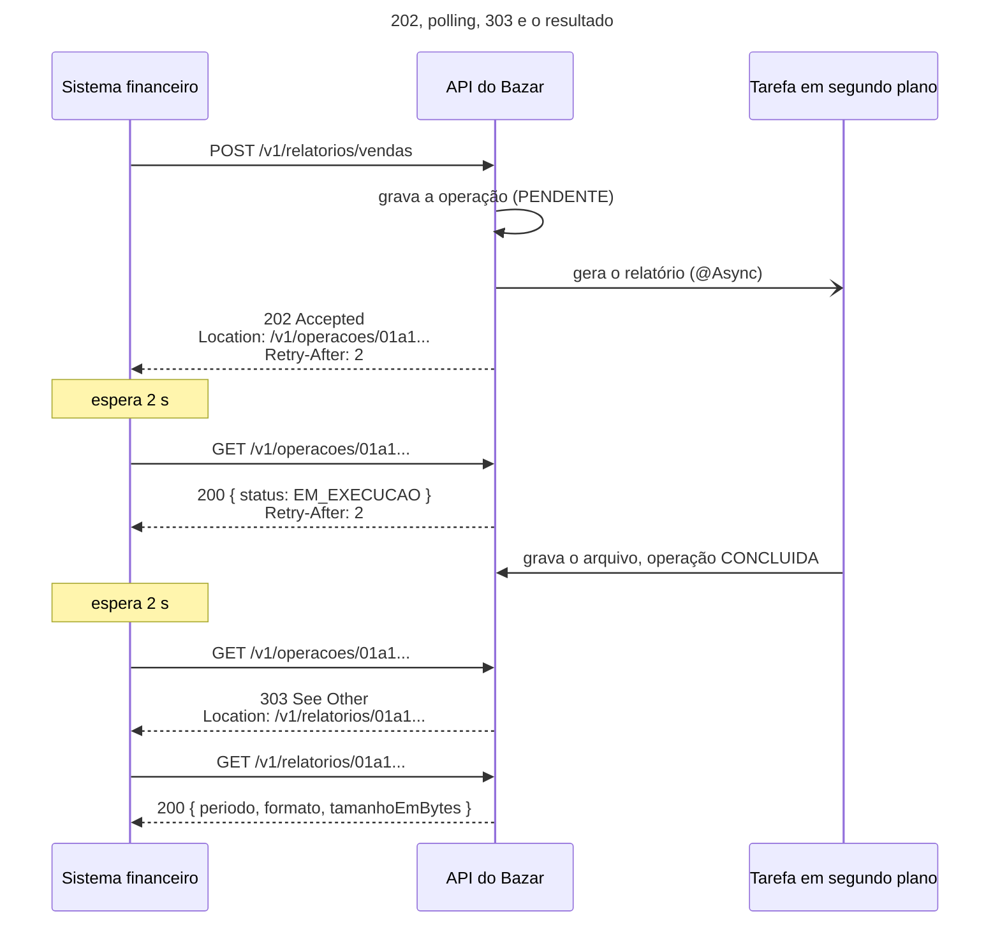
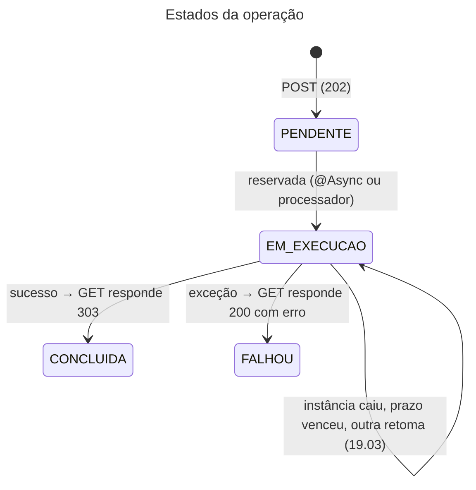

## O problema

O time financeiro do Bazar pede o relatório de vendas do mês. Hoje são 225 bytes e alguns milissegundos. Em dezembro, com um milhão de pedidos, a mesma consulta vai levar minutos. Se a API gerar o relatório **dentro** da requisição, a conexão fica aberta esse tempo todo, e cada pedaço do caminho tem um limite:

- o cliente HTTP do sistema financeiro desiste em 30 segundos;
- o *load balancer* corta conexões ociosas em 60;
- a CDN não espera mais que 100;
- e, enquanto isso, a requisição ocupa uma *thread* (ou uma conexão do *pool* do banco, 19.01) que outras requisições poderiam usar.

Quando o cliente desiste, o servidor continua gerando o relatório, que ninguém vai receber. O cliente tenta de novo, e agora são dois relatórios sendo gerados. É o *timeout* em cascata.

A [19.03](/concorrencia-e-execucao-assincrona/async-scheduled-e-tarefas-em-segundo-plano) tirou o trabalho da requisição: o `POST /v1/relatorios/vendas` grava uma **operação** no banco e responde `202 Accepted` na hora, e o relatório é gerado em segundo plano. Mas a resposta parou aí:

```json
{ "operacaoId": "01a177e7-f1c6-7565-a4ef-e7cd69bcd1a3", "status": "PENDENTE" }
```

O cliente sabe que o pedido foi aceito, e só. Não sabe onde perguntar se terminou, de quanto em quanto tempo perguntar, onde buscar o resultado, nem o que aconteceu se deu errado. É como deixar o carro na oficina e sair sem o número da ordem de serviço nem o telefone.

> **A pergunta desta página:** depois do `202`, como o cliente acompanha a operação, descobre que ela terminou e chega ao resultado, sem abusar do servidor e sem depender de mensagens internas?

## O conceito

### O padrão

São três recursos e um ciclo:

1. **A requisição que inicia**: `POST /v1/relatorios/vendas` → `202 Accepted`, com `Location` apontando o **recurso da operação** e `Retry-After` dizendo quando perguntar.
2. **O recurso da operação** (*status monitor*): `GET /v1/operacoes/{id}`. O cliente consulta (*polling*) até ela terminar.
3. **O recurso do resultado**: `GET /v1/relatorios/{id}`, que só existe quando a operação termina com sucesso.

O `202` diz, pela RFC 9110 (§15.3.3), que a requisição foi aceita para processamento, mas não concluída, e que ela pode até falhar. Ele não promete nada além disso. Quem dá as próximas informações é o recurso da operação.

### O recurso da operação

O Bazar usa os quatro estados que a operação já tinha desde a 19.03:

| Estado | `GET /v1/operacoes/{id}` | O que o cliente faz |
|---|---|---|
| `PENDENTE` | `200`, `Retry-After: 2` | Espera e pergunta de novo |
| `EM_EXECUCAO` | `200`, `Retry-After: 2` | Espera e pergunta de novo |
| `CONCLUIDA` | `303 See Other`, `Location` do resultado | Segue o `Location` |
| `FALHOU` | `200`, com `erro` (Problem Details) | Mostra o erro ou solicita de novo |

Duas decisões merecem explicação.

**Uma operação que falhou responde `200`, e não `500`.** O `GET /v1/operacoes/{id}` deu certo: ele devolveu, com sucesso, o estado de uma operação, e esse estado é "falhou". Um `500` diria que a consulta falhou, e o cliente (ou um *proxy*, ou uma biblioteca de *retry*) tentaria de novo, para receber o mesmo `500` para sempre. O erro da operação vai **no corpo**, no formato Problem Details da [16.01](/design-de-apis-profissional/projetando-erros-catalogo-codigos-e-decisoes-dificeis), com o `status: 500` descrevendo a operação, não a consulta.

**A operação concluída responde `303 See Other`.** O `303` diz "o que você procura está em outro recurso; busque-o com `GET`". Clientes HTTP seguem o `303` sozinhos, e um *script* com `curl -L` termina direto no relatório. A alternativa é responder `200` com o estado `CONCLUIDA` e um link para o resultado no corpo, que é o que fazem a Microsoft e o Google. O `303` é mais conveniente para quem só quer o resultado. O `200` é mais conveniente para quem quer ver o estado final da operação: com o `303`, um cliente que segue redirecionamentos sozinho nunca vê o `"status": "CONCLUIDA"`. O Bazar responde `303` **com** o estado no corpo, e quem não segue o redirecionamento automaticamente vê as duas coisas.

### `Retry-After`: o ritmo do *polling*

Sem orientação, cada cliente escolhe o seu ritmo, e alguns escolhem "o mais rápido possível": um laço sem pausa gera centenas de `GET` por segundo para cada operação. O `Retry-After` (RFC 9110, §10.2.3) diz ao cliente quanto esperar, em segundos ou como uma data. O Bazar manda `2`.

O servidor pode ajustar o valor: um intervalo curto para operações que costumam terminar logo, maior para as que levam minutos, ou uma estimativa a partir do progresso. O cliente bem-comportado também aumenta o intervalo sozinho a cada consulta, como no *backoff* da [25.02](/consumindo-outras-apis/retry-quando-e-seguro-e-como-fazer), e tem um prazo total para desistir.

### Progresso

Uma operação que processa itens (exportar um milhão de linhas, reindexar o catálogo) pode informar o progresso: `"progresso": 0.42`, ou `"processados": 420000, "total": 1000000`. O relatório do Bazar é uma consulta só, sem etapas intermediárias, e um progresso inventado ("10%... 90%") é pior que nenhum. Por isso a operação do Bazar não tem o campo.

### `Prefer`: o cliente escolhe

A RFC 7240 define o header `Prefer`, que permite ao cliente dizer como prefere ser atendido:

- **`Prefer: respond-async`**: "prefiro um `202` agora a esperar". Útil em endpoints que normalmente respondem de forma síncrona, mas podem demorar: com a preferência, o servidor pode adotar o padrão desta página.
- **`Prefer: wait=10`**: "posso esperar até 10 segundos". O servidor espera a operação até esse limite. Se ela terminar a tempo, responde o resultado direto, sem *polling*. Se não, responde o `202`.

O servidor diz quais preferências aplicou no header `Preference-Applied`. O relatório do Bazar é sempre assíncrono e não implementa o `wait`; o `return=minimal` da [14.01](/design-de-apis-profissional/criacao-com-post-e-put-com-id-do-cliente) usa o mesmo header.

### Alternativas ao *polling*

O *polling* é simples e funciona com qualquer cliente, mas desperdiça requisições. As alternativas:

- **Webhook**: o cliente informa uma URL, e o Bazar a chama quando a operação termina ([21.03](/padroes-avancados-de-http/webhooks-enviando-e-recebendo)). Bom para sistemas, que têm um servidor para receber.
- **SSE**: o cliente abre um fluxo e recebe a mudança de estado na hora, como o acompanhamento do pedido da [19.04](/concorrencia-e-execucao-assincrona/server-sent-events-e-uma-visao-de-websocket). Bom para telas abertas.

Os três convivem: o recurso da operação continua existindo, e é para ele que o cliente volta se perdeu a notificação.

### Como os grandes fazem

| | Google (AIP-151) | Microsoft (Azure) | Bazar |
|---|---|---|---|
| Onde está o estado | Recurso `Operation`, com `done: true/false` | *Status monitor* no header `operation-location` | `Location` do `202` |
| Estados | `done` e, ao terminar, `response` ou `error` | `NotStarted`, `Running`, `Succeeded`, `Failed`, `Canceled` | `PENDENTE`, `EM_EXECUCAO`, `CONCLUIDA`, `FALHOU` |
| Ritmo | Por conta do cliente | `retry-after` enquanto não termina | `Retry-After` enquanto não termina |
| Ao concluir | `200`, resultado no campo `response` | `200`, com `result` (em ações) | `303` para o resultado, com o estado no corpo |
| Erro | `error` (um `google.rpc.Status`) | `error` no *status monitor* | `erro` (Problem Details) |

As diferenças são de vocabulário. O desenho é o mesmo: um recurso para o estado, separado do recurso do resultado, e o erro como dado, não como status da consulta.

### Cancelamento e expiração

Duas coisas que um recurso de operação costuma ter e o do Bazar ainda não tem:

- **Cancelamento**: `POST /v1/operacoes/{id}/cancelamento`, uma ação como as da [12.04](/design-de-apis-profissional/acoes-que-nao-sao-crud-e-maquinas-de-estado). Uma operação pendente pode ser cancelada na hora. Uma em execução só pode ser cancelada se o código que a executa verificar, de tempos em tempos, se foi cancelada (cancelamento cooperativo). O exercício desta página desenha o do Bazar.
- **Expiração**: a operação e o arquivo do relatório não precisam existir para sempre. Uma política comum é guardar o resultado por alguns dias e, depois disso, responder `410 Gone` no resultado e manter só o registro da operação.

## Diagrama





## Na prática

### O `202` completo

```java title="src/main/java/com/bazar/relatorios/api/RelatorioController.java (trecho)"
// 202 Accepted: o pedido foi registrado, e o relatório será gerado depois (19.03). O Location aponta o recurso da
// operação, que o cliente consulta no ritmo do Retry-After até receber o 303 para o relatório (21.02).
@PostMapping("/vendas")
public ResponseEntity<OperacaoAceitaResponse> solicitarVendas(
        @Valid @RequestBody SolicitarRelatorioVendasRequest pedido) {
    var operacao = relatorios.solicitar(pedido.paraPeriodo());
    // ... dispara o @Async, como na 19.03 ...
    return ResponseEntity.accepted()
            .location(ServletUriComponentsBuilder.fromCurrentContextPath()
                    .path(OperacaoController.caminho(operacao)).build().toUri())
            .header(HttpHeaders.RETRY_AFTER, String.valueOf(OperacaoController.INTERVALO_DE_CONSULTA.toSeconds()))
            .body(new OperacaoAceitaResponse(operacao, StatusOperacao.PENDENTE));
}
```

O corpo continua o da 19.03 (`operacaoId` e `status`). Trocá-lo pela representação completa da operação mudaria o nome do campo `operacaoId`, e quebraria quem já o lê. Os headers novos são uma mudança compatível. O cliente novo segue o `Location`; o antigo continua lendo o corpo.

<HttpExchange
  title="Solicitar o relatório"
  request={{ method: 'POST', url: '/v1/relatorios/vendas', headers: { 'Content-Type': 'application/json' }, body: { criadoApos: '2026-10-01T00:00:00Z', criadoAntes: '2026-11-01T00:00:00Z' } }}
  response={{ status: 202, headers: { 'Location': 'http://localhost:8080/v1/operacoes/01a177e7-f1c6-7565-a4ef-e7cd69bcd1a3', 'Retry-After': '2', 'Cache-Control': 'no-store', 'Content-Type': 'application/json' }, body: { operacaoId: '01a177e7-f1c6-7565-a4ef-e7cd69bcd1a3', status: 'PENDENTE' } }}
/>

### O recurso da operação

```java title="src/main/java/com/bazar/compartilhado/operacoes/OperacaoController.java (trecho)"
// Em andamento: 200 com Retry-After. Concluída: 303 See Other para o resultado, com o estado no corpo. Falhou: 200
// com o erro no corpo; o GET deu certo, quem falhou foi a operação.
@GetMapping("/{id}")
public ResponseEntity<OperacaoResponse> detalhar(@PathVariable UUID id) {
    var operacao = fila.buscar(id)
            .orElseThrow(() -> new RecursoNaoEncontradoException(TipoProblema.OPERACAO_NAO_ENCONTRADA, id));
    return switch (operacao.status()) {
        case PENDENTE, EM_EXECUCAO -> ResponseEntity.ok()
                .header(HttpHeaders.RETRY_AFTER, String.valueOf(INTERVALO_DE_CONSULTA.toSeconds()))
                .body(resposta(operacao, null));
        case CONCLUIDA -> {
            var resultado = ServletUriComponentsBuilder.fromCurrentContextPath()
                    .path(resultados.get(operacao.tipo()).caminho(id))
                    .build().toUri();
            yield ResponseEntity.status(HttpStatus.SEE_OTHER).location(resultado)
                    .body(new OperacaoResponse(id, operacao.tipo(), operacao.status(), operacao.criadaEm(),
                            operacao.atualizadaEm(), resultado, null));
        }
        // A mensagem da exceção fica na tabela e no log, para quem opera o Bazar. O cliente recebe um problema
        // genérico: uma mensagem interna pode revelar SQL, caminhos de arquivo ou dados de outras pessoas.
        case FALHOU -> ResponseEntity.ok().body(resposta(operacao, Problemas.de(
                new RegraDeNegocioException(TipoProblema.OPERACAO_FALHOU, Map.of()), mensagens,
                LocaleContextHolder.getLocale())));
    };
}
```

O `switch` sobre o `enum`, sem `default`, é exaustivo: se um dia surgir o estado `CANCELADA`, o compilador aponta este método como incompleto.

O controller fica no pacote `compartilhado.operacoes` e não conhece relatórios. Quem diz onde está o resultado de cada tipo de operação é o próprio módulo, com um `LocalDoResultado`:

```java title="src/main/java/com/bazar/relatorios/api/ResultadoDoRelatorio.java"
/** O resultado de uma operação RELATORIO_VENDAS é o relatório de mesmo id (21.02). */
@Component
class ResultadoDoRelatorio implements LocalDoResultado {

    @Override
    public String tipo() {
        return RelatorioVendasService.TIPO;
    }

    @Override
    public String caminho(UUID operacao) {
        return "/v1/relatorios/" + operacao;
    }
}
```

Quando o reembolso da Parte 10 virar uma operação, o módulo de pagamentos registra o seu `LocalDoResultado`, e o `OperacaoController` não muda.

<HttpExchange
  title="Ainda em andamento"
  request={{ method: 'GET', url: '/v1/operacoes/01a17800-0000-7000-8000-000000000021' }}
  response={{ status: 200, headers: { 'Retry-After': '2', 'Cache-Control': 'no-store', 'Content-Type': 'application/json' }, body: { id: '01a17800-0000-7000-8000-000000000021', tipo: 'RELATORIO_VENDAS', status: 'PENDENTE', criadaEm: '2026-10-26T11:10:53.021702Z', atualizadaEm: '2026-10-26T11:10:53.021702Z' } }}
>
O `Cache-Control: no-store` vem da política padrão da 20.01, e aqui é essencial: uma cópia em cache do estado `PENDENTE` faria o cliente perguntar para sempre sem ver a mudança.
</HttpExchange>

<HttpExchange
  title="Concluída: 303 para o relatório"
  request={{ method: 'GET', url: '/v1/operacoes/01a177e7-f1e8-7b8f-9968-417ae455fcd5' }}
  response={{ status: 303, headers: { 'Location': 'http://localhost:8080/v1/relatorios/01a177e7-f1e8-7b8f-9968-417ae455fcd5', 'Cache-Control': 'no-store', 'Content-Type': 'application/json' }, body: { id: '01a177e7-f1e8-7b8f-9968-417ae455fcd5', tipo: 'RELATORIO_VENDAS', status: 'CONCLUIDA', criadaEm: '2026-10-26T11:10:51.880773Z', atualizadaEm: '2026-10-26T11:10:51.892626Z', resultado: 'http://localhost:8080/v1/relatorios/01a177e7-f1e8-7b8f-9968-417ae455fcd5' } }}
>
O relatório ficou pronto 12 milissegundos depois de solicitado: a primeira consulta, um segundo depois, já recebeu o `303`.
</HttpExchange>

<HttpExchange
  title="O resultado"
  request={{ method: 'GET', url: '/v1/relatorios/01a177e7-f1e8-7b8f-9968-417ae455fcd5' }}
  response={{ status: 200, headers: { 'Cache-Control': 'no-store', 'Content-Type': 'application/json' }, body: { id: '01a177e7-f1e8-7b8f-9968-417ae455fcd5', periodo: { de: '2026-10-01T00:00:00Z', ate: '2026-11-01T00:00:00Z' }, formato: 'text/csv', tamanhoEmBytes: 225, geradoEm: '2026-10-26T11:10:51.892626Z' } }}
>
Os metadados do relatório. O download do arquivo, com *streaming* e `Range`, é da [22.02](/padroes-avancados-de-http/download-streaming-e-range). O caminho do arquivo no disco do servidor, que a operação guarda no campo `resultado` da tabela, não aparece em lugar nenhum da API.
</HttpExchange>

<HttpExchange
  title="Uma operação que falhou"
  request={{ method: 'GET', url: '/v1/operacoes/01a17800-0000-7000-8000-000000000021', headers: { 'Accept-Language': 'pt-BR' } }}
  response={{ status: 200, headers: { 'Cache-Control': 'no-store', 'Content-Type': 'application/json' }, body: { id: '01a17800-0000-7000-8000-000000000021', tipo: 'RELATORIO_VENDAS', status: 'FALHOU', criadaEm: '2026-10-26T11:10:53.021702Z', atualizadaEm: '2026-10-26T11:10:53.021702Z', erro: { type: 'https://api.bazar.example/problemas/operacao-falhou', title: 'A operação falhou', status: 500, detail: 'A operação não pôde ser concluída. Solicite de novo em alguns minutos; se persistir, informe o id da operação ao suporte.', codigo: 'OPERACAO_FALHOU' } } }}
>
Na tabela, o erro desta operação é `UncheckedIOException: /tmp/bazar/relatorios: No space left on device`. O cliente não precisa saber o caminho do diretório nem que o disco encheu; quem opera o Bazar vê isso no log e na tabela, pelo id da operação. Uma mensagem de exceção na resposta é um vazamento clássico de informação interna (veja a [documentação de segurança](https://security-doc-beta.vercel.app/)).
</HttpExchange>

Com `curl -L`, que segue redirecionamentos, o ciclo termina sozinho no relatório:

```text noCopy
$ curl -s -L -D - http://localhost:8080/v1/operacoes/01a177e7-f1e8-7b8f-9968-417ae455fcd5
HTTP/1.1 303
Location: http://localhost:8080/v1/relatorios/01a177e7-f1e8-7b8f-9968-417ae455fcd5

HTTP/1.1 200
Content-Type: application/json
Content-Length: 197

{"id":"01a177e7-f1e8-7b8f-9968-417ae455fcd5","periodo":{...},"formato":"text/csv","tamanhoEmBytes":225,...}
```

### Um cliente que acompanha a operação

Do lado de quem consome, o ciclo inteiro é um laço com o `RestClient` (Parte 10):

```java
// Sem seguir redirecionamentos sozinho: o 303 é a condição de saída do laço.
var aceito = restClient.post().uri("/v1/relatorios/vendas").body(periodo).retrieve().toBodilessEntity();
var operacao = aceito.getHeaders().getLocation();
var prazo = Instant.now().plus(Duration.ofMinutes(10));
while (Instant.now().isBefore(prazo)) {
    var estado = restClient.get().uri(operacao).retrieve().toEntity(OperacaoResponse.class);
    if (estado.getStatusCode() == HttpStatus.SEE_OTHER) {
        return restClient.get().uri(estado.getHeaders().getLocation()).retrieve().body(RelatorioResponse.class);
    }
    if (estado.getBody().status() == StatusOperacao.FALHOU) {
        throw new RelatorioFalhouException(estado.getBody().erro());
    }
    var espera = estado.getHeaders().getFirst(HttpHeaders.RETRY_AFTER);
    Thread.sleep(Duration.ofSeconds(espera != null ? Long.parseLong(espera) : 5));
}
throw new TimeoutException("O relatório não ficou pronto em 10 minutos");
```

Três cuidados: o laço respeita o `Retry-After`, tem um prazo total, e trata `FALHOU` como fim. Um laço sem prazo, diante de uma operação presa, consulta para sempre.

### Os testes

```java title="src/test/java/com/bazar/compartilhado/operacoes/OperacaoControllerTest.java (trecho)"
@Test
void o202ApontaAOperacaoQueTerminaNum303ParaORelatorio() {
    var aceito = mvc.post().uri("/v1/relatorios/vendas").contentType(MediaType.APPLICATION_JSON)
            .content("""
                    { "criadoApos": "2026-10-01T00:00:00Z", "criadoAntes": "2026-11-01T00:00:00Z" }
                    """)
            .exchange();
    assertThat(aceito).hasStatus(HttpStatus.ACCEPTED).hasHeader("Retry-After", "2");
    var operacao = aceito.getResponse().getHeader("Location");

    await().atMost(Duration.ofSeconds(5)).untilAsserted(() -> assertThat(mvc.get().uri(operacao))
            .hasStatus(HttpStatus.SEE_OTHER));
    var relatorio = mvc.get().uri(operacao).exchange().getResponse().getHeader("Location");

    assertThat(mvc.get().uri(relatorio)).hasStatusOk()
            .bodyJson().isLenientlyEqualTo("""
                    { "periodo": { "de": "2026-10-01T00:00:00Z", "ate": "2026-11-01T00:00:00Z" },
                      "formato": "text/csv" }
                    """);
}

@Test
void umaOperacaoQueFalhouEh200ComOErroSemAMensagemInterna() throws Exception {
    var id = fila.enfileirar(RelatorioVendasService.TIPO, "{}");
    fila.falhar(id, "PSQLException: relation \"venda_secreta\" does not exist");

    var resposta = mvc.get().uri("/v1/operacoes/{id}", id).exchange();
    assertThat(resposta).hasStatusOk().doesNotContainHeader("Retry-After")
            .bodyJson().isLenientlyEqualTo("""
                    { "status": "FALHOU",
                      "erro": { "type": "https://api.bazar.example/problemas/operacao-falhou",
                                "status": 500, "codigo": "OPERACAO_FALHOU" } }
                    """);
    assertThat(resposta.getResponse().getContentAsString()).doesNotContain("venda_secreta");
}
```

O `await()` (Awaitility) espera o `@Async` terminar sem um `Thread.sleep` fixo: consulta até dar certo ou até o limite. Os outros testes cobrem a operação pendente (`200` com `Retry-After`, e o relatório ainda `404`) e a operação inexistente.

## Erros comuns

<BadVsGood title="Uma operação que falhou como 500 no GET" why="O GET da operação deu certo: ele informou um estado. Responder 500 faz o cliente, os proxies e as bibliotecas de retry acharem que a consulta falhou e repeti-la, para sempre. O estado FALHOU vai no corpo, com o erro como Problem Details, e o status da consulta é 200.">
<Bad title="O erro da operação vira o status da consulta">

```java
case FALHOU -> ResponseEntity
    .status(HttpStatus.INTERNAL_SERVER_ERROR)
    .body(operacao.erro()); // e com a mensagem interna
```

</Bad>
<Good title="200, com o erro como dado">

```java
case FALHOU -> ResponseEntity.ok()
    .body(resposta(operacao, Problemas.de(
        new RegraDeNegocioException(
            TipoProblema.OPERACAO_FALHOU, Map.of()),
        mensagens, idioma)));
```

</Good>
</BadVsGood>

Outros tropeços frequentes:

- **`202` sem `Location`.** O cliente não tem onde perguntar e vai adivinhar uma URL, ou repetir o `POST`.
- **Gerar o resultado na requisição e responder `202` depois.** O `202` só faz sentido se a requisição terminar logo; o trabalho precisa estar registrado em algum lugar durável (a tabela `operacao` da 19.03) antes da resposta.
- **Guardar o estado da operação só na memória.** Um *restart* apaga todas as operações em andamento, e os clientes recebem `404` para operações que eles acabaram de criar.
- ***Polling* sem `Retry-After` e sem prazo** do lado do cliente: um laço apertado por operação, para sempre.
- **Deixar o estado da operação ir para cache.** Uma cópia do `PENDENTE` em cache esconde a conclusão.
- **Expor a mensagem da exceção** no campo de erro, com caminhos, SQL ou dados internos.
- **Progresso inventado**, que anda por tempo e não por trabalho feito.
- **Misturar o recurso da operação com o do resultado**, de forma que o resultado só existe "dentro" da operação: depois, fica difícil expirar um sem o outro, ou dar ao resultado o seu próprio cache e as suas permissões.

## Boas práticas

- **Responda `202` com `Location` e `Retry-After`**, e registre o trabalho de forma durável antes de responder.
- **Dê à operação um recurso próprio**, com estado, datas, e resultado ou erro.
- **Erro da operação é dado**: `200` na consulta, Problem Details genérico no corpo, detalhes só no log.
- **Ao concluir, aponte o resultado**: `303` (conveniente para quem só quer o resultado) ou `200` com link (para quem quer o estado final). Documente qual.
- **`no-store` no recurso da operação.**
- **Ofereça *webhook* ou SSE** para quem não quer fazer *polling*, sem tirar o recurso da operação.
- **Defina a expiração** dos resultados e o que acontece depois dela (`410 Gone`).

## Por baixo dos panos

<DeepDive title="Por que 303, e não 302 ou 307">

Os três status redirecionam, mas dizem coisas diferentes sobre o método da próxima requisição:

| Status | Significado | O cliente repete com |
|---|---|---|
| `302 Found` | O recurso está temporariamente em outro lugar | O mesmo método, em tese; na prática, a maioria dos clientes troca `POST` por `GET` |
| `303 See Other` | A resposta para esta requisição está em outro recurso | **Sempre `GET`** (ou `HEAD`) |
| `307 Temporary Redirect` | O recurso está temporariamente em outro lugar | **O mesmo método e o mesmo corpo** |

No recurso da operação, a requisição já é um `GET`, e os três levariam a um `GET` no relatório. A escolha do `303` é pela semântica: o relatório **não é** a operação "em outro lugar" (o que `302` e `307` dizem). Ele é outro recurso, que contém a resposta. É o mesmo `303` do padrão *Post/Redirect/Get* dos formulários HTML: depois de um `POST`, o servidor manda o navegador buscar o resultado com `GET`, para que um F5 não reenvie o formulário.

O `303` também aparece num desenho alternativo ao desta página: o próprio `POST` que inicia a operação poderia responder `303` direto para o resultado, quando ele fica pronto rápido (o `Prefer: wait` da RFC 7240 é o jeito de o cliente pedir isso).

</DeepDive>

## No projeto Bazar

<ProjectStep title="Recurso de operação e resultado do relatório" module="relatorios" tag="pagina-21.02" files={[
  { path: 'src/main/java/com/bazar/compartilhado/operacoes/OperacaoController.java', change: 'novo' },
  { path: 'src/main/java/com/bazar/compartilhado/operacoes/OperacaoResponse.java', change: 'novo' },
  { path: 'src/main/java/com/bazar/compartilhado/operacoes/LocalDoResultado.java', change: 'novo' },
  { path: 'src/main/java/com/bazar/compartilhado/operacoes/Operacao.java', change: 'alterado' },
  { path: 'src/main/java/com/bazar/compartilhado/operacoes/FilaDeOperacoes.java', change: 'alterado' },
  { path: 'src/main/java/com/bazar/relatorios/api/RelatorioController.java', change: 'alterado' },
  { path: 'src/main/java/com/bazar/relatorios/api/ResultadoDoRelatorio.java', change: 'novo' },
  { path: 'src/main/java/com/bazar/relatorios/dominio/RelatorioVendas.java', change: 'novo' },
  { path: 'src/main/java/com/bazar/relatorios/dominio/RelatorioVendasService.java', change: 'alterado' },
  { path: 'src/main/java/com/bazar/compartilhado/erros/TipoProblema.java', change: 'alterado' },
  { path: 'src/test/java/com/bazar/compartilhado/operacoes/OperacaoControllerTest.java', change: 'novo' },
  { path: 'docs/openapi/bazar-api.yaml', change: 'alterado' },
]}>
O `202` do relatório ganhou `Location` (o recurso da operação) e `Retry-After`. O `GET /v1/operacoes/{id}` responde `200` com `Retry-After` em andamento, `303` para o resultado quando concluída e `200` com o erro em Problem Details quando falhou, sem a mensagem interna. O `GET /v1/relatorios/{id}` traz os metadados do relatório pronto (o download vem na 22.02). Três tipos novos no catálogo de problemas: `OPERACAO_NAO_ENCONTRADA`, `RELATORIO_NAO_ENCONTRADO` e `OPERACAO_FALHOU`.
</ProjectStep>

## Resumo

- Trabalho que leva mais que alguns segundos sai da requisição: o servidor registra a operação de forma durável e responde `202 Accepted`.
- O `202` traz `Location` (o recurso da operação) e `Retry-After` (o ritmo do *polling*).
- O recurso da operação mostra o estado; ao concluir, aponta o resultado (`303` no Bazar, `200` com link no Google e na Microsoft).
- Uma operação que falhou é um estado, não um erro da consulta: `200`, com o erro como Problem Details genérico.
- `no-store` no estado, prazo total no cliente, e *webhook* ou SSE como alternativa ao *polling*.
- `Prefer: respond-async` e `Prefer: wait` (RFC 7240) deixam o cliente escolher entre esperar e receber um `202`.

<Exercise title="Cancelar um relatório" difficulty="medio">
O financeiro pediu o relatório do ano inteiro por engano e quer cancelá-lo. Desenhe `POST /v1/operacoes/{id}/cancelamento`:

1. Que estados podem ser cancelados, e o que acontece em cada um?
2. A operação precisa de um estado novo, `CANCELADA`. Isso quebra os clientes atuais?
3. Como o `UPDATE` do cancelamento evita a corrida com a reserva da operação pelo `@Async` ou pelo `ProcessadorDeOperacoes` (19.03)?
4. O que o `GET /v1/operacoes/{id}` responde para uma operação cancelada?

<Hint>Olhe a descrição do campo `status` no contrato: "Lista extensível: valores novos podem ser acrescentados" (15.04). E o `reservar` da `FilaDeOperacoes` só pega linhas com um status específico.</Hint>

<Solution>

1. **`PENDENTE`**: cancela na hora, porque ninguém começou o trabalho. **`EM_EXECUCAO`**: só com cancelamento cooperativo. A ação marca um pedido de cancelamento, e o código que gera o relatório verifica a marca entre as etapas. Como a consulta do relatório é uma etapa só, o Bazar pode responder `409` ("já está sendo gerado") ou aceitar o pedido e descartar o resultado ao terminar. **`CONCLUIDA`, `FALHOU`, `CANCELADA`**: `409 TRANSICAO_INVALIDA`, como na máquina de estados do pedido (12.04). Cancelar uma operação já cancelada pode responder `200`, pelo mesmo raciocínio do exercício da 21.01.

2. Não, porque a 15.04 declarou o `status` como lista extensível: o contrato avisa que valores novos podem aparecer, e um cliente bem escrito trata um valor desconhecido como "não sei o que é, não continue esperando". No servidor, o `switch` exaustivo do `OperacaoController` deixa de compilar até alguém decidir o que responder para `CANCELADA`, que é exatamente o lembrete que se quer.

3. Com um `UPDATE` condicional, atômico:

```sql
update operacao set status = 'CANCELADA', atualizada_em = :agora
 where id = :id and status = 'PENDENTE'
```

Se devolver 1 linha, o cancelamento venceu: o `reservar` só pega linhas `PENDENTE`, e esta não é mais. Se devolver 0, alguém reservou antes (ou ela já tinha terminado): o serviço relê o estado e responde `409` com o estado atual. Não há janela entre "ler o estado" e "mudar o estado", porque as duas coisas são o mesmo comando.

4. `200`, com `"status": "CANCELADA"` e sem `Retry-After`, porque não há mais o que esperar. Não há resultado, e o `GET /v1/relatorios/{id}` continua `404`. Um `410 Gone` no recurso do relatório também seria defensável, mas o relatório nunca existiu, e o `410` diz "existiu e não existe mais".

</Solution>
</Exercise>

<Quiz questions={[
  {
    question: 'O relatório falhou porque o disco encheu. O que o GET /v1/operacoes/{id} responde?',
    options: [
      '500, com a mensagem da exceção',
      '200, com status FALHOU e um Problem Details genérico no campo erro',
      '410 Gone',
      '303 para uma página de erro',
    ],
    answer: 1,
    explanation: 'A consulta deu certo; quem falhou foi a operação. O detalhe interno (o caminho do diretório, o disco cheio) fica no log e na tabela.',
  },
  {
    question: 'Para que serve o Retry-After no 202 e no GET da operação em andamento?',
    options: [
      'Para dizer quando a operação vai terminar',
      'Para dizer ao cliente quanto esperar antes da próxima consulta, evitando polling sem pausa',
      'Para pedir ao cliente que repita o POST',
      'Para o cache saber por quanto tempo guardar a resposta',
    ],
    answer: 1,
    explanation: 'É o ritmo do polling. Não é uma estimativa de conclusão, e não tem relação com cache (que aqui é no-store).',
  },
  {
    question: 'Por que o recurso da operação precisa de Cache-Control: no-store?',
    options: [
      'Porque o RFC proíbe cache de 200',
      'Porque uma cópia em cache do estado PENDENTE esconderia a conclusão, e o cliente consultaria para sempre',
      'Porque o corpo tem dados pessoais',
      'Porque o 303 não pode ir para cache',
    ],
    answer: 1,
    explanation: 'O estado muda sem o cliente fazer nada; qualquer cópia fica velha. No Bazar, a política padrão da 20.01 já põe no-store em tudo que não declarou cache.',
  },
  {
    question: 'O POST do relatório já respondia 202 com { operacaoId, status }. Por que a 21.02 não trocou o corpo pela representação completa da operação?',
    options: [
      'Porque o 202 não pode ter corpo',
      'Porque renomear operacaoId para id quebraria os clientes que já leem o campo; acrescentar Location e Retry-After é compatível',
      'Porque o corpo do 202 é ignorado pelos clientes',
      'Porque o OpenAPI não permite',
    ],
    answer: 1,
    explanation: 'Headers e campos novos são mudanças compatíveis; renomear um campo não é (18.01).',
  },
]} />

## Referências

<References />
