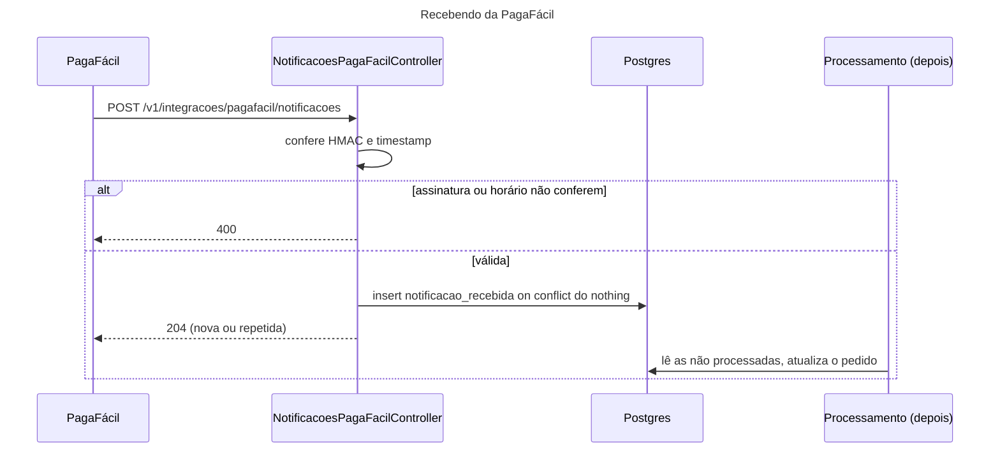

## O problema

Lojistas do Bazar usam um ERP para emitir nota fiscal e separar o estoque. Hoje, para saber que entrou um pedido, o ERP consulta `GET /v1/pedidos` a cada minuto, o dia inteiro, quase sempre para descobrir que nada mudou. Com mil lojistas, são 1,4 milhão de consultas por dia, e o pedido ainda leva até um minuto para aparecer.

O inverso resolve: **o Bazar avisa o ERP** quando um pedido é criado, com um `POST` numa URL que o ERP informou. Isso é um **webhook**, um "*callback* por HTTP".

A ideia é simples, e por isso os problemas aparecem na implementação:

- O ERP está fora do ar quando o aviso sai. O aviso se perde?
- O aviso chega duas vezes. O ERP emite duas notas?
- Alguém descobre a URL do ERP e manda avisos falsos. Como o ERP sabe que veio do Bazar?
- Um "parceiro" cadastra como URL um endereço da rede interna do Bazar. O Bazar faz a requisição por ele?

E o Bazar também está do outro lado: a PagaFácil, o *gateway* de pagamento da Parte 10, avisa o Bazar por webhook quando um pagamento é aprovado. As mesmas perguntas valem, invertidas.

É como o correio com aviso de recebimento: o carteiro tenta entregar; se ninguém atende, deixa o aviso e volta depois, algumas vezes; quem recebe confere o remetente e o lacre antes de abrir; e uma segunda via da mesma carta não vira uma segunda compra.

> **A pergunta desta página:** como o Bazar envia webhooks sem perder nem forjar eventos, e como recebe os da PagaFácil sem ser enganado nem processar duas vezes?

## O conceito

### Enviando: as garantias

**Pelo menos uma vez (*at-least-once*).** O Bazar não pode garantir que cada aviso chegue **exatamente** uma vez. Se o ERP processou o aviso e a resposta `200` se perdeu, o Bazar não tem como saber, e vai mandar de novo. O que ele garante é que o aviso chega **pelo menos** uma vez: insiste até receber um `2xx`, ou até desistir depois de um prazo. A outra metade da garantia ("não processar duas vezes") é responsabilidade de quem recebe, pelo identificador do evento.

**Não perder o evento.** Se o Bazar envia o aviso direto do código que cria o pedido, há duas formas de perdê-lo: o processo cai entre o *commit* do pedido e o envio, ou o envio falha e ninguém tenta de novo. A solução é o padrão **outbox**: na mesma transação que cria o pedido, o Bazar grava uma linha "aviso a entregar" numa tabela. Um processo separado (o entregador) lê essa tabela e envia. O pedido e o aviso nascem juntos ou não nascem; e o entregador tenta até conseguir.

**Retentativas espaçadas, com *jitter*.** Se o ERP está fora, tentar de novo em um segundo não adianta. O Bazar espera cada vez mais: 5 segundos, 30 segundos, 2 minutos, 10 minutos, 1 hora, 3 horas, 8 horas. São oito tentativas em cerca de 12 horas. Cada espera recebe uma variação aleatória (*jitter*) de ±25%: sem ela, os mil avisos que falharam quando o ERP caiu voltariam todos no mesmo segundo quando ele voltasse, e o derrubariam de novo. A [25.02](/consumindo-outras-apis/retry-quando-e-seguro-e-como-fazer) aprofunda o *backoff*.

**Desistir e avisar.** Depois da última tentativa, a entrega fica `FALHOU`, e a assinatura é **desativada**: um endpoint que não responde há 12 horas provavelmente mudou ou foi desligado, e insistir gasta recursos dos dois lados. O parceiro vê o motivo no histórico de entregas e reativa quando consertar. Um `410 Gone` desativa na hora: o parceiro disse que o endpoint não existe mais.

**Sem garantia de ordem.** Com retentativas e entregas em paralelo, o aviso `pedido.cancelado` pode chegar antes do `pedido.criado` que falhou na primeira tentativa. O parceiro não deve depender da ordem de chegada; o `timestamp` do evento e a consulta à API dizem qual é o estado atual.

### Enviando: o formato

O corpo é um **evento**. O Bazar segue o formato do **Standard Webhooks**, uma especificação aberta escrita por empresas que operam webhooks em escala:

```json
{
  "type": "pedido.criado",
  "timestamp": "2026-10-26T11:23:07.831163867Z",
  "data": { "pedidoId": "01a177f3-2c7d-7fe8-9ab7-b8b4482671d4", "valorTotal": { "valor": "139.90", "moeda": "BRL" } }
}
```

O **CloudEvents**, da CNCF, é a alternativa mais difundida fora do mundo dos webhooks: ele define atributos (`id`, `source`, `type`, `specversion`, `time`, `data`) e como levá-los em HTTP, Kafka ou AMQP. Os dois resolvem o mesmo problema: um envelope comum, para o parceiro não precisar de um *parser* por tipo de evento. Escolha um e seja consistente.

**Evento magro × completo.** O evento do Bazar é **magro** (*thin*): leva o id do pedido e o valor, e o ERP busca o resto com `GET /v1/pedidos/{id}`, com as permissões dele. Um evento **completo** (*fat*) leva o pedido inteiro, e poupa a consulta. O magro tem três vantagens. Não manda dados pessoais (nome, endereço, CPF) para uma URL de terceiro, onde eles podem parar num log. Evita mostrar um estado velho: se o pedido mudou entre o evento e a entrega (que pode levar horas), o `GET` mostra o atual. E o contrato fica menor. O custo é a consulta extra.

### Enviando: a assinatura HMAC

Para o parceiro saber que o aviso veio do Bazar e não foi alterado no caminho, cada entrega leva uma assinatura. O Standard Webhooks define três headers:

| Header | Conteúdo |
|---|---|
| `webhook-id` | O id do evento. **O mesmo em todas as tentativas**: é por ele que o parceiro reconhece uma repetição. |
| `webhook-timestamp` | O horário **desta tentativa**, em segundos Unix. |
| `webhook-signature` | `v1,` + HMAC-SHA256 de `webhook-id.webhook-timestamp.corpo`, em base64. |

O **segredo** do HMAC é gerado pelo Bazar na criação da assinatura e mostrado **uma única vez** ao parceiro (`whsec_` + 32 bytes em base64). O parceiro calcula o mesmo HMAC com o segredo e compara. Como o *timestamp* entra no HMAC, o parceiro pode recusar avisos com mais de alguns minutos: alguém que capturou um aviso legítimo não consegue reenviá-lo depois (*replay*), porque não consegue trocar o horário sem invalidar a assinatura.

O header `webhook-signature` pode ter várias assinaturas separadas por espaço. É assim que se troca o segredo sem parar as entregas: durante a transição, o Bazar assina com o segredo antigo e com o novo, e o parceiro aceita qualquer uma das duas.

A **RFC 9421** (*HTTP Message Signatures*, 2024) é o padrão da IETF para assinar mensagens HTTP: ela define como escolher os componentes assinados (método, URL, headers, corpo) e os headers `Signature` e `Signature-Input`. É mais geral e mais complexa que o esquema do Standard Webhooks, e começa a aparecer em APIs de *open banking*. Para webhooks, o esquema simples é o que a maioria dos parceiros sabe verificar.

### Enviando: SSRF

A URL do webhook é escolhida por quem está de **fora**, e a requisição sai de **dentro** da rede do Bazar. Um "parceiro" que cadastra `http://10.0.0.5/admin` ou `http://169.254.169.254/latest/meta-data/` (o serviço de metadados da nuvem, que entrega credenciais) usa o Bazar para alcançar o que ele mesmo não alcança. É o **SSRF** (*Server-Side Request Forgery*), um dos riscos do OWASP API Top 10 ([26.05](/seguranca-essencial-para-apis/transporte-segredos-headers-de-seguranca-e-ssrf); veja também a [documentação de segurança](https://security-doc-beta.vercel.app/)). As defesas mínimas:

- Só `https`.
- Resolver o nome e recusar endereços internos: *loopback* (`127.0.0.1`, `::1`), redes privadas (`10.x`, `172.16-31.x`, `192.168.x`), *link-local* (`169.254.x`, onde fica o serviço de metadados).
- Validar **de novo a cada entrega**, porque o DNS do parceiro pode passar a apontar o mesmo nome para um endereço interno depois do cadastro (*DNS rebinding*).
- **Não seguir redirecionamentos**: um `302` para `http://169.254.169.254/` passaria por cima de toda a validação.

### Recebendo

Do outro lado, recebendo da PagaFácil, as regras se invertem:

1. **Verifique a assinatura** com o segredo que a PagaFácil forneceu, sobre os **bytes exatos** do corpo. Desserializar e serializar de novo pode mudar espaços ou a ordem dos campos, e a assinatura deixa de bater.
2. **Verifique o *timestamp***: mais de 5 minutos de diferença, recuse (proteção contra *replay*).
3. **Deduplique pelo `webhook-id`**: uma repetição recebe `2xx` de novo (para o remetente parar de tentar), mas não é processada de novo.
4. **Responda `2xx` rápido e processe depois.** O remetente tem um *timeout* curto; se o processamento (atualizar o pedido, mandar e-mail) demorar, ele desiste e reenvia, e o processamento lento vira processamento duplicado. Grave a notificação e responda; um processo separado a trata.

## Diagrama

```mermaid
---
title: Enviando um webhook, com retentativas
---
sequenceDiagram
    participant API as POST /v1/pedidos
    participant DB as Postgres
    participant E as EntregadorDeWebhooks
    participant ERP as ERP do lojista
    API->>DB: BEGIN; insert pedido
    API->>DB: insert entrega_webhook (PENDENTE)
    API->>DB: COMMIT
    loop a cada 1 s
        E->>DB: reserva entregas vencidas (SKIP LOCKED)
    end
    E->>ERP: POST (webhook-id, timestamp, signature)
    ERP-->>E: 503
    E->>DB: tentativas=1, próxima em ~5 s
    E->>ERP: POST (mesmo webhook-id, novo timestamp)
    ERP-->>E: 503
    E->>DB: tentativas=2, próxima em ~30 s
    E->>ERP: POST (mesmo webhook-id)
    ERP-->>E: 200
    E->>DB: ENTREGUE
```



## Na prática

### O outbox

O `PedidoService` publica o evento `PedidoCriado` desde a [10.03](/persistencia-para-apis/transacoes-na-camada-de-servico). Um ouvinte novo o transforma numa entrega:

```java title="src/main/java/com/bazar/integracoes/webhooks/EventosParaWebhooks.java (trecho)"
/**
 * Transforma eventos do domínio em entregas de webhook (21.03).
 * <p>
 * É um @EventListener comum, e não um @TransactionalEventListener: roda na hora do publishEvent, dentro da transação
 * que criou o pedido. A entrega é gravada no mesmo commit do pedido (o padrão outbox). Se o pedido for desfeito, a
 * entrega também é; se o processo cair logo depois do commit, a entrega já está na tabela, e o entregador a envia
 * quando voltar.
 */
@Component
class EventosParaWebhooks {

    // Um evento "magro": o essencial para o parceiro decidir o que fazer, e o id para buscar o resto na API, com as
    // permissões dele. Nada de dados pessoais do cliente num POST para uma URL de terceiro.
    record DadosDoPedidoCriado(UUID pedidoId, Dinheiro valorTotal) {
    }

    @EventListener
    void aoCriarPedido(PedidoCriado evento) {
        var agora = relogio.instant();
        var corpo = json.writeValueAsString(new Evento(PEDIDO_CRIADO, agora,
                new DadosDoPedidoCriado(evento.pedidoId(), evento.valorTotal())));
        entregas.enfileirar(PEDIDO_CRIADO, Ids.novo(), corpo, agora);
    }
}
```

A diferença entre `@EventListener` e `@TransactionalEventListener` é o centro do padrão. O `RegistroDePedidosCriados` e o SSE da 19.04 usam `@TransactionalEventListener`, que roda **depois** do *commit*: é o certo para efeitos que não podem acontecer se o pedido for desfeito, mas que também não são críticos (um log, uma tela atualizada). Para o webhook, rodar depois do *commit* deixaria a janela da queda: pedido gravado, aviso não. Aqui, o ouvinte roda **dentro** da transação, e o que ele faz é só um `insert`, sem rede nenhuma.

O `enfileirar` cria uma entrega para cada assinatura ativa interessada no evento, num `insert ... select`:

```sql
insert into entrega_webhook (id, assinatura_id, evento_id, tipo_evento, corpo, status,
                             proxima_tentativa_em, criada_em)
select gen_random_uuid(), a.id, :evento, :tipo, :corpo, 'PENDENTE', :agora, :agora
  from assinatura_webhook a
 where a.ativa and :tipo = any (string_to_array(a.eventos, ','))
```

### O entregador

```java title="src/main/java/com/bazar/integracoes/webhooks/EntregadorDeWebhooks.java (trecho)"
// Sem seguir redirecionamentos: um 302 para http://169.254.169.254/ passaria por cima da validação da URL.
private final HttpClient http = HttpClient.newBuilder()
        .connectTimeout(Duration.ofSeconds(5))
        .followRedirects(HttpClient.Redirect.NEVER)
        .build();

@Scheduled(fixedDelayString = "${bazar.webhooks.intervalo}")
void entregarPendentes() {
    var reservadas = entregas.reservar(LIMITE_POR_RODADA, PRAZO_DA_RESERVA, relogio.instant());
    // Em paralelo, uma virtual thread por entrega: um parceiro lento (até 10 s de timeout) não atrasa os outros.
    try (var executor = Executors.newVirtualThreadPerTaskExecutor()) {
        reservadas.forEach(entrega -> executor.submit(() -> entregar(entrega)));
    }
}

void entregar(EntregasDeWebhook.Reservada entrega) {
    Integer statusHttp = null;
    String erro = null;
    try {
        validador.validar(entrega.url());
        var corpo = entrega.corpo().getBytes(StandardCharsets.UTF_8);
        var id = entrega.eventoId().toString();
        // O timestamp é o do envio, não o do evento: o recebedor recusa assinaturas velhas (replay).
        var timestamp = relogio.instant().getEpochSecond();
        var requisicao = HttpRequest.newBuilder(entrega.url())
                .timeout(Duration.ofSeconds(10))
                .header("Content-Type", "application/json")
                .header("User-Agent", "Bazar-Webhooks/1.0")
                .header("webhook-id", id)
                .header("webhook-timestamp", String.valueOf(timestamp))
                .header("webhook-signature",
                        new AssinaturaStandardWebhooks(entrega.segredo()).assinar(id, timestamp, corpo))
                .POST(HttpRequest.BodyPublishers.ofByteArray(corpo))
                .build();
        statusHttp = http.send(requisicao, HttpResponse.BodyHandlers.discarding()).statusCode();
    }
    catch (IOException | CampoInvalidoException ex) {
        erro = ex.getClass().getSimpleName() + ": " + ex.getMessage();
    }
    catch (InterruptedException ex) {
        // A aplicação está parando. A reserva vence, e a entrega volta para a fila.
        Thread.currentThread().interrupt();
        return;
    }
    registrar(entrega, statusHttp, erro);
}
```

O entregador usa o `HttpClient` do JDK direto, com os dois *timeouts* explícitos (conexão e resposta). O `RestClient` do Spring, que a [Parte 10](/consumindo-outras-apis/panorama-dos-clientes-http-no-spring) apresenta, faria o mesmo. O que importa aqui são as decisões: *timeouts* curtos, sem redirecionamento, corpo da resposta descartado (o parceiro pode responder qualquer coisa, inclusive um corpo enorme).

A **reserva** é a mesma técnica da fila de operações da 19.03. Um `update ... where id in (select ... for update skip locked)` empurra a próxima tentativa para daqui a um minuto e devolve as linhas. Com duas instâncias do Bazar, cada entrega é enviada por uma só. Se a instância cair no meio do envio, o minuto passa e a entrega volta à fila (e o parceiro pode recebê-la duas vezes: é o *at-least-once*).

O que acontece depois do envio:

```java title="src/main/java/com/bazar/integracoes/webhooks/EntregadorDeWebhooks.java (trecho)"
private void registrar(EntregasDeWebhook.Reservada entrega, @Nullable Integer statusHttp, @Nullable String erro) {
    var agora = relogio.instant();
    if (statusHttp != null && statusHttp >= 200 && statusHttp < 300) {
        entregas.marcarEntregue(entrega.id(), statusHttp, agora);
        return;
    }
    // 410 Gone: o parceiro disse que este endpoint não existe mais. Não adianta insistir.
    if (entrega.tentativas() > esperas.size() || Integer.valueOf(410).equals(statusHttp)) {
        entregas.marcarFalhou(entrega.id(), statusHttp, erro);
        assinaturas.desativar(entrega.assinaturaId(), agora);
        return;
    }
    entregas.agendarNovaTentativa(entrega.id(), statusHttp, erro,
            agora.plus(comVariacao(esperas.get(entrega.tentativas() - 1))));
}

// Jitter: de 75% a 125% da espera. Sem ele, mil entregas que falharam juntas (o parceiro caiu) voltam todas no
// mesmo segundo quando ele volta, e o derrubam de novo.
private static Duration comVariacao(Duration espera) {
    return espera.multipliedBy(ThreadLocalRandom.current().nextInt(75, 126)).dividedBy(100);
}
```

As esperas vêm da configuração, uma lista de `Duration` lida por um `@ConfigurationProperties`:

```yaml title="src/main/resources/application.yml (trecho)"
bazar:
  webhooks:
    # A cada quanto tempo o entregador procura entregas vencidas (21.03).
    intervalo: 1s
    # A espera antes de cada nova tentativa: 8 tentativas em cerca de 12 horas.
    esperas: 5s, 30s, 2m, 10m, 1h, 3h, 8h
    aceitar-enderecos-locais: ${BAZAR_WEBHOOKS_LOCAIS:false}
```

### A assinatura HMAC

```java title="src/main/java/com/bazar/integracoes/AssinaturaStandardWebhooks.java (trecho)"
public String assinar(String id, long timestamp, byte[] corpo) {
    return "v1," + Base64.getEncoder().encodeToString(hmac(id, timestamp, corpo));
}

public boolean verificar(String id, String timestamp, byte[] corpo, String assinaturas, Instant agora,
        Duration tolerancia) {
    long segundos;
    try {
        segundos = Long.parseLong(timestamp);
    }
    catch (NumberFormatException ex) {
        return false;
    }
    if (Duration.between(Instant.ofEpochSecond(segundos), agora).abs().compareTo(tolerancia) > 0) {
        return false;
    }
    var esperada = hmac(id, segundos, corpo);
    for (var assinatura : assinaturas.split(" ")) {
        if (assinatura.startsWith("v1,")) {
            try {
                // Comparação em tempo constante: um equals comum para no primeiro byte diferente, e o tempo de
                // resposta revelaria quantos bytes já estão certos.
                if (MessageDigest.isEqual(esperada, Base64.getDecoder().decode(assinatura.substring(3)))) {
                    return true;
                }
            }
            catch (IllegalArgumentException ex) {
                // Base64 inválido: não é esta.
            }
        }
    }
    return false;
}

private byte[] hmac(String id, long timestamp, byte[] corpo) {
    var mac = Mac.getInstance("HmacSHA256");
    mac.init(new SecretKeySpec(chave, "HmacSHA256"));
    mac.update((id + "." + timestamp + ".").getBytes(StandardCharsets.UTF_8));
    return mac.doFinal(corpo);
}
```

A mesma classe assina o que o Bazar envia e verifica o que ele recebe. Para ter certeza de que ela segue a especificação, e não só de que concorda consigo mesma, o teste usa o **vetor de teste** publicado pelo Standard Webhooks:

```java title="src/test/java/com/bazar/integracoes/AssinaturaStandardWebhooksTest.java (trecho)"
// O vetor de teste da especificação do Standard Webhooks: outra implementação, com o mesmo segredo, a mesma
// mensagem e o mesmo horário, chega à mesma assinatura.
static final String SEGREDO = "whsec_MfKQ9r8GKYqrTwjUPD8ILPZIo2LaLaSw";
static final String ID = "msg_p5jXN8AQM9LWM0D4loKWxJek";
static final long TIMESTAMP = 1614265330;
static final byte[] CORPO = "{\"test\": 2432232314}".getBytes(StandardCharsets.UTF_8);
static final String ASSINATURA = "v1,g0hM9SsE+OTPJTGt/tmIKtSyZlE3uFJELVlNIOLJ1OE=";

@Test
void assinaComoAEspecificacao() {
    assertThat(assinatura.assinar(ID, TIMESTAMP, CORPO)).isEqualTo(ASSINATURA);
}
```

### A assinatura do parceiro

<HttpExchange
  title="O ERP se inscreve"
  request={{ method: 'POST', url: '/v1/assinaturas-webhook', headers: { 'Content-Type': 'application/json' }, body: { parceiro: 'ERP da Loja Exemplo', url: 'https://erp.lojaexemplo.com.br/webhooks/bazar', eventos: ['pedido.criado'] } }}
  response={{ status: 201, headers: { 'Location': 'http://localhost:8080/v1/assinaturas-webhook/01a177f2-83eb-7a2d-ac61-40966fef0786', 'Content-Type': 'application/json' }, body: { id: '01a177f2-83eb-7a2d-ac61-40966fef0786', parceiro: 'ERP da Loja Exemplo', url: 'https://erp.lojaexemplo.com.br/webhooks/bazar', eventos: ['pedido.criado'], ativa: true, criadaEm: '2026-10-26T11:22:24.613073699Z', desativadaEm: null, segredo: 'whsec_uU1PvwNbwvuyFS8w6oZozODGBw9Nrv03oA+ogM77lPg=' } }}
>
O segredo aparece só aqui. Um `GET` da mesma assinatura devolve tudo, menos o `segredo`: um parceiro que o perdeu cria uma assinatura nova. "Assinatura" tem dois sentidos nesta página: a inscrição (*subscription*, este recurso) e a assinatura HMAC de cada entrega.
</HttpExchange>

<HttpExchange
  title="Um 'parceiro' tentando SSRF"
  request={{ method: 'POST', url: '/v1/assinaturas-webhook', headers: { 'Content-Type': 'application/json', 'Accept-Language': 'pt-BR' }, body: { parceiro: 'X', url: 'https://169.254.169.254/latest/meta-data/', eventos: ['pedido.criado'] } }}
  response={{ status: 422, headers: { 'Content-Type': 'application/problem+json' }, body: { type: 'https://api.bazar.example/problemas/validacao', title: 'Dados inválidos', status: 422, detail: 'A requisição tem 1 campo inválido.', instance: '/v1/assinaturas-webhook', erros: [ { campo: 'url', mensagem: 'A URL aponta para um endereço de rede interna.' } ], codigo: 'VALIDACAO', traceId: 'e91e26064e76adf147425717aa36b275' } }}
>
Com `http://`, a recusa é "A URL precisa usar https.". Em desenvolvimento e nos testes, a variável `BAZAR_WEBHOOKS_LOCAIS=true` libera `http` e `localhost`, para o laboratório abaixo.
</HttpExchange>

### O laboratório: falhas e retentativas

Um "ERP" de mentira, um servidor Python que confere a assinatura com o segredo recebido e responde `503` nas duas primeiras tentativas. O Bazar rodou com esperas encurtadas (`--bazar.webhooks.esperas=2s,4s,8s`) para caber na página. Um pedido criado:

```text noCopy
t=  0.0s  tentativa 1  webhook-id=01a177f3-2cb9-76c4-bcaf-05a44e8346f9  assinatura ok  -> 503
   corpo: {"type":"pedido.criado","timestamp":"2026-10-26T11:23:07.831163867Z","data":{"pedidoId":"01a177f3-2c7d-7fe8-9ab7-b8b4482671d4","valorTotal":{"valor":"139.90","moeda":"BRL"}}}
t=  3.0s  tentativa 2  webhook-id=01a177f3-2cb9-76c4-bcaf-05a44e8346f9  assinatura ok  -> 503
t=  7.1s  tentativa 3  webhook-id=01a177f3-2cb9-76c4-bcaf-05a44e8346f9  assinatura ok  -> 200
```

O mesmo `webhook-id` nas três tentativas, e a assinatura válida em todas, cada uma com o seu *timestamp*. Os intervalos (3,0 s e 4,1 s) são a espera configurada, com o *jitter*, mais até 1 segundo do ciclo do entregador. O histórico, do ponto de vista do parceiro:

<HttpExchange
  title="O histórico de entregas"
  request={{ method: 'GET', url: '/v1/assinaturas-webhook/01a177f2-83eb-7a2d-ac61-40966fef0786/entregas' }}
  response={{ status: 200, headers: { 'Content-Type': 'application/json' }, body: [ { id: 'a804a90f-6097-4184-ac73-4e0404092902', eventoId: '01a177f3-2cb9-76c4-bcaf-05a44e8346f9', tipoEvento: 'pedido.criado', status: 'ENTREGUE', tentativas: 3, ultimoStatusHttp: 200, ultimoErro: null, proximaTentativaEm: null, criadaEm: '2026-10-26T11:23:07.831164Z', entregueEm: '2026-10-26T11:23:15.046058Z' } ] }}
>
Quando um aviso não chega, o parceiro descobre aqui o motivo (o status que o endpoint dele devolveu, ou o erro de conexão), sem abrir um chamado.
</HttpExchange>

### Recebendo da PagaFácil

```java title="src/main/java/com/bazar/integracoes/pagafacil/NotificacoesPagaFacilController.java (trecho)"
// O corpo chega como bytes, sem desserializar: a assinatura é calculada sobre os bytes exatos. Um JSON lido e
// escrito de novo pode mudar espaços ou a ordem dos campos, e a assinatura deixaria de bater.
@PostMapping("/v1/integracoes/pagafacil/notificacoes")
public ResponseEntity<Void> receber(@RequestHeader("webhook-id") String id,
        @RequestHeader("webhook-timestamp") String timestamp,
        @RequestHeader("webhook-signature") String assinaturas, @RequestBody byte[] corpo) {
    var agora = relogio.instant();
    if (!assinatura.verificar(id, timestamp, corpo, assinaturas, agora, TOLERANCIA)) {
        throw new RegraDeNegocioException(TipoProblema.WEBHOOK_NAO_VERIFICADO, Map.of());
    }
    if (!notificacoes.registrar(ORIGEM, id, new String(corpo, StandardCharsets.UTF_8), agora)) {
        log.info("Notificação {} da PagaFácil repetida; ignorada", id);
    }
    return ResponseEntity.noContent().build();
}
```

O `registrar` é um `insert ... on conflict (origem, webhook_id) do nothing`, que devolve se a linha é nova. Uma repetição recebe o mesmo `204`: se recebesse um erro, a PagaFácil continuaria tentando. O processamento em si (o pedido passa a `PAGO`) chega com o pagamento, na Parte 10. Ele vai ler as notificações com `processada_em` nulo, como o entregador lê as entregas pendentes.

Uma falha de verificação responde `400`, e não `401`. O `401` diria "faltam credenciais", e a RFC 9110 exige que ele venha com um header `WWW-Authenticate` indicando o esquema de autenticação, que o Standard Webhooks não define.

As quatro situações, com um *script* que assina como a PagaFácil assinaria:

```text noCopy
== válida              204
== repetida            204   (a tabela continua com uma linha só)
== corpo adulterado    400 {"type":".../webhook-nao-verificado","title":"Webhook não verificado",...}
== 10 min atrás        400 {"type":".../webhook-nao-verificado",...}
```

O "corpo adulterado" trocou o id do pagamento depois de assinar, como faria alguém no meio do caminho. O "10 min atrás" tem a assinatura **certa**, calculada com o segredo certo, mas o *timestamp* fora da tolerância. É a captura e o reenvio de um aviso legítimo.

### Os testes

O teste de integração sobe um servidor HTTP de verdade (`com.sun.net.httpserver.HttpServer`, do próprio JDK) no papel do ERP:

```java title="src/test/java/com/bazar/integracoes/webhooks/WebhooksTest.java (trecho)"
@Test
void umaFalhaAgendaOutraTentativaComOMesmoWebhookId() throws Exception {
    proximoStatus.set(503);
    var assinatura = assinar();
    criarPedido();

    await().atMost(Duration.ofSeconds(5)).until(() -> recebidos.size() == 1);
    await().atMost(Duration.ofSeconds(5)).untilAsserted(() -> assertThat(entrega(assinatura))
            .containsEntry("status", "PENDENTE").containsEntry("ultimo_status_http", 503));
    // A primeira espera é de 5 s, com variação de 75% a 125%.
    var espera = Duration.between(Instant.now(), ((Timestamp) entrega(assinatura)
            .get("proxima_tentativa_em")).toInstant());
    assertThat(espera).isBetween(Duration.ofSeconds(2), Duration.ofSeconds(7));

    proximoStatus.set(200);
    jdbc.sql("update entrega_webhook set proxima_tentativa_em = now()").update();
    await().atMost(Duration.ofSeconds(5)).untilAsserted(() -> assertThat(entrega(assinatura))
            .containsEntry("status", "ENTREGUE").containsEntry("tentativas", 2));
    // O mesmo evento, a mesma identidade: é assim que o parceiro reconhece uma repetição.
    assertThat(recebidos).extracting(Recebido::id).containsExactly(recebidos.getFirst().id(),
            recebidos.getFirst().id());
}
```

Em vez de esperar 5 segundos, o teste adianta a próxima tentativa direto no banco. As outras classes cobrem o segredo só na criação, o `410` que desativa a assinatura, a validação da URL (um teste parametrizado com `127.0.0.1`, `10.0.0.5`, `169.254.169.254`, `[::1]`, `http://`) e o recebimento (válida, repetida, assinatura errada, *timestamp* velho).

## Erros comuns

<BadVsGood title="Enviar o webhook de dentro da requisição" why="O POST do pedido passa a depender do ERP: se ele demora 10 s, o cliente espera 10 s; se ele está fora, o aviso se perde (ou o pedido falha). E se o envio vier depois do commit, uma queda entre os dois perde o aviso. Com o outbox, a requisição só grava uma linha, na mesma transação, e o envio acontece fora, com retentativas.">
<Bad title="HTTP para o parceiro no meio do caso de uso">

```java
@Transactional
public Pedido criar(...) {
    // ... grava o pedido ...
    for (var a : assinaturas.ativas()) {
        http.send(post(a.url(), evento)); // 10 s?
    }
    return pedido;
}
```

</Bad>
<Good title="Uma linha no outbox, na mesma transação">

```java
@EventListener   // dentro da transação
void aoCriarPedido(PedidoCriado evento) {
    entregas.enfileirar(PEDIDO_CRIADO,
        Ids.novo(), corpo(evento), agora);
}
// e o EntregadorDeWebhooks envia depois
```

</Good>
</BadVsGood>

Outros tropeços frequentes:

- **Um `webhook-id` novo a cada tentativa.** O parceiro não consegue deduplicar, e cada retentativa vira um evento novo.
- **Retentativas sem *jitter* e sem limite.** O parceiro que volta do ar recebe uma avalanche, e um endpoint morto recebe tentativas para sempre.
- **Aceitar qualquer URL** e seguir redirecionamentos: SSRF.
- **Verificar a assinatura depois de desserializar** o JSON. Os bytes mudam, e a verificação falha (ou, pior, o código pula a verificação "porque não bate").
- **Comparar assinaturas com `equals`.** A comparação para no primeiro byte diferente, e o tempo de resposta vaza informação (*timing attack*). `MessageDigest.isEqual` compara em tempo constante.
- **Ignorar o *timestamp*.** Uma assinatura válida capturada pode ser reenviada para sempre.
- **Processar a notificação antes de responder.** O remetente desiste por *timeout* e reenvia, e o processamento acontece duas vezes.
- **Responder erro a uma repetição.** O remetente acha que falhou e continua tentando.
- **Evento completo com dados pessoais** para uma URL de terceiro.
- **Mostrar o segredo em todo `GET`**, ou guardá-lo em log.

## Boas práticas

- **Outbox**: grave a entrega na transação do evento; envie fora dela.
- **Pelo menos uma vez**, com `webhook-id` estável, retentativas espaçadas com *jitter*, limite, e desativação do endpoint que não responde.
- **Assine** (Standard Webhooks ou RFC 9421), com *timestamp*, e mostre o segredo uma vez só.
- **Valide a URL** no cadastro e a cada envio, só `https`, sem endereços internos, sem seguir redirecionamentos.
- **Eventos magros**, com o id para o parceiro consultar a API.
- **Histórico de entregas** visível para o parceiro, e um evento de teste para ele validar a integração.
- **Recebendo**: verifique os bytes, o *timestamp* e a assinatura; deduplique pelo id; responda `2xx` rápido e processe depois.

## Por baixo dos panos

<DeepDive title="Por que at-least-once, e não exactly-once">

O "exatamente uma vez" entre dois sistemas separados por uma rede é impossível de garantir só com o protocolo. É uma versão do problema dos dois generais. Considere o último momento da entrega:

1. O Bazar envia o aviso.
2. O ERP processa e responde `200`.
3. A resposta se perde.

Do lado do Bazar, os passos 1-3 são indistinguíveis de "o aviso se perdeu no passo 1". Ele tem que escolher: reenviar (e talvez entregar duas vezes) ou não reenviar (e talvez não entregar). Não existe uma terceira opção que funcione em todos os casos.

Sistemas que anunciam *exactly-once* (o Kafka, por exemplo) fazem, na verdade, *at-least-once* na entrega mais **deduplicação** no consumo, com um identificador e um registro do que já foi processado, dentro do mesmo sistema. É exatamente o que o Bazar e a PagaFácil fazem entre si: o remetente reenvia até ter certeza, e o destinatário deduplica pelo `webhook-id`. O efeito é processado uma vez; a entrega, não.

O mesmo raciocínio está por trás da Idempotency-Key da [21.01](/padroes-avancados-de-http/idempotency-keys): lá, o cliente reenvia e o servidor deduplica pela chave.

</DeepDive>

## No projeto Bazar

<ProjectStep title="Webhooks de saída e de entrada" module="integracoes" tag="pagina-21.03" files={[
  { path: 'src/main/resources/db/migration/V15__webhooks.sql', change: 'novo' },
  { path: 'src/main/java/com/bazar/integracoes/AssinaturaStandardWebhooks.java', change: 'novo' },
  { path: 'src/main/java/com/bazar/integracoes/webhooks/AssinaturaWebhookController.java', change: 'novo' },
  { path: 'src/main/java/com/bazar/integracoes/webhooks/EventosParaWebhooks.java', change: 'novo' },
  { path: 'src/main/java/com/bazar/integracoes/webhooks/EntregadorDeWebhooks.java', change: 'novo' },
  { path: 'src/main/java/com/bazar/integracoes/webhooks/EntregasDeWebhook.java', change: 'novo' },
  { path: 'src/main/java/com/bazar/integracoes/webhooks/AssinaturasWebhook.java', change: 'novo' },
  { path: 'src/main/java/com/bazar/integracoes/webhooks/ValidadorDeUrl.java', change: 'novo' },
  { path: 'src/main/java/com/bazar/integracoes/webhooks/ConfiguracaoDeWebhooks.java', change: 'novo' },
  { path: 'src/main/java/com/bazar/integracoes/pagafacil/NotificacoesPagaFacilController.java', change: 'novo' },
  { path: 'src/main/java/com/bazar/integracoes/pagafacil/NotificacoesRecebidas.java', change: 'novo' },
  { path: 'src/test/java/com/bazar/integracoes/webhooks/WebhooksTest.java', change: 'novo' },
  { path: 'src/test/java/com/bazar/integracoes/pagafacil/NotificacoesPagaFacilTest.java', change: 'novo' },
  { path: 'src/main/resources/application.yml', change: 'alterado' },
]}>
Módulo novo, `integracoes`. **Saída**: parceiros se inscrevem em `/v1/assinaturas-webhook` (o segredo aparece só na criação; URL só `https` e pública), o evento `pedido.criado` vira uma linha no outbox na transação do pedido, e o `EntregadorDeWebhooks` envia com a assinatura do Standard Webhooks, em paralelo, com 8 tentativas espaçadas e *jitter*, desativando a assinatura que esgota as tentativas ou responde `410`. O parceiro vê o histórico em `/entregas`. **Entrada**: `POST /v1/integracoes/pagafacil/notificacoes` verifica assinatura e *timestamp* (`400` se não conferem), deduplica pelo `webhook-id` e responde `204`. O processamento da notificação chega com o pagamento, na Parte 10.
</ProjectStep>

## Resumo

- Webhook é o servidor avisando o cliente por HTTP, em vez de o cliente perguntar sem parar.
- Enviar: outbox na transação do evento, entrega *at-least-once* com `webhook-id` estável, retentativas espaçadas com *jitter*, limite e desativação.
- Assinar: HMAC-SHA256 de `id.timestamp.corpo` (Standard Webhooks), segredo mostrado uma vez, *timestamp* contra *replay*. A RFC 9421 é a alternativa padronizada e mais geral.
- A URL é escolhida por terceiros: só `https`, sem endereços internos, validada a cada envio, sem redirecionamentos (SSRF).
- Receber: verificar os bytes exatos, o *timestamp* e a assinatura (em tempo constante), deduplicar pelo id, responder `2xx` rápido e processar depois.
- *Exactly-once* entre sistemas é *at-least-once* mais deduplicação.

<Exercise title="O evento de teste" difficulty="medio">
O PROJETO-FINAL prevê `POST /v1/assinaturas-webhook/{id}/testes`: o parceiro dispara um evento de teste para conferir que o endpoint dele recebe e verifica as assinaturas.

1. O evento de teste deve passar pelo outbox e pelas retentativas, ou ser enviado na hora, dentro da requisição? Que status a ação devolve em cada caso?
2. Que `type` e que `data` ele deveria ter? Por que não mandar um `pedido.criado` com um pedido de verdade?
3. O parceiro desativado (8 falhas) consertou o endpoint. Como o evento de teste pode ajudar a reativar a assinatura com segurança?

<Hint>O parceiro quer saber o resultado na hora, enquanto está olhando a tela de configuração dele. E o SSRF continua valendo para uma URL que alguém mandou testar.</Hint>

<Solution>

1. Na hora, dentro da requisição, e sem retentativas: o objetivo é um diagnóstico imediato, e o parceiro vai repetir manualmente se falhar. A ação devolve `200` com o resultado da tentativa (`{ "statusHttp": 200, "duracaoMs": 87 }` ou `{ "erro": "ConnectException: Connection refused" }`), porque a **ação de testar** deu certo, mesmo que o endpoint testado tenha falhado. É o mesmo raciocínio do `FALHOU` com `200` na 21.02. Ela passa pela mesma validação de URL e pelo mesmo cliente HTTP sem redirecionamentos, com *timeout* curto. O endpoint de teste vira um jeito de fazer o Bazar chamar URLs arbitrárias, e precisa de limite de requisições (23.01).

2. Um tipo próprio, `webhook.teste`, com `data` fixo e sem dados reais (`{ "mensagem": "Evento de teste do Bazar" }`), assinado com o segredo da assinatura e com um `webhook-id` novo a cada teste. Um `pedido.criado` falso faria o ERP do parceiro emitir uma nota fiscal para um pedido que não existe. Um verdadeiro mandaria dados de um cliente para um endpoint que ainda está sendo configurado.

3. A reativação (`POST /v1/assinaturas-webhook/{id}/reativacao`) envia um evento de teste antes e só reativa se ele receber `2xx`. Assim, uma assinatura não volta a acumular entregas para um endpoint que continua quebrado. As entregas que falharam (`FALHOU`) não são reenviadas sozinhas: os eventos podem ter horas, e o parceiro decide se quer o reenvio (uma ação de "reentregar" por entrega, a partir do histórico) ou se vai buscar o estado atual na API.

</Solution>
</Exercise>

<Quiz questions={[
  {
    question: 'Por que o EventosParaWebhooks é um @EventListener comum, e não um @TransactionalEventListener?',
    options: [
      'Porque @TransactionalEventListener não funciona com records',
      'Para gravar a entrega na mesma transação do pedido: os dois nascem juntos ou nenhum, sem janela entre o commit e o registro do aviso',
      'Para enviar o webhook mais rápido',
      'Porque o evento não é publicado dentro de uma transação',
    ],
    answer: 1,
    explanation: 'É o outbox. Depois do commit, uma queda perderia o aviso; dentro da transação, o ouvinte só faz um insert, sem rede.',
  },
  {
    question: 'O ERP processou o aviso, mas a resposta 200 se perdeu. O que acontece, e como o ERP evita emitir duas notas?',
    options: [
      'Nada; o Bazar sabe que o aviso chegou',
      'O Bazar reenvia com o mesmo webhook-id; o ERP reconhece o id já processado e só responde 2xx',
      'O Bazar reenvia com um webhook-id novo, e o ERP compara o corpo',
      'O Bazar desativa a assinatura',
    ],
    answer: 1,
    explanation: 'At-least-once do lado de quem envia, deduplicação pelo id do lado de quem recebe.',
  },
  {
    question: 'Uma notificação da PagaFácil chega com a assinatura correta, mas o webhook-timestamp é de 10 minutos atrás. O que o Bazar faz?',
    options: [
      'Aceita, porque a assinatura confere',
      'Recusa com 400: pode ser a captura e o reenvio (replay) de um aviso legítimo',
      'Aceita e marca como atrasada',
      'Responde 401 com WWW-Authenticate',
    ],
    answer: 1,
    explanation: 'O timestamp entra no HMAC; quem capturou o aviso não consegue trocá-lo sem invalidar a assinatura, e o recebedor recusa horários fora da tolerância.',
  },
  {
    question: 'Por que o entregador não segue redirecionamentos?',
    options: [
      'Porque o HttpClient do JDK não sabe seguir',
      'Porque um 302 para um endereço interno (como 169.254.169.254) passaria por cima da validação de URL feita antes do envio: SSRF',
      'Porque redirecionamentos são lentos',
      'Porque o Standard Webhooks proíbe',
    ],
    answer: 1,
    explanation: 'A validação só vale para a URL que foi validada. Um redirecionamento leva a requisição para outra URL, que ninguém validou.',
  },
]} />

## Referências

<References />
