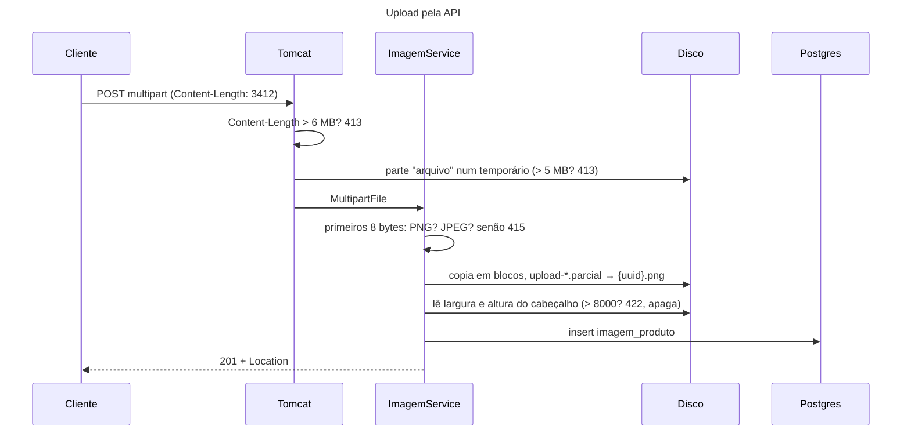
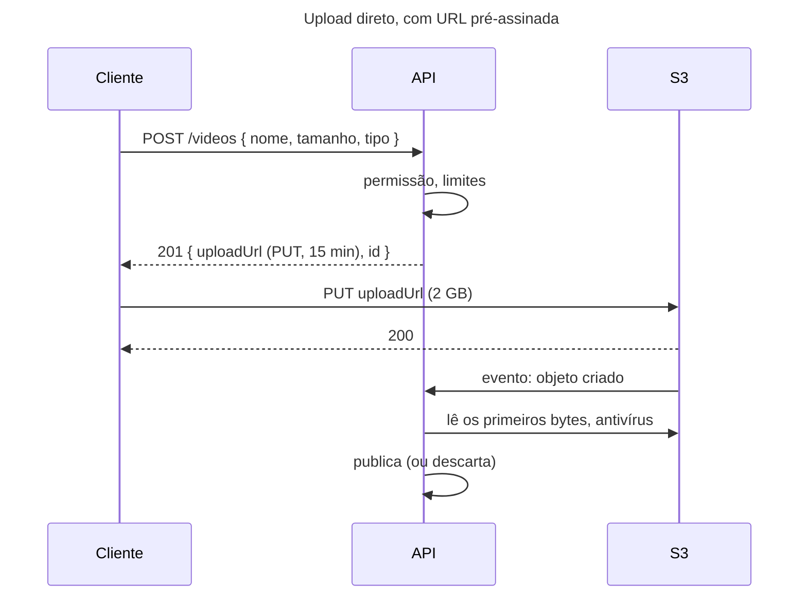

## O problema

O Bazar vai mostrar fotos dos produtos. O lojista escolhe um arquivo no painel e o painel o envia para a API. Parece só mais um `POST`, mas o corpo agora não é um JSON de 300 bytes que o Jackson lê de uma vez. É um arquivo de tamanho, formato e nome escolhidos por quem envia.

Cada uma dessas três escolhas é uma porta aberta:

- **Tamanho.** Um arquivo de 2 GB lido com `getBytes()` são 2 GB de *heap*. Dez desses ao mesmo tempo derrubam o servidor, e nem precisa ser um ataque: basta um lojista enviando o vídeo errado.
- **Formato.** O cliente diz `Content-Type: image/jpeg`, e o arquivo é um script PHP, um HTML com JavaScript ou um executável. Se o Bazar serve esse arquivo depois, ele roda no navegador de outro usuário, ou no servidor.
- **Nome.** `../../etc/cron.d/backup` e `capa.php.jpg` são nomes válidos de arquivo. Usá-los para gravar no disco é escrever onde o atacante quiser.

É como a recepção de um prédio que aceita encomendas: há um limite de tamanho (o elevador não leva um piano), o porteiro confere o que é o pacote em vez de acreditar na etiqueta, e cada caixa ganha a etiqueta do prédio, com o número do apartamento, e não o que o remetente escreveu por fora.

> **A pergunta desta página:** como receber arquivos na API sem confiar no tamanho, no tipo nem no nome que o cliente declara, e sem carregar o arquivo inteiro na memória?

## O conceito

### `multipart/form-data`

Um formulário HTML com `<input type="file">` envia o corpo em `multipart/form-data` (RFC 7578): várias **partes**, separadas por um delimitador (*boundary*) que o cliente escolhe. Cada parte tem os seus próprios headers:

```http
POST /v2/produtos/bcd399f5-d6d1-4032-9c80-10ca4c363d31/imagens HTTP/1.1
Content-Type: multipart/form-data; boundary=----bazar7MA4YWxk
Content-Length: 3412

------bazar7MA4YWxk
Content-Disposition: form-data; name="arquivo"; filename="capa.png"
Content-Type: image/png

‰PNG␍␊␚␊ ...3089 bytes binários...
------bazar7MA4YWxk
Content-Disposition: form-data; name="metadados"
Content-Type: application/json

{ "textoAlternativo": "Capa do livro Clean Code" }
------bazar7MA4YWxk--
```

É isso que permite mandar o **arquivo e os metadados juntos**, numa requisição só: a parte `arquivo` com os bytes, a parte `metadados` com um JSON. O `filename` e o `Content-Type` de cada parte são declarações do cliente, e é justamente nelas que não se pode confiar.

A alternativa é mandar o arquivo **como o corpo**, com `Content-Type: image/png` e mais nada. É mais simples para clientes que não são navegadores (um aplicativo, um script, outro servidor), e o nome, se importar, vai num header `Content-Disposition: attachment; filename="capa.png"`. Os metadados ficam para outra requisição. O Bazar aceita as duas formas no mesmo endpoint, escolhidas pelo `Content-Type` ([02.05](/comecando-e-fundamentos-de-http/content-negotiation-e-media-types)).

### Limites, e o `413`

O limite de tamanho tem que valer **enquanto** o corpo é lido, e não depois de ele estar inteiro no servidor. No Spring Boot, são duas propriedades, que o Tomcat confere ao separar as partes:

- `spring.servlet.multipart.max-file-size`: o tamanho de cada arquivo.
- `spring.servlet.multipart.max-request-size`: o tamanho do corpo inteiro, com todas as partes.

Passou de qualquer um dos dois, a resposta é **`413 Content Too Large`** (o nome atual, desde a RFC 9110; antes, *Payload Too Large*). Se o `Content-Length` declarado já passa do limite da requisição, o Tomcat recusa sem ler o corpo.

Os limites padrão do Spring Boot são 1 MB por arquivo e 10 MB por requisição: pequenos demais para fotos de celular e grandes demais para quem não precisa de upload. Ajuste-os ao que o endpoint aceita. O limite geral de corpo, para todos os endpoints, é assunto da [23.02](/padroes-avancados-de-http/limites-de-payload-e-protecao-contra-abuso).

### O tipo real: os primeiros bytes

O `Content-Type` da parte e a extensão do nome são o que o cliente **diz** que o arquivo é. O que ele **é** está nos primeiros bytes. Quase todo formato binário começa com uma assinatura fixa, o *magic number*:

| Formato | Primeiros bytes (hex) | Como texto |
|---|---|---|
| PNG | `89 50 4E 47 0D 0A 1A 0A` | `‰PNG␍␊␚␊` |
| JPEG | `FF D8 FF` | `ÿØÿ` |
| PDF | `25 50 44 46 2D` | `%PDF-` |
| ZIP (e DOCX, XLSX, JAR) | `50 4B 03 04` | `PK␃␄` |

Para dois formatos, uma tabela pequena resolve. Para aceitar dezenas (PDF, planilhas, áudio), o **Apache Tika** reconhece mais de mil tipos pelo conteúdo, com `new Tika().detect(inputStream)`. Ele também separa casos que a assinatura sozinha confunde, como um ZIP e um DOCX.

Os primeiros bytes ainda não bastam. Um arquivo pode começar como PNG e não ser um PNG válido, ou ser um PNG válido que declara 50000 × 50000 pixels em 75 bytes. Decodificar essa imagem pede 10 GB de memória: é uma **bomba de descompressão**. O Bazar lê o **cabeçalho** da imagem (largura e altura) sem decodificar os pixels, e recusa o que passa do limite. Quem for gerar miniaturas depois decodifica uma imagem já conferida.

### O nome: guardar, nunca usar

O nome que o cliente mandou é **dado para exibição**, e nada além disso. O arquivo é gravado com uma **chave gerada pelo servidor**: um UUID e a extensão do **formato reconhecido**. `../../capa.jpg` com conteúdo PNG vira `01a178c1-44aa-78ad-bb11-048775526d75.png`. Não há *path traversal* possível, não há dois arquivos com o mesmo nome, e a extensão sempre corresponde ao conteúdo.

O nome original é guardado no banco, sem caminho e sem caracteres de controle, para mostrar ao lojista ("capa.jpg") e para o `Content-Disposition` do download ([22.02](/padroes-avancados-de-http/download-streaming-e-range)).

### *Streaming*: nunca o arquivo inteiro na memória

`MultipartFile.getBytes()` devolve um `byte[]` do tamanho do arquivo. Com o limite de 5 MB e 200 uploads simultâneos, é 1 GB de *heap* só para isso. O caminho certo é `getInputStream()`, copiado em blocos para o destino: a memória usada é a de um bloco (8 KB), qualquer que seja o tamanho do arquivo.

No multipart, o Tomcat já faz a parte dele: grava cada parte num arquivo temporário à medida que o corpo chega (`spring.servlet.multipart.file-size-threshold` decide a partir de que tamanho; o padrão é zero, ou seja, sempre em disco). No corpo binário direto, não há arquivo temporário: o `InputStream` é o próprio *socket*, e o Bazar conta os bytes enquanto copia, porque não há Tomcat conferindo o limite.

### Arquivos grandes: URL pré-assinada

Passar o arquivo pela API faz sentido para imagens de alguns megabytes. Para vídeos de 2 GB, cada byte atravessa a API só para ir para o armazenamento (S3, GCS, Azure Blob), ocupando uma conexão por minutos. A alternativa é o cliente enviar **direto para o armazenamento**:

1. O cliente pede à API um lugar para enviar: `POST /v2/produtos/{id}/videos` com o nome e o tamanho.
2. A API confere permissão, tamanho e tipo declarados, e gera uma **URL pré-assinada**: uma URL do S3 que permite um `PUT` de um objeto específico, com tamanho e tipo fixos, válida por 15 minutos. Ela é assinada com a credencial da API, mas não a contém.
3. O cliente faz o `PUT` do arquivo direto no S3.
4. O S3 avisa a API (um evento), ou o cliente confirma (`POST .../confirmacao`). Só então a API confere o conteúdo de verdade (os primeiros bytes, o antivírus) e o publica.

A API nunca vê os bytes passando, e por isso a conferência do conteúdo vai para o passo 4: até ele, o objeto fica numa área de "não verificados", que não é servida a ninguém. O Bazar grava em disco local, e as URLs pré-assinadas ficam como nota: entram quando o armazenamento for um S3 ([31.03](/projeto-final-o-bazar/catalogo)).

### Uploads retomáveis e antivírus

Num celular com sinal ruim, um upload de 500 MB que cai em 90% recomeça do zero. O protocolo **tus** (e o *resumable upload* que a IETF está padronizando a partir dele) divide o envio em pedaços, e o cliente pergunta ao servidor quanto já chegou (`HEAD`, com o *offset*) antes de continuar. Vale para arquivos grandes em redes instáveis. Para imagens de 5 MB, é complexidade sem retorno.

Arquivos que **outras pessoas vão baixar** (anexos, documentos) devem passar por um antivírus antes de serem publicados, como o ClamAV, num processo separado, com o arquivo em quarentena até o resultado. Imagens que o Bazar só exibe, reconhecidas pelo cabeçalho e servidas com o tipo certo, têm um risco menor. Mas, se um dia o Bazar gerar miniaturas, a biblioteca de imagens vira a superfície de ataque (falhas em decodificadores de imagem são clássicas). Veja a [documentação de segurança](https://security-doc-beta.vercel.app/) e o [OWASP File Upload Cheat Sheet](https://cheatsheetseries.owasp.org/cheatsheets/File_Upload_Cheat_Sheet.html).

## Diagrama





## Na prática

### A configuração

```yaml title="src/main/resources/application.yml (trecho)"
spring:
  servlet:
    multipart:
      # Os limites do multipart, conferidos pelo Tomcat enquanto lê o corpo: passou, 413 (22.01). O da requisição
      # deixa folga para a parte dos metadados e os delimitadores.
      max-file-size: 5MB
      max-request-size: 6MB

bazar:
  imagens:
    diretorio: ${java.io.tmpdir}/bazar/imagens
```

### O controller: duas formas, um endpoint

```java title="src/main/java/com/bazar/catalogo/api/ImagemProdutoController.java (trecho)"
@PostMapping(path = "/v{versao}/produtos/{id}/imagens", version = "2", consumes = MediaType.MULTIPART_FORM_DATA_VALUE)
public ResponseEntity<ImagemProdutoResponse> adicionar(@PathVariable UUID id,
        @RequestPart("arquivo") MultipartFile arquivo,
        @RequestPart(name = "metadados", required = false) @Valid @Nullable MetadadosDaImagem metadados)
        throws IOException {
    // getInputStream, e não getBytes: o Tomcat já gravou a parte num arquivo temporário, e ela é copiada para o
    // armazenamento em blocos.
    try (var conteudo = arquivo.getInputStream()) {
        var nome = arquivo.getOriginalFilename();
        return criada(imagens.adicionar(id, nome != null ? nome : "imagem",
                metadados != null ? metadados.textoAlternativo() : null, conteudo));
    }
}

// O arquivo é o corpo, sem multipart: o cliente manda os bytes como estão, e o servidor os lê direto do socket.
@PostMapping(path = "/v{versao}/produtos/{id}/imagens", version = "2",
        consumes = { MediaType.IMAGE_JPEG_VALUE, MediaType.IMAGE_PNG_VALUE })
@Operation(hidden = true)
public ResponseEntity<ImagemProdutoResponse> adicionarBinaria(@PathVariable UUID id,
        @RequestHeader(name = HttpHeaders.CONTENT_DISPOSITION, required = false) @Nullable String disposicao,
        InputStream conteudo) {
    var nome = disposicao != null ? ContentDisposition.parse(disposicao).getFilename() : null;
    return criada(imagens.adicionar(id, nome != null ? nome : "imagem", null, conteudo));
}
```

As imagens só existem na **v2** de produtos. A v1 está em depreciação desde a [18.04](/contratos-documentacao-e-ciclo-de-vida/depreciacao-e-desligamento-de-apis): um recurso novo nasce na versão atual, e um `POST /v1/produtos/{id}/imagens` é um `404`.

O `@RequestPart("metadados")` com um record faz o Spring desserializar aquela parte como JSON (pelo `Content-Type: application/json` dela), e o `@Valid` valida como num `@RequestBody`. Um parâmetro `InputStream` recebe o corpo cru, sem conversor nenhum.

O `@Operation(hidden = true)` não esconde o endpoint, e sim resolve uma limitação do OpenAPI: ele tem **uma** operação por caminho e método. Sem isso, o springdoc junta os dois métodos e fica com um corpo só. A operação documentada declara os três tipos de corpo:

```java title="src/main/java/com/bazar/catalogo/api/ImagemProdutoController.java (trecho)"
requestBody = @io.swagger.v3.oas.annotations.parameters.RequestBody(required = true, content = {
    @Content(mediaType = MediaType.MULTIPART_FORM_DATA_VALUE,
            schema = @Schema(implementation = ImagemMultipartRequest.class)),
    @Content(mediaType = MediaType.IMAGE_JPEG_VALUE, schema = @Schema(type = "string", format = "binary")),
    @Content(mediaType = MediaType.IMAGE_PNG_VALUE, schema = @Schema(type = "string", format = "binary"))
})
```

### O serviço: reconhecer, gravar, conferir

```java title="src/main/java/com/bazar/catalogo/dominio/ImagemService.java (trecho)"
public ImagemProduto adicionar(UUID produtoId, String nomeOriginal, @Nullable String textoAlternativo,
        InputStream conteudo) {
    produtos.detalhar(produtoId);
    if (imagens.quantas(produtoId) >= MAXIMO_POR_PRODUTO) {
        throw new RegraDeNegocioException(TipoProblema.LIMITE_DE_IMAGENS, Map.of(), MAXIMO_POR_PRODUTO);
    }
    var entrada = new BufferedInputStream(new ComLimite(conteudo, TAMANHO_MAXIMO.toBytes()));
    var tipo = reconhecer(entrada);
    // A chave é do Bazar: um UUID e a extensão do formato reconhecido. O nome que o cliente mandou
    // ("../../etc/passwd", "foto.php.jpg") só é guardado como texto, para exibição.
    var id = Ids.novo();
    var chave = id + "." + tipo.extensao();
    var tamanho = armazenamento.gravar(chave, entrada);
    try {
        var dimensoes = dimensoes(armazenamento.caminho(chave));
        var imagem = new ImagemProduto(id, produtoId, chave, nomeSeguro(nomeOriginal), tipo.tipoConteudo(), tamanho,
                dimensoes[0], dimensoes[1], textoAlternativo, imagens.proximaOrdem(produtoId), relogio.instant());
        imagens.inserir(imagem);
        return imagem;
    }
    catch (RuntimeException ex) {
        // O arquivo foi gravado, mas a imagem não foi aceita (ou o insert falhou): nada de arquivo órfão.
        armazenamento.apagar(chave);
        throw ex;
    }
}

private static TipoDeImagem reconhecer(BufferedInputStream entrada) {
    try {
        entrada.mark(TipoDeImagem.BYTES_DA_ASSINATURA);
        var inicio = entrada.readNBytes(TipoDeImagem.BYTES_DA_ASSINATURA);
        entrada.reset();
        return TipoDeImagem.reconhecer(inicio)
                .orElseThrow(() -> new RegraDeNegocioException(TipoProblema.IMAGEM_NAO_ACEITA, Map.of()));
    }
    catch (IOException ex) {
        throw new UncheckedIOException(ex);
    }
}
```

O `BufferedInputStream` com `mark`/`reset` permite **espiar** os 8 primeiros bytes e depois copiar o arquivo inteiro, desde o começo, sem ler nada duas vezes do *socket*. A tabela de assinaturas é um enum:

```java title="src/main/java/com/bazar/catalogo/dominio/TipoDeImagem.java (trecho)"
public enum TipoDeImagem {

    JPEG("image/jpeg", "jpg", "ffd8ff"),
    PNG("image/png", "png", "89504e470d0a1a0a");

    public static Optional<TipoDeImagem> reconhecer(byte[] inicio) {
        return Arrays.stream(values())
                .filter(tipo -> inicio.length >= tipo.assinatura.length
                        && Arrays.equals(inicio, 0, tipo.assinatura.length, tipo.assinatura, 0, tipo.assinatura.length))
                .findFirst();
    }
}
```

As dimensões vêm do `ImageReader` do próprio JDK, que lê só o cabeçalho:

```java title="src/main/java/com/bazar/catalogo/dominio/ImagemService.java (trecho)"
// Lê só o cabeçalho: largura e altura, sem decodificar os pixels. Um arquivo que começa como PNG mas não é um PNG
// válido não tem leitor ou falha aqui.
private static int[] dimensoes(Path arquivo) {
    try (var entrada = ImageIO.createImageInputStream(arquivo.toFile())) {
        var leitores = ImageIO.getImageReaders(entrada);
        if (!leitores.hasNext()) {
            throw new RegraDeNegocioException(TipoProblema.IMAGEM_NAO_ACEITA, Map.of());
        }
        var leitor = leitores.next();
        try {
            leitor.setInput(entrada, true, true);
            int largura = leitor.getWidth(0);
            int altura = leitor.getHeight(0);
            if (largura > LADO_MAXIMO || altura > LADO_MAXIMO) {
                throw new CampoInvalidoException("arquivo", "bazar.imagem.dimensoes");
            }
            return new int[] { largura, altura };
        }
        finally {
            leitor.dispose();
        }
    }
    catch (IOException ex) {
        throw new RegraDeNegocioException(TipoProblema.IMAGEM_NAO_ACEITA, Map.of());
    }
}
```

O `ImageIO.read(...)`, que é o que aparece na maioria dos exemplos, decodificaria a imagem inteira para descobrir a largura: com a bomba, `OutOfMemoryError`.

### O armazenamento: em blocos, e nunca pela metade

```java title="src/main/java/com/bazar/catalogo/dominio/ArmazenamentoDeArquivos.java (trecho)"
/**
 * Copia o conteúdo para o arquivo da chave, em blocos, sem carregar tudo na memória. Grava num arquivo temporário
 * e só depois o renomeia: quem lê nunca vê um arquivo pela metade.
 */
public long gravar(String chave, InputStream conteudo) {
    try {
        Files.createDirectories(diretorio);
        var temporario = Files.createTempFile(diretorio, "upload-", ".parcial");
        try {
            var bytes = Files.copy(conteudo, temporario, StandardCopyOption.REPLACE_EXISTING);
            Files.move(temporario, caminho(chave), StandardCopyOption.ATOMIC_MOVE);
            return bytes;
        }
        finally {
            Files.deleteIfExists(temporario);
        }
    }
    catch (IOException ex) {
        throw new UncheckedIOException(ex);
    }
}
```

O `Files.copy(InputStream, Path)` copia em blocos de 8 KB. Se a cópia falha no meio (o cliente desconectou, o limite estourou), o `finally` apaga o temporário. O `ATOMIC_MOVE` garante que o arquivo com o nome definitivo só existe completo.

No corpo binário, quem confere o limite é o `ComLimite`, um `FilterInputStream` que conta os bytes e lança o `413` ao passar de 5 MB. A cópia para no meio, e o temporário é apagado.

### O `413` com o tipo do catálogo

O Spring já transforma o `MaxUploadSizeExceededException` num `413`, mas com `type: about:blank`. O tratador global o troca pelo tipo do catálogo ([16.01](/design-de-apis-profissional/projetando-erros-catalogo-codigos-e-decisoes-dificeis)):

```java title="src/main/java/com/bazar/compartilhado/erros/TratadorGlobalDeErros.java (trecho)"
// O multipart passou de spring.servlet.multipart.max-file-size ou max-request-size (22.01). O Spring já responderia
// 413, mas com o type about:blank; aqui ele ganha o tipo do catálogo.
@Override
protected ResponseEntity<Object> handleMaxUploadSizeExceededException(
        MaxUploadSizeExceededException ex, HttpHeaders headers, HttpStatusCode status, WebRequest request) {
    return deDominio(new RegraDeNegocioException(TipoProblema.ARQUIVO_GRANDE_DEMAIS, Map.of(),
            tamanhoMaximoDoArquivo.toMegabytes()), request);
}
```

### As respostas

<HttpExchange
  title="Upload multipart, com metadados"
  request={{ method: 'POST', url: '/v2/produtos/bcd399f5-d6d1-4032-9c80-10ca4c363d31/imagens', headers: { 'Content-Type': 'multipart/form-data; boundary=------------------------OLbsKQTuWdyBu9z6' }, body: '--------------------------OLbsKQTuWdyBu9z6\nContent-Disposition: form-data; name="arquivo"; filename="capa.png"\nContent-Type: image/png\n\n(3089 bytes)\n--------------------------OLbsKQTuWdyBu9z6\nContent-Disposition: form-data; name="metadados"; filename="meta.json"\nContent-Type: application/json\n\n{ "textoAlternativo": "Capa do livro Clean Code" }\n--------------------------OLbsKQTuWdyBu9z6--' }}
  response={{ status: 201, headers: { 'Location': 'http://localhost:8080/v2/produtos/bcd399f5-d6d1-4032-9c80-10ca4c363d31/imagens/01a178c1-44aa-78ad-bb11-048775526d75', 'Content-Type': 'application/json' }, body: { id: '01a178c1-44aa-78ad-bb11-048775526d75', nomeOriginal: 'capa.png', tipoConteudo: 'image/png', tamanhoBytes: 3089, largura: 600, altura: 800, textoAlternativo: 'Capa do livro Clean Code', ordem: 1, criadaEm: '2026-10-26T15:08:14.393375229Z' } }}
>
Com `curl -F "arquivo=@capa.png;type=image/png" -F "metadados=@meta.json;type=application/json"`. O `GET` do `Location` chega na 22.02. A resposta não traz a chave do armazenamento nem o caminho no disco: são detalhes de onde o arquivo está, que mudam se ele for para um S3.
</HttpExchange>

<HttpExchange
  title="Um script com a etiqueta de JPEG"
  request={{ method: 'POST', url: '/v2/produtos/bcd399f5-d6d1-4032-9c80-10ca4c363d31/imagens', headers: { 'Content-Type': 'multipart/form-data; boundary=...', 'Accept-Language': 'pt-BR' }, body: 'Content-Disposition: form-data; name="arquivo"; filename="foto.jpg"\nContent-Type: image/jpeg\n\n<?php system($_GET[\'c\']); ?>' }}
  response={{ status: 415, headers: { 'Content-Type': 'application/problem+json' }, body: { type: 'https://api.bazar.example/problemas/imagem-nao-aceita', title: 'Imagem não aceita', status: 415, detail: 'O arquivo não é uma imagem JPEG ou PNG válida.', instance: '/v2/produtos/bcd399f5-d6d1-4032-9c80-10ca4c363d31/imagens', codigo: 'IMAGEM_NAO_ACEITA', traceId: '2b6c2ff0766785e442f27d7a378a0caf' } }}
>
O nome diz `.jpg` e a parte diz `image/jpeg`, mas os primeiros bytes são `<?ph`. `415` porque o problema é o formato do conteúdo enviado.
</HttpExchange>

<HttpExchange
  title="Uma bomba de pixels: 75 bytes, 50000 × 50000"
  request={{ method: 'POST', url: '/v2/produtos/bcd399f5-d6d1-4032-9c80-10ca4c363d31/imagens', headers: { 'Content-Type': 'multipart/form-data; boundary=...', 'Accept-Language': 'pt-BR' }, body: 'Content-Disposition: form-data; name="arquivo"; filename="bomba.png"\nContent-Type: image/png\n\n(75 bytes: um PNG de 10 × 10 com o cabeçalho reescrito)' }}
  response={{ status: 422, headers: { 'Content-Type': 'application/problem+json' }, body: { type: 'https://api.bazar.example/problemas/validacao', title: 'Dados inválidos', status: 422, detail: 'A requisição tem 1 campo inválido.', instance: '/v2/produtos/bcd399f5-d6d1-4032-9c80-10ca4c363d31/imagens', erros: [ { campo: 'arquivo', mensagem: 'A imagem tem pixels demais: no máximo 8000 por 8000.' } ], codigo: 'VALIDACAO', traceId: 'f88956ac5b7837c0afed911329adfd9c' } }}
>
É um PNG de verdade, e por isso não é um `415`: o formato é aceito, o valor é que está fora da regra. O arquivo gravado é apagado antes da resposta.
</HttpExchange>

<HttpExchange
  title="O arquivo como corpo"
  request={{ method: 'POST', url: '/v2/produtos/bcd399f5-d6d1-4032-9c80-10ca4c363d31/imagens', headers: { 'Content-Type': 'image/png', 'Content-Disposition': 'attachment; filename="capa-verso.png"' }, body: '(3089 bytes)' }}
  response={{ status: 201, headers: { 'Location': 'http://localhost:8080/v2/produtos/bcd399f5-d6d1-4032-9c80-10ca4c363d31/imagens/01a178c1-4504-741b-99fb-f94fe47b9510', 'Content-Type': 'application/json' }, body: { id: '01a178c1-4504-741b-99fb-f94fe47b9510', nomeOriginal: 'capa-verso.png', tipoConteudo: 'image/png', tamanhoBytes: 3089, largura: 600, altura: 800, textoAlternativo: null, ordem: 2, criadaEm: '2026-10-26T15:08:14.469468986Z' } }}
>
Com `curl --data-binary @capa.png`. Sem delimitadores nem partes; o nome, opcional, vem no `Content-Disposition`.
</HttpExchange>

### O `413` e a conexão fechada

Um arquivo de 50 MB, com o curl mostrando a conversa (`-v`):

```text noCopy
> Content-Length: 52429003
> Expect: 100-continue
< HTTP/1.1 100
< HTTP/1.1 413
< Connection: close
{"type":"https://api.bazar.example/problemas/arquivo-grande-demais","title":"Arquivo grande demais","status":413,
 "detail":"O arquivo passa do limite de 5 MB.","codigo":"ARQUIVO_GRANDE_DEMAIS",...}
* Closing connection
```

O `Connection: close` não é decoração. Ao responder `413`, o Tomcat **fecha a conexão sem ler o resto do corpo**: ler 45 MB só para descartá-los seria entregar ao atacante o que o limite deveria impedir. O curl e os navegadores leem a resposta enquanto enviam, e mostram o `413`. Um cliente que só lê depois de terminar de enviar, como o `HttpClient` do JDK, recebe um `IOException: Broken pipe` e nunca vê o Problem Details. O primeiro teste do Bazar para esse caso, com o `RestTestClient`, falhou exatamente assim.

Para um cliente, isso tem duas consequências. Um erro de conexão durante o envio de um arquivo grande pode ser um `413` disfarçado, e não vale repetir. E vale conferir o tamanho **antes** de enviar: o limite está no contrato.

### Os testes

O `MockMvc` monta o multipart já separado em partes, sem passar pelo Tomcat, e por isso é ótimo para a lógica (tipo, nome, dimensões) e cego para os limites do multipart:

```java title="src/test/java/com/bazar/catalogo/ImagensDeProdutoTest.java (trecho)"
@Test
void umPngComMetadadosEhGravadoPeloQueEle() throws Exception {
    // O cliente diz que é um JPEG chamado capa.jpg; o conteúdo é um PNG.
    var arquivo = new MockMultipartFile("arquivo", "../../capa.jpg", "image/jpeg", imagem("png", 640, 480));
    var metadados = new MockMultipartFile("metadados", "", "application/json",
            "{ \"textoAlternativo\": \"Capa do livro\" }".getBytes(StandardCharsets.UTF_8));

    var resposta = mvc.post().uri("/v2/produtos/{id}/imagens", cleanCode).multipart().file(arquivo).file(metadados)
            .exchange();

    assertThat(resposta).hasStatus(HttpStatus.CREATED).bodyJson().isLenientlyEqualTo("""
            { "nomeOriginal": "capa.jpg", "tipoConteudo": "image/png", "largura": 640, "altura": 480,
              "textoAlternativo": "Capa do livro", "ordem": 1 }
            """);
    var chave = jdbc.sql("select chave from imagem_produto").query(String.class).single();
    assertThat(chave).endsWith(".png");
    assertThat(Files.size(armazenamento.caminho(chave))).isEqualTo(arquivo.getSize());
}
```

A bomba é feita no próprio teste: um PNG de 10 × 10 com a largura e a altura reescritas no cabeçalho, e o CRC recalculado:

```java title="src/test/java/com/bazar/catalogo/ImagensDeProdutoTest.java (trecho)"
static byte[] comDimensoes(byte[] png, int largura, int altura) {
    var bytes = ByteBuffer.wrap(png.clone());
    bytes.putInt(16, largura).putInt(20, altura);
    var crc = new CRC32();
    crc.update(bytes.array(), 12, 17);
    bytes.putInt(29, (int) crc.getValue());
    return bytes.array();
}
```

O limite do multipart é testado pela rede, num *socket*: uma *virtual thread* envia 20 MB enquanto o teste lê a resposta, como o curl faz. O teste confere o `413`, o `Connection: close` e o Problem Details.

## Erros comuns

<BadVsGood title="Confiar no que o cliente declara" why="O Content-Type da parte e a extensão do nome são escolhas de quem envia. Gravar com o nome original abre path traversal e sobrescrita; aceitar pelo Content-Type aceita qualquer coisa com a etiqueta certa; getBytes põe o arquivo inteiro no heap.">
<Bad title="Nome, tipo e memória do cliente">

```java
if (!arquivo.getContentType().startsWith("image/")) {
    throw new TipoInvalido();
}
Files.write(dir.resolve(arquivo.getOriginalFilename()),
        arquivo.getBytes());
```

</Bad>
<Good title="Conteúdo, chave e streaming do servidor">

```java
var tipo = TipoDeImagem.reconhecer(primeiros8Bytes)
        .orElseThrow(...);           // 415
var chave = Ids.novo() + "." + tipo.extensao();
armazenamento.gravar(chave,
        arquivo.getInputStream());   // em blocos
```

</Good>
</BadVsGood>

Outros tropeços frequentes:

- **Deixar os limites padrão** (1 MB e 10 MB) sem pensar, ou desligá-los (`-1`) porque "deu 413 em produção".
- **Validar o tamanho depois de ler o arquivo**: o servidor já pagou o custo que o limite deveria evitar.
- **`ImageIO.read` para descobrir as dimensões**: decodifica tudo, e uma bomba vira `OutOfMemoryError`.
- **Gravar direto no nome final**: quem lê no meio da gravação vê um arquivo pela metade, e uma falha deixa lixo.
- **Deixar arquivos órfãos**: o arquivo é gravado, a validação seguinte falha, e ninguém o apaga.
- **Servir o arquivo enviado com o `Content-Type` que o cliente declarou**, ou do mesmo domínio da aplicação, sem `X-Content-Type-Options: nosniff`. Um HTML enviado como "imagem" vira XSS ([22.02](/padroes-avancados-de-http/download-streaming-e-range), [26.05](/seguranca-essencial-para-apis/transporte-segredos-headers-de-seguranca-e-ssrf)).
- **Passar arquivos de gigabytes pela API** quando o armazenamento aceita upload direto com URL pré-assinada.
- **Tratar um `Broken pipe` no envio como erro de rede transitório** e repetir o upload de 50 MB para sempre.

## Boas práticas

- **Limites explícitos** por endpoint, com `413` e o limite no contrato.
- **Tipo pelo conteúdo** (assinatura; Tika para muitos formatos) e **conferência do formato** (cabeçalho, dimensões) sem decodificar tudo.
- **Chave gerada pelo servidor**; o nome original só para exibição, limpo.
- **Streaming** do começo ao fim: `getInputStream`, cópia em blocos, temporário e `ATOMIC_MOVE`.
- **Limpeza** em toda falha depois da gravação.
- **Arquivo e metadados** juntos com `@RequestPart`, ou o arquivo como corpo para clientes que não são navegadores.
- **URL pré-assinada** para arquivos grandes; **tus** para redes instáveis; **antivírus** e quarentena para o que outros vão baixar.

## Por baixo dos panos

<DeepDive title="O que acontece entre o socket e o MultipartFile">

Quando uma requisição `multipart/form-data` chega, o `DispatcherServlet` chama o `MultipartResolver` (no Spring Boot, o `StandardServletMultipartResolver`) **antes** de escolher o controller. Ele chama `request.getParts()` da API de Servlet, e o Tomcat:

1. Confere o `Content-Length` contra o `max-request-size`. Se passa, falha sem ler nada.
2. Lê o corpo como um fluxo, procurando os delimitadores. Cada parte vai para um `DiskFileItem`: na memória, até o `file-size-threshold`, e depois num arquivo temporário (em `server.tomcat.basedir`, ou no diretório temporário do sistema).
3. Conta os bytes de cada parte contra o `max-file-size`, e os da requisição contra o `max-request-size`. Se algum passa, lança `FileSizeLimitExceededException` ou `SizeLimitExceededException`, que o Spring embrulha num `MaxUploadSizeExceededException`.

Como isso acontece antes da escolha do controller, o `413` vem do `@RestControllerAdvice` global, nunca de um `@ExceptionHandler` do próprio controller. Pelo mesmo motivo, ele aparece até para um produto que não existe: no laboratório, o `413` veio antes de qualquer `404`.

O `MultipartFile` que chega ao controller é um embrulho do arquivo temporário. `getInputStream()` o lê do disco; `transferTo(Path)` tenta um *rename* (sem copiar bytes, se for o mesmo sistema de arquivos). No fim da requisição, o Spring apaga os temporários. Por isso o `MultipartFile` não pode ser passado para uma tarefa `@Async`: quando ela rodar, o arquivo pode já ter sido apagado. Copie antes, ou processe na requisição.

</DeepDive>

## No projeto Bazar

<ProjectStep title="Imagens de produto" module="catalogo" tag="pagina-22.01" files={[
  { path: 'src/main/resources/db/migration/V16__imagem_do_produto.sql', change: 'novo' },
  { path: 'src/main/java/com/bazar/catalogo/api/ImagemProdutoController.java', change: 'novo' },
  { path: 'src/main/java/com/bazar/catalogo/api/ImagemProdutoResponse.java', change: 'novo' },
  { path: 'src/main/java/com/bazar/catalogo/dominio/ImagemService.java', change: 'novo' },
  { path: 'src/main/java/com/bazar/catalogo/dominio/TipoDeImagem.java', change: 'novo' },
  { path: 'src/main/java/com/bazar/catalogo/dominio/ImagemProduto.java', change: 'novo' },
  { path: 'src/main/java/com/bazar/catalogo/dominio/ImagensDeProduto.java', change: 'novo' },
  { path: 'src/main/java/com/bazar/catalogo/dominio/ArmazenamentoDeArquivos.java', change: 'novo' },
  { path: 'src/main/java/com/bazar/compartilhado/erros/TipoProblema.java', change: 'alterado' },
  { path: 'src/main/java/com/bazar/compartilhado/erros/TratadorGlobalDeErros.java', change: 'alterado' },
  { path: 'src/main/resources/application.yml', change: 'alterado' },
  { path: 'src/test/java/com/bazar/catalogo/ImagensDeProdutoTest.java', change: 'novo' },
]}>
`POST /v2/produtos/{id}/imagens` aceita multipart (parte `arquivo` e parte `metadados` em JSON) ou o arquivo como corpo (`image/jpeg`, `image/png`). JPEG e PNG, até 5 MB, 8000 × 8000 pixels e 10 imagens por produto. O formato é reconhecido pelos primeiros bytes, as dimensões pelo cabeçalho; o arquivo é gravado em blocos, sob uma chave gerada pelo Bazar, e apagado se não for aceito. Tipos novos no catálogo: `IMAGEM_NAO_ACEITA` (415), `ARQUIVO_GRANDE_DEMAIS` (413) e `LIMITE_DE_IMAGENS` (409). O download da imagem chega na 22.02.
</ProjectStep>

## Resumo

- Upload é um corpo de tamanho, formato e nome escolhidos pelo cliente, e nenhum dos três é confiável.
- `multipart/form-data` leva arquivo e metadados juntos (`@RequestPart`); o arquivo como corpo é mais simples para clientes que não são navegadores.
- Limites conferidos durante a leitura, com `413`. O Tomcat fecha a conexão, e clientes que só leem depois de enviar veem `Broken pipe`.
- Tipo pelos primeiros bytes (ou Tika), dimensões pelo cabeçalho, sem decodificar: contra scripts disfarçados e bombas de descompressão.
- Chave gerada pelo servidor; o nome original só para exibição.
- Streaming em blocos, temporário e `ATOMIC_MOVE`, e nada de arquivo órfão.
- Arquivos grandes: URL pré-assinada, direto para o armazenamento; redes instáveis: tus; arquivos que outros baixam: antivírus.

<Exercise title="Notas fiscais em PDF" difficulty="medio">
O Bazar vai aceitar que o lojista anexe a nota fiscal de cada pedido: `POST /v1/pedidos/{id}/nota-fiscal`, um PDF de até 2 MB, que o cliente do pedido pode baixar depois.

1. O que muda em relação às imagens no reconhecimento do tipo? Os primeiros bytes bastam?
2. O PDF vai ser baixado por **outra pessoa** (o cliente). Que riscos isso traz que as imagens não traziam, e o que você faria antes de publicá-lo?
3. Os limites de `spring.servlet.multipart` são globais. Como ter 5 MB para imagens e 2 MB para notas fiscais?

<Hint>Um PDF pode ter JavaScript e anexos. E o `MaxUploadSizeExceededException` acontece antes do controller, mas o tamanho do `MultipartFile` está disponível dentro dele.</Hint>

<Solution>

1. A assinatura do PDF é `%PDF-`, e entra no `TipoDeImagem` (que viraria um `TipoDeArquivo`). Mas um PDF tem estrutura no fim do arquivo (a tabela de referências), e o começo não diz se ele é válido. Abrir o documento com uma biblioteca (PDFBox, `Loader.loadPDF`) confere a estrutura e conta as páginas. Para muitos formatos, o Apache Tika faz o reconhecimento e extrai metadados.

2. Um PDF pode conter JavaScript, formulários que enviam dados, anexos e links. Quem abre é o cliente, num leitor que pode ter falhas. Antes de publicar: antivírus (ClamAV), num processo separado, com o arquivo em quarentena até o resultado (o recurso da nota fica `EM_VERIFICACAO`, como uma operação da 21.02); recusar PDFs com JavaScript ou anexos embutidos (o PDFBox os lista); e servir sempre com `Content-Disposition: attachment`, `Content-Type: application/pdf` e `X-Content-Type-Options: nosniff` (22.02). Também é preciso autorização por objeto: só o cliente daquele pedido baixa aquela nota ([26.03](/seguranca-essencial-para-apis/autorizacao-por-objeto-exposicao-de-dados-e-validacao)).

3. O limite global fica no maior (5 MB), que protege o servidor. O limite de cada endpoint é conferido no serviço: `arquivo.getSize() > 2 MB` dá o mesmo `ARQUIVO_GRANDE_DEMAIS`, com o limite certo na mensagem. O `ComLimite` do Bazar já recebe o limite como parâmetro. O custo é aceitar até 5 MB em disco temporário antes de recusar, o que é aceitável. Para limites muito diferentes (5 MB e 2 GB), o endpoint grande não deveria passar pela API: URL pré-assinada.

</Solution>
</Exercise>

<Quiz questions={[
  {
    question: 'Um arquivo chega como foto.jpg, com Content-Type: image/jpeg, e começa com os bytes 89 50 4E 47. O que o Bazar faz?',
    options: [
      'Recusa com 415, porque o nome diz JPEG e o conteúdo diz PNG',
      'Aceita como PNG e grava com a extensão .png, porque o tipo vem do conteúdo',
      'Aceita como JPEG, porque o cliente declarou',
      'Recusa com 422, porque o nome está errado',
    ],
    answer: 1,
    explanation: 'O que o cliente declara é ignorado; o formato reconhecido decide o tipo e a extensão da chave. O nome fica só para exibição.',
  },
  {
    question: 'Por que o Bazar lê as dimensões com ImageReader.getWidth, e não com ImageIO.read(...).getWidth()?',
    options: [
      'Porque ImageIO.read não suporta PNG',
      'Porque ImageIO.read decodifica a imagem inteira, e um arquivo pequeno que declara 50000 × 50000 pixels esgota a memória',
      'Porque getWidth é mais preciso',
      'Por desempenho apenas, sem impacto em segurança',
    ],
    answer: 1,
    explanation: 'É a bomba de descompressão: o cabeçalho é lido sem decodificar, e as dimensões são conferidas antes de qualquer decodificação.',
  },
  {
    question: 'Um cliente feito com o HttpClient do JDK envia um arquivo de 50 MB e recebe IOException: Broken pipe. Qual é a causa mais provável?',
    options: [
      'Uma falha de rede; vale repetir',
      'O servidor respondeu 413 e fechou a conexão sem ler o resto, enquanto o cliente ainda enviava',
      'O servidor caiu',
      'O Content-Type está errado',
    ],
    answer: 1,
    explanation: 'Ao responder 413, o Tomcat fecha a conexão (Connection: close). Clientes que só leem depois de enviar não veem a resposta.',
  },
  {
    question: 'Para que serve a URL pré-assinada?',
    options: [
      'Para o cliente baixar o arquivo mais rápido pela API',
      'Para o cliente enviar o arquivo direto ao armazenamento (S3), com permissão limitada a um objeto e a um prazo, sem os bytes passarem pela API',
      'Para assinar o arquivo com HMAC',
      'Para dispensar a validação do conteúdo',
    ],
    answer: 1,
    explanation: 'A API autoriza o envio e confere o conteúdo depois que ele chega ao armazenamento; a validação continua, só muda de lugar.',
  },
]} />

## Referências

<References />
