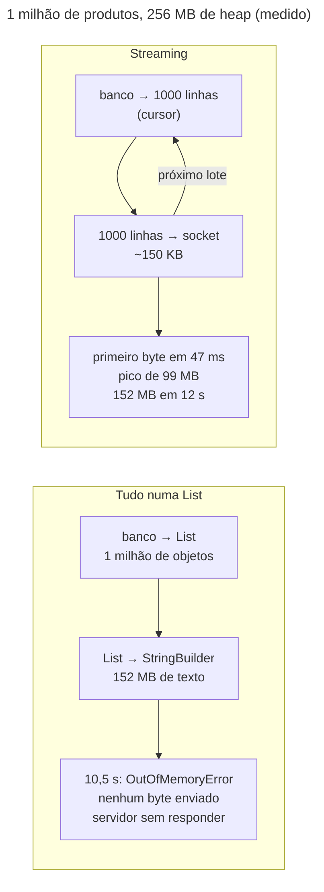

## O problema

O lojista quer o catálogo inteiro numa planilha, para revisar preços. A API já tem `GET /v2/produtos` com paginação: 100 por página, um cursor para a próxima. Para um catálogo de 1 milhão de produtos, são 10 mil requisições. O lojista não vai escrever esse laço; ele quer **um arquivo**.

A primeira versão que vem à cabeça é a da paginação, sem a paginação: buscar tudo numa `List`, montar o CSV numa `String`, devolver. Ela funciona nos testes, com 3 produtos. Em produção, com 1 milhão, o Bazar mediu o que acontece (a medição está mais abaixo): a requisição fica 10 segundos sem responder nada, o *heap* de 256 MB esgota, e a JVM lança `OutOfMemoryError`. E o erro não fica na requisição que o causou: ele atinge a *thread* do Tomcat que aceita conexões, e o servidor para de responder **para todo mundo**.

Do lado de quem baixa, há outros problemas. O relatório de vendas de 200 MB caiu em 90% numa rede ruim, e o navegador recomeça do zero. A imagem do produto é baixada a cada visita à página, sempre igual.

É a diferença entre encher um caminhão-pipa e abrir uma torneira. O caminhão tem que caber o volume inteiro antes de sair; a torneira entrega o que chega, enquanto chega, e o tamanho do reservatório não importa.

> **A pergunta desta página:** como entregar arquivos e exportações de qualquer tamanho com memória constante, retomar downloads interrompidos e servir arquivos com os headers certos?

## O conceito

### Três formas de responder com um arquivo

| O que você tem | Como responder | O Spring faz |
|---|---|---|
| Um arquivo pronto (no disco, num S3) | `ResponseEntity<Resource>` | Copia em blocos, põe o `Content-Length`, atende o `Range` |
| Um fluxo de bytes que só pode ser lido uma vez | `ResponseEntity<InputStreamResource>` | Copia em blocos; sem `Range` |
| Um conteúdo que vai sendo **produzido** (linhas do banco) | `ResponseEntity<StreamingResponseBody>` | Te dá o `OutputStream`, numa outra *thread*; sem `Content-Length` |

Nas três, a memória usada é a de um bloco, e não a do arquivo. O que não funciona é `ResponseEntity<byte[]>` ou `ResponseEntity<String>` com o conteúdo inteiro: o tamanho do arquivo vira o tamanho do *heap*.

### `Content-Disposition`: baixar ou mostrar, e com que nome

O header `Content-Disposition` (RFC 6266) diz ao navegador o que fazer:

- `attachment; filename="vendas-2026-10.csv"`: baixar, e sugerir esse nome.
- `inline; filename="capa.png"`: mostrar na página, e usar esse nome se o usuário salvar.

O `filename` só aceita ASCII com segurança. Um nome com acento ou outros caracteres vai no `filename*`, codificado em UTF-8 (RFC 8187), **além** do `filename` em ASCII, para clientes antigos:

```http
Content-Disposition: inline; filename="capa e.jpg"; filename*=UTF-8''capa%20%C3%A9.jpg
```

O `ContentDisposition` do Spring 7 monta os dois: com `.filename(nome, UTF_8)`, ele gera o `filename*` e um `filename` com os acentos removidos.

### *Streaming* do banco: o cursor e o *fetch size*

`StreamingResponseBody` resolve o lado HTTP: as linhas saem para o cliente à medida que são escritas. Mas, se elas vêm de uma `List` montada antes, o problema só mudou de lugar. O banco também precisa entregar aos poucos.

O `JdbcClient` tem `.stream()`, que devolve um `Stream<T>`. Por padrão, o driver do PostgreSQL **lê o resultado inteiro** para a memória na primeira leitura, e o `Stream` só esconde uma lista. Para o driver usar um **cursor** no servidor e trazer um lote de cada vez, duas condições:

1. Um ***fetch size*** maior que zero: quantas linhas trazer por vez (`.withFetchSize(1000)`).
2. O *autocommit* **desligado**, ou seja, a consulta dentro de uma transação.

Sem a segunda, a primeira é ignorada em silêncio. É o tipo de detalhe que passa em todos os testes e só aparece em produção.

O preço do cursor é uma conexão do banco **presa durante todo o download**. Uma exportação de 20 segundos segura uma conexão do *pool* por 20 segundos. Dez exportações simultâneas, num *pool* de 10, param a API inteira. Por isso a exportação precisa de um limite de concorrência próprio ([28.02](/performance/pool-de-conexoes-hikaricp)).

### O executor das respostas assíncronas

O `StreamingResponseBody` roda **depois** que o método do controller retorna, numa *thread* do executor de tarefas assíncronas do Spring MVC. A *thread* da requisição volta para o Tomcat, e a resposta continua aberta.

No Spring Boot, esse executor é, por padrão, o mesmo do `@Async`. No Bazar, a [19.03](/concorrencia-e-execucao-assincrona/async-scheduled-e-tarefas-em-segundo-plano) o limitou a 4 tarefas, recusando as excedentes, para proteger o banco dos relatórios. Resultado, medido mais abaixo: a quinta exportação simultânea recebia `500`, e quatro exportações tomavam todas as vagas dos relatórios. A correção é dar às respostas assíncronas um executor só delas, com o próprio limite, e transformar a recusa num `503` com `Retry-After`.

Há também um **prazo**: `spring.mvc.async.request-timeout`. Sem configurar, vale o do Tomcat, 30 segundos, e uma exportação que passa disso é cortada no meio.

### Range: pedir um pedaço

Um cliente pode pedir só uma parte do arquivo (RFC 9110, §14):

```http
GET /v1/relatorios/01a178bf-.../arquivo
Range: bytes=100-
```

O servidor responde **`206 Partial Content`** com o trecho e um `Content-Range: bytes 100-224/225` (do byte 100 ao 224, de um total de 225). Quem anuncia que aceita isso é o header `Accept-Ranges: bytes` na resposta completa. Os usos:

- **Retomar um download** interrompido: o cliente já tem 100 bytes e pede o resto.
- **Vídeo e áudio**: o *player* pede o trecho do ponto em que o usuário pulou.
- **Downloads paralelos**: quatro conexões, cada uma com um quarto do arquivo.

Um `Range` com vários trechos (`bytes=0-9,-20`) recebe um corpo `multipart/byteranges`, com cada trecho numa parte. Um trecho impossível (`bytes=99999-` num arquivo de 225 bytes) recebe **`416 Range Not Satisfiable`**, com `Content-Range: bytes */225`, dizendo o tamanho real.

### `If-Range`: retomar só se for o mesmo arquivo

Retomar um download tem um risco: o arquivo mudou desde a primeira parte. O cliente tem os 100 primeiros bytes da versão antiga e recebe o resto da nova, e o resultado é um arquivo corrompido que ninguém percebe.

O **`If-Range`** evita isso. O cliente manda junto a ETag (ou o `Last-Modified`) da versão que ele tem:

```http
Range: bytes=100-
If-Range: "01a178bf-2d92-7c7f-a917-d46396fd5d64"
```

Se a versão ainda é essa, `206` com o trecho. Se mudou, o servidor **ignora o `Range`** e manda o arquivo inteiro, com `200`. O cliente descarta o que tinha e recomeça. A comparação é **forte**: uma ETag fraca (`W/"..."`) nunca confere, porque ela não garante que os bytes são os mesmos ([20.02](/padroes-avancados-de-http/etag-e-requisicoes-condicionais)).

### NDJSON

Um JSON comum (`[ {...}, {...} ]`) só é válido quando chega o `]` final, e a maioria das bibliotecas só o entrega inteiro. Para um fluxo de objetos, o formato é o **NDJSON** (*Newline Delimited JSON*, também chamado de JSON Lines): um objeto JSON completo por linha, sem colchetes nem vírgulas entre eles, com `Content-Type: application/x-ndjson`.

```text
{"id":"bcd399f5-...","sku":"LIV-0042","nome":"Clean Code (2ª ed.)","precoValor":139.90,...}
{"id":"01a177a2-...","sku":"LIV-0077","nome":"Java Concurrency in Practice","precoValor":149.90,...}
```

Quem lê processa uma linha de cada vez, com memória constante, e uma linha cortada no fim de uma conexão perdida não invalida as anteriores. É o formato de exportações grandes, de logs e de APIs que respondem em fluxo, como as de modelos de linguagem.

## Diagrama



Na `List`, a memória cresce com o catálogo; no *streaming*, ela é a de um lote, qualquer que seja o tamanho do catálogo.

```mermaid
---
title: StreamingResponseBody, do banco ao cliente
---
sequenceDiagram
    participant C as Cliente
    participant T as Thread do Tomcat
    participant E as Executor "resposta-"
    participant DB as PostgreSQL
    C->>T: GET /v2/produtos/exportacao
    T->>T: controller devolve o StreamingResponseBody
    T->>E: inicia a resposta assíncrona (limite: 8)
    T-->>C: 200, headers (sem Content-Length)
    Note over T: a thread volta para o Tomcat
    E->>DB: BEGIN READ ONLY; cursor, fetch 1000
    loop até acabar
        DB-->>E: 1000 linhas
        E-->>C: ~150 KB de CSV
    end
    E->>DB: COMMIT
    E-->>C: fim (chunk final)
```

## Na prática

### A exportação: o banco aos poucos

```java title="src/main/java/com/bazar/catalogo/dominio/ExportacaoDeProdutos.java (trecho)"
// Quantas linhas o driver traz do banco por vez. Sem isso, o driver do PostgreSQL traz o resultado inteiro para a
// memória na primeira leitura, e o Stream só esconde a lista.
static final int LINHAS_POR_LOTE = 1000;

/**
 * Entrega cada produto ao destino, em ordem de SKU, sem guardar nenhum. Roda numa transação porque o driver do
 * PostgreSQL só usa um cursor (e respeita o fetch size) com o autocommit desligado.
 */
public void percorrer(Consumer<LinhaDeProduto> destino) {
    transacao.executeWithoutResult(status -> {
        try (var linhas = jdbc.sql("""
                select id, sku, nome, status, preco_valor, preco_moeda, categoria_id, criado_em
                  from produto
                 order by sku""")
                .withFetchSize(LINHAS_POR_LOTE)
                .query(LinhaDeProduto.class)
                .stream()) {
            linhas.forEach(destino);
        }
    });
}
```

Três detalhes. O `try` com recursos fecha o `Stream`, e com ele o `ResultSet` e o cursor: um `Stream` do JDBC esquecido aberto segura a conexão. A transação é programática (`TransactionTemplate`, *read-only*), e não um `@Transactional`, porque quem chama é a *thread* do `StreamingResponseBody`, que roda depois do controller. E o `withFetchSize` é novo no `JdbcClient` do Spring 7; antes, só configurando o `JdbcTemplate` inteiro.

### O controller: `StreamingResponseBody`

```java title="src/main/java/com/bazar/catalogo/api/ExportacaoDeProdutosController.java (trecho)"
@GetMapping(path = "/v{versao}/produtos/exportacao", version = "2", produces = "text/csv")
public ResponseEntity<StreamingResponseBody> exportarCsv() {
    return resposta(CSV, "csv", saida -> {
        saida.write(CABECALHO_CSV);
        exportacao.percorrer(linha -> escrever(saida, String.join(",", Csv.campo(linha.id().toString()),
                Csv.campo(linha.sku()), Csv.campo(linha.nome()), Csv.campo(linha.status()),
                linha.precoValor().toPlainString(), Csv.campo(linha.precoMoeda()),
                linha.categoriaId().toString(), linha.criadoEm().toInstant().toString()) + "\n"));
    });
}

@GetMapping(path = "/v{versao}/produtos/exportacao", version = "2", produces = "application/x-ndjson")
@Operation(hidden = true)
public ResponseEntity<StreamingResponseBody> exportarNdjson() {
    return resposta(NDJSON, "ndjson",
            saida -> exportacao.percorrer(linha -> escrever(saida, json.writeValueAsString(linha) + "\n")));
}

private ResponseEntity<StreamingResponseBody> resposta(MediaType tipo, String extensao, Escrita escrita) {
    // Roda depois que o método retorna, numa thread do executor do MVC assíncrono, com a resposta já começada:
    // a partir do primeiro byte, o status (200) não muda mais. Um erro no meio corta a resposta.
    StreamingResponseBody corpo = (OutputStream saida) -> {
        var escritor = new BufferedWriter(new OutputStreamWriter(saida, StandardCharsets.UTF_8), 64 * 1024);
        escrita.em(escritor);
        escritor.flush();
    };
    var nome = "catalogo-" + LocalDate.now(relogio) + "." + extensao;
    return ResponseEntity.ok()
            .contentType(tipo)
            .header(HttpHeaders.CONTENT_DISPOSITION, ContentDisposition.attachment().filename(nome).build()
                    .toString())
            // O StreamingResponseBody não passa pelos ResponseBodyAdvice: a política padrão de cache (20.01) e o
            // Vary da negociação de formato são declarados aqui.
            .cacheControl(CacheControl.noStore())
            .varyBy(HttpHeaders.ACCEPT)
            .body(corpo);
}
```

A exportação existe só na **v2** de produtos, como as imagens da [22.01](/padroes-avancados-de-http/upload-de-arquivos): a v1 está em depreciação. Os dois métodos compartilham o caminho e se separam pelo `produces`, como o CSV da [09.03](/construindo-apis-com-spring-boot/httpmessageconverter-e-a-serializacao-por-dentro). A diferença é que o CSV de lá é **uma página**, montada por um `HttpMessageConverter`; este é o catálogo inteiro, escrito à mão.

O comentário sobre o status é o ponto mais traiçoeiro do *streaming*. Os headers e o `200` saem antes da primeira linha. Se o banco cair na linha 600 mil, não há como trocar o `200` por um `500`: a conexão é cortada, e o cliente recebe um arquivo truncado. Em CSV, isso é indistinguível de um arquivo completo. Em NDJSON, a última linha pode vir cortada. Clientes de exportações grandes devem conferir o fim (uma linha de rodapé com o total, ou a contagem esperada num header de *trailer*).

### CSV seguro

```java title="src/main/java/com/bazar/catalogo/api/ExportacaoDeProdutosController.java (trecho)"
/**
 * Um campo de CSV (RFC 4180): entre aspas se tiver vírgula, aspas ou quebra de linha. E protegido contra
 * injeção de fórmula: um valor que começa com =, +, -, @ vira fórmula quando o arquivo é aberto numa planilha
 * ("=HYPERLINK(...)" no nome de um produto). O apóstrofo na frente faz a planilha tratá-lo como texto.
 */
static String campo(String valor) {
    var seguro = !valor.isEmpty() && "=+-@\t\r".indexOf(valor.charAt(0)) >= 0 ? "'" + valor : valor;
    return seguro.chars().anyMatch(c -> c == ',' || c == '"' || c == '\n' || c == '\r')
            ? "\"" + seguro.replace("\"", "\"\"") + "\""
            : seguro;
}
```

A **injeção de CSV** é o risco que ninguém espera de um arquivo de texto. Um lojista mal-intencionado cadastra um produto chamado `=HYPERLINK("https://evil.example","Clique")`. O CSV leva o nome como está; o administrador do Bazar abre a exportação no Excel, e a célula vira um link (ou, em versões antigas, um comando). O teste cobre exatamente esse nome:

```java title="src/test/java/com/bazar/catalogo/ExportacaoDeProdutosTest.java (trecho)"
// A fórmula vira texto: apóstrofo na frente, e aspas dobradas por causa das aspas e da vírgula.
assertThat(linhas[3]).contains(",\"'=HYPERLINK(\"\"https://evil.example\"\",\"\"Clique\"\")\",");
```

Números (`precoValor`) não passam pela proteção, porque um preço negativo legítimo (`-10.00`) viraria texto. Eles vêm do banco, tipados, e não de texto livre. Veja também a [documentação de segurança](https://security-doc-beta.vercel.app/).

### Um executor só para as respostas

```java title="src/main/java/com/bazar/compartilhado/web/ConfiguracaoWeb.java (trecho)"
// Cada exportação ocupa uma conexão do banco durante todo o download: o limite protege o pool (28.02).
static final int RESPOSTAS_ASSINCRONAS_SIMULTANEAS = 8;

// As respostas assíncronas do MVC (StreamingResponseBody, 22.02) num executor só delas. Sem isso, usariam o
// executor do @Async (19.03), limitado a 4 e com recusa: a quinta exportação simultânea seria um 500, e quatro
// exportações tomariam todas as vagas dos relatórios. Acima do limite, a recusa vira 503 com Retry-After.
@Override
public void configureAsyncSupport(AsyncSupportConfigurer configurer) {
    var executor = new SimpleAsyncTaskExecutor("resposta-");
    executor.setVirtualThreads(true);
    executor.setConcurrencyLimit(RESPOSTAS_ASSINCRONAS_SIMULTANEAS);
    executor.setRejectTasksWhenLimitReached(true);
    // O MDC (traceId) da requisição vai junto para a thread que escreve a resposta.
    executor.setTaskDecorator(new ContextPropagatingTaskDecorator());
    configurer.setTaskExecutor(executor);
}
```

```java title="src/main/java/com/bazar/compartilhado/erros/TratadorGlobalDeErros.java (trecho)"
// O executor das respostas assíncronas (StreamingResponseBody) está no limite (22.02). Não é um defeito: é falta de
// vaga agora. 503 com Retry-After, e o cliente tenta de novo.
@ExceptionHandler(TaskRejectedException.class)
ResponseEntity<Object> semCapacidade(TaskRejectedException ex, WebRequest request) {
    var excecao = new RegraDeNegocioException(TipoProblema.CAPACIDADE_ESGOTADA, Map.of());
    var problema = Problemas.de(excecao, getMessageSource(), LocaleContextHolder.getLocale());
    var cabecalhos = new HttpHeaders();
    cabecalhos.set(HttpHeaders.RETRY_AFTER, String.valueOf(ESPERA_SEM_CAPACIDADE.toSeconds()));
    return handleExceptionInternal(ex, problema, cabecalhos, HttpStatus.SERVICE_UNAVAILABLE, request);
}
```

O limite de 8 deixa 2 das 10 conexões do *pool* para o resto da API, mesmo com o máximo de exportações. É um número para ajustar com medição, não uma regra.

```yaml title="src/main/resources/application.yml (trecho)"
spring:
  mvc:
    async:
      # Quanto tempo uma resposta assíncrona (StreamingResponseBody, 22.02) pode levar até terminar. O padrão do
      # Tomcat, 30 s, corta a exportação de um catálogo grande no meio. Os SseEmitter definem o próprio prazo (19.04).
      request-timeout: 10m
```

### A medição

Um milhão de produtos no banco (310 MB na tabela), a aplicação com `-Xmx256m`, e o pico do *heap* amostrado com `jstat` a cada 100 ms.

**A exportação por streaming**, sozinha:

```text noCopy
http 200  primeiro byte 0.046899s  total 12.032473s  151709270 bytes
pico do heap usado: 99 MB
```

São 152 MB de CSV com um pico de 99 MB de *heap*, incluindo o resto da aplicação e o lixo ainda não coletado. O primeiro byte chega em 47 ms: o cliente vê o download começar na hora.

**A versão "tudo numa List"**, um endpoint escrito só para esta medição (`query(...).list()` e um `StringBuilder`), que não ficou no projeto:

```text noCopy
http 500  primeiro byte 10.472563s  total 10.473450s  236 bytes
pico do heap usado: 256 MB

Exception: java.lang.OutOfMemoryError thrown from the UncaughtExceptionHandler in thread "File Watcher"
Exception: java.lang.OutOfMemoryError thrown from the UncaughtExceptionHandler in thread "http-nio-8080-Poller"
Exception in thread "HttpClient-1-SelectorManager" java.lang.OutOfMemoryError: Java heap space
```

Logo depois, uma requisição qualquer:

```text noCopy
$ curl -m 5 localhost:8080/v1/categorias
categorias: http 000        (timeout: ninguém respondeu)
```

O `OutOfMemoryError` não respeitou a fronteira da requisição. Ele estourou em outras *threads* que alocavam memória naquele momento, entre elas o **Poller** do Tomcat, que aceita as conexões. Com ele morto, o processo continua de pé, e nenhuma conexão nova é atendida. Um *health check* que só confere se o processo existe não percebe nada ([29.04](/producao-e-deploy/kubernetes-para-apis-probes-graceful-shutdown-e-rollouts)).

**Exportações simultâneas, com o executor do `@Async`** (antes da correção), seis ao mesmo tempo:

```text noCopy
exportação 6: http 500  total 0.086277s  233 bytes
exportação 5: http 500  total 0.088768s  233 bytes
exportação 3: http 200  total 30.300388s  151709270 bytes
exportação 1: http 200  total 30.367408s  151709270 bytes
...
ERROR ... TratadorGlobalDeErros : Erro inesperado [traceId=9b3463ea...]
org.springframework.core.task.TaskRejectedException: Concurrency limit reached: 4
```

**Com o executor próprio**, dez ao mesmo tempo:

```text noCopy
exportação 10: http 503  total 0.056640s  339 bytes
exportação 3: http 503  total 0.063184s  339 bytes
exportação 2: http 200  total 21.104086s  151709270 bytes
... (oito com 200, todas em cerca de 21 s)
```

O *heap* de 256 MB atendeu oito exportações de 152 MB ao mesmo tempo, porque nenhuma delas guarda mais que um lote de mil linhas. As duas excedentes receberam:

<HttpExchange
  title="Sem vaga: 503 com Retry-After"
  request={{ method: 'GET', url: '/v2/produtos/exportacao', headers: { 'Accept': 'text/csv', 'Accept-Language': 'pt-BR' } }}
  response={{ status: 503, headers: { 'Cache-Control': 'no-store', 'Retry-After': '10', 'Content-Type': 'application/problem+json' }, body: { type: 'https://api.bazar.example/problemas/capacidade-esgotada', title: 'Capacidade esgotada', status: 503, detail: 'O servidor está atendendo o máximo de requisições deste tipo agora. Tente de novo em alguns segundos.', instance: '/v2/produtos/exportacao', codigo: 'CAPACIDADE_ESGOTADA', traceId: '7541f307991285a4bca445c16d79785e' } }}
>
Um `503` diz "agora não, mas tente de novo", e o `Retry-After` diz quando. É o mesmo contrato do `AGUARDAR_E_REPETIR` do catálogo de erros. O log registra um aviso, sem *stack trace*: falta de capacidade não é defeito.
</HttpExchange>

<HttpExchange
  title="O catálogo em NDJSON"
  request={{ method: 'GET', url: '/v2/produtos/exportacao', headers: { 'Accept': 'application/x-ndjson' } }}
  response={{ status: 200, headers: { 'Content-Disposition': 'attachment; filename="catalogo-2026-10-26.ndjson"', 'Cache-Control': 'no-store', 'Vary': 'Accept', 'Content-Type': 'application/x-ndjson', 'Transfer-Encoding': 'chunked' }, body: '{"id":"bcd399f5-d6d1-4032-9c80-10ca4c363d31","sku":"LIV-0042","nome":"Clean Code (2ª ed.)","status":"RASCUNHO","precoValor":139.90,"precoMoeda":"BRL","categoriaId":"0192f3a0-5555-7000-8000-000000000003","criadoEm":"2026-10-25T04:13:58.915864Z"}\n{"id":"01a177a2-4072-7904-b8db-45de372442b0","sku":"LIV-0077","nome":"Java Concurrency in Practice","status":"RASCUNHO","precoValor":149.90,"precoMoeda":"BRL","categoriaId":"0192f3a0-5555-7000-8000-000000000003","criadoEm":"2026-10-26T09:54:44.466622Z"}' }}
>
Sem `Content-Length`: o tamanho não é conhecido quando a resposta começa. O HTTP/1.1 usa `Transfer-Encoding: chunked`, e o fim é marcado por um bloco vazio. No HTTP/2, o fim do *stream* faz o mesmo papel.
</HttpExchange>

### O relatório: um `Resource`, com Range

O relatório de vendas da [21.02](/padroes-avancados-de-http/operacoes-assincronas-e-de-longa-duracao-202-polling) é um arquivo pronto no disco. Aqui, o certo é `Resource`, e o Spring faz o *streaming* e o `Range` sozinho:

```java title="src/main/java/com/bazar/relatorios/api/RelatorioController.java (trecho)"
@GetMapping("/{id}/arquivo")
public ResponseEntity<Resource> baixar(@PathVariable UUID id, @RequestHeader HttpHeaders requisicao) {
    var relatorio = relatorios.buscar(id);
    var periodo = relatorio.periodo();
    var nome = "vendas-%s-a-%s.csv".formatted(LocalDate.ofInstant(periodo.de(), ZoneOffset.UTC),
            LocalDate.ofInstant(periodo.ate(), ZoneOffset.UTC));
    // O relatório não muda depois de gerado: o id identifica o conteúdo, e serve de ETag para o If-Range.
    return DownloadDeArquivo.de(requisicao, new FileSystemResource(relatorio.arquivo()),
            ETag.create("\"" + id + "\""), relatorio.geradoEm(), ResponseEntity.ok()
                    .contentType(new MediaType("text", "csv", StandardCharsets.UTF_8))
                    .header(HttpHeaders.CONTENT_DISPOSITION, ContentDisposition.attachment().filename(nome).build()
                            .toString())
                    .cacheControl(CacheControl.noCache().cachePrivate()));
}
```

A representação do relatório ganhou o link para o arquivo (`"arquivo": "http://localhost:8080/v1/relatorios/{id}/arquivo"`), e o caminho no disco do servidor continua sem aparecer.

<HttpExchange
  title="Os primeiros 100 bytes"
  request={{ method: 'GET', url: '/v1/relatorios/01a178bf-2d92-7c7f-a917-d46396fd5d64/arquivo', headers: { 'Range': 'bytes=0-99' } }}
  response={{ status: 206, headers: { 'Content-Disposition': 'attachment; filename="vendas-2026-10-01-a-2026-11-01.csv"', 'Cache-Control': 'no-cache, private', 'Last-Modified': 'Mon, 26 Oct 2026 15:05:57 GMT', 'ETag': '"01a178bf-2d92-7c7f-a917-d46396fd5d64"', 'Accept-Ranges': 'bytes', 'Content-Range': 'bytes 0-99/225', 'Content-Type': 'text/csv;charset=UTF-8', 'Content-Length': '100' }, body: 'produtoId,sku,nomeProduto,pedidos,unidades,receita\nbcd399f5-d6d1-4032-9c80-10ca4c363d31,LIV-0042,"Cl' }}
>
O trecho termina no meio de "Clean Code": `Range` é em bytes, e não respeita linhas, nem caracteres. Num texto UTF-8, um trecho pode até cortar um caractere de dois bytes ao meio. Quem junta os trechos é o cliente.
</HttpExchange>

<HttpExchange
  title="Retomando, se o arquivo ainda for o mesmo"
  request={{ method: 'GET', url: '/v1/relatorios/01a178bf-2d92-7c7f-a917-d46396fd5d64/arquivo', headers: { 'Range': 'bytes=100-', 'If-Range': '"01a178bf-2d92-7c7f-a917-d46396fd5d64"' } }}
  response={{ status: 206, headers: { 'ETag': '"01a178bf-2d92-7c7f-a917-d46396fd5d64"', 'Accept-Ranges': 'bytes', 'Content-Range': 'bytes 100-224/225', 'Content-Type': 'text/csv;charset=UTF-8', 'Content-Length': '125' }, body: 'ean Code (2ª ed.)",666,666,93173.40\n01a177a2-4072-7904-b8db-45de372442b0,LIV-0077,"Java Concurrency in Practice",1,1,189.90\n' }}
>
Os 100 bytes anteriores e estes 125 formam o arquivo de 225. Com `If-Range: "outro"`, a resposta seria `200` com os 225 bytes.
</HttpExchange>

### O que o Spring não faz: `If-Range` e o corpo do `416`

A primeira versão do download usava só `ResponseEntity<Resource>`, e o laboratório mostrou duas surpresas:

```text noCopy
== If-Range diferente  (Range: bytes=100-, If-Range: "outro")
HTTP/1.1 206
Content-Range: bytes 100-224/225          ← deveria ser 200, com o arquivo inteiro

== fora  (Range: bytes=99999-)
HTTP/1.1 416
Content-Range: bytes */225
Content-Length: 225                        ← o arquivo inteiro, no corpo de um erro
```

O código do Spring MVC explica: o `AbstractMessageConverterMethodProcessor` aplica o `Range` a todo `Resource` cuja resposta é `200`, e não lê o `If-Range`. Num `416`, ele troca o status e segue escrevendo o corpo. Para um relatório que nunca muda, o primeiro buraco é inofensivo; para um arquivo que muda, é corrupção silenciosa. O Bazar fecha os dois numa classe pequena:

```java title="src/main/java/com/bazar/compartilhado/web/DownloadDeArquivo.java (trecho)"
public static ResponseEntity<Resource> de(HttpHeaders requisicao, Resource arquivo, ETag versao,
        Instant modificadoEm, ResponseEntity.BodyBuilder resposta) {
    resposta.eTag(versao.formattedTag()).lastModified(modificadoEm);
    if (requisicao.getFirst(HttpHeaders.RANGE) == null) {
        return resposta.body(arquivo);
    }
    try {
        if (!ifRangeConfere(requisicao.getFirst(HttpHeaders.IF_RANGE), versao, modificadoEm)) {
            // O InputStreamResource é o único Resource a que o Spring não aplica o Range: o arquivo inteiro, 200.
            return resposta.header(HttpHeaders.ACCEPT_RANGES, "bytes")
                    .contentLength(arquivo.contentLength())
                    .body(new InputStreamResource(arquivo.getInputStream()));
        }
        HttpRange.toResourceRegions(requisicao.getRange(), arquivo);
    }
    catch (IllegalArgumentException ex) {
        // Range fora do arquivo, ou malformado: 416 com o tamanho, e sem corpo.
        return ResponseEntity.status(HttpStatus.REQUESTED_RANGE_NOT_SATISFIABLE)
                .header(HttpHeaders.CONTENT_RANGE, "bytes */" + tamanho(arquivo))
                .build();
    }
    catch (IOException ex) {
        throw new UncheckedIOException(ex);
    }
    return resposta.body(arquivo);
}

// Sem If-Range, o Range vale. Com uma ETag, ela precisa ser idêntica (comparação forte). Com uma data, ela precisa
// ser exatamente o Last-Modified.
static boolean ifRangeConfere(@Nullable String ifRange, ETag versao, Instant modificadoEm) {
    if (ifRange == null) {
        return true;
    }
    if (ifRange.startsWith("\"") || ifRange.startsWith("W/")) {
        return ETag.create(ifRange).compare(versao, true);
    }
    try {
        return ZonedDateTime.parse(ifRange, DateTimeFormatter.RFC_1123_DATE_TIME).toInstant()
                .equals(modificadoEm.truncatedTo(ChronoUnit.SECONDS));
    }
    catch (DateTimeParseException ex) {
        return false;
    }
}
```

O truque do `InputStreamResource` vem do mesmo código do Spring: ele é o único `Resource` excluído do tratamento de `Range`, justamente porque um fluxo não pode ser relido nem pulado. Depois da correção:

```text noCopy
== If-Range diferente
HTTP/1.1 200
Content-Length: 225

== fora
HTTP/1.1 416
Content-Range: bytes */225
Content-Length: 0
```

### A imagem: tipo, `nosniff` e cache imutável

```java title="src/main/java/com/bazar/catalogo/api/ImagemProdutoController.java (trecho)"
// Os bytes como foram aceitos no upload, com o tipo reconhecido na época, nunca o que o cliente declarou (22.01).
// O conteúdo de uma imagem nunca muda (uma imagem nova é outro id): cache de um ano, imutável.
@GetMapping(path = "/v{versao}/produtos/{id}/imagens/{imagemId}", version = "2")
public ResponseEntity<Resource> baixar(@PathVariable UUID id, @PathVariable UUID imagemId,
        @RequestHeader HttpHeaders requisicao) {
    var imagem = imagens.buscar(id, imagemId);
    return DownloadDeArquivo.de(requisicao, new FileSystemResource(imagens.arquivo(imagem)),
            ETag.create("\"" + imagem.id() + "\""), imagem.criadaEm(), ResponseEntity.ok()
                    .contentType(MediaType.parseMediaType(imagem.tipoConteudo()))
                    // inline: o navegador mostra, em vez de baixar. O filename* leva o nome em UTF-8 (RFC 6266).
                    .header(HttpHeaders.CONTENT_DISPOSITION, ContentDisposition.inline()
                            .filename(imagem.nomeOriginal(), StandardCharsets.UTF_8).build().toString())
                    // Sem nosniff, um navegador pode "farejar" o conteúdo e tratar como HTML o que foi servido como
                    // imagem.
                    .header("X-Content-Type-Options", "nosniff")
                    .cacheControl(CacheControl.maxAge(Duration.ofDays(365)).cachePublic().immutable()));
}
```

<HttpExchange
  title="A imagem do produto"
  request={{ method: 'GET', url: '/v2/produtos/bcd399f5-d6d1-4032-9c80-10ca4c363d31/imagens/01a178c1-44aa-78ad-bb11-048775526d75' }}
  response={{ status: 200, headers: { 'Content-Disposition': 'inline; filename="capa.png"; filename*=UTF-8\'\'capa.png', 'X-Content-Type-Options': 'nosniff', 'Cache-Control': 'max-age=31536000, public, immutable', 'Last-Modified': 'Mon, 26 Oct 2026 15:08:14 GMT', 'ETag': '"01a178c1-44aa-78ad-bb11-048775526d75"', 'Accept-Ranges': 'bytes', 'Content-Type': 'image/png', 'Content-Length': '3089' }, body: '(3089 bytes, idênticos aos enviados)' }}
>
`immutable` diz ao navegador que nem vale revalidar: durante um ano, a imagem vem do cache local, sem requisição. Funciona porque a URL identifica o conteúdo: trocar a capa é criar outra imagem, com outro id e outra URL. Um `If-None-Match` com a ETag recebe `304` ([20.02](/padroes-avancados-de-http/etag-e-requisicoes-condicionais)).
</HttpExchange>

O `nosniff` fecha a última porta da 22.01. O Bazar já recusa o que não é imagem no upload, mas, se um dia um HTML passasse, um navegador antigo poderia ignorar o `Content-Type: image/png` e "farejar" o conteúdo, executando-o como página, no domínio do Bazar. Com `nosniff`, o navegador obedece ao `Content-Type`. A defesa completa é servir arquivos enviados por usuários de **outro domínio** (`arquivos.bazar.example`), sem cookies da aplicação ([26.05](/seguranca-essencial-para-apis/transporte-segredos-headers-de-seguranca-e-ssrf)).

## Erros comuns

<BadVsGood title="Exportação: lista na memória × fluxo" why="A versão com List não envia nada até ter tudo, e o heap cresce com o catálogo: com 1 milhão de produtos, OutOfMemoryError e servidor sem responder. A versão em fluxo usa um cursor com fetch size dentro de uma transação, escreve conforme lê, e a memória não depende do tamanho.">
<Bad title="Tudo, depois a resposta">

```java
@GetMapping(produces = "text/csv")
String exportar() {
    var linhas = jdbc.sql(SQL)
        .query(Linha.class).list();
    var csv = new StringBuilder();
    linhas.forEach(l -> csv.append(...));
    return csv.toString();
}
```

</Bad>
<Good title="Cursor, lote, fluxo">

```java
StreamingResponseBody corpo = saida ->
    transacao.executeWithoutResult(s -> {
        try (var linhas = jdbc.sql(SQL)
                .withFetchSize(1000)
                .query(Linha.class).stream()) {
            linhas.forEach(l -> escrever(saida, l));
        }
    });
```

</Good>
</BadVsGood>

Outros tropeços frequentes:

- **`.stream()` sem *fetch size* ou fora de uma transação**: o driver do PostgreSQL carrega tudo do mesmo jeito.
- **`Stream` do JDBC sem `try` com recursos**: a conexão fica presa até o coletor de lixo, se ficar.
- **`ResponseEntity<byte[]>`** com `Files.readAllBytes` para servir um arquivo.
- **Deixar o executor padrão** atender as respostas assíncronas sem olhar o limite dele (nem o *pool* do banco).
- **Esquecer o `request-timeout`** e ter exportações cortadas aos 30 segundos.
- **Confiar no `Range` do Spring para arquivos que mudam**, sem tratar o `If-Range`.
- **`filename` com acentos sem `filename*`**, ou montado por concatenação com o nome do usuário (aspas e quebras de linha no nome quebram o header).
- **CSV sem escape e sem proteção contra fórmulas**.
- **Servir o arquivo com o `Content-Type` que o cliente declarou no upload**, ou sem `nosniff`.
- **Tratar um arquivo truncado como completo**: depois do primeiro byte, o `200` já foi.

## Boas práticas

- **Arquivo pronto → `Resource`**; **conteúdo produzido → `StreamingResponseBody`**; nunca o arquivo inteiro num `byte[]` ou `String`.
- **Do banco, um cursor**: *fetch size*, transação *read-only*, `try` com recursos.
- **Executor e limite próprios** para respostas longas, com `503` e `Retry-After` ao lotar, e um `request-timeout` que caiba na maior exportação.
- **`Content-Disposition`** com `filename` ASCII e `filename*` UTF-8, montado pelo `ContentDisposition`.
- **`Accept-Ranges`, `206`, `416`, e `If-Range` com ETag forte** para arquivos grandes.
- **Cache longo e `immutable`** para conteúdo endereçado por id; **`nosniff`** e, idealmente, outro domínio para arquivos de usuários.
- **NDJSON** para fluxos de objetos; **CSV** com escape (RFC 4180) e proteção contra injeção de fórmula.
- Exportações muito grandes ou lentas: **gerar em segundo plano** (21.02) e servir o arquivo pronto, com `Range`.

## Por baixo dos panos

<DeepDive title="O que acontece entre o return e o último byte">

Quando o controller devolve um `StreamingResponseBody`, o `StreamingResponseBodyReturnValueHandler` faz três coisas:

1. Aplica os headers do `ResponseEntity` à resposta.
2. Chama `request.startAsync()` da API de Servlet: a requisição entra no modo assíncrono, e a resposta fica aberta quando a *thread* atual terminar.
3. Entrega ao `WebAsyncManager` uma tarefa que chama `corpo.writeTo(response.getOutputStream())`, submetida ao executor configurado em `configureAsyncSupport`. Se o executor recusa, a `TaskRejectedException` sobe ali mesmo, ainda na *thread* da requisição, e por isso o tratador global consegue responder `503` antes de qualquer byte.

A *thread* do Tomcat volta para o *pool* (com *virtual threads*, isso importa pouco; sem elas, libera uma das 200 *threads* para outra requisição). A tarefa escreve no `OutputStream` do Servlet. O Tomcat junta os bytes num *buffer* de 8 KB por resposta e, a cada *buffer* cheio, manda um *chunk* para o *socket*. Se o cliente é lento, o `write` bloqueia (o TCP tem controle de fluxo), e a leitura do banco espera junto. É a **contrapressão** que faz a memória ficar constante: o banco não é lido mais rápido do que o cliente consome.

Quando `writeTo` retorna, o Spring encerra o modo assíncrono (`asyncContext.complete()`), e o Tomcat manda o *chunk* final. Se `writeTo` lança uma exceção, o Spring tenta despachar um erro, mas a resposta já foi confirmada (`isCommitted`): o único efeito visível para o cliente é a conexão encerrada antes do *chunk* final. Um cliente HTTP correto acusa a resposta incompleta (o `curl` termina com o código 18, *transfer closed with outstanding read data remaining*), mas o que já chegou pode estar salvo em disco, e um *script* que não confere o código de saída segue em frente com o arquivo truncado.

Se o prazo do `request-timeout` vence com a tarefa ainda escrevendo, o Spring interrompe a resposta pelo mesmo caminho. Por isso o prazo precisa caber na maior exportação, com folga.

</DeepDive>

## No projeto Bazar

<ProjectStep title="Downloads e exportação" module="catalogo, relatorios" tag="pagina-22.02" files={[
  { path: 'src/main/java/com/bazar/catalogo/dominio/ExportacaoDeProdutos.java', change: 'novo' },
  { path: 'src/main/java/com/bazar/catalogo/api/ExportacaoDeProdutosController.java', change: 'novo' },
  { path: 'src/main/java/com/bazar/catalogo/api/ImagemProdutoController.java', change: 'alterado' },
  { path: 'src/main/java/com/bazar/relatorios/api/RelatorioController.java', change: 'alterado' },
  { path: 'src/main/java/com/bazar/compartilhado/web/DownloadDeArquivo.java', change: 'novo' },
  { path: 'src/main/java/com/bazar/compartilhado/web/ConfiguracaoWeb.java', change: 'alterado' },
  { path: 'src/main/java/com/bazar/compartilhado/erros/TratadorGlobalDeErros.java', change: 'alterado' },
  { path: 'src/main/java/com/bazar/compartilhado/erros/TipoProblema.java', change: 'alterado' },
  { path: 'src/main/resources/application.yml', change: 'alterado' },
  { path: 'src/test/java/com/bazar/catalogo/ExportacaoDeProdutosTest.java', change: 'novo' },
  { path: 'src/test/java/com/bazar/compartilhado/web/DownloadDeArquivoTest.java', change: 'novo' },
  { path: 'src/test/java/com/bazar/relatorios/api/RelatorioVendasTest.java', change: 'alterado' },
]}>
`GET /v2/produtos/exportacao` exporta o catálogo inteiro em CSV ou NDJSON, por *streaming*, com cursor e *fetch size* de 1000. `GET /v1/relatorios/{id}/arquivo` serve o CSV do relatório com `Range`, `If-Range` e `416` corretos (`DownloadDeArquivo`), e a representação do relatório ganhou o link `arquivo`. `GET /v2/produtos/{id}/imagens/{imagemId}` serve a imagem com o tipo reconhecido no upload, `nosniff` e cache imutável de um ano. As respostas assíncronas ganharam executor próprio (8 simultâneas, `503` + `Retry-After` acima disso, tipo novo `CAPACIDADE_ESGOTADA`) e prazo de 10 minutos. As imagens e a exportação existem só na v2.
</ProjectStep>

## Resumo

- Nunca o arquivo inteiro na memória: `Resource` para arquivos prontos, `StreamingResponseBody` para conteúdo produzido.
- Do banco, um cursor: *fetch size* **e** transação; sem a transação, o PostgreSQL ignora o *fetch size*.
- Medido: 152 MB de CSV com 99 MB de *heap* e primeiro byte em 47 ms; a versão com `List` esgotou 256 MB e derrubou o servidor inteiro.
- O `StreamingResponseBody` roda num executor: dê a ele um executor próprio, com limite que proteja o *pool* do banco, `503` ao lotar e um prazo adequado.
- Depois do primeiro byte, o `200` não volta atrás: um erro no meio vira um arquivo truncado.
- `Range` → `206`, `416` com `bytes */total`, `If-Range` com ETag forte. O Spring faz o primeiro; os outros dois, o Bazar completa.
- `Content-Disposition` com `filename` e `filename*`; `nosniff` e cache `immutable` para arquivos endereçados por id; CSV protegido contra fórmulas; NDJSON para fluxos de objetos.

<Exercise title="A exportação que não pode ser truncada em silêncio" difficulty="dificil">
Um parceiro importa a exportação NDJSON do catálogo toda noite. Numa noite, o banco foi reiniciado na linha 600 mil, e o parceiro importou 600 mil produtos como se fossem o catálogo inteiro, desativando os outros 400 mil.

1. Por que o Bazar não pôde avisar com um status de erro?
2. Proponha duas formas de o parceiro detectar o arquivo incompleto: uma que muda o formato, outra que não muda.
3. Uma terceira opção é não fazer *streaming*: gerar o arquivo em segundo plano (21.02) e servir o arquivo pronto. O que se ganha e o que se perde?

<Hint>Pense no que existe no fim de um arquivo completo e não existe num cortado. E nos *trailers* do HTTP/1.1 chunked.</Hint>

<Solution>

1. O status e os headers saíram antes da primeira linha. Quando o erro aconteceu, o `200` já estava no *socket*; o único sinal possível era fechar a conexão sem o *chunk* final, e o cliente do parceiro tratou o fim da conexão como fim do arquivo.

2. **Mudando o formato**: uma última linha de rodapé, `{"tipo":"fim","total":1000000}`, escrita só depois do último produto. Sem ela, o arquivo está incompleto. É o mais robusto, porque sobrevive a cópias e reprocessamentos do arquivo, mas é uma mudança de contrato. **Sem mudar o formato**: o parceiro confere o encerramento do HTTP (o *chunk* final; a maioria das bibliotecas lança exceção, como a `EOFException` do `HttpClient` do JDK, quando ele falta). Ou o Bazar manda um *trailer* (`Trailer: X-Total-De-Linhas`, com o valor depois do último *chunk*), que poucos clientes leem. Um header `X-Total-De-Linhas` no **início** não serve: o total precisaria ser contado antes, o que é uma consulta a mais e ainda pode mudar durante a exportação.

3. Gerado em segundo plano, o arquivo só é publicado quando está completo (a operação vira `CONCLUIDA` depois do último byte). O parceiro baixa um arquivo com `Content-Length`, que denuncia qualquer corte, pode retomar com `Range` e `If-Range`, e o banco não fica preso ao ritmo da rede do parceiro: o cursor dura o tempo da geração, não o do download. Perde-se o imediatismo (o 202, o *polling*), ganha-se disco para guardar os arquivos e uma política para apagá-los. Para uma importação noturna de um milhão de linhas, essa troca vale a pena. Para o lojista que quer a planilha agora, o *streaming* continua melhor.

</Solution>
</Exercise>

<Quiz questions={[
  {
    question: 'O código usa jdbc.sql(...).query(...).stream(), sem withFetchSize e fora de uma transação. O que acontece com 1 milhão de linhas no PostgreSQL?',
    options: [
      'As linhas vêm uma a uma, por causa do Stream',
      'O driver carrega o resultado inteiro na memória na primeira leitura; o Stream só esconde a lista',
      'O PostgreSQL recusa a consulta',
      'O Spring cria a transação sozinho',
    ],
    answer: 1,
    explanation: 'O driver só usa cursor com fetch size maior que zero e autocommit desligado. Sem os dois, o Stream percorre uma lista já carregada.',
  },
  {
    question: 'Na medição, a versão que montava o CSV numa List esgotou o heap. Qual foi o efeito além da requisição que falhou?',
    options: [
      'Nenhum: só aquela requisição recebeu 500',
      'O OutOfMemoryError atingiu outras threads, inclusive o Poller do Tomcat, e o servidor parou de aceitar conexões',
      'O Spring reiniciou a aplicação',
      'As outras requisições ficaram mais lentas por alguns segundos',
    ],
    answer: 1,
    explanation: 'O OutOfMemoryError estoura em qualquer thread que tente alocar naquele momento. Com o Poller morto, o processo segue de pé sem atender ninguém.',
  },
  {
    question: 'Um cliente retoma um download com Range: bytes=100- e If-Range com uma ETag que não é mais a atual. O que o servidor deve responder?',
    options: [
      '206 com os bytes a partir de 100 da versão atual',
      '200 com o arquivo inteiro: o If-Range não conferiu, e o Range é ignorado',
      '412 Precondition Failed',
      '416 Range Not Satisfiable',
    ],
    answer: 1,
    explanation: 'É o que o If-Range existe para fazer (RFC 9110, §13.1.5). O Spring MVC não confere o If-Range, e o Bazar completa isso no DownloadDeArquivo.',
  },
  {
    question: 'Por que a quinta exportação simultânea recebia 500 antes da correção?',
    options: [
      'Porque o pool de conexões do banco tinha 4 conexões',
      'Porque o StreamingResponseBody rodava no executor do @Async, limitado a 4 e configurado para recusar, e a recusa caía no tratador de erro inesperado',
      'Porque o Tomcat só aceita 4 respostas chunked',
      'Porque o request-timeout era de 30 segundos',
    ],
    answer: 1,
    explanation: 'O Spring Boot usa o executor de tarefas da aplicação para o MVC assíncrono. Com um executor próprio, o limite é das respostas, e a recusa vira 503 com Retry-After.',
  },
]} />

## Referências

<References />
