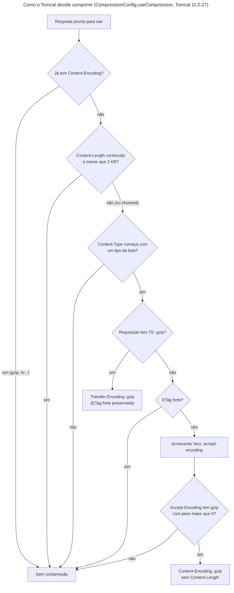

## O problema

Uma página da lista de produtos do Bazar, com 100 itens, tem 18.807 bytes de JSON. O aplicativo do lojista abre essa lista várias vezes por dia, muitas vezes no 4G. A exportação do catálogo da [22.02](/padroes-avancados-de-http/download-streaming-e-range), com 100 mil produtos, tem 15 MB.

Quase tudo nesses bytes se repete: `"precoEmCentavos":`, `"categoriaId":`, o mesmo UUID de categoria cem vezes, `"status":"ATIVO"`. Texto repetitivo é exatamente o que um compressor reduz bem. Comprimidos com gzip, os 18.807 bytes viram 3.529, e os 15 MB viram 3,2 MB.

O HTTP tem um mecanismo padrão para isso desde sempre, e o Spring Boot o liga com uma propriedade. Mas a configuração padrão deixa de fora tipos que o Bazar usa, há respostas que o Tomcat se recusa a comprimir, e comprimir respostas com segredos tem um ataque com nome próprio. Além disso, o caminho inverso (o cliente mandar o corpo comprimido) não vem pronto, e, feito sem cuidado, abre uma porta para derrubar o servidor com um arquivo de 1 MB.

É como mandar uma mudança: dobrar as roupas antes de pôr na caixa ocupa menos espaço no caminhão, e quem recebe desdobra. Mas alguém precisa perguntar antes se o destinatário sabe desdobrar, e conferir se a caixa pequena não vai virar um armário inteiro quando aberta.

> **A pergunta desta página:** como comprimir respostas (e aceitar requisições comprimidas) sem quebrar caches, ETags e limites, e sem abrir brechas?

## O conceito

### A negociação: `Accept-Encoding` e `Content-Encoding`

O cliente diz quais compressões entende; o servidor escolhe uma e diz qual usou:

```http
GET /v1/produtos?limit=100
Accept-Encoding: gzip, br, zstd

HTTP/1.1 200
Content-Encoding: gzip
Vary: accept,accept-encoding
Content-Type: application/json
Transfer-Encoding: chunked
```

É a mesma negociação de conteúdo do `Accept` ([02.05](/comecando-e-fundamentos-de-http/content-negotiation-e-media-types)), aplicada à codificação. Os pesos também valem: `gzip;q=0` quer dizer "gzip não". Sem `Accept-Encoding`, o servidor responde sem compressão.

O **`Vary: accept-encoding`** é obrigatório. A mesma URL agora tem duas representações em bytes, a comprimida e a não comprimida, e um cache precisa guardar uma por valor de `Accept-Encoding`, ou entrega gzip a quem não pediu ([20.01](/padroes-avancados-de-http/cache-http-rfc-9111)).

O `Content-Length`, quando existe, é o tamanho **comprimido**: são os bytes que viajam. Como o tamanho comprimido só é conhecido no fim, o Tomcat responde com `Transfer-Encoding: chunked`.

### `Content-Encoding` × `Transfer-Encoding`

Os dois nomes se parecem, e a diferença importa:

| | `Content-Encoding: gzip` | `Transfer-Encoding: gzip` |
|---|---|---|
| O que é | Uma propriedade da **representação**: "este recurso, em gzip" | Uma propriedade **da conexão**, só para este trecho da viagem |
| Quem desfaz | O cliente final (o navegador, o `HttpClient`) | O próximo nó (um *proxy* desfaz, e pode recomprimir) |
| ETag | É de outra representação: uma ETag forte não vale para os dois | Não muda a representação: a ETag forte continua valendo |
| Como se pede | `Accept-Encoding` | `TE: gzip` |
| Na prática | Universal | Quase ninguém usa; o HTTP/2 proíbe o `TE` (só `TE: trailers`) |

Na teoria, o `Transfer-Encoding: gzip` seria o certo para comprimir sem mexer na representação. Na prática, a web inteira usa `Content-Encoding`, e é ele que esta página trata. O `chunked` é um `Transfer-Encoding` que todo mundo usa, mas ele não comprime: só divide o corpo em blocos ([22.02](/padroes-avancados-de-http/download-streaming-e-range)).

### gzip, br, zstd

| Codificação | Desde | Onde |
|---|---|---|
| `gzip` | 1996 | Em todo lugar: navegadores, bibliotecas, servidores |
| `br` (Brotli) | 2016 | Navegadores, CDNs, nginx (módulo), *proxies*. Comprime melhor que gzip, mas os níveis altos são lentos para respostas dinâmicas |
| `zstd` (Zstandard) | 2021 no HTTP (RFC 8878) | Chrome e Firefox desde 2024, CDNs. Comprime como Brotli, com a velocidade do gzip ou melhor |

O `deflate` existe, mas teve implementações incompatíveis entre navegadores por anos, e ninguém deve escolhê-lo hoje.

O **Tomcat só comprime com gzip**. O código dele confere se o `Accept-Encoding` tem `gzip` e ignora o resto. Para `br` ou `zstd`, a compressão precisa ficar num *proxy* ou CDN na frente da aplicação.

### Na aplicação ou no *proxy*

Comprimir é CPU. Onde gastar essa CPU:

- **No *proxy* ou CDN** (nginx, Envoy, Cloudflare, CloudFront): oferece `br` e `zstd`, tira o trabalho da JVM e comprime também o que a aplicação não toca. É o padrão em produção.
- **Na aplicação** (Tomcat): sem infraestrutura nenhuma, funciona em desenvolvimento e em ambientes simples, e só gzip.

O que não se deve é ligar os dois sem pensar. O *proxy* recebe gzip da aplicação e não recomprime (já está comprimido), e a escolha do algoritmo e do nível fica com quem comprimiu primeiro. Se o *proxy* comprime, desligue a compressão da aplicação. O Bazar liga a do Tomcat, porque a página precisa mostrar o mecanismo funcionando sem *proxy*. A [29.04](/producao-e-deploy/kubernetes-para-apis-probes-graceful-shutdown-e-rollouts) volta ao assunto com um *ingress* na frente.

### O que não vale comprimir

- **Respostas pequenas.** O gzip tem um cabeçalho e um rodapé de 18 bytes. Abaixo de 1–2 KB, o ganho é pequeno, e às vezes a resposta aumenta.
- **Formatos já comprimidos.** JPEG, PNG, PDF, ZIP, vídeo: comprimir de novo gasta CPU e não reduz nada. Por isso a compressão é configurada por lista de tipos: `image/png` não está nela.
- **Respostas com segredos e dados controlados pelo atacante no mesmo corpo**, numa API com autenticação por *cookie*. É o BREACH, explicado abaixo.

### ETag e compressão

Uma ETag **forte** promete os mesmos bytes. A resposta comprimida tem outros bytes, então uma ETag forte não pode valer para as duas representações. Há duas saídas:

- **Enfraquecer a ETag** ao comprimir (`"1"` vira `W/"1"`). É o que o nginx faz. O `If-None-Match` continua funcionando (ele usa comparação fraca), mas o `If-Match` e o `If-Range` não (eles exigem comparação forte; [20.03](/padroes-avancados-de-http/concorrencia-otimista-com-if-match-412-e-428), [22.02](/padroes-avancados-de-http/download-streaming-e-range)).
- **Não comprimir** respostas com ETag forte. É o que o Tomcat faz.

A [20.02](/padroes-avancados-de-http/etag-e-requisicoes-condicionais) mostrou o efeito: o detalhe do produto, que tem `ETag: "1"`, nunca é comprimido pelo Tomcat. Para um detalhe de 324 bytes, isso não custa nada. Para um arquivo de relatório com ETag forte e `Range`, é a escolha certa: o `Range` conta bytes de **uma** representação, e misturar com uma compressão feita na hora tornaria os trechos imprevisíveis.

### Requisições comprimidas, e a bomba

O cliente também pode comprimir o corpo que envia, com `Content-Encoding: gzip`. Vale a pena em importações grandes (um lote de mil produtos em JSON) e em clientes com *upload* lento. O Tomcat **não descomprime** requisições; quem aceita precisa de um filtro.

Esse filtro tem um risco que a resposta não tem. Na resposta, quem descomprime é o cliente. Na requisição, é o **servidor**. E gzip tem uma razão de compressão absurda para dados repetitivos: 1 GB de espaços cabe em 1 MB. Um filtro que descomprime sem limite transforma uma requisição de 1 MB em 1 GB de memória ou de disco: é uma **bomba de descompressão**, a mesma ideia do PNG de 50000 × 50000 da [22.01](/padroes-avancados-de-http/upload-de-arquivos). O limite tem que valer para os bytes **descomprimidos**.

E uma codificação que o servidor não conhece (`Content-Encoding: br`) é `415 Unsupported Media Type`, com um header `Accept-Encoding` na resposta dizendo o que ele aceita (RFC 9110, §12.5.3). Nesse uso, o `Accept-Encoding` aparece na **resposta**.

### BREACH

O BREACH (2013) explora uma propriedade básica da compressão: **conteúdo repetido comprime melhor**. Se uma resposta comprimida contém um segredo (um token CSRF, por exemplo) e também um texto que o atacante controla (um termo de busca refletido), o tamanho da resposta revela se o texto do atacante se parece com o segredo:

1. O atacante faz o navegador da vítima mandar requisições para o site, com os *cookies* da vítima, variando o termo de busca: `?q=token=a`, `?q=token=b`, ...
2. Quando o palpite acerta o próximo caractere do segredo, a resposta comprimida fica **um byte menor**, porque o compressor reaproveita a repetição.
3. Observando os tamanhos no tráfego (cifrado, mas com o tamanho visível), o atacante descobre o segredo caractere a caractere.

As três condições são: compressão, um segredo no corpo e um dado refletido no mesmo corpo, e uma forma de fazer a vítima enviar requisições **autenticadas** sem saber. A terceira é a que torna o BREACH raro em APIs como a do Bazar: a autenticação vai num header `Authorization` com um *token* ([26.04](/seguranca-essencial-para-apis/resource-server-com-jwt-o-essencial)), que o navegador **não** manda sozinho numa requisição disparada por outro site, como faz com *cookies*.

Mesmo assim, vale conhecer as defesas: não comprimir respostas que juntam segredos e entrada refletida; não pôr segredos no corpo quando não precisa; mascarar o segredo com um valor aleatório a cada resposta (o Spring Security faz isso com o token CSRF desde a versão 6); limitar a taxa de requisições ([23.01](/padroes-avancados-de-http/rate-limiting-e-quotas)). O CRIME, primo mais antigo do BREACH, atacava a compressão de **headers** no TLS e no SPDY, e é por isso que o HTTP/2 usa o HPACK, um esquema de compressão de headers desenhado para resistir a ele. Veja também a [documentação de segurança](https://security-doc-beta.vercel.app/).

## Diagrama



O diagrama segue o código do Tomcat, lido no jar de fontes da versão que o Bazar usa. Duas consequências não são óbvias. O tamanho mínimo só vale quando o `Content-Length` é conhecido: uma resposta *chunked* (um Problem Details, um `StreamingResponseBody`) é comprimida mesmo com 293 bytes. E o `Vary` é acrescentado antes de olhar o `Accept-Encoding` do cliente: toda resposta que **poderia** ser comprimida avisa os caches, mesmo quando sai sem compressão.

## Na prática

### A configuração

```yaml title="src/main/resources/application.yml (trecho)"
server:
  compression:
    # Respostas em gzip para quem manda Accept-Encoding: gzip (22.03). O Tomcat só comprime as maiores que
    # min-response-size (2 KB) e dos tipos listados; os da lista padrão não incluem os formatos abaixo.
    enabled: true
    additional-mime-types: application/problem+json, application/hal+json, application/x-ndjson, text/csv
```

A lista padrão (`server.compression.mime-types`) tem `text/html`, `text/xml`, `text/plain`, `text/css`, `text/javascript`, `application/javascript`, `application/json` e `application/xml`. Os formatos que o Bazar acrescentou ao longo do curso (Problem Details, HAL, NDJSON, CSV) ficariam de fora. O `additional-mime-types`, do Spring Boot 4.1, **acrescenta** à lista padrão; antes dele, era preciso repetir a lista inteira em `mime-types`.

### As medições

A lista de produtos, com 100 itens, com e sem `Accept-Encoding: gzip`:

```text noCopy
== sem Accept-Encoding
HTTP/1.1 200
Vary: accept,accept-encoding
Content-Type: application/json
bytes: 18807

== Accept-Encoding: gzip
HTTP/1.1 200
Vary: accept,accept-encoding
Content-Encoding: gzip
Content-Type: application/json
Transfer-Encoding: chunked
bytes: 3529                         (descomprimido: idêntico, byte a byte)
```

**81% menor.** O mesmo JSON, comprimido fora do Bazar, com outros algoritmos e níveis:

```text noCopy
gzip -1:   3864
gzip -6:   3531     ← o nível padrão, o do Tomcat
gzip -9:   3521
zstd -3:   2887
zstd -19:  2711
```

O nível máximo do gzip ganha 10 bytes sobre o padrão. O zstd, que o Tomcat não oferece, comprime 18% melhor que o gzip no nível padrão dele. É o argumento para pôr a compressão num *proxy* que fale `zstd` (o Brotli não foi medido: não havia ferramenta disponível no ambiente).

A exportação de 100 mil produtos, em CSV:

```text noCopy
sem:  15071269 bytes  1.055466s
gzip:  3254063 bytes  1.138822s
```

78% menor. Em `localhost`, a rede é infinita, e a compressão só aparece como 8% a mais de tempo. Numa conexão de 10 Mbit/s, são 12 segundos contra 2,6.

O custo em latência, com 300 requisições seguidas da lista de 100 itens:

```text noCopy
sem compressão  p50 5.76 ms  p95 8.61 ms  18809 bytes
gzip            p50 5.50 ms  p95 9.97 ms  3549 bytes
```

A diferença fica dentro do ruído da medição: comprimir 18 KB leva bem menos de um milissegundo. O custo real aparece na CPU agregada, com milhares de requisições por segundo, e é medido na Parte 14 ([28.01](/performance/medindo-antes-de-otimizar-testes-de-carga)).

### O que não foi comprimido

```text noCopy
== Accept-Encoding: br, zstd          → 200, 18807 bytes, sem Content-Encoding
== Accept-Encoding: gzip;q=0          → 200, 18807 bytes, sem Content-Encoding
== GET /v1/categorias (439 bytes, com Content-Length)
                                      → sem Content-Encoding
== GET /v2/produtos/{id} (ETag: "1")  → sem Content-Encoding
== o mesmo, com TE: gzip              → Transfer-Encoding: gzip, chunked; ETag: "1"
```

E um caso que a configuração não sugere: um Problem Details de 293 bytes, *chunked*, saiu comprimido para 248 bytes. Sem `Content-Length`, o Tomcat não tem como aplicar o mínimo, e comprime.

O teste de integração confere o comportamento pela rede (o MockMvc não passa pelo Tomcat, e não vê compressão nenhuma):

```java title="src/test/java/com/bazar/compartilhado/web/CompressaoTest.java (trecho)"
@Test
void umaListaGrandeVemEmGzipParaQuemPede() throws Exception {
    var semGzip = get("/v1/produtos?limit=30", Map.of());
    var comGzip = get("/v1/produtos?limit=30", Map.of("Accept-Encoding", "gzip"));

    assertThat(semGzip.headers().firstValue("Content-Encoding")).isEmpty();
    assertThat(comGzip.headers().firstValue("Content-Encoding")).hasValue("gzip");
    assertThat(comGzip.headers().allValues("Vary")).anyMatch(vary -> vary.contains("accept-encoding"));
    assertThat(comGzip.body().length).isLessThan(semGzip.body().length / 3);
    assertThat(descomprimir(comGzip.body())).isEqualTo(semGzip.body());
}

@Test
void umaRespostaComEtagForteNaoEhComprimida() throws Exception {
    // O ETag forte promete os mesmos bytes; o Tomcat prefere não comprimir a quebrar a promessa (20.02).
    var detalhe = get("/v2/produtos/" + cleanCode, Map.of("Accept-Encoding", "gzip"));
    assertThat(detalhe.headers().firstValue("ETag")).isPresent();
    assertThat(detalhe.headers().firstValue("Content-Encoding")).isEmpty();
}
```

Ligar a compressão quebrou um teste antigo, o da [20.01](/padroes-avancados-de-http/cache-http-rfc-9111), que esperava `Vary: Accept` na lista. O Tomcat acrescenta `accept-encoding` e reescreve o header como `accept,accept-encoding`. A resposta passou a variar com mais um header, e o teste foi atualizado para dizer isso.

### Aceitando requisições comprimidas

```java title="src/main/java/com/bazar/compartilhado/web/DescompressaoDeRequisicoes.java (trecho)"
@Override
protected void doFilterInternal(HttpServletRequest request, HttpServletResponse response, FilterChain chain)
        throws ServletException, IOException {
    var codificacao = request.getHeader(HttpHeaders.CONTENT_ENCODING);
    if (codificacao == null || codificacao.equalsIgnoreCase("identity")) {
        chain.doFilter(request, response);
        return;
    }
    // O multipart é lido pelo Tomcat direto do socket, sem passar por este wrapper: comprimido, não daria certo.
    if (!codificacao.trim().equalsIgnoreCase("gzip") || ehMultipart(request)) {
        response.setHeader(HttpHeaders.ACCEPT_ENCODING, "gzip");
        erros.resolveException(request, response, null,
                new RegraDeNegocioException(TipoProblema.CODIFICACAO_NAO_SUPORTADA, Map.of(), codificacao));
        return;
    }
    try {
        chain.doFilter(new Descomprimida(request, limite.toBytes()), response);
    }
    catch (ServletException ex) {
        // Um gzip corrompido aparece como erro de leitura no meio do processamento.
        if (ex.getCause() instanceof RegraDeNegocioException excecao) {
            erros.resolveException(request, response, null, excecao);
            return;
        }
        throw ex;
    }
}
```

O `Descomprimida` é um `HttpServletRequestWrapper`: o `getInputStream()` devolve um `GZIPInputStream` com um contador de bytes, e os headers `Content-Encoding` e `Content-Length` somem, porque o resto da aplicação vê o corpo já descomprimido, de tamanho desconhecido. O contador lança o `413` ao passar do limite:

```java title="src/main/java/com/bazar/compartilhado/web/DescompressaoDeRequisicoes.java (trecho)"
private void contar(int n) {
    lidos += n;
    if (lidos > limite) {
        throw new RegraDeNegocioException(TipoProblema.CORPO_GRANDE_DEMAIS, Map.of(), limite / 1024 / 1024);
    }
}
```

O registro do filtro tem uma ordem que custou uma depuração:

```java title="src/main/java/com/bazar/compartilhado/web/ConfiguracaoWeb.java (trecho)"
// Antes de todos os filtros que leem o corpo (a idempotência calcula o hash dele, 21.01), e depois do
// RequestContextFilter do Spring Boot (-105), que define o idioma das mensagens de erro.
@Bean
FilterRegistrationBean<DescompressaoDeRequisicoes> descompressaoDeRequisicoes(
        @Value("${bazar.requisicoes.limite-descomprimido}") DataSize limite,
        @Qualifier("handlerExceptionResolver") HandlerExceptionResolver erros) {
    var registro = new FilterRegistrationBean<>(new DescompressaoDeRequisicoes(limite, erros));
    registro.setOrder(-100);
    return registro;
}
```

Na primeira versão, a ordem era `Ordered.HIGHEST_PRECEDENCE + 100`, "o mais cedo possível". O `415` saiu em inglês, mesmo com `Accept-Language: pt-BR`: o filtro rodava antes do `RequestContextFilter`, que é quem põe o idioma da requisição no `LocaleContextHolder`. Um filtro que responde erros tem que rodar depois dele.

Um segundo tropeço: a bomba de descompressão respondia `400 JSON inválido`, e não `413`. O limite estoura dentro da leitura do Jackson, que embrulha a exceção num `HttpMessageNotReadableException`. O tratador global passou a desembrulhar qualquer exceção de domínio que chegue assim:

```java title="src/main/java/com/bazar/compartilhado/erros/TratadorGlobalDeErros.java (trecho)"
// Um campo desconhecido numa busca (13.01), ou um limite estourado durante a leitura do corpo descomprimido
// (22.03): a exceção de domínio chega embrulhada pelo Jackson.
if (ex.getMostSpecificCause() instanceof ExcecaoDeDominio dominio) {
    return deDominio(dominio, request);
}
```

As três situações, com o curl:

<HttpExchange
  title="Um produto novo, com o corpo em gzip"
  request={{ method: 'POST', url: '/v1/produtos', headers: { 'Content-Type': 'application/json', 'Content-Encoding': 'gzip', 'Prefer': 'return=minimal' }, body: '(207 bytes em gzip; descomprimidos, 1890 bytes de JSON)' }}
  response={{ status: 201, headers: { 'Location': 'http://localhost:8080/v1/produtos/01a178cb-5225-7ca1-8685-f87cd5e3a497', 'Preference-Applied': 'return=minimal', 'Content-Length': '0' } }}
>
Com `curl --data-binary @novo.json.gz -H "Content-Encoding: gzip"`. Para o controller, o corpo é JSON comum: ele nunca soube da compressão.
</HttpExchange>

<HttpExchange
  title="A bomba: 1 MB que vira 1 GB"
  request={{ method: 'POST', url: '/v1/produtos', headers: { 'Content-Type': 'application/json', 'Content-Encoding': 'gzip', 'Accept-Language': 'pt-BR' }, body: '(1.043.719 bytes em gzip: um JSON com 1 GB de espaços dentro de uma string)' }}
  response={{ status: 413, headers: { 'Content-Type': 'application/problem+json' }, body: { type: 'https://api.bazar.example/problemas/corpo-grande-demais', title: 'Corpo grande demais', status: 413, detail: 'O corpo da requisição, descomprimido, passa do limite de 10 MB.', instance: '/v1/produtos', codigo: 'CORPO_GRANDE_DEMAIS', traceId: 'd51fcdaf42b00b4b2e5f9a09909bf0f3' } }}
>
Respondido em 47 ms: a leitura para nos 10 MB descomprimidos, sem chegar perto do gigabyte.
</HttpExchange>

<HttpExchange
  title="Uma codificação que o Bazar não descomprime"
  request={{ method: 'POST', url: '/v1/produtos', headers: { 'Content-Type': 'application/json', 'Content-Encoding': 'br', 'Accept-Language': 'pt-BR' }, body: '(o JSON)' }}
  response={{ status: 415, headers: { 'Accept-Encoding': 'gzip', 'Content-Type': 'application/problem+json' }, body: { type: 'https://api.bazar.example/problemas/codificacao-nao-suportada', title: 'Codificação não suportada', status: 415, detail: 'O corpo veio com Content-Encoding br; a API aceita gzip.', instance: '/v1/produtos', codigo: 'CODIFICACAO_NAO_SUPORTADA', traceId: '6c5d1c93c945810d2a9a02efa03c4773' } }}
>
O `Accept-Encoding` numa **resposta** é raro, e é exatamente este o caso de uso que a RFC 9110 prevê.
</HttpExchange>

## Erros comuns

<BadVsGood title="Descomprimir sem limite" why="O limite de tamanho da requisição (o do Tomcat, o do multipart) olha os bytes que chegam pela rede, comprimidos. Sem um contador depois da descompressão, 1 MB de gzip vira 1 GB na memória ou no disco do servidor.">
<Bad title="Confiar no Content-Length">

```java
if (request.getContentLength() > 10_000_000) {
    throw new GrandeDemais();      // 1 MB: passa
}
var corpo = new GZIPInputStream(
        request.getInputStream()).readAllBytes(); // 1 GB
```

</Bad>
<Good title="Contar o que sai do GZIPInputStream">

```java
var entrada = new ComLimite(
        new GZIPInputStream(request.getInputStream()),
        limite.toBytes());          // 413 aos 10 MB
// e ninguém chama readAllBytes: o Jackson lê
// o fluxo
```

</Good>
</BadVsGood>

Outros tropeços frequentes:

- **Ligar `server.compression.enabled` e achar que tudo está comprimido**: `application/problem+json`, `text/csv`, `application/x-ndjson` e `application/hal+json` não estão na lista padrão.
- **Esquecer o `Vary: Accept-Encoding`** ao comprimir num filtro próprio: um cache entrega gzip a quem não entende.
- **Comprimir imagens, PDFs e ZIPs**: CPU gasta para nada.
- **Comprimir duas vezes** (aplicação e *proxy*), ou ligar a compressão da aplicação atrás de um *proxy* que já comprime melhor.
- **Esperar `br` ou `zstd` do Tomcat.**
- **ETag forte em resposta comprimida** por um filtro próprio: o `If-Match` e o `If-Range` passam a comparar bytes diferentes.
- **Filtro de descompressão antes do `RequestContextFilter`**, com mensagens de erro no idioma errado.
- **Testar compressão com MockMvc**: ele não passa pelo Tomcat, e o teste não vê nada.
- **Respostas com segredo e entrada refletida, comprimidas, em API com *cookie***: BREACH.

## Boas práticas

- **Ligue a compressão**, e confira a lista de tipos: inclua os formatos de texto que a API usa de verdade.
- **Em produção, comprima no *proxy* ou CDN**, com `zstd` e `br` além de `gzip`; na aplicação, só se não houver *proxy*.
- **Mínimo de 1–2 KB**, sabendo que respostas *chunked* passam pelo mínimo.
- **`Vary: Accept-Encoding`** em tudo que pode sair comprimido.
- **ETag forte e compressão não se misturam**: ou ETag fraca, ou sem compressão (e `Range` só em representações sem compressão feita na hora).
- **Requisições comprimidas**: aceite só o que descomprime, com limite nos bytes descomprimidos, `415` com `Accept-Encoding` para o resto.
- **BREACH**: separe segredos de entrada refletida, ou não comprima essas respostas; autenticação por header e não por *cookie* já elimina a condição principal.

## Por baixo dos panos

<DeepDive title="Por que JSON comprime tanto">

O gzip é o DEFLATE (1993) com um cabeçalho. O DEFLATE combina duas ideias:

1. **LZ77**: percorre o texto com uma janela dos últimos 32 KB. Quando um trecho já apareceu dentro da janela, ele é trocado por um par (distância, comprimento): "repita os 17 bytes que estão 412 bytes atrás". Em JSON, `"precoEmCentavos":` aparece a cada item. Da segunda vez em diante, cada ocorrência vira um par de poucos bits.
2. **Huffman**: os símbolos que sobram (letras, e os pares) recebem códigos de tamanho variável, curtos para os frequentes. Em JSON, `"`, `:` e `,` são muito frequentes e ganham códigos curtos.

Por isso a compressão depende tanto do conteúdo. A lista de produtos repete nomes de campos, o UUID da categoria e valores de status: 81%. Um UUID aleatório, sozinho, quase não comprime (são 122 bits de aleatoriedade escritos em 36 caracteres; o ganho vem só do alfabeto restrito). E JPEG não comprime nada, porque já foi comprimido por um algoritmo que eliminou toda a redundância.

O zstd e o Brotli ganham do gzip por três motivos: janelas maiores (megabytes, contra 32 KB), modelos de entropia melhores que o Huffman (o zstd usa FSE, uma variante de codificação aritmética) e, no caso do Brotli, um **dicionário embutido** de 120 KB com trechos comuns da web (tags HTML, palavras em inglês), que ajuda especialmente em respostas pequenas. O zstd aceita **dicionários treinados**: uma API pode treinar um dicionário com respostas típicas e compartilhá-lo com os clientes. O padrão *Compression Dictionary Transport* (os `dcb` e `dcz` que aparecem na lista de codificações conhecidas do Tomcat) leva isso ao HTTP.

O BREACH é a mesma propriedade do LZ77, vista pelo lado de quem ataca: se o palpite repete um trecho do segredo, o LZ77 o troca por uma referência, e a resposta encolhe.

</DeepDive>

## No projeto Bazar

<ProjectStep title="Compressão de respostas e de requisições" module="compartilhado" tag="pagina-22.03" files={[
  { path: 'src/main/resources/application.yml', change: 'alterado' },
  { path: 'src/main/java/com/bazar/compartilhado/web/DescompressaoDeRequisicoes.java', change: 'novo' },
  { path: 'src/main/java/com/bazar/compartilhado/web/ConfiguracaoWeb.java', change: 'alterado' },
  { path: 'src/main/java/com/bazar/compartilhado/erros/TratadorGlobalDeErros.java', change: 'alterado' },
  { path: 'src/main/java/com/bazar/compartilhado/erros/TipoProblema.java', change: 'alterado' },
  { path: 'src/test/java/com/bazar/compartilhado/web/CompressaoTest.java', change: 'novo' },
  { path: 'src/test/java/com/bazar/compartilhado/web/PoliticaDeCacheTest.java', change: 'alterado' },
]}>
O Tomcat comprime respostas em gzip, com Problem Details, HAL, NDJSON e CSV acrescentados à lista de tipos. Requisições com `Content-Encoding: gzip` são descomprimidas por um filtro, com limite de 10 MB depois de descomprimir (`413 CORPO_GRANDE_DEMAIS`). Outras codificações recebem `415 CODIFICACAO_NAO_SUPORTADA` com `Accept-Encoding: gzip`. O tratador global desembrulha exceções de domínio lançadas durante a leitura do JSON. Respostas com ETag forte (detalhe do produto, downloads com `Range`) continuam sem compressão.
</ProjectStep>

## Resumo

- `Accept-Encoding` pede, `Content-Encoding` responde, `Vary: Accept-Encoding` avisa os caches. O `Transfer-Encoding: gzip` existe, mas quase ninguém usa.
- Medido no Bazar: a lista de produtos 81% menor, a exportação 78% menor, sem diferença perceptível de latência.
- O Tomcat só faz gzip, e a lista padrão de tipos deixa de fora Problem Details, HAL, NDJSON e CSV. `br` e `zstd` (18% melhor que o gzip na lista medida) ficam para o *proxy* ou CDN.
- O mínimo de 2 KB só vale com `Content-Length`; respostas *chunked* são sempre candidatas.
- ETag forte e compressão não combinam: o Tomcat não comprime, o nginx enfraquece a ETag.
- Requisições comprimidas precisam de um filtro, com limite nos bytes **descomprimidos**: 1 MB de gzip virou 1 GB no teste da bomba.
- BREACH: segredo + entrada refletida + compressão + requisições autenticadas forjáveis. Autenticação por header remove a última condição.

<Exercise title="Comprimir o relatório sem perder o Range" difficulty="dificil">
O relatório de vendas da 21.02 pode ter centenas de megabytes de CSV, e é servido com ETag forte e suporte a `Range` (22.02). Por causa da ETag forte, o Tomcat nunca o comprime. Um parceiro reclama do tempo de download.

1. Por que simplesmente trocar a ETag por uma fraca (`W/"..."`) não é uma boa saída?
2. Proponha uma forma de servir o relatório comprimido **mantendo** o `Range` e o `If-Range`.
3. E se o cliente não aceitar gzip?

<Hint>O `Range` conta bytes da representação que está sendo servida. Se a representação comprimida for um arquivo, ela tem bytes estáveis.</Hint>

<Solution>

1. O `If-Range` exige comparação forte: com uma ETag fraca, ele nunca confere, e todo download retomado recomeçaria do zero (o `DownloadDeArquivo` responderia `200` com o arquivo inteiro). E a compressão feita na hora não garante os mesmos bytes a cada requisição (outro nível, outra versão do Tomcat), então um `Range` sobre ela pediria trechos de uma sequência de bytes que pode mudar entre uma requisição e outra.

2. **Pré-comprimir na geração.** O `RelatorioVendasService` grava `vendas-{id}.csv.gz` ao lado do `.csv` (ou só o `.gz`). No download, se o `Accept-Encoding` tem `gzip`, o Bazar serve o `.gz` como um `Resource`, com `Content-Encoding: gzip`, `Content-Type: text/csv` e uma ETag forte **diferente** da do CSV (`"{id}-gz"`), e acrescenta `Vary: Accept-Encoding`. O Tomcat não recomprime, porque a resposta já tem `Content-Encoding`. O `Range` passa a contar bytes do `.gz`, que são estáveis, e o `If-Range` com `"{id}-gz"` funciona. É o que servidores de arquivos estáticos fazem com `.gz` e `.br` pré-gerados (o `DefaultServlet` do Tomcat tem a opção `precompressed`).

3. Sem `gzip` no `Accept-Encoding`, o Bazar serve o `.csv` com a ETag `"{id}"`. Se só o `.gz` foi guardado, descomprime em fluxo (`GZIPInputStream` num `InputStreamResource`), com `Content-Length` conhecido se o tamanho original foi gravado junto, mas sem `Range`: o `Accept-Ranges: none` avisa o cliente. Para um parceiro de integração, que controla o próprio cliente, exigir `gzip` também é razoável, e o contrato pode dizer isso.

</Solution>
</Exercise>

<Quiz questions={[
  {
    question: 'O Bazar respondeu um Problem Details de 293 bytes comprimido em gzip, apesar do mínimo de 2 KB. Por quê?',
    options: [
      'Porque Problem Details sempre é comprimido',
      'Porque a resposta era chunked, sem Content-Length: o Tomcat só aplica o mínimo quando conhece o tamanho',
      'Porque o mínimo é de 200 bytes',
      'Porque o cliente pediu gzip;q=1',
    ],
    answer: 1,
    explanation: 'O CompressionConfig do Tomcat só compara com o mínimo se o Content-Length for diferente de -1. Sem ele, a resposta é candidata à compressão.',
  },
  {
    question: 'Por que o detalhe do produto, com ETag: "1", nunca sai comprimido pelo Tomcat?',
    options: [
      'Porque é pequeno demais',
      'Porque uma ETag forte promete os mesmos bytes, e a versão comprimida tem outros: o Tomcat prefere não comprimir',
      'Porque application/json não está na lista',
      'Porque o Spring desliga a compressão para GET',
    ],
    answer: 1,
    explanation: 'O nginx faz a outra escolha: comprime e enfraquece a ETag. O Tomcat preserva a ETag forte e não comprime (a não ser com TE: gzip, que quase ninguém manda).',
  },
  {
    question: 'Um filtro descomprime requisições gzip e confere o Content-Length contra um limite de 10 MB. Qual é o problema?',
    options: [
      'Nenhum',
      'O Content-Length é o tamanho comprimido: 1 MB de gzip pode virar 1 GB descomprimido. O limite tem que contar os bytes que saem do GZIPInputStream',
      'O Content-Length não existe em requisições',
      'O gzip não pode ser usado em requisições',
    ],
    answer: 1,
    explanation: 'É a bomba de descompressão. No Bazar, o contador fica depois do GZIPInputStream, e a bomba de 1 GB recebeu 413 em 47 ms.',
  },
  {
    question: 'Quais condições o BREACH precisa?',
    options: [
      'Só HTTPS',
      'Compressão, um segredo e um dado controlado pelo atacante no mesmo corpo, e uma forma de fazer a vítima mandar requisições autenticadas (como cookies enviados automaticamente)',
      'HTTP/2',
      'Uma ETag fraca',
    ],
    answer: 1,
    explanation: 'Com autenticação por header Authorization, que o navegador não manda sozinho em requisições de outro site, a última condição deixa de existir.',
  },
]} />

## Referências

<References />
