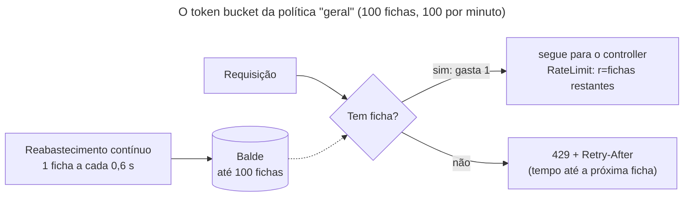
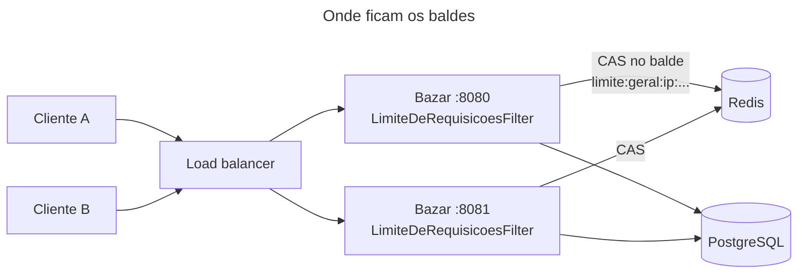

## O problema

Um parceiro do Bazar escreveu um sincronizador de catálogo. O código tem um *bug*: quando a lista de produtos volta vazia, ele tenta de novo, sem esperar, num laço. Numa madrugada, esse cliente faz 4 mil requisições por segundo. O pool de conexões do banco esgota ([28.02](/performance/pool-de-conexoes-hikaricp)), a lista dos outros lojistas passa a levar 10 segundos, e o painel de alertas acende. Ninguém fez nada de malicioso: um único cliente descontrolado derrubou a API para todos.

Há também os casos maliciosos: alguém testando senhas, alguém raspando o catálogo inteiro, alguém disparando a exportação de 15 MB da [22.02](/padroes-avancados-de-http/download-streaming-e-range) cem vezes por minuto. E há o caso comercial: o plano gratuito da API dá 10 mil chamadas por mês, o plano pago, um milhão.

Os três casos pedem a mesma coisa: **contar** o que cada cliente faz e **recusar** o que passa do combinado. E o cliente precisa saber qual é o combinado, quanto ainda resta e quando pode tentar de novo. Sem isso, ele não tem como se comportar bem.

É como um caixa eletrônico: ele não recusa saques porque não gosta de você, mas porque há um limite diário. O limite é conhecido de antemão, o extrato diz quanto resta, e no dia seguinte o limite volta.

> **A pergunta desta página:** como limitar quantas requisições cada cliente faz, de forma justa, com várias instâncias da API, e dizer ao cliente as regras do jogo?

## O conceito

### Três problemas com o mesmo mecanismo

| | Proteção técnica (*rate limit*) | Quota comercial | Limite de concorrência |
|---|---|---|---|
| Pergunta | Quantas por segundo/minuto? | Quantas por mês, por plano? | Quantas **ao mesmo tempo**? |
| Janela | Curta (segundos, minutos) | Longa (dia, mês) | Nenhuma: conta o que está em andamento |
| Objetivo | Proteger o servidor de rajadas | Cobrar, dividir capacidade entre planos | Proteger recursos caros e lentos |
| Ao estourar | `429` com `Retry-After` curto | `429` (ou `403`) com `Retry-After` longo, ou cobrança extra | `429` ou `503` |
| No Bazar | O filtro desta página | Fica para o módulo de clientes (31.04) | O executor da exportação (22.02) |

As três coisas convivem. Uma API madura tem um limite por segundo (para não cair), uma quota por mês (para o plano) e um limite de concorrência nas operações pesadas.

### Os algoritmos

**Janela fixa** (*fixed window*). Um contador por cliente e por minuto do relógio: `INCR limite:cliente:12:04`, com expiração de 60 segundos. Simples e barato. O problema está na virada da janela: um cliente pode fazer 100 requisições às 12:04:59 e mais 100 às 12:05:00. São 200 em um segundo, com um limite de "100 por minuto".

**Janela deslizante com registro** (*sliding log*). Guarda o horário de cada requisição e conta as dos últimos 60 segundos. É exato, mas guarda um item por requisição: 100 mil requisições por minuto são 100 mil itens na memória.

**Janela deslizante com contador** (*sliding window counter*). Um meio-termo: estima as requisições dos últimos 60 segundos a partir do contador do minuto atual e de uma fração do contador do minuto anterior. Aos 15 segundos do minuto atual, conta 75% do minuto passado. É a abordagem que a Cloudflare descreveu para o seu *rate limiting*, com um erro de estimativa muito pequeno na prática.

**Token bucket** (balde de fichas). Cada cliente tem um balde com até N fichas. Cada requisição gasta uma. O balde é reabastecido a uma taxa constante (100 por minuto = uma ficha a cada 0,6 s), sem passar do máximo. Permite **rajadas** de até N (o balde cheio) e garante uma **taxa média** sustentada. Guarda só dois números por cliente: as fichas e a hora do último cálculo. É o algoritmo mais usado em APIs (AWS, Stripe e o Bucket4j).

**Leaky bucket** (balde furado). As requisições entram numa fila que escoa a uma taxa fixa. Suaviza o tráfego, mas atrasa em vez de recusar. Faz sentido num *proxy* que protege um *backend* frágil, e pouco numa API, onde o cliente prefere um `429` imediato a uma espera sem explicação. Uma variante sem fila, o GCRA (*Generic Cell Rate Algorithm*), é equivalente ao *token bucket* e guarda um único número por cliente.

| Algoritmo | Memória por cliente | Rajada na virada | Rajadas permitidas |
|---|---|---|---|
| Janela fixa | 1 contador | Até 2× o limite | Sim, sem controle |
| *Sliding log* | 1 item por requisição | Não | Não |
| *Sliding window counter* | 2 contadores | Quase nada | Pouco |
| *Token bucket* / GCRA | 2 números / 1 número | Não | Sim, até a capacidade |

### A chave: quem é o cliente

O limite vale "por cliente", e escolher o que identifica o cliente é a decisão mais importante:

- **O cliente autenticado** (o `client_id` do *token*, a chave de API): a melhor chave. Cada parceiro tem o próprio balde, e o plano dele define a capacidade.
- **O IP**: a única opção para quem não se autentica (o *login*, o cadastro, a API antes da [26.04](/seguranca-essencial-para-apis/resource-server-com-jwt-o-essencial)). Tem problemas conhecidos. Uma empresa inteira atrás de um NAT divide um IP. Um atacante com uma *botnet* tem milhares. E um cliente com IPv6 recebe do provedor um bloco `/64` inteiro: 2^64 endereços. Limitar por endereço IPv6 completo não limita ninguém. O equivalente a "um IPv4" é o prefixo `/64`.
- **A rota**: não é uma chave, é uma segunda política. A exportação, que custa um cursor no banco por minutos, merece um limite próprio, menor, **além** do geral.

Atrás de um *proxy* ou *load balancer*, o IP que a aplicação vê é o do *proxy*. O IP real vem no `X-Forwarded-For`, que **qualquer cliente pode forjar**. Só se confia nele quando quem o escreveu é um *proxy* seu ([29.01](/producao-e-deploy/configuracao-externa-e-profiles)); senão, um atacante troca de "IP" a cada requisição.

### `429`, `Retry-After` e os headers `RateLimit`

O status é o `429 Too Many Requests` (RFC 6585), com um `Retry-After` dizendo quantos segundos esperar ([02.03](/comecando-e-fundamentos-de-http/status-codes-em-profundidade)). O corpo é um Problem Details, como todo erro do Bazar.

O `429` só diz que passou. Para o cliente se comportar **antes** de estourar, ele precisa ver o limite e o saldo em toda resposta. Por anos, cada API inventou os seus headers: `X-RateLimit-Limit`, `X-RateLimit-Remaining` e `X-RateLimit-Reset` (o GitHub usa um horário Unix no `Reset`; outras usam segundos). O IETF está padronizando o assunto no *draft* `draft-ietf-httpapi-ratelimit-headers`, hoje na versão 11 (maio de 2026), ainda não uma RFC:

```http
RateLimit-Policy: "geral";q=100;w=60
RateLimit: "geral";r=98;t=2
```

- **`RateLimit-Policy`** descreve as políticas: um nome, `q` (a quota) e `w` (a janela, em segundos). Opcionalmente, `qu` (a unidade: `"requests"`, o padrão, `"content-bytes"` ou `"concurrent-requests"`) e `pk` (a chave de partição).
- **`RateLimit`** diz o estado atual de cada política: `r` (o que resta) e `t` (em quantos segundos a quota se renova).

Os dois são *Structured Fields* (RFC 9651), uma lista de itens separados por vírgula: uma resposta pode informar várias políticas. As versões antigas do *draft* (até a 06) usavam três headers separados, `RateLimit-Limit`, `RateLimit-Remaining` e `RateLimit-Reset`, e muitas bibliotecas ainda os emitem. Como o *draft* ainda muda, o Bazar documenta no contrato qual versão segue.

### Onde aplicar: *gateway* ou aplicação

| | No *gateway* / *proxy* (nginx, Envoy, Kong, AWS API Gateway, Cloudflare) | Na aplicação |
|---|---|---|
| Vê | IP, rota, *headers*, a chave de API | Tudo isso, mais o usuário, o plano, o custo real da operação |
| Recusa | Antes de chegar à aplicação: protege até contra rajadas enormes | Depois do Tomcat aceitar a conexão e do filtro rodar |
| Bom para | Proteção bruta por IP, DDoS, limites simples por rota | Limites por cliente e por plano, quotas comerciais, limites por custo |

Na prática, os dois: o *gateway* segura o tráfego grosso e barato de recusar, e a aplicação aplica as regras que dependem do negócio. O Bazar, sem *gateway* no ambiente local, faz tudo na aplicação, num filtro.

### Com várias instâncias: o estado no Redis

Um balde em memória funciona com uma instância. Com três instâncias atrás de um *load balancer*, cada uma tem o seu balde, e um cliente com limite de 100 consegue até 300. Pior: o limite efetivo muda conforme o número de instâncias, que o *autoscaling* altera sozinho.

O estado tem que ser compartilhado, e o Redis é a escolha natural: fica em memória, responde em menos de um milissegundo e tem expiração por chave. O Bucket4j guarda cada balde numa chave do Redis e atualiza com **compare-and-swap**: lê o balde, calcula o novo estado e grava só se ninguém mudou o balde nesse meio-tempo. Se alguém mudou, tenta de novo. Isso é correto sem *locks*, mas tem um custo sob disputa, que o laboratório abaixo mediu.

### Se o Redis cair: *fail-open* ou *fail-closed*

O contador virou uma dependência de toda requisição. Se ele cai, há duas escolhas:

- ***Fail-open***: atende sem limite. A API continua no ar; perde-se a proteção enquanto o Redis estiver fora.
- ***Fail-closed***: recusa tudo. A queda do contador vira a queda da API inteira.

Para um limite de proteção, *fail-open* é quase sempre o certo: o Redis fora do ar por um minuto é muito menos perigoso que a API fora do ar por um minuto. Para um limite que **é** a regra de segurança (tentativas de senha), *fail-closed* pode fazer sentido. Nos dois casos, o tempo de espera pelo Redis tem que ser curto: um *fail-open* que espera 60 segundos (o *timeout* padrão do Lettuce) antes de desistir não é *fail-open*, é *fail-slow*.

### O lado do cliente

O cliente que recebe `429` deve esperar o `Retry-After` e não tentar de novo na hora. E um cliente bem-comportado nem chega ao `429`: lê o `RateLimit` e desacelera quando o `r` fica baixo. Quando o Bazar chama o PagaFácil, ele está do outro lado dessa conversa, e a [25.02](/consumindo-outras-apis/retry-quando-e-seguro-e-como-fazer) e a [25.03](/consumindo-outras-apis/circuit-breaker-bulkhead-e-limites-de-concorrencia) tratam do *retry* com espera e do limite de chamadas do lado de quem consome.

## Diagrama





## Na prática

### As políticas

```yaml title="src/main/resources/application.yml (trecho)"
bazar:
  limites:
    # Rate limiting por cliente (23.01): um token bucket por política, guardado no Redis.
    geral:
      capacidade: 100
      janela: 1m
    exportacao:
      capacidade: 10
      janela: 1h
```

```java title="src/main/java/com/bazar/compartilhado/limites/LimiteDeRequisicoesFilter.java (trecho)"
static Politica de(String nome, PoliticasDeLimite.Politica politica) {
    // Token bucket com reabastecimento contínuo (greedy): 100 por minuto é uma ficha a cada 0,6 s, e não 100
    // fichas de uma vez a cada minuto. Rajadas de até "capacidade", e nunca mais que isso por janela.
    var banda = Bandwidth.builder()
            .capacity(politica.capacidade())
            .refillGreedy(politica.capacidade(), politica.janela())
            .build();
    return new Politica(nome, politica.capacidade(), politica.janela().toSeconds(),
            BucketConfiguration.builder().addLimit(banda).build());
}
```

O `refillGreedy` reabastece aos poucos. A alternativa, `refillIntervally`, devolve as 100 fichas de uma vez a cada minuto, e reintroduz o problema da janela fixa na virada.

### O filtro

```java title="src/main/java/com/bazar/compartilhado/limites/LimiteDeRequisicoesFilter.java (trecho)"
@Override
protected void doFilterInternal(HttpServletRequest request, HttpServletResponse response, FilterChain chain)
        throws ServletException, IOException {
    var politicas = politicasDe(request);
    var cliente = cliente(request);
    var resultados = new ArrayList<ConsumptionProbe>();
    try {
        for (var politica : politicas) {
            resultados.add(balde(politica, cliente).tryConsumeAndReturnRemaining(1));
        }
    }
    catch (RuntimeException ex) {
        // Redis fora do ar: a API continua atendendo, sem limite (fail-open). A alternativa, recusar tudo,
        // transformaria uma falha do contador numa queda da API inteira.
        log.warn("Rate limiting indisponível; requisição atendida sem limite: {}", ex.toString());
        chain.doFilter(request, response);
        return;
    }

    response.setHeader(RATE_LIMIT_POLICY, String.join(", ", politicas.stream().map(Politica::descricao).toList()));
    response.setHeader(RATE_LIMIT, restante(politicas, resultados));
    for (int i = 0; i < politicas.size(); i++) {
        if (!resultados.get(i).isConsumed()) {
            var espera = segundos(resultados.get(i).getNanosToWaitForRefill());
            response.setHeader(HttpHeaders.RETRY_AFTER, String.valueOf(espera));
            erros.resolveException(request, response, null, new RegraDeNegocioException(
                    TipoProblema.LIMITE_DE_REQUISICOES, Map.of("politica", politicas.get(i).nome()),
                    politicas.get(i).capacidade(), politicas.get(i).janelaEmSegundos(), espera));
            return;
        }
    }
    chain.doFilter(request, response);
}
```

Três detalhes:

- O `tryConsumeAndReturnRemaining` faz numa ida ao Redis o que o filtro precisa: tenta gastar, diz quanto restou e quanto falta para a próxima ficha.
- Com duas políticas (geral e exportação), uma requisição recusada pela segunda já gastou uma ficha da primeira. É um desperdício pequeno e aceito: o Bucket4j permite verificar sem gastar (`estimateAbilityToConsume`), mas isso dobraria as idas ao Redis.
- O filtro está registrado com a ordem `-102`: depois do `RequestContextFilter` (`-105`), para o erro sair no idioma certo (a lição da [22.03](/padroes-avancados-de-http/compressao)), e **antes** da descompressão e de tudo que lê o corpo. Recusar custa uma ida ao Redis, e nada mais.

A chave do cliente, por enquanto o IP, com IPv6 agrupado por `/64`:

```java title="src/main/java/com/bazar/compartilhado/limites/LimiteDeRequisicoesFilter.java (trecho)"
// Um provedor entrega a cada cliente IPv6 um bloco /64 inteiro: 2^64 endereços. Limitar por endereço não segura
// ninguém; o /64 é o equivalente a um IPv4.
static String chaveDoEndereco(String endereco) {
    if (!(InetAddress.ofLiteral(endereco) instanceof Inet6Address ipv6)) {
        return endereco;
    }
    var bytes = Arrays.copyOf(ipv6.getAddress(), 16);
    Arrays.fill(bytes, 8, 16, (byte) 0);
    try {
        return InetAddress.getByAddress(bytes).getHostAddress() + "/64";
    }
    catch (UnknownHostException ex) {
        throw new IllegalStateException(ex);
    }
}
```

Quando o JWT chegar ([26.04](/seguranca-essencial-para-apis/resource-server-com-jwt-o-essencial)), a chave passa a ser o cliente do *token*, e o IP fica só para requisições anônimas.

### A conexão com o Redis

```java title="src/main/java/com/bazar/compartilhado/limites/ConfiguracaoDosLimites.java (trecho)"
// Um cliente Redis só dos limites, com a conexão que o Spring Boot descobriu (Docker Compose, Testcontainers ou
// spring.data.redis.*). Não dá para reaproveitar o da LettuceConnectionFactory: ela é um Lifecycle, e um stop()
// do contexto fecha o cliente, deixando o Bucket4j com uma conexão morta. O timeout curto é o tempo que uma
// requisição espera antes do fail-open, com o Redis fora do ar.
@Bean(destroyMethod = "shutdown")
RedisClient clienteRedisDosLimites(DataRedisConnectionDetails conexao) {
    var endereco = RedisURI.builder()
            .withHost(conexao.getStandalone().getHost())
            .withPort(conexao.getStandalone().getPort())
            .withTimeout(TEMPO_MAXIMO_NO_REDIS);
    if (conexao.getPassword() != null) {
        endereco.withPassword(conexao.getPassword().toCharArray());
    }
    return RedisClient.create(endereco.build());
}

// Os baldes no Redis. Cada balde expira quando ficaria cheio de novo: um cliente que some não deixa chave para
// trás, e um balde cheio é igual a um balde que não existe. @Lazy: o Bucket4j conecta ao Redis já na construção,
// e sem o @Lazy a aplicação nem subiria com o Redis fora do ar. Criado no primeiro uso, e tentado de novo a cada
// requisição enquanto falhar (o Spring não guarda um singleton que falhou).
@Bean
@Lazy
ProxyManager<byte[]> baldesDeLimite(RedisClient clienteRedisDosLimites) {
    return Bucket4jLettuce.casBasedBuilder(clienteRedisDosLimites)
            .requestTimeout(TEMPO_MAXIMO_NO_REDIS)
            .expirationAfterWrite(ExpirationAfterWriteStrategy.basedOnTimeForRefillingBucketUpToMax(
                    Duration.ofSeconds(10)))
            .build();
}
```

Os três comentários registram três problemas encontrados ao rodar o código, nenhum deles visível lendo a documentação.

**O cliente fechado.** A primeira versão usava o `RedisClient` da `LettuceConnectionFactory` do Spring Data. Isoladamente, os testes passavam. Na suíte inteira, o filtro passou a responder sem os headers, com `RedisException: Connection is closed` no log. O Spring Framework 7 **pausa** os contextos de teste ociosos no cache e chama `stop()` nos beans `Lifecycle`. A `LettuceConnectionFactory` é um deles, e o `stop()` fecha o cliente. Quando o contexto voltou a ser usado, a fábrica criou outro cliente, mas o Bucket4j continuou com o antigo.

**A aplicação que não sobe.** Com o Redis fora do ar, a aplicação inteira falhou ao iniciar: o `casBasedBuilder` abre a conexão na hora. Um limite que se diz *fail-open* não pode impedir a aplicação de subir. Daí o `@Lazy`.

**O *timeout*.** O padrão do Lettuce é de 60 segundos. Com o Redis travado, cada requisição esperaria um minuto antes do *fail-open*. Com 200 ms, ela espera 200 ms.

E no `compose.yaml`, o Redis ao lado do PostgreSQL, sem volume: perder os contadores num *restart* devolve as fichas a todos, o que não causa dano.

```yaml title="compose.yaml (trecho)"
  redis:
    # Os baldes do rate limiting (23.01). Sem volume: perder os contadores num restart não faz mal.
    image: redis:8
    ports:
      - "6379"
```

### O laboratório

**Uma rajada de 120 requisições seguidas**, de um mesmo cliente:

```text noCopy
    102 200
     18 429
```

Foram 102, e não 100: a rajada levou pouco mais de um segundo, e o balde ganhou duas fichas nesse tempo. É o reabastecimento contínuo funcionando.

<HttpExchange
  title="A 103ª requisição"
  request={{ method: 'GET', url: '/v1/categorias', headers: { 'Accept-Language': 'pt-BR' } }}
  response={{ status: 429, headers: { 'RateLimit-Policy': '"geral";q=100;w=60', 'RateLimit': '"geral";r=0;t=60', 'Retry-After': '1', 'Cache-Control': 'no-store', 'Content-Type': 'application/problem+json' }, body: { type: 'https://api.bazar.example/problemas/limite-de-requisicoes', title: 'Limite de requisições atingido', status: 429, detail: 'O limite é de 100 requisições a cada 60 segundos. Tente de novo em 1 segundo.', instance: '/v1/categorias', politica: 'geral', codigo: 'LIMITE_DE_REQUISICOES', traceId: '371765fc1bf251e54c2d6f5f59249579' } }}
>
O `Retry-After: 1` é o tempo até a **próxima** ficha (0,6 s, arredondado para cima). O `t=60` é o tempo até o balde encher de novo. Um cliente que só precisa de uma requisição espera um segundo; um que quer fazer outra rajada de 100 espera um minuto.
</HttpExchange>

O mesmo `429` respondido a partir de `127.0.0.2` (outra interface, outro cliente): `200`. Cada cliente tem o seu balde.

**Duas instâncias**, na 8080 e na 8081, com 60 requisições alternadas em cada uma:

```text noCopy
     51 8080 200
      9 8080 429
     51 8081 200
      9 8081 429
```

Foram 102 aceitas no total, divididas entre as duas. Com baldes em memória, cada instância teria aceitado 60, num total de 120, e com dez instâncias o limite efetivo seria de 1.000.

No Redis, o balde é uma chave de 107 bytes, com expiração:

```text noCopy
$ redis-cli --scan
limite:geral:ip:0:0:0:0:0:0:0:0/64
$ redis-cli pttl limite:geral:ip:0:0:0:0:0:0:0:0/64
10474
```

A chave revela uma surpresa do primeiro teste: o `curl localhost` foi por IPv6 (`::1`), e o mesmo computador, por IPv4, seria outro cliente. Antes do agrupamento por `/64`, a chave era `ip:0:0:0:0:0:0:0:1`. A expiração de 10,5 s é o tempo para o balde encher de novo (0,6 s para a única ficha gasta) mais os 10 s de folga da configuração. Um cliente que não volta não deixa nada para trás.

**Cinquenta requisições ao mesmo tempo**, 150 no total, do mesmo cliente:

```text noCopy
antes:    131 200      19 429      em 0,52 s
depois:   100 200      50 429      em 0,40 s     (três rodadas, o mesmo resultado)
```

O "antes" deixou passar 31 requisições a mais. O log mostrou por quê:

```text noCopy
WARN LimiteDeRequisicoesFilter : Rate limiting indisponível; requisição atendida sem limite:
     io.github.bucket4j.TimeoutException: Timeout 200,000,000 nanos has been reached, actual operation time is 201,000,000 nanos
```

Cinquenta requisições disputando o mesmo balde fazem cinquenta *compare-and-swap* na mesma chave. Só um vence por vez, os outros releem e tentam de novo, e alguns passam dos 200 ms e caem no *fail-open*. **Um cliente abusivo, justamente o que o limite deveria segurar, passava pelo limite por causa da própria agressividade.** A correção é a otimização de *batching* do Bucket4j. As requisições simultâneas do mesmo balde, na mesma instância, são agrupadas num único CAS:

```java title="src/main/java/com/bazar/compartilhado/limites/LimiteDeRequisicoesFilter.java (trecho)"
// O balde fica no Redis; o proxy guarda só a otimização. Com batching, requisições simultâneas do mesmo cliente
// nesta instância viram um único compare-and-swap no Redis. Sem ela, cinquenta requisições ao mesmo tempo
// disputam o mesmo CAS, estouram o timeout e passam pelo fail-open, sem limite nenhum. Por isso o proxy é
// reaproveitado: os 10 mil clientes mais recentes ficam em memória.
private BucketProxy balde(Politica politica, String cliente) {
    var chave = "limite:%s:%s".formatted(politica.nome(), cliente);
    return proxies.computeIfAbsent(chave, _ -> baldes.getObject().builder()
            .withOptimization(Optimizations.batching())
            .build(chave.getBytes(StandardCharsets.UTF_8), politica::configuracao));
}
```

Depois, o resultado foi exato: 100 aceitas, 50 recusadas, nenhum *fail-open*.

**O Redis travado** (`docker pause`), e depois de volta:

```text noCopy
== normal
200 0.009184s RateLimit: "geral";r=98;t=2
200 0.008522s RateLimit: "geral";r=97;t=2
== redis pausado
200 0.213360s     (sem RateLimit)
200 0.209618s     (sem RateLimit)
== redis de volta
200 0.008274s RateLimit: "geral";r=96;t=2
```

Com o Redis travado, cada requisição pagou os 200 ms do *timeout* e foi atendida, sem os headers (o filtro não sabe o saldo, e não inventa um). Ao voltar, o limite voltou na primeira requisição. Com muito tráfego, 200 ms a mais em toda requisição ainda é ruim. O passo seguinte seria um *circuit breaker* ([25.03](/consumindo-outras-apis/circuit-breaker-bulkhead-e-limites-de-concorrencia)) que, depois de algumas falhas, para de consultar o Redis por alguns segundos.

Um último tropeço, só do laboratório: o primeiro teste de queda usou `docker stop` e `docker start`. O Redis voltou em outra porta do *host* (o `compose.yaml` publica a 6379 numa porta aleatória), e o Lettuce ficou dois minutos tentando reconectar na porta antiga. Em produção, o endereço do Redis é estável. No laboratório, `docker pause` simula a queda sem esse efeito.

### O teste

```java title="src/test/java/com/bazar/compartilhado/limites/LimiteDeRequisicoesTest.java (trecho)"
@Test
void aDecimaPrimeiraExportacaoNaHoraRecebe429() throws Exception {
    // Com Accept: application/xml, nenhum método da exportação serve, e a resposta é um erro sem abrir o cursor; a
    // ficha já foi gasta no filtro.
    var exportacao = get("/v2/produtos/exportacao").accept(MediaType.APPLICATION_XML);
    for (int i = 0; i < 10; i++) {
        mockMvc.perform(doIp(exportacao, "198.51.100.3")).andExpect(status().is4xxClientError())
                .andExpect(header().string("RateLimit", containsString("\"exportacao\";r=" + (9 - i))));
    }

    mockMvc.perform(doIp(exportacao, "198.51.100.3").header("Accept-Language", "pt-BR"))
            .andExpect(status().isTooManyRequests())
            .andExpect(header().string("RateLimit-Policy", "\"geral\";q=1000000;w=60, \"exportacao\";q=10;w=3600"))
            .andExpect(header().string("Retry-After", matchesPattern("3[56]\\d")))
            .andExpect(jsonPath("$.politica").value("exportacao"));

    // Outro cliente não é afetado.
    mockMvc.perform(doIp(exportacao, "198.51.100.4"))
            .andExpect(header().string("RateLimit", containsString("\"exportacao\";r=9")));
}
```

Cada teste usa um IP só dele (da faixa `198.51.100.0/24`, reservada para documentação), para ter baldes só dele. E a configuração comum dos testes de integração sobe a capacidade geral para um milhão: todos os testes vêm de `127.0.0.1`, e com o limite de produção a suíte (411 testes) se bloquearia sozinha. O `Retry-After` de 360 s é o tempo até a próxima ficha da exportação: 10 fichas por hora, uma a cada 6 minutos.

## Erros comuns

<BadVsGood title="Um contador por instância" why="Com o estado em memória, o limite real é o limite configurado vezes o número de instâncias, e muda a cada autoscaling. O laboratório: duas instâncias com estado no Redis aceitaram 102 de 120; com estado local, aceitariam todas as 120.">
<Bad title="Balde em memória">

```java
private final Map<String, Bucket> baldes =
        new ConcurrentHashMap<>();

var balde = baldes.computeIfAbsent(ip,
        _ -> Bucket.builder()
                .addLimit(banda).build());
// 3 instâncias: até 300 "por minuto"
```

</Bad>
<Good title="Balde no Redis, compartilhado">

```java
var balde = proxyManager.builder()
        .withOptimization(Optimizations.batching())
        .build(chave, configuracao);
// todas as instâncias gastam do mesmo
// balde
```

</Good>
</BadVsGood>

<BadVsGood title="429 sem dizer nada" why="Sem o Retry-After e sem o saldo, o cliente só pode adivinhar. O mais comum é tentar de novo na hora, e o 429 vira um laço que piora a carga.">
<Bad title="Só o status">

```http
HTTP/1.1 429
Content-Length: 0
```

</Bad>
<Good title="Quando tentar, e as regras">

```http
HTTP/1.1 429
RateLimit-Policy: "geral";q=100;w=60
RateLimit: "geral";r=0;t=60
Retry-After: 1
Content-Type: application/problem+json
```

</Good>
</BadVsGood>

Outros tropeços frequentes:

- **Janela fixa** e a rajada de 2× na virada do minuto.
- **Confiar no `X-Forwarded-For`** sem saber quem o escreveu: cada requisição chega de um "IP" diferente.
- **Limitar por endereço IPv6 completo**: um único cliente tem 2^64 endereços.
- **Limitar só por IP quando há autenticação**: uma empresa inteira atrás de um NAT divide o mesmo balde.
- **Uma política só** para tudo: a listagem barata e a exportação cara gastam do mesmo balde.
- ***Fail-closed* por descuido**: o Redis cai, o filtro lança exceção, e a API inteira responde `500`.
- ***Fail-slow***: o *timeout* padrão do cliente Redis (60 s no Lettuce) segura cada requisição enquanto o Redis não responde.
- **CAS sob disputa sem *batching***: o cliente mais agressivo passa pelo *fail-open*.
- **Usar `503` para limite do cliente**: o `503` diz "o servidor está mal"; o `429` diz "você passou do combinado".
- **Rate limiting depois de ler o corpo**: uma requisição recusada já gastou o *parse* de 10 MB de JSON.
- **Esquecer os testes**: com o limite ligado, a própria suíte esbarra nele.

## Boas práticas

- ***Token bucket*** (ou GCRA) como padrão: rajadas controladas, taxa média garantida, dois números por cliente.
- **Chave pelo cliente autenticado**; o IP só para o anônimo, com IPv6 por `/64` e `X-Forwarded-For` só de *proxy* confiável.
- **Políticas por custo**: uma geral e outras, menores, para as rotas caras.
- **Estado compartilhado** (Redis) com várias instâncias, com otimização contra disputa.
- **`429` + `Retry-After` + Problem Details**, e os headers `RateLimit` e `RateLimit-Policy` em **toda** resposta, com a versão do *draft* documentada.
- ***Fail-open* com *timeout* curto** para limites de proteção, com alerta no log ou numa métrica.
- **Recusar cedo**: o filtro antes de qualquer leitura de corpo.
- ***Gateway* para o grosso, aplicação para o negócio.**
- **Quotas comerciais** num sistema próprio, com janelas longas e persistência (não num Redis sem volume).

## Por baixo dos panos

<DeepDive title="O token bucket guarda dois números, não um relógio">

Um *token bucket* não tem um processo que acorda a cada 0,6 s para pôr uma ficha em cada balde. Com milhões de clientes, isso seria impossível. O balde guarda só dois números: as fichas que havia e o instante desse cálculo. Quando chega uma requisição, o reabastecimento é calculado na hora:

```text noCopy
agora = 12:00:10.000
balde = { fichas: 3, calculadoEm: 12:00:07.000 }

passou   = 3 s
ganhou   = 3 s × (100 fichas / 60 s) = 5 fichas
fichas   = min(100, 3 + 5) = 8
gasta 1  → { fichas: 7, calculadoEm: 12:00:10.000 }
```

Daí sai também o `Retry-After`: com zero fichas, a próxima chega em `60 s / 100 = 0,6 s`. E o `t` do header `RateLimit`: o balde enche em `(100 − fichas) × 0,6 s`.

No Redis, o Bucket4j serializa esse estado em bytes (os 107 bytes da chave medida) e o atualiza com *compare-and-swap*: um *script* Lua que grava o novo estado só se o valor atual ainda for o que foi lido. Sob disputa, o CAS falha e o cliente tenta de novo. O *batching* resolve dentro da JVM: enquanto um CAS está em andamento, as requisições que chegam para o mesmo balde esperam numa fila e são enviadas juntas no próximo, como um pedido de "gaste 7 fichas".

O GCRA, usado pelo `redis-cell` e por várias bibliotecas, chega ao mesmo comportamento com um número só: o *theoretical arrival time* (TAT), o instante em que o balde estaria cheio de novo. Uma requisição é aceita se `TAT − agora ≤ capacidade × intervalo`, e a aceitação empurra o TAT um intervalo para a frente. Um número, uma comparação, e cabe numa única instrução atômica do Redis.

</DeepDive>

## No projeto Bazar

<ProjectStep title="Rate limiting por cliente, com Bucket4j e Redis" module="compartilhado" tag="pagina-23.01" files={[
  { path: 'pom.xml', change: 'alterado' },
  { path: 'compose.yaml', change: 'alterado' },
  { path: 'src/main/resources/application.yml', change: 'alterado' },
  { path: 'src/main/java/com/bazar/compartilhado/limites/PoliticasDeLimite.java', change: 'novo' },
  { path: 'src/main/java/com/bazar/compartilhado/limites/LimiteDeRequisicoesFilter.java', change: 'novo' },
  { path: 'src/main/java/com/bazar/compartilhado/limites/ConfiguracaoDosLimites.java', change: 'novo' },
  { path: 'src/main/java/com/bazar/compartilhado/erros/TipoProblema.java', change: 'alterado' },
  { path: 'src/test/java/com/bazar/TestcontainersConfiguration.java', change: 'alterado' },
  { path: 'src/test/java/com/bazar/TesteDeIntegracao.java', change: 'alterado' },
  { path: 'src/test/java/com/bazar/compartilhado/limites/LimiteDeRequisicoesTest.java', change: 'novo' },
]}>
O Redis entra no Docker Compose e no Testcontainers. Um filtro aplica duas políticas de *token bucket* por cliente (IP, com IPv6 agrupado por `/64`): `geral`, com 100 por minuto, e `exportacao`, com 10 por hora. Os baldes ficam no Redis via Bucket4j, com *batching* contra a disputa no CAS. Toda resposta da API leva `RateLimit-Policy` e `RateLimit` (*draft* 11). Ao estourar, a resposta é `429 LIMITE_DE_REQUISICOES` com `Retry-After`. Se o Redis falhar, a API continua atendendo sem limite depois de 200 ms (*fail-open*), e a aplicação sobe mesmo sem o Redis.
</ProjectStep>

## Resumo

- Rate limit (por segundos/minutos) protege o servidor; quota (por mês, por plano) é contrato comercial; limite de concorrência protege operações caras. São três coisas.
- *Token bucket*: rajadas até a capacidade, taxa média garantida, dois números por cliente. A janela fixa deixa passar o dobro na virada.
- A chave é o cliente autenticado; o IP é o recurso para o anônimo, com IPv6 por `/64` e `X-Forwarded-For` só de *proxy* confiável.
- `429` + `Retry-After` + Problem Details, e os headers `RateLimit`/`RateLimit-Policy` (*draft* 11) em toda resposta.
- Com várias instâncias, o estado vai para o Redis: no Bazar, duas instâncias dividiram as mesmas 100 fichas.
- Medido: sem *batching*, 50 requisições simultâneas furaram o limite pelo *fail-open* (131 aceitas); com *batching*, exatamente 100.
- *Fail-open* com *timeout* curto (200 ms), e uma aplicação que sobe sem o Redis.

<Exercise title="Limite por plano" difficulty="medio">
Quando a autenticação chegar (26.04), cada parceiro do Bazar terá um plano: `basico` (100 por minuto) e `profissional` (1.000 por minuto, com rajadas de até 2.000). As requisições anônimas continuam limitadas por IP, a 20 por minuto.

1. Que chaves de Redis o filtro vai usar?
2. Como configurar o *token bucket* do plano profissional, com taxa de 1.000 por minuto e rajada de 2.000?
3. Um parceiro muda do básico para o profissional no meio do dia. O que acontece com o balde dele no Redis, e como o Bucket4j trata isso?

<Hint>A capacidade do balde e a taxa de reabastecimento são números independentes no `Bandwidth`.</Hint>

<Solution>

1. Uma chave por política e por cliente: `limite:geral:cliente:{client_id}` para quem se autentica, `limite:geral:ip:{endereço ou /64}` para quem não se autentica. O prefixo `cliente:`/`ip:` evita que um `client_id` igual a um IP colida com o balde do IP. A política da exportação continua separada: `limite:exportacao:cliente:{client_id}`.

2. A capacidade é a rajada, e o reabastecimento é a taxa:

```java
Bandwidth.builder()
        .capacity(2_000)
        .refillGreedy(1_000, Duration.ofMinutes(1))
        .build();
```

E o `RateLimit-Policy` informa a taxa e, como parâmetro de extensão, a rajada: `"profissional";q=1000;w=60`. O *draft* trata parâmetros desconhecidos como comentário, e um prefixo de fornecedor evita conflito com versões futuras.

3. O balde no Redis guarda a configuração antiga. Com `getProxy(chave, configuracao)`, o Bucket4j usa a configuração do Redis, e o parceiro continuaria no plano básico até a chave expirar. A opção é `withImplicitConfigurationReplacement(versao, TokensInheritanceStrategy)` no *builder* do proxy: cada configuração tem um número de versão (por exemplo, a data em que o plano mudou, ou um contador do plano), e quando o número muda, o Bucket4j substitui a configuração no Redis. A estratégia `PROPORTIONALLY` mantém a proporção de fichas (o parceiro com 50 de 100 passa a ter 1.000 de 2.000); `AS_IS` mantém as fichas que ele tinha; `RESET` enche o balde. Para uma promoção de plano, `PROPORTIONALLY` ou `RESET` são as escolhas razoáveis. Para uma redução, `AS_IS` evita dar fichas de presente.

</Solution>
</Exercise>

<Quiz questions={[
  {
    question: 'Um limite de "100 por minuto" com janela fixa (um contador por minuto do relógio) pode deixar passar quantas requisições em um segundo?',
    options: ['100', '200: 100 no último segundo de um minuto e 100 no primeiro do seguinte', '1', 'Infinitas'],
    answer: 1,
    explanation: 'É o problema da virada. O token bucket com reabastecimento contínuo (refillGreedy) não tem virada: o balde nunca passa da capacidade.',
  },
  {
    question: 'Três instâncias do Bazar, cada uma com um balde em memória de 100 por minuto, atrás de um load balancer. Quantas requisições por minuto um cliente consegue fazer?',
    options: ['100', 'Até 300, e o número muda com o autoscaling', '33', 'Nenhuma'],
    answer: 1,
    explanation: 'Por isso o estado vai para o Redis: no laboratório, duas instâncias dividiram as mesmas fichas (102 aceitas de 120, divididas entre as duas).',
  },
  {
    question: 'Por que o limite por IP agrupa endereços IPv6 pelo prefixo /64?',
    options: [
      'Para economizar memória no Redis',
      'Porque um cliente IPv6 recebe um bloco /64 inteiro, com 2^64 endereços: limitar por endereço completo não limitaria ninguém',
      'Porque o IPv6 não tem os últimos 64 bits',
      'Porque o draft RateLimit exige',
    ],
    answer: 1,
    explanation: 'O /64 é o equivalente a um endereço IPv4 de uma conexão doméstica.',
  },
  {
    question: 'No laboratório, 50 requisições simultâneas do mesmo cliente tiveram 131 aceitas de 150, com limite de 100. Por quê?',
    options: [
      'O Redis perdeu dados',
      'O compare-and-swap no mesmo balde sofreu disputa, algumas tentativas passaram dos 200 ms de timeout e caíram no fail-open',
      'O token bucket permite 30% a mais',
      'O load balancer duplicou requisições',
    ],
    answer: 1,
    explanation: 'Com a otimização de batching do Bucket4j, as requisições simultâneas viram um CAS só, e o resultado foi exatamente 100.',
  },
  {
    question: 'Qual é o status certo para "o cliente passou do limite"?',
    options: ['503 Service Unavailable', '429 Too Many Requests, com Retry-After', '400 Bad Request', '403 Forbidden, sempre'],
    answer: 1,
    explanation: 'O 503 diz que o servidor está mal, e não que o cliente passou do combinado. Uma quota mensal esgotada também costuma ser 429, com um Retry-After longo.',
  },
]} />

## Referências

<References />
