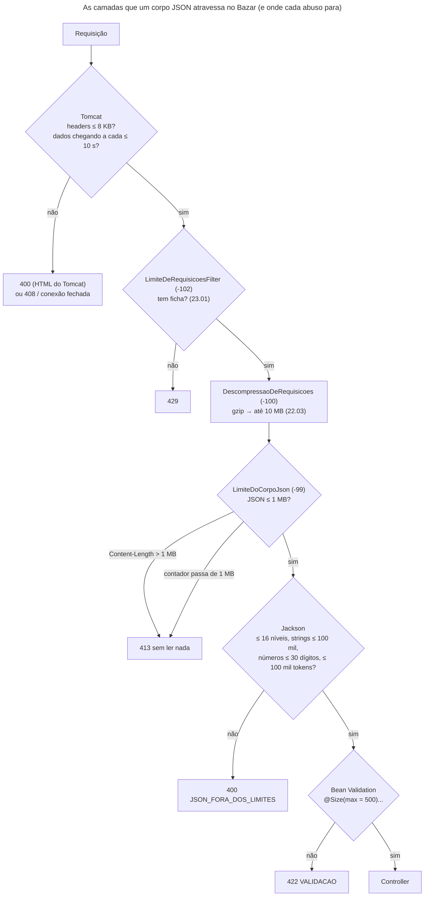

## O problema

O endpoint de ajuste de estoque em lote ([14.04](/design-de-apis-profissional/operacoes-em-lote)) aceita até 500 itens. O contrato diz isso, e o `@Size(max = 500)` garante: um lote de 501 itens recebe `422`.

Agora alguém manda um lote de **um milhão** de itens, 78 MB de JSON. O Bazar responde `422`, como esperado. Mas leva 10,5 segundos, e no caminho o *heap* da aplicação (limitado a 512 MB no teste) chega a 483 MB. Duas requisições dessas ao mesmo tempo, e uma delas termina em `OutOfMemoryError` e `500`.

O `@Size` não protegeu nada. Ele roda **depois** que o Jackson leu o corpo inteiro e montou um milhão de objetos na memória. A validação diz que o lote é grande demais quando o estrago já está feito.

O [rate limiting](/padroes-avancados-de-http/rate-limiting-e-quotas) da 23.01 não ajuda: são **duas** requisições. O problema não é a frequência, é o **tamanho** de cada uma. É a categoria que o OWASP chama de *Unrestricted Resource Consumption* (API4:2023; veja também a [documentação de segurança](https://security-doc-beta.vercel.app/)). Não exige ataque sofisticado: um `curl` com um arquivo grande basta. E também acontece sem má intenção, com um cliente que serializa uma lista sem paginar.

É como uma agência dos correios: a balança e a régua ficam no balcão, **antes** de o pacote entrar. Ninguém abre um contêiner no galpão para só então descobrir que ele não cabe no caminhão.

> **A pergunta desta página:** onde e como limitar o tamanho e a forma do que entra na API, para que uma requisição grande seja recusada antes de custar memória, CPU e threads?

## O conceito

### O caminho de uma requisição, e onde cada limite atua

Uma requisição passa por várias camadas antes de chegar ao controller, e cada uma pode recusá-la. Quanto mais cedo a recusa, mais barata:

| Camada | O que limita | Padrão | Ao estourar |
|---|---|---|---|
| Rede e *proxy* | Tamanho total, conexões por IP, tempo | Depende do *proxy* (nginx: `client_max_body_size 1m`) | `413` do *proxy* |
| Tomcat: conexão | Tempo para mandar headers e corpo (`connection-timeout`) | 60 s | Fecha a conexão, ou `408` |
| Tomcat: headers | Tamanho dos headers (`max-http-request-header-size`) | 8 KB | `400`, página HTML do Tomcat |
| Tomcat: formulários e *multipart* | `max-http-form-post-size`, `spring.servlet.multipart.*` | 2 MB, 1 MB por arquivo | `413` |
| Filtro da aplicação | Tamanho do corpo JSON | **Nenhum** | `413` (a ser criado) |
| Jackson | Profundidade, strings, números, tokens (`StreamReadConstraints`) | 500 níveis, 100 milhões de caracteres, 1000 dígitos, tokens sem limite | `400` |
| Bean Validation | Regras de negócio: `@Size`, `@Max` | O que o código declarar | `422` |
| Consulta | Itens por página | O que o código declarar | Limita, ou `400` |

A tabela mostra o buraco: **o Tomcat não limita o corpo de um POST JSON**. O `max-http-form-post-size` vale só para `application/x-www-form-urlencoded`, e os limites de *multipart* só para *multipart*. Um `application/json` de 78 MB passa direto para o Jackson.

### Os limites do Jackson

O Jackson 2.15 introduziu as `StreamReadConstraints`: limites que o *parser* confere enquanto lê, token a token, antes de qualquer objeto ser montado. No Jackson 3 (o do Spring Boot 4), os padrões são:

| Restrição | Padrão (Jackson 3) | O que protege |
|---|---|---|
| `max-nesting-depth` | 500 | `[[[[[...]]]]]`: estouro de pilha na recursão |
| `max-number-length` | 1000 dígitos | `BigInteger`/`BigDecimal` com milhões de dígitos: a conversão é quadrática |
| `max-string-length` | 100.000.000 caracteres | Uma string de 50 MB |
| `max-name-length` | 50.000 | Nomes de campo gigantes |
| `max-document-length` | Sem limite | O documento inteiro |
| `max-token-count` | Sem limite | Um milhão de elementos pequenos |

Os dois primeiros têm padrões razoáveis, e o laboratório confirma: aninhamento de 100 mil níveis e um número de 100 mil dígitos receberam `400` em 10 ms, sem configurar nada. Os outros são permissivos de propósito: o Jackson não sabe se está lendo um JSON de 1 KB de uma API ou um arquivo de 2 GB de uma exportação. Quem sabe é a aplicação.

No Spring Boot 4.1, essas restrições são propriedades: `spring.jackson.factory.constraints.read.*`. Antes, era preciso um `JsonMapperBuilderCustomizer`.

### Por que contar bytes, e não confiar no `Content-Length`

O `Content-Length` permite recusar sem ler nada, e é o caminho rápido. Mas nem toda requisição tem um: com `Transfer-Encoding: chunked`, o tamanho só é conhecido no fim. Depois de uma descompressão ([22.03](/padroes-avancados-de-http/compressao)), o `Content-Length` é o tamanho comprimido, e não diz nada sobre o que vai sair. O limite tem duas partes:

1. Se o `Content-Length` existe e passa do limite: `413` imediato.
2. Senão, um contador em volta do `InputStream`, que interrompe a leitura ao passar do limite.

### Tempo também é um recurso

O ataque *slowloris* (2009) abre muitas conexões e manda os headers um byte a cada poucos segundos, sem nunca terminar. Cada conexão ocupa uma vaga no servidor. A variante *slow POST* manda os headers completos e o corpo devagar: aí, além da conexão, uma thread fica bloqueada lendo.

O Tomcat usa NIO: esperar os headers não ocupa thread, só uma das 8.192 conexões (`max-connections`). Já a leitura do corpo é bloqueante, e ocupa uma thread (com *virtual threads*, uma *virtual thread*: barata, mas não de graça; [19.02](/concorrencia-e-execucao-assincrona/virtual-threads-em-apis-spring)). O que limita os dois casos é o `connection-timeout`: quanto tempo o Tomcat espera por **cada** pedaço de dados. O padrão é 60 segundos. Para uma API que recebe JSON pequeno, 10 segundos é generoso.

O `connection-timeout` não é um limite de duração total: um cliente que manda um byte a cada 9 segundos nunca estoura um limite de 10. Contra isso, só um *proxy* na frente (o nginx tem `client_body_timeout` e limites de taxa mínima) ou um limite de conexões por IP.

### O que o `@Size` ainda faz

O `@Size(max = 500)` não é inútil: é a **regra de negócio**, e a mensagem que ele gera (`422`, "tamanho deve ser entre 0 e 500") é a que um cliente legítimo precisa ver. O limite de bytes é a proteção técnica, grosseira e barata. Os dois convivem: o limite de bytes (1 MB) fica bem acima do maior pedido legítimo (um lote de 500 itens tem uns 40 KB) e abaixo do que machuca. Entre um e outro, o `@Size` decide.

O mesmo vale para as listas e mapas aninhados (`@Size(max = 20)` nos atributos do produto, `@Size(max = 50)` nos itens do pedido) e para a paginação. O `limit` das listagens já tem teto desde a [13.04](/design-de-apis-profissional/paginacao-por-cursor-keyset): acima de 100, vale 100. Sem teto, `?limit=1000000` é o mesmo ataque, pelo lado da resposta.

### Limites são contrato

Um limite que o cliente não conhece é um erro que ele só descobre em produção. O contrato ([17.05](/contratos-documentacao-e-ciclo-de-vida/documentacao-alem-da-referencia)) deve dizer o tamanho máximo do corpo, o máximo de itens por lote, os limites do JSON e o que acontece ao passar de cada um (`413`, `400`, `422`). E a resposta de erro deve dizer o limite no `detail`. "Requisição inválida", sem número, faz o cliente adivinhar.

## Diagrama



## Na prática

### Antes: o que o Bazar aceitava

Com a aplicação rodando com `-Xmx512m` e sem nenhum limite novo, os payloads abusivos, um de cada vez:

```text noCopy
lote com 1 milhão de itens (78 MB)     → 422 em 10,5 s   heap: 483 MB
produto com nome de 50 milhões de "a"  → 422 em 2,8 s    heap: 409 MB
produto com 1 milhão de atributos      → 422 em 2,0 s    heap: 485 MB
aninhamento de 100 mil níveis          → 400 em 12 ms
número com 100 mil dígitos             → 400 em 10 ms
```

Os três primeiros terminaram no `@Size`, e por isso com `422`: a resposta certa, depois de todo o custo. Os dois últimos foram recusados pelo Jackson com os padrões, quase de graça. O mapa de atributos é o pior caso: 16 MB de JSON viraram 485 MB de *heap*, porque cada entrada é um objeto, duas strings e um nó de `HashMap`.

Dois lotes de um milhão ao mesmo tempo:

```text noCopy
lote 1: 500 em 13,5 s
lote 2: 422 em 17,2 s

java.lang.OutOfMemoryError: Java heap space
```

Desta vez, a aplicação sobreviveu: o `OutOfMemoryError` aconteceu na thread do lote 1, e o resto continuou respondendo. Na [22.02](/padroes-avancados-de-http/download-streaming-e-range), um `OutOfMemoryError` parecido matou a thread do *poller* do Tomcat, e o servidor parou de aceitar conexões. Com OOM, não há garantia nenhuma de onde o erro cai.

E os limites de conexão:

```text noCopy
header de 10 KB                         → 400, página HTML do Tomcat
headers enviados pela metade            → conexão fechada após 60,3 s, sem resposta
corpo enviado pela metade               → 408 após 60,0 s
```

### A configuração

```yaml title="src/main/resources/application.yml (trechos)"
spring:
  jackson:
    factory:
      constraints:
        read:
          # Limites do parser (23.02), bem abaixo dos padrões do Jackson 3 (profundidade 500, strings de 100 milhões
          # de caracteres, documentos e tokens sem limite). O JSON mais fundo do Bazar tem 3 níveis.
          max-nesting-depth: 16
          max-string-length: 100000
          max-number-length: 30
          max-token-count: 100000

server:
  tomcat:
    # Quanto o Tomcat espera pelos headers e por cada pedaço do corpo antes de desistir (23.02). O padrão é 60 s: um
    # cliente lento, de propósito ou não, segura a conexão e a thread por um minuto.
    connection-timeout: 10s

bazar:
  requisicoes:
    # O maior corpo aceito depois de descomprimir uma requisição com Content-Encoding: gzip (22.03).
    limite-descomprimido: 10MB
    # O maior corpo JSON aceito, contado depois da descompressão (23.02). O maior pedido legítimo, um lote de 500
    # ajustes de estoque, tem uns 40 KB.
    limite-json: 1MB
```

Os números saem do próprio Bazar. O maior campo de texto é a descrição do produto, com 2.000 caracteres: 100 mil deixa uma folga de 50 vezes. O maior número é uma quantidade de estoque ou um preço em centavos: 30 dígitos cobrem um `long` com sobra. Um lote de 500 itens tem 3.000 tokens: 100 mil é folga de mais de 30 vezes. Limites apertados demais quebram clientes legítimos; folgados demais não protegem. A folga de 30 a 50 vezes sobre o maior caso real é um bom ponto de partida.

O `max-http-request-header-size` ficou no padrão de 8 KB: é suficiente para um *token* JWT grande ([26.04](/seguranca-essencial-para-apis/resource-server-com-jwt-o-essencial)), e aumentá-lo aumenta a memória de **toda** conexão.

### O filtro do tamanho do JSON

```java title="src/main/java/com/bazar/compartilhado/web/LimiteDoCorpoJson.java (trecho)"
// Só JSON: os arquivos (22.01) e o multipart têm limites próprios, maiores.
@Override
protected boolean shouldNotFilter(HttpServletRequest request) {
    var tipo = request.getContentType();
    if (tipo == null) {
        return true;
    }
    var mediaType = MediaType.parseMediaType(tipo);
    return !mediaType.isCompatibleWith(MediaType.APPLICATION_JSON)
            && !"json".equals(mediaType.getSubtypeSuffix());
}

@Override
protected void doFilterInternal(HttpServletRequest request, HttpServletResponse response, FilterChain chain)
        throws ServletException, IOException {
    if (request.getContentLengthLong() > limite) {
        erros.resolveException(request, response, null, grandeDemais());
        return;
    }
    try {
        chain.doFilter(new ComLimite(request), response);
    }
    catch (RegraDeNegocioException ex) {
        // Um filtro que lê o corpo antes do controller (a idempotência, 21.01) recebe a exceção sem embrulho;
        // no controller, o Jackson a embrulha, e o tratador global a desembrulha.
        erros.resolveException(request, response, null, ex);
    }
    catch (ServletException ex) {
        if (ex.getCause() instanceof RegraDeNegocioException excecao) {
            erros.resolveException(request, response, null, excecao);
            return;
        }
        throw ex;
    }
}
```

O `+json` no `shouldNotFilter` pega `application/merge-patch+json` e `application/json-patch+json` ([14.02](/design-de-apis-profissional/put-patch-json-merge-patch-e-json-patch)). O `ComLimite` é um `HttpServletRequestWrapper` com um `ServletInputStream` que conta os bytes e lança `CORPO_GRANDE_DEMAIS` ao passar do limite, a mesma ideia do contador da descompressão.

A ordem do filtro, `-99`, é logo depois da descompressão (`-100`). Assim, ele conta os bytes **já descomprimidos**, e um JSON de 50 MB comprimido em 500 KB não escapa. A cadeia completa dos filtros do Bazar ficou assim:

```text noCopy
-105  RequestContextFilter          (Spring Boot: idioma das mensagens)
-102  LimiteDeRequisicoesFilter     (23.01: 429)
-100  DescompressaoDeRequisicoes    (22.03: gzip, 415, 413 a 10 MB)
 -99  LimiteDoCorpoJson             (23.02: 413 a 1 MB)
       ... os filtros que leem o corpo, e o DispatcherServlet
```

### A resposta para as violações do Jackson

Sem tratamento, uma violação das `StreamReadConstraints` chega como `HttpMessageNotReadableException`, e o Bazar respondia o genérico "O corpo da requisição não é um JSON válido ou tem um valor do tipo errado". Mas o JSON **é** válido. O cliente que recebe essa mensagem procura um erro de sintaxe que não existe. O tratador global ganhou um caso:

```java title="src/main/java/com/bazar/compartilhado/erros/TratadorGlobalDeErros.java (trecho)"
// Um JSON bem formado, mas fundo, longo ou grande demais para as restrições do parser (23.02). A mensagem do
// Jackson cita classes internas; o detail diz quais são os limites, e o contrato também.
if (ex.getMostSpecificCause() instanceof StreamConstraintsException) {
    return deDominio(new RegraDeNegocioException(TipoProblema.JSON_FORA_DOS_LIMITES, Map.of()), request);
}
```

A mensagem do Jackson (``Number value length (100000) exceeds the maximum allowed (30, from `StreamReadConstraints.getMaxNumberLength()`)``) é precisa, mas em inglês e cita a classe interna. Ela vai para o log; o cliente recebe o `detail` traduzido, com os limites.

### Depois: os mesmos payloads

```text noCopy
lote com 1 milhão de itens (78 MB)          → 413 em 21 ms    heap: 113 MB (o de repouso)
o mesmo, com Transfer-Encoding: chunked      → 413 em 6 ms
produto com nome de 50 milhões de "a"       → 413 em 6 ms
produto com 1 milhão de atributos           → 413 em 6 ms
dois lotes de 1 milhão ao mesmo tempo       → 413 em 6 ms e 413 em 8 ms
número com 100 mil dígitos                  → 400 JSON_FORA_DOS_LIMITES em 13 ms
headers pela metade                         → conexão fechada após 10,0 s
corpo pela metade                           → 408 após 10,0 s
```

De 10,5 segundos e 483 MB para 21 milissegundos e nenhum *heap* a mais.

<HttpExchange
  title="O lote de um milhão de itens"
  request={{ method: 'POST', url: '/v1/ajustes-estoque/lotes', headers: { 'Content-Type': 'application/json', 'Content-Length': '78000011', 'Accept-Language': 'pt-BR' }, body: '{"itens":[{"produtoId":"bcd399f5-...","quantidadeDisponivel":1}, ... (1.000.000 de itens)]}' }}
  response={{ status: 413, headers: { 'Content-Type': 'application/problem+json', 'Connection': 'close' }, body: { type: 'https://api.bazar.example/problemas/corpo-grande-demais', title: 'Corpo grande demais', status: 413, detail: 'O corpo da requisição passa do limite de 1 MB.', instance: '/v1/ajustes-estoque/lotes', codigo: 'CORPO_GRANDE_DEMAIS', traceId: '7e29f56e80de8ad5c1e493d490d81c8b' } }}
>
Recusado pelo `Content-Length`, sem ler um byte do corpo. O Tomcat descarta até 2 MB do corpo não lido (`max-swallow-size`) para manter a conexão; acima disso, fecha a conexão. Por isso clientes HTTP às vezes veem um "*broken pipe*" no lugar do `413`, como na [22.01](/padroes-avancados-de-http/upload-de-arquivos).
</HttpExchange>

<HttpExchange
  title="Um número de 100 mil dígitos"
  request={{ method: 'POST', url: '/v1/produtos', headers: { 'Content-Type': 'application/json', 'Accept-Language': 'pt-BR' }, body: '{"nome":"x","precoEmCentavos":1111111111...(100.000 dígitos)}' }}
  response={{ status: 400, headers: { 'Content-Type': 'application/problem+json' }, body: { type: 'https://api.bazar.example/problemas/json-fora-dos-limites', title: 'JSON fora dos limites', status: 400, detail: 'O JSON passa de um dos limites da API: até 16 níveis de aninhamento, strings de até 100.000 caracteres, números de até 30 dígitos e 100.000 elementos no documento.', instance: '/v1/produtos', codigo: 'JSON_FORA_DOS_LIMITES', traceId: '3f725e43190e484a40102ba8c42218d0' } }}
>
`400`, e não `413`: o tamanho do corpo está dentro do limite, o problema é a **forma** do JSON.
</HttpExchange>

As camadas se completam, e qual delas age depende do formato do abuso. A bomba de descompressão da 22.03 (1 GB de espaços dentro de uma string) agora para no Jackson, que recusa a string aos 100 mil caracteres: `400` em 10 ms. Uma bomba com os espaços **entre** os campos, que o *parser* pula sem contar como token, passa pelo Jackson, e para no contador de 1 MB: `413` em 17 ms.

### Os testes

```java title="src/test/java/com/bazar/compartilhado/web/LimitesDePayloadTest.java (trecho)"
@Test
void semContentLengthOsBytesSaoContadosDuranteALeitura() throws Exception {
    // Transfer-Encoding: chunked: o filtro não sabe o tamanho de antemão, e interrompe a leitura em 1 MB. São
    // espaços fora das strings, que o parser pula sem limite nenhum: só o contador os pega.
    var nome = "{\"nome\":\"x\"," + " ".repeat(2 * 1024 * 1024) + "\"sku\":\"LIV-0103\"}";
    var corpo = HttpRequest.BodyPublishers.ofInputStream(
            () -> new ByteArrayInputStream(nome.getBytes(StandardCharsets.UTF_8)));

    var resposta = HttpClient.newHttpClient().send(
            HttpRequest.newBuilder(URI.create("http://localhost:" + porta + "/v1/produtos"))
                    .header("Content-Type", "application/json")
                    .POST(corpo)
                    .build(),
            HttpResponse.BodyHandlers.ofString());

    assertThat(resposta.statusCode()).isEqualTo(413);
    assertThat(resposta.body()).contains("\"codigo\":\"CORPO_GRANDE_DEMAIS\"");
}

@Test
void jsonFundoDemaisEhRecusadoPeloParser() throws Exception {
    var fundo = "{\"nome\":\"x\",\"extra\":" + "[".repeat(20) + "]".repeat(20) + "}";

    mockMvc.perform(post("/v1/produtos").contentType(MediaType.APPLICATION_JSON).content(fundo))
            .andExpect(status().isBadRequest())
            .andExpect(jsonPath("$.codigo").value("JSON_FORA_DOS_LIMITES"));
}
```

Dois detalhes que os testes ensinaram:

- O primeiro rascunho do teste *chunked* mandava 2 MB de `a` **dentro** de uma string. A resposta foi `400`, e não `413`: o limite de string do Jackson (100 mil) age antes do contador (1 MB). Para testar o contador, os bytes precisam estar onde o *parser* não conta nada: espaço em branco entre os campos.
- O primeiro teste de profundidade mandava os colchetes no campo `atributos`, que é um `Map<String, String>`. O Jackson recusou no segundo `[`, por tipo errado (`REQUISICAO_INVALIDA`), antes de chegar ao nível 16. Num campo desconhecido (`extra`), que o Jackson pula token a token, o limite de profundidade é o que age.

O teste da bomba, na `CompressaoTest`, passou a esperar `passa do limite de 1 MB`: o limite do JSON chega antes do da descompressão.

## Erros comuns

<BadVsGood title="Confiar no @Size para limitar o tamanho" why="A validação roda depois da desserialização: o lote de um milhão de itens já está na memória quando o @Size o recusa. No Bazar, 78 MB de JSON custaram 10,5 s e 483 MB de heap para um 422.">
<Bad title="Só a regra de negócio">

```java
public record AjusteEmLoteRequest(
        @Size(max = 500)
        List<Item> itens) {
}
// 1 milhão de itens: lidos, montados,
// e só então recusados
```

</Bad>
<Good title="Limite de bytes antes, regra depois">

```yaml
bazar.requisicoes.limite-json: 1MB
spring.jackson.factory.constraints.read:
  max-token-count: 100000
```

```java
@Size(max = 500) List<Item> itens
// o filtro recusa os 78 MB em 21 ms;
// o @Size cuida do lote de 501
```

</Good>
</BadVsGood>

Outros tropeços frequentes:

- **Achar que o Tomcat limita o corpo**: o `max-http-form-post-size` vale só para formulários.
- **Contar só o `Content-Length`**: `chunked` e corpos descomprimidos não o têm, ou têm o número errado.
- **Limitar antes da descompressão**: 1 MB comprimido pode ser 1 GB.
- **Deixar os padrões do Jackson** e esperar que eles conheçam a sua API: strings de 100 milhões de caracteres e tokens sem limite.
- **Limites apertados demais**: um limite de 64 KB que quebra o lote legítimo de 500 itens é um *bug*, não uma proteção.
- **Mensagem genérica** ("JSON inválido") para um JSON válido que passou de um limite.
- **`connection-timeout` de 60 s** numa API de JSON pequeno.
- **Coleções sem `@Size`** e listagens sem teto de `limit`.
- **Limites não documentados**: o cliente descobre o 1 MB em produção.

## Boas práticas

- **Defesa em camadas**: *proxy*, Tomcat, filtro de bytes, Jackson, Bean Validation. Cada uma pega o que a anterior não vê.
- **Limite de bytes para JSON**, com `Content-Length` e com contador, **depois** da descompressão.
- **Restrições do Jackson ajustadas à API**, com folga de 30 a 50 vezes sobre o maior caso real.
- **`@Size` em toda coleção** e **teto no `limit`** da paginação.
- **`connection-timeout` curto** (10 s para JSON pequeno); para *uploads* grandes, um *timeout* próprio ou um *proxy* na frente.
- **Erros que dizem o limite**: `413` com o tamanho, `400` com as restrições, `422` com a regra.
- **Limites no contrato**, e testes que mandam o payload abusivo.

## Por baixo dos panos

<DeepDive title="Por que 78 MB de JSON viram 483 MB de heap">

Um item do lote tem 78 bytes de JSON: `{"produtoId":"bcd399f5-...","quantidadeDisponivel":1},`. Na memória, depois do Jackson, ele vira:

```text noCopy
Item (record)                      16 bytes de cabeçalho + 2 referências   ≈ 24
UUID                               16 de cabeçalho + 2 longs              ≈ 32
Integer (fora do cache −128..127)  16                                     ≈ 16
uma posição no Object[] do ArrayList                                      ≈  4
                                                                          ≈ 76 bytes
```

Parece pouco, mas falta o que fica pelo caminho. O `ArrayList` cresce dobrando: para chegar a um milhão, ele copia o *array* várias vezes, e os *arrays* antigos ficam no *heap* até o próximo GC. O Tomcat e o Jackson leem o corpo em *buffers*, e o *parser* cria uma `String` temporária para cada UUID (36 caracteres, uns 56 bytes) antes de convertê-la em `UUID`. A Bean Validation, ao conferir o `@Valid` de cada item, cria contextos de validação. E o erro `422` monta a lista de violações. O pico medido inclui todo esse lixo ainda não coletado.

O mapa de atributos é pior: cada entrada tem duas `String` (com o `byte[]` de cada uma), um nó de `HashMap` de 32 bytes e uma posição na tabela. São cerca de 150 bytes por entrada para 16 bytes de JSON: um fator de quase 10.

A regra prática: **um JSON desserializado ocupa de 3 a 10 vezes o seu tamanho em bytes**. Um limite de 1 MB de JSON é um limite de uns 10 MB de *heap* por requisição. Com 200 requisições simultâneas, 2 GB no pior caso: ainda é preciso pensar na concorrência, mas é um número conhecido, e não ilimitado.

O `max-token-count` limita outra coisa: o **trabalho**. Um JSON de 1 MB com um milhão de `0,` (um *array* de inteiros) tem um milhão de tokens. O limite de tokens recusa isso antes de o *parser* chegar ao fim, e protege o caso que o limite de bytes deixa passar.

</DeepDive>

## No projeto Bazar

<ProjectStep title="Limites de payload" module="compartilhado" tag="pagina-23.02" files={[
  { path: 'src/main/resources/application.yml', change: 'alterado' },
  { path: 'src/main/java/com/bazar/compartilhado/web/LimiteDoCorpoJson.java', change: 'novo' },
  { path: 'src/main/java/com/bazar/compartilhado/web/ConfiguracaoWeb.java', change: 'alterado' },
  { path: 'src/main/java/com/bazar/compartilhado/erros/TratadorGlobalDeErros.java', change: 'alterado' },
  { path: 'src/main/java/com/bazar/compartilhado/erros/TipoProblema.java', change: 'alterado' },
  { path: 'src/test/java/com/bazar/compartilhado/web/LimitesDePayloadTest.java', change: 'novo' },
  { path: 'src/test/java/com/bazar/compartilhado/web/CompressaoTest.java', change: 'alterado' },
]}>
Um filtro limita corpos JSON a 1 MB, contados depois da descompressão: `413 CORPO_GRANDE_DEMAIS` pelo `Content-Length` ou por um contador durante a leitura. O Jackson passa a ter limites próprios do Bazar (16 níveis, strings de 100 mil caracteres, números de 30 dígitos, 100 mil tokens), com `400 JSON_FORA_DOS_LIMITES` e um `detail` que lista os limites. O `connection-timeout` do Tomcat cai de 60 s para 10 s. A mensagem de `CORPO_GRANDE_DEMAIS` passa a valer para os dois limites de corpo.
</ProjectStep>

## Resumo

- O Tomcat não limita o corpo de um POST JSON, e o `@Size` roda depois da desserialização: medido no Bazar, um lote de 78 MB custou 10,5 s e 483 MB de *heap* para um `422`, e dois ao mesmo tempo deram `OutOfMemoryError`.
- Limite de bytes num filtro: `Content-Length` para recusar sem ler, contador para `chunked` e para corpos descomprimidos. Depois dele, o mesmo lote recebe `413` em 21 ms.
- `StreamReadConstraints` do Jackson, via `spring.jackson.factory.constraints.read.*` no Boot 4.1: profundidade e números já têm padrões razoáveis; strings, documento e tokens, não.
- `connection-timeout` de 60 s para 10 s: menos tempo para clientes lentos segurarem conexões e threads.
- `@Size` em coleções e teto no `limit` continuam: são as regras de negócio, com `422`.
- Cada camada pega um formato de abuso, e cada erro diz o limite. E os limites vão para o contrato.

<Exercise title="O limite do lote de produtos" difficulty="medio">
O Bazar vai ganhar uma importação de catálogo: `POST /v2/produtos/importacoes`, com até 5.000 produtos por requisição, cada um com até 2.000 caracteres de descrição e 20 atributos.

1. O limite de 1 MB do JSON quebra essa importação? Faça a conta.
2. Como dar um limite maior só para essa rota, sem abrir o limite de toda a API?
3. Mesmo com um limite maior, por que essa importação talvez não devesse ler o corpo inteiro na memória?

<Hint>Calcule o tamanho de um produto no pior caso legítimo, e lembre da 21.02 e da 22.02.</Hint>

<Solution>

1. No pior caso legítimo, um produto tem uns 2 KB de descrição, mais 20 atributos de até 100 caracteres (cerca de 2,5 KB com as chaves e as aspas), mais os outros campos: uns 5 KB. Com 5.000 produtos, são 25 MB. O limite de 1 MB quebra a importação; até o limite de tokens quebra (5.000 × ~50 tokens = 250 mil).

2. O `LimiteDoCorpoJson` pode receber um mapa de limites por rota, como o rate limiting da 23.01 tem uma política por rota: `/v2/produtos/importacoes` com 30 MB, o resto com 1 MB. As restrições do Jackson são globais (um `JsonMapper` para a aplicação), então a rota de importação teria que usar um `JsonMapper` próprio, com restrições maiores, e ler o corpo por conta própria. Ou, melhor, aceitar outro formato.

3. 25 MB de JSON viram de 75 a 250 MB de *heap* (o fator de 3 a 10 do aprofundamento). Com algumas importações simultâneas, é o mesmo problema desta página. As saídas são duas: **ler em fluxo**, com NDJSON (um produto por linha, como a exportação da 22.02), validando e gravando em blocos de 500, de modo que a memória fica constante; ou **tornar a importação assíncrona** (21.02): o cliente envia o arquivo como *upload* (22.01, com limite de arquivo), recebe `202` e uma operação, e o processamento lê o arquivo do disco, em fluxo, numa tarefa de fundo.

</Solution>
</Exercise>

<Quiz questions={[
  {
    question: 'Um lote com @Size(max = 500) recebe 1 milhão de itens. O que acontece sem um limite de bytes?',
    options: [
      'O @Size recusa antes de ler o corpo',
      'O Jackson lê e monta todos os itens na memória, e só então a validação recusa com 422',
      'O Tomcat recusa com 413',
      'O Spring corta a lista em 500',
    ],
    answer: 1,
    explanation: 'A Bean Validation roda sobre o objeto já desserializado. No Bazar, isso custou 10,5 s e 483 MB de heap.',
  },
  {
    question: 'Por que o filtro de tamanho do JSON não pode confiar só no Content-Length?',
    options: [
      'Porque o Content-Length é sempre falso',
      'Porque requisições chunked não têm Content-Length, e depois de uma descompressão ele é o tamanho comprimido',
      'Porque o Tomcat remove o header',
      'Porque o Content-Length é em bits',
    ],
    answer: 1,
    explanation: 'O Content-Length permite recusar sem ler (o caminho rápido). O contador durante a leitura cobre o resto.',
  },
  {
    question: 'O que o max-http-form-post-size do Tomcat (2 MB) limita?',
    options: [
      'Todo corpo de POST',
      'Só corpos application/x-www-form-urlencoded: um POST JSON passa direto',
      'O tamanho dos headers',
      'Os uploads multipart',
    ],
    answer: 1,
    explanation: 'Por isso o Bazar precisou de um filtro próprio para JSON.',
  },
  {
    question: 'Um JSON válido com uma string de 200 mil caracteres recebe qual resposta no Bazar, e por quê?',
    options: [
      '413, porque é grande demais',
      '400 JSON_FORA_DOS_LIMITES: o corpo cabe no limite de 1 MB, mas a string passa do max-string-length de 100 mil',
      '422, pelo @Size do campo',
      '500',
    ],
    answer: 1,
    explanation: 'O 413 é para o tamanho do corpo; o 400 é para a forma do JSON. O @Size nem chega a rodar.',
  },
]} />

## Referências

<References />
