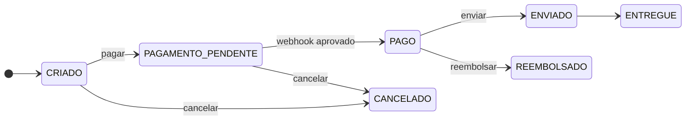
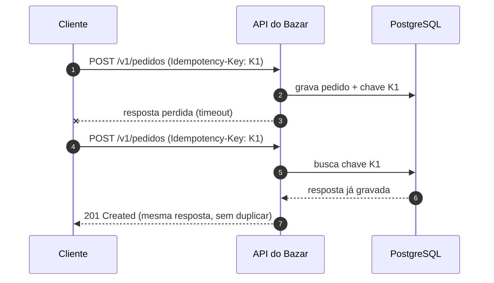
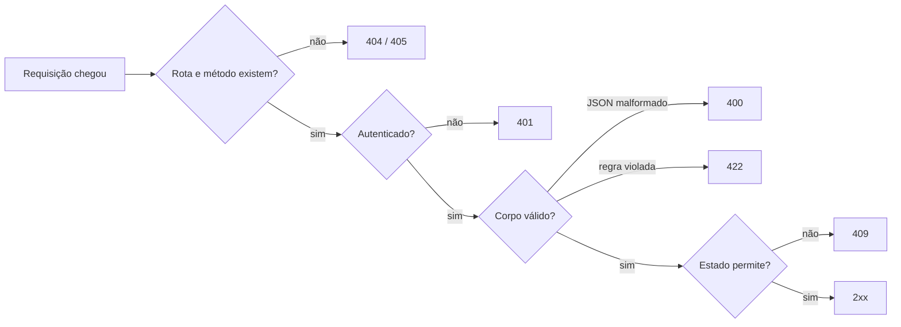

Os componentes abaixo estão disponíveis em qualquer arquivo `.mdx` de `src/content`, **sem import**. O guia de escrita completo, com regras de uso de cada um, está em `planejamento/GUIA-DE-ESCRITA.md`.

## Markdown e código

O texto comum é Markdown com GFM: **negrito**, *itálico*, `código inline`, [links internos](/comecando-e-fundamentos-de-http/status-codes-em-profundidade) e [externos](https://www.rfc-editor.org/rfc/rfc9110), listas e tabelas.

| Método | Seguro | Idempotente | Cacheável |
|---|---|---|---|
| `GET` | sim | sim | sim |
| `POST` | não | não | raramente |
| `PUT` | não | sim | não |

### Bloco de código

Blocos de código são destacados pelo **Shiki** no build. Informe o nome do arquivo com `title="..."` e destaque linhas com `{n-m}`:

```java title="src/main/java/com/bazar/catalogo/CategoriaController.java" {8-12}
package com.bazar.catalogo;

@RestController
@RequestMapping("/v1/categorias")
class CategoriaController {

    private final CategoriaService service;

    @PostMapping
    ResponseEntity<CategoriaResponse> criar(@Valid @RequestBody CriarCategoriaRequest request) {
        var criada = service.criar(request);
        return ResponseEntity.created(URI.create("/v1/categorias/" + criada.id())).body(criada);
    }
}
```

### Diff e foco

Use os comentários `// [!code ++]` e `// [!code --]` para mostrar o que mudou, e `// [!code focus]` para focar uma linha:

```java title="ProdutoController.java"
@GetMapping("/{id}")
ProdutoResponse detalhar(@PathVariable UUID id) {
    return repository.findById(id).map(mapper::toResponse).orElse(null); // [!code --]
    return service.detalhar(id); // lança ProdutoNaoEncontradoException → 404 // [!code ++]
}
```

```yaml title="application.yml"
spring:
  mvc:
    problemdetails:
      enabled: true # [!code focus]
  jackson:
    json:
      read:
        fail-on-unknown-properties: false
```

```bash
curl -i https://api.bazar.example/v1/categorias
```

## Callout

<Callout type="info">
  O status `422 Unprocessable Content` foi renomeado na RFC 9110. Antes se chamava "Unprocessable Entity".
</Callout>

<Callout type="tip" title="Atalho">
  Use `ResponseEntity.created(uri)` para devolver `201` com o header `Location` em uma linha.
</Callout>

<Callout type="warning">
  `spring.jpa.open-in-view` vem **ligado** por padrão e esconde problemas de N+1. Desligue em APIs.
</Callout>

<Callout type="danger">
  Nunca devolva `200 OK` com `{"erro": "..."}` no corpo. Clientes, gateways e *retries* leem o status, não o corpo.
</Callout>

## CodeTabs

O mesmo exemplo em várias formas. Cada bloco vira uma aba; o rótulo vem do `title`.

<CodeTabs title="Criar uma categoria">

```bash title="curl"
curl -X POST https://api.bazar.example/v1/categorias \
  -H 'Content-Type: application/json' \
  -d '{"nome": "Livros", "slug": "livros"}'
```

```bash title="HTTPie"
http POST https://api.bazar.example/v1/categorias nome=Livros slug=livros
```

```javascript title="JavaScript (fetch)"
const resposta = await fetch('https://api.bazar.example/v1/categorias', {
  method: 'POST',
  headers: { 'Content-Type': 'application/json' },
  body: JSON.stringify({ nome: 'Livros', slug: 'livros' }),
})
console.log(resposta.status, resposta.headers.get('Location'))
```

```java title="Java (RestClient)"
var categoria = restClient.post()
    .uri("/v1/categorias")
    .body(new CriarCategoriaRequest("Livros", "livros"))
    .retrieve()
    .toEntity(CategoriaResponse.class);
```

</CodeTabs>

## HttpExchange

Requisição e resposta completas, como trafegam na rede. O corpo pode ser um objeto (formatado como JSON) ou uma string.

<HttpExchange
  title="Criando um pedido com chave de idempotência"
  request={{
    method: 'POST',
    url: '/v1/pedidos',
    headers: { 'Content-Type': 'application/json', 'Idempotency-Key': '0192f3a1-7c4e-7b2a-9d1e-3f5a6b7c8d9e' },
    body: { clienteId: '0192f3a0-1111-7000-8000-000000000001', itens: [{ produtoId: '0192f39f-2222-7000-8000-000000000042', quantidade: 2 }] },
  }}
  response={{
    status: 201,
    headers: { 'Content-Type': 'application/json', Location: '/v1/pedidos/0192f3a1-9999-7000-8000-000000000123' },
    body: { id: '0192f3a1-9999-7000-8000-000000000123', numero: 'BZR-2026-000123', status: 'CRIADO', valorTotal: { valor: '259.80', moeda: 'BRL' } },
  }}
>
  Se o cliente repetir a mesma requisição com a mesma `Idempotency-Key`, o Bazar devolve a **mesma resposta** sem criar outro pedido.
</HttpExchange>

<HttpExchange
  request={{ method: 'POST', url: '/v1/pedidos/0192f3a1-9999-7000-8000-000000000123/cancelamento' }}
  response={{
    status: 409,
    headers: { 'Content-Type': 'application/problem+json' },
    body: {
      type: 'https://api.bazar.example/problemas/transicao-invalida',
      title: 'Transição de estado inválida',
      status: 409,
      detail: 'O pedido BZR-2026-000123 já foi enviado e não pode ser cancelado.',
      codigo: 'PEDIDO_TRANSICAO_INVALIDA',
      traceId: '4bf92f3577b34da6a3ce929d0e0e4736',
    },
  }}
/>

## Endpoint

Cartão de referência de um endpoint, com parâmetros, respostas e exemplos como filhos.

<Endpoint
  method="GET"
  path="/v1/produtos/{id}"
  summary="Detalha um produto. Responde com ETag e Cache-Control para permitir cache e requisições condicionais."
  params={[
    { name: 'id', in: 'path', type: 'UUID', required: true, description: 'Identificador público do produto (UUID v7).' },
    { name: 'fields', in: 'query', type: 'string', description: 'Campos desejados, separados por vírgula (ex.: id,nome,preco).' },
    { name: 'If-None-Match', in: 'header', type: 'string', description: 'ETag da versão em cache; se não mudou, a resposta é 304.' },
  ]}
  responses={[
    { status: 200, description: 'Produto encontrado.' },
    { status: 304, description: 'A versão em cache continua válida.' },
    { status: 404, description: 'Produto inexistente ou descontinuado.' },
  ]}
>

```http
GET /v1/produtos/0192f39f-2222-7000-8000-000000000042 HTTP/1.1
Host: api.bazar.example
If-None-Match: "v7"
```

</Endpoint>

<Endpoint method="DELETE" path="/v1/categorias/{id}" summary="Remove uma categoria sem produtos." responses={[{ status: 204 }, { status: 409, description: 'A categoria ainda tem produtos.' }]} />

<Endpoint method="GET" path="/v1/produtos" summary="Versão 1 do catálogo, com precoEmCentavos." deprecated />

## BadVsGood

Duas abordagens lado a lado. Use `<Bad>` e `<Good>` como filhos e `why` para a explicação.

<BadVsGood title="Ações que não são CRUD" why="A URI identifica um recurso; o verbo é o método HTTP. Modelar o cancelamento como um sub-recurso deixa a ação auditável e permite responder 409 quando o estado não permite cancelar.">
<Bad title="Verbo na URI">

```http
POST /v1/cancelarPedido?id=123
```

Mistura RPC com REST e não tem lugar para o motivo do cancelamento.

</Bad>
<Good title="Sub-recurso de ação">

```http
POST /v1/pedidos/123/cancelamento
Content-Type: application/json

{ "motivo": "CLIENTE_DESISTIU" }
```

O cancelamento vira um recurso com corpo, histórico e erros próprios.

</Good>
</BadVsGood>

## Steps

<Steps>
<Step title="Crie o projeto no Spring Initializr">
Escolha **Java 25**, **Spring Boot 4.1.2** e as dependências `spring-boot-starter-webmvc` e `spring-boot-starter-validation`.
</Step>
<Step title="Suba as dependências locais">

```bash
docker compose up -d postgres redis
```

</Step>
<Step title="Rode a aplicação">
Execute `./mvnw spring-boot:run` e acesse `http://localhost:8080/actuator/health`.
</Step>
</Steps>

## Mermaid

Escreva diagramas como bloco ` ```mermaid `. Eles acompanham o tema claro/escuro. Use `title="..."` para a legenda.







## AnimatedFlow

Diagrama que avança passo a passo. O "pacote" viaja entre os nós; passos com `response: true` usam outra cor. Também responde às setas do teclado.

<AnimatedFlow
  title="O caminho de GET /v1/produtos/42 no Spring MVC"
  nodes={[
    { id: 'cliente', label: 'Cliente', sublabel: 'curl' },
    { id: 'tomcat', label: 'Tomcat', sublabel: 'Filtros' },
    { id: 'dispatcher', label: 'Dispatcher', sublabel: 'DispatcherServlet' },
    { id: 'controller', label: 'Controller', sublabel: 'ProdutoController' },
    { id: 'service', label: 'Serviço', sublabel: 'ProdutoService' },
  ]}
  steps={[
    { from: 'cliente', to: 'tomcat', label: 'GET /v1/produtos/42', title: 'A requisição chega ao Tomcat', description: 'O conector HTTP lê os bytes, monta o HttpServletRequest e passa pela cadeia de filtros (ex.: segurança, tracing).' },
    { from: 'tomcat', to: 'dispatcher', label: 'HttpServletRequest', title: 'O DispatcherServlet assume', description: 'Ele consulta os HandlerMappings para descobrir qual método atende GET /v1/produtos/{id}.' },
    { from: 'dispatcher', to: 'controller', label: 'id = 42', title: 'Argumentos resolvidos', description: 'O HandlerAdapter converte o path variable em UUID e chama ProdutoController.detalhar(id).' },
    { from: 'controller', to: 'service', label: 'detalhar(42)', title: 'Regra de negócio', description: 'O controller delega ao serviço, que busca o produto no repositório.' },
    { from: 'service', to: 'controller', label: 'Produto', response: true, title: 'O serviço devolve o domínio', description: 'O controller mapeia a entidade para ProdutoResponse (DTO).' },
    { from: 'controller', to: 'dispatcher', label: 'ProdutoResponse', response: true, title: 'Serialização', description: 'O HttpMessageConverter de JSON (Jackson 3) escreve o corpo e o status 200.' },
    { from: 'dispatcher', to: 'cliente', label: '200 OK', response: true, title: 'Resposta enviada', description: 'A resposta volta pelos filtros e pelo Tomcat até o cliente.' },
  ]}
/>

## FileTree

Pastas terminam com `/`, a indentação é de 2 espaços, e as marcas `(novo)`, `(alterado)` e `(removido)` destacam o que mudou. Comentários vêm depois de `#`.

<FileTree title="Módulo de catálogo após a página 05.04" tree={`
bazar/
  pom.xml
  compose.yaml # PostgreSQL e Redis locais
  src/main/java/com/bazar/
    BazarApplication.java
    catalogo/
      Categoria.java (novo)
      CategoriaController.java (novo)
      CategoriaRepository.java (novo)
      CategoriaService.java (novo)
    compartilhado/
      erros/
        TratadorGlobalDeErros.java (alterado)
  src/main/resources/
    application.yml (alterado)
`} />

## Comparison

Tabela comparativa. `true`, `false` e `null` viram ícones; `highlight` destaca a coluna recomendada.

<Comparison
  title="PUT × PATCH"
  columns={['PUT', 'PATCH (Merge Patch)']}
  highlight={1}
  rows={[
    { label: 'Semântica', values: ['Substitui a representação inteira', 'Aplica só os campos enviados'] },
    { label: 'Idempotente', values: [true, false] },
    { label: 'Campos omitidos', values: ['Viram nulos ou padrão', 'Ficam como estão'] },
    { label: 'Media type', values: ['application/json', 'application/merge-patch+json'] },
    { label: 'Exige If-Match no Bazar', values: [true, true] },
  ]}
  caption="JSON Patch (RFC 6902) é a alternativa quando é preciso operar em listas ou mover campos."
/>

## StatusCodeTable

Passe números (usa a explicação padrão) ou objetos com `when`, `example` e `retry`.

<StatusCodeTable
  title="Status usados pelo Bazar no ciclo do pedido"
  codes={[
    { code: 201, example: 'POST /v1/pedidos criou BZR-2026-000123' },
    { code: 202, example: 'POST /v1/pagamentos/{id}/reembolsos aceito para processamento' },
    { code: 303, example: 'GET /v1/operacoes/{id} concluída redireciona ao reembolso' },
    { code: 409, example: 'Cancelar um pedido já ENVIADO' },
    { code: 412, example: 'PUT /v1/produtos/{id}/estoque com ETag desatualizada' },
    { code: 422, example: 'Pedido com quantidade 0' },
    { code: 429, retry: true, example: 'Mais de 100 requisições por minuto' },
    { code: 503, retry: true, example: 'PagaFácil fora do ar e circuit breaker aberto' },
  ]}
/>

<StatusCodeTable codes={[200, 204, 400, 404]} filter={false} />

## DeepDive

<DeepDive>
O `DispatcherServlet` é um `HttpServlet` comum registrado pelo Spring Boot. Ao iniciar, ele procura beans de `HandlerMapping`, `HandlerAdapter`, `HandlerExceptionResolver` e `HttpMessageConverter` no contexto e monta o *pipeline* com eles.

```java
// Simplificado de DispatcherServlet#doDispatch
HandlerExecutionChain handler = getHandler(request);
HandlerAdapter adapter = getHandlerAdapter(handler.getHandler());
ModelAndView mv = adapter.handle(request, response, handler.getHandler());
```
</DeepDive>

## ProjectStep

Destaca a etapa do projeto final construída na página, com a *tag* do repositório de exemplos e os arquivos alterados.

<ProjectStep
  title="Primeiro CRUD de categorias com status corretos"
  module="catalogo"
  tag="pagina-05.04"
  files={[
    { path: 'src/main/java/com/bazar/catalogo/CategoriaController.java', change: 'novo' },
    { path: 'src/main/java/com/bazar/catalogo/CategoriaService.java', change: 'novo' },
    { path: 'src/test/java/com/bazar/catalogo/CategoriaControllerTest.java', change: 'novo' },
    { path: 'src/main/resources/application.yml', change: 'alterado' },
  ]}
>
Ao final desta etapa o Bazar responde `GET`, `POST`, `PUT` e `DELETE` em `/v1/categorias`, com `201 + Location` na criação e `204` na remoção.
</ProjectStep>

## Checklist

As marcações ficam salvas no navegador. Use `id` diferente se houver mais de um checklist na página.

<Checklist
  id="revisao-endpoint"
  title="Antes de publicar um endpoint"
  items={[
    'O método HTTP corresponde à semântica da operação',
    'Criação devolve 201 com Location',
    { label: 'Erros usam application/problem+json', hint: 'Com type, title, status e o campo codigo do Bazar.' },
    'O contrato OpenAPI foi atualizado',
    'Há teste com @WebMvcTest para os status de erro',
  ]}
/>

## Quiz

Perguntas de múltipla escolha. `answer` é o índice da opção correta, a partir de 0.

<Quiz
  questions={[
    {
      question: 'Um DELETE /v1/categorias/7 repetido devolve 404 na segunda vez. Ele continua idempotente?',
      options: ['Não, porque a resposta mudou', 'Sim, porque o efeito no servidor é o mesmo', 'Só se devolver 204 nas duas vezes'],
      answer: 1,
      explanation: 'Idempotência fala do efeito no servidor, não da resposta. Depois da primeira chamada a categoria não existe, e repetir não muda isso.',
    },
    {
      question: 'O cliente envia um JSON válido, mas com quantidade 0 em um item do pedido. Qual status?',
      options: ['400 Bad Request', '409 Conflict', '422 Unprocessable Content'],
      answer: 2,
      explanation: 'A sintaxe está correta; o que falha é a regra de validação. 400 é para requisições malformadas e 409 para conflito com o estado atual do recurso.',
    },
  ]}
/>

## Exercise

Exercício prático com `<Hint>` e `<Solution>` recolhíveis. `difficulty` aceita `facil`, `medio` e `dificil`.

<Exercise title="Devolva 201 com Location na criação de produto" difficulty="facil">
Altere `ProdutoController.criar` para responder `201 Created` com o header `Location` apontando para o produto criado, em vez de `200 OK`.

<Hint>
`ServletUriComponentsBuilder.fromCurrentRequest()` monta a URI a partir da requisição atual.
</Hint>

<Solution>

```java title="ProdutoController.java"
@PostMapping
ResponseEntity<ProdutoResponse> criar(@Valid @RequestBody CriarProdutoRequest request) {
    var produto = service.criar(request);
    var location = ServletUriComponentsBuilder.fromCurrentRequest()
        .path("/{id}").buildAndExpand(produto.id()).toUri();
    return ResponseEntity.created(location).body(produto);
}
```

</Solution>
</Exercise>

## Term

Marque termos do glossário com `<Term id="...">`. A definição aparece ao passar o mouse (ou ao tocar, no celular): um `PUT` é <Term id="idempotencia">idempotente</Term>, e o Bazar usa <Term id="etag" /> para evitar o <Term id="lost-update">lost update</Term>. Os termos ficam em `src/content/glossario.ts`.

## Draft

Usado só nas páginas esqueleto: marca o que a fase 3 ainda precisa escrever.

<Draft title="Tópicos previstos">
- Exemplo de tópico vindo do currículo
</Draft>

## References

Sem props, lista as referências do frontmatter da página. Também aceita `items`.

<References />
